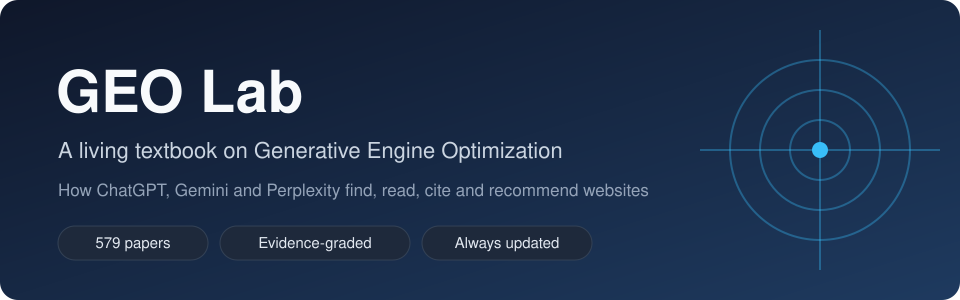

<div align="center">
  
  <h1>GEO Lab</h1>
  <p><a href="README.md">English</a> · <a href="README.zh-Hant.md">繁體中文</a> · <strong>简体中文</strong></p>
  <p><strong>一本持续更新的生成式引擎优化（GEO）教材：不断纳入新研究与原创实验。</strong></p>
  <p>AI 搜索怎么找到、读取、引用、推荐网站 · 证据分级 · 永远是新的</p>
  <p>
    
    <a href="LICENSE-CONTENT.txt"></a>
    <a href="LICENSE"></a>
    
    
    
  </p>
  <p>
    <a href="#为什么需要这本书">为什么需要这本书</a> ·
    <a href="#内容">内容</a> ·
    <a href="#阅读">阅读</a> ·
    <a href="#怎么做出来的">怎么做出来的</a> ·
    <a href="#证据怎么分级">证据分级</a> ·
    <a href="CHANGELOG.md">更新记录</a> ·
    <a href="#授权">授权</a>
  </p>
</div>

## 为什么需要这本书

ChatGPT、Gemini、Perplexity 这类 AI 搜索，现在直接回答问题，并列出几个来源。哪些网站会被列进去？为什么？市面上关于这个主题的建议，大多是个人经验或广告。这本书把**研究证明了什么**和**业内相信什么**分开，而且随着 AI 搜索的改变持续更新。

<table>
  <tr>
    <td width="33%"><strong>证据分级</strong><br /><br />整理自 579 篇研究论文与约 14 万则从业者讨论。每一个结论都标明证据强弱，从真实用户的随机实验，到单一观察。</td>
    <td width="33%"><strong>永远是新的</strong><br /><br />定期筛选新论文纳入。每次修改都有版本号与<a href="CHANGELOG.md">更新记录</a>；因为 AI 搜索变得很快，结论都标明时间。</td>
    <td width="33%"><strong>原创实验</strong><br /><br />我们自己测试 AI 搜索，跨模型、跨时间比较。结果连同方法和限制一起写进教材。</td>
  </tr>
  <tr>
    <td><strong>七道关</strong><br /><br />全书跟着一个答案走过七个阶段：AI 会不会上网查、读不读得到你、召回、挑选、引用、有没有被正确使用，以及流量会怎样。</td>
    <td><strong>两个版本</strong><br /><br />写给所有人的通俗版，以及附证据表和来源追溯的研究版。</td>
    <td><strong>三种语言</strong><br /><br />英文、繁体中文、简体中文，每次更新同步。</td>
  </tr>
</table>

## 内容

| 文件夹 | 内容 |
|---|---|
| [`book/en/`](book/en/) | 通俗版（英文） |
| [`book/zh-hant/`](book/zh-hant/) | 通俗版（繁体中文） |
| [`book/zh-hans/`](book/zh-hans/) | 通俗版（简体中文） |
| [`book/research-zh-hant/`](book/research-zh-hant/) | 研究版，含证据表（繁体中文） |
| [`website/`](website/) | 三种语言的网站 |
| [`papers/`](papers/) | 论文索引与精读笔记（不含 PDF） |
| [`framework/`](framework/) | 教材框架与数据审查方法 |
| [`scripts/`](scripts/) | 建站、转换与检查脚本 |

## 阅读

- **在 GitHub 上读：** 从 [`book/zh-hans/00_目录.md`](book/zh-hans/00_目录.md) 开始。
- **用网站读：** 用浏览器打开 `website/index.html`，或在本机启动：

```bash
python -m http.server 8765 --directory website
```

然后打开 http://localhost:8765 。Windows 上也可以直接双击 `start-website.bat`。

## 怎么做出来的

1. **研究论文：** 从 arXiv 收集生成式搜索、检索与 AI 引用相关的论文，筛选后完整阅读，每篇写成结构化笔记并评定证据等级。
2. **从业者讨论：** 约 14 万则 GEO 与 SEO 社群的帖子和留言，由多个语言模型分类，并用统计方法检验一致性；过滤软广告与重复内容，对反复出现的说法检验是否真的是共识。
3. **原创实验：** 通过 API 向 AI 搜索提问，记录它搜了什么、看到哪些网页、引用了哪些，并跨模型、跨时间比较。
4. **写作与检查：** 通俗版里的每个数字，都必须能在研究版找到；翻译版都会检查结构和数字。

## 证据怎么分级

| 等级 | 研究设计 |
|---|---|
| A | 真实用户的随机田野实验，或有对照的强准实验 |
| B | 在真实的商业 AI 搜索上重复测量 |
| C | 商业系统，但网页是人工提供的 |
| D | 可复现的检索与生成管线 |
| E | 固定内容、模拟或理论 |

从业者的报告另外标示，不会当作证明。

## 授权

- **教材内容、网站、笔记与框架文件：** [CC BY-NC-ND 4.0](LICENSE-CONTENT.txt)。可在非商业用途下原样分享，并须注明出处；不得散布改编版本（包括翻译）。
- **代码：** [MIT](LICENSE)。

## 引用方式

> ivantsai1982. *GEO Lab: A Living Textbook on Generative Engine Optimization*, version 0.6.0. https://github.com/ivantsai1982/geo-lab

引用时请注明版本号，因为内容会持续更新。
