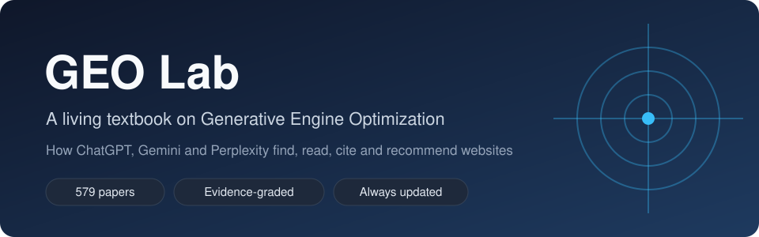

<div align="center">
  
  <h1>GEO Lab</h1>
  <p><a href="README.md">English</a> · <strong>繁體中文</strong> · <a href="README.zh-Hans.md">简体中文</a></p>
  <p><strong>一本持續更新的生成式引擎優化（GEO）教材：不斷納入新研究與原創實驗。</strong></p>
  <p>AI 搜尋怎麼找到、讀取、引用、推薦網站 · 證據分級 · 永遠是新的</p>
  <p>
    
    <a href="LICENSE-CONTENT.txt"></a>
    <a href="LICENSE"></a>
    
    
    
  </p>
  <p>
    <a href="book/zh-hant/00_先讀這一頁.md"><strong>先讀這一頁</strong></a> ·
    <a href="#為什麼需要這本書">為什麼需要這本書</a> ·
    <a href="#內容">內容</a> ·
    <a href="#閱讀">閱讀</a> ·
    <a href="#怎麼做出來的">怎麼做出來的</a> ·
    <a href="#證據怎麼分級">證據分級</a> ·
    <a href="CHANGELOG.md">更新記錄</a> ·
    <a href="#作者簡介">作者簡介</a> ·
    <a href="#授權">授權</a>
  </p>
</div>

## 為什麼需要這本書

ChatGPT、Gemini、Perplexity 這類 AI 搜尋，現在直接回答問題，並列出幾個來源。哪些網站會被列進去？為什麼？市面上關於這個主題的建議，大多是個人經驗或廣告。這本書把**研究證明了什麼**和**業內相信什麼**分開，而且隨著 AI 搜尋的改變持續更新。

<table>
  <tr>
    <td width="33%"><strong>證據分級</strong><br /><br />整理自 579 篇研究論文與約 14 萬則從業者討論。每一個結論都標明證據強弱，從真實用戶的隨機實驗，到單一觀察。</td>
    <td width="33%"><strong>永遠是新的</strong><br /><br />定期篩選新論文納入。每次修改都有版本號與<a href="CHANGELOG.md">更新記錄</a>；因為 AI 搜尋變得很快，結論都標明時間。</td>
    <td width="33%"><strong>原創實驗</strong><br /><br />我們自己測試 AI 搜尋，跨模型、跨時間比較。結果連同方法和限制一起寫進教材。</td>
  </tr>
  <tr>
    <td><strong>七道關</strong><br /><br />全書跟著一個答案走過七個階段：AI 會不會上網查、讀不讀得到你、召回、挑選、引用、有沒有被正確使用，以及流量會怎樣。</td>
    <td><strong>兩個版本</strong><br /><br />寫給所有人的通俗版，以及附證據表、每個結論都能追溯來源的研究版（英文、繁中）。</td>
    <td><strong>三種語言</strong><br /><br />英文、繁體中文、簡體中文，每次更新同步。</td>
  </tr>
</table>

## 內容

| 資料夾 | 內容 |
|---|---|
| [`book/en/`](book/en/) | 通俗版（英文） |
| [`book/zh-hant/`](book/zh-hant/) | 通俗版（繁體中文） |
| [`book/zh-hans/`](book/zh-hans/) | 通俗版（簡體中文） |
| [`book/research-en/`](book/research-en/) | 研究版，含證據表與來源追溯（英文） |
| [`book/research-zh-hant/`](book/research-zh-hant/) | 研究版，含證據表與來源追溯（繁體中文） |
| [`website/`](website/) | 三種語言的網站 |
| [`papers/`](papers/) | 論文索引與精讀筆記（不含 PDF） |
| [`framework/`](framework/) | 教材框架與數據審查方法 |
| [`scripts/`](scripts/) | 建站、轉換與檢查腳本 |

## 閱讀

- **五分鐘版：** [先讀這一頁：GEO 研究到底證明了什麼](book/zh-hant/00_先讀這一頁.md)。
- **在 GitHub 上讀：** 全書從 [`book/zh-hant/00_目錄.md`](book/zh-hant/00_目錄.md) 開始；研究版從 [`book/research-zh-hant/00_目錄.md`](book/research-zh-hant/00_目錄.md) 開始。
- **用網站讀：** 用瀏覽器打開 `website/index.html`，或在本機啟動：

```bash
python -m http.server 8765 --directory website
```

然後打開 http://localhost:8765 。Windows 上也可以直接雙擊 `start-website.bat`。

## 怎麼做出來的

1. **研究論文：** 從 arXiv 收集生成式搜尋、檢索與 AI 引用相關的論文，篩選後完整閱讀，每篇寫成結構化筆記並評定證據等級。
2. **從業者討論：** 約 14 萬則 GEO 與 SEO 社群的帖子和留言，由多個語言模型分類，並用統計方法檢驗一致性；過濾軟廣告與重複內容，對反覆出現的說法檢驗是否真的是共識。
3. **原創實驗：** 透過 API 向 AI 搜尋提問，記錄它搜了什麼、看到哪些網頁、引用了哪些，並跨模型、跨時間比較。
4. **寫作與檢查：** 通俗版裡的每個數字，都必須能在研究版找到；翻譯版都會檢查結構和數字。

## 證據怎麼分級

| 等級 | 研究設計 |
|---|---|
| A | 真實用戶的隨機田野實驗，或有對照的強準實驗 |
| B | 在真實的商業 AI 搜尋上重複測量 |
| C | 商業系統，但網頁是人工提供的 |
| D | 可複現的檢索與生成管線 |
| E | 固定內容、模擬或理論 |

從業者的報告另外標示，不會當作證明。

## 作者簡介

<table>
  <tr>
    <td width="180" valign="top"></td>
    <td valign="top">
      <strong>Ivan Tsai</strong><br /><br />
      1999 年開始接觸網路，2003 年進入網路產業。2005 年開始研究搜尋引擎優化（SEO），出版過多部 SEO 專著，也發表過研究論文。自 2007 年起一直在 SEO 一線工作，把實務與研究結合在一起。<br /><br />
      2022 年，AI 開始直接回答問題，我轉向研究生成式引擎優化（GEO），一直到今天。二十多年的 SEO 經驗，讓我最確定的一件事是：搜尋一直在變，而大部分的建議跟不上它的變化。GEO Lab 想做的，就是一本跟得上的教材：每個結論都有證據，每次修改都有版本，每次更新都公開。
    </td>
  </tr>
</table>

## 授權

- **教材內容、網站、筆記與框架文件：** [CC BY-NC-ND 4.0](LICENSE-CONTENT.txt)。可在非商業用途下原樣分享，並須註明出處；不得散布改編版本（包括翻譯）。
- **代碼：** [MIT](LICENSE)。

## 引用方式

> Ivan Tsai. *GEO Lab: A Living Textbook on Generative Engine Optimization*, version 0.9.0. https://github.com/ivantsai1982/geo-lab

引用時請註明版本號，因為內容會持續更新。
