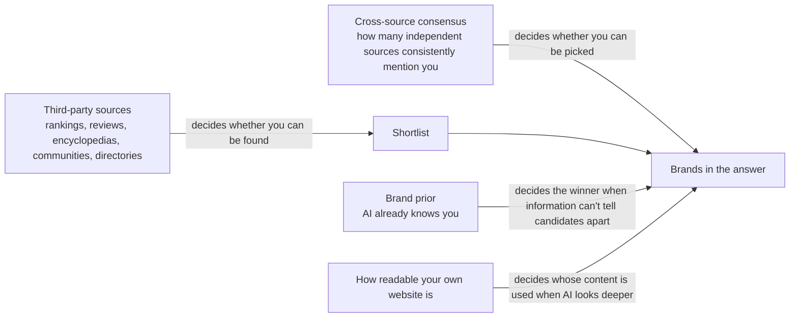

# Chapter 5 — AI Trusts What Others Say About You More

## First, imagine a scene

The following is a hypothetical situation.

An online shop owner sells specialty coffee beans. She has put real care into her website: origin stories, roasting notes, FAQs — nothing is missing. In traditional search results, her website also ranks on the first page.

One day, she opens an AI assistant and asks: "Which specialty coffee bean shops online are worth buying from?"

The AI lists five shops. Hers is not one of them.

She rephrases: "Please tell me about my coffee bean shop." This time, the AI gives a very complete answer. It even gets her signature origins right.

The AI clearly knows her. So why doesn't it mention her when it recommends?

That is what this chapter is about. Here is the answer up front:

**In the eyes of AI, what others say about you often matters more than what you say about yourself.**

---

## Five questions this chapter answers

1. When AI answers "which product in this category is good," does it cite the brand's own website, or other people's websites?
2. Why is "many sources say so" especially convincing to AI? And why is this also the biggest risk?
3. How much does a brand's fame (brand prior) actually matter? Do small brands still have a chance?
4. Which matters more: other websites mentioning you, or how readable your own website is?
5. In practice, what should you do first, and what should you not do?

Among the book's "seven gates," this chapter mainly covers Gate 3, **can it find you** (retrieval), and Gate 4, **does it pick you** (selection and ranking). It also extends to Gate 6, **does it actually use you, and use you correctly** (absorption). The core question is: the brands AI writes into its answers — from which sources, and by what signals, were they picked?

---

## 1. Most AI answers are built on other people's websites

### A librarian doesn't flip through the catalogue you printed yourself

Back to the book's very busy librarian.

You ask him: "Which one is better?" He won't go through the catalogue each company printed for itself, one by one. He will look for things like "top ten picks," "how to choose between A and B," and "user ratings," because this kind of material compares several companies at once.

AI search works the same way. When answering questions about brands, products and services, most of its citations come from **other people's websites**, not the brand's own website. This is what the book calls **word of mouth from others**, also known as third-party sources.

"Others" here covers a wide range, including:

- Media coverage and professional reviews
- Ranking articles (the "best X" kind)
- Review platforms
- Directory websites
- Encyclopedias
- Video platforms
- Community discussions
- Pages from other companies in the same industry

### Why this happens: walk through it with the AI

Suppose someone asks AI: "Which X tool is best for startups?"

1. **Breaking up the question**: AI rewrites the question into several smaller questions and searches them separately, for example "best X tools" and "X tool comparison." This is called **query fan-out**.
2. **Pulling in material**: What these smaller questions pull in most easily are rankings, comparison articles and review pages, not a single brand's product page. This step decides who gets onto the **shortlist**.
3. **Picking material**: AI prefers assessments "said by others" over a brand's promotion of itself.
4. **Writing the answer**: Whether a brand gets written into the answer depends on whether it appears on these other people's pages.

So there is a simple division of labour:

- **Your website** answers "who you are."
- **Third-party sources** answer "who to choose."

And what people ask AI before making a purchase decision is mostly the latter.

### How lopsided the numbers are

Researchers tested repeatedly on real AI search, and several teams, across different languages and different AI platforms, got results pointing the same way.

- One study covered 128 brands, 13 languages and 167,551 citations in total. Of these, 85.7% came from third-party websites, and only 14.3% from the brands' own websites.
- Another study analysed 149,912 citations. The brands' own websites made up only 2.9%; pages from other companies in the same field made up 75.2%; ranking-type pages made up 21.0% of all citations, and if you look only at content-type citations, rankings made up 35.7%.
- A study of Chinese-language AI platforms used 614 questions, asked 3 times each on 8 interfaces, and got 160,860 citations in total. Third parties made up about 69%, and brands' official websites 12.9%.
- On US car ranking questions, the share of AI citations going to third-party media was 81.9%, and the share going to community sources was 0. For the same questions in traditional search results, these two shares were 45.1% and 15.4%. In consumer electronics, the share of AI citations going to third-party media was as high as 92.1%.

Putting several studies together, brands' own websites make up only about 3% to 17% of AI citations.

> **A closer look: how to read these numbers**
>
> - Several of the studies were done by companies that sell "AI visibility" or "monitoring" services. The car study measured on a single date only; although it used many questions, the author is connected to GEO services.
> - All of these studies are **descriptive measurements**. They show "what AI cites right now"; they do not prove that "as long as you put your brand on third-party pages, you will definitely be recommended."
> - In other words, they tell you where the battlefield is. They don't guarantee you'll win just by showing up.

### Citations are highly concentrated, and "authority" differs by market

- In the first large-scale study, about 80% of citations were concentrated on about 18.2% of domains. That is, a small number of websites took most of the citations.
- Among 12 of the languages, Wikipedia was the most-cited website in 11.
- Different AI engines also cited brands' own websites at different rates: 16.8% for one engine, only 5.8% for another.
- In the Polish market, 4 HR and job-search websites were cited about 2.1 times as often as Polish-language Wikipedia. This shows that "which source counts as authoritative" varies by market.

### Change the AI or the language, and the list changes

Researchers tested repeatedly on real AI search and also found very little overlap between sources:

- Comparing the top 5 most-cited domains of AI engines and traditional search, the overlap was only 15% for smartphones and only 32% for laptops.
- In the car category, the similarity of cited domains between different AI engines was only 0.096 to 0.251. (This similarity is calculated so that 0 means completely different and 1 means completely identical.)
- Even on the same AI platform, the domains cited by the web version and the mobile app version had a similarity of only 0.19 to 0.51.
- Ask in a different language, and some engines swap out almost the entire set of cited domains.

This means two things:

1. Being cited on one AI does not mean you will be cited on other AIs.
2. Ranking well in traditional search cannot be taken as a stand-in for how you perform on AI.

Also, this share varies by field. In a study of election information (Japan, four AI systems with web access), the parties' own websites made up 24.8% to 44.3% of citations, far higher than in the brand and product field.

### An easy point to misunderstand: how big a share do "third parties" really have?

Different measurements give conflicting numbers:

- Several measurements say third parties make up 69% to 95%.
- But someone in the industry observed that, across 860 answers from a single engine, among the top 100 most-cited domains, 77.4% were **pages written by vendors themselves**, and review platforms made up only 10.2%.
- Another person in the industry tested this themselves (repeated many times, with a control group). For a fixed set of 40 buyer questions, about 80.9% of cited domains belonged to "pages from general companies and publishers." The author explained that this is really a leftover category for things that "don't belong to any other category," not a clearly defined category.

These numbers can all be true at the same time. The key is how "owned" is defined.

For **any one brand**, other vendors' pages are also third parties. In the large-scale study above, "pages from other companies in the same field" alone made up 75.2%.

So the correct understanding is: **AI often cites vendors' pages, but rarely cites "your own" pages.**

---

## 2. "Lots of people say so": one of the strongest signals, and also the biggest loophole

### The librarian counts "how many people say this"

The librarian has another habit: he especially trusts claims that "lots of people say."

AI is the same. It doesn't just look at what one source says; it also looks at **how many sources say the same thing**. When a brand is mentioned again and again across many different sources, and the descriptions agree, its chance of being written into the answer rises sharply. This is "consensus."

A simple comparison to remember:

- One source says "A is the best": limited effect.
- The same source says it three times: adds almost no effect.
- Three sources that look independent of each other all say "A is the best": the effect rises clearly.

The point is "different people saying it," not "the same person saying it many times."

### This has two sides

- **The good side**: Brands endorsed by many independent people are more likely to be recommended. This is very close to how humans judge by word of mouth.
- **The bad side**: AI often uses "the number of sources" in place of "whether these sources are truly independent." A few pages that **look** independent but actually come from the same party can also manufacture a fake consensus.

### Evidence 1: observed on real AI search

Researchers tested repeatedly on real Chinese-language AI platforms and found:

- Of the brands AI pulled in and put into its citations, only 8.3% were actually written into the answer.
- If a brand appeared in only 1 cited source, its probability of being written into the answer was 2.1%.
- If it appeared in 11 or more sources, the probability rose to 59.9%.
- The researchers used a model to predict "who gets written into the answer." In this model, the importance of the overall traditional SEO quality score was only 4.52%.

### Evidence 2: experiments

Researchers also ran experiments. **Under test conditions with given web pages** — that is, first assuming the designed content has already made it into the search results, then seeing whether AI gets led by it:

- The researchers tested 13 AI search systems that go online to look things up on their own. The average manipulation rate was 13.4%, with a low of 0% and a high of 31.4%. The differences came mainly from the AI models themselves.
- Taking one of the models as an example: with 1 source endorsing, the manipulation success rate was 39%; with 2 seemingly independent sources endorsing consistently, 55%; with 3, 77%.
- If it was **the same source appearing repeatedly**, the success rate stayed flat and did not rise.
- Where the content ranked in the search results had no clear effect.

The same study also compared the average success rates of different techniques:

| Technique | Average success rate |
|---|---|
| Hiding instructions for AI in the web page code | 0.3% |
| Page summary inconsistent with page content | 1.2% |
| Impersonating an authority | 14.2% |
| Manufacturing a fake consensus that "many parties say so" | 24.8% |
| Impersonating an authority, plus a chain of sources citing each other | 37.2% |

The pattern is clear: **the more it looks like "a multi-party claim with evidence," the more effective it is; the more it looks like "a secretly hidden instruction," the less effective it is.**

### Evidence 3: a whole "fake evidence network"

**Seen under laboratory conditions** (not necessarily in the real world yet):

- The subjects of the study were AI search systems that browse page by page on their own and follow links.
- The researchers created a set of multi-page content: consistent style, consistent claims, linked to each other, like an "evidence ecosystem." This set of content pushed the recommendation rate of a fictional product to 67.2% to 73.9%.
- With only one page of content, the recommendation rate was 35.9% to 59.0%.
- Several "single-page rewriting" techniques did not reliably do better than "a single page with no optimisation at all."

To be especially clear: **this study is, in essence, testing the manipulation technique of "forging multi-source consensus."**

### Evidence 4: telling AI to be careful doesn't necessarily help either

**Possible in theory, but not yet proven**: simulation analysis shows that several sources seemingly corroborating each other are harder to identify as fake than simply stating a conclusion directly.

The researchers also added a defensive prompt telling the AI to "please verify carefully." As a result, the AI did go and verify more often, but in the end the rate of false endorsement did not fall. Instead, it rose from 28.6% to 38.6%.

**"Went to verify" does not equal "corrected itself after verifying."**

### How reliable is the evidence

The two lines — real-world measurements and experiments — point the same way. So "consensus" is one of the most reliable mechanisms in this chapter.

But there are two points to note:

1. The experiments mostly used fictional products and controlled data.
2. What the experiments proved is that "consensus can be forged." This is a weakness that gets attacked, **not a method we recommend you use**. The "Stop doing this" section at the end of this chapter will say it again.

---

## 3. Brand prior: big brands have a built-in advantage, but they are not invincible

### What is a brand prior

When AI models are trained, they have already read huge amounts of data, so they already "know" many brands. This brand impression that exists before any searching is called the **brand prior**. You can think of it as the "old impressions" in the librarian's head.

The brand prior has three characteristics:

1. **Knowing is not recommending.** Ask AI about a brand directly by name, and it almost always recognises it; but ask it to "recommend products in this category," and it often doesn't think of that brand.
2. **The prior is conditional.** When there is no information to tell several candidate products apart, the well-known brand almost always wins. Once real, distinguishing information appears — such as ratings, number of reviews, price — the prior can be broken.
3. **The weaker the prior, the more easily AI is swayed by the content in front of it.** For small brands, this is an opportunity: as long as someone writes about you, you have a chance of being used. It is also a risk: if someone writes about you wrongly, AI may take it all at face value.

### The starting lines really are different

Researchers tested repeatedly on real AI search. In category questions that don't mention a brand name, on the first ask, the rates at which brands were mentioned fell into three tiers:

- Big brands: 72.9%
- Mid-sized brands: 43.6%
- Small brands: 11.4%

This data comes from a service provider, and "big, mid-sized, small" were divided manually.

### It knows you, but doesn't recommend you

Researchers tested new products repeatedly on real AI search and found:

- When asked directly about a new product by name, AI recognised it 99.4% of the time (94.3% on another engine).
- But when "recommending products in this category," it was mentioned only 3.32% of the time (8.29% on the other engine).
- The researchers also gave these websites an "overall GEO score." This score turned out to have no relationship with visibility on AI.
- In the same study, visibility was positively correlated with two things: how many different websites link to you, and how many times you are mentioned in community discussions. However, this is only correlation, not causation, and the sample was only 60.

Another measurement on real AI search saw a similar phenomenon: creators who were already well known on external platforms also got more exposure in AI citations. Among the top-ranked creators, each place higher in the ranking gave an exposure advantage of roughly 4.3 to 4.8 more percentage points. This, too, is only correlation.

> **A closer look: what "correlation coefficient" means**
>
> Studies often use a number called the "correlation coefficient," ranging from −1 to +1. The closer to +1, the more often two things go up together; the closer to −1, the more often one goes down when the other goes up; close to 0 means the two have almost no relationship.
>
> - A website's overall GEO score and visibility: −0.108 and −0.102, almost no relationship.
> - Number of websites linking to you and visibility: +0.319, some positive correlation.
> - Number of community-discussion mentions and visibility: +0.395, some positive correlation.
>
> Correlation is not causation. These numbers only show that things "often appear together"; they don't show that "doing one thing causes the other."

### Can the prior be broken?

Both of the following results are **possible in theory, but not yet proven**. They were obtained under simulated conditions with fixed content: the researchers first decided what material the AI would read, then looked at how it recommended.

**First result: distinguishing information matters more than brand fame.**

- When several products had exactly the same specifications, the well-known brand was recommended 100% of the time.
- But a competitor only needed a rating 0.075 stars higher, or 1.6 times as many reviews, or a price 7.3% lower, to have a 50% chance of winning.
- Of the variation in recommendation results, the product's own parameters could explain 82.4%, while brand accounted for only 1.2%.

**Second result: ask a different way, and overlooked brands wake up.**

- Under conditions where the AI doesn't go online and relies only on its own memory, many well-known brands had a recommendation rate of zero.
- After changing the question to one that describes a need, one brand's recommendation rate rose from 0% to 35.4%.
- Adding cues that explain positioning could take it to 81.3%.

### The thinner the prior, the easier to mislead

**Seen under laboratory conditions** (not necessarily in the real world yet):

- The weaker an AI model's prior about a brand, the more easily it is misled by false pages placed in its material. The cross-model correlation coefficient was −0.65, a fairly clear inverse relationship.
- The average rate at which 12 models were fooled was 42.7%, with a low of 13.3% and a high of 73.8%.
- With only one polluted page, putting it in position 1 gave the highest fooled rate, reaching 27%; in positions 2 to 10, only 1% to 4%.

### A counterexample: when everyone does it, the benefit disappears

**Possible in theory, but not yet proven** (again, a fixed-content simulation):

- When only one challenger adopted GEO, the rate at which the originally leading brand "kept being recommended" dropped from 100% to 19.8%.
- But once all competitors adopted GEO, the originally leading brand rose back to 93.8%.
- The benefit each adopter got fell from +0.802 to +0.007.

This means **the benefit of GEO may shrink towards zero as more people adopt it**. It is a "if you get a bit more, someone else gets a bit less" kind of competition. However, this is a simulation result and cannot be taken directly as a conclusion about real markets.

### How reliable is the evidence

- "Big brands are more likely to be recommended": supported by measurements on real AI search.
- "The prior can be broken by distinguishing information": currently comes mainly from fixed-content simulation experiments. We can only say it is **possible in terms of mechanism**; there is no real-world intervention evidence yet.
- "The prior only matters when the information can't tell options apart": this needs correcting. A large-scale study (158,000 answers, correlational) found that brands AI remembers were written into its own search terms 67% of the time, versus only 11% for brands it doesn't remember; at the same rank position, websites it remembers had 1.6 times the odds of being cited; and 46% of ChatGPT's brand mentions were not supported by any cited page, which amounts to naming from memory. In other words, the prior is at work in three places: "what to search, whom to pick, whom to name".

### Where the prior comes from: being written about a lot, and being written about alongside the right things

Think about how people come to know, understand and trust someone: mostly through what others say about them. Hear a name from many people and you remember it; when everyone describes them the same way, you know what they do; when several people who don't know each other all say they're reliable, you start to trust them.

AI is quite similar. What it learns is text on the web: which names appear often, which words they appear with, and in what tone. So **AI's impression of you comes from how others write about you, not necessarily from what you are actually like.**

While writing this book we ran another experiment: we had AI play real people based on about 270 labels each, and answer a social survey as them. The stereotypes were very obvious; for example, AI generally assumed that a retired Black car mechanic was unhappy. (This is a single observation; the raw data is not included in this book, and it has not yet been compared with these people's own answers.)

But AI's "what others say" differs from a person's:

- **It can only count voices that are written down and readable.**
- **It has trouble telling whether those voices are independent of one another.** A whole set of pages that look independent but come from the same source can change its answer (see the "fake evidence network" in Section 2).

Breaking it down further, being "written about a lot" and being "thought of" are two different things:

- **Written about a lot → it recognizes you.** In our memory test, AI knew a well-known platform well, even remembering its old name from years ago; for a new website only a few months old, its answer was the same as for a made-up web address (see Case 9).
- **Written about alongside the right things → it thinks of you.** As mentioned earlier: when asked directly about a new product, AI recognized it 99.4% of the time; but when asked to "recommend a product of this type", only 3.32% of the time did it think of it. Recognizing a name does not mean thinking of you when someone describes a need.
- What AI remembers is often "where to look for which kind of information". In our test, when AI used `site:` to name the national swimming federation's official site, it was searching for the time-standards document of a particular age group; websites AI named on its own had a clearly higher chance of being cited in the same answer (see Chapters 4 and 6). So what you need to build is not just fame, but **your name** appearing again and again together with **a particular kind of question or data**, in trustworthy places.

This also leads to two timelines:

- **Now: through search.** It doesn't matter if AI doesn't know you; as long as your page matches the queries it rewrites, you can still be cited a lot (Chapter 3, Case 8: a new website AI didn't know was cited in 9 of 10 runs).
- **Later: through memory.** Getting into the memory of the next generation of AI takes at least one round of training; being crawled is not the same as being remembered (Case 9: GPTBot crawled about 92.5% of the pages, and AI still didn't know the website).

One more thing to watch out for: trust built on "how often you appear" favours old, established websites that are already written about a lot, and it can also be inflated artificially. The thinner the prior, the easier it is to be misled by a single wrong page (correlation −0.65, see "The thinner the prior, the easier to mislead" earlier in this section). So **more important than "more" is whether the sources are trustworthy and independent of one another.**

> **How strong is the evidence:** The strength of each fact is noted where it appears. Linking them into "impressions come from text, frequency decides recognition, appearing together decides being thought of" is this book's inference, and has not yet been tested directly.

---

## 4. How the forces combine

Putting the above together, it can be drawn like this:

In words:

- **Third-party sources** decide whether you can get onto the shortlist.
- **Cross-source consensus** decides whether you can be picked.
- **The brand prior** decides the winner when everyone's information is about the same.
- **How readable your own website is** decides, when AI looks deeper, whose content the answer uses.

### Controversy: does being mentioned by others have an independent effect?

This question has not been settled yet. Here is what each side says.

**The side that says it has an effect:**

- Measurements on Chinese-language AI platforms show that the number of sources a brand appears in at the same time is a strong predictor of whether it will be written into the answer.
- The new-product study shows that the number of websites linking to you and the number of times communities mention you are both positively correlated with visibility.

**The side that says it has no independent effect once other factors are removed:**

Researchers tested repeatedly on real AI search, comparing 1,056 companies and 37,927 query sessions of "AI that goes online to look things up on its own." They paired companies with similar conditions and compared them.

- After removing the effect of "how readable the website is for AI," two indicators representing "others mentioning you" and "being easy to discover" had no clear additional relationship with either of two things: whether the answer was based on your own content, and whether you were explicitly recommended.
- In the group with readable websites, 78% of answer content came from the companies' own pages; the control group was 58%.
- In the group with readable websites, the rate of being explicitly recommended was 20%; the control group was 11%.

**A possible explanation: the two work at different stages.**

- Others mentioning you decides whether you **surface** on the shortlist.
- How readable your website is decides, when AI looks deeper, **whose content** the answer is written from.

The latter study only looked at situations where "AI has already entered your website and is looking deeper"; it used the research team's own scoring tool; and it was a paired observation, not an experiment. So the two claims don't necessarily contradict each other. But so far, no study has tested both stages within the same design.

Someone in the industry tested this themselves and proposed a similar "two-stage" view: distribute your content so the brand enters the range AI will search; the quality of the page itself decides whether you get chosen. Among brands with about the same distribution reach, brands with more clearly structured content were cited more. This is a single observation; no one has independently verified it.

---

## 5. Other questions still being argued over

### How important are community discussions and review directories?

The conclusions people in the industry reached from their own tests differ enormously:

- Some found that, on "buying advice" questions, community content was the most-cited domain.
- Others analysed about 16,400 commercial questions and 127,198 citations, and found community discussions made up only 1.8%, Wikipedia less than 0.6%, and 90.6% went to vendors' documentation, product pages and various niche category websites.
- Another person in the industry tested this themselves (repeated many times, with a control group). On a fixed set of 40 buyer questions, the share of community sources differed by AI engine: about 7% to 9% on some engines, close to 0% on others.

Review directory websites are also disputed. One person in the industry first reported that "alternatives to X" questions cited directory websites more often than "best X" questions (43.0% vs. 3.8%). Later he corrected himself: this gap only appeared in traditional search results; in AI answers, the two shares were the same within the margin of error.

**Conclusion: there is no universal "most important platform."** The mix of sources changes with the AI engine, the industry, the purpose of the question and the language market. The role of community platforms as AI citation sources is discussed specifically in Chapter 15.

When writing this book, we tested ChatGPT ourselves through the API (method in Chapter 4; the sample is very small and no one else has independently verified it): community discussion sites appeared in the search results in 24 of the 30 conversations for the three types, and in all 10 for the swimming question, but were cited 0 times; encyclopedia and video sites also appeared many times and were likewise cited 0 times. Note: "appearing in the search results" does not mean AI read the full text, and this is only the result of one model through the API.

### Does domain authority still matter?

"Domain authority" refers to a website's overall weight, such as how long it has existed and how many other websites link to it.

- Someone in the industry tested this themselves: across more than 18,000 cited pages, domain-level authority accounted for about 77% of "the predictable part," and page-level factors for about 23%. Moreover, page optimisation only worked on high-authority domains.
- Another person in the industry tested this themselves (repeated many times, with a control group) and found that, on one AI engine, domain authority had little effect on citations; instead, content published simultaneously on multiple platforms within 7 days was cited clearly more. However, the sample was only 14 articles, and the author also pointed out that the sample was small and the tracking results were noisy.
- Yet another person in the industry observed that other websites linking to you helps only a little with "your own pages being chosen directly." But the third-party publishers AI picks are themselves heavily linked editorial websites. So links may be working **indirectly**.

These three claims measure different things, and for now it is impossible to judge who is right.

### Are the sources AI cites fixed, or constantly changing?

- Someone in the industry tested this themselves: of about 180 cited URLs across 40 questions over three weeks, about 70% were the same set of third-party pages appearing again and again; newly published owned pages hardly appeared at all.
- Another person in the industry tested this themselves: 40% to 60% of cited sources change every month.
- Yet another person in the industry observed that an analytics tool's citation count in category questions fell from 8 to 3 within a month, while a competitor that relied mainly on coverage from review websites rose to 13.

Both phenomena may exist at the same time: **the few pages at the top are relatively stable, while the long tail behind them rotates quickly.** This is also why looking at results only once is unreliable. It is like **rolling dice**: ask the same question ten times and the answers may differ, so you need to look at "how many times out of ten you appear."

---

## 6. Real cases

The following cases are all results that people in the industry tested or observed themselves. Unless otherwise noted, no one has independently verified them. They are used to help understand the principles, not as proof.

### Case 1: third in traditional search, almost nonexistent in AI

- **Background**: An enterprise software company that makes warehouse management software, whose customers are companies that handle logistics for others. It ranked third on Google for its core keyword.
- **Observation**: Someone in the industry tested this themselves (repeated many times, with a control group). Starting in January, they recorded 40 "recommendation-type" questions every month. ChatGPT named this company in only 2 to 4 of the questions. A competitor that ranked only on the second page of search results, with fewer links, was named about 18 times.
- **What the competitor had**: two ranking articles on logistics blogs, a category page on a software review website, and a 2023 community discussion in which a logistics operator praised it.
- **This company's weakness**: it had three different company descriptions across company databases, a professional social network and review websites.
- **What was done**: they unified the descriptions on third-party websites, and at the same time published one comparison page per day. By August, about 9 of the 40 questions named it. Because the two things happened at the same time, it is impossible to tell which one made the difference.
- **Other observations from the same author**:
  - Citations could mainly be traced back to review websites, rankings written by others, and one old community discussion.
  - A trade association's member directory was cited by one AI engine.
  - 200 posts on a professional social network in a year: zero citations.
  - Spending US$6,000 to upgrade to a paid profile on a review website: no change at all.
- **The principle it matches**: AI's recommendations are decided by third-party sources; only consistent descriptions can form a consensus.

### Case 2: a product whose identity AI got wrong

- **What was done**: Someone in the industry tested this themselves. For a "CSV file import tool," they tested 8 buyer-style questions on ChatGPT, Claude, Gemini and Perplexity.
- **Observation**: it appeared only 1 time in 8 conversations, and was described as an "ETL tool" (a kind of data transfer and transformation tool), which it actually isn't. Two models turned to introducing competitors instead, with wording clearly taken from the competitors' own marketing copy. This product actually did well in traditional search, with links and ranking pages.
- **The author's judgement**: the recommended tools all had "one clear, repeated positioning sentence" in third-party content. The ones not recommended had vague or inconsistent descriptions.
- **What was done, and how long it took**: within 10 days, they published 2 comparison articles and updated the product documentation. The result went from appearing 1 time in 8 to 5 times in 8.
- **The principle it matches**: consistent descriptions form consensus; when the prior is weak, AI adopts whatever descriptions it can find at hand, even including a competitor's claims.

### Case 3: two weeks of on-site optimisation did nothing; one third-party roundup article changed the picture

- **What was done**: Someone in the industry tested this themselves. They did full on-site optimisation on 12 client pages, including structured data, heading hierarchy, making the "entity" clearer, and internal links. Then they tracked the same 15 questions on ChatGPT, Perplexity and Gemini, logging out of the account before each ask.
- **Observation**: after two weeks, nothing had changed at all. In the third week, a roundup article comparing this client side by side with 4 competitors was published. Within a few days, two pages that had previously been invisible started being cited.
- **The author's caveat**: the sample is very small, and the effects of the two things cannot be separated. His conclusion: "On-site optimisation is necessary, but not enough."
- **The principle it matches**: third-party sources decide the shortlist; this also echoes the "two stages" explanation above.

### Case 4: squeezing into rankings AI is already citing

- Someone in the industry tested this themselves: for a consumer brand's sleep-aid product, they first listed all the websites AI cited for the target question, then contacted these websites and asked them to add the client to existing articles; where that didn't work, they wrote guest articles instead. After getting into 5 rankings and 2 product roundups, within a week, ChatGPT listed the client in 2nd place for this question.
- Another person in the industry tested this themselves: a newly launched energy drink brand found that Google's AI Overviews repeatedly cited 3 to 4 "best drinks of this kind" review blogs. After getting included by these blogs, within a few days it appeared in AI Overviews alongside the big brands.
- **Note**: both authors are practitioners who specialise in earning external links and doing outreach for others; the results are self-reported.
- **The principle it matches**: squeezing into **pages AI is already reading** is more direct than writing a new page yourself and waiting for AI to discover it.

### Case 5: knowing you doesn't mean recommending you

- Someone in the industry tested this themselves: with three "help me find an executive coach" questions on two AI engines, 6 sets of results in total. The coach with the highest industry profile, with millions of followers, appeared only 1 time. But when AI was asked directly "please tell me about this coach," both engines gave detailed and correct answers. AI knew him; it just didn't mention him when recommending.
- Another person in the industry tested this themselves (repeated many times, with a control group): of 20 Indian startups that had closed Series A or later funding within the last 18 months, 17 did not appear at all in category questions that didn't mention a brand name. But when asked directly "what is X," AI mostly answered correctly. The 3 that did appear all had real community discussions, structured comparison pages, and review markup.
- Yet another person in the industry tested this themselves (repeated many times, with a control group): 82 questions with purchase intent, asked 3 times each on 4 AI engines. Funded startups were cited 6% to 13% of the time; big companies already in the market were cited 32% to 62%. The only startup category above double digits was "vector databases," at 34%. The author speculates that this is because such products have been widely discussed on technical blogs for years. In addition, syndication through press release distribution platforms didn't help, and on one of the engines even had a slightly negative effect.
- **The principle it matches**: knowing is not recommending; the prior comes from third-party discussion accumulated over a long time.

### Case 6: in some industries, the aggregator platform is the ranking itself

- Someone in the industry tested this themselves: they put 510 questions to Google's AI Mode, about hotels in 30 destinations in Turkey. Of the 481 answers received, 98% cited at least one booking platform; the largest single booking platform appeared in 74% of answers. Hotels' own websites were almost never cited directly.
- Someone in the industry tested this themselves: across more than 10,000 ChatGPT shopping questions, retail websites made up 89% to 99% of all citations. In another set of 8,520 women's clothing questions, retail platforms were cited more often than most brands' official websites.
- Someone in the industry tested this themselves: when ChatGPT recommended mobile apps, nearly half (47.5%) of citations came from crawlable web versions of app store listings. The author themselves cautioned that these shares vary a lot and are only a snapshot of one moment.
- **The principle it matches**: in industries dominated by aggregator platforms, **the quality of your listing on the platform is the main battlefield of GEO**.

### Case 7: brand image rewritten by others

- Someone in the industry tested this themselves: for six consecutive weeks, they tested three competing brands every week with the same category questions. The descriptions of two of the brands changed noticeably: one, originally called an "analytics tool," was later called a different kind of platform; the other gained a criticism of "limited integration capabilities." Neither change came from content these companies published themselves; they were traced back, respectively, to a direct comparison discussion in a niche community and to a few forum comments with lots of engagement.
- Someone in the industry observed: after a company's Wikipedia entry was "soft-deleted," AI and search engines became inconsistent in recognising the brand, even linking other things to the brand name. The company strengthened its own website, its structured data and its mentions elsewhere, but still couldn't make up for it.
- **The principle it matches**: when the prior is weak, what others say directly becomes what AI says.

### Case 8: the brand that gets recommended and the website that gets cited are two different things

- Someone in the industry tested this themselves: over 12 days, they analysed 180 running shoe recommendations from three AI engines, with 1,783 citations and 250 domains in total. The most-recommended brand's official website was cited only 2 times. One of the engines cited brand official websites 0 times across all 180 answers. The main sources were video platforms, review websites, fashion media and communities.
- Someone in the industry tested this themselves: in Romania, in the local language, they put 18 book-buying questions to 5 AI interfaces, running one round a week apart each time, for 180 answers in total.
  - 58% of answers did not recommend any bookshop.
  - The market leader appeared in only about one fifth of the answers.
  - The rankings were rewritten every week.
  - "Ghost brands" also appeared: some websites were used by AI as the source for prices and book lists, yet the answer recommended someone else.
  - Conversely, a cultural brand with 35 years of history was recommended 13 times, but its website was not cited even once. It was recommended entirely from AI's memory.
- Someone in the industry observed: on a single engine, among answers that named a certain company, only 47% also cited that company's website.
- **The principle it matches**: "being cited" (the answer attaches your link) and "being mentioned" (the answer writes your name) are two different metrics and must be measured separately.

### Case 9: AI doesn't know a new website, but remembers an old platform's name from years ago

- **What was done:** When writing this book, we tested ChatGPT ourselves through the API (method in Chapter 4; the sample is very small and no one else has independently verified it). This time web search was turned off, AI was asked to "say you don't know if you're not sure", and each question was asked 5 times.
- **What was seen:** For the new website in Chapter 3, Case 8, AI said 5 times out of 5 that it was not familiar with it, the same answer it gave for a made-up web address; asked about the site's own tier names and web address structure, it said 5 times that it did not know; asked to list from memory "websites that provide recruiting time standards", it left the site out all 5 times. For a well-known swimming data platform, AI described it concretely all 5 times, and all 5 times mentioned its old name from years ago. In other words, memory goes out of date.
- **Memory doesn't necessarily come from the website itself:** This well-known platform blocks GPTBot, and AI still knows it well. The memory may come from other people mentioning it, or from old data from before the block (this is a guess). What AI remembers is "which website has which kind of data": when it used `site:` to name the national swimming federation's official site, it searched for the time-standards document of a particular age group.
- **Being crawled is not the same as being remembered:** According to the new website's own server logs (analysed by the site itself, not independently verified), GPTBot crawled about 92.5% of its pages between July and 20 August 2026, yet AI at the time of the test still did not know it. Between being crawled and being remembered, there is at least the next round of training.
- **Limits:** Only one model and one topic, with no independent verification.
- **The principle it matches:** The brand prior (Section 3). Until the next generation of AI arrives, a new website can only be found through search, which is exactly what happened in Chapter 3, Case 8.

---

## Key points of this chapter

1. On brand and product questions, most of what AI cites is third-party sources; brands' own websites make up only about 3% to 17% across different studies. This is a consistent conclusion from several large-scale measurements, but it is descriptive evidence.
2. "Several seemingly independent sources all saying the same thing" is one of the strongest signals influencing what AI picks. The same source repeating itself is almost useless.
3. This consensus mechanism can be forged, and is currently the biggest weakness under attack. People doing GEO should seek truly independent sources, not manufacture fake consensus.
4. The brand prior sets the starting line: the visibility of big, mid-sized and small brands in category questions is about 73%, 44% and 11%. But "knowing" is not "recommending"; the prior is mainly decisive when information can't tell candidates apart.
5. The weaker the prior, the more easily AI adopts third-party descriptions, including competitors' claims and wrong claims. So small brands must actively manage how they are described on other people's websites.
6. Others mentioning you and how readable your own website is work at different stages: the former decides whether you can surface, the latter decides whose content AI uses when looking deeper. The relationship between the two is still disputed.
7. Authoritative sources differ by AI engine, industry and language market; there is no universal "most important platform." First map the sources for your own category, then decide where to go.
8. Measurement should separate different AI engines, ask each question many times, record "cited" and "recommended" separately, and keep a control group.

---

## Remember in one sentence

**Your website tells AI "who you are"; third-party sources tell AI "who to choose" — and it takes many truly independent people saying so consistently.**

---

## What you can do tomorrow

### 1. First, map your sources

- List 30 to 50 questions real buyers would ask, such as "best product in category X," "A vs. B comparison" and "alternatives to X."
- Ask them repeatedly on several AI engines, record every cited URL, then sort them by website.
- Someone in the industry tested this themselves: in one check of 200 questions, 60% of citations were concentrated on 7 websites, and most of them were not on their original PR target list.
- Evidence strength: "third parties make up the majority" and "citations are highly concentrated" have been tested repeatedly by researchers on real AI search; the specific workflow comes from industry practitioners' own tests.

### 2. Find the gaps and turn them into an outreach list

- Find the pages where "competitors are cited but you are absent." That is your outreach list.
- Prioritise getting included in rankings, comparison articles and review pages **that AI is already citing**, rather than writing a new article of your own and waiting to be discovered.
- Evidence strength: industry practitioners tested this themselves; several mutually independent cases point the same way, but none have been independently verified.

### 3. Unify how you are described everywhere

- On your website's "About us" page, company databases, review websites, professional social networks and directory websites, use the same sentence to state clearly: "what you are, and who you serve."
- Make your positioning specific to a particular industry or use case.
- Evidence strength: the effect of consensus is supported by measurements both under test conditions with given web pages and on real AI search; the effect of consistent descriptions themselves was tested by industry practitioners themselves (repeated many times, with a control group).

### 4. Seek several truly independent sources

- Different publishers, different authors, different types of platforms.
- The same source repeating itself adds almost nothing.
- Evidence strength: seen under test conditions with given web pages — the same source appearing repeatedly does not increase the effect.

### 5. Provide real information that sets you apart

- Ratings, number of reviews, price, specific specifications, data on actual results.
- If your information looks about the same as everyone else's, the big brand's prior will win.
- Evidence strength: possible in theory, but not yet proven (simulation analysis).

### 6. Find the real "local authorities" for your industry

- In industries dominated by aggregator platforms, such as hotels, retail and mobile apps: how complete your listing on the platform is, is the main battlefield.
- In niche industries: the key sources may be trade publications and association member directories.
- Different language markets have different most-important sources.
- Evidence strength: differences between markets have been tested repeatedly by researchers on real AI search; differences between industries come from industry practitioners' own tests.

### 7. Get others to write about you together with "specific needs"

- Get third-party content to write about you together with "a specific problem + a specific use," not just mention your brand name in passing.
- Evidence strength: possible in theory, but not yet proven (simulation analysis shows that questions describing a need can wake up brands that were previously missed).

### 8. Your own website still needs to be readable to AI

- Others mentioning you makes you surface; a readable website means that when AI looks deeper, it uses your own content rather than descriptions from competitors or third parties.
- Evidence strength: tested repeatedly by researchers on real AI search (a study by a service provider, paired observation).

### 9. Separate different AI engines, and ask each question many times

- To see "whether you are mentioned," run each question at least 3 times for relatively stable results.
- To see "whether AI is positive or negative about you," you need at least 10 questions for relatively stable results.
- Some studies also repeat each question 40 times.
- Record "cited" and "recommended" separately.
- Evidence strength: tested repeatedly by researchers on real AI search, and also supported by simulation analysis.

### 10. Keep a set of control questions

- Keep some questions unchanged, but track them all the same.
- If the control group changes together with the group you modified, it's the AI engine that changed, not your work that made a difference.
- Evidence strength: a method recommendation observed by industry practitioners.

### How long until you see results?

There is no reliable universal number; cases vary greatly:

- In industry practitioners' own tests, there are examples of "within a few days," "within a week" and "10 days." These mostly happened on AI engines that search the web in real time, or where the brand squeezed into pages AI was already citing.
- Other industry practitioners observed that it took 6 weeks, 60 to 90 days, about 3 months, or even 5 months before results appeared consistently.
- Several industry practitioners observed that engines that search the web in real time reflect new sources earlier than engines that rely on training data (one estimate is 3 to 4 weeks earlier). **If you only test on one slow-reacting engine, it's easy to wrongly conclude that nothing worked.**

---

## Stop doing this

### Things not to do

1. **Faking "lots of people say so."** For example, setting up several seemingly independent websites yourself, coordinated posting, or flooding reviews. Experiments show this really can manipulate AI that goes online to look things up on its own, but it is a manipulation technique. And defences have already appeared: under laboratory conditions, if sources are reordered by publisher type (editorial content first, then commercial content, and user-generated content last), the fooled rate can be reduced by 8.4 percentage points without affecting normal recommendations.
2. **Hiding instructions for AI in your web pages.** Under test conditions with given web pages, hidden instructions had an average success rate of only 0.3% — almost useless.
3. **Using sales tactics like creating scarcity, setting price anchors, or stressing "you'll lose out if you don't buy."** Theoretical simulation analysis shows this kind of writing makes a brand win only 9.6% to 12.9% of the time.
4. **Treating syndication from press release distribution platforms as media coverage.** Someone in the industry tested this themselves: in news-type questions, press releases made up only 4% of citations, and original reporting 73%; reposts by syndication platforms didn't help startups. However, someone in the industry also observed that press releases written like a proper article are occasionally cited; this is a rare exception.
5. **Writing a "best products in category X" ranking on your own website, ranking yourself first, and hoping AI believes it.** Someone in the industry tested this themselves: several clients who published lots of these self-made rankings saw their mention rate across 50 questions drop suddenly. The author suspects that self-promotion on one's own website was given less weight, but this has not been verified. Besides, AI overall already prefers assessments "said by others."
6. **Expecting that paying to upgrade a profile on a platform, or posting in large volumes, will directly bring citations.** Someone in the industry tested this themselves; neither had any effect (see Case 1). This is only a single case; treat it as a reminder.

### Outdated practices

1. **Using your Google ranking to represent your visibility on AI.** Several cases show that brands ranking near the top in search were completely absent from AI answers; the overlap between sources cited by AI engines and traditional search is also very low.
2. **Optimising only your own website.** Your website is still necessary, especially when people search directly for your brand name, and when AI looks deeper into your website. But on "who to choose" questions, your website often isn't among the sources AI searches at all.
3. **Visibility reports that look at results only once.** Sources and recommendations change every week. Looking only once makes you think the results are more precise than they really are.

---

## What is still uncertain

1. **Does being mentioned by others have an independent effect?** One side's measurements say yes; the other side's study says no, once "how readable the website is" is removed. A possible explanation is that the two work at different stages, but no study has yet tested both within the same design.
2. **How big a share do "third parties" really have?** Figures range from 69% to 95%, and there are also measurements showing vendor pages make up the majority. The difference comes mainly from how "owned" is defined. What is certain: AI rarely cites "your own" pages.
3. **How important are community discussions and review directories?** Different industry tests range from "the most cited" to "only 1.8%," and it varies by AI engine. There is no universal "most important platform."
4. **Does domain authority still matter?** Some say it accounts for 77% of the predictable part; some say it has little effect on one engine; others say links may work indirectly. The three claims measure different things, and for now it's impossible to judge.
5. **Are the sources AI cites stable, or constantly changing?** Some tests say about 70% appear repeatedly; others say 40% to 60% are swapped out every month. It may be that the few at the top are stable while the long tail rotates.
6. **Can the brand prior really be broken?** Current evidence comes mainly from fixed-content simulation experiments. It is possible in terms of mechanism, but there is no real-world intervention evidence yet.
7. **Once everyone does GEO, is there still any benefit?** Simulations show the benefit may shrink towards zero, but this cannot be taken directly as a conclusion about real markets.
8. **How strong is the consensus effect in the real world?** Experiments mostly used fictional products and controlled data; the size of the effect in the real world is still uncertain.
9. **How long until it works?** Anywhere from a few days to 5 months; there is no reliable universal number.
10. **How do you get remembered by the next generation of AI?** For now there is only a mechanism-based inference, "build up over the long term, through other people mentioning you", with no direct evidence. In our test, a new website that AI crawlers had crawled more than 90% of was still unknown to AI.
