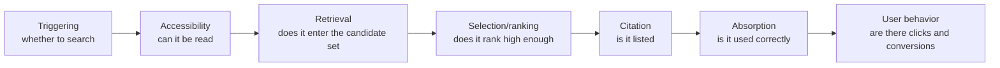

# Chapter 1: How AI Search Systems Work (the Full Picture)

> This chapter is the map for the whole book. Each later chapter zooms in on just one part of this map.

## Questions this chapter answers

1. When AI answers a question, where does its knowledge come from? When does it rely on what it "remembers", and when on what it "finds by searching on the spot"?
2. Between the user asking a question and the user seeing the answer, what stages does the process go through? What does each stage value?
3. Why can an optimisation that helps at one stage end up with a negative overall effect?
4. What is the relationship between GEO and SEO? Where is the saying "doing SEO well is the same as doing GEO well" right, and where is it wrong?
5. Which part of the pipeline does each later chapter of this book deal with?

## 1. Core principles

### 1.1 Two sources of knowledge: parametric knowledge and retrieved knowledge

When AI answers a question, it can use two kinds of knowledge:

| Knowledge source | What it is | How you can influence it |
|---|---|---|
| **Parametric knowledge** | What the model memorised during training | Only indirectly, through content that exists widely on the web over a long period; the cycle is long |
| **Retrieved knowledge** | What the model reads after searching and opening web pages at the moment of answering | By making content get found, get selected and get understood |

The proportion between the two is not fixed. It depends on two things:

- **Whether it is connected to the web.** In the mode where an agent answers with web access, repeated tests on real AI search engines found that only about 7–10% of the final answer content comes from training knowledge; the rest is built on content read on the spot.
- **How popular the subject of the question is.** Popular and obscure entities work by different mechanisms:
  - Popular entities (brands and products everyone knows): the answer relies mainly on parametric knowledge, and retrieval is used only to "confirm an existing impression". In an experiment, shuffling the order of retrieved snippets moved the rankings in the answer by only 2.30 places on average.
  - Obscure entities (small brands, new products, long-tail topics): the answer has to be "built" from retrieved content; after the same shuffling, rankings moved by 4.15 places on average.
  - These results come from a perturbation experiment on a single model. They are mechanism evidence under controlled conditions: the direction is credible, but the specific figures should not be extrapolated.

What this means in practice: the more obscure the brand or topic, the more it depends on the retrieval pipeline, and the more room GEO has to make a difference; the more popular the entity, the harder it is to shift the model's existing impression with a single content change.

### 1.2 The map of the book: a random, multi-stage filtering pipeline

AI search is not a ranking table but a **random, multi-stage filtering pipeline**. For your content to reach the user and create value, it must pass seven gates in turn:



| Stage | What this gate asks | What failure looks like | See |
|---|---|---|---|
| **Triggering** | Will AI search for this question, or answer directly from memory? | No retrieval at all; only parametric knowledge remains | Chapter 2 |
| **Accessibility** | Can AI crawlers or agents fetch, open and understand your page? | Blocked, or content rendered by JS cannot be read, so AI uses other people's content instead | Chapter 3 |
| **Retrieval** | After query rewriting, semantic matching and language and market filtering, can your page enter the candidate set? | You are not in the candidate set at all | Chapters 4 and 5 |
| **Selection/ranking** (selection / ranking) | Where do you rank within the candidate set? Are you cut off? | Ranked below the cut-off line, so the generator cannot see you | Chapter 6 |
| **Citation** | Does the answer list you as a source? | Your content is used but not credited to you, or only others are listed | Chapter 7 |
| **Absorption** | Does the answer actually use your content, and use it correctly? | Listed but not used, or distorted | Chapter 7 |
| **User behavior** | After seeing it, will users click, trust, buy? | Cited, but no traffic or conversions | Chapter 10 |

Topics that span several stages are handled in separate chapters:

| Topic | Chapter |
|---|---|
| How to read GEO evidence | Chapter 0 |
| The source ecosystem: third parties, consensus and brand priors | Chapter 5 |
| Content-level practices: what works, what fails, what goes out of date | Chapter 8 |
| Measurement: visibility is a distribution, not a ranking | Chapter 9 |
| Competition, manipulation and defence | Chapter 11 |
| Platform differences and the Chinese-language ecosystem | Chapter 12 |
| Case types: brand and product recommendations, content websites, community platforms | Chapters 13–15 |

**The word "random" matters.** Ask the same question twice and the answer, the cited sources and the order of recommendations may all differ. So a "rank" in GEO is not a fixed value but a probability of appearing. This shapes every measurement method that follows (Chapter 9).

### 1.3 Each stage values different things

In controlled experimental systems (a reproducible pipeline made up of keyword retrieval, a reranking model and a generation model, using a corpus of real web pages), researchers found that the three main stages reward different document features:

| Stage | What it values |
|---|---|
| Retrieval | Keywords and structural fields (title, meta description, headings at each level, schema) |
| Reranking | Topical fit, and whether the answer is placed up front |
| Generation | Content in the body text that contains evidence |

This produces a counter-intuitive consequence:

- **Optimising only the body text**: the retrieval hit rate fell by about 9%, the reranking hit rate by about 16%, and the final citation rate by about 6%. Making the body text more "suited to generation" caused the document to fall behind at the first two gates.
- **Optimising only the structural fields**: the retrieval hit rate rose by about 22%, but the reranking hit rate still fell by about 17%.
- Automatic rewriting with heavy expansion: the retrieval hit rate fell by about 36%. Losses were greatest when technical terms and rare words were rewritten.
- About 5.8% of target documents dropped from 10th to 11th place during reranking, landing just outside the cut-off line, so the generator could not see them at all.
- In the shopping domain, every rewriting strategy tested lowered the citation rate.

### 1.4 The total effect is the combination of the effects at each stage

An optimisation must **survive every stage** before its final effect can be seen. Benefits measured at only one stage cannot simply be added up into a total effect.

```
Final effect ≈ Triggering × Accessibility × Retrieval × Ranking × Citation × Absorption × User behavior
(if any one factor is close to zero, the total effect is close to zero)
```

In controlled experimental systems, this has been confirmed repeatedly:

- Downstream rewriting can harm upstream retrieval (see 1.3).
- Testing various injection methods for "getting content adopted by AI" in a full pipeline: on average about 79.9% of injected content passed retrieval; but generic instruction-override methods passed retrieval only about 59.3% of the time, leaving an end-to-end success rate of only about 14.7%; gradient-based methods had an end-to-end success rate below 2%. Only rewriting-style methods that kept query relevance still had an end-to-end success rate of about 40–54%.
- Within the same pipeline, the reranking model and the generation model even had opposite preferences for position in the context: the reranker preferred later positions, and the generator preferred earlier ones.

This means that "fixed context" experiments, which supply only a few documents and let the model generate directly, systematically overestimate the effect of optimisation. This is also the main reason why the 2023 batch of conclusions that "adding statistics and quotations raises visibility by 40%" cannot be generalised (see Chapters 0 and 8).

### 1.5 Agents search in multiple rounds and open web pages to read them

The new generation of AI search does not just "search once and excerpt a passage". An agent splits a question into several sub-queries (query fan-out), searches in multiple rounds, and actually opens web pages to read them.

So the scope of GEO is extending: from "being found" to "**being understood by an agent and acted upon**".

- Repeated tests on real AI search engines found (a matched quasi-experiment covering 1,056 businesses and 37,927 agent journeys): for websites more readable by agents, about 78% of the answer came from the business's own pages, against only about 58% for poorly readable ones; the share explicitly recommended was 20% against 11%.
- The same study found that when a website could not be read, the agent's typical failure was **omission**, using third-party or competitors' content instead, rather than making things up.
- A caution: the authors of this study are themselves a related vendor, they used their own scorer, and readability was measured as one bundled score without separating the effects of individual practices.
- For accessibility see Chapter 3; for brand and product recommendation scenarios see Chapter 13.

### 1.6 GEO and SEO: shared foundations, different filtering logic

| Aspect | SEO | GEO |
|---|---|---|
| Output form | A ranked list of links | A synthesised answer, with (or without) citations |
| Unit of competition | The ranking of a whole page | Extractable passages and entity information within a page, plus descriptions of you on other people's pages |
| Stability of results | Relatively stable; ranks can be tracked | Random; results for the same question drift across runs |
| Source of knowledge | The index only | Parametric knowledge + retrieved knowledge |
| Definition of success | Ranking, clicks | Triggered → retrieved → selected → cited → correctly absorbed → leads to action |

The relationship between the two can be summed up in three statements:

1. **SEO is one of the preconditions of GEO, but not a sufficient condition.** Being crawlable, indexable and clearly structured is the foundation both share. On many platforms, being indexed and ranked by a search engine is still an important way into the AI candidate set.
2. **The sources AI cites overlap only to a limited degree with search rankings.** Repeated tests on real AI search engines found:
   - For the same set of queries, the overlap (Jaccard similarity) between the domains cited by each AI engine and Google's results was only: GPT-4o 4.0%, Gemini 11.1%, Claude 12.6%, Perplexity 15.2%.
   - AI engines prefer third-party "earned" sources (earned media): Claude about 65%, GPT-4o about 57%; in Google's results, earned sources were about 41% and community content about 34%.
   - The pages AI engines cite are fresher: for car-related queries, for example, the median age of pages cited by Claude was about 148.0 days, against about 492.9 days for Google.
   - Taking existing research together, page overlap over two months was about 18% for Google AI Overviews and about 45% for organic results; URL overlap between different systems was about 0.11–0.18.
3. No research has yet shown that GEO reliably brings traffic or conversions. Taking existing research together, the evidence is concentrated on "content that has already been retrieved can change the answer"; for organic discoverability or commercial conversion, there is not yet stable, cross-platform, long-term causal evidence (Chapter 10).

## 2. How strong is the evidence

| Conclusion | Type of evidence | Strength and scope |
|---|---|---|
| In web-connected agent mode, training knowledge makes up only 7–10% of answers | Repeated tests on real AI search engines | Moderate to strong; limited to agent answering with web access; authors are a vendor |
| Popular entities rely on parametric knowledge, obscure entities on retrieval | Real-engine observation + single-model perturbation experiment | Mechanism credible; specific figures should not be extrapolated |
| Each stage values different features; optimising only the body text harms retrieval and reranking | Controlled experimental systems | Clear mechanism evidence; commercial engines' pipelines are not public, so details may differ |
| The total effect is the combination of all stages; fixed-context experiments overestimate effects | Controlled experimental systems + research synthesis | Consistent direction; several studies corroborate one another |
| Sources cited by AI overlap little with Google results | Repeated tests on real AI search engines | Fairly strong; but overlap varies by platform, industry and time |
| Agent readability correlates with the share of own content and the recommendation rate | Matched quasi-experiment with real agents | Correlational rather than strictly causal; own scorer; individual practices not separated |
| Effect of GEO on traffic and conversions | No stable causal research so far | A gap; cannot be claimed |

Two reminders for reading the evidence:

- Controlled experimental systems can explain "what happens in principle", but the real pipelines of commercial engines are not public, so specific percentages can serve only as a direction, not a promise.
- Measurements on real engines can show "what things look like now", but AI search changes quickly, and every overlap figure and share is time-sensitive.

## 3. Debates and counterexamples

### Debate 1: does doing SEO well automatically mean doing GEO well?

**View A: GEO is basically SEO.**

- Practitioners widely believe the two overlap heavily and differ only in emphasis. One practitioner estimates about 70% overlap; another, estimating from their own task list, puts it as high as 85% or more.
- One practitioner observed that several of their own websites, with no schema, no llms.txt and no special structure, appeared in AI answers through ordinary SEO alone.
- One practitioner observed that after three or four months of comprehensive SEO work on a website, its appearances in AI Overviews rose from twenty or thirty to more than 700, and observed that the higher the ranking, the more likely it was to be cited.
- Practitioners report from their own tests: on a small SaaS page, only the title and the first 200 words or so were rewritten; three months of data showed organic rankings rising first, and only afterwards citation by AI Overviews.

**View B: ranking and being cited are two different things.**

- Practitioners report from their own tests (about 1,200 queries, ChatGPT and Perplexity): only about 38–45% of the cited brands were in Google's top three; about 30% of citations came from pages ranked 6–20; about 20% came from sources with no ranking, such as community discussions and documentation pages.
- Practitioners report from their own tests (about 350,000 articles, 10,382 B2B SaaS keywords, 52 categories): only about 14% of the URLs cited by AI appeared in Google's top 20.
- Practitioners report from their own tests (4 websites, 80 queries, each checked by hand in incognito mode): only 31% of pages in Google's top three were cited by AI Overviews; beyond 10th place, the citation rate fell to 12%.
- Practitioners' repeated, controlled tests found: running a fixed set of about 40 prompts on ChatGPT, Perplexity and Google AI Overviews for several weeks and recording about 500 citations by hand, Google ranking was no longer a good proxy for being cited; moreover, each platform had different source preferences, so testing one engine says nothing about another. The large public dataset this tester compared against showed the same direction, but those figures have not been independently checked by this book.

How to understand this disagreement: the two views actually correspond to different stages of the pipeline.

- View A is mainly about accessibility and retrieval: a page must first be fetchable and indexed before it has a chance to enter the candidate set. In this sense, SEO is the foundation.
- View B is mainly about selection, citation and absorption: once in the candidate set, the criteria that decide who gets used differ from search ranking.
- The most balanced statement comes from a large-scale audit: GEO is a "content-layer extension" of SEO rather than a brand-new discipline; but "good SEO means automatic citation by AI" does not hold (see Case 1).

Also note that the relationship between ranking and citation varies by platform. One practitioner observed that one platform's AI assistant draws mainly on another search engine's index, so comparing its citations against Google rankings may mean using the wrong reference point in the first place (platform differences: see Chapter 12).

### Debate 2: does AI rely on "memory" or on "search"?

- One practitioner view: one practitioner believes that some mainstream conversational AI systems answer mostly from training data unless the user actively triggers browsing; so for these platforms, backlinks and search rankings do not matter, and what matters is whether the content has appeared in the training data.
- What research found: repeated tests on real AI search engines found that once in agent web-answering mode, training knowledge makes up only 7–10% of the answer. Popular entities lean on memory, obscure entities lean on retrieval.
- How to understand it: the two are not entirely contradictory. The point is that "whether search is triggered" is itself the first gate of the pipeline, and it varies by platform, product mode and question type (Chapter 2). Generalising observations from one mode to all platforms is the root of this debate. One practitioner also observed that their own article was cited by AI about ten minutes after publication, because it quickly reached the top of the search results and was retrieved in real time, not because the model "remembered" it.

### Debate 3: which matters more, off-site mentions or a readable own website?

- Practitioners widely believe that AI prefers information that recurs consistently across several independent sources; they also widely believe that consistent mentions of a brand on third-party platforms and review sites matter more than the ranking of its own website.
- But in a matched quasi-experiment with real agents, after controlling for website readability, two off-site mention metrics had no independent effect on either "whether the answer is built on the business's own content" or "whether it is recommended".
- How to understand it: this study measured only the scenario where "the agent has already found you and reads further". Off-site mentions may work mainly at earlier stages (retrieval, brand priors), while at the deep-reading stage what decides is whether your own website can be understood. The two claims may correspond to different stages; Chapter 5 develops this question in detail.

## 4. Cases

### Case 1: on Google's first page, but not in AI answers (large-scale audit)

- What was done: about 17,000 websites of French small and medium-sized businesses were audited, comparing how websites cited by AI differed from those not cited.
- Platforms: ChatGPT, Perplexity.
- What was observed: the same pattern recurred: websites on Google's first page never appeared in AI answers. The difference between cited and uncited websites was not traditional ranking factors but three defects that Google tolerates and AI does not:
  1. No direct, straight-to-the-point answer sentence that can be extracted;
  2. Marketing language in place of verifiable figures;
  3. Inconsistent entity information on the website and across directories.
- Strength of evidence: Practitioners report from their own tests; not independently verified.
- Pipeline stage: this is the typical case of "retrieval succeeded, selection and absorption failed": the page was approved by the search engine but skipped at AI's selection stage.

### Case 2: an AI Mode experiment on a single dish (ranking, order and description diverge)

- What was done: taking Singapore chicken rice as the topic, the tester designed 1 citywide query plus 10 district queries, ran each query three times, and inserted an unrelated query between runs to reduce carry-over effects; the recommendations, descriptions and cited sources in AI Mode were recorded and compared with the first page of search results.
- Platform: Google AI Mode.
- What was observed: the sources cited by AI Mode overlapped clearly with the first page of search results; but both the **order** and the **descriptions** of the recommendations differed from the search results, and the results kept drifting across repeated runs.
- Strength of evidence: Practitioners' repeated, controlled tests.
- Pipeline stage: the retrieval stage intersects with SEO, but selection/ranking and absorption follow a different logic; and the results are random.

### Case 3: two parallel tracks for local businesses

- What was done: the AI visibility of more than 500 local service businesses was checked.
- Platforms: ChatGPT, Siri, with "category + city" queries.
- What was observed: 72% of businesses did not appear in AI answers even when they ranked in the top three on Google Maps. The tester's explanation: Maps ranking looks at the completeness of the business profile, reviews and directory listings; AI's recognition of local entities looks at structured data for the business type, consistency of name, address and phone number, and whether there is a confirmed entity in the knowledge graph.
- Strength of evidence: Practitioners report from their own tests; not independently verified; the causal explanation is the tester's conjecture.

### Case 4: the same content, and one channel suddenly disappears

- What was done: every day the tester asked ChatGPT, Claude and Gemini a fixed prompt set, recorded the cited sources, and compared them side by side with ordinary rank tracking.
- What was observed:
  - Direction one: one of the tester's own small websites ranked 30th–40th on Google and had almost no organic traffic, yet showed unusually high impressions in the AI section of Bing Webmaster Tools (the tester also cautioned that "impressions" there do not equal citations and can serve only as a signal).
  - Direction two: a large community platform blocked crawlers at the domain level in mid-August. According to public citation-tracking data, its share of ChatGPT citations plunged within a few days; but its share in Google AI Overviews barely changed, and neither did its search rankings. Same content, same rankings, and one channel simply disappeared.
- Strength of evidence: Practitioners report from their own tests; not independently verified.
- Pipeline stage: this is a live lesson in the "**accessibility**" gate: rankings were fully intact, but as soon as one AI's crawler could not read the content, that channel was cut (Chapter 3).

### Case 5: ranked higher, yet ignored

- What was done: the tester recorded Gemini referral visits for a client and tested the client's core topics with structured prompts.
- Platform: Gemini.
- What was observed: Gemini consistently cited one or two particular competitors and completely ignored the client, even though the client ranked 1st–3rd on Google and those competitors ranked only 6th–20th. After readability changes such as adjusting summaries and headings, the citation results did not change.
- Strength of evidence: Practitioners report from their own tests; not independently verified.
- Lesson: changing page content alone may not change the result. The cause may lie further upstream (retrieval, brand priors), or in the source ecosystem (Chapter 5). The tester could not tell whether the competitors' pages were being retrieved or whether the model already had an impression of that brand: this is exactly the distinction between the two knowledge sources described in 1.1.

### Case 6: in the top five, but cited only 20% of the time (financial content)

- What was done: financial content ranked 3rd–5th on Google with meaningful search volume was selected, and the questions those pages answer were put to Claude, Perplexity and ChatGPT.
- What was observed: the pages were cited in only about 20% of cases; when citations appeared, they were always the same two or three large authoritative websites. The tester believes that the directness of the answer and the freshness of the content matter more than traditional ranking signals.
- Strength of evidence: Practitioners report from their own tests; not independently verified.

## 5. What to do

### Recommended

| Practice | Stage | Strength of evidence |
|---|---|---|
| First confirm whether your question types trigger search on the target platform; plan separately for popular and obscure entities | Triggering | Repeated tests on real AI search engines + mechanism experiments |
| Make sure AI crawlers and agents can fetch and understand your website (no blocking, key content not dependent on JS) | Accessibility | Repeated tests on real AI search engines (matched quasi-experiment, authors are a vendor); practitioners report from their own tests |
| State core entities and key figures clearly in structural fields (title, meta, headings, schema) | Retrieval | In controlled experimental systems |
| Put the answer first, and keep the topic consistent across the page | Selection/ranking | In controlled experimental systems; practitioners report from their own tests |
| Put verifiable evidence (figures, prices, dates) in the body text | Generation/absorption | In controlled experimental systems; research synthesis |
| Keep brand and entity information consistent across your own website, directories and third-party platforms | Retrieval/selection | Practitioners report from their own tests; practitioners widely believe |
| When evaluating any optimisation, check stage by stage: did it cause a loss at some earlier gate? | Whole pipeline | In controlled experimental systems |
| Use a fixed, representative prompt set, run it repeatedly, track it over time, and record rankings and AI citations separately | Measurement | Practitioners widely believe (detailed in Chapter 9) |
| Measure each platform separately; do not infer one platform's results from another's | Measurement | Repeated tests on real AI search engines; practitioners' repeated, controlled tests |

### Do not do

- **Do not optimise only the body text.** In controlled experimental systems, changing only the body text makes the page fall behind at both retrieval and reranking, and final citations fall too.
- **Do not treat Google ranking as a proxy for AI visibility.** Several practitioner tests and real-engine measurements show that the overlap is limited.
- Do not expand content heavily, or rewrite technical terms into plain language. In controlled experimental systems, such rewriting causes the greatest losses at the retrieval stage.
- Do not draw conclusions from a single run of a prompt. Answers are random, and single results mislead.
- Do not equate "being cited" with "being recommended" or "bringing business". Practitioners widely believe the two are different; in research, the causal effect of GEO on traffic and conversions remains a gap.

### Already outdated

- **"Adding statistics and quotations raises visibility by 40%" as a general promise.** The conditions behind that figure were that the page was already among 5 candidate documents, and what was measured was the share of words in the answer. In a full pipeline, such effects shrink sharply (Chapters 0 and 8).
- **"AI relies only on training data, so retrieval does not matter" as a general judgement.** In web-connected agent mode, the vast majority of the answer comes from content retrieved on the spot.
- "Do SEO well and AI will cite you naturally" as a sufficient condition. SEO is the foundation, not a guarantee.

## Key points

1. AI answers have two sources of knowledge: parametric knowledge memorised during training, and retrieved knowledge found on the spot. In web-connected agent mode, most of the answer is built on retrieved knowledge; popular entities lean on memory, obscure entities lean on retrieval.
2. AI search is a random, multi-stage pipeline: triggering → accessibility → retrieval → selection/ranking → citation → absorption → user behavior. Chapters 2–7 of this book go through this pipeline gate by gate, Chapters 8–12 deal with cross-stage topics, and Chapters 13–15 cover case types.
3. Each stage values different things: retrieval looks at keywords and structural fields, reranking looks at topical fit and whether the answer comes first, and generation looks at evidence in the body text.
4. The total effect is the combination of the effects at each stage. An optimisation that helps at one stage may hurt at another; effects measured only in a fixed context overestimate the real effect.
5. GEO and SEO share the foundation of being crawlable and indexable, but their filtering logic differs once content is in the candidate set. The sources AI cites overlap only to a limited degree with search rankings, and this varies by platform.
6. GEO is extending from "being found" to "being understood by an agent and acted upon"; when a website cannot be understood, agents tend to use other people's content instead of making things up.
7. Results are random and must be measured with multiple runs, separately per platform, and over time.
8. No research has yet shown that GEO reliably brings traffic or conversions; any claim of "guaranteed improvement" goes beyond the evidence.
