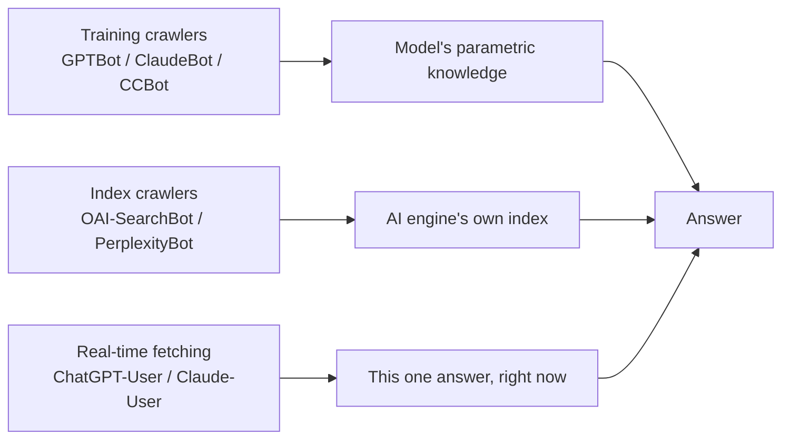

# Chapter 3: Accessibility: Can AI Read Your Website?

> In this book's pipeline, "Triggering → **Accessibility** → Retrieval → Selection/ranking → Citation → Absorption → User behavior", this chapter covers the second stop. All later optimisation rests on one precondition: the AI's fetching programs actually got your content.

## 1. Questions this chapter answers

1. Does blocking or allowing AI crawlers change your chances of appearing in AI answers?
2. Why does "robots.txt is fine" not mean "AI can read it"? At which layers can blocking happen?
3. What does AI actually capture? Of JavaScript rendering, the metadata in `<head>` and structured data, which actually gets read?
4. Which indexes do AI engines rely on behind the scenes? How does real-time fetching differ from a pre-built index?
5. Are llms.txt and Markdown mirror pages any use? When AI goes deep into your website as an agent, what decides whether it can use your content?

## 2. Core principles

### Principle 3.1: If it can't be read, it doesn't exist

When an AI search engine answers a question, it can only use the content it can get. If it can't get yours, your website does not enter the candidate set, and later ranking and citation are out of the question.

There is direct observation of this on Google's products. Repeated tests on real AI search engines found: websites that block Google-Extended (the crawling token Google uses to separate AI purposes) **were cited by Gemini zero times**, and were also cited significantly less often by AI Overviews. This is a correlational observation, not a randomised experiment, but the direction is clear.

The form of failure deserves attention. When an agent cannot read a website, it does not make up content for you. It **leaves you out** and answers using content from third parties or competitors instead. You will not see an error message; you will only find that you are not in the answer.

### Principle 3.2: "The AI crawler" is not one thing, but several fetchers with different jobs

The most common misunderstanding is to treat all AI crawlers as one category. In fact, the same AI company usually runs several identities (user-agents), each handling one job. Taking the division of labour published by OpenAI as an example, practitioners summarise it as follows:

| Identity | Job | Consequence of blocking it |
|---|---|---|
| GPTBot | Collects training data | Opts out of model training; does not affect real-time answers. OpenAI's official documentation: content obtained while users browse in ChatGPT Atlas (OpenAI's browser) also respects this block |
| OAI-SearchBot | Builds the index used by ChatGPT search | OpenAI's official documentation: if you block it, the website's content will not appear in the summaries and snippets of ChatGPT search; if OpenAI learns the URL from a third-party search provider or while crawling other pages, ChatGPT Atlas may show only the link and title |
| ChatGPT-User | Real-time fetching triggered by users in a conversation | When a user pastes your URL, AI cannot read it |
| OAI-AdsBot | Verifies ad landing pages (added in 2026) | Related to ads |

Other vendors have a similar layering: identities with "User" in the name (such as Claude-User and Perplexity-User) are usually real-time fetching when answering questions, while ClaudeBot and PerplexityBot are index or training fetchers. Another practitioner pointed out that meta-externalagent, according to its official description, handles both training and the index for Meta AI's answers, so blocking it means opting out of both channels at once.

A diagram showing where the three types of fetching sit in the pipeline:



This division of labour has two direct consequences:

- **Blocking training crawlers does not remove you from real-time answers.** Appendix data from large-scale experiments with real users show: 79% of domains blocked at least one AI crawler, yet the mean referral traffic blockers received from ChatGPT (6.48) was no lower than that of non-blockers (4.48). This is a correlation and cannot be read as "blocking brings traffic". It shows only that **blocking training crawlers does not stop ChatGPT from bringing traffic when it answers**.
- Conversely, allowing only training crawlers while blocking real-time fetching is the real loss. When a web-connected agent answers, only 7–10% of the answer content comes from training knowledge; the rest comes from on-the-spot retrieval. Whether you can be read in real time matters far more than whether you were trained in.

### Principle 3.3: Blocking can happen at three layers, and robots.txt is only the outermost one

```
Request → [CDN / WAF / host's bot protection] → [robots.txt declaration] → [Server response content]
         Enforcement layer: returns 403 or a challenge page directly       Declaration layer: courtesy rules        Content layer: does the HTML received contain anything
```

- **Declaration layer (robots.txt)**: tells crawlers "please don't come". Whether this is respected depends on the crawler itself.
- **Enforcement layer (CDN, WAF, host security settings)**: blocks the request based on user-agent or IP reputation before it reaches the website, returning 403 or a challenge page. This layer does not appear in robots.txt, and site owners cannot see it from a browser. Enforcement-layer blocking does not always show up as a 403, either. In controlled experimental systems (researchers used their own fetching program on about 10,000 real URLs; the fetcher was not an AI company's crawler, and the test ran from a single network location over three days), they found that about 21.5% of pages explicitly returned 401, 403 or 429 to a simple fetching program, but bot challenge pages and block pages were also often returned with a "successful" 200 status code. In a set of source URLs that had been cited in AI question answering, about 8% of 200 responses were actually challenge pages or block pages, mostly concentrated on a few document and academic publishing websites.
- Content layer: the request succeeds (status code 200), but the HTML returned does not contain the content you think it does (see Principle 3.4). In the same study, about one fifth of the pages that a static fetch received with a 200 had no main content (about 20% after manual review of a sample). The common cases were: front-end app shells with only navigation and a footer, whose main content is loaded by scripts; bot challenge pages; block pages; substitute pages that redirect deep URLs to the home page or show other content; parked domains; and consent walls. In addition, about 13% of websites returned 200 even for URLs that do not exist at all (soft 404s). These failures carry no error code, and neither the fetching side nor the website side can see them. The study did not test how AI answers handle these failures.

Practitioners widely believe that AI crawlers are often blocked at the CDN or WAF layer by default or unintended settings, which takes effect even if robots.txt allows them (this is the majority view in the community, with supporters clearly outnumbering opponents, but it is not proof). One CDN's "AI crawler" switch inserts a managed rule block in front of the website's own robots.txt, blocking GPTBot, ClaudeBot, Google-Extended and others and overriding the website's own settings. Another practitioner pointed out that this CDN's new default from 15 September 2026 blocks "mixed-purpose" crawlers on pages that carry ads; websites without ad slots are not affected by this change.

### Principle 3.4: AI reads the "raw server response", not the page you see in your browser

A browser executes JavaScript and assembles the complete page; most AI crawlers do not. They fetch the raw HTML, convert it to plain text, and then pass it to the model.

Practitioners widely believe that most AI crawlers do not execute JavaScript, so client-side rendered content is invisible to them (this is one of the strongest community consensuses on this topic, with supporters and opponents at about 23 to 1). Several sets of tests provide details:

- Practitioners report from their own tests: on a test page seeded with more than 60 identifiers, read by six AI platforms, **three did not execute JavaScript at all**, and the other three gave it only 0.5 to 3 seconds before leaving.
- In the same test, 9 of 11 categories of metadata returned zero reads: meta description, JSON-LD, OG tags and schema markup were not read; the only metadata read was `<title>`. The tester's explanation: the step that converts the page to plain text discards the entire `<head>` block.
- Practitioners report from their own tests: of 50 websites, 34 (68%) injected JSON-LD through client-side JavaScript such as tag managers. For websites that output JSON-LD on the server side, 92% of the structured data was fetched by at least two AI crawlers; for those relying only on client-side injection, 0%.

So **what you see in your browser's developer tools does not necessarily exist in the raw server response.** One practitioner found that their own hreflang tags numbered 0 in the raw response and 3 in the rendered DOM, because the inspection tool showed the result after JavaScript had run. This problem went unnoticed for several months.

How much is lost without executing JavaScript depends on how the page is built. In controlled experimental systems (the same study with its own fetching program mentioned in Principle 3.3, comparing fetches that do and do not execute JavaScript, not AI crawlers themselves): of the 3,307 pages where both fetches got main content, the fetch without JavaScript retained a median of about 98.5% of the sentences and numerical facts; about 17% lost more than a tenth, and only about 2% lost more than half. For pages that depend on scripts, the main form of failure is a whole page that is only a shell, with the main content loaded entirely by scripts. So the first thing to check is whether key pages contain only navigation, a footer and "Loading…" in the raw response. Parts of content that appear only after rendering (such as the prices in the table below) still need fixing, but there is no need to assume that every website built with a front-end framework loses heavily. Rendering also has a cost: in the same study, the median time to render a page with a headless browser was about 19.7 seconds, against about 1.6 seconds for a static fetch, a difference of about 12 times. This may be one reason why fetchers at answer time tend not to render, but this is the book's inference; the study did not measure the behaviour of AI crawlers.

Content that commonly "exists only after rendering":

| Content | Why it gets lost |
|---|---|
| Prices, plan figures | Rendered on the front end from a database; the raw HTML has only the plan names |
| Text in carousel blocks | Display switched by a script |
| Answers in FAQ accordions | Loaded by JavaScript only after a click |
| Headline words rotated by animation | Only half the headline remains; the rest is in the animation component |
| Structured data | Injected by a tag manager |
| Language version tags | Generated by the front-end framework |

### Principle 3.5: AI engines rely on several indexes, which overlap very little

AI answers draw their sources from roughly two paths: **pre-built indexes** (the engine's own index or a borrowed search engine index) and **real-time fetching at answer time**.

- Repeated tests on real AI search engines found: across one company's three interfaces (traditional search results, AI Overviews and Gemini), the Jaccard overlap of sources was only 0.11–0.18. Even when the same company is behind them, the sets of web pages that different AI interfaces obtain differ greatly.
- One practitioner, while discussing JavaScript rendering, mentioned in passing that in this situation ChatGPT relies to a large extent on Google's index. This is a personal statement without supporting evidence, not a test result; accounts differ on which indexes ChatGPT's web search actually uses (see Chapter 4). In addition, OpenAI's official documentation confirms that besides the index built by OAI-SearchBot, ChatGPT search also uses "third-party search providers", without saying which. This means that "inclusion in traditional search indexes" is itself part of AI accessibility.
- "The AI claims to have read your web page" does not necessarily mean it read the live version. One practitioner had four AIs read a plain-HTML test page: ChatGPT failed to read it in about 10 attempts; Claude read it only the first time in a new conversation and did not see updates afterwards; Perplexity cited 14 unrelated pages; only Gemini read the complete page, including its schema. The tester judged that in most cases a cached version was read. This is a single tester's observation and can serve only as a lead.
- Another situation is that the web page is never opened at all. Repeated tests on real AI search engines found (using OpenAI's native search through the API): with a lightweight model, 53.6% of sessions did not open a single web page and answered from search result snippets alone. In controlled experimental systems, sessions that read only snippets more often gave outdated answers and more often cited unfaithfully (see Chapter 7). So there are at least two ways of "not reading the latest version": reading a cache (for now only a single lead), and reading only the snippet.

Cold-start entities illustrate the difference between indexes especially well. Practitioners' repeated, controlled tests found: a new entity with zero web footprint was polled daily by five web-connected AI systems over 23 days. Although the CDN's default AI blocking returned 403 to training crawlers on 22 of the 23 days, the entity was still cited on day 6, through a knowledge graph plus third-party mentions. Logs showed that on the same day, the two types of crawlers used only at the answering stage (the index crawler OAI-SearchBot and the real-time fetcher ChatGPT-User) were let through normally. The gap between vendors was also large: one used the entity's own domain as a basis about 119 times, another 0 times, drawing only from third-party community platforms.

Being indexed by a search engine is itself a threshold with a time lag. Repeated tests on real AI search engines found (three AI search engines, 56 artificially created topics with almost no other sources, one page published per topic, measured on day 25 after going live): the search engine indexed pages on established domains and on new domains submitted for indexing within 48 hours; AI-related crawlers were first observed visiting on day 10 after going live (only pages on established domains could be tracked); and results stabilised only around day 25. New domains that were not submitted for indexing and relied only on natural discovery had an appearance rate of 0 on all three engines; new domains submitted for indexing had 14%–43%, and established domains 38%–78%. The limits: these topics were deliberately chosen as "data voids" with no competing sources, so topics with competition may be harder; the domain conditions are bundled together (domain age, backlinks, whether submitted for indexing), so it is impossible to tell which one matters; and each condition had only one answer per engine. What it shows: a new website's accessibility starts with being indexed, and seeing no results in the first week after launch does not mean there is no effect.

### Principle 3.6: Agent experience: after being found, you still have to be "usable"

When AI goes deep into your website as an agent (checking prices, comparing specifications, completing tasks), the standard for accessibility rises from "can read the text" to "can understand and operate". This is called agent experience (AX).

- Repeated tests on real AI search engines found: across 1,056 companies and 37,927 agent journeys, for agent-readable websites **78%** of the answer came from the company's own pages (58% for unreadable ones); the share explicitly recommended was **20%** (11% for unreadable ones). The study was carried out by an organisation that provides related services, using its own scorer, and is a matched observational study. Readability is a bundled score covering: content that does not depend on JavaScript, structured data, llms.txt or a Markdown fallback version, and bot controls that let agents through; the effects of individual items were not separated.
- In the same study, after controlling for agent readability, "the breadth of off-site mentions" had no independent effect on whether the agent used your content or recommended you. This conclusion applies only to situations where the agent has already entered the website to look in depth, and does not mean off-site mentions are unimportant at the "being discovered" stage.
- In controlled experimental systems: after a prototype e-commerce website added JSON-LD, aria attributes, action hints and evidence timestamp fields, the strict task success rate of three browser agents rose from 49.3% to 89.3%, and the average number of steps fell from 9.31 to 6.49. But this is a single synthetic website with bundled changes, which the authors describe as a proof of concept, and it cannot show which item had the effect.
- When the pages are supplied to the engine: in a dataset retrieval setting, after machine-readable dataset descriptions were published, the precision with which agents retrieved directly usable data pages was 46.4%, against 28.0% for the control group. At the same time, agents using this path answered only 40 questions, while the control group answered 56. Being found does not mean being usable; this is the "last mile" problem of agent scenarios.
- OpenAI's official documentation: the agent in ChatGPT Atlas uses ARIA labels (accessibility labels and roles designed for screen readers) to understand page structure and interactive elements such as buttons, menus and forms. The official recommendation is to follow WAI-ARIA practice and give interactive elements descriptive roles, labels and states.

## 3. How strong is the evidence

| Conclusion | Type of evidence | Strength and limits |
|---|---|---|
| Blocking Google-Extended correlates with zero Gemini citations and fewer AI Overviews citations | Repeated tests on real engines | Medium to strong; correlation, not causation |
| Blocking training crawlers does not stop ChatGPT referral traffic | Large-scale real user data (appendix) | Medium; correlation, the main study's causal design does not cover this point |
| Agent-readable websites answer more from their own content and are recommended more often | Repeated tests with real agents | Medium; vendor study, matched observation, bundled score |
| Machine-readable changes raise agent task success rates | Controlled experimental system | Weak to medium; single synthetic website, not separated |
| Most AI crawlers do not execute JavaScript | Practitioners' tests + strong community consensus | Medium; but most citations ultimately point to a single analysis from late 2024 (see Debates) |
| Blocking often happens at the CDN/WAF layer | Community consensus + samples from several practitioners | Medium; proportions vary greatly between samples |
| Training and real-time fetching need to be treated separately | Several sets of practitioner logs + one R-A test | Medium |
| Status code 200 does not mean the main content was received (challenge pages, shells, substitute pages and soft 404s are often returned with 200) | Controlled experimental system (own fetching program tested on about 10,000 real URLs) | Weak to medium; large sample with manual review of a sample, but the fetcher is not an AI company's crawler, and the proportions vary with IP and time; did not test how AI answers handle these failures |
| Not executing JavaScript usually loses only a little text; the main problem is whole-page shells | Controlled experimental system (same as above) | Weak to medium; exploratory analysis comparing two in-house fetching programs, not AI crawlers |
| New domains not submitted for indexing were not cited by AI search; AI crawlers visited only around day 10, and results stabilised only around day 25 | Repeated tests on real engines | Medium; limited to topics with no competing sources, single-day snapshot, only one answer per condition |
| llms.txt is effective on its own | None | **No evidence so far** |

Limits of applicability that need particular attention:

- Accessibility research mostly proves only that "not being readable hurts"; **it does not prove that "being readable gets you cited"**. Accessibility is a necessary condition, not a sufficient one.
- Crawl volume does not equal citation. Practitioners widely believe that crawl volume alone is not enough to measure a website's visibility in AI.

## 4. Debates and counterexamples

### Debate 1: Is llms.txt any use?

The side that says it is not:
- Repeated tests on real AI search engines found: of the 1,047 source websites examined in the study, 16.9% had llms.txt, but such technical markers were unrelated to answer accuracy (coefficient about -0.04).
- Several independent logs point the same way. Practitioners report from their own tests: a website launched a 38 KB llms.txt on 31 August; from 2 to 16 September there were 299 requests, of which 240 were its own monitoring and 59 were real requests, **with only 2 from AI crawlers** (both Amazonbot); in the same period GPTBot crawled the whole site 920 times, ClaudeBot 1,494 times and OAI-SearchBot 631 times, and none of them requested llms.txt. Another practitioner queried billions of lines of client logs and tracked more than 100 websites, and saw no AI tool request llms.txt.
- Practitioners widely believe that llms.txt does not help AI visibility or citation (33 for, 4 against); most LLMs never look for this file.
- One practitioner observed: in a citation dataset of 200 queries, fewer than 3% of websites had llms.txt, and the llms.txt pages themselves were never cited. Another practitioner added one for a month and then removed it, and observed no change.

**The side that says it is useful, or reserves judgement:**
- Google's official search documentation says special files such as llms.txt are not needed, but Google's web page testing tool has added an llms.txt check. One practitioner read the latter as "it has an effect", while another pointed out that the testing tool can only confirm the file exists and says nothing about whether any AI uses it.
- One practitioner observed: of 50 companies, the 5 with llms.txt were named by AI 77% of the time, against 49% for those without. But the sample is only 5 companies, and these websites also had other machine-readable changes at the same time.
- Some practitioners believe the value of llms.txt lies mainly in "the process of writing it forcing you to sort out which pages matter", or that it is useful for technical documentation sites for software development (coding agents may read it).
- A vendor claims that in its logs AI crawlers request llms.txt far more often than other pages, but this has not been independently verified, and it contradicts the several independent logs above.

This book's position: one study found it unrelated to accuracy, and another placed it inside a bundle without separating it. There is so far no evidence that llms.txt is effective on its own. It costs very little and you can add it, but do not treat it as the focus of accessibility work.

### Debate 2: Is a separate Markdown version for AI any use?

- Practitioners report from their own tests: after deploying site-wide `.md` versions and llms.txt, training and index crawlers fetched 56 files 177 times; but **real-time fetchers read almost only HTML**: ChatGPT-User fetched 1,936 HTML files and 0 `.md`; PerplexityBot 306 HTML and 0 `.md`; Claude-User 38 HTML and 1 `.md`. Another practitioner observed the same pattern in about three months of logs from two small blogs.
- Practitioners report from their own tests: Markdown mirror pages were crawled by Google within a few days, but ChatGPT and Perplexity still cited the HTML versions, and citation rates did not change over 60 days.
- Practitioners report from their own tests: after serving Markdown to AI crawlers for 16 blog URLs, sessions grew by 52% within 30 days; but blog URLs not served Markdown also grew by 43%, so it cannot be established that Markdown itself was effective.
- One practitioner observed: in an A/B test across six websites and 381 pages, pages offering Markdown gained only about 1 extra bot visit (median) over three weeks.
- A report on the other side: practitioners report from their own tests that after offering `.md` versions for 20 popular articles, Perplexity and ChatGPT search discovered and cited the Markdown versions faster, and the AI crawl rate doubled. This report has no control group.
- On cost: one practitioner measured 300 websites; the median page required 2,592 tokens, about half of which was not body text and about one fifth was navigation, headers and footers; the median for the 7 websites offering Markdown versions was 962 tokens. But 6 of those 7 lacked the `Vary: Accept` header (caches may serve the wrong version to the wrong visitor), and 3 lost body text in their Markdown versions. Another practitioner pointed out that mainstream AI crawlers do not send `Accept: text/markdown`, so schemes relying on header negotiation may never be triggered.

**Summary**: the more consistent observation so far is that real-time fetching for answering user questions reads HTML. Facts meant to affect answers must be in the HTML that humans see. Markdown versions may save bandwidth and may be read by the index layer, but there is no reliable evidence that they increase citation.

### Debate 3: Does AI read JSON-LD?

- One side: practitioners report from their own tests that AI discards `<head>` when converting a page to plain text, and JSON-LD reads were zero; another practitioner reports that neither ChatGPT's nor Gemini's fetching uses schema data.
- The other side: practitioners report from their own tests that 92% of server-side JSON-LD was fetched by at least two AI crawlers; one practitioner observed that Gemini could read and restate the schema in a page; a log analyst recommends putting JSON-LD in the same HTML that humans see, so that real-time fetchers obtain machine-readable facts.
- The two are not fully contradictory: "the crawler fetched HTML containing JSON-LD" and "the model used JSON-LD when answering" are two different things. Research on agent scenarios placed structured data inside a bundle without separating it. **Only one thing is certain: structured data injected only on the client side does not exist for crawlers that do not execute JavaScript.**

### Debate 4: Does "AI crawlers don't execute JavaScript" still hold?

This is community consensus, but one practitioner pointed out that almost every citation ultimately points to the same analysis from December 2024, about 20 months old now, and its publisher sells server-side rendering services. Access logs can only record "what was requested", not "whether JavaScript was executed". Another practitioner saw in logs that OpenAI's training crawler made a small number of JavaScript requests, while user-triggered fetching did not.

**How to handle it**: do not wait for this question to be settled. Compare your raw server response with the rendered DOM directly; whenever important content appears only in the latter, treat it as unreadable by AI. When comparing, take the rendered page as seen in an ordinary browser as the reference. In controlled experimental systems, headless browsers fail too: among pages where the static fetch had already received the main content, about 6.5% of headless renders failed or received a block page, a shell or a consent layer.

### Debate 5: Is robots.txt respected?

- Practitioners report from their own tests: in 48 days of logs, GPTBot and Meta-WebIndexer never checked robots.txt.
- Practitioners report from their own tests: a test page was blocked in robots.txt, and eight AI assistants were then asked to read it. ChatGPT, Claude and Meta refused to read it (Claude returned an explicit "the website does not allow automated access" error); Gemini, Grok and Manus read it anyway; Copilot and Perplexity did not attempt it. The tester found Google documentation stating that user-triggered fetching is generally not bound by robots.txt. This is only one domain and three rounds of tests, and involves only user-triggered fetching.

So robots.txt can guarantee neither "keeping them out" nor "letting them in".

### Debate 6: Is accessibility actually a common bottleneck?

Different samples give very different proportions:

| Observation | Sample | Result |
|---|---|---|
| Declarative blocking in robots.txt | About 510,000 websites | 16.8% block LLM crawlers |
| Declarative blocking in robots.txt | 300 small and medium businesses sampled from each of three industries | Law firms 1.8%, home services 5.4%, travel 3.0% |
| Enforcement-layer blocking (named AI refused, control request passes) | 131 websites, skewed towards news, SaaS and e-commerce | About 21% |
| Blocking at least one major LLM crawler, mostly at the CDN/host layer | About 3,000 websites, mainly B2B SaaS | 27% |
| Fetching small business websites with AI identities | About 17,000 French small business websites | Accessibility was almost never the bottleneck |

These are figures that individual practitioners observed. The layers measured and the samples differ, so they cannot be ranked against each other. What can be concluded is: **blocking at the declaration layer is generally rare; blocking at the enforcement layer is clearly more common on websites behind a CDN, B2B SaaS and media websites.** Practitioners also caution that testing with requests that claim an AI identity from data-centre IPs and getting a 200 does not mean the real crawler will get through too (CDNs verify by IP range), and vice versa. And even getting a 200 does not mean the main content was received (see Principle 3.3).

Another counterexample comes from "readable but not cited": one practitioner observed that a website of about 100,000 pages was crawled by AI crawlers about 430,000 times in 30 days, but crawl volume was unrelated to whether pages were cited; the pages cited were those with "one fact per page, a stable URL, and the easiest to verify". A practitioner who audited about 17,000 websites also believes that most websites are not cited because their pages contain no answer that can be taken directly, not because of technical problems.

## 5. Cases

### Case 1: A new entity was cited on day 6 despite "default AI blocking"

- **What was done**: a new entity with zero web footprint was created, the test protocol was registered in advance, and five web-connected AI systems were asked about it every day. Each answer was scored as correct, not found or hallucination, for about 16,000 scored data points in total.
- **Platforms**: five web-connected AI systems.
- What was observed: the CDN's default AI blocking returned 403 to the listed training crawlers on 22 of the 23 days, but real-time fetchers were let through normally on the same days; the entity was cited on day 6, relying on a knowledge graph and third-party mentions. Buzz on community platforms increased 23 times without raising citations; structured identity (public entity database entries, stable identifiers, a real website) had an effect.
- Duration: 23 days.
- Related principles: 3.2 (training crawlers and real-time fetching have different jobs), 3.5 (there is more than one index path). This is an experiment on a single entity; it can only illustrate the mechanism and does not represent a general pattern.

### Case 2: A CDN switch quietly overrode the website's robots.txt

- **What was done**: a site owner found that the website did not appear in ChatGPT, Perplexity or AI Overviews, even though the robots.txt output by the website's code explicitly allowed all AI crawlers. Fetching the live robots.txt with `curl` revealed an extra managed block at the top that they had not written, blocking GPTBot, ClaudeBot, Google-Extended and others.
- **Cause**: the CDN's "AI crawler" switch inserts its own rules in front of robots.txt.
- Related principle: 3.3. This report comes from a single practitioner and has not been independently verified; but the checking method it reveals (look at the file actually returned live, not at the source code) applies generally.

### Case 3: The catch-all blocking rule of an old plugin

- **Observation**: a practitioner who audited 50 local service websites (plumbing and electrical, air conditioning, dentists, lawyers) reports that one common problem is GPTBot and ClaudeBot being blocked in robots.txt, not by the owner's intent, but through a catch-all `Disallow` left over by an old SEO plugin. In another sample of small businesses, of the 10 websites flagged as blocking AI crawlers, 4 used catch-all rules blocking all crawlers (including real-time fetchers and even Googlebot), as if staging environment settings had been carried into production; 9 blocked meta-externalagent; and several unrelated websites had the same blocklist in the same order. That was not 10 decisions, but one default value.
- **Result**: the auditor reports that fixing the blocking alone usually produces the fastest visible improvement in AI search appearance, within 2–4 weeks. Practitioners report this from their own tests; it is not independently verified.
- Related principle: 3.3.

### Case 4: Prices existed only on the rendered page

- **Observation**: one practitioner scanned a SaaS website: the raw HTML had about 300 words and the rendered page about 1,033; the pricing page had 194 words in raw HTML and 511 after rendering, and **the raw HTML contained no price figures at all**, only plan names. When AI assistants were asked about prices, they knew which plans existed but could not give figures.
- Fix: the website confirmed that the cause was a prerendering script that described the plans only in text, while prices were rendered on the front end from a database. After the fix, fetching the pricing page with `curl` returned the prices. The same check also found that the prerendering list had missed 7 pages, which was discovered only after a search crawler found them.
- Related principle: 3.4. This is a first-hand observation of a single website and can serve only as an example.

### Case 5: Building a parallel version for AI

- **What was done**: a little-known app brand found that ChatGPT, Claude and Perplexity were all citing it, but describing it incorrectly. It built a parallel `/ai/` version of the whole site: the same content with distractions such as navigation, animations and calls to action removed, each page rewritten as direct question and answer (answer in the first 75–120 words); each page pointing back to the human version with canonical, placed in a separate sitemap; and made discoverable to AI through llms.txt, `rel="alternate"` links and direct fetching at citation time.
- **What was observed**: practitioners' repeated, controlled tests found that within 5 weeks AI citation coverage expanded by 12% and AI referral traffic rose by 60%, with no new external links.
- Caveat: these were bundled changes, so it cannot be determined whether the content rewriting, the readability or the discovery mechanism had the effect; and the result does not fit the observation in Debate 2 that "real-time fetchers read only HTML". More replication is needed.

### Case 6: Agent experience and "being left out"

- **What was done**: researchers ran 37,927 real agent journeys on 1,056 company websites, with matched comparisons by fame, the model's prior knowledge and other factors.
- **What was observed**: for readable websites, 78% of answers came from the company's own pages and 20% were explicit recommendations; for unreadable websites, 58% and 11%. When a site was unreadable, the agent substituted content from third parties or competitors rather than making things up.
- Related principles: 3.1, 3.6. Vendor study, bundled score; see "How strong is the evidence" for details.

### Case 7: A well-known platform blocking all AI crawlers was named by the model but cited 0 times

- **What was done**: a small-scale test by this book's author (method in Chapter 4). Five English phrasings of the same swimming recruitment question, each asked 2 times, for 10 sessions in total.
- **What was observed**: a well-known swimming data platform blocks GPTBot, OAI-SearchBot and other AI crawlers in robots.txt. In 6 of the 10 sessions the model used `site:` to search this platform by name, yet cited it 0 times; the platform also appeared only 1 time in search results. Without web access, the model was very familiar with this platform (see Chapter 5, Case 9): the model wanted to look it up, but could not read it.
- Strength of evidence: a small-scale test by this book's author, single topic, single model, not independently verified; no control (the same platform was not tested while allowing crawlers).
- Related principles: 3.1, 3.2.

### Case 8: A website less than four months old became the most-cited source through search alone

- **What was done**: the same 10 sessions as in Case 7.
- **What was observed**: a website registered only in June 2026, dedicated to compiling swimming recruitment times, was cited in 9 of the 10 sessions, accounted for 44% of all cited links, and was usually the first source cited. Without web access, the model said all 5 times that it did not know the site, the same answer it gave for a fictitious domain (see Chapter 5, Case 9), so its citations came entirely from retrieval, not from model memory. The website's features: robots.txt allows all crawlers; data are written directly in the HTML; each "competition level × event" has its own page; page titles almost match the search terms the model generates; data sources and update dates are stated; pages link to each other. After reading one page, the model followed the URL pattern and used `site:` to search other pages on the same website.
- Strength of evidence: a small-scale test by this book's author, single website, single topic; these features all exist at the same time, so it is impossible to tell which one had the effect.
- Related principles: 3.1, 3.4; also echoes Chapter 4's "what you need to match is the rewritten query".

### Counterexample: mistaking an indexing problem for AI blocking

One practitioner, several weeks after blocking AI crawlers, noticed that Google indexing kept declining, suspected collateral damage from WAF rules, and turned off all the rules to troubleshoot. Only later did they find the real cause: a mistakenly submitted temporary URL removal request had frozen indexing for as long as six months. This is a reminder that accessibility problems should be verified layer by layer, rather than inferring the cause directly from the symptom.

## 6. What to do

### 1. First confirm the status of the three types of fetchers, and decide on each separately

| Practice | Strength of evidence |
|---|---|
| Decide separately whether to allow the three types of identities (training, index, real-time fetching); if you want to appear in AI answers, allow at least the index and real-time fetching identities (such as OAI-SearchBot, ChatGPT-User, Claude-User, Perplexity-User) | Practitioners' repeated, controlled tests found + several sets of logs |
| If you care about Gemini and AI Overviews, do not block Google-Extended | Repeated tests on real engines (correlation) |
| After searching robots.txt for GPTBot, search for OAI-SearchBot too; writing only the former means making only half the decision | Practitioners report from their own tests: of 72 companies, 18 named GPTBot, only 11 named OAI-SearchBot, and 0 named OAI-AdsBot |
| If you do not want a page to appear in ChatGPT, mark it noindex rather than relying only on a robots.txt block; and the crawler must be able to read the page to see this mark | OpenAI's official documentation |
| Have other pages link to your important pages: OpenAI also discovers URLs while crawling other pages | OpenAI's official documentation |
| After a new website or new domain goes live, actively submit it to search engines for indexing (for example through webmaster tools); wait at least three to four weeks before judging whether AI cites it | Repeated tests on real AI search engines found (limited to topics with no competing sources, single-day snapshot) |

### 2. Check layer by layer, not just robots.txt

1. **Declaration layer**: fetch the **live** robots.txt with `curl`, and confirm there are no blocks inserted by a CDN or plugin and no catch-all `Disallow: /`.
2. Enforcement layer: request the same page at the same time with each AI identity and with an ordinary browser identity, and compare status codes and response sizes, **and above all the length of the visible main text in the response**; if the control request is also refused, it is a general protection problem, not an AI policy. Remember that this only tests the response path and does not equal the treatment real crawlers receive. In controlled experimental systems, looking only at status codes detected none of the 200 responses that lacked main content; the length of the visible main text was the most effective single signal, catching about three quarters; adding the random-URL comparison in step 6 and the "redirected to the home page" check caught about 85%, with about 6% false alarms.
3. Live test: paste the URL directly into ChatGPT or another assistant and ask "what services does this website offer". A blocked website fails outright, which you can confirm in ten seconds (practitioners report from their own tests).
4. Content layer: get the raw server response with `curl` or by viewing the source, and compare it with the rendered DOM. Prices, specifications, FAQ answers, headings and structured data that appear only in the latter all need to be changed. Take the rendered page as seen in an ordinary browser as the reference; headless browsers fail too. One practitioner observed that on 11 websites, AI identity requests all returned 200, but in 2 of the 10 valid comparisons the rendered word count was more than double: the gap came from rendering, not blocking. In controlled experimental systems, a larger sample points the same way but is milder: pages that lost more than a tenth of their text without JavaScript were about 17%, and those that lost more than half were about 2%.
5. Main-text self-check: fetch your own important pages the simplest way (for example with `curl`, without executing JavaScript). After getting a 200, open the response and confirm: are the main paragraphs, prices and specifications really there, or only navigation, a footer, "Loading…", a challenge page or a consent pop-up? Was the final URL redirected to the home page? Basis as above (in controlled experimental systems, about one fifth of 200 responses had no main content).
6. Soft 404 self-check: request a random, non-existent URL (for example `/a3f9c2e17b4d8e06`) and confirm that the website returns 404 or 410, not 200 or a redirect to the home page; also spot-check a few deep URLs to confirm they are not redirected to the home page. In controlled experimental systems, about 13% of websites returned 200 for non-existent URLs.

### 3. Make sure key content exists in the raw HTML

| Practice | Strength of evidence |
|---|---|
| Output key content and structured data with server-side rendering or static HTML | Practitioners widely believe (strong consensus) + practitioners report from their own tests |
| Use tag managers only for analytics tracking, not for outputting content that AI needs to see | Practitioners report from their own tests |
| Confirm that text in carousels, accordions and animations exists in full in the raw HTML | One practitioner observed |
| Make the prerendering list cover new pages through an enforced process, to prevent drift | One practitioner observed |
| Put the facts meant to affect answers (prices, specifications, qualifications) in the same HTML that humans see | Practitioners report from their own tests (real-time fetchers read only HTML) |

### 4. Use your own server logs, but verify identities first

- Analytics tools usually filter out bots, and client-side analytics scripts cannot see crawlers that do not execute JavaScript, so use **server logs**. Some hosting platforms keep request logs for only about an hour, so you need to store them long-term yourself.
- **Verify IPs**: the user-agent is just a text field that anyone can fill in. Practitioners report from their own tests: over two months, none of the 394 source IPs claiming to be ChatGPT were in the ranges published by OpenAI, and 79 of them were probing sensitive paths such as `/.env` and `/.aws/credentials`. One practitioner observed that of 14,771 verifiable visits, 5,577 were impersonators, and 38.3% of the impersonators were looking for passwords or configuration files. Verification should check against the IP range files each vendor publishes; reverse DNS works for Googlebot, but one practitioner's check found it does not work for GPTBot.
- Look at real-time fetchers, not total crawl volume: an identity with "User" in its name means a real user read this page a few seconds before asking. One practitioner observed that the ratio of fetches to subsequent actual visits was mostly above ten to one.
- Treat crawler logs as a debugging layer: confirm whether pages are fetched, whether there are non-existent URLs hallucinated by AI, and whether any pages are too slow. Measure visibility outcomes by tracking AI answers. A 200 in the logs does not mean the other side received the main content; also look at response size, or the CDN's record of how it handled the request as a bot (see Chapter 9).

### 5. Prepare machine-readable facts for agents

| Practice | Strength of evidence |
|---|---|
| Let agents obtain content without depending on JavaScript, provide structured data, and let agents through bot controls | Repeated tests on real AI search engines found (bundled, not separated) |
| On websites that agents need to operate, add machine-readable data, action hint attributes and evidence timestamp fields | In controlled experimental systems (single website, not separated) |
| Publish standard machine-readable descriptions for dataset content | When the pages are supplied to the engine (dataset scenarios only) |
| Provide a simple machine-readable facts endpoint so AI cites the latest figures | One practitioner observed |
| An e-commerce product's eligibility in AI shopping may depend on whether the product feed is complete (product identifiers, variant attributes, policy data), not only on page content | One practitioner observed; can serve only as a lead |
| Follow WAI-ARIA practice and give buttons, menus and forms descriptive roles, labels and states | OpenAI's official documentation (for the agent in ChatGPT Atlas) |

### 6. Manage crawl load rather than blocking

AI crawlers fetch in sudden bursts (one practitioner reports GPTBot once reaching 114 requests per minute over 3 minutes). One practitioner observed that rate limiting at 60 requests per 60 seconds, returning the 429 status code, made the crawler slow down after about a week. Rate limiting is less likely than blanket blocking to hit real-time fetchers by mistake.

### Do not do

- Do not use the catch-all rule `Disallow: /`, or apply a plugin's or CDN's default blocklist without checking its contents.
- Do not assume that blocking GPTBot means opting out of AI answers, and do not assume that allowing in robots.txt means AI can read you.
- Do not rely only on client-side JavaScript to inject content or structured data.
- Do not count AI traffic or report it to clients by user-agent alone; figures without IP verification will be inflated by impersonating scanners.
- Do not serve different content to AI and humans by user-agent without handling cache headers; also confirm that Markdown versions have not lost body text.
- Do not treat crawl volume as a visibility KPI.
- Do not judge whether AI can get your page from the status code alone; a 200 may also be a challenge page, a shell or the home page.
- Do not infer AI blocking directly from "I don't show up in AI"; verify layer by layer.

### Already outdated

- "One robots.txt rule controls one AI company": OpenAI now runs four identities with different jobs, and other vendors are also split into training, index and real-time fetching.
- "Treating llms.txt as an AI ranking factor or a visibility fix": there is no supporting evidence, and several logs show that major AI crawlers almost never request it.
- "Judging accessibility from robots.txt alone": enforcement-layer blocking does not appear in robots.txt.
- "If it's visible in the browser's developer tools, crawlers can see it": developer tools show the result after JavaScript has run.

## 7. Key points

1. **If it can't be read, it doesn't exist, and the failure is silent**: when AI cannot read you, it does not report an error; it replaces you with someone else's content.
2. **AI crawlers fall into three types (training, index and real-time fetching), and you need to decide on each separately.** Blocking training crawlers will not make you disappear from real-time answers; blocking index and real-time fetching is the real loss.
3. Blocking has three layers: robots.txt declaration, CDN/WAF enforcement, and raw response content. robots.txt being fine does not mean AI can get the content; a 200 status code does not mean the main content was received either.
4. AI reads the raw server response. Prices, FAQs and structured data that exist only after JavaScript rendering do not exist for most AI crawlers. But in controlled experimental systems, most pages with main content lose only a little text without JavaScript; the most serious case is a whole page that is only a shell.
5. AI engines rely on several indexes that overlap very little; inclusion in traditional search indexes is itself part of AI accessibility. New domains must be indexed first, and AI citations may appear only after several weeks.
6. Agent scenarios require being "usable", not just "findable": readable websites answer more from their own content and are recommended more often, but all current evidence is bundled and not separated.
7. llms.txt and Markdown mirrors have not been shown to increase citation; real-time fetching at answer time reads HTML.
8. Accessibility is a necessary condition, not a sufficient one: crawl volume is unrelated to citation; once you can be read, whether you are chosen depends on the factors in the following chapters.
