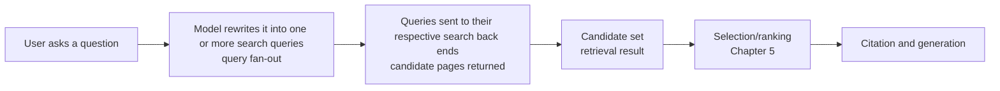

# Chapter 4: Retrieval: Query Rewriting, Semantic Matching, and the Language and Market Gate

> Position in the pipeline: triggering → accessibility → **retrieval** → selection/ranking → citation → absorption → user behavior
>
> The previous chapter dealt with "can the page be fetched at all". This chapter deals with the next step: once AI has decided to go online and look things up, **which pages get pulled into the candidate set**. Pages outside the candidate set, however well written, have no chance of being selected or cited.

## Questions this chapter answers

1. Why is "what is my ranking in AI" the wrong question?
2. Is the question the user types the same as the query AI actually searches with? Where do they differ?
3. Why can a small change in wording move a brand from "recommended every time" to "never appears"?
4. How do the query language and the user's location decide which market AI picks its sources from?
5. At the retrieval gate, which practices are supported by evidence, and which are already outdated?

## 1. Core principles

### 1.1 What retrieval does

Before it generates an answer, AI search goes roughly through the following steps:

Retrieval decides **who is eligible to compete**. The later steps of selection, citation and absorption all happen only inside the candidate set. As Chapter 0 noted, once content is in the candidate set it really can change the answer; but whether it gets in is mainly not a question of writing quality.

This chapter breaks retrieval down into four principles:

| Principle | In one sentence | What it means for GEO |
|---|---|---|
| 4.1 | The source sets of different engines barely overlap | There is no single "AI ranking" |
| 4.2 | The model rewrites queries, and rewriting makes sources less stable | What you need to match is the query AI searches with, not the one the user typed |
| 4.3 | Wording and vocabulary decide whether you are in the candidate set | Category names, buyer types and your own vocabulary all change the result |
| 4.4 | Query language and egress IP are a market gate | Measuring in English cannot see local markets |

### 1.2 Principle 4.1: The source sets of different engines barely overlap

**Causal chain**: each AI engine uses a different search back end, rewrites queries differently, and has different source preferences. With three layers of difference stacked on top of each other, the pages finally cited go almost entirely separate ways.

Repeated tests on real AI search engines found:

| Comparison | Degree of overlap |
|---|---|
| Sources of Google organic search, AI Overviews (AIO) and Gemini | Jaccard only 0.11–0.18 |
| Exact URLs cited for the same prompt by ChatGPT, Copilot, Google and Perplexity | Mean Jaccard 0.0079; 84.9% of engine pairs share no URL at all |
| Top-5 URLs for the full set of 10 prompts across the same four engines | 60 pairwise comparisons, overlap 0 in every one |
| Sources a single engine can capture | Only 11.4%–42.6% of the union of URLs across the four engines; 96.4% of URLs appear in only one engine |
| Domains shared between AI engines and Google's top 10 | GPT-4o 4.0%, Gemini 11.1%, Claude 12.6%, Perplexity 15.2% |
| Domains cited by LLM engines | 37% never appear in traditional search results; 38% appear in both |
| Domains cited by AIO | 29.8% are not in the Google first-page results for the same query; only 25.0% are in the top 5 of the first page |
| Share of Google's traditional top 5 pages cited by AIO, for health questions | About 44% (page level, 3,611 health questions, collected once); about 47% for short, single-turn questions only |

A few details that are easy to overlook:

- **AI cites fewer pages than traditional search shows**: LLM engines cite on average 4.3 URLs per answer, while a traditional search results page shows 10.3. Fewer slots means more concentrated competition.
- Where there is overlap, ranking first still helps: when pages cited by AI also appear in traditional search results, the most cited are the results ranked first in traditional search (Bing 23.27%, Google 14.53%). So "SEO is useless" is also wrong; SEO is only insufficient.
- A single engine is far more stable than engines compared with each other: the URL set of the same engine turns over by 67.0% from one day to the next, yet the similarity of the same engine on two consecutive days is still about 42 times the similarity of different engines on the same day. Put simply: each engine changes every day, and the gap between engines is larger still.
- Vertical categories differ a great deal: domain overlap with Google's top 5 is 15% for smartphones, 32% for laptops, 33% for electric vehicles, and only 0.1%–20.6% for local services. Domain Jaccard between different engines for car-related queries ranges from 0.096 to 0.251.
- Source composition also differs in health: in one large-scale audit on a real AI search engine (US English health questions, collected once), pages cited by AIO leaned towards commercial health information websites compared with the traditional top 5 for the same question; large academic medical institutions and government health agencies had lower shares. All effects were small. The audit excluded video and forum sources, so the comparison holds only among readable web pages.

Practitioners report from their own tests figures that point the same way; these are not independently verified:

- Across 1,000 prompts mixing informational and commercial intent, the sources of ChatGPT, Google and Bing overlapped by only 19%.
- One practitioner reported that, across a large number of identical questions, ChatGPT and Perplexity agreed on only 11% of sources (the report kept only the conclusion; its method cannot be examined).
- Across 48 local markets (8 cities, 6 categories), only 11.9% of the businesses that Google Maps listed for buyer questions were mentioned by any AI engine; in most markets, more than half of the businesses that were mentioned were mentioned by only one engine.

Why does this happen? One practitioner observed that each model uses its own native search provider. As for which index ChatGPT actually uses when it goes online, practitioners do not agree (see "Debates and counterexamples"). What is certain is this: different back ends naturally produce different candidate pools.

Conclusion: "ranked first in AI" is not something that can be measured. All you can say is "under a given engine, language, market and phrasing, the probability of being retrieved is this much".

### 1.3 Principle 4.2: Query rewriting makes sources less stable

**Causal chain**: the user types a sentence in natural language. The model does not search with it as it stands. It first rewrites it into one or more search queries, a process called query fan-out. The rewrites are generated and may differ each time; search results change with the rewrites; so sources are less stable than in traditional search.

**Research evidence**

Repeated tests on real AI search engines found:

- After a slight rewording of the query, the rank-biased overlap (RBO) of AIO sources was 0.49, against 0.74 for traditional search results.
- Even without rewording, simply rerunning on the same device, the RBO of AIO was 0.69, against 0.86 for traditional search.
- When the AI-rewritten queries were sent back into Google search, 98.16% failed to find the black-hat SEO sites that had originally ranked near the top. Minor rewriting was enough to bring the attack success rate below 10%.

The last point has a double meaning for GEO. On one hand, AI's rewriting layer keeps out most pages optimized only for the original keywords. On the other hand, the rewriting itself follows patterns, and whoever can predict the rewrites holds the entrance to the candidate set. In the same study, covering likely rewritten query terms on the page raised the share of adoption across the 5 tested systems to more than 2 times the baseline (this is a share, not a success rate); plain keyword stuffing had no effect on any tested system.

What rewritten queries look like

Research has not systematically published the rewriting rules of each engine. The following comes from practitioners' packet captures and logs. Practitioners report from their own tests, not independently verified:

| Observation | Content |
|---|---|
| Searches per conversation | In a small test of 30 prompts, ChatGPT averaged 1.1; Google AI Mode 3.3 and AIO 3.4 (Google's sub-queries were reconstructed by inference, not observed directly) |
| Differences between modes | Repeated tests on real AI search engines found (capturing the internal execution of the ChatGPT web version, versions 5.2–5.5): Instant mode issues 1.06–2.36 queries each time, with multiple rounds in only 3.8%–17.4%; 5.4 Thinking mode issues about 11.8 queries each time over an average of 3.2 rounds, 71.3% multi-round, and the share of queries using `site:` rises from 25.1% in the first round to 54.7% in later rounds. The 1.1 in the row above is closer to Instant mode |
| Shape of ChatGPT's queries | One fairly long query packed with entities, averaging 8.2 words, about one third copied directly from the user's original sentence |
| Pages cited | ChatGPT averages 4.1 pages, AI Mode 16.9, AIO 13.3 |
| Whether cited pages are in the top 10 | Of the pages cited by AI Mode and AIO, only 10% are in the top 10 for the main query; counting all sub-queries, still only 23% (AI Mode) and 28% (AIO) |
| Year added automatically | The user asks "Best shoes for running"; ChatGPT actually searches "best running shoes 2026", and most cited pages contain "2026" |
| Background verification queries | One practitioner captured Gemini's retrieval tool calls and found that it often issues 3–5 terse technical queries (for example "[category] safety certification list 2026", "pricing plans table"), and often appends the name of a community discussion site or words such as "forum" to the end of the query to look for community consensus |
| Brands built into the query | The user named no brand, yet the sub-queries ChatGPT generated already contained the names of several well-known brands in the category |

These figures have an expiry date. In the author's own small-scale test (October 2026, see below), GPT-5.6 Sol called through the API generated on average 9.5–11.9 sets of search terms per session, far more than the 1.1 in the table above. The model version is different, and the API differs from the web interface, so this cannot simply replace the table; it only shows that observations of this kind go out of date quickly as versions change.

In another large-scale study, repeated tests on real AI search engines found (two markets, 90 days each, 158,000 answers, 468,000 citations): all pages cited by ChatGPT came from its own search; 97% of the pages it retrieved were not in Google's top 50; among pages of the same website, "whether it was retrieved by ChatGPT's search" explained about 32% of the variation in citation, while the features of the page itself explained only about 2.8%. This study used the API of a small model, all findings are correlational, and the authors run a monitoring platform.

The last item deserves a pause. It means the model already has a list of candidates before it goes online, and search only verifies and supplements it. One practitioner observed that brands written into the query had a citation rate of 68.9% against 2.1% for those not written in (only the title of the original report survives, so it can serve only as a lead). This fits the principle in Chapter 1 that "popular entities rely on parametric knowledge, obscure entities rely on retrieval": In controlled experimental systems, on average 16% of ranked entities did not appear in any retrieved snippet at all.

The author's own test

The author's small-scale test (October 2026): GPT-5.6 Sol was called through the OpenAI API with web search enabled, and the search terms generated by the model, the URLs in the search results and the final citations were recorded. There were 40 sessions in total: 5 English phrasings of one swimming recruitment question, each asked 2 times; and 3 categories (shopping, local services, health knowledge) of 5 questions each, with each question asked once in each of 2 phrasings. Limitations: English only, a single model, through the API rather than the web interface, only one city for the local questions, a small sample, not independently verified. The code and raw data are kept in this book's experiment folder. Observed:

- Almost every search term added words the user never said: 94% for the swimming question and 95% for the three categories (270/284). The added words fall roughly into five types: replacing terms with industry jargon (for example replacing "how fast should a 12-year-old swim" with the name of the sport's official time standards); predicting the sources of evidence needed (official bodies, results lists); predicting the underlying constraints (for example caps on recruitment places); filling in specific instances from memory (names of well-known swimmers); and predicting a deeper question (for example longitudinal tracking studies). As a result, a research article answering "what happened later to swimmers who were slow at age 12" was cited, though the user had never asked that question.
- The three categories were rewritten in different patterns: shopping questions had specific brands and models written in, plus specification terms such as price, weight and battery hours; health questions had evidence-level terms added (clinical guidelines, systematic reviews, randomized trials); local service questions had verification terms added (official, reviews, license, address).
- The very first search term already named a website: in 7 of the 30 sessions for the three categories and 6 of the 10 sessions for the swimming question, the first search term used `site:` to target a specific website; shopping questions often targeted a specific product page on the brand's official website directly. This is direct evidence that "the model has a list of candidates before it goes online".
- The search terms generated by the model explained which pages were cited better than the user's original sentence did: scoring the pages the model had seen by vector semantic similarity, scores based on the generated search terms separated cited from uncited pages better than scores based on the user's original sentence (AUC difference for the three categories +0.075, 95% confidence interval from session-level resampling +0.022 to +0.127). By category, only shopping was significant; local services and health pointed the same way but were not significant. The result still held when using only search terms without `site:`, or only the first search term, which rules out the explanation that "the model first decided what to cite, then wrote the product names into the search terms".
- Meaning matters more than literal wording: vector semantic scores separated cited from uncited pages moderately well (AUC 0.74 for the swimming question, 0.67 for the three categories; 0.5 equals random guessing). For the swimming question, keyword matching came close to random guessing once the most cited website was removed. The exception was shopping (keyword AUC 0.71): exact strings such as model numbers help.

These results support this principle: what you need to match is the query the model rewrites. But they come from a small sample of a single model through the API, and cannot represent ChatGPT on the web or other platforms.

Query fan-out does not mean more diverse sources

Intuitively, the more you search, the more scattered the sources. The evidence does not support this intuition.

- In controlled experimental systems, the multi-round queries of deep research agents converge on a small number of editable user-generated content (UGC) pages. UGC makes up 16.7%–23.4% of the URLs retrieved by open-source agents, and a single large community discussion site accounts for 53.7%–70.7% of that UGC. In observations of commercial deep research products, 12.1% of Gemini's citations were UGC, against only 0.4% for OpenAI. One possible cause of the convergence is path dependence: later queries are generated from content already read, so whatever is read early reinforces itself. In an experiment with a fixed set of candidate documents (weaker evidence), two searches that differed only in document order had, by round 4, 63.9% of their queries different and 75.0% of their sequences of documents read different.
- Practitioners' repeated, controlled tests found: from 8 August 2026, the number of sources ChatGPT retrieved per answer rose from about 11.7 to 18.9 (+61%), and distinct URLs rose 69%, but distinct domains rose only 9%; the number of pages fetched from a single website within one answer rose from 1.38 to 2.20. That is, it reads deeper into websites it already uses rather than discovering new ones. Websites that were not in the candidate pool before the 8th were not brought in by the increase in retrieval volume.

Conclusion: what you need to match is not the sentence the user typed but the few sentences the model rewrites. And a larger search volume will not automatically bring you into the candidate pool.

### 1.4 Principle 4.3: Wording and vocabulary decide whether you are in the candidate set

**Causal chain**: rewritten queries find pages through semantic matching. The wording on a page, the name it uses for its category, and the tasks and buyers it describes decide which queries can pull it in. Call the category by another name, or ask the question for a different buyer, and the set of matched pages changes.

Research evidence for this principle is thinner and comes mainly from practitioners' repeated tests. Support on the research side is that rewriting queries greatly changes sources (Principle 4.2), and that covering rewritten query terms on a page helps it get adopted.

Practitioners' repeated, controlled tests found:

- **The same tool disappears when the question is phrased differently**: "best shared inbox software" was changed into what a real user would type, "how do we collaborate on a shared mailbox without disrupting our normal email flow", and each was run 10 times on four models. Under the category-term phrasing, the two main tools were named almost every time; after the change, one of them went from appearing every time to 0/10 on ChatGPT. Two other tools tracked as a control stayed stable under every phrasing: their pages describe the actual workflow in buyers' language, rather than just claiming to belong to a category.
- Change the buyer and the result changes: a newsletter platform appeared only in phrasings where "creators" were the buyer; keeping "businesses" as the buyer and only describing the task in plain language, it dropped to 0/40. A "visibility score" averaged over all phrasings would hide this difference completely.
- Your own vocabulary can be retrieved, similarity cannot: a brand-new author entity was tested on three engines every day for 99 consecutive days with 16 fixed questions. Across the 10 recommendation questions that did not contain the entity's name, it was named 40 times in 6,729 answers, 25 of them from the same question, the one that used a subgenre term the entity had coined itself and that did not exist online before. For similarity questions of the "like a certain well-known author" type, it was named 0 times in about 700 answers per question. Asked about directly by name, it held steady at 72% from about day 49 onward, showing that this was not an indexing problem.

The interpretation offered by the practitioner who ran the tests (an opinion, not a proof):

> Your off-site footprint (third-party comparison lists, reviews, discussion threads) decides whether you can enter the recommendation set; the language on your pages describing concrete workflows decides whether you can stay in the set when the phrasing changes.

Similar observations by individual practitioners, usable only as leads:

- The same agency, asked about with the niche term it is known for, was named 19 times out of 25; asked about with the two broad category labels on its home page, it was named 0 times out of 25.
- Different names for the same category caused one brand's mention rate to fall from about three quarters to zero.
- In local business data for one city, about 42% of businesses changed whether they were recommended because of wording differences alone.
- "Alternatives" phrasings cited comparison pages about 10 times as often as "best" phrasings; the deciding factor was the intent shape of the question, not whether it contained a brand term.
- One practitioner reported that, when no other explanatory source was available, AI Mode and AIO cited social platform content whose wording was identical to the prompt.

Conclusion: semantic matching is not "keyword density". What decides whether you are in the candidate set is whether the page uses the wording buyers use and the model will rewrite into, to describe the task you actually solve.

### 1.5 Principle 4.4: Query language and egress IP are a "market gate"

**Causal chain**: ask the same question in another language, and the model rewrites it into queries in that language; the search back end then returns web pages from another language's ecosystem. The candidate pool is replaced wholesale, not fine-tuned. The egress IP affects which country the search back end treats you as a user from.

Repeated tests on real AI search engines found:

- **Changing language replaces almost the whole set of domains**: when GPT switches language, overlap of cited domains is close to 0; Claude is the most stable. Rewording affects domains less than changing language does.
- Local brands benefit most: across 12 European languages, three web-connected models and 35,640 answers, asking in the brand's home language raised the recommendation share of local leading brands by 0.80, against only 0.15 for global brands. The mean cosine similarity of answers across languages was 0.825; slightly higher within a language family than across families (0.844 vs 0.820). The sentiment of answers also changed with language, with English the most negative.
- The share of local sources changes many times over: in AIO on health topics, the share of local sources cited for English queries varied widely (Australia 48.2%, United States 33.7%, India 2.3%, Nigeria 0.2%); switching to the native language raised local citations 3.5–13.5 times, for example from 16.6% to 57.5% in Japan and from 2.7% to 36.4% in South Korea.
- Language picks the vendor, IP picks the country: in a small-sample study (234 runs, 6 repetitions per group), when asked in English from Istanbul and Tallinn, local vendors did not appear once in 12 runs; in the local-language groups, global vendors appeared only 1 time in 24. More telling: asked in Turkish from Berlin, the results were German local accounting software vendors (5 of 6 runs); asked in Russian from Tallinn, the results were Estonian local vendors (4 of 6 runs). Language decides that the candidate set is replaced wholesale with a "local" type, and the egress IP decides which country's local. Project management software, the negative control category, showed no language effect; the authors speculate this may relate to whether the category is subject to national regulation, but this was not verified.
- Different engines read location through different channels: repeated tests on real AI search engines found (300 questions, 31,200 answers, through the API): ChatGPT follows the location declared by the application, down to the city, and writes the place name into its own search terms; even when the search terms contain no place name, the search back end still changes sources by location; it ignores network location. Gemini ignores the declared location and changes sources only by the country of the network, swapping out quite a few sources even for questions unrelated to location, but it cannot get down to the city. Recommended businesses were very unstable: asking again in the same city overlapped by only 32%, and in a different city only 8% remained.

Two additions to remember alongside these:

- Stability is decided mainly by the model, not by the language (the variance explained by each is about 0.319 and 0.011 respectively).
- In 11 of the 12 languages, the most cited domain was the same online encyclopedia. The language gate replaces the local layer, not all sources.

Practitioners report from their own tests (not independently verified):

- Word-sense ambiguity in smaller languages: five AI search tools were asked in Finnish for "the best GEO agency in my area", and only two understood it as a marketing service; the other three recommended, respectively, a land surveying firm, an agricultural earthworks contractor, and geocaching. In languages with sparse content, a short query lacks enough context to disambiguate a new term.
- Put the city in the sentence, not in the settings: a logistics company serving about 8 Indian cities was named 0 times across 41 buyer questions. With the location set to a city and a generic question asked, it was still 0/3; with the city name written directly into the question, Gemini named it all 3 times, and AIO named it in two cities, and only where it had a matching city page. (This observation holds only for Gemini and AIO; the research above shows that ChatGPT follows the declared city.)
- Local ecosystems all differ: asking ChatGPT about "GEO agency + city" in 19 cities, the official websites of 97% of 94 agencies were cited; citations of business listings (Business Profile) made up 86% in large Indian cities, only 18% elsewhere, and about 15% in other emerging markets. This is not a shared pattern of "emerging markets" but a feature of a single market.
- One practitioner observed: translating an English prompt list directly is not enough, because people in each language ask purchase questions differently; if local answers are pieced together from English pages, the local web is thin on that topic, and a decent local page will be cited quickly.

Conclusion: measurement results in English cannot represent local markets. Language is a gate, and on the other side of the gate is a different candidate pool.

## 2. How strong is the evidence

| Principle | Evidence level | Strengths | Weaknesses |
|---|---|---|---|
| 4.1 Sources do not overlap | Several sets of repeated tests on real AI search engines, including peer-reviewed research; large-sample practitioner tests point the same way | Several independent teams, different engines and different times reach conclusions in the same direction | Some studies use few prompts (for example 15 prompts); some authors are visibility vendors, with a conflict of interest |
| 4.2 Rewriting makes sources unstable | Repeated tests on real engines (including peer-reviewed); deep research convergence comes from controlled experimental systems | RBO and re-search experiments measured the effect of rewriting directly | The concrete shape of rewrites comes mainly from practitioners' packet captures; Google's sub-queries are inferred, not observed directly |
| 4.3 Wording decides the candidate set | Mainly practitioners' repeated, controlled tests; only indirect support on the research side | Control groups, repeated runs, long-term daily records | Mostly a single category or a single entity (n=1); the mechanism is the tester's speculation |
| 4.4 Language and market gate | Three or more sets of repeated tests on real engines, covering 12 European languages and health topics in Asia and Africa | Large effect sizes, consistent direction, reproducible across studies | "Egress IP picks the country" rests on a single model and a small sample of 6 runs per group; the authors of two core studies are visibility measurement vendors |

**Reminder on scope**:

- All of the above is **observational** or descriptive evidence. It shows how the candidate pool changes, but no randomized experiment has shown that "changing page wording → higher retrieval rate → more traffic or conversions".
- Engines update frequently. The abrupt change in ChatGPT's retrieval behavior on 8 August shows that any specific figure (how many queries per search, how many pages cited) has a shelf life.
- The research evidence that "covering rewritten query terms works" comes from experiments on self-built websites and measures the share of adoption, not the success rate on real commercial sites.

## 3. Debates and counterexamples

### 3.1 Can query fan-out be seen?

| Claim | Basis |
|---|---|
| ChatGPT shows you the rewritten queries; Google's two interfaces do not | Practitioners report from their own tests; other practitioners have also seen ChatGPT's rewritten queries through the browser's developer tools |
| Claude and Perplexity disclose query fan-out; ChatGPT and Gemini do not | Another practitioner's report from their own tests |
| Query fan-out obtained through a third-party API yields only 1–3 queries, mostly variants of the original keyword, and sometimes none at all | Practitioners report from their own tests; another person tried 6 times and got at most 3 |
| The fan-out queries from simulation tools are more useful, but they are simulated with prompts, not queries the model actually issued | Comparison by the same practitioner |

**How to read this**: visibility varies with interface, version and time, and contradictory reports may each have been true at their own point in time. Synthetic "fan-out queries" are only guesses and cannot be treated as observational data.

### 3.2 Which index does ChatGPT use?

Practitioners widely believe that ChatGPT's web search uses both the Bing and Google indexes, but this is a contested view (supporters outnumber opponents by a little more than three to one), not a proof. OpenAI's official documentation confirms that, besides its own index, ChatGPT search also uses "third-party search providers", but does not say which ones, so "Bing or Google" remains unresolved. A practitioner study reports that 83% of the products in ChatGPT's shopping carousel came from Google's shopping data through shopping-type fan-out queries. This can serve as supporting evidence, but it covers only shopping.

### 3.3 Do location settings work?

- Research (small sample): the egress IP decides which country's vendors are recommended.
- Practitioner tests: with a location set and a generic question asked, local businesses were still named 0 times; only writing the city into the sentence worked.

The two are not necessarily in conflict: the IP may act at the **country** level, while localization at the **city** level needs the query text itself to contain the place. But at present no study has tested both in the same design. Another study with repeated tests on real search engines (5 EU countries) shows that language decides results more than location does: for the same English queries across countries, the overlap of result domains was 0.58–0.80; after switching to the local language it was only 0.11–0.17.

Update: research has now tested both in the same design (see Principle 4.4). The answer depends on the engine: ChatGPT follows the declared location (down to the city), and Gemini follows the country of the network.

### 3.4 Are users' prompts long or short?

- One practitioner observed that two user surveys show most prompts are short, about two thirds within 15 words, close to keyword searches, but more and more people add personal context such as budget and location.
- One practitioner saw on client websites that about 60% of prompts were nothing more than search terms.
- Another practitioner believes that, in categories they know well, prompts run to about 20 words, and get shorter because AI remembers the context.
- Yet another practitioner found that paragraph-length conversational queries have started to appear in Search Console.

**How to read this**: these are all isolated observations. For retrieval, what matters more is the query after the model rewrites it, not the length of the user's original sentence: whatever its length, what finally goes into the search engine is the rewritten version. In addition, real conversation logs show that single messages are often short because conditions such as budget and location were stated in earlier turns (see Principle 9.4 in Chapter 9); measuring with isolated short prompts may miss these conditions.

### 3.5 Off-site footprint or on-page wording?

In the wording tests, even the tester could not cleanly separate two factors: whether the brand's stability came from its pages describing workflows in buyers' language, or from a large number of third-party comparison lists. His provisional view is that "the off-site footprint gets you in, on-page wording keeps you there". This is a hypothesis yet to be tested.

### 3.6 Are more queries good or bad?

- For content owners: more queries mean more entrances through which to be pulled in.
- But in controlled experimental systems, more queries instead converge on a few editable UGC pages, creating a single point of attack: appending about 13 words to a single URL was enough for 57%–76% of runs to pull it into context, 34%–61% to cite it, and 22%–37% to mention the attacker's chosen entity in the report; detection by perplexity or by output similarity was ineffective.
- At the same time, practitioners observed that after August ChatGPT sharply reduced its retrieval from a large community discussion site (from about 4% of sources to 0.02%).

That is, "community platforms are a source AI always fetches" may not hold at all for different engines at different points in time. One practitioner cautioned that, for the same query, only about 11% of the domains cited by one engine appear in another engine, so changes in one engine cannot be extrapolated to others.

## 4. Cases

### Case 1: The same tool, from 10/10 to 0/10 with a different phrasing

- **What was done**: on ChatGPT, Claude, Perplexity and Gemini, shared inbox tools were asked about with two phrasings, each run 10 times. One was a category term; the other was a descriptive phrasing as real users would ask. Two further tools were tracked as a control.
- **What was observed**: under the category-term phrasing, the two main tools were present almost every time. Under the descriptive phrasing, ChatGPT named one of them 9/10 and the other 0/10; Claude was the reverse (8 vs 5); Gemini named both (10 and 8); Perplexity named one 5 times and the other 0 times, and simply switched to teaching the user how to do it themselves in their email client. The two control tools were stable under every phrasing, loosening at most on Perplexity.
- Principle illustrated: 4.3. Retrieval depends on matching between wording and page language, and each engine reacts in a different direction (4.1).

### Case 2: 99 days of a new entity

- **What was done**: a brand-new author entity launched on 11 May, with a preregistered measurement plan, asked three web-connected engines 16 fixed questions every day, scoring more than 11,000 answers in total.
- **What was observed**: questions naming it directly held steady at 72% from about day 49; among recommendation questions not naming it, 25 of its 40 mentions came from the one question using its coined vocabulary; similarity phrasings gave 0 in about 700 answers.
- Principle illustrated: 4.3. A new entity can be retrieved in the short term through "its own vocabulary", but being retrieved by "like so-and-so" phrasings requires co-mentions by third parties, which cannot be achieved within a few weeks.

### Case 3: One city name, from 0/41 to 3/3

- **What was done**: a logistics company serving about 8 cities was first tested with 41 buyer questions, then "location set + generic question" was compared with "city name written into the question".
- **What was observed**: originally 0/41; with the location set, still 0/3; with the city written into the sentence, Gemini 3/3, and AIO named it in two cities, and only where it had a dedicated city page.
- Principle illustrated: 4.4 and 4.3. The location has to become the "content" of the query, and the page needs matching location content to be matched against.

### Case 4: ChatGPT reads deeper, but not wider

- **What was done**: using the same set of 961 prompts, the retrieved sources of a total of 5,029 ChatGPT answers before and after 8 August were compared.
- **What was observed**: sources retrieved per answer +61%, but distinct domains only +9%; government and official agency domains rose sharply, while a large community discussion site and several media domains fell sharply. The tester cautioned that the prompt mix leaned toward health and finance and should not be taken as a general rule; also, only the change can be seen, not its cause.
- Principle illustrated: 4.2. More queries do not mean more diverse sources; websites not in the candidate pool are not discovered because retrieval volume increases.

### Case 5: Targeting fan-out queries, a new site cited within a week

- **What was done**: a new website in a highly competitive category built pages aimed not at the user's original sentence but at the fan-out queries ChatGPT generated. Those fan-out queries already contained the names of several well-known brands in the category.
- **What was observed**: within about a week, the page was cited by ChatGPT for a broad "best [category] tool" question. The tester stressed: being cited is not the same as being recommended.
- Principle illustrated: 4.2. Retrieval matches the rewritten queries; but entering the candidate set is only the first gate, and selection and recommendation are the subject of the next chapter.

### Case 6: A process for extracting real fan-out queries

- **What was done**: a practitioner serving e-commerce clients ran target prompts 5 times each on ChatGPT and Gemini, recorded every sub-query, and kept only those that appeared 3 or more times.
- **What was observed**: a single prompt for a cookware client yielded 14 stable sub-queries; after that, one page per query, using the query's own wording. In the first month he had instead built pages for paraphrases of the user's phrasing, and all 9 pages were wasted.
- Principle illustrated: 4.2. What you need to match is the real sub-queries that recur, not synonymous sentences you imagine yourself.

### Case 7: "GEO" in Finnish

- **What was done**: five AI search tools were asked in Finnish for "the best GEO agency in this area".
- **What was observed**: three of the five understood GEO as land surveying, earthworks or geocaching.
- Principle illustrated: 4.4. In languages with sparse content, a new term lacks enough context, and rewriting a short query may retrieve the wrong category outright. The tester's preliminary experience is that writing out the full name in service descriptions helps, but this has not been rigorously tested.

### Case 8 (weaker evidence): Targeting a few "superlative" phrasings

- **What was done**: one practitioner relayed a client case: abandoning broad category terms and instead picking 5–6 purchase-stage phrasings such as "best [product] for [use]" or "cheapest [product] that works well", first checking which sources were already cited under these phrasings, choosing the ones they had a chance to compete with, and then concentrating all content and third-party placements on these few angles.
- **What was observed**: the report claims that within 90 days the client went from almost invisible to appearing in 15%–20% of relevant AI answers, and that the conversion rate of this traffic was about 4 times that of traditional organic traffic.
- How to read it: this is second-hand, not independently verified, and lacks a control group. The conversion figure in particular calls for caution: the position of this book's main line is that at present no research has shown that GEO reliably brings traffic or conversions. Its value here is to show an approach: choosing battlegrounds by phrasing family, rather than pursuing full coverage.

## 5. What to do

### 5.1 Recommended practices

| # | Practice | Strength of evidence |
|---|---|---|
| 1 | **Measure and manage each engine separately**; do not use a single "AI visibility score" to represent all engines | Repeated tests on real engines, consistent across several studies |
| 2 | **Measure each language and each market separately**; local brands must be measured in their native language; record the query language and egress region of each measurement | Repeated tests on real engines (the IP part is a small sample) |
| 3 | **Repeat each prompt several times** and look at frequency of appearance, not a single screenshot | Repeated tests on real engines: the top recommendation changes for 4 of 6 prompts; AIO sources change even when rerun on the same device |
| 4 | **Cover on the page the phrasings AI is likely to rewrite into**, including qualifiers the model often adds automatically (such as the year) | Experiments on self-built websites on real engines (measuring share of adoption); practitioners report from their own tests |
| 5 | **Extract real fan-out queries**: run the same prompt several times on the same engine, keep the sub-queries that recur, and build pages or add paragraphs using their original wording | Practitioners report from their own tests, not independently verified |
| 6 | **Describe the tasks and workflows you actually handle in buyers' language**; do not just claim to belong to a category | Practitioners' repeated, controlled tests |
| 7 | **Plan by phrasing family**: category terms, descriptive, comparative, alternatives, superlative, and different buyer identities, each tested separately | Practitioners' repeated, controlled tests; some are single observations |
| 8 | **Build your own vocabulary**: a new entity can first be retrieved on niche terms it defines itself | Practitioners' repeated, controlled tests, but only one entity |
| 9 | **For location-based businesses, build a dedicated page for each service location**, and test with "service + location" phrasings | Practitioners' repeated, controlled tests, a single business |
| 10 | **In smaller-language markets, write out terms in full and add context**, so that new terms are not misread as old ones | Practitioners report from their own tests, not rigorously tested |
| 11 | **For topics where local web content is thin, give priority to pages in the local language** | One practitioner observed this; usable only as a lead |

### 5.2 Do not do

- **Do not use English measurement results to represent local markets.** English phrasings may miss local competitors entirely.
- **Do not use a single screenshot as evidence of visibility.**
- Do not stuff keywords. In the AI search systems tested, it had no effect on retrieval.
- Do not build large numbers of pages for paraphrases of the user's phrasing. What you need to match is the sub-queries the model actually issues.
- Do not treat simulated fan-out queries as observational data.
- Do not rely only on a VPN or location settings to measure local visibility. At least also test the version with "the location written into the question".
- Do not extrapolate changes in one engine to other engines.

### 5.3 Ideas that are already outdated

| Outdated idea | Why it is outdated |
|---|---|
| "Ranking first in AI" | The source sets of different engines barely overlap, and the same engine changes every day |
| "Rank first on Google and AI will cite you" | Only about 10% of pages cited by AIO are in the top 10 for the main query; nearly 30% of cited domains are not on the first page. For health questions, too, only about 44% of the traditional top 5 pages are cited by AIO. Ranking first still helps, but it is only one condition |
| "Optimize for the keyword the user will type" | AI searches with rewritten queries, and the rewriting adds words, years and brands |
| "More queries bring more diverse sources" | Both research and practitioner data show that more retrieval mainly means reading deeper into existing websites |
| "Get the English version right, then just translate" | Changing language means changing the whole candidate pool; people also phrase questions differently in each language |

## Key points

1. **Retrieval decides who is eligible to compete.** Pages outside the candidate set have no chance of being selected, cited or absorbed.
2. **There is no "first place in AI".** The URLs cited by different engines barely overlap, and the same engine turns over heavily from one day to the next; retrieval rates can only be discussed separately by engine, language, market and phrasing.
3. AI does not search with the sentence the user typed. The model rewrites queries, may split them into several, add years, and even write in brand names in advance; what you need to match is the rewritten query.
4. Searching more does not mean searching wider. More queries may converge on a few websites or a few editable UGC pages; websites not in the candidate pool are not discovered because retrieval volume increases.
5. Wording can turn a brand from always present to absent. Category names, the tasks described and the buyer's identity all change the candidate set; brands that describe actual workflows in buyers' language are more stable (practitioner tests; mechanism not proven).
6. Query language is a market gate. Switching to the native language sharply raises the share of local brands and local sources; English measurement cannot see local markets.
7. The location has to be in the question itself. The egress IP may decide the country, but for city-level localization, current practitioner evidence points to "the place in the query, and a matching page on the website".
8. Favorable retrieval does not mean traffic. All the evidence in this chapter is observational; after entering the candidate set, content still has to pass selection and citation, and at present no research has shown that these reliably bring traffic or conversions.
