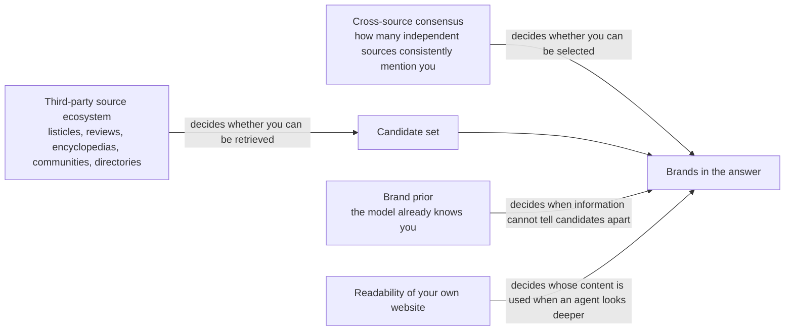

# Chapter 5: The Source Ecosystem: Third Parties, Consensus and Brand Priors

> Where this chapter sits: along the book's main line "triggering → accessibility → retrieval → selection/ranking → citation → absorption → user behavior", this chapter mainly deals with the two stages of **retrieval** and **selection**, and extends to absorption: the brands that AI writes into its answers, from which sources and by which signals are they picked out?

## Questions this chapter answers

1. When AI answers "which product in a category is good", does it cite the brand's own website or other people's websites?
2. Why is "many sources say so" especially persuasive to AI? Why is this same mechanism also the greatest risk?
3. How much does brand recognition (the brand prior) actually matter? Do small brands still have a chance?
4. Which matters more: off-site mentions, or how readable your own website is?
5. In practice, what should be done first, and what should not be done?

## 1. Core principles

### Principle 5.1: AI answers are built mainly on third-party sources

When AI search answers questions about brands, products and services, most citations come from **third-party websites**, not from the brand's own website. This varies by domain: in a study of election information (Japan, four web-connected models), parties' own websites accounted for 24.8%–44.3% of citations, far higher than in the brand and product domain.

"Third party" here includes: media and reviews (earned media), listicles ("best X" style rankings), review platforms, directory sites, encyclopedias, video platforms, community discussions, and the pages of other companies in the same industry.

Why does this happen? It can be understood from the point of view of the pipeline:

```
User asks "Which X tool is best for startups?"
   ↓
Query fan-out: rewritten into several sub-queries, such as "best X tools" and "X tool comparison"
   ↓
Retrieval: these sub-queries most easily hit listicles, comparison articles and review pages, not a single brand's product page
   ↓
Selection: the model prefers assessments "said by others" over a brand's claims about itself
   ↓
Answer: whether a brand gets written in depends on whether it appears on these third-party pages
```

Put simply, **a brand's own website answers "who you are"; third-party sources answer "whom to choose"**. Purchase-decision questions ask the latter.

### Principle 5.2: Repeated appearance across sources forms "consensus": one of the strongest signals, and also the largest attack surface

AI does not look only at what one source says; it looks at **how many sources say the same thing**. When a brand is mentioned again and again in many different sources, and the descriptions are consistent, its probability of being written into the answer rises sharply.

This mechanism has two sides:

- **Positive**: it makes brands that are "endorsed by many independent people" easier to recommend, close to the human logic of word of mouth.
- Negative: models often use "the number of sources" as a stand-in for "whether the sources are truly independent". Several pages that look independent but actually come from the same party can also manufacture a fake consensus.

```
A single source says "A is best"                 → limited effect
The same source says it three times              → adds almost no effect
One claim rewritten as several pages, origin unclear → may be counted as several sources (simulation or theory, one small model)
Three seemingly independent sources say "A is best" → effect rises markedly
Almost no other reliable source (data void)      → a single source may enter the answer
```

The consensus effect presupposes that other sources are competing. Repeated tests on real AI search engines found that on topics with few reliable sources (a data void), a single page can be written into the answer without any corroboration (see Chapter 11). This is the same mechanism that lets a legitimate small website be cited, and the threshold is being indexed by a search engine first. So fake consensus is the attack surface when there are competing sources, and the data void is the attack surface when there are none.

### Principle 5.3: Brand priors are decisive only when "the information cannot tell candidates apart"

During training, a model has already "come to know" many brands; this existing impression is the brand prior. Its effect has four characteristics:

1. **Knowing is not recommending**. When a brand is named directly, the model almost always recognises it, but when asked to "recommend a product in this category" it often does not think of it.
2. **The prior is conditional**. When there is no distinguishing information among candidate products, the well-known brand wins almost every time; once real distinguishing information appears (ratings, number of reviews, price), the prior is broken.
3. The weaker the prior, the more easily the model is swayed by context. For small brands this is both an opportunity (if someone writes about you, you may be used) and a risk (if someone writes about you wrongly, the model may also accept it wholesale). When the prior is zero (a newly coined term, a new event), repeated tests on real AI search engines found that a single page appears about 30% of the time; but new domains that were never submitted for indexing and relied only on natural discovery never appeared. So on the "opportunity" side, the threshold is being indexed first.
4. The prior does not act only as a tie-breaker. Repeated tests on real AI search engines found (158,000 answers, correlational): 67% of brands in the model's prior were written into its own search queries, against only 11% of brands not in the prior; at the same position, websites in the prior had 1.60 times the odds of being cited; 46% of ChatGPT's brand mentions were not supported by any cited page, which amounts to naming brands straight from memory. So "acts only when the information cannot tell candidates apart" needs correcting: the prior also acts on three links, the search queries, the choice of sources and the answer.

### Supplement: where priors come from: "being written about a lot" and "what you are written about together with" are two different things

This subsection links the four points above to the book author's experiments. It is a mechanistic inference; the evidence strength of each fact is marked where it appears.

**The model's impression of you comes from how others write about you.** A language model learns the distribution of text: which names appear often, which words they appear with, and in what tone. So its "impression" of a brand or a group of people reflects how the text describes them, not necessarily how things actually are. In another experiment, the book's author had a model role-play real people based on about 270 of their labels and answer a social survey, and observed clear stereotypes; for example, the model generally assumed that a retired Black car mechanic was unhappy with his life (a single author's observation; the raw data are not included in this book and have not yet been compared with these people's own answers). This resembles human social identity: people also come to know, understand and trust a person through "what others say about you". The difference is that the model can count only the voices that are written down and readable, and finds it harder to tell whether these voices are independent of each other (see Principle 5.2, and the fake evidence network experiment in Chapter 11).

**How often you appear decides "whether you are recognised"; appearing together decides "whether you come to mind".**
- Recognition: in the book author's memory test, the model knew a well-known platform well, even remembering its old name from years ago; for a new website a few months old, its answers were the same as for a fictitious domain (Case 9).
- Coming to mind: new products named directly had a recognition rate of 99.4%, but only 3.32% in category recommendations (see Section 2.3). A model recognising a name does not mean that it thinks of that name when someone describes a need.
- What the model remembers is often "where to look for which kind of information": in the book author's tests, when the model used `site:` to name the national swimming association's official website, it searched for the time-standard documents of a specific age group; websites the model named on its own initiative had a clearly higher chance of being cited in the same answer (see Chapter 4 and Chapter 6). So what needs to be built is not just recognition, but repeated co-occurrence, in credible sources, of "your name" with "a certain kind of question and a certain kind of data".

Two timelines.
- Now, through retrieval: a website the model does not know can still be cited heavily, as long as its pages match the rewritten queries (Chapter 3, Case 8: a new website the model did not know was cited in 9 of 10 sessions). The precondition is being indexed by a search engine first: repeated tests on real AI search engines found that on data-void topics, new domains the model did not know but that had been actively submitted for indexing appeared 14.3%–42.9% of the time; new domains that were not submitted appeared 0% of the time.
- Later, through memory: getting into the memory of the next model generation takes at least one training cycle; being crawled is not being remembered (Case 9: GPTBot crawled about 92.5% of the pages, and the model still did not know the website).

Risk. Trust built on frequency of appearance favours established websites that are already written about a lot, and it can also be inflated: the thinner the prior, the more easily a single page misleads the model (r = −0.65, see Section 2.3); repeated tests on real AI search engines also found results in the same direction (see Principle 5.3, point 3). So what matters more than "a lot" is whether the sources are credible and independent of each other.

Evidence strength: each fact is marked where it appears; linking them into the mechanism "impressions come from text, frequency decides recognition, co-occurrence decides coming to mind" is this book's inference and has not been tested directly.

### How the three principles relate



## 2. How strong is the evidence

### 2.1 Third-party sources dominate: several large-scale measurements agree

| Finding | Type of evidence | Notes |
|---|---|---|
| Across 128 brands, 13 languages and 167,551 citations, third parties accounted for 85.7% and brands' own websites for 14.3% | Repeated tests on real AI search engines | Researchers are a visibility vendor; descriptive, not causal |
| About 80% of citations were concentrated on about 18.2% of domains; Wikipedia ranked first in 11 of 12 languages | Same as above | The share of engines' own websites differed: 16.8% for one engine, 5.8% for another |
| In the Polish market, 4 human-resources/job-search websites received about 2.1 times as many citations as Polish Wikipedia | Same as above | Shows that "authoritative sources" differ by market |
| Of 149,912 citations, brands' own domains accounted for only 2.9%; pages of other companies in the same field for 75.2%; listicle pages for 21.0% of all citations (35.7% of content citations) | Repeated tests on real AI search engines | Researchers are a visibility vendor; observational data |
| For US car ranking queries, AI engines cited third-party media 81.9% of the time and social sources 0%; for the same queries in traditional search the figures were 45.1% and 15.4%. For electronics, third-party media reached 92.1% | Repeated tests on real AI search engines | Single date, multiple queries; the authors are connected with GEO services |
| On Chinese platforms, 614 queries × 8 interfaces × 3 runs, 160,860 citations: third parties about 69%, brands' official websites 12.9% | Repeated tests on real AI search engines | Researchers are a monitoring vendor |

**Strength assessment**: several independent teams, in different languages and on different engines, reached the conclusion that "third parties are the majority", and the direction is highly consistent. But all of these are **descriptive measurements**: they show "what AI cites", and do not prove that "putting a brand on third-party pages will certainly get it recommended".

In addition, source overlap is low both between engines and between AI and traditional search:
- Repeated tests on real AI search engines found that the overlap of top-5 domains between AI engines and traditional search was only 15% for smartphones and 32% for laptops; for cars, domain similarity (Jaccard) between engines was only 0.096–0.251.
- Between the web version and the app version of the same platform, domain-level similarity was only 0.19–0.51.
- Switching the language of the question makes some engines replace almost the whole set of cited domains.

This means that "being cited on one engine" cannot be generalised directly to other engines, and traditional search rankings cannot be used as a substitute.

### 2.2 Consensus signals: measurement and experiment both point the same way

**Measurement evidence**:
- Repeated tests on real AI search engines found (Chinese platforms): only 8.3% of brands in the citation pool were finally written into the answer. When a brand appeared in only 1 cited source, its selection probability was 2.1%; when it appeared in 11 or more sources, this rose to 59.9%. In the prediction model, the importance of the composite traditional SEO quality score was only 4.52%.

**Experimental evidence**:
- When the pages are supplied to the engine (assuming the content has already been placed in the search results), the average manipulation rate across 13 search agent backends was 13.4%, ranging from 0% to 31.4%, with the differences coming mainly from the models themselves. Taking one of the models as an example, when 1, 2 or 3 seemingly independent sources endorsed consistently, the success rates were 39%, 55% and 77%; when the same source appeared repeatedly, the success rate stayed flat; ranking position had no significant effect.
- In the same study, the average success rates of different techniques were: instructions hidden in the page code 0.3%, summary inconsistent with the page 1.2%, impersonating authority 14.2%, synthetic consensus 24.8%, authority plus citation chain 37.2%. The more it looks like "evidence-backed statements from several parties", the more effective; the more it looks like "hidden instructions", the less effective.
- In controlled experimental systems, for search agents that browse page by page and follow links, a multi-page "evidence ecosystem" of interlinked pages with consistent style and attributes pushed the recommendation rate of a fictitious product to 67.2%–73.9%; the single-page baseline was 35.9%–59.0%. None of several page-level rewriting techniques was consistently better than the unoptimised single page. In essence, this study tests a manipulation technique that fakes multi-source consensus.
- Simulations or theoretical analysis suggest that, in principle, corroboration that appears to come from multiple sources may be harder to identify as false than a direct assertion. After defensive prompts were added, the agents' verification behaviour increased markedly, but the final rate of wrong endorsements did not fall (it rose from 28.6% to 38.6%): "went to check" does not mean "corrected after checking".
- Simulations or theoretical analysis suggest that, in principle, rewritten copies of a claim may be counted as independent sources (7 fixed documents, a single 12-billion-parameter open-weight model, 200 scientific-claim questions): when a false claim appeared in only 1 document and the model was asked to check for misinformation, it flagged the problem 25% of the time; when the claim was rewritten into 5 more documents, so that it made up 6 of 7, this fell to 10%. Of the 38 questions whose result changed, 34 went from "caught" to "missed". But the design also reduced the number of normal documents at the same time (from 6 to 1), so it cannot tell whether "conformity", "repetition" or "fewer counter-documents" caused the drop; the outcome measured was also "whether the model detects it", not whether the final answer adopts it.

Strength assessment: measurement (grade B) and experiments (grades C and D) point in the same direction, and the consensus effect is one of the most reliable mechanisms in this chapter. But note two points: first, the experimental settings mostly use fictitious products and controlled corpora; second, the experiments show that "consensus can be faked", which is an attack surface, not a recommended practice. Another set of simulations or theoretical analysis suggests that, in principle, faked consensus may not need several websites: in a fixed context, rewriting the same claim into several documents markedly lowered the chance that the model caught it (one small model, confounded factors). In addition, the consensus effect presupposes competing sources; on data-void topics, a single page can enter the answer (see Principle 5.2 and Chapter 11).

### 2.3 Brand priors: a conditional monopoly

| Finding | Type of evidence |
|---|---|
| In unbranded category questions, first-run visibility showed a three-level gradient: large brands 72.9%, mid-sized 43.6%, small brands 11.4% | Repeated tests on real AI search engines (vendor data; tiers assigned manually) |
| New products named directly had a recognition rate of 99.4% (94.3% on another engine), but only 3.32% in category recommendations (8.29% on another engine); a website's composite GEO score had no correlation with visibility (r = −0.108, −0.102) | Repeated tests on real AI search engines |
| In the same study, visibility correlated positively with the number of referring domains (r = +0.319) and with the number of community discussion mentions (r = +0.395, n = 60) | Same as above, correlation only |
| Creators already well known on external platforms also gained more exposure in AI citations; top-tier creators had an exposure advantage of about 4.3–4.8 percentage points per rank | Repeated tests on real AI search engines, correlation only |
| With identical product specifications, the well-known brand was recommended 100% of the time; but a competitor needed only a rating 0.075 stars higher, 1.6 times as many reviews, or a price 7.3% lower to reach a 50% breakthrough rate. Of the variance in recommendation results, product parameters accounted for 82.4% and brand for only 1.2% | Simulations or theoretical analysis (fixed context) |
| Without web access, relying only on model memory, many well-known brands had a recommendation rate of zero; after switching to need-based questions, one brand's recommendation rate rose from 0% to 35.4%, and reached 81.3% with positioning cues added | Simulations or theoretical analysis (fixed context) |
| The weaker a model's prior about a brand, the more easily it was misled by polluted pages in its context (cross-model correlation r = −0.65); the average deception rate across 12 models was 42.7% (13.3%–73.8%); a single polluted page placed in position 1 produced the highest deception rate, 27%, while in positions 2–10 it was only 1–4% | In controlled experimental systems |

**Strength assessment**: "large brands are more easily recommended" is supported by measurements on real engines; "the prior can be broken by distinguishing information" currently comes mainly from fixed-context experiments, so it can only be said that it **may hold in principle**; there is not yet real-world intervention evidence.

## 3. Debates and counterexamples

### Debate 1: Do off-site mentions have an independent effect?

| Position | Basis |
|---|---|
| **They have an effect** | Measurements on Chinese platforms show that cross-source co-occurrence is a strong predictor of selection; the new-product study shows that referring domains and community mentions correlate positively with visibility |
| **No independent effect after controls** | Repeated tests on real AI search engines found (matched comparison of 1,056 companies and 37,927 agent query journeys): after controlling for "how readable the website is to agents", two indicators representing off-site mentions and discoverability had no significant partial correlation with either "the answer is grounded in the company's own content" or "explicitly recommended". In the group with high website readability, 78% of answers came from the company's own pages (control group 58%), and the explicit recommendation rate was 20% (control group 11%) |

**Possible explanation**: the two act at different stages. Off-site mentions decide whether a brand can **surface** among the candidates; website readability decides whose content the answer is built from when an agent looks deeper. The latter study looks only at the "deeper look" situation after the agent has already entered the website, and it uses the researchers' own scoring tool and a matched observational design. The two are not necessarily in contradiction, but at present no study tests both stages within the same design.

Practitioners report from their own tests a similar "two-stage" account: distribution gets a brand into the retrieval pool, and page quality decides whether it is selected; when distribution footprints are similar, brands with clearer content structure are cited more. This is a single observation, not independently verified.

### Debate 2: How large is the "third-party" share? Different definitions make the numbers clash

- Several measurements put the third-party share at 69%–95%.
- One practitioner observed that across 860 answers on a single engine, 77.4% of the top 100 cited domains were **pages written by vendors themselves**, while review platforms accounted for only 10.2%.
- Practitioners' repeated, controlled tests found that in a fixed panel of 40 buyer questions, about 80.9% of cited domains belonged to "ordinary company and publisher pages"; the author explains that this is a residual category, "not belonging to any other category", not a positive classification.

These figures can all hold at once. The key is the definition of "own": for **any one brand**, other vendors' pages are also third parties. In the large-scale measurement mentioned above, "pages of other companies in the same field" alone accounted for 75.2%. So the correct reading is: AI cites vendor pages heavily, but rarely cites "your own" pages.

### Debate 3: The weight of community discussions and review directories

- Practitioners report from their own tests conclusions that differ widely: some found that community content was the most-cited domain in purchase-advice queries; others, across about 16,400 commercial questions and 127,198 citations, found that community discussions accounted for only 1.8% and Wikipedia for less than 0.6%, with 90.6% going to vendor documentation, product pages and long-tail category sites.
- Practitioners' repeated, controlled tests found that on a fixed set of 40 buyer questions, the share of community sources varied by engine: about 7%–9% on some engines, close to 0% on others.
- Review directories are also contested. One practitioner first reported that "alternatives" questions cited directory sites more often than "best" questions (43.0% vs 3.8%), and later corrected this themselves: the difference appeared only in traditional search results, and in AI answers the two proportions were the same within the margin of error.

**Conclusion**: there is no universal "most important platform". Source structure changes with the engine, the industry, the query intent and the language market. The role of community platforms as sources of AI citations is discussed specifically in Chapter 15.

In the book author's small-scale tests (method in Chapter 4), community discussion sites appeared in the search results in 24 of 30 sessions across three question types, and in all 10 sessions for the swimming question, yet were cited 0 times; encyclopedia and video sites also appeared many times and were cited 0 times. "Appearing in the search results" does not mean that the model read the full text, and these are the results of a single model accessed via the API.

### Debate 4: Does domain authority still matter?

- Practitioners report from their own tests: across more than 18,000 cited pages, domain-level authority accounted for about 77% of the predictable part and page factors for about 23%; page optimisation worked only on high-authority domains.
- Practitioners' repeated, controlled tests found: on one engine, domain authority had little effect on citation, while content published simultaneously across platforms within 7 days was cited markedly more (the sample was only 14 articles; the author notes that the sample is small and the tracking noisy).
- One practitioner observed: backlinks have limited effect on "your own page being selected directly", but the third-party publishers that AI chooses are themselves well-linked editorial websites, so links may work **indirectly**.

These three accounts measure different things, and at present it is not possible to decide which is right.

### Debate 5: Is the source pool stable or rotating?

- Practitioners report from their own tests: across 40 questions and about 180 cited URLs over three weeks, about 70% were the same set of third-party pages appearing repeatedly, and newly published own pages hardly appeared at all.
- Another practitioner report from their own tests: 40%–60% of cited sources rotate each month.
- One practitioner observed that within one month, an analytics tool's citations in category queries fell from 8 to 3, while a competitor relying on coverage by review sites rose to 13.

The two phenomena may coexist: **a small number of top pages are relatively stable, while the long tail rotates quickly**. This is also why a single snapshot cannot be trusted (see the measurement methods in Section 5).

### Counterexample: the prior is not unshakeable

Simulations or theoretical analysis suggest that, in principle, a single challenger adopting GEO may cut the incumbent brand's survival rate from 100% to 19.8%; but when all competitors adopt it, the incumbent's survival rate recovers to 93.8%, and the individual gain falls from +0.802 to +0.007. **The gains from GEO may approach zero as more players adopt it**, which is a feature of zero-sum competition. This is a fixed-context experiment and cannot be taken directly as a conclusion about real markets.

## 4. Cases

> All the cases below are practitioners' own tests and, unless stated otherwise, are not independently verified. They are used to illustrate principles, not to prove them.

### Case 1: Third on Google, almost non-existent in AI (B2B software, warehouse management)

- **Background**: a warehouse management software company serving third-party logistics providers ranked third on Google for its core keyword.
- **Observation**: practitioners' repeated, controlled tests found that, recording 40 recommendation questions every month from January, ChatGPT named the company in only 2–4 of them; a competitor that ranked on the second page of search results and had fewer links was named about 18 times.
- What the competitor had: two listicles on logistics blogs, a category page on a software review site, and a 2023 community discussion in which logistics operators praised it.
- The company's weakness: three different company descriptions on company databases, a professional social network and review sites.
- What was done: the third-party descriptions were unified, and at the same time one comparison page was published every day. By August, the company was named in about 9 of the 40 questions. The two changes were made simultaneously, so the effect cannot be attributed to either one separately.
- Other observations by the same author: citations traced mainly to review sites, other people's listicles and one old community discussion; an industry association's member directory was cited by one engine; 200 posts on a professional social network in one year produced zero citations; spending 6,000 US dollars to upgrade a review-site paid profile changed nothing.
- Related principles: 5.1 (third-party sources decide recommendations), 5.2 (consistency of descriptions).

### Case 2: A product the model called by the wrong name (developer tool)

- **What was done**: practitioners report from their own tests that, for a CSV import tool, 8 buyer-style questions were tested on ChatGPT, Claude, Gemini and Perplexity.
- **Observation**: it appeared in only 1 of 8 conversations, and was described as an ETL tool (which it is not). Two models instead described competitors, in wording clearly taken from the competitors' own marketing copy. The product itself had good traditional SEO (links, ranking pages).
- Assessment: the tools that were recommended all had "one clear, repeatedly appearing positioning statement" in third-party content; those not recommended had vague or inconsistent descriptions.
- What was done, and how long it took: within 10 days, 2 comparison articles were published and the documentation was updated, and appearances rose from 1 in 8 to 5 in 8.
- Related principles: 5.2 (consistent descriptions form consensus), 5.3 (when the prior is weak, the model uses whatever description it can find at hand, including competitors' claims).

### Case 3: Two weeks of on-site optimisation did nothing; one third-party roundup article changed the picture

- **What was done**: practitioners report from their own tests that complete on-site optimisation (structured data, heading hierarchy, entity clarity, internal links) was carried out on 12 client pages, and the same 15 questions were tracked on ChatGPT, Perplexity and Gemini (logged out each time).
- **Observation**: after two weeks, nothing had changed. In the third week, a roundup article listing the client alongside 4 competitors was published, and within a few days two previously invisible pages began to be cited.
- The author's reservation: the sample is very small, and the effect cannot be attributed separately to the two. His conclusion is that "on-site optimisation is necessary but not sufficient".
- Related principles: 5.1, and the two-stage explanation in Debate 1.

### Case 4: Getting into the listicles AI already cites

- Practitioners report from their own tests: for a consumer brand's sleep-aid product, they first extracted all the websites that AI cited for the target question, then contacted these sites to add the client to existing articles; where that was not possible, they wrote guest articles. After 5 listicles and 2 product roundups, within one week ChatGPT listed the client in position 2 for that question.
- Another practitioner reports from their own tests: a newly launched energy drink brand found that Google AI Overviews repeatedly cited 3–4 "best X drinks" review blogs; after getting included, within a few days it appeared in AI Overviews alongside the big brands.
- **Note**: both authors are practitioners who do link building and outreach, and these are self-reported results.
- **Related principle**: 5.1. Getting into pages that are already being retrieved is more direct than creating new pages and waiting to be discovered.

### Case 5: Knowing you is not recommending you

- Practitioners report from their own tests: three "find an executive coach" questions were tested on two engines (6 sets in total). The coach best known in the industry, with millions of followers, appeared only once. When the models were asked directly to "introduce this coach", both engines gave detailed, accurate answers: the model knows him, it simply does not mention him when recommending.
- Practitioners' repeated, controlled tests found: of 20 Indian startups that had closed Series A or later rounds in the past 18 months, 17 were completely absent from unbranded category questions; when asked directly "what is so-and-so", the models mostly answered correctly. The 3 that did appear all had genuine community discussions, structured comparison pages and review markup.
- Practitioners' repeated, controlled tests found: with 82 buyer-intent questions run 3 times each on 4 engines, funded startups were cited at rates of 6%–13%, and incumbent major vendors at 32%–62%. The only startup category to break into double digits (34%) was vector databases; the author speculates that this is because these products have been discussed heavily on technical blogs for years. Syndication through press-release distribution platforms did not help, and on one engine was even slightly negative.
- **Related principle**: 5.3 (knowing ≠ recommending; the prior comes from third-party discussion accumulated over a long time).

### Case 6: Aggregator platforms are the ranking surface

- Practitioners report from their own tests: 510 hotel questions about 30 destinations in Turkey were put to Google AI Mode; of the 481 answers returned, 98% cited at least one booking platform, and the largest single booking platform appeared in 74% of answers; hotels' official websites were almost never cited directly.
- Practitioners report from their own tests: across more than 10,000 ChatGPT shopping queries, retail websites accounted for 89%–99% of all citations; in another set of 8,520 womenswear queries, retail platforms were cited more often than most brands' official websites.
- Practitioners report from their own tests: when ChatGPT recommends apps, nearly half (47.5%) of the citations come from crawlable web versions of app store listings. The author cautions that these proportions vary a lot and are only snapshots.
- **Related principle**: 5.1. In industries dominated by aggregator platforms, **the quality of your listing on the platform is the main battlefield of GEO**.

### Case 7: A brand image rewritten by third parties

- Practitioners report from their own tests: three competitors were tested every week for six consecutive weeks with the same category questions. The descriptions of two of them changed markedly: one went from being called an "analytics tool" to being called a different kind of platform; the other acquired the criticism "limited integration capabilities". Neither shift came from content the companies had published themselves; they were traced respectively to a direct comparison discussion in a niche community and to a few highly engaged forum comments.
- One practitioner observed: after a company's Wikipedia entry was soft-deleted, AI and search engines' recognition of the brand entity became inconsistent, and they even associated other entities with the brand name; strengthening the website, structured data and other mentions did not make up for it.
- **Related principle**: 5.3. When the prior is weak, what third parties say becomes what the model says.

### Case 8: The brands recommended and the websites cited are two different things

- Practitioners report from their own tests: over 12 days, 180 running-shoe recommendations from three engines were analysed, with 1,783 citations in total from 250 domains. The most-recommended brand's official website was cited only 2 times; one of the engines cited brands' official websites 0 times across all 180 answers. The main sources were video platforms, review sites, fashion media and communities.
- Practitioners report from their own tests: in Romania, in the local language, 18 book-buying questions were put to 5 AI interfaces, in two rounds a week apart, giving 180 answers in total. 58% of answers recommended no bookshop at all; the market leader appeared in only about one-fifth of answers; rankings were rewritten every week. "Ghost brands" also appeared: some websites were used by AI as sources of prices and lists while the answer recommended someone else; conversely, a 35-year-old cultural brand was recommended 13 times while its website was not cited once, relying entirely on model memory.
- **Related principle**: citation and recommendation (mention) are two different metrics and must be measured separately. One practitioner observed that on a single engine, only 47% of answers that named a company also cited that company's website.

### Case 9: The model does not know a new website, but remembers an old platform's name from years ago

- **What was done**: the book author's small-scale tests (method in Chapter 4). Web search was switched off, the model was told to "say you don't know if you are not sure", and each question was asked 5 times.
- **What was observed**: for the new website from Chapter 3, Case 8, the model said all 5 times that it was not familiar with it, the same answer it gave for a fictitious domain; asked about the site's distinctive grade names and URL structure, it said all 5 times that it did not know; when listing from memory "websites that provide recruiting time standards", it did not include the site in any of the 5 runs. For a well-known swimming data platform, the model gave a concrete description all 5 times, and all 5 times mentioned its old name from years ago, showing that memory can go out of date. This platform blocks GPTBot, yet the model still knew it well, so memory does not necessarily come from the website itself; it may come from third-party mentions or old data from before the block (speculation). What is remembered is an association between "a website and a specific type of data": when the model used `site:` to name the national swimming association's official website, it searched for the time-standard documents of a specific age group.
- Being crawled is not being remembered: according to the new website's own server logs (analysed by the site itself, not independently verified), GPTBot crawled about 92.5% of its pages between July and 20 August 2026, but the model used in the experiment still did not know it. Between being crawled and being remembered there is at least the next training cycle.
- Evidence strength: the book author's small-scale tests, a single model and a single topic, not independently verified.
- Related principle: 5.3. Until the next model generation arrives, a new website can be found only through retrieval (which is exactly what happened in Chapter 3, Case 8).
- Open question: what does it take to be remembered by the next model generation? At present there is only the mechanistic inference of "long-term accumulation through third-party mentions", with no direct evidence.

## 5. What to do

### 5.1 Recommended practices

| # | Practice | Evidence strength |
|---|---|---|
| 1 | **First map your sources**: list 30–50 questions that real buyers ask ("best X", "X vs Y", "alternatives to so-and-so"), run them repeatedly on several engines, record every cited URL, and group them by domain. Practitioners report from their own tests that in one audit of 200 questions, 60% of citations were concentrated on 7 domains, most of which were not on the original PR target list | Third-party dominance and source concentration: repeated tests on real AI search engines found; the specific procedure: practitioners report from their own tests |
| 2 | **Compare the gaps**: find the pages where competitors are cited and you are absent; that is your outreach list. Give priority to getting included in listicles, comparison articles and review pages **that AI already cites**, rather than writing new articles and waiting to be discovered | Practitioners report from their own tests (several independent cases point the same way, none independently verified) |
| 3 | **Unify your description across the web**: the company descriptions on your website's "About us" page, company databases, review sites, professional social networks and directories should all state "what you are and whom you serve" in the same sentence. Make the positioning specific to a vertical use case | Consensus mechanism: when the pages are supplied to the engine, and repeated tests on real AI search engines; the effect of consistent descriptions: practitioners' repeated, controlled tests found |
| 4 | **Win several truly independent sources**: different publishers, different authors, different types of platform. The same source saying it repeatedly adds almost nothing. This refers to verbatim repetition; rewriting the same claim into several pages may, in principle, weaken the model's ability to catch a false claim, which is an attack surface, not a practice | When the pages are supplied to the engine (repetition from the same source has no effect); simulations or theoretical analysis suggest that, in principle, this may happen (rewritten repetition, one model) |
| 5 | **Provide real distinguishing information**: ratings, number of reviews, price, concrete specifications and performance data. When the information cannot tell candidates apart, the big brand's prior wins | Simulations or theoretical analysis suggest that, in principle, this may work |
| 6 | **Find the "local authorities" for your industry**: in industries dominated by aggregator platforms (hotels, retail, apps), the completeness of your platform listing is the main battlefield; in niche industries it may be trade publications or association directories; leading sources also differ between language markets | Repeated tests on real AI search engines (market differences); industry differences: practitioners report from their own tests |
| 7 | **Build associations with need-based and use-case wording**: get third-party content to write about you together with "a specific problem + a specific use", not just mention the brand name in passing | Simulations or theoretical analysis suggest that, in principle, this may work (need-based prompts can activate brands that were missed) |
| 8 | **Still work on website readability**: off-site mentions make you surface; on-site readability makes an agent that looks deeper use your own content rather than competitors' or third parties' descriptions | Repeated tests on real AI search engines (vendor study, matched observation) |
| 9 | **Measure per engine, over multiple runs**: mentions need at least 3 runs, and sentiment judgements at least 10 questions, to be relatively stable; one study repeats each question 40 times. Record citations and recommendations separately | Repeated tests on real AI search engines; simulations or theoretical analysis |
| 10 | **Keep a control group**: hold a fixed set of questions with no intervention and track them in the same way. If the control group moves together with the intervention group, the engine has changed; your work has not taken effect | One practitioner observed (methodological suggestion) |

### 5.2 Expected timing

Time to effect varies greatly across cases, and there is no reliable general figure:
- In practitioners' reports from their own tests, there are examples of "within a few days", "within a week" and "10 days", mostly on engines with real-time search, or where the brand got into pages that were already cited.
- Some practitioners observed that it took 6 weeks, 60–90 days, about 3 months, or even 5 months before appearances became stable.
- Several practitioners observed that engines with real-time search reflect new sources earlier than engines relying on training data (one estimate puts it at 3–4 weeks earlier). **Testing only on one slow engine can easily lead you to conclude wrongly that nothing worked.**

### 5.3 Do not do

| Do not do | Reason |
|---|---|
| **Fake multi-source consensus** (building several seemingly independent websites, coordinated posting, review stuffing) | Experiments show that this can indeed manipulate agents, but it is a manipulation technique. In controlled experimental systems, reordering sources by publisher type (editorial content ahead of commercial content, and that ahead of user-generated content) reduced the deception rate by 8.4 percentage points without losing normal recommendations: defences already exist |
| **Hide instructions to AI in your web pages** | When the pages are supplied to the engine, hidden instructions had an average success rate of only 0.3%; they are almost useless |
| **Use scarcity, anchoring or loss-aversion sales copy** | Simulations or theoretical analysis show a breakthrough rate of only 9.6%–12.9% |
| **Treat wire-service syndication of press releases as media coverage** | Practitioners report from their own tests: in news queries, press releases accounted for only 4% of citations and original reporting for 73%; syndication through distribution platforms did not help startups. However, one practitioner observed that press releases written as articles are occasionally cited, a minority exception |
| **Write a "best X" list on your own website, rank yourself first, and expect it to be believed** | Practitioners report from their own tests: several clients who published many such self-owned lists saw their mention rate across 50 questions drop suddenly; the author suspects that self-mentions on one's own website are downweighted (not verified); in addition, models generally prefer assessments "said by others" |
| **Expect a paid platform-profile upgrade or high posting volume to bring citations directly** | Practitioners report from their own tests that neither had any effect (a single case, mentioned only as a caution) |

### 5.4 Already outdated

- **Using Google rankings to stand for AI visibility**. Several cases show brands ranked first being completely absent from AI answers; source overlap between AI engines and traditional search is low.
- **Optimising only your own website**. Your own website is still necessary (especially for branded queries and for agents looking deeper), but in "whom to choose" queries it is often not among the retrieved sources.
- One-off snapshot visibility reports. Sources and recommendations change every week, and a single result overstates precision.

## 6. Key points

1. For brand and product questions, most of what AI cites is third-party sources; brands' own websites account for only about 3%–17% across studies. This is the consistent conclusion of several large-scale measurements, but it is descriptive evidence.
2. "Several seemingly independent sources consistently saying the same thing" is one of the strongest signals affecting AI selection; repetition from the same source is almost useless.
3. This consensus mechanism can be faked, and it is the largest attack surface when there are competing sources; rewriting the same claim into several pages may, in principle, be enough for it to be counted as several sources. On topics with few reliable sources (data voids), not even consensus is needed: a single page may enter the answer. GEO practitioners should seek genuinely independent sources rather than manufacture fake consensus.
4. The brand prior sets the starting line: category visibility for large, mid-sized and small brands is about 73%, 44% and 11%. But "knowing" is not "recommending", and the prior is decisive mainly when the information cannot tell candidates apart.
5. The weaker the prior, the more readily the model adopts third-party descriptions (including competitors' and erroneous ones). Small brands therefore have to actively manage how they are described in third-party sources.
6. Off-site mentions and on-site readability act at different stages: the former decides whether you surface, the latter decides whose content an agent uses when it looks deeper. The relationship between the two is still debated.
7. Authoritative sources differ by engine, industry and language market; there is no universal "most important platform". First map the sources for your own category, then decide where to go.
8. Measure per engine, over multiple runs, record citations and recommendations separately, and keep a control group.
