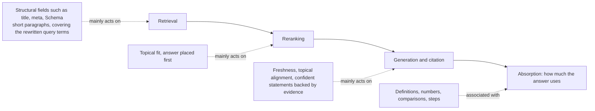

# Chapter 8: The Evidence on Content-Level Practices: What Works, What Fails, What Goes Out of Date

> Where this chapter sits: the three pipeline stages "selection and ranking → citation → absorption", with a look back at how content changes affect "retrieval".
> Precondition: the page is already accessible and indexed (the accessibility problems discussed in earlier chapters have been handled). This chapter asks only one thing: **for the same page, does how the content is written or changed alter whether AI cites it, and how much?**

## Questions this chapter answers

1. Why do the 2023 favourites, "add statistics, add quotations, cite sources", no longer work on today's engines?
2. If most hand-written techniques have stopped working, what kind of content does automated optimization converge on?
3. How much evidence is there for freshness, structure, Schema, Q&A format, short paragraphs, an authoritative tone and keyword stuffing? At which stage of the pipeline does each one act?
4. What side effects does content optimization have? When does more optimization make things worse?
5. Where do research and practitioners' tests contradict each other, and how should that be understood?

## 8.1 Core principles

### Principle 1: Content techniques have a shelf life, and the classic 2023 techniques no longer work

The first set of content techniques proposed in GEO research was measured under one specific condition: the web page was already among a handful of candidate documents, the models of the time generated the answer, and the measure was the relative change in word-count share (see Chapter 0).

When these techniques are retested on today's engines, the results are completely different:

| Technique | Effect reported in 2023 | Retested on modern models |
|---|---|---|
| Add quotations | +42.6 | -0.33 |
| Add statistics | +32.8 | -0.28 |
| Cite sources | +27.7 | -0.79 |

(Unit: percentage points of citation share. The retest covered ten modern models; none of the three increased citations.)

The reasons for the failure can be understood mechanically. There are at least three:

- **The engines themselves are changing.** When models are replaced by new generations, the way they judge "whether this text is worth citing" also changes. A lever that worked on an old model does not necessarily still work on a new one.
- **Crowding.** As more and more websites adopt the same kind of rewrite, each adopter's gain shrinks towards zero and can even turn into zero-sum competition. Simulation studies show that once adoption is high enough, sticking to a single fixed strategy does worse than not optimizing at all.
- Experimental conditions overstate the effect. In experiments with "fixed candidate documents", a rewrite only has to beat the other four documents. In the full pipeline, the same rewritten document may fall behind at the retrieval or reranking stage and never reach the generation stage at all.

```
2023 experimental setup:  [already among 5 candidates] → rewrite → generation → word-count share ↑
Real pipeline:            query → retrieval → reranking → generation → citation
                                     ↑            ↑
                      the rewrite may be eliminated at either of these two gates
```

Conclusion: every content technique should be treated as a hypothesis "with an expiry date", not a law. It has to be measured repeatedly on the current engines before you keep using it.

### Principle 2: Automated optimization converges on "faithful to the facts, aligned with the query, clearly structured"

If most hand-written techniques have stopped working, what happens when AI itself searches for "the best way to rewrite"?

Several studies point the same way. The style that automated optimization eventually converges on is:

- **Faithful to the facts**: no exaggeration, no invention, no piling on emotion.
- **Aligned with user intent (query alignment)**: responds directly to what the query is asking, in the user's own wording.
- Clearly structured: bullet points, separate paragraphs, information that is easy to extract.

In an e-commerce setting, after a simple defensive clause was added, prompts that had been optimized to "manipulate" the ranking converged on their own towards a factual style, and the share flagged as manipulation fell by 60 percentage points on average. So when an engine has basic defences, manipulation does not pay, and honest, clear writing turns out to be the best solution.

This is consistent with Principle 6.1 in Chapter 6: what engines prefer is not some writing trick but content that matches the query, can be extracted and can be trusted.

Two points need attention at the same time:

- The automatically derived "engine preference rules" overlap fairly strongly across models (about 79–84%), but across domains (for example e-commerce versus open-domain) the overlap is only about 35–40%. Preferences are domain-specific.
- Another study found that a "content quality score" that looks only at the content itself, ignoring the query, correlates only weakly with actual citations (about 0.11), while models that measure "relevance between query and source" correlate clearly better (about 0.35–0.39). Answer the question first; then worry about how well it is written.

### Principle 3: Each content element acts at a different stage of the pipeline

A common misunderstanding is to treat every content element as a "lever for more citations". In fact they act at different points:



The current evidence for each element is summarised below:

| Element | Evidence summary | Conclusion |
|---|---|---|
| Freshness | In controlled experiments, the odds ratio (OR) of a newer timestamp against an older one ranges from 14.4 to over 10,000; on Chinese-language engines, cited pages for highly time-sensitive queries have a median age of 18 days and a citation half-life of 39 days, against 101 days and 68 days for queries with low time sensitivity | **Effective**, especially for time-sensitive queries |
| Definitions, numbers, comparisons, steps | Pages containing these elements are absorbed into answers 41–77% more | Correlational evidence; points the same way as experimental results on "raising evidence density across the whole page" |
| Structure / Schema | Changing structural fields helps retrieval; changing layout alone has no effect; structured presentation only redistributes citations among equivalent sources; correlated with being cited (r=0.63, correlational) | **Acts at the retrieval and extraction stages; not a citation lever in itself** |
| Q&A format | Does not increase absorption; no clear advantage in live website experiments | Ineffective on its own |
| Short paragraphs / splitting into sections | Performed best in experiments with self-built websites | Preliminary evidence |
| Authoritative tone | Unstable effect, and may reduce credibility | Not recommended |
| Keyword stuffing | All relevant studies show it is ineffective or harmful | **Ineffective** |

A few points deserve separate explanation:

**There are two kinds of structure.** One is **structural fields** (title, meta, headings, Schema), which help the retriever find you. The other is body layout (adding lists, adding subheadings, aggregating information), which in controlled experiments has almost no effect on "who gets cited" (odds ratios 0.79–1.68, with no consistent direction).

The items within structural fields need to be looked at separately. Repeated tests on real AI search engines found (158,000 answers, comparing pages within the same website): for each standard deviation of better fit between a paragraph and the question, citations rise by 15.5%; better fit between the title and the question adds 14.1%, but has no effect on ChatGPT (−0.2%). FAQ, structured data, summary boxes and page speed all correlate positively with citations when compared across websites (+7.5% to +20.9%), but none is significant when compared within the same website (−5.3% to +6.9%), because they mostly appear on websites that were already frequently cited. So title wording belongs to "matching the question", and Schema cannot be treated as a driver of citations. This is a correlational study, it used the API of a small model, and the authors run a monitoring platform.

Structured presentation "redistributes"; it does not "expand". When the same fact has several equivalent sources, structured presentation can win the target page a few more citations (about +0.50 citations), but the total number of citations does not rise: they are taken from the other equivalent sources. And for the main metric, "whether it is cited", the confidence interval of the improvement crosses zero, so the effect cannot be established.

Rewrites that do not specify a target are almost ineffective. Simulations or theoretical analysis suggest (election scenario, fixed context, three models): when a rewrite does not specify which entity to highlight, none of 36 settings significantly increases the target's exposure after correction, and about a quarter actually strengthen the opponent; when the target is specified, half are significant after correction. Structural and argument-based rewrites work best and switching to technical jargon works worst, but the absolute gain is only about 0.5–1.5 percentage points.

Q&A format is not the answer in itself. The absorption of Q&A pages, compared with non-Q&A pages, is slightly lower, by 5.74%. What really correlates with absorption is whether the page contains directly usable content such as definitions, numbers and comparisons.

### Principle 4: Optimization has side effects

Content optimization does not bring only benefits. Three kinds of side effect are known:

1. **Gaining one thing, losing another.** A page usually has to answer several related queries. When it is tuned for a single query, 30.6% of the non-target queries show a negative gain.
2. **Lower faithfulness.** Automated rewrites aimed at visibility lower the content's faithfulness score from 8.29 to 4.90 and attribution accuracy from 6.15 to 4.18. The page is "seen" more, but it is reported correctly less often.
3. Falling behind at the retrieval stage. In the full pipeline, changing only the body text lowers the page's retrieval hits by about 9% and reranking hits by about 16%; an automated rewriting method that expands the text heavily lowers retrieval hits by about 36%; rewrites that switch to obscure or technical vocabulary lose the most.

```
Change only the body text → generation stage may gain + a little
                          → but retrieval -9%, reranking -16%
                          → net effect: citation rate -6%
```

## 8.2 How strong is the evidence

### On "the classic techniques no longer work"

- **When the pages are supplied to the engine**, retesting add quotations, add statistics and cite sources on ten modern models found that none of the three moved citations; cite sources was nominally negative before correction. A further replication on three latest-generation models also gave zero or nominally negative results.
  - Limitations: the authors of this study themselves provide a content scoring service, so there is a conflict of interest; the experiment "appended quotations, statistics and so on as separate blocks" rather than working them into the body text.
- **Simulations or theoretical analysis suggest that, in principle**: of 54 "method × domain" combinations, only 3 showed a statistically significant improvement in citation rank, and none worked on question-answering tasks. Adding statistics significantly lowered rank in 19 of 24 scenarios. By comparison, the gain from putting the document first in the context is far larger than that of any content rewriting method.
- Simulations or theoretical analysis suggest that, in principle: in an e-commerce reranking setting, only 4 of 15 hand-written techniques slightly beat or matched a simple prompt, and the other 11 did worse; a storytelling rewrite scored -4.36.
- Simulations or theoretical analysis suggest that, in principle: 9 word-level (token-level) rewriting techniques all fell below the unrewritten baseline on three engines.

Scope: most of the above used fixed contexts or controlled frameworks. What they show together is that "appended, word-level techniques are unreliable"; this is not the same as "evidence and data are useless" (see Debate 1 in Section 8.3).

### On "the direction automated optimization converges on"

- **In controlled experimental systems**, using automatically derived engine preference rules to guide rewrites raised visibility on one engine from 20.18 to 43.76, with clear gains on the other two engines as well. But on one of the engines, answer precision fell from 96.51 to 84.98, which shows that the claim of "maintaining answer quality" does not fully hold.
- **Simulations or theoretical analysis suggest that, in principle**: in an e-commerce setting, automated prompt optimization improved 63 of 75 test cells; the gain was unrelated to description length.

### On the individual content elements

| Element | Type of evidence | Strength |
|---|---|---|
| Freshness | Repeated tests on real AI search engines (Chinese-language engines, about 160,000 citations) + simulation experiments (252,000 trials) | Fairly strong; both types of evidence point the same way |
| Structural fields help retrieval | In controlled experimental systems (a corpus of about 171,000 real web pages) | Moderate; retrieval improves by about 22%, but reranking still drops |
| Structure correlates with citations | Observational audit on real AI search engines (B2B SaaS, 1,702 citations) | Correlation only; audited only cited pages, with no uncited pages for comparison |
| Structured presentation redistributes citations | In controlled experimental systems, including counterfactual replay | Moderate; main metric uncertain |
| Short paragraphs | Tests on real AI search engines (450 self-built websites) | Preliminary; the figure is a "share of successful exposures", not a success rate |
| Definitions, numbers, comparisons | Descriptive analysis of snapshots from real engines | Weak; confounders not controlled |
| Q&A has no advantage | Descriptive analysis + experiments with self-built websites | Weak to moderate |
| Authoritative tone is harmful | Simulation analysis, LLM judges | Weak |
| Keyword stuffing is ineffective | Tests on real engines + several simulation studies | Consistent across studies |

### An easily overlooked measurement problem

- **In controlled experimental systems**, 15% of single-generation "cite or not" decisions flip when rerun; about 45% of the effect variance comes from decoding randomness.
- **Practitioners' repeated, controlled tests found**: when the noise floor was measured before intervening, 98% of 387 queries gave the same result 3 days later; changes smaller than about 3–4 percentage points should therefore be treated as measurement noise, not as an effect.

This means that measuring once, seeing a change of a few percentage points and declaring a content practice effective is unreliable.

## 8.3 Debates and counterexamples

### Debate 1: Are statistics and evidence useful or not?

| One side | The other side |
|---|---|
| On modern engines, appended statistics blocks do not move citations; in simulation experiments, adding statistics often lowers rank and reduces credibility as rated by LLM judges from 8.352 to 7.613 | In simulation experiments, raising the density of statistics and source citations across the whole page increases visibility by 37–96%, and in ablations "statistics" and "cite sources" contribute the most; in another simulation, adding statistics had an effect of +3.49, and evidence-type changes were the strongest of all heuristics |

**What each side is based on**: the former measures "appending a block" or "word-level rewriting"; the latter measures "raising evidence density when the whole page is rewritten".

**The practitioner side**: Practitioners report from their own tests that one piece of original research (an audit of the AI visibility of more than two thousand training companies) became the only page on that website listed by Perplexity as the top source, and they consider original figures the strongest citable signal at present. One practitioner observed that, across about 150 websites, the median share of paragraphs containing numbers, quotations or external links was only 23/100.

A reading that holds both together: "pasting numbers in" and "the content itself contains evidence not available elsewhere" are two different things. The former has been shown to be unreliable; the latter is currently supported only by simulations and practitioner reports, with no causal evidence yet from real engines.

### Debate 2: Is Schema useful?

| Supporting side | Sceptical side |
|---|---|
| In controlled systems, structural fields (including Schema) raise retrieval hits by about 22% | In a randomised controlled test on 318 pages, Markdown formatting gave no statistically significant improvement; that practitioner also considers Schema not to be a main lever (practitioners report from their own tests) |
| In an observational audit, structured data correlates with being cited at r=0.63 | Practitioners report from their own tests that, on the same test page, ChatGPT and Gemini showed the price visible on the page, 349.99, rather than the 199.99 in the Schema |
| Practitioners report from their own tests that, comparing SaaS websites with similar traffic, websites with complete Schema were cited about twice as often as those without | One practitioner observed that one of their own websites has no Schema at all and still receives about 55,000 search-engine AI citations a month |
| One practitioner observed that after completing the Schema for products with multiple variants, AI went from picking up only the price of the default variant to correctly listing the price of each variant | Practitioners widely believe that Schema on its own has limited effect, and that adding it carelessly or incompletely does nothing |

**A reading that holds both together**: Schema works more like "helping machines understand what you already have" and "helping retrieval and entity classification" than "making AI choose you". One practitioner summed it up in one sentence: being readable is not the same as being chosen. When Schema conflicts with the visible content of the page, at least in the tests above, the model trusted the visible content. In addition, cross-website correlational evidence (such as the r=0.63 in the table above) may be mixed with the effect of the website itself; when compared within the same website, structured data shows no significant correlation with citations (see the addition after "There are two kinds of structure").

### Debate 3: Is FAQ / Q&A format useful?

- **The research side**: Q&A pages are absorbed slightly less than non-Q&A pages (-5.74%, descriptive evidence); in experiments with self-built websites, Q&A formatting showed no clear advantage.
- **The practitioner side**: Practitioners report from their own tests that after restructuring 8 comparison pages so that "each H2 answers one complete question within 300 characters" and adding FAQ Schema, ChatGPT citations across 12 target queries went from 0 to 4 within 6 weeks. In another test report, after adding FAQ Schema, a summary at the top and comparison tables, and posting on social platforms, appearances across 60 questions rose from 4 to 25.
- A key counterexample: Practitioners report from their own tests that FAQ questions optimized for keywords were completely ignored; only questions using "the wording real people actually type" were cited.

A reading that holds both together: the success stories in practitioner reports almost all involve "several changes made together", so the credit cannot be given to the FAQ format alone. And the detail of "asking questions in real people's wording" actually points to the query alignment of Principle 2, not to the format itself.

### Debate 4: Is an authoritative, confident tone good or bad?

- **Simulations or theoretical analysis suggest that, in principle**: an authoritative-tone rewrite lowered credibility as rated by LLM judges from 8.352 to 7.332; in the e-commerce setting, an authoritative tone is also on the list of techniques that fail.
- **But another controlled experiment** found that "confident statements backed by evidence" help a page get cited, while vague wording and self-contradictory content reduce citations.
- Practitioners report from their own tests: after rewriting 8 articles into more confident, citable assertive wording, two topics that previously had zero visibility began to be cited within two months (no control group, and the author also suspects coincidence). Practitioners' repeated, controlled tests found: reducing hedging such as "however, although, despite" makes citations more stable.

A reading that holds both together: the issue is not "confidence" but "whether there is a basis for it". Clear statements backed by evidence and an unfounded authoritative tone may have effects in opposite directions.

### Debate 5: Freshness: is newer better, or is older more stable?

- **For "new"**: research shows a strong advantage for new timestamps, and the citation half-life for time-sensitive queries is only 39 days. Practitioners report from their own tests that a page deliberately left un-updated for two months was dropped entirely by ChatGPT, which switched to citing a short post on a professional networking platform that was newer and answered more directly.
- **For "old"**: Practitioners report from their own tests that the median age of 356 cited pages was 23 months, only 35% were less than a year old, but the median time since last update was 5 months. In another test report, articles published more than two months earlier had a citation rate of about 43%, against only about 7% for new articles. One practitioner observed that the median age of cited pages when their first citation was recorded was 203 days, and only 9% were less than a month old.
- Counterexample: One practitioner observed that after updating a page that had been cited consistently, its citations dropped noticeably, recovered only partly after several weeks, and did not return to their original level.

A reading that holds both together: "fresh" may mean two different things: the page has been maintained recently (which helps existing pages), and the page has just been published (new pages often need time to build up). The most consistent pattern in the data is that pages that have existed for some time and keep being updated are cited most often. Updating also carries risk: a major change can temporarily disrupt existing citations.

### Debate 6: Summaries at the top, long content, large numbers of pages

- **Summaries at the top**: in simulation studies, a summary placed first gave small significant gains in the retail and gaming domains; in controlled systems, putting the answer first helps reranking. But practitioners report from their own tests that adding a "key points summary" at the top of the page had no effect.
- **Length**: in simulation studies, the optimization gain was unrelated to description length; in controlled systems, heavy expansion lowers retrieval hits by about 36%. One practitioner observed that strong brands tend to publish long content of 2,000 words or more; another practitioner observed that making content more concise and factual won an AI Overviews position.
- Number of pages: Practitioners' repeated, controlled tests found that publishing a large number of standalone topic pages raised the ChatGPT recommendation rate from 11.9% to 23.1% within six weeks, while Claude dropped by 4.1 percentage points over the same period. Another practitioner observed that publishing three articles a week for two months, adding Schema and getting listed in directories produced almost no change in citations.

A reading that holds both together: "putting the answer first" and "adding a summary at the front" are not the same thing. The former changes the starting point of every paragraph; the latter just adds one more block of text. Length itself is not the variable; whether each paragraph can answer one question on its own is. Whether the number of pages helps depends on whether each page corresponds to a real question that has not yet been answered well.

### Debate 7: Does writing quality matter?

- **Practitioners report from their own tests**: in an audit of 158 articles, cited articles had an average quality score of 60.4 and uncited ones 62.5, so the ignored articles were in fact slightly better written. **Practitioners' repeated, controlled tests found**: across 200 articles and 3 engines, editorial quality scores were almost unrelated to being cited.
- Practitioners widely believe that only content with a viewpoint worth citing or useful information gets cited.

A reading that holds both together: "quality" here mostly means prose style and editorial scores. What engines value is answering the question, being extractable and adding information, not prose style. This points the same way as the research finding in Principle 2 that "query-independent content scores correlate only weakly with citations".

## 8.4 Cases

The following cases all come from practitioners' first-hand reports and are not independently verified. They illustrate the principles; they do not prove them.

### Case 1: Two months without updates, replaced by a short post on a professional networking platform

- **What was done**: a page was deliberately left un-updated for two months, with its topic and keywords unchanged.
- **Platform**: ChatGPT.
- What was observed: ChatGPT stopped citing the page entirely and instead cited a short post on a professional networking platform written by an author with only 300 followers, because that post was newer and answered more directly.
- Related principle: freshness is a strong factor at the citation stage (Principle 3); "answering more directly" was also at work at the same time, so the effect cannot be attributed to one factor.

### Case 2: A B2B client goes from 0 to 7/10 in 12 weeks

- **Starting point**: of 10 target queries, 7 already ranked on the first or second page of traditional search, but AI Overviews citations were zero.
- **What was done**: in month one, a content audit and structural rewrite: answering directly at the start, and adding FAQ Schema to 8 target pages; in month two, off-site mentions (from 2 to more than 12); in month three, freshness maintenance and monitoring.
- Platform: Google AI Overviews (and Perplexity).
- What was observed: the first AI Overviews citation appeared on day 18; at 12 weeks, 7 of the 10 queries produced citations; traditional rankings did not change at all. FAQ questions optimized for keywords were completely ignored, and only questions in real people's wording were used. The remaining 3 queries, dominated by big brands, could never be cracked.
- Related principle: putting the answer first helps at the reranking stage; query alignment matters more than format (Principle 2); content changes cannot overcome a gap in the third-party source ecosystem (see the chapter of this book on third-party sources).

### Case 3: Four experiments by a website-building platform

- **What was done and what was observed**:
  - Rewriting blog posts as "real user question" articles: share of voice rose from 38% to 100% within 3 weeks, and 70% of the tracked questions improved.
  - Adding a table of contents: clicks +23% and AI visits +60% within 4 weeks.
  - Changing headings to questions: AI visits +58% within 4 weeks.
  - Adding a "key points summary" at the top of the page: **no effect**.
- Related principle: the three changes that worked all relate to "aligning with user questions" and "letting the engine locate paragraphs quickly"; the one that did not work only added a summary and did not change the paragraph structure (Debate 6).

### Case 4: Measure the noise first, then look at the effect

- **What was done**: the same set of 134 questions was tracked weekly; the strategy was to publish a large number of new standalone topic pages (458 articles) rather than rewrite pages that already ranked; the pages were plain HTML and did not depend on JavaScript.
- **Platforms**: ChatGPT, Claude, Google.
- What was observed:
  - Within about six weeks, ChatGPT's proactive recommendation rate rose from 11.9% to 23.1% (24 queries rose, 9 fell); over the same period Claude dropped by 4.1 percentage points.
  - Google listed the domain as a source in 36% of answers, but recommended the brand 0% of the time.
  - Claude copied up to 64 words verbatim in a row and attached the URL, but its list of recommendations still came from competitors' official websites.
  - Noise was measured before intervening: 98% of queries gave the same result 3 days later; changes smaller than about 3–4 percentage points were treated as noise.
- Related principle: "being cited" and "being recommended" are different states; the same content strategy may have opposite effects on different engines (Principle 1); evaluation requires knowing the noise floor first (Section 8.2).

### Case 5: An audit of 158 articles

- **What was done**: 158 published pieces were reviewed, 78 of which were audited against 28 criteria and tracked on ChatGPT, Perplexity, Google AI Overviews and Claude.
- **What was observed**:
  - Writing quality was almost irrelevant (cited 60.4 points vs uncited 62.5 points).
  - The same author with the same material had a citation rate of about 52% when published on an industry publishing platform, and 0% on both the company blog and personal pages.
  - Question-style H2s +19% in citations, tables / lists +18%; a sales tone -26%.
  - About 43% of articles published more than two months earlier were cited, against about 7% of new articles.
- Related principle: where content is published (third-party sources) has a far larger effect than how it is written; a sales tone runs against "faithful to the facts" in Principle 2; new content needs time (Debate 5).

### Case 6: When Schema conflicts with the visible content

- **What was done**: on a test page, the price marked up in Schema (199.99) was made inconsistent with the price visible on the page (349.99).
- **Platforms**: ChatGPT, Gemini.
- What was observed: both showed the visible 349.99.
- Related principle: at least in this test, the models took the visible text as authoritative; Schema cannot replace the body text (Debate 2).

## 8.5 What to do

### Recommended (ordered by strength of evidence)

| Practice | Strength of evidence | Notes |
|---|---|---|
| First confirm that the content corresponds to real queries, and write titles and questions in users' actual wording | In controlled experiments and simulations, query relevance is the strongest predictor; supported by practitioners' own test reports | Answer the question first; then worry about the writing |
| Keep existing pages continuously updated, with more frequent updates for time-sensitive topics | Repeated tests on real engines + simulation experiments, pointing the same way | The half-life for time-sensitive queries is about 39 days, which can serve as a reference for review intervals |
| Write core entities and key numbers into structural fields such as title, meta, headings and Schema | Controlled experimental systems | Acts at the retrieval stage; not a citation lever |
| Open each subsection with the answer, so that each paragraph can answer one question on its own | Controlled experiments (answer-first helps reranking); Practitioners widely believe | This changes where paragraphs start; it is not adding a summary at the top of the page |
| Split content into short paragraphs | Preliminary evidence on real engines | The figure is a share, not a success rate; effect size unknown |
| Put evidence into the content that is not available elsewhere: original data, definitions, comparisons, steps | Simulation experiments + descriptive correlation + practitioners' own test reports | Work it into the body text, with sources and dates; not as an appended block |
| Use clear statements backed by evidence, and cut unnecessary hedging | Controlled experiments; practitioners' repeated, controlled tests | Confident ≠ exaggerated; do not force an assertion where there is no basis |
| Make one page serve several related queries instead of tuning it for just one | Simulation analysis | Tuning for a single query harmed 30.6% of non-target queries |
| Before evaluating any change, measure the noise floor first and record results per engine | Controlled experiments (15% flips); practitioners' repeated, controlled tests | Do not treat changes smaller than 3–4 percentage points as an effect |

### Do not do

- **Do not stuff keywords.** All relevant studies show it is ineffective or harmful; on real engines it had no effect on any system.
- **Do not replace existing wording with obscure or technical terms.** In the full pipeline, this is the rewrite with the largest retrieval loss.
- Do not expand content heavily to make it "more comprehensive". It makes the page fall behind at the retrieval stage.
- Do not use a sales, advertising, storytelling or emotionally exaggerated style. Research and practitioner reports point the same way, towards a negative effect. (This applies to the goal of "being cited by AI". Simulation studies show that in Q&A communities, emotion and expressiveness actually correlate positively with human votes; the two goals are different.)
- Do not add only an authoritative tone without evidence. It may reduce credibility.
- Do not let Schema disagree with the visible content. Models may take the visible content as authoritative, and the conflict only creates confusion.
- Do not make a large change in one go to a page that is already cited consistently. One practitioner observed citations falling for several weeks as a result and never fully recovering; make changes in small, reversible steps.
- Do not pursue visibility at the expense of accuracy. Visibility-oriented rewrites lower faithfulness: the page is cited more, but also misreported more.

### Already outdated

- **The "add statistics, add quotations, cite sources" trio as standalone techniques.** The +27% to +43% of 2023 retests as zero or slightly negative on modern models.
- **Any single-technique list of the "boost by 40%" kind.** Word-level rewrites fall below the unrewritten baseline in several studies, and the more people adopt them, the closer the effect gets to zero.
- Treating FAQ format or Schema as the main means of "getting AI to cite you". They help reading and retrieval, but do not in themselves decide whether you are chosen.
- The idea of "optimize once, effective forever". Engine updates make known levers expire, so they have to be retested regularly.

## Key points

1. **Content techniques have a shelf life.** The 2023 "add statistics, add quotations, cite sources" no longer increase citations when retested on modern models.
2. **Automated optimization converges on faithful to the facts, aligned with the query, clearly structured.** This is currently the closest thing to a "general optimum", and preferences vary by domain.
3. Answer the question first; then worry about the writing. Relevance between query and content predicts citations better than query-independent "content quality"; good or bad prose is almost unrelated to being cited.
4. Freshness is the content factor with the most consistent evidence, but the pages cited most often are those that "have existed for some time and keep being updated", not newly published ones.
5. Structure and Schema act at the retrieval and extraction stages. Structured presentation only redistributes citations among equivalent sources and is not a citation lever in itself.
6. Q&A format, an authoritative tone and keyword stuffing are all ineffective or harmful on their own. The FAQ success stories mostly come from "aligning with the query in real people's wording", not from the format itself.
7. Optimization has side effects: tuning for one query harms other queries; pursuing visibility lowers faithfulness; changing only the body text may make the page fall behind at the retrieval stage.
8. A single measurement cannot be trusted. About 15% of citation decisions flip when rerun; before evaluating any practice, measure the noise floor first and record results per engine.
