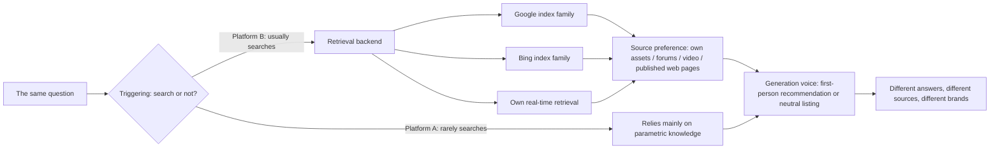

# Chapter 12: Platform Differences and the Chinese-Language Ecosystem

## Questions this chapter answers

1. Why is there no single, unified "AI search"? At which stages of the pipeline do the differences between platforms appear?
2. What tendencies do ChatGPT, Gemini / Google AI Overviews (hereafter AIO), Claude, Perplexity and Copilot each show in source selection? How reliable are these tendencies?
3. How does the Chinese-language ecosystem (Baidu AI Overview (百度 AI 概覽), Doubao (豆包), DeepSeek, Tencent Yuanbao (騰訊元寶), Qwen (通義千問)) differ structurally from the English-language ecosystem?
4. How does the query language change the citation pool?
5. With limited resources, how should you decide which platforms to track and optimize for?

## 1. Core principles

### 12.1 Each platform is a different pipeline

The main thread of this book is that AI search is a filtering pipeline: "triggering → accessibility → retrieval → selection/ranking → citation → absorption → user behavior". This chapter adds one sentence: **each platform has its own pipeline of this kind, and the parameters differ at almost every stage.**

So the same question, on the same day, with the same set of pages, gives different answers on different platforms. A brand being "visible" on one platform tells you almost nothing about whether it is visible on another.

### 12.2 Where the differences appear

| Pipeline stage | Differences between platforms | Evidence strength |
|---|---|---|
| Triggering | For the same set of 1,000 prompts called through the API, GPT-5.3-chat invoked search only 14% of the time, while Claude Sonnet 4.6 did so 83% of the time | Repeated tests on real AI search engines |
| Retrieval backend | Google products depend on the Google index; websites that block Google's AI-training crawler token (Google-Extended) receive zero citations in Gemini and significantly fewer citations in AIO (a correlation, not causation) | Repeated tests on real AI search engines |
| Retrieval scale | URLs returned per query: ChatGPT averages 14.06, DeepSeek 5.46 | Repeated tests on real AI search engines (real user conversation data) |
| Source preference | Large forum and community sites and YouTube appear in ChatGPT's and Grok's search results but are completely absent from Claude's search results | Repeated tests on real AI search engines |
| Own assets | Google platforms tend to cite their own assets, such as YouTube; Baidu AI Overview mainly cites Baidu's own subdomains | Repeated tests on real AI search engines |
| Generation voice | In product recommendations, ChatGPT gives 79% in the first person ("I recommend"), Gemini only 7%, AIO only 2% | Repeated tests on real AI search engines |
| Citation and absorption | ChatGPT cites an average of 6.88 sources per prompt, Google 12.06, Perplexity 16.35; but the average influence of a fetched page on the answer is 0.2713 for ChatGPT, 0.0584 for Google and 0.0646 for Perplexity | Secondary analysis of a static snapshot; counts only as descriptive evidence |

The last row can be condensed to: **ChatGPT cites fewer sources, but each cited source influences the answer more deeply.** This conclusion comes only from a descriptive analysis of a single snapshot with no control for confounding factors. Treat it as "possible in principle", not as a law.

### 12.3 Platforms favor their own assets

Platforms give priority to their own material. This is a structural bias, not a question of content quality.

- In health queries, the source Google AIO cites most often is YouTube, ahead of the US Centers for Disease Control and Prevention, the World Health Organization and well-known medical institutions' websites.
- The source overlap between the three Google interfaces (Google Search, AIO and Gemini) is extremely low, with Jaccard coefficients of only 0.11–0.18 (0.18 between AIO and traditional search results), and the generative interfaces favor Google's own assets.
- The most frequent sources in Baidu AI Overview are mainly Baidu's own subdomains (see 12.5).

Implication: on Google and Baidu platforms, "the platform's own content formats" are an entry point in themselves. This does not mean every brand has to make videos or set up a presence on platform subsites. But when you assess "why my page was not cited", first subtract the positions taken by the platform's own assets.

### 12.4 Levels of observation are not equivalent

Platform differences have another frequently overlooked source: **what you see depends on how you look.**

- **The interface and the API differ.** A large-scale audit found that the domains returned by consumer interfaces and by the corresponding APIs overlap by only 12.0% (ChatGPT) and 14.8% (Gemini). Using API results to stand for the answers consumers see is wrong.
- A single run and multiple runs differ. A single observation of ChatGPT shows an average of only 2.65 domains; after 3 repetitions this rises to 5.56. The Jaccard coefficient of product recommendation sets across repeated queries is 0.421 for AIO, 0.287 for Gemini and 0.178 for ChatGPT. That is, ChatGPT's recommended products change the most from run to run.
- Slight rewording also changes the sources. After slight rewording of a query, the consistency of source ranking (RBO) is only 0.49 for AIO, against 0.74 for traditional search results; when rerun on the same device, AIO is 0.69 and traditional search 0.86. Generative interfaces are less stable than blue links.
- Model versions differ. Practitioners' repeated, controlled tests found that, for the same set of brand queries, a fintech client appeared 3 times out of 10 in a larger model, while a smaller model recommended the same market leader every time, however the question was asked. In another set of tests, the same client appeared 8 times out of 10 in a larger model and 0 times in the raw API with no system prompt.
- "Listed" is not the same as "used". Real user conversation data show that 14–53% of claims in answers are in fact supported by search results without a citation being marked, and a further 15–20% or more of claims cannot be grounded in any source. Measuring source influence only by "was it cited or not" both misses and miscounts.

### 12.5 The structure of the Chinese-language ecosystem

The Chinese-language ecosystem is not a translated version of the English-language ecosystem. Existing research points to three structural features.

**Feature 1: Baidu AI Overview is highly concentrated and favors its own subdomains.**

In an audit using 500 translated queries collected in a single run:

| Metric | Baidu (Chinese) | Google (Chinese) | Google (English) | Baidu (English) |
|---|---|---|---|---|
| Overview appearance rate | 82.0% | 97.6% | 97.0% | 4.0% |
| Source Gini coefficient | 0.895 | 0.500 | 0.462 | n/a |
| Share of the top-ranked host | 27.1% | 6.6% | 5.5% | n/a |

The closer the Gini coefficient is to 1, the more citations are concentrated in a few sources. Baidu's 0.895 for Chinese means a few hosts (mainly Baidu's own subdomains) take most of the citation positions. The Jaccard coefficient of host domains between the two platforms is only 0.008–0.034, meaning they share almost no sources; yet on 331 shared queries, the median cosine similarity of the semantic embeddings of the two sides' answers lies between 0.701 and 0.813. **The answers say much the same thing, but the sources cited are almost completely different.** For brands, the latter is what matters.

Feature 2: the query language determines the citation pool more than geographic location does.

In a study of health queries in AIO, the share of citations going to local sources varied widely when queries were in English: Australia 48.2%, the United States 33.7%, India 2.3%, Nigeria 0.2%. When queries were switched to the local native language, local citations rose 3.5–13.5 times, for example from 16.6% to 57.5% in Japan and from 2.7% to 36.4% in South Korea.

The implication for Chinese content is that users who ask in Chinese face a citation pool made up mainly of Chinese sources. Chinese content does not need to compete with authoritative English sites for the same positions, but it also means the "authority" of English content does not transfer automatically into Chinese answers. In the same study, the return rate for traditional Chinese medicine topics in Google AIO was about 42%; Baidu's return rate was higher, but it attached only about 1 citation on average.

On ChatGPT, however, a qualification is needed: a study that captured the internal execution of ChatGPT's web version found that, for questions in Chinese, the new Instant mode used only English search in about 67%–70% of runs (the study measured the query language, not the language of the cited sources).

Feature 3: Chinese generative search engines show a large gap between "citation → absorption".

A large-scale study covering Doubao, DeepSeek, Tencent Yuanbao and Qwen, 8 interfaces in total (Web and App counted separately), collected 160,860 citations using 614 queries × 8 interfaces × 3 repetitions. Main findings:

- Source structure: third-party sources account for about 69%, brand official websites 12.9%, government sources 4.5%.
- Listed is not the same as used: of the sources listed, 66% appear in the body of the answer, 30% are substantively cited, and only 8% are cited in depth; 39.3% are "silent citations" (listed, but not used in the answer).
- Low brand selection rate: of the brands that appear in the citation pool, only 8.3% make it into the final answer.
- Multi-source co-occurrence is a strong signal: when a brand appears in only 1 citation, its selection rate is 2.1%; when it appears in 11 or more citations, its selection rate is 59.9%.
- Traditional SEO scores are not the primary factor: a commonly used third-party composite Baidu quality score has an importance of only 4.52% in the model predicting absorption. This shows it is not a primary predictor; it does not prove it is useless.
- Freshness: for high-freshness queries, the median publication age of cited pages is 18 days, with a half-life of 39 days; for low-freshness queries, the figures are 101 days and 68 days.
- Different interfaces of the same platform: between the App and the Web version of the same platform, the domain-level Jaccard coefficient is only 0.19–0.51; for Qwen, the URL-level Jaccard is only 0.014.

The last point deserves separate emphasis: in the Chinese-language ecosystem, the App and the web version of the same brand should be treated as two platforms.

The authors of this study belong to a monitoring vendor, and the data were collected by its monitoring system; all findings are correlational. The study design itself (multiple interfaces, three repetitions) is solid, but it should be treated as the most complete descriptive data on the Chinese-language ecosystem currently available, not as proof of causation.

## 2. How strong is the evidence

| Conclusion | Evidence strength | Scope and limitations |
|---|---|---|
| Source overlap between platforms is low | Repeated tests on real AI search engines found (several studies agree); Practitioners' repeated, controlled tests found the same; Practitioners widely believe | The most robust conclusion. Specific figures vary widely with the measurement method (see Debate 4) |
| Search triggering rates differ enormously (14% vs 83%) | Repeated tests on real AI search engines found | Controlled replay through the API; consumer interfaces may differ |
| ChatGPT's share of first-person recommendations is far higher than Gemini's and AIO's | Repeated tests on real AI search engines found | Limited to product recommendation queries |
| Claude's search results contain no large forum and community sites or YouTube | Repeated tests on real AI search engines found; Practitioners report from their own tests the same | Observations up to September 2026 |
| Google platforms favor their own assets | Repeated tests on real AI search engines found (two studies) | Health and general queries; other verticals may not show the same degree |
| Blocking Google-Extended correlates with zero citations in Gemini | Repeated tests on real AI search engines found | Correlation only |
| ChatGPT cites less but absorbs more deeply | Simulation or theoretical analysis level (secondary analysis of a static snapshot) | Can only be described as "possible in principle" |
| Baidu AI Overview is highly concentrated | Repeated tests on real AI search engines found | Single collection run, translated queries, collected from a single location (Milan) |
| Native-language queries greatly increase local citations | Repeated tests on real AI search engines found | Health topics; observational |
| In Chinese engines, multi-source co-occurrence predicts brand selection | Repeated tests on real AI search engines found | Correlational; the authors are a vendor |
| Large differences between model versions | Practitioners' repeated, controlled tests found | Small sample, single client |

Overall judgment: **the evidence that "platforms differ from one another" is very strong; the evidence on "what exactly each platform prefers" is much weaker, and it changes quickly.** The former can serve as a premise for designing a tracking system; the latter can only serve as a current observation and should be used together with its observation date.

For the Chinese-language ecosystem, current evidence comes almost entirely from research, and controlled practitioner tests on Chinese platforms are lacking. This is a clear evidence gap in this chapter.

## 3. Debates and counterexamples

### Debate 1: How much does ChatGPT actually rely on forum communities?

| View | Basis |
|---|---|
| ChatGPT favors forum communities the most | Practitioners report from their own tests: about 150,000 citations were classified by source type, and ChatGPT showed the strongest tilt toward forums and Q&A sites (about 5%) and reference and academic pages (about 4%). In another test within a single niche, 14 of the 16 community sources ChatGPT cited came from large forum and community sites |
| ChatGPT almost never cites forum communities | Practitioners' repeated, controlled tests: with the same 40 fixed prompts in the same week, large forum and community sites were cited 22 times in Gemini and 20 times in AIO, and at most once in ChatGPT. In another benchmark across 10 industries, for South Africa-related queries, Gemini cited that forum about 750 times, while GPT-5 and Claude cited it zero times |

Both sides have data. Possible explanations: different observation times (July for the former, September for the latter), different measurement targets (API or consumer interface, with or without web access), and different verticals. For a single brand, the answer to this question can only be measured with your own prompt set. The relationship between platforms and forum communities is discussed in Chapter 15.

Note also: even if a site ranks high on a platform, its share of total citations may still be small. In the tests above, general publications and web pages accounted for 86–97% on every platform, and no platform was dominated by forums or video.

### Debate 2: Which platform cites the most sources per answer?

| Source | ChatGPT | Google platforms | Perplexity |
|---|---|---|---|
| Static snapshot study (average citations per prompt) | 6.88 | 12.06 | 16.35 |
| Practitioner tests (70 prompts, 30 days, 1,474 answers; citations per answer) | 9.62 | Gemini 15.08; AIO 5.34 | 5.04 |

Perplexity has the most on one side and the fewest on the other. The difference may come from the collection method, timing, prompt type, and whether "Google" means AIO or Gemini. The lesson is not who is right, but this: **"how many citations per answer" is a product of the measurement method and cannot be compared across studies.**

### Debate 3: Which platform is the most stable?

- Research shows the repeat consistency of product recommendation sets is highest for AIO (0.421) and lowest for ChatGPT (0.178).
- Practitioners' repeated, controlled tests reran 45 emergency repair queries in 15 cities in incognito mode: about 85% of Perplexity's results did not change, about two thirds of ChatGPT's repeated, and Google kept the same recommendations in about 60% of cities while switching providers in 40%.

Both show that ChatGPT varies a lot, but they disagree about Google. This may be because one measured product recommendations and the other local services, and the latter's Google results included personalization factors.

### Debate 4: How much do platforms actually overlap?

Different measurements give very different figures:

| Measurement | Overlap |
|---|---|
| Research: average shared domains between ChatGPT and Gemini for the same query | 5.4%; 76.7% of comparisons had no shared domain at all |
| Research: source Jaccard across the three Google interfaces | 0.11–0.18 |
| Practitioner tests (two independent samples verifying each other): pairwise overlap of cited domains | ChatGPT with the other three 10.6–14%; AIO with Gemini about 25–26% |
| Practitioner tests: 197 clinics in the same industry, three engines, each prompt run three times | 39–48% |
| Practitioner tests: median overlap of businesses named in local lists, Perplexity and Gemini | 11% |

One practitioner pointed out that when overlap is computed after pooling the citations from all prompts, the long tail of one-off domains pulls the figure down; comparing prompt by prompt may give higher numbers. So "11%" and "48%" do not necessarily contradict each other; they are computed differently.

The point both independent samples support is: **ChatGPT has the lowest overlap with other platforms, and the two Google products are closest to each other.** Perplexity's position is inconsistent across the two datasets.

### Debate 5: How quickly is new content reflected?

Practitioners widely believe that Perplexity reflects new content faster than ChatGPT, on the grounds that the former is based on real-time retrieval. Practitioners report from their own tests that Perplexity reflected updates within a few days while ChatGPT took weeks; another multi-model test claimed ChatGPT reflects content changes in about 2–4 weeks. This view is marked as disputed: its supporters all offer one-sided observations, with no controlled tests.

### Debate 6: Should you build a separate approach for each platform?

- The separate camp: Practitioners widely believe that each platform cites a different set of sources, so tracking must be done per platform. Practitioners report from their own tests that in about 40% of cases, a brand ranked first on ChatGPT was completely invisible on DeepSeek.
- The single-approach camp: One practitioner observed that, although sources differ greatly across platforms, focusing on two indexes, Google and Bing, roughly covers most cases. Another tester pointed out that page-level writing can be shared across platforms; what really varies by platform is "which external sources decide who gets named".

The two camps can in fact be reconciled: **build one approach for the readability and extractability of the pages themselves; look at the placement of external sources separately for each platform.**

### Debate 7: Can generalizations about what each platform "likes" be trusted?

Practitioners report from their own tests a "preference profile" for each platform: ChatGPT values statistics and forum discussions, DeepSeek values freshness most, and Gemini is the most balanced and more influenced by structured markup. Generalizations of this kind need caution:

- One of them, "adding statistics has the biggest effect on ChatGPT", conflicts with the main thread of this book: "the 2023 techniques of adding data and adding quotations no longer work".
- The sample was 15 pages over two months, with no published control group.
- Each platform's source preferences can change within a few months.

Profiles like this can serve as hypotheses when you design your own tests, not as conclusions.

## 4. Cases

### Case 1: A turning point in Copilot's citation curve after AI crawlers were allowed (June–September 2026)

- What was done: a streaming guide website that answers "where can I watch a given show in my country", covering 34 Asian markets. In June it had blocked AI crawlers because of bandwidth problems, and later lifted the block. On the content side it did two things: built data-driven comparison pages using real catalogue counts (rather than opinions), and built separate pages for each country.
- On which platform: Microsoft Copilot, with data from the AI performance report in a search engine's webmaster tools.
- What was observed: in 3 months it was cited about 185,600 times in Copilot answers; the number of pages cited per day grew from fewer than 100 in June to about 400; over the same period, traditional search clicks rose from close to zero to about 1,500 per day. The site owner said lifting the block was exactly the turning point of the curve. Unexpectedly, the most cited content was not the originally targeted markets but anime platform comparisons (7 of the top 12 queries); for another category of series queries, the site's pages supplied 61–85% of the answers' sources.
- Corresponding principle: accessibility is the first gate (12.2, retrieval backend); platforms look for sources that genuinely cover a given market (12.5, language and region).
- Limitations: Practitioners report from their own tests; single website; not independently verified. Lifting the block and the content improvements happened at the same time, so the effect cannot be attributed to either one separately.

### Case 2: Building profiles in the directories each platform cites (about 1 month)

- What was done: a service business built 10 industry prompts plus several brand prompts, and queried ChatGPT, Copilot, Claude, Gemini and Perplexity separately, each time in an incognito browser with a new conversation for each prompt, recording each platform's sources and main competitors. When a source turned out to be an industry directory site, the business created and completed a profile there and asked clients to leave reviews.
- What was observed: within one month it went from zero citations to being cited on 3 of the 5 platforms and for 6 of the 10 prompts. The author believes Copilot and Perplexity depend more on traditional search rankings, and that on these two platforms the only route is improving organic rankings.
- Corresponding principle: platform differences lie mainly in "which external sources are cited", so read out the source list platform by platform and then fill the gaps.
- Limitations: Practitioners report from their own tests; not independently verified. "Copilot and Perplexity depend more on traditional rankings" is the author's judgment, with no control.

### Case 3: Four-platform visibility across 48 local markets (single snapshot, August 2026)

- What was done: 8 mid-sized US cities × 6 categories, 48 markets in total. First, the businesses Google Maps returned for "category + city" were collected (about 97 per market, 4,657 in total); then three buyer-style questions were put to ChatGPT, Claude, Gemini and AIO to see which businesses were named.
- What was observed:
  - Only 11.9% of businesses were named by at least one of the four systems (26% under loose matching).
  - Businesses named per platform: AIO 376, ChatGPT 206, Gemini 134, Claude 92.
  - Of the businesses named, 70% appeared on only one platform; in 36 of the 48 markets, no business was named by all four platforms.
  - Differences between categories were larger than differences between cities: gyms 14.4%, coffee shops 14.1%, hair salons 9.7%.
- Corresponding principle: "visibility" across platforms is four independent questions, not four measurement points of one question.
- Limitations: Practitioners report from their own tests; only the top 100 map results were taken, so large markets are underestimated; the gap between strict and loose matching is large, as the author also points out.

Another related set of practitioner tests (recorded daily since August, 9,217 answers in total) adds two points: local recommendation lists are highly concentrated, and in 25 of 36 local lists, the same business appeared on more than 80% of days; for this kind of question, Perplexity mainly cites the businesses' own pages, plus a few directory and review sites.

### Case 4: The same news website, hundreds of pages cited by ChatGPT, zero by Gemini (September 2026)

- What was observed: tracking for a news website showed about 650–659 pages cited by ChatGPT and 0 pages cited by Gemini.
- The author's judgment: Gemini's problem is not "whether it recognizes this brand" but that it never retrieved these pages at all. This is a retrieval gap, not an attribution problem.
- Supporting evidence: One practitioner observed that a large website that had been deindexed by Google was crawled heavily every day by other platforms' crawlers, yet Gemini knew nothing about it. Another developer observed that a website brought in 230 users from ChatGPT in its first month, while Gemini never saw it.
- Corresponding principle: retrieval on Google platforms is tied to the Google index (12.2). When you are absent from Gemini, check your Google index status first, before discussing content.
- Limitations: Practitioners report from their own tests plus first-hand observations; not independently verified; usable only as a troubleshooting lead.

### Case 5: The same question, 10 models, 29 brands (July 2026)

- What was done: a Romanian agency asked the same luxury jewelry brand recommendation question in Romanian to 10 models: ChatGPT, Claude, Gemini, Copilot, Grok, Perplexity, DeepSeek, Kimi, GLM and Qwen. Clean sessions, no memory, no brand name in the prompt; each model was run only once, with no regeneration.
- What was observed: 29 different brands appeared in 50 slots, 19 of which appeared in only one model's list; any two models shared on average only 0.91 brands (about 18%); even the most frequent brand appeared in only 6 models. Copilot had no overlap at all with the other 9 models; its answer cited review counts, and the author infers that it relies mainly on Bing's real-time index and review aggregator sites. The two brands that made it into several models both had verifiable third-party facts and financial media coverage repeated across sources.
- Corresponding principle: cross-source co-occurrence is a strong signal for selection, consistent in direction with the finding of the Chinese engine study (12.5, Feature 3).
- Limitations: Practitioners report from their own tests; each model was run only once, the models' own repeat consistency has not been measured, and interpreting the 18% requires that baseline.

### Case 6: The same brand across different model versions (May 2026)

- What was done: a practitioner tested queries such as "the best project management tools for remote teams" on a larger model, a smaller model, and the raw API with no system prompt.
- What was observed: the same client appeared 8 times out of 10 in the larger model and 0 times in the raw API. The author says what actually worked was a 2023 article in a tech media outlet and two discussions on software review platforms from the same period; these older references worked across more model versions than any recently published content.
- Corresponding principle: different model versions have different training cutoffs and citation behavior (12.4); parametric knowledge depends on an earlier, broader web presence.
- Limitations: Practitioners' repeated, controlled tests, but with only a single client; "the old coverage worked" is the author's attribution, with no control.

## 5. What to do

### Building a tracking system

| Practice | Evidence strength |
|---|---|
| **Report by platform; do not merge into a single "AI visibility score".** A merged score averages away exactly the differences you want to see | Repeated tests on real AI search engines found; Practitioners' repeated, controlled tests found the same |
| **Test with consumer interfaces, not only the API.** Domain overlap between the two is only 12–15% | Repeated tests on real AI search engines found |
| **Run each prompt at least 3 times.** A single observation seriously underestimates the number of sources (ChatGPT 2.65 → 5.56) | Repeated tests on real AI search engines found |
| **Log out, use incognito, and open a new conversation for each prompt.** Otherwise your history will feed your brand back to you. What this measures is single-turn visibility, which is not the same as what users see when they keep asking follow-up questions in the same conversation | Practitioners' repeated, controlled tests found |
| **Confirm whether the platform actually searched.** Practitioners report from their own tests that, in a logged-out state, one platform once answered directly from memory without searching, and also misread an abbreviation | Practitioners report from their own tests |
| **Fix the prompt set, rerun it weekly by platform, and record the model version and date** | Practitioners' repeated, controlled tests found |
| **Exclude the echo from brand prompts.** When you ask "Is X suitable for Y", the model repeats X back regardless of whether it retrieved it; handle these separately | Practitioners' repeated, controlled tests found |
| **Test on another platform before changing the page.** With the same 16 questions run daily, an entity was cited 25% of the time on one platform and 12.5% on Gemini. If the platform itself cites a narrow range, changing the page will not help | Practitioners' repeated, controlled tests found (single entity; the author calls it only a data point) |
| **Track the App and Web versions of Chinese platforms separately** | Repeated tests on real AI search engines found |

### Filling gaps platform by platform

| Practice | Evidence strength |
|---|---|
| **For each platform, read out which sources your target queries cite, and classify them by "whether you can get onto them"**: your own website, review platforms, communities, open publishing platforms, competitors' own domains. In practitioner tests, typically between half and two thirds of cited pages are reachable | Practitioners report from their own tests |
| **Do not block Google-Extended** (if you care about Gemini and AIO) | Repeated tests on real AI search engines found (correlation) |
| **When you are absent from Gemini, check your Google index status first** | One practitioner observed (several first-hand observations point the same way); usable only as a troubleshooting lead |
| **Appear repeatedly across multiple third-party sources**; in both the Chinese engine study and the multi-model tests, this is strongly associated with selection | Repeated tests on real AI search engines found (correlational); Practitioners report from their own tests |
| **Write Chinese content in Chinese; use the language of whichever language market you target.** Native-language queries raise local citations several times over | Repeated tests on real AI search engines found (observational) |
| **Build separate pages for each country or market**, rather than one generic page | Practitioners report from their own tests (single case) |
| **Keep high-freshness topics updated**: for high-freshness Chinese queries, the median age of cited pages is only 18 days | Repeated tests on real AI search engines found (correlational) |
| **Publish content for "describe the problem" queries.** Several sets of tests found that when users describe a problem rather than naming a product category (for example "how do I get clients to pay faster"), most platforms recommend no specific product | Practitioners report from their own tests |
| **In the Baidu ecosystem, treat Baidu's own subdomains as a structural presence.** They take a considerable share of citation positions | Repeated tests on real AI search engines found; no controlled evidence yet on specific practices |

### Trade-offs when resources are limited

- One practitioner, based on observations of 100–150 analytics accounts, believes ChatGPT and Gemini bring the most referral traffic; another practitioner observed that 98% of one client's AI traffic came from ChatGPT. These are all one-sided observations, and the main thread of this book points out that no research currently proves GEO reliably brings traffic.
- The more robust approach is: first use your own prompt set to measure how absent you are on each platform and why (a retrieval gap or a selection gap), then prioritize investment according to the platforms your audience actually uses.
- When targeting Chinese-speaking users, include at least Baidu AI Overview and the main Chinese generative engines; do not rely only on conclusions drawn from English-language platforms.

### Do not do

- Do not infer performance on all platforms from a screenshot of one platform.
- Do not carry success on one platform directly over to another, especially advice aimed at Google interfaces, which tests show does not transfer.
- Do not treat API results as the answers users see.
- Do not treat the result of a single query as the system's output.
- Do not treat "listed as a citation" as "used by the answer". In Chinese engines, 39.3% of citations are silent.
- Do not treat any "platform preference profile" as a stable rule.

### Already outdated

- **"Optimizing for AI search" as a single goal.** Platforms differ in triggering, retrieval, sources and voice, and one overall goal cannot guide action.
- **Inferring AI visibility from traditional search rankings alone.** Several sets of practitioner tests found brands that rank well on Google absent from AI answers; in Chinese engines, the predictive importance of traditional quality scores is also very low. Ranking is still a retrieval prerequisite on some platforms, but it is not a proxy for AI visibility.

## 6. Key points

1. There is no single, unified "AI search". Each platform differs in triggering, retrieval backend, source preference and generation voice, and the same question gets different sources and brands.
2. Source overlap between platforms is low; this is the strongest evidence. ChatGPT has the lowest overlap with other platforms, and the two Google products are closest to each other.
3. Platforms favor their own assets: Google platforms favor their own content such as YouTube, and Baidu AI Overview favors Baidu's own subdomains.
4. The method of observation itself creates differences: interface versus API, single versus multiple runs, and different model versions all show different things. Measure with consumer interfaces, repeat multiple times, and record dates and versions.
5. Baidu's Chinese overviews are highly concentrated (Gini 0.895, top host 27.1%) and share almost no sources with Google, even though the answers are semantically similar.
6. The query language determines the citation pool more than geographic location does; asking in the native language raises the share of local sources several times over.
7. In Chinese generative engines, being listed as a citation is not the same as being used; only 8.3% of brands go from the citation pool into the answer, and repeated appearance across multiple sources is the strongest associated signal. The App and Web versions of the same platform should be looked at separately.
8. Evidence on "what exactly each platform likes" is weak and changes quickly; use it only as a hypothesis, together with its observation date. In practice: one approach for how pages are written, and the placement of external sources looked at separately for each platform.
