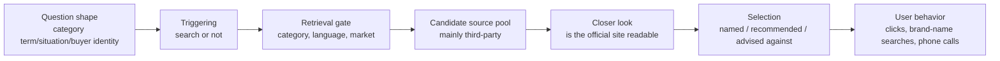

# Chapter 13: Brand and Product Recommendations (Case Chapter)

> This is a case chapter. Each group of cases maps to a principle explained in an earlier chapter: Chapter 1 (two sources of knowledge), Chapter 2 (triggering), Chapter 3 (accessibility and agent readability), Chapter 4 (language and market gates), Chapter 5 (third-party sources, consensus and brand priors), Chapter 6 (selection and attribute weighting), Chapter 7 (citation and absorption), Chapter 9 (measurement), Chapter 10 (commercial value) and Chapter 11 (manipulation and zero-sum competition). The role of community forums as citation sources is covered in Chapter 15.

## Questions this chapter answers

1. Why does AI fail to recommend a brand in category questions even though it clearly "knows" the brand?
2. When a brand cannot get onto the recommendation list, which stage of the pipeline is it usually stuck at? How do you diagnose it?
3. How much do third-party rankings, review sites, directories and community discussions contribute to recommendations? How solid is the evidence?
4. Does the official website still matter? Under what conditions?
5. How should brand visibility be measured so that you do not fool yourself?

## 13.1 Core principles: brand recommendation is a multi-stage elimination contest

When a user asks "what is the best X", AI does not look up a brand league table. It runs the random, multi-stage filtering pipeline described in Chapter 1. If a brand drops out at any stage, it will not appear in the final recommendation.



**Four core conclusions** (from the principles in Chapters 5, 6 and 3, tested here against cases):

1. **Real attributes that can be told apart drive recommendations.** Facts that create clear differences, such as ratings, prices, reviews and specifications, are what AI bases its choices on (Chapter 5, Principle 5.3; Chapter 6, Principle 6.3).
2. Brand priors only matter when the information cannot tell candidates apart. The advantage of big brands is most visible when there is no difference between candidates (Chapter 5).
3. Third-party consensus is the evidence AI uses to judge. AI's answers about brands are built mainly on what others say about you, not on what you say about yourself (Chapter 5, Principles 5.1 and 5.2).
4. Agents go into the official website to take a look. Whether the site can be understood decides whose content the answer is built from (Chapter 3, Principle 3.2).

The five states must be looked at separately. A brand in an AI answer is not simply "present" or "absent"; there are at least five states:

| State | Meaning | Common misjudgment |
|---|---|---|
| Known | Asked directly about the brand name, AI describes it correctly | Assuming that "AI knows me" means it will recommend me |
| Cited | The official site appears in the source list | Assuming that being cited means being recommended |
| Named | The brand name appears in the body of the answer | Being named may just be part of a list, or a counterexample |
| Recommended | AI explicitly suggests choosing it | This is the state that actually matters commercially |
| Advised against | AI explicitly suggests avoiding it | Most dashboards do not record this |

These five states come apart from one another. Most of the cases in this chapter show how and why they come apart.

There is also a subtler situation: the brand is listed, but described more briefly than the other options or with more caveats. Large-scale experiments with real users show that in AI conversations, adding caveats to the other options or mentioning them only in passing has the strongest association with users switching to the product being promoted (see Chapter 11). So besides recording the state, also compare whether the descriptions are symmetrical.

## 13.2 How strong is the evidence

| Conclusion | Supporting evidence | Strength and limits |
|---|---|---|
| Most citations in brand answers come from third parties | Repeated tests on real AI search engines found this; several large citation analyses agree | Descriptive, not causal; several of the studies are authored by visibility vendors |
| "Known" does not equal "recommended" | Repeated tests on real AI search engines found this; plus many practitioner tests | Direction consistent; numbers vary widely with the sample |
| Repeated appearance across sources predicts brand selection | Repeated tests on real AI search engines found this (Chinese-language engines) | Correlation; authors are a vendor |
| Official site readability for agents affects recommendation | Repeated tests on real AI search engines found this (matched observation) | Authors' own scorer; bundled score, components not separated |
| Getting onto third-party rankings raises recommendations | Only practitioner reports from their own tests | **No paper has run an intervention experiment**; most cases have no control and did several things at once |
| Visibility must be measured over many runs, languages and engines | Repeated tests on real AI search engines found this, plus several controlled practitioner tests | The strongest item of evidence in this chapter |
| GEO brings commercial results | One quasi-experiment on real user traffic (single website); the rest are practitioners' own accounts | The effect is far smaller than the raw numbers, and only suggestive |

**The single most important point to remember**: "Get third parties to write about you and recommendations will rise" is widely believed by practitioners and supported by quite a few cases. But so far it has only observational and before-and-after evidence; it has not been verified by controlled experiments.

## 13.3 Cases

### Case group A: question shape and triggering: "knows you, but does not recommend you"

**Related principles**: Chapter 2 (triggering), Chapter 5, Principle 5.3 (known ≠ recommended), Chapter 1, Principle 1.1 (parametric knowledge and retrieved knowledge).

**A1. The "discovery gap" for new products**

Repeated tests on real AI search engines found that newly launched products, when asked about directly by name, are recognized at very high rates (99.4% on one engine, 94.3% on another). But in category discovery questions that do not mention the brand name, the mention rate was only 3.32% and 8.29%, a gap of 30:1 and 11:1. The website's own composite GEO score was unrelated to visibility (r about -0.1). On engines with web search, visibility correlated positively with the number of referring domains and the number of community mentions (correlation only).

- Principle illustrated: a brand being present in the model's knowledge does not mean it will be "recalled" in category questions.
- Caution: only the API was tested, not the consumer interface.

A2. Category leaders are not named either

Practitioners report from their own tests: an audit of 2,475 US category-leading brands, selected by review volume, found that in category questions without brand names, 86% of the e-commerce brands did not appear even once across four AI assistants. Yet when asked directly about the brand name, all four assistants could state the founding year, product lines and positioning.

Practitioners' repeated, controlled tests found that for questions like "find an executive coach", the best-known coach in the industry appeared only 1 time in 6 queries; another coach with a huge audience also appeared only 1 time, yet when asked about him directly, both engines gave detailed and accurate introductions.

Practitioners' repeated, controlled tests found that of 20 Indian startups that had raised Series A or later, 17 were completely absent from category queries, although most were answered normally when asked about directly by brand name. The 3 that did appear all had community discussion, structured comparison pages and review markup.

- Principle illustrated: awareness, funding and review volume do not automatically turn into recommendations. The model recommends "brands that have evidence supporting them in the context of this question".
- Caution: these are all observations; they do not prove that "doing something" can change the outcome.

A3. The closer a question is to purchase, the less often ChatGPT searches the web

Practitioners report from their own tests: the search tool was enabled through the API and the model was left to decide whether to search. For "Brand A vs Brand B" questions, ChatGPT did not search in 76 of 80 runs; for situational questions like "I have a certain condition, which one should I buy", it did not search in 106 of 120 runs; broad category questions triggered search about half the time. Gemini searched in 493 of 500 runs, and Perplexity in all 500. Answers without search had zero citations.

- Principle illustrated: the differences in triggering rates described in Chapter 2 have a direct consequence for brand recommendation: the most critical comparison questions may be answered entirely from the model's parametric knowledge. In that case no amount of official-site quality helps; what decides the outcome is the brand's presence in the training corpus.
- Caution: this is an API test; the author believes the decisions are the same as in consumer products, but this was not directly verified.

A4. Many buyer questions do not name any brand at all

- Practitioners report from their own tests: among 300 buyer questions for field service software, for questions describing a problem, such as "how do I stop losing work orders", most engines gave only general advice and recommended no product.
- Practitioners report from their own tests: in Romania, 18 book-buying questions were asked in Romanian over two rounds; 58% of the answers recommended no bookstore or publisher; the market leader appeared in only about one fifth of the answers.
- One practitioner observed that of 60 real buyer questions collected from forums and "related questions", 13 in one round and 23 in another named no brand.

Practical implication: before tracking a question, first confirm that the question "names brands". Tracking a question that never names brands proves nothing, however long you track it.

### Case group B: the retrieval gate: category misclassification, phrasing, cities and language

**Related principles**: Chapter 4 (retrieval, query rewriting, language and market gates), Chapter 6, Principle 6.1 (relevance as gatekeeper).

**B1. Change the phrasing, and a brand goes from "always there" to "never there"**

Practitioners' repeated, controlled tests found that for "shared inbox" tools, when asked with the broad category term, the two main brands were named almost every time on four engines. After switching to the way real users phrase it (describing the workflow they want), with 10 runs per engine:

| Engine | Brand A | Brand B |
|---|---|---|
| ChatGPT | 9/10 | 0/10 |
| Claude | 5/10 | 8/10 |
| Gemini | 10/10 | 8/10 |
| Perplexity | 0/10 | 5/10 |

Same company, same website; only the phrasing changed. The two control brands tracked at the same time stayed broadly stable, loosening only on Perplexity. The author's hypothesis: the off-site footprint decides whether a brand gets into the candidate set, while the official site describing actual tasks in buyers' language decides whether it stays in the set when the phrasing changes. The author states that the two cannot be cleanly separated.

Practitioners' repeated, controlled tests found that a newsletter platform appeared only in questions about "creators who want to start a newsletter and monetize it". When the buyer was changed to a business and the same thing was described in plain language, its appearances dropped to 0/40. What it "owns" is not a keyword but a type of buyer.

- Principle illustrated: retrieval looks at semantic match and intent, not at the brand itself. Which kind of question and which kind of buyer a brand is tied to decides where it is visible.

B2. Category misclassification: put in the wrong category by AI

Practitioners' repeated, controlled tests found that a CSV import tool appeared only 1 time in 8 purchase conversations, and when it did appear it was described as an ETL tool, which it is not; two models instead described a competitor, in wording clearly taken from the competitor's own marketing copy. Targeting the specific questions where AI named competitors but not them, the team published two comparison articles and one technical documentation page and rewrote the README. After 10 days, appearances rose to 5 of 8, and the category misclassification was corrected on 3 of 4 engines.

- Principle illustrated: category misclassification happens in the "understanding" layer before retrieval. If AI puts you in the wrong category, you get compared against the wrong rivals, or never enter the candidates at all.
- Caution: the author builds measurement tools and states that the results should be discounted; the sample was only 8 questions.

Similar phenomena:
- One practitioner observed that an agency, queried with its best-known niche term, was named 19 times in 25; queried with the two broad category labels on its homepage, it was 0/25 for both.
- One practitioner observed that different names for the same category can make a brand's mention rate drop from about three quarters to zero.
- One practitioner observed that in tests of three Australian law firms, engines placed the firms in much narrower categories than expected (for example "employment law firm" rather than "lawyer").

B3. Broad questions are occupied by giants; niche questions still have room

Practitioners report from their own tests: a B2B client was completely invisible in broad questions such as "best laser marking machine brands in India", but ranked first and was cited in niche questions such as "which kind of printer should I use for metal marking", with no change to its pages. The cited clients had one thing in common: the model repeated specific details from their pages (for example specific equipment models), while pages written only in category language were not cited.

B4. Put the city into the question rather than setting the location

Practitioners' repeated, controlled tests found that a logistics company serving about 8 cities in India was named 0 times across 41 buyer questions. With the location set to Bhopal and a generic question asked, it was 0 of 3; with "in Bhopal" written into the question, Gemini named it 3 of 3 times, and Google AI Overviews also named it in two cities, Bhopal and Coimbatore. The author notes that it was named only where the company had a corresponding city page.

- Principle illustrated: the location setting mainly affects ranking signals, but a place name written into the question changes "what the question is asking", which in turn changes retrieval.
- Caution: the author works on visibility tools and has disclosed this.

B5. Language and market gates

Repeated tests on real AI search engines found:
- Asking in the brand's home language raised the recommendation share of local leading brands by 0.80, but that of global brands by only 0.15 (12 European languages).
- In local-language test cells, global suppliers appeared only 1 time in 24; asking in English from Istanbul and Tallinn, local suppliers appeared 0 times in 12. Asking in Turkish from Berlin returned German suppliers (5 of 6). The query language decides the candidate set; the exit IP decides which country's market (single model, small sample).
- Sentiment also varies with language: the same set of brands received the most negative sentiment in English.

Practitioners' repeated, controlled tests found that with the same model and the same question, simply telling the model where the user was made a brand go from absent to named in 5 of 6 tests.

Practitioners report from their own tests: the same jewelry brand recommendation question, asked in Romanian to 10 models, produced 29 different brands in total, 19 of them mentioned by only one model; any two models overlapped by only about 18% of their recommendations on average. One model had no overlap at all with the other nine.

- Principle illustrated: Chapter 4, Principle 4.3. Testing a local market in English systematically underestimates local brands.

### Case group C: the third-party source pool: rankings, review sites, platforms and communities

**Related principles**: Chapter 5, Principle 5.1 (answers are built on third parties), 5.2 (multi-source consensus).

**C1. Citation distribution: the official site is only a small part**

| Finding | Strength of evidence |
|---|---|
| Of 167,551 citations across 128 brands and 13 languages, third parties accounted for 85.7% and brand-owned sites for 14.3%; 80% of citations were concentrated in about 18.2% of domains; Wikipedia was the most-cited domain in 11 of 12 languages | Repeated tests on real AI search engines found (vendor) |
| Of 149,912 citations for 102 brands, the brand's own domain accounted for only 2.9%, and pages of other companies in the same field for 75.2%; ranking-style pages accounted for 21.0% of all citations and 35.7% of content citations | Repeated tests on real AI search engines found (vendor production logs, observational) |
| In ranking-type queries, AI engines lean heavily toward third-party media: in US automotive AI answers, third-party media accounted for 81.9% and social sources for 0; for the equivalent Google results the figures were 45.1% and 15.4% | Repeated tests on real AI search engines found |
| Of 2,410 citations in web-search answers, the owned domains of all tracked vendors combined accounted for only 7.3%, and each single vendor's domain for less than 1% | Practitioners' repeated, controlled tests found; the author states clearly that this is only a distribution, with no causal evidence |
| Across 510 Turkish hotel questions, 98% of Google AI Mode answers cited at least one booking platform, the largest booking platform appeared in 74% of answers, and hotels' official sites were almost never cited | Practitioners report from their own tests |
| Of 1,783 citations in 180 sneaker recommendations, video platforms, review sites and fashion media ranked highest; the most-recommended brand's official site was cited only 2 times; Perplexity cited brand official sites zero times | Practitioners report from their own tests |

- Principle illustrated: AI's "view" of a brand is assembled mainly from other people's pages. Even the most frequently recommended brand is not necessarily recommended on the basis of its official site.

C2. Cross-source co-occurrence and "being written into the answer"

Repeated tests on real AI search engines found (Chinese-language engines) that only 8.3% of the brands in the citation pool made it into the body of the answer. When a brand appeared in only 1 cited source, its selection rate was 2.1%; when it appeared in 11 or more sources, the selection rate was 59.9%. The traditional SEO quality score had an importance of only 4.52% in the prediction model. Of the sources listed, 66% actually entered the body, 30% were substantively cited, and 8% were cited in depth. See Chapters 7 and 12.

- Caution: this is association, not intervention. It shows that "brands mentioned in many places are selected more often"; it does not prove that "posting in many places will get you selected".

C3. Getting onto rankings AI already cites (before-and-after)

The following cases all use the same play: first find the pages AI repeatedly cites for the target question, then try to get the brand onto those pages.

| Case | What was done | What was observed | Strength of evidence |
|---|---|---|---|
| Cannabis consumer brand | Contacted every site appearing for the target question, asking to be added to existing articles; where that was not possible, wrote guest articles. For one sleep-product question, did 5 rankings and 2 product roundups | Within about a week ChatGPT ranked the brand 2nd | Practitioners report from their own tests; the author handled only backlinks, and the client's on-site SEO was already strong |
| New energy drink brand | Found that AI Overviews repeatedly cited 3–4 "best X drinks" review blogs, and tried to get included | Within days appeared alongside big brands in AI Overviews and on the first page | Practitioners report from their own tests |
| 12 client pages | First did full on-site optimization (structured markup, heading hierarchy, entity clarity, internal links), then tracked status for two weeks with 15 prompts while logged out | No change at all within two weeks; in the third week, after a roundup article including the client and four competitors was published, two previously invisible pages began to be cited within days | Practitioners report from their own tests; the author says the sample is small and the causes cannot be separated |
| Warehouse management software (3PL niche) | Found that across 40 recommendation prompts recorded monthly, ChatGPT named them only 2–4 times, versus about 18 times for a competitor on Google's second page. The competitor had two rankings on logistics blogs, a category page on a review platform and a favorable community post from three years earlier. They then unified contradictory company descriptions across three platforms and published one comparison page per day | About 9/40 by August | Practitioners' repeated, controlled tests found; two things done at once, cannot be separated |
| Service provider directories | Recorded the directory sites each AI cited for industry questions, created and filled out profiles on those directories, and asked clients for reviews | Within one month went from zero citations to being cited on 3 of 5 AIs and for 6 of 10 prompts | Practitioners report from their own tests |

Additional observations from the same warehouse software company (practitioners report from their own tests): citations traced back mainly to review platforms, other people's rankings and one community discussion thread; the official site was cited only for questions about pricing and integrations, almost never for "which should I choose"; 200 posts a year on a professional social network produced zero citations; spending US$6,000 to upgrade a review-platform profile changed nothing; an industry association's member directory, by contrast, was cited by Perplexity.

- Principle illustrated: answers are assembled from "pages already in the candidate pool". Getting onto those pages is the same as entering the candidate pool directly.
- Caution:
  1. All of these are before-and-after comparisons, with no concurrent control group. The quasi-experiment in Chapter 10 shows that without subtracting the platform's own growth, raw multiples greatly overestimate the effect.
  2. Borrowed exposure is unstable. One practitioner observed that if your appearance depends on someone else's ranking, you may disappear the day they update the page; being cited from your own documentation or pricing page is more stable.
  3. Paying for ranking positions, or trading guest articles for backlinks, may break the rules on some platforms and also falls into the grey area discussed in Chapter 11.

C4. Consistent descriptions matter more than volume (mostly opinion)

- Practitioners report from their own tests: a company checked each month, with fixed prompts, how each model described it, and twice found wrong information, traced respectively to an outdated directory profile and an erroneous third-party article.
- Practitioners report from their own tests: tracking the descriptions of three competitors for six consecutive weeks, two changed noticeably (one went from "analytics tool" to "AI visibility platform", the other gained the criticism "limited integrations"). Neither came from content the competitors published themselves; both traced back to comparison discussions in niche communities and a few high-engagement forum comments.
- Practitioners report from their own tests: brands with consistent and complete product attributes across retail channels had clearly higher citation rates, but the author admits that the causal mechanism has not been verified and that there was no concurrent holdout control group.
- One practitioner observed that making the "About us" page and all third-party profiles use exactly the same description was the single change with the largest effect; the brand began to be cited consistently after about three months.

C5. Press release distribution does not work

Practitioners' repeated, controlled tests found that, testing funded AI startups and established large companies on 4 engines, the startups' citation rate was 6–13% and the large companies' 32–62%. Distributing press releases for republication on financial news sites did not help, and on Perplexity was even slightly negative. Only vector database startups reached 34%; the author believes this is because these products had been written about by technical blogs for years and had already entered the training corpus.

After being challenged later, the author corrected two points: each round was actually 5,400 trials, not the 46,122 queries stated in the title; and the more accurate statement would be "engines cite entities that are well represented in the training corpus and have retrievable authoritative sources, and startups lack both", rather than "large companies have the advantage". This correction is itself a measurement lesson (see case group G).

### Case group D: accessibility and the official site: when the official site has the final say

**Related principles**: Chapter 3, Principles 3.1 and 3.2; Chapter 1, Principle 1.4 (agents open web pages and read them).

**D1. Once an agent is on the site, official-site readability decides whose content is supplied**

Repeated tests on real AI search engines found that across 1,056 businesses and 37,927 agent journeys, for agent-friendly websites 78% of the answer came from the business's own pages (58% for unfriendly ones), and the share explicitly recommended was 20% (11% for unfriendly ones). After controlling for website readability, the two indicators representing "off-site mentions" had no significant independent effect on grounding, recommendation or cost. When the website could not be read, the agent switched to third-party or competitor content; the failure took the form of omission, not fabrication. Training knowledge accounted for only 7–10% of the final answer.

- Caution: the authors are a vendor using their own scorer, in a matched observational study; "readability" is a bundled score (content not dependent on JS, structured data, Markdown fallback, crawler settings that allow agents), and the effects of the components were not separated.

D2. When the official site is retrieved, the brand is almost always mentioned

Practitioners' repeated, controlled tests found that in shopping recommendation answers across several brands, when the brand's official site was retrieved, the brand was mentioned 89% of the time; when it was not retrieved, only 24%. Another finding: of one brand's 165 citations of its own website, 116 came from blog content and only 3 from product pages; a single roundup article was cited 37 times on its own. The author also mentions that about a quarter of identical prompts gave different results when rerun.

- Principle illustrated: the same visibility score can hide completely different problems: not retrieved, retrieved but not recommended, understood only for some product lines, or the question itself rarely naming brands.

D3. Building a clean parallel version for AI

Practitioners' repeated, controlled tests found that a small, low-authority app was cited by several AIs but described wrongly (they got the product's core mechanism wrong). The founder built a parallel version of the website: navigation, animations, cookie banners and other distractions were removed, each page was written as a direct question and answer with the answer placed in the first 75–120 words; each page had a canonical pointing back to the corresponding original page, a separate sitemap was set up, and llms.txt and rel="alternate" were used to let AI discover it. Within 5 weeks AI citation coverage expanded by 12% and AI referral traffic rose by 60%, with no new backlinks.

- Caution: the author is the product's founder and has disclosed this; several measures were implemented together, so it is impossible to tell which one worked; evidence that llms.txt works on its own still does not exist (Chapter 3).

D4. All the on-site work was done, and it still did not help

- Practitioners report from their own tests: a company was named in about 6% of ChatGPT's "who can do X" questions. The website audit came back clean and all crawlers received 200, but on-site fixes changed nothing. Someone suggested diagnosing by comparing "web search on vs off": if it still does not appear with web search off, what is missing is the model's training memory; if it appears only with web search on, it is real-time retrieval, and the lever is roundup articles. The person making the suggestion said they had scored about 180 companies, and the companies named were those that frequently appeared in "X vs Y" articles, not those with the cleanest websites.
- Practitioners report from their own tests: a company was on Google's first page, but ChatGPT never named it for the same question, while a lower-ranked competitor was named three times.

D5. The official site controls "how you are described"

Practitioners report from their own tests: a GEO agency with only a business profile and a one-page homepage was still named by ChatGPT. The author queried 19 cities and recorded 94 agencies: 97% of official sites were cited; business profiles being cited was specific to India (86% in Indian big cities, 18% elsewhere). For agencies without a dedicated service page, ChatGPT guessed their positioning 66% of the time; for those with a dedicated page, guessing was zero.

- Principle illustrated: a profile can get you named, but only a dedicated page can control what the model says about you.
- Caution: single query, single model, and the author's own agency is in the sample.

### Case group E: selection and absorption: cited, yet someone else was recommended

**Related principles**: Chapter 6 (selection), Chapter 7 (listed ≠ used ≠ used correctly).

**E1. Being cited and being recommended are two different states**

Practitioners' repeated, controlled tests found the following, running 134 fixed questions weekly for the same client.
- Over six weeks, ChatGPT's proactive recommendation rate rose from 11.9% to 23.1% (+11.2 percentage points), with 24 questions improving and 9 worsening. Over the same period Claude fell by 4.1 percentage points.
- Google listed the domain as a source in 36% of answers, but recommended the brand 0% of the time (194 citations and 0 recommendations in 538 runs).
- Claude copied up to 64 consecutive words verbatim from a client article and attached the URL, yet built its recommendation list from competitors' official sites. It takes the description from you and the list from others.
- Before intervening, the noise floor was measured: 387 questions gave identical results 98% of the time after 3 days, so changes below 3–4 percentage points were treated as instrument error.
- The approach was to publish 458 standalone topic pages (plain HTML, not dependent on JS), rather than rewriting pages that already ranked. In one batch of 110, about 50–55% were indexed by Google within 5 days, but AI citations lagged indexing by several weeks.

Other data pointing the same way:
- Practitioners report from their own tests: across about 1,140 prompts for 76 companies, brands were mentioned in 44% of answers on average, but recommended in only 10%.
- Practitioners report from their own tests: in about 26,400 answers about brands, the brand appeared in only about 16%; of these, about 13% were cited and about 3% were only named without a link. ChatGPT had the lowest citation rate (under 10%), but the highest share of "named without a link".
- One practitioner observed that among 85 B2B software companies, 29.4% were cited more often than they were named; of these, 9 had their official site in the citation list yet were not named in any answer.

E2. Your sentence, someone else's name

One practitioner observed that a small bicycle tour operator's guide page was treated by AI as its primary source, but the answer named and recommended three or four competitors with prices attached, and one of the recommendation sentences was taken almost verbatim from the client's own page. The cause was presentation: on the client's page the brand name was not next to the key sentences, while competitors put the brand, the fact and the number in the same sentence.

One practitioner observed that a company's official site had a section saying "We may not be right for everyone; here are 5 trustworthy competitors". Perplexity used this list directly to generate its recommendations; the official site was cited as many as 4 times, yet the company's own brand was not among the recommendations.

- Principle illustrated: the absorption problem from Chapter 7. The model extracts "paragraphs that list entities" and "sentences where the entity and the fact are adjacent". If the brand name is too far from the fact, the fact may be attached to someone else's name.

E3. Specific facts are cited; vague copy is skipped

- Practitioners report from their own tests: in queries for AEO services in Perth, the information for every agency named was taken from its service page; those whose pages stated real prices were cited, and those that only said "contact us" were skipped.
- Practitioners report from their own tests: a London clinic ranking first on Google had zero citations across three AI engines; a competitor with an average ranking was recommended about 70% of the time. The difference was that the competitor had named doctors, a dedicated page for each service, and real third-party mentions.
- One practitioner observed that clinics listing specific equipment models on their pages were quoted verbatim by AI.

E4. Once the buyer describes themselves, AI starts "advising against"

Practitioners' repeated, controlled tests found that for five healthy-snack purchase questions, each asked in a new incognito session, when only the question was asked, 2 of 50 answers explicitly told the user to avoid a brand; after adding a buyer description (cutting fat, tracking macros, reading ingredient lists, not price-sensitive), this became 20. The same brand was recommended in one conversation and advised against in another.

Repeated tests on real AI search engines found that in product recommendations, 79% of ChatGPT's answers used first-person recommendations ("If I could only buy one..."), versus 7% for Gemini and 2% for Google AI Overviews.

- Principle illustrated: Chapter 6, Principle 6.3. Given specific evaluation criteria, the model filters by attributes, brands can be told apart, and priors take a back seat. This is what "real attributes that can be told apart drive recommendations" looks like in practice.
- Practical implication: besides tracking "recommended", also track "advised against".

E5. The challenger won in the corpus first

Practitioners report from their own tests: a large beverage company's new prebiotic cola was replaced by a challenger brand in the first round in 4 of 6 AI purchase journeys. The author's interpretation: the challenger brand had already occupied the corpus while the model was being trained, and a big brand arriving late cannot catch up even with awareness; buying ad placements inside AI platforms after the fact cannot change preferences the model has already formed.

- Caution: a sample of 6 journeys is very small, and the author uses their own scoring system; "ads cannot rescue it" is an inference, not tested.

### Case group F: local businesses: a different set of rules

**Related principles**: Chapter 4 (engine differences), Chapter 5 (third-party sources), Chapter 3 (official site readability).

Local businesses differ clearly from national brands and deserve a separate look.

| Finding | Strength of evidence |
|---|---|
| 8 US cities, 6 categories, 48 markets, with about 97 businesses taken from the map results in each market: only 11.9% were named by at least one of four AI systems. Of 4,657 businesses, AI Overviews named 376, ChatGPT 206, Gemini 134 and Claude 92. 70% of named businesses appeared in only one system; in 36 of 48 markets no business was named by all four systems. Differences between categories were larger than between cities (gyms 14.4%, coffee shops 14.1%, hair salons 9.7%) | Practitioners report from their own tests; strict name matching, 26% with looser matching |
| 45 queries using 3 emergency plumbing and electrical questions in 15 cities, rerun in incognito: for Google, the recommended businesses changed in about 40% of cities; for ChatGPT, about two thirds of names repeated; for Perplexity, about 85% were unchanged. One national chain took about half the answers under all conditions; the consistent winners were chains that inherited a national footprint, or local businesses that happened to have built up reviews on the platforms the engines read | Practitioners' repeated, controlled tests found |
| 9,217 answers recorded daily across 48 city and niche combinations: in 25 of 36 local lists, the same business appeared on more than 80% of days; the median overlap between Perplexity's and Gemini's named lists for the same question was only 11%; Perplexity mainly cited businesses' own pages plus a few directories | Practitioners report from their own tests |
| 197 clinics in the same industry, 3 engines, each prompt run 3 times: citation overlap between engines was only 39–48%; the strongest correlate was having one's own website, followed by industry-specific structured data, not generic markup auto-generated by plugins | Practitioners report from their own tests |
| 20 logged-out tests in Perth: broad "best X in Perth" questions are essentially a reviews game, with engines reading the businesses with the most reviews and longest operating history on the map; niche service questions take answers directly from service pages | Practitioners report from their own tests |
| Of more than 400 local businesses checked, 72% did not appear in AI answers despite good map rankings | Practitioners report from their own tests; the author says business structured markup, FAQ structured data and name, address and phone consistency predict better than map ranking, but did not publish the method |
| Of 1,444 businesses in Charleston, only 241 had ever been named and recommended by AI; 83% had never appeared | Practitioners report from their own tests |
| Of 33 local service businesses, 76% had zero citations on any AI engine, and 67% had inconsistent name, address or phone details; it was also observed that AI Overviews for most home-service categories in one city were systematically suppressed on the day of the audit | Practitioners report from their own tests |

- **Principle illustrated**: in local queries, map ranking and being named by AI are two separate sets of signals. Unlike national brands, local businesses' official sites and service pages carry clearly more weight in AI citations; directories, review platforms and name, address and phone consistency are also frequently mentioned factors.
- Do not do: practitioners report from their own tests that stuffing city names and "near me" phrases into the services section of a business profile (for example a dozen or more "city name + service" variants) may be treated as a spam signal. This is one auditor's observation, but it points in the same direction as Chapter 11's analysis of manipulation tactics.

### Case group G: measurement traps

**Related principles**: Chapter 9 (visibility is a distribution, not a ranking).

**G1. What your own account sees is not what others see**

Practitioners report from their own tests: someone claimed a new website was cited by ChatGPT within a week for a highly competitive category question. Another practitioner tested with 20 clean accounts plus residential proxies; the brand did not appear at all, and ChatGPT's default wording about new companies appeared instead. The original author had been misled by their own conversation history.

The original author's observation still has value: the fan-out queries (query fan-out) ChatGPT generates when answering broad category questions already included the names of several well-known brands. In other words, the candidate set is partly decided before the search (Chapter 4). The original author also admits that being cited is not the same as being recommended.

Practitioners report from their own tests: a tracking dashboard showed 45% brand coverage, but the client's own spot checks could not find the brand at all.

G2. A single result is a roll of the dice

| Finding | Strength of evidence |
|---|---|
| Four engines tested daily for 45 days plus 10 same-day repeats: source overlap between consecutive days was only 0.336–0.423, and same-day repeats were about the same as day-to-day; 57.8% of ChatGPT runs had zero citations. Recommendation: run each prompt at least 7 times a day (8 times for sources), with a 2–4 week rolling window | Repeated tests on real AI search engines found |
| Running the same prompt 6 times in a row, the top recommendation changed for 4 of 6 prompts | Repeated tests on real AI search engines found (small sample) |
| Brand mentions are close to binary: 63.2% of test cells never mentioned the brand, and only 6.8% flipped; the sentiment flip rate was 6.7 times the mention flip rate. Mentions need at least 3 runs, and sentiment at least 10 prompts, to stabilize | Repeated tests on real AI search engines found (vendor) |
| 4 mentions in 10 runs: the confidence interval for "40%" is roughly 12% to 74% | Practitioners report from their own tests |
| The same buyer question run 10 times on the same engine: the score swung between 50% and 80%; Gemini recommended the brand in exactly 5 of 10 runs | Practitioners report from their own tests (the author sells visibility tools) |

G3. Expanding breadth works better than repetition

Repeated tests on real AI search engines found that of the variance in individual brand answers, query language accounted for 26.5% and the brand itself for only 1.5%. Adding 5 more repetitions after the 5th barely reduced the error; adding 3 languages had about 15 times the effect (this result is based on the sentiment metric). See Chapter 9, Principle 9.2.

G4. Engines, versions and interfaces must all be separated

- Repeated tests on real AI search engines found that domain overlap between the consumer interface and the API was only 12.0% (ChatGPT) and 14.8% (Gemini); ChatGPT and Gemini shared on average only 5.4% of domains for the same query.
- Practitioners' repeated, controlled tests found that the same client appeared 8 times in 10 in one model version, and zero times in the API without a system prompt. Another fintech client was cited 3 times in 10 on a larger model, while the smaller model recommended the same payments giant however the question was asked.
- Practitioners report from their own tests: in the same week, for the same "Jira alternatives" question, the same brand ranked first in ChatGPT and Claude but only fourth in Gemini.
- Practitioners report from their own tests: in data from the last 30 days or so, pairwise overlap of cited domains among Gemini, Perplexity and AI Overviews was about 25%, while ChatGPT's overlap with them was only 11–14%.
- Practitioners' repeated, controlled tests found that across 40 fixed buyer questions, community forum sources accounted for 7% in Gemini and AI Overviews, 9% in AI Mode, 1% in Perplexity, and almost zero in ChatGPT and Claude (Chapter 15).

G5. Counting rules create fake changes

- One practitioner observed that counting only the company name gave a score of 77; adding product names as aliases, with the same 20 questions and the same 4 engines, it became 94 the next day. The world did not change; the counting method did.
- One practitioner observed that when the question itself contains a brand name ("X vs Y", "alternatives to X"), the engine may just echo the name from the question. After removing these "echoes", the naming rate fell from 10.9% to 8.9%; for "X vs Y" questions it fell from 15.8% to 8.1%.
- Practitioners report from their own tests: of 10 companies in one tracking database, 2 had names that models misread as ordinary words. When a brand name is the same as a common word or another entity, "not appearing" may just mean the model understood it as something else; you can only tell by reading the raw answers.
- Practitioners report from their own tests: a car brand's visibility score stayed at 84 for 47 days, but purchase recommendations had already shifted to a competitor. The score did not reflect that the citations supporting it were decaying.

G6. Blended scores erase what you want to see

Practitioners' repeated, controlled tests found that within the same set of prompts, one model favored identity verification vendor A, another favored vendor B, and the engine with web search favored vendor C. Blending these into a single "AI visibility score" averages away the very differences you want to measure. "Mention frequency" answers who appears; "rank-weighted share" answers who is ranked at the top. They ask different questions.

### Case group H: commercial outcomes and attribution

**Related principles**: Chapter 10 (traffic and commercial value).

**H1. After subtracting platform growth, the effect is much smaller**

Large-scale experiments with real users show (this study covers only a single website) that referral traffic from ChatGPT grew 5.7 times month over month, but pages on the same domain that received no treatment also grew 3.5 times over the same period. Using untreated pages as the control, the level jump for GEO-treated pages was about 1.82 times (95% confidence interval 1.31–2.54), with robustness checks between 1.8 and 2.3 times. The placebo test gave p=0.16, so this counts only as suggestive evidence. No "flywheel" effect of GEO driving organic search was found.

- Principle illustrated: much of the "AI traffic multiplied several times" that brands see may be the platform itself growing. Without a concurrent control group, it is impossible to tell what GEO did.

H2. What AI brings is often not clicks

- Practitioners report from their own tests: server logs showed ChatGPT-User (triggered only when a real person asks a question and ChatGPT fetches in real time) visiting the site about 14 times a day, but the analytics tool recorded only about 1 click. The other users saw the recommendation and then searched for the brand name directly, which was recorded as direct traffic.
- One practitioner observed that AI answers for local businesses often state the name, address and phone number directly, and users phone directly, with no click and no referral record. The suggestion is to use a dedicated phone number placed only on the business profile and AI-facing listings, plus a "How did you find us?" question.
- Practitioners report from their own tests: an agency asked about the source verbally in the first call and found that about 30% of closed deals came from AI search; the author thinks this may still be a lower bound, because the agency's decision cycle is short and clients still remember where they first saw it.

H3. Citations rise, but conversions may not follow

Practitioners report from their own tests: a small B2B SaaS company front-loaded answers, added FAQ and product markup, llms.txt, comparison pages and entity cleanup; AI citations did rise, but AI-referred visitors bounced faster than organic search visitors and almost never converted.

Other practitioners reported the opposite: leads arriving after being named by AI converted at 8–9%, versus about 1% for organic search (Practitioners' repeated, controlled tests); concentrating on 5–6 "superlative" purchase prompts led to a 15–20% mention rate in the relevant AI answers within 90 days, with a conversion rate about 4 times that of organic traffic (Practitioners report from their own tests).

- Caution: all the conversion figures are self-reported, with no control group; and high conversion may simply be because these users were already at the end of their decision (Chapter 10).

### Case group I: manipulation and risk

**Related principles**: Chapter 11 (zero-sum competition, manipulation and defense).

- When the pages are supplied to the engine: adding hidden prompt injection and exaggerated claims to a page raised a fictional camera's recommendation rate from 34.0% to 59.4% (57.9% for real brands). But when several parties do this at once, everyone's visibility falls together, creating a prisoner's dilemma.
- Practitioners report from their own tests: someone claimed that after repeatedly "correcting" ChatGPT's answers using multiple accounts and devices, and after 5 real users did the same, ChatGPT began recommending their business. This claim has no control and cannot rule out the effects of personalization and random fluctuation (see case group G); it should not be treated as a method.
- One practitioner observed that in a low-competition niche, 4 community posts made a new website the second recommendation on two AIs; there are also users who were recommended to scam sites because AI cited favorable community reviews.
- One practitioner observed that a competitor used high-reputation bot accounts to flood a community forum with posts, disguised as neutral buyer comparisons and disparaging other products; AI cited this content and spread false information about the targeted brand, and clarifying in the comments had limited effect.

- **Principle illustrated**: Chapter 5, Principle 5.2 says that multi-source consensus is both the strongest signal and the largest attack surface. These cases are what that attack surface looks like in practice. Authoritative-sounding copy and fabricated evidence work in experiments, but they are manipulation; and once the whole industry adopts them, the gains approach zero.

## 13.4 Debates and counterexamples

**Debate 1: Do off-site mentions actually help?**

| Position | Basis |
|---|---|
| Off-site mentions decide whether you can be recommended | On Chinese-language engines, cross-source co-occurrence predicts selection; new products' visibility correlates positively with referring domains and community mentions; many practitioners' before-and-after cases |
| After controlling for website readability, off-site mentions have no independent effect | Results of a matched observation in scenarios where agents look closely at business websites |

Possible explanation (Chapter 5): the two act at different stages. Off-site mentions decide whether a brand can "surface" in the candidate set; when an agent looks closely, website readability decides whose content is used. One practitioner describes their own observations with the same framework: the off-site footprint gets you into the set, and task language on the official site keeps you in the set when the phrasing changes. The two studies had different conditions, and it is not yet possible to say which is right.

**Debate 2: Do structured markup and llms.txt help?**

| View | Evidence |
|---|---|
| They help | Practitioners report from their own tests: among SaaS websites at the same traffic level, those with complete structured markup were cited about twice as often as those without; after restructuring 8 comparison pages with short question-and-answer headings and adding FAQ markup, citations for 12 target queries rose from 0 to 4 within 6 weeks; among local businesses, industry-specific structured data correlated with visibility |
| They are hygiene, not a lever | Practitioners' repeated, controlled tests found that llms.txt could never be attributed to any change; structured markup will not get you named, but once you are named it helps you be described correctly; wrong markup is worse than none |
| Almost no measurable effect | One practitioner observed that FAQ markup and llms.txt had no measurable effect, and on-site optimization is the smallest lever |

Chapter 3 has already pointed out that there is currently no evidence that llms.txt works on its own. Every case in this chapter that reported it working implemented it bundled with other changes.

Debate 3: Does Google ranking still matter?

- Many practitioners report "first on Google, nowhere in AI".
- But some practitioners also report from their own tests that citations in AI Overviews and Gemini are highly correlated with traditional rankings: a high ranking does not guarantee citation, but being completely absent from search results almost certainly means being filtered out. Practitioners' repeated, controlled tests also found that AI Mode citations overlap noticeably with first-page search results, but the order of recommendations and the descriptions differ.
- Repeated tests on real AI search engines found that domain overlap between AI engines and Google is low (for example only 15% for the top 5 in the smartphone category).

A reasonable reading: for engines that rely on Google's index, ranking is more like an "entry threshold"; for ChatGPT's comparison questions (which often do not search the web) it is almost irrelevant. Judge each engine separately.

Debate 4: Does awareness matter or not?

- Repeated tests on real AI search engines found (vendor production data) that on the first run, visibility for questions without brand names followed a three-tier gradient: large brands 72.9%, mid-sized brands 43.6%, small brands 11.4%.
- But the cases of the celebrity coaches, category leaders and funded startups all show that awareness does not translate directly into recommendation.

The way to reconcile them: the gradient reflects not "fame" itself but the density of the brand's presence in the corpus and in retrievable sources (the corrected conclusion of case C5). Big brands usually have both, so they have the advantage in broad questions; but in niche questions and specific buyer situations, presence density has to be counted per "question", not per "brand". One practitioner observed that big spirits brands won only in generic questions; in more specific questions such as "which one to use for a certain cocktail", brands with a more distinctive brand story led.

Debate 5: How fast do results show?

| Reported time | Situation | Strength |
|---|---|---|
| Days | Getting into review blogs AI already cites | Practitioners report from their own tests |
| About a week | ChatGPT ranked it 2nd after 5 rankings plus 2 roundups | Practitioners report from their own tests |
| 10 days | Comparison articles plus documentation, from 1 to 5 of 8 questions | Practitioners' repeated, controlled tests |
| About 2 weeks for Perplexity, close to 2 months for ChatGPT | Running 20 buyer prompts weekly and seeking exposure on recurring sources | Practitioners report from their own tests |
| AI citations lag indexing by several weeks | Publishing large numbers of standalone topic pages | Practitioners' repeated, controlled tests |
| About 3 months | Unified descriptions plus getting into existing comparison articles | One practitioner observed |

At the same time, several observations indicate that older content is still at work: practitioners' repeated, controlled tests found that tech media coverage and review discussion threads from three years earlier had an effect across more model versions than recently published content. Research on Chinese-language engines, on the other hand, shows that the median age of pages cited for highly time-sensitive queries is only 18 days.

A reasonable reading: engines that rely on real-time retrieval (especially Perplexity) respond quickly; questions answered from parametric knowledge (ChatGPT's comparison questions) respond slowly, and have to wait until the content enters the training corpus.

## 13.5 What to do

### Diagnostic process

```
1. Define the question set: write down 10–30 questions real buyers would ask (category, alternatives, situation, city, buyer identity)
      ↓
2. Filter out questions that do not name brands
      ↓
3. Establish a baseline: run each question on each engine at least 3 times, in clean sessions, in the target language, from the target region
      ↓
4. Record separately: named / recommended / advised against / whether the official site is cited / which third-party pages are cited
      ↓
5. Determine which stage it is stuck at:
   - Does not appear even with web search off → missing parametric knowledge (slow)
   - Appears only with web search on, or you are not in the citation pool → missing third-party sources (medium)
   - Official site cited but not named → presentation and absorption problem (fast)
   - Placed in the wrong category → category and positioning description problem
      ↓
6. Address it specifically, then retest with the same question set, measuring the noise floor first
```

### Action list (with strength of evidence)

| Action | Strength of evidence |
|---|---|
| Measure separately by engine, language, market and model version; do not use blended scores | Repeated tests on real AI search engines found; several studies agree |
| Run each question many times, report mention rate and stability, not single screenshots; prioritize expanding breadth across languages, engines and phrasings | Repeated tests on real AI search engines found |
| Test local visibility in the target market's language, with the city written into the question | Repeated tests on real AI search engines found; also practitioners' repeated, controlled tests |
| Fix the definition of a "hit" (aliases, same-name entities, echoes when the question already contains the brand name) before starting to record a time series | One practitioner observed; methodologically common sense |
| Find the third-party pages AI repeatedly cites for target questions (rankings, review sites, directories, industry directories) and seek genuine inclusion | Practitioners report from their own tests (many cases, no control); no paper has verified it by intervention |
| Unify the company description on the official "About us" page and all third-party profiles: what it does and who it is for | Practitioners report from their own tests, and observations; mechanistically consistent with the consensus principle in Chapter 5 |
| Build a dedicated page for each core buyer question and each service, placing the brand name, specific facts, prices and numbers near each other in the same sentence | Practitioners report from their own tests; consistent with the relevance and absorption principles in Chapters 6 and 7 |
| Describe the tasks the product actually accomplishes in buyers' language, not just claim a category | Practitioners' repeated, controlled tests, single case |
| Make sure the official site is readable for agents: content not dependent on JS, structured data provided, crawler settings allowing access | Repeated tests on real AI search engines found (bundled, not separated) |
| Local businesses: keep name, address and phone consistent across directories, build city pages and service pages, cultivate review platforms | Practitioners report from their own tests; several independent samples agree in direction |
| Use niche questions, specific situations and particular buyers where big brands have no advantage as entry points | Practitioners report from their own tests, and observations; direction consistent |
| Evaluate commercial effects with a concurrent control (untreated pages on the same domain); for local businesses, use a dedicated phone number and ask about the source | Large-scale experiments with real users show the need for a control (single website) |

### Do not do

- **Do not judge visibility from your own account or a single screenshot.** Conversation history and location will show you results others do not see.
- **Do not treat being cited as being recommended.** Your cited official site may be supplying the description for a competitor.
- Do not look only at a blended visibility score. It hides differences between engines, differences between buyers, and shifts in recommendation outcomes.
- Do not list "trustworthy competitors" on your official site, unless you accept that it will be taken directly as the recommendation list.
- Do not fabricate evidence, flood forums with posts or hide instructions in your pages. They work in experiments, but they are manipulation; when several parties use them at once everyone is harmed (Chapter 11), and they also invite platform action and reputational risk.
- Do not stuff place names and "near me" keywords into your business profile.
- Do not count on press release distribution, large volumes of posts on professional social networks, or paid upgrades of review-platform profiles; current practitioner tests show they have no visible effect.

### Already outdated

- "Rank well on Google and AI will naturally recommend you": for some engines ranking is only a threshold, and for ChatGPT's comparison questions it is almost irrelevant.
- "Track the mention rate for brand-name questions": when the question contains the brand name it almost always appears, so this number is meaningless.
- "Monitor a global brand only in English and only from one location": you will systematically miss local competitors.
- "One audit settles it for good": recommendation lists change every week, and citations decay.

## 13.6 Key points

1. **Brand recommendation is a multi-stage elimination.** Known, cited, named, recommended and advised against are five different states that come apart from one another; first find out at which stage the brand is stuck.
2. **"Known" does not equal "recommended".** Recognition by name can approach 100%, while the category discovery rate is in single digits. Awareness, funding and review volume do not automatically translate into recommendations.
3. The shape of the question decides the candidate set. Category terms, phrasing, buyer identity, a city written into the sentence and the query language can each replace the whole recommendation list; for the comparison questions closest to purchase, ChatGPT often does not search the web.
4. AI's brand answers are built mainly on third-party sources. Owned websites account for only a small part of citations; multi-source co-occurrence is strongly associated with selection. "Getting onto rankings AI already cites raises recommendations" is supported by many practitioner cases, but has not yet been verified by controlled experiments.
5. The official site's role lies in "being understood" and "controlling the description". When an agent visits, readability decides whose content the answer is built from; without a dedicated page, AI guesses your positioning; the brand name must sit together with specific facts, or the facts may be attached to a competitor's name. For local businesses, the official site carries clearly more weight.
6. Measurement is the part of this chapter with the strongest evidence. You must run many times, separate by engine, language and version, fix the definition of a hit, and measure the noise floor first; single screenshots and blended scores mislead.
7. Commercial effects need a control. After subtracting the platform's own growth, the effect is far smaller than the raw multiple; the value AI brings often takes the form of brand-name searches and direct phone calls, which are hard to attribute.
8. Multi-source consensus is both the strongest signal and the largest attack surface. Flooding forums with posts, fabricating evidence and hiding instructions may work in the short term, but they are manipulation, and once the whole industry adopts them the gains approach zero.
