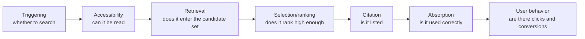
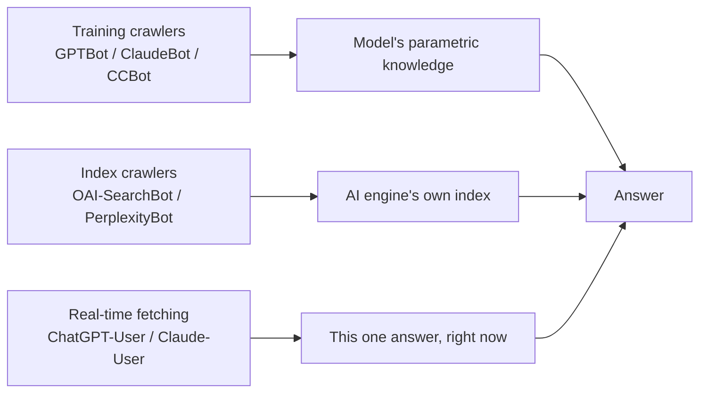
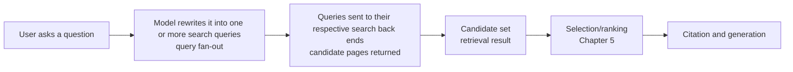
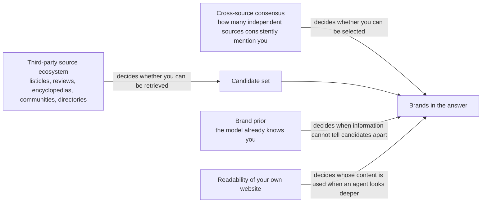
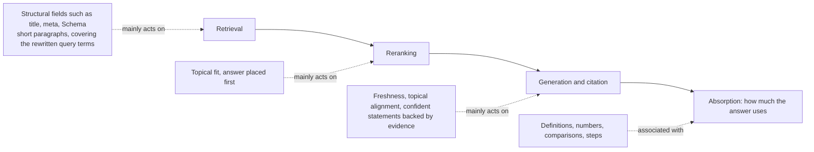
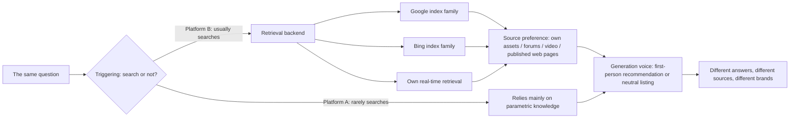
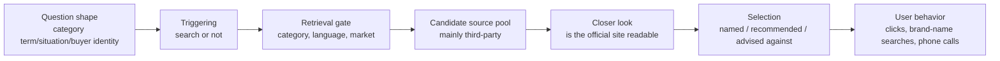

# GEO Lab: Research Edition
## A Textbook on Generative Engine Optimization

> Basis: close reading of 138 papers (mostly from 2026) and about 31,000 practitioner discussions, each labelled independently three times, with statistical removal of soft advertising and tests of whether recurring claims reflect real consensus.
> The main text marks how far each conclusion can be trusted with fixed evidence-strength phrases; the item-by-item source trail is in `_sources/`.

## Contents

**Part One: Foundations**

- [Chapter 0: How to Read GEO Evidence](Chapter_00.md) (about 4,661 words)
- [Chapter 1: How AI Search Systems Work (the Full Picture)](Chapter_01.md) (about 4,612 words)

**Part Two: The Pipeline, Stage by Stage**

- [Chapter 2: Triggering: When Does AI Search?](Chapter_02.md) (about 3,243 words)
- [Chapter 3: Accessibility: Can AI Read Your Website?](Chapter_03.md) (about 6,742 words)
- [Chapter 4: Retrieval: Query Rewriting, Semantic Matching, and the Language and Market Gate](Chapter_04.md) (about 7,262 words)
- [Chapter 5: The Source Ecosystem: Third Parties, Consensus and Brand Priors](Chapter_05.md) (about 6,882 words)
- [Chapter 6: Selection and Ranking (Relevance, Position, Attribute Weights)](Chapter_06.md) (about 4,794 words)
- [Chapter 7: Citation and Absorption (Listed ≠ Used ≠ Used Correctly)](Chapter_07.md) (about 5,221 words)

**Part Three: Cross-Stage Topics**

- [Chapter 8: The Evidence on Content-Level Practices: What Works, What Fails, What Goes Out of Date](Chapter_08.md) (about 5,598 words)
- [Chapter 9: Measurement: Visibility Is a Distribution, Not a Ranking](Chapter_09.md) (about 7,237 words)
- [Chapter 10: Traffic and Commercial Value](Chapter_10.md) (about 5,303 words)
- [Chapter 11: Competition, Manipulation and Defence](Chapter_11.md) (about 4,749 words)
- [Chapter 12: Platform Differences and the Chinese-Language Ecosystem](Chapter_12.md) (about 5,542 words)

**Part Four: Case Types**

- [Chapter 13: Brand and Product Recommendations (Case Chapter)](Chapter_13.md) (about 9,957 words)
- [Chapter 14: Content Websites: After the Traffic Is Intercepted, What Content Still Gets Cited and Clicked](Chapter_14.md) (about 8,726 words)
- [Chapter 15: The Role of Reddit and Social Platforms in AI Search](Chapter_15.md) (about 5,390 words)

**Appendix**

- [Appendix A: Major Disagreements Between Studies, and Between Research and Practice](Appendix_A.md) (about 4,573 words)

About 100,492 words in total.

# Chapter 0: How to Read GEO Evidence

## Questions this chapter answers

1. Under what conditions were figures such as "GEO can raise visibility by 40%" actually measured?
2. What kinds of design does GEO research use? Which one produces conclusions closest to the real world?
3. Why do results change when you ask the same question twice, switch engines or switch languages? What does this mean for "proving it works"?
4. How far should you trust practitioners' experience, vendors' reports and community consensus?
5. When you are handed any GEO claim or report, in what order should you check it?

## 1. Core principles

### 1.1 Every GEO conclusion comes with "conditions"

AI search is not a fixed ranking table. It is a random, multi-stage filtering pipeline:

```
Triggering → Accessibility → Retrieval → Selection/ranking → Citation → Absorption → User behavior
```

A study usually measures only one or two of these stages. So every conclusion carries an implicit question: **which stage of the pipeline was measured, with what system, and under what conditions?**

The most typical example is the widely circulated "GEO raises visibility by up to 40%". The conditions behind this figure are:

| Condition | What actually happened |
|---|---|
| Did the page first have to be found by search? | No. The page was already placed among 5 candidate documents |
| Who generated the answer | GPT-3.5 |
| What was measured | The share of words in the answer belonging to that page (relative increase, 19.3 → 27.2) |
| What it does not mean | It does not mean the page is easier to retrieve, and it does not mean more traffic |

So it answers only one question: "once a page is already in the candidate set, can rewriting make the answer use it a little more?" It does not answer what readers really care about: "will I be found, and will it bring business?"

### 1.2 Four generations of research

To understand a study, first look at which generation it belongs to and which question it is answering:

| Generation | Period | Main question |
|---|---|---|
| First generation | 2023–2024 | Can content change visibility in AI answers? (Showed that it "can") |
| Second generation | 2024–2025 | Can this influence be manipulated maliciously? (Showed that it "can") |
| Third generation | 2025 | Do the techniques generalise to other engines and other domains? (Found it "hard", and found zero-sum competition) |
| Fourth generation | 2026 | How much of the effect remains once placed back in the full pipeline? How can it be measured reliably? How should it be governed? |

The earlier the study, the more likely its figures are optimistic numbers obtained under simplified conditions. When citing an early figure, ask whether later research has repeated it under more realistic conditions.

### 1.3 Simplified conditions systematically overestimate effects

A "fixed context" experiment feeds the page directly to the model, skipping retrieval and ranking. This makes variables easy to control, but it misses the elimination that happens in the early stages of the pipeline.

```
Fixed-context experiment:   [Your page is already in the candidate set] → Generation → Measurement
Full pipeline:              Query → Retrieval (may be eliminated) → Reranking (may be eliminated) → Truncation (may be eliminated) → Generation → Measurement
```

In controlled experimental systems, when prompt injection attacks were placed in a full "retrieval → reranking → generation" pipeline:

- generic instruction-override injections lost about 40% at the retrieval stage, with an end-to-end success rate of about 14.7%;
- gradient-based attacks had an end-to-end success rate below 2%;
- only rewriting-style injections that stayed highly relevant to the query still had an end-to-end success rate of about 40%–54%.

The same set of attacks had been reported at about 80% success under fixed context. The gap comes almost entirely from "whether the attack had to pass the retrieval gate".

Observational data also overestimates. In controlled experimental systems, one study compared the effect of ranking position on citation:

| Measurement method | Citation-rate gap between rank 1 and rank 5 |
|---|---|
| Reading observational data directly | 42.3 percentage points |
| Controlled replay (only position changed, everything else held constant) | 7.9 percentage points |
| Replay on held-out samples | 0 |

In observational data, higher-ranked content is already more relevant and more authoritative. Once these confounding factors are removed, the effect of "position itself" shrinks sharply.

**Principle: any study that skips a stage, or does not control for confounding factors, reaches conclusions that lean optimistic.**

## 2. How strong is the evidence: six research designs

Throughout the book, fixed phrases mark the strength of evidence. Readers can use the same standard to classify any study they see in other material.

### 2.1 Overview of the six designs

| Design | Phrase used in this book | What it can answer | What it cannot answer |
|---|---|---|---|
| Real-user experiments (randomised or quasi-experimental) | "Large-scale experiments with real users show …" | Whether real traffic and sessions changed after an intervention | Usually covers only one site or platform, so it is hard to generalise |
| Repeated tests on real engines | "Repeated tests on real AI search engines found …" | Whom commercial engines actually cite, and how unstable this is | Mostly observational, showing correlation rather than causation |
| Tests with supplied pages | "When the pages are supplied to the engine …" | How the engine uses a page once it has read it | Skips "whether the engine would find this page on its own" |
| Reproducible experimental pipelines | "In controlled experimental systems …" | How large the causal effect is in a complete but open-source pipeline | An open-source pipeline is not a commercial engine |
| Simulation / theory | "Simulations or theoretical analysis suggest that, in principle, … may" | Whether something is possible in principle | Cannot be written up as a real-world conclusion |
| Large models as judges (LLM-as-judge) | Not a separate grade but a **measurement tool**, which can appear in any of the designs above | Large-scale automatic scoring | The scores themselves may be unreliable |

### 2.2 Real-user experiments: closest to "does it work", but very rare

These studies look directly at real traffic or sessions. There are very few so far, and most are run by platforms or websites themselves. Two examples show their value and their traps:

**Example 1: using a same-domain control group to remove the "platform tailwind".** A website carried out a set of optimisations aimed at AI answer engines. Referral traffic from ChatGPT grew 5.7 times in raw terms over the observation period. But the **pages on the same site that were not optimised** also grew 3.5 times over the same period: this was growth in the platform's own user base. Using the untreated pages as a control and running an interrupted time series analysis, the level jump attributed to the optimisation was about 1.8 times (robustness checks ranged from 1.8 to 2.3 times). The placebo test reached only a "suggestive" level. In addition, the optimisations were bundled together, so it is impossible to tell which one worked; over the same period, organic clicks from traditional search actually fell by about 25%, and there was no evidence of "AI optimisation lifting traditional search".

Lesson: most of the raw multiple is the whole market rising, not something you did right. In the same study, a single-day spike reached 38.2 times; a figure like that is even less usable as a causal effect.

Example 2: check the numbers in self-run tests yourself. An image platform tested on itself adding annotations aligned with users' search intent to its content, and building collection pages and internal links. In a 4-week A/B test, the enabled group had 1.18 times the sessions of the control group, and the group with the related features switched off had 0.82 times. But other figures in the same report were inconsistent: the text claimed relevance was 19% higher, but the table figures did not match; it claimed a 20% traffic increase, but the breakdown table showed increases of only +0.83% to +1.83%; "generative search traffic 9.2 times" did not define the metric.

Lesson: even with the highest grade of design, check whether the figures in the text match the tables and whether the metrics are defined. That the authors are the platform itself is also a factor to consider.

### 2.3 Repeated tests on real engines: realistic, but mostly observational

These studies put questions to real products such as ChatGPT, Perplexity and Google AI Overviews, and record citations and recommendations. Their strength is that they reflect the real behaviour of commercial engines; their weakness is that most can only describe "who gets cited" and cannot prove "change this and you will be cited".

Pay attention to the word "repeated". Some studies run their queries only once, on a single date, which strictly speaking is just a snapshot. As the next section shows, the error of a snapshot can be large enough to invalidate the conclusion.

### 2.4 Tests with supplied pages and reproducible pipelines: each lacks one stage

- Tests with supplied pages: the URL is handed to a commercial engine by hand. The generation side is real; what is missing is the stage where "the engine finds it on its own".
- Reproducible pipelines: a complete pipeline is built from open-source retrievers, rerankers and generation models. Causal inference is clean, but the pipeline is not a commercial engine.

Both have value, but neither can be directly stated as "doing this works on ChatGPT".

### 2.5 Simulation and theory: they only show what is "possible"

Fixed context, simulated users and mathematical derivations all belong here. This is the largest category in the total body of research. These studies are suited to proposing hypotheses and explaining mechanisms, not to serving as a basis for practice. Whenever this book meets this kind of evidence, it writes "in principle, … may".

### 2.6 Large models as judges: the judge itself must be tested

Many studies use a large model to score answers: is this statement supported by the source? Is this content relevant? The problem is that the judge model itself makes mistakes.

In one audit based on repeated tests on real AI search engines, researchers used a large model to judge "whether a statement is supported by the source" and then compared it with human judgement: on 100 samples, the correlation coefficient between the two was only 0.62. The researchers themselves acknowledged that this limits the credibility of the core metric.

When reading a study that uses large-model scoring, ask three things:

1. Was it compared with human annotation? On how many samples? How high was the agreement?
2. Are the judge model and the model being judged from the same company, or even the same model?
3. Are the scoring criteria public? Does the conclusion still hold with a different judge model?

## 3. Why results change: instability is the norm, not the exception

A generative engine may answer differently every time. This is not a measurement error but a property of the system itself. Any conclusion based on a single result must be discounted first.

### 3.1 Asking the same question twice

Repeated tests on real AI search engines found:

- When the same query is run repeatedly, the median Jaccard similarity of the cited domain sets (the intersection of two results divided by their union) is about 0.29–0.31 for Gemini, about 0.33–0.40 for SearchGPT and about 0.50 for Perplexity. That is, the domains cited in two answers are often only one-third to one-half the same.
- To estimate a domain's "citation share" with a 95% confidence interval no wider than 5 percentage points, Gemini needs about 30–50 queries, Perplexity about 90–100, and SearchGPT more than 150.
- When the same prompt was repeated 6 times, the "top recommendation" changed for 4 of the 6 prompts.
- One vendor's production tracking data showed that whether a brand "is mentioned or not" is close to binary and fairly stable, but the flip rate of "sentiment" is about 6.7 times the flip rate of mentions. The study recommends running mentions at least 3 times, and using at least 10 prompts for sentiment, before results become stable (an observational recommendation).

The same phenomenon appears in controlled experimental systems: in single generations, about 15% of binary "cite or not" decisions flip, and about 45% of the effect variance comes from the randomness of decoding.

A large-scale audit of one social platform's own generative search found that on re-query, only about 41.8% retrieved exactly the same sources; when the retrieval results were the same, 89.6% of answers were nearly identical. **The variation comes almost entirely from retrieval, not from generation.**

### 3.2 Switching engines

The sources cited by different engines overlap very little:

| Comparison | Degree of overlap |
|---|---|
| Source domains across different AI engines | Jaccard about 0.10–0.25 (varies by study and domain) |
| AI engines vs Google organic results | Domain overlap ranges from about 4% to 25% (varies by engine and study) |
| Google AI Overviews vs Google organic results | About 68% overlap in the top 100 domains |
| App vs web version of the same Chinese-language platform | Domain-level Jaccard 0.19–0.51; URL-level only 0.014 on one platform |

So "it works on ChatGPT" cannot be extended to Perplexity; "it works on the web version" cannot even be extended to the same company's app.

### 3.3 Switching language or region

Repeated tests on real AI search engines found that query language is one of the largest sources of systematic variation:

- In one variance decomposition study, query language accounted for 26.5% of the variance in single answers, while the brand itself accounted for only 1.5%. The ranking reliability of a single answer was only about 0.01.
- When commercial questions were asked in the local language, global vendors appeared only 1 time out of 24; when asked in English in two non-English-speaking cities, local vendors appeared 0 times out of 12. Language determines which set of candidate vendors appears, and the exit IP determines which country's market.
- The same variance study estimated that adding 5 more repetitions after the first 5 reduces error variance by only 0.0003; adding 3 more languages instead reduces it by 0.00462, about 15 times as much. The measurement budget should go to **breadth** (languages, models, rephrasings), not to **depth** of repetition of the same prompt. (This result is limited to the sentiment metric, and confidence intervals have not yet been calculated.)

Measurements made in English cannot see the local competitors in non-English markets.

### 3.4 Switching dates

Platforms actively adjust "whether to show an AI answer". Repeated tests on real AI search engines found:

- Google AI Overviews expanded from 7 countries in 2024 to 229 countries in 2025; the appearance rate for US queries rose from 42% to 67%.
- The appearance rate for one category of health-topic queries rose from 1% to 66% (this subsample has only 74 queries).
- In one vendor's tracking data, with no intervention at all, visibility on ChatGPT fell by an average of 1.34% per run, and on Perplexity by 0.76%.

A "before vs after optimisation" comparison without a control group cannot tell whether a change came from your optimisation or from the platform itself changing.

### 3.5 Switching the wording

- In consumer products, adding "list your sources" after a question raised the average number of citations from 16.6 to 19.9, and the source composition changed by no more than 2.1 percentage points: a very small effect.
- But on the API side, the same wording raised the share of cases where the model called search from 12.1% to 88.4%. Prompt wording mainly changes "whether to search", not "whom it finds".
- Answers also follow the wording of the question: on debate-type questions, the share of one-sided answers ranged from about 49% to about 90% across engines.

So every measurement should disclose the full prompt text, the interface (product or API), the language, the region and the date.

### 3.6 "Cited" does not mean "used"

The metric itself also needs checking. Repeated tests on real AI search engines found:

- In Chinese-language generative engines, of the listed sources only 66% had content that made it into the body of the answer, 30% were substantively cited and 8% were deeply cited; about 39.3% were "silent citations".
- Another cross-system audit found that community discussion sources were listed as citations in AI Overviews, but noticeably less of their content was actually absorbed.
- Citing a source that really exists can also mislead: in a check of more than 760,000 citation pairs, 30.6% of the citations distorted the source content, and 27.1% of the sources were themselves unsuitable for answering the question.
- Researchers also point out that some conclusions that "long sources are overused" are partly produced by the scoring method: with a different calculation, the gap shrinks sharply.

When a report says "cited so many times", ask: was the source listed, used, or used correctly?

## 4. Debates and counterexamples

### 4.1 The gap between "40%" and later research

| Position | Basis |
|---|---|
| GEO rewriting can raise visibility substantially | Early fixed-context research, up to about 40% relative increase |
| This is not a general promise | A critical review of 45 studies points out: in one cross-method, cross-domain benchmark, only 3 of 54 method–domain combinations were significantly positive; in another multi-stage test, optimising only the body text actually lowered the top-20 appearance rate by about 9% and final citations by 6% |

The two are not necessarily contradictory: the former measures "already in the candidate set", while the latter also counts retrieval. But reading the former as "doing GEO gets you 40% more" is a misreading.

### 4.2 Does position matter?

Observational data shows a huge gap between rank 1 and rank 5; after controlled replay the gap shrinks to 7.9 percentage points, and it disappears on held-out samples. The same study also found that structured presentation (headings, lists, tables) increased the number of citations of the target source by 0.50 (statistically significant), but the total number of citations did not increase: it **redistributes** credit among equivalent sources rather than enlarging the total. And on the main metric, "whether cited", the effect is uncertain (+4.5 percentage points, with a confidence interval that crosses 0).

The same thing, viewed through different metrics, can lead to different conclusions.

### 4.3 How many repetitions are enough?

| View | Basis |
|---|---|
| Repeat more | The intervals of a single snapshot are so wide that many domain differences amount to noise; share estimates need tens to hundreds of queries |
| Do not repeat too much; widen breadth | Variance decomposition shows that repetitions after the 5th have very low marginal value, while adding languages and models pays off more |

The two can coexist: first repeat enough to stabilise single points, then shift the budget to breadth across languages, engines and wordings. But the latter has only been estimated for the sentiment metric, and has no confidence intervals yet.

### 4.4 Much measurement research comes from interested parties

Among the real-engine studies cited in this chapter, several were written by AI visibility vendors or by authors connected with GEO vendors. This does not mean the data is fake; some vendor studies are precisely the ones exposing the instability of measurement. But note:

- vendors have a motive to show that "visibility can be measured, is worth measuring and is worth optimising";
- vendor studies are mostly observational and lack intervention experiments;
- grouping methods (for example, tiers of brand awareness) are often defined by hand;
- samples may cover only a few topics and a few models.

Platforms' self-run tests (such as Example 2 in 2.2) have the same problem: the people running the experiment also benefit from the result.

## 5. How to read practitioners' claims

In this chapter's evidence base, no practitioner test passed screening for use as a case. This is itself a signal: many widely circulated figures (for example, "40%" or "3 times") cannot be traced back to an original test that can be checked. Below is a method for reading practitioners' claims, which every chapter of the book uses.

### 5.1 Distinguish four kinds of claim

| Type of claim | Features | How this book writes it | What it can be used for |
|---|---|---|---|
| Repeated, controlled tests | Before-and-after comparison, a control group, multiple repetitions, published method | "Practitioners' repeated, controlled tests found …" | Can serve as practical evidence, but still awaits independent verification |
| Ordinary test reports | Done by the person, with figures, but incomplete controls or repetition | "Practitioners report from their own tests …", stating that this is not independently verified | Indicates a direction |
| A single first-hand observation | A phenomenon seen once, a screenshot | "One practitioner observed …" | Only a lead or an example |
| Community consensus | Many people say so | "Practitioners widely believe …" | Shows "what people think", not proof |

### 5.2 Common traps

1. **First-hand ≠ reliable.** Someone who did it personally may still have done it only once. Section 3 of this chapter shows that the top recommendation in a single answer often changes.
2. **A single screenshot is not evidence.** A screenshot of "my brand appeared in a ChatGPT answer" proves only that one time, that language, that region, that day.
3. Before-and-after comparisons without a control. Platforms are changing themselves (3.4), and the whole market is rising (Example 1 in 2.2). Without a control group over the same period, growth cannot be credited to optimisation.
4. Consensus ≠ truth. Many people repeating the same claim may simply be relaying the same source. Each author should count as only one vote.
5. Numbers detached from conditions. For "40% increase" or "3 times", ask: relative or absolute? Was it measured on retrieval, citation or traffic? On which engine, in which language, over which period?
6. Conflicts of interest. Does the speaker sell tools or services, or have a commercial relationship with the brands mentioned? For such content, this book at most writes "A vendor claims …, but this has not been independently verified".

## 6. Cases

### Case 1: how a "5.7 times" became "about 1.8 times, and only suggestive"

- **What was done**: a website carried out a set of AI answer engine optimisations, including URL normalisation, mining demand from the 404 logs of AI crawlers, and switching to question-style headings with standalone summaries.
- **Platform**: ChatGPT referral traffic.
- What was observed: raw growth of 5.7 times; untreated pages on the same site grew 3.5 times over the same period; with the untreated pages as a control, the level effect was about 1.8–2.3 times; the placebo test was only suggestive. Organic clicks from traditional search fell by about 25% over the same period.
- Principle illustrated: the raw multiple mixes in platform growth; a same-domain control group is the key to separating the two; when several measures are bundled, no single practice can be credited.

### Case 2: the same widely circulated figure under different conditions

- **What was done**: with 5 candidate documents fixed, researchers applied various rewrites to web pages and had GPT-3.5 generate answers.
- **What was observed**: word share rose from 19.3 to 27.2, a relative increase of about 40%.
- Follow-up: under more complete conditions, most method–domain combinations showed no significant positive effect; changing only the body text may even harm retrieval.
- Principle illustrated: the number itself is not wrong; what is wrong is stripping it from its conditions.

### Case 3: testing in English cannot see local competitors

- **What was done**: on the ChatGPT web interface while logged out, researchers asked for business software recommendations in different languages and from different exit IPs, repeating each combination 6 times.
- **What was observed**: when asked in the local language, global vendors almost never appeared (1 time out of 24); when asked in English in non-English-speaking cities, local vendors did not appear at all (0 times out of 12). Asking in one country's language from another country returned vendors from the country matching that language.
- Limitations: a single model, only 6 runs per combination, and the authors are a visibility measurement vendor; in one control category there was no language effect.
- Principle illustrated: the measurement settings (language, region) themselves determine what you see.

## 7. What to do: a checklist for evaluating any GEO claim

### 7.1 Eight-step checklist

When you are handed a study, a vendor report or a practitioner's claim, ask in this order:

| Step | Question to ask | Warning sign | Basis for this step |
|---|---|---|---|
| 1. Research design | Is it a real-user experiment, repeated tests on real engines, supplied pages, an experimental pipeline, or a simulation? | Cannot say clearly, or presents simulation results as real effects | This book's grading standard |
| 2. Pipeline stage | Does it measure triggering, retrieval, citation, absorption or traffic? | Infers "traffic" from "cited" | Repeated tests on real engines; critical review |
| 3. Candidate set | Was the content found on its own, or fed directly to the model? | Fixed context, yet claims "easier for AI to find" | In controlled experimental systems |
| 4. Repetition and intervals | How many times was each condition repeated? Are there confidence intervals? | A single screenshot, a single-day snapshot, only averages reported | Repeated tests on real engines |
| 5. Measurement scope | Which engines, languages, regions, interfaces and dates? | Tests one engine and calls it "AI search" | Repeated tests on real engines |
| 6. Control group | Is there an untreated control over the same period? | Only a before-and-after comparison | Large-scale experiments with real users |
| 7. Scoring method | Who did the scoring? Was the large-model judge compared with humans? | Judge agreement not reported | Repeated tests on real engines |
| 8. Interests and consistency | Who are the authors? Do they sell related services? Do the figures in the text match the tables? | Authors are beneficiaries, figures do not match, metrics undefined | Counterexample in a large-scale experiment with real users |

### 7.2 When you run measurements yourself

- **Do**: repeat the same prompt several times at least, then widen to multiple languages, engines and wordings. (Repeated tests on real engines; "breadth first" has so far only been estimated for the sentiment metric)
- **Do**: record the full prompt text, interface (product / API), language, exit region and date. (Repeated tests on real engines)
- Do: report each engine separately; do not average results from different engines into a single "AI visibility". (Repeated tests on real engines)
- Do: when reporting citation share, attach an interval rather than a single percentage. (Repeated tests on real engines; authors are a vendor)
- Do: when evaluating the effect of optimisation, keep a batch of pages from the same site and of the same type unoptimised as a control. (Large-scale experiments with real users; a single website)
- Do: distinguish "listed as a citation", "content used" and "used correctly". (Repeated tests on real engines)

### 7.3 Do not do

- Do not use a screenshot to prove that "the optimisation worked" or that "A beats B".
- Do not treat percentages from fixed-context or simulation experiments as effects you can promise to clients.
- Do not treat a raw growth multiple as the effect of optimisation.
- Do not measure non-English markets in English only.
- Do not treat a practice as proven because "many people say so".

### 7.4 Already outdated readings

- Treating "GEO raises visibility by up to 40%" as a general effect: this figure applies only under the conditions "already among 5 candidate documents, generated by GPT-3.5, measuring word share".
- Believing that "good traditional search rankings mean good AI visibility": several studies show that the sources of AI engines and traditional search results overlap very little.
- Believing that one query can represent an engine's "view": when the same question is asked repeatedly, the cited sources are often only one-third to one-half the same.

## Key points

1. Every GEO conclusion comes with conditions: which stage of the pipeline was measured, in what system, in what language and on what date. Figures detached from their conditions get misread.
2. "GEO raises visibility by 40%" is a relative increase in word share with 5 fixed candidate documents and GPT-3.5. It does not mean easier to find, and it does not mean more traffic.
3. Experiments that skip retrieval, and observational data without control for confounding, both systematically overestimate effects.
4. Generative engines are inherently unstable: when the same question is asked again, the cited sources often overlap by only one-third to one-half; language, engine, interface, date and wording all change the results.
5. Single screenshots and single-day snapshots are not evidence; measurements need repetition, intervals and wider breadth.
6. Real-user experiments come closest to "does it work", but they are rare, and they still need a same-period control group to subtract platform growth.
7. Large-model judges, vendor studies and platforms' self-run tests all need checking: were they compared with humans? Who benefits? Are the figures consistent throughout?
8. Distinguish among practitioners' claims: "repeated, controlled tests", "single observations" and "community consensus"; consensus is not truth.

# Chapter 1: How AI Search Systems Work (the Full Picture)

> This chapter is the map for the whole book. Each later chapter zooms in on just one part of this map.

## Questions this chapter answers

1. When AI answers a question, where does its knowledge come from? When does it rely on what it "remembers", and when on what it "finds by searching on the spot"?
2. Between the user asking a question and the user seeing the answer, what stages does the process go through? What does each stage value?
3. Why can an optimisation that helps at one stage end up with a negative overall effect?
4. What is the relationship between GEO and SEO? Where is the saying "doing SEO well is the same as doing GEO well" right, and where is it wrong?
5. Which part of the pipeline does each later chapter of this book deal with?

## 1. Core principles

### 1.1 Two sources of knowledge: parametric knowledge and retrieved knowledge

When AI answers a question, it can use two kinds of knowledge:

| Knowledge source | What it is | How you can influence it |
|---|---|---|
| **Parametric knowledge** | What the model memorised during training | Only indirectly, through content that exists widely on the web over a long period; the cycle is long |
| **Retrieved knowledge** | What the model reads after searching and opening web pages at the moment of answering | By making content get found, get selected and get understood |

The proportion between the two is not fixed. It depends on two things:

- **Whether it is connected to the web.** In the mode where an agent answers with web access, repeated tests on real AI search engines found that only about 7–10% of the final answer content comes from training knowledge; the rest is built on content read on the spot.
- **How popular the subject of the question is.** Popular and obscure entities work by different mechanisms:
  - Popular entities (brands and products everyone knows): the answer relies mainly on parametric knowledge, and retrieval is used only to "confirm an existing impression". In an experiment, shuffling the order of retrieved snippets moved the rankings in the answer by only 2.30 places on average.
  - Obscure entities (small brands, new products, long-tail topics): the answer has to be "built" from retrieved content; after the same shuffling, rankings moved by 4.15 places on average.
  - These results come from a perturbation experiment on a single model. They are mechanism evidence under controlled conditions: the direction is credible, but the specific figures should not be extrapolated.

What this means in practice: the more obscure the brand or topic, the more it depends on the retrieval pipeline, and the more room GEO has to make a difference; the more popular the entity, the harder it is to shift the model's existing impression with a single content change.

### 1.2 The map of the book: a random, multi-stage filtering pipeline

AI search is not a ranking table but a **random, multi-stage filtering pipeline**. For your content to reach the user and create value, it must pass seven gates in turn:



| Stage | What this gate asks | What failure looks like | See |
|---|---|---|---|
| **Triggering** | Will AI search for this question, or answer directly from memory? | No retrieval at all; only parametric knowledge remains | Chapter 2 |
| **Accessibility** | Can AI crawlers or agents fetch, open and understand your page? | Blocked, or content rendered by JS cannot be read, so AI uses other people's content instead | Chapter 3 |
| **Retrieval** | After query rewriting, semantic matching and language and market filtering, can your page enter the candidate set? | You are not in the candidate set at all | Chapters 4 and 5 |
| **Selection/ranking** (selection / ranking) | Where do you rank within the candidate set? Are you cut off? | Ranked below the cut-off line, so the generator cannot see you | Chapter 6 |
| **Citation** | Does the answer list you as a source? | Your content is used but not credited to you, or only others are listed | Chapter 7 |
| **Absorption** | Does the answer actually use your content, and use it correctly? | Listed but not used, or distorted | Chapter 7 |
| **User behavior** | After seeing it, will users click, trust, buy? | Cited, but no traffic or conversions | Chapter 10 |

Topics that span several stages are handled in separate chapters:

| Topic | Chapter |
|---|---|
| How to read GEO evidence | Chapter 0 |
| The source ecosystem: third parties, consensus and brand priors | Chapter 5 |
| Content-level practices: what works, what fails, what goes out of date | Chapter 8 |
| Measurement: visibility is a distribution, not a ranking | Chapter 9 |
| Competition, manipulation and defence | Chapter 11 |
| Platform differences and the Chinese-language ecosystem | Chapter 12 |
| Case types: brand and product recommendations, content websites, community platforms | Chapters 13–15 |

**The word "random" matters.** Ask the same question twice and the answer, the cited sources and the order of recommendations may all differ. So a "rank" in GEO is not a fixed value but a probability of appearing. This shapes every measurement method that follows (Chapter 9).

### 1.3 Each stage values different things

In controlled experimental systems (a reproducible pipeline made up of keyword retrieval, a reranking model and a generation model, using a corpus of real web pages), researchers found that the three main stages reward different document features:

| Stage | What it values |
|---|---|
| Retrieval | Keywords and structural fields (title, meta description, headings at each level, schema) |
| Reranking | Topical fit, and whether the answer is placed up front |
| Generation | Content in the body text that contains evidence |

This produces a counter-intuitive consequence:

- **Optimising only the body text**: the retrieval hit rate fell by about 9%, the reranking hit rate by about 16%, and the final citation rate by about 6%. Making the body text more "suited to generation" caused the document to fall behind at the first two gates.
- **Optimising only the structural fields**: the retrieval hit rate rose by about 22%, but the reranking hit rate still fell by about 17%.
- Automatic rewriting with heavy expansion: the retrieval hit rate fell by about 36%. Losses were greatest when technical terms and rare words were rewritten.
- About 5.8% of target documents dropped from 10th to 11th place during reranking, landing just outside the cut-off line, so the generator could not see them at all.
- In the shopping domain, every rewriting strategy tested lowered the citation rate.

### 1.4 The total effect is the combination of the effects at each stage

An optimisation must **survive every stage** before its final effect can be seen. Benefits measured at only one stage cannot simply be added up into a total effect.

```
Final effect ≈ Triggering × Accessibility × Retrieval × Ranking × Citation × Absorption × User behavior
(if any one factor is close to zero, the total effect is close to zero)
```

In controlled experimental systems, this has been confirmed repeatedly:

- Downstream rewriting can harm upstream retrieval (see 1.3).
- Testing various injection methods for "getting content adopted by AI" in a full pipeline: on average about 79.9% of injected content passed retrieval; but generic instruction-override methods passed retrieval only about 59.3% of the time, leaving an end-to-end success rate of only about 14.7%; gradient-based methods had an end-to-end success rate below 2%. Only rewriting-style methods that kept query relevance still had an end-to-end success rate of about 40–54%.
- Within the same pipeline, the reranking model and the generation model even had opposite preferences for position in the context: the reranker preferred later positions, and the generator preferred earlier ones.

This means that "fixed context" experiments, which supply only a few documents and let the model generate directly, systematically overestimate the effect of optimisation. This is also the main reason why the 2023 batch of conclusions that "adding statistics and quotations raises visibility by 40%" cannot be generalised (see Chapters 0 and 8).

### 1.5 Agents search in multiple rounds and open web pages to read them

The new generation of AI search does not just "search once and excerpt a passage". An agent splits a question into several sub-queries (query fan-out), searches in multiple rounds, and actually opens web pages to read them.

So the scope of GEO is extending: from "being found" to "**being understood by an agent and acted upon**".

- Repeated tests on real AI search engines found (a matched quasi-experiment covering 1,056 businesses and 37,927 agent journeys): for websites more readable by agents, about 78% of the answer came from the business's own pages, against only about 58% for poorly readable ones; the share explicitly recommended was 20% against 11%.
- The same study found that when a website could not be read, the agent's typical failure was **omission**, using third-party or competitors' content instead, rather than making things up.
- A caution: the authors of this study are themselves a related vendor, they used their own scorer, and readability was measured as one bundled score without separating the effects of individual practices.
- For accessibility see Chapter 3; for brand and product recommendation scenarios see Chapter 13.

### 1.6 GEO and SEO: shared foundations, different filtering logic

| Aspect | SEO | GEO |
|---|---|---|
| Output form | A ranked list of links | A synthesised answer, with (or without) citations |
| Unit of competition | The ranking of a whole page | Extractable passages and entity information within a page, plus descriptions of you on other people's pages |
| Stability of results | Relatively stable; ranks can be tracked | Random; results for the same question drift across runs |
| Source of knowledge | The index only | Parametric knowledge + retrieved knowledge |
| Definition of success | Ranking, clicks | Triggered → retrieved → selected → cited → correctly absorbed → leads to action |

The relationship between the two can be summed up in three statements:

1. **SEO is one of the preconditions of GEO, but not a sufficient condition.** Being crawlable, indexable and clearly structured is the foundation both share. On many platforms, being indexed and ranked by a search engine is still an important way into the AI candidate set.
2. **The sources AI cites overlap only to a limited degree with search rankings.** Repeated tests on real AI search engines found:
   - For the same set of queries, the overlap (Jaccard similarity) between the domains cited by each AI engine and Google's results was only: GPT-4o 4.0%, Gemini 11.1%, Claude 12.6%, Perplexity 15.2%.
   - AI engines prefer third-party "earned" sources (earned media): Claude about 65%, GPT-4o about 57%; in Google's results, earned sources were about 41% and community content about 34%.
   - The pages AI engines cite are fresher: for car-related queries, for example, the median age of pages cited by Claude was about 148.0 days, against about 492.9 days for Google.
   - Taking existing research together, page overlap over two months was about 18% for Google AI Overviews and about 45% for organic results; URL overlap between different systems was about 0.11–0.18.
3. No research has yet shown that GEO reliably brings traffic or conversions. Taking existing research together, the evidence is concentrated on "content that has already been retrieved can change the answer"; for organic discoverability or commercial conversion, there is not yet stable, cross-platform, long-term causal evidence (Chapter 10).

## 2. How strong is the evidence

| Conclusion | Type of evidence | Strength and scope |
|---|---|---|
| In web-connected agent mode, training knowledge makes up only 7–10% of answers | Repeated tests on real AI search engines | Moderate to strong; limited to agent answering with web access; authors are a vendor |
| Popular entities rely on parametric knowledge, obscure entities on retrieval | Real-engine observation + single-model perturbation experiment | Mechanism credible; specific figures should not be extrapolated |
| Each stage values different features; optimising only the body text harms retrieval and reranking | Controlled experimental systems | Clear mechanism evidence; commercial engines' pipelines are not public, so details may differ |
| The total effect is the combination of all stages; fixed-context experiments overestimate effects | Controlled experimental systems + research synthesis | Consistent direction; several studies corroborate one another |
| Sources cited by AI overlap little with Google results | Repeated tests on real AI search engines | Fairly strong; but overlap varies by platform, industry and time |
| Agent readability correlates with the share of own content and the recommendation rate | Matched quasi-experiment with real agents | Correlational rather than strictly causal; own scorer; individual practices not separated |
| Effect of GEO on traffic and conversions | No stable causal research so far | A gap; cannot be claimed |

Two reminders for reading the evidence:

- Controlled experimental systems can explain "what happens in principle", but the real pipelines of commercial engines are not public, so specific percentages can serve only as a direction, not a promise.
- Measurements on real engines can show "what things look like now", but AI search changes quickly, and every overlap figure and share is time-sensitive.

## 3. Debates and counterexamples

### Debate 1: does doing SEO well automatically mean doing GEO well?

**View A: GEO is basically SEO.**

- Practitioners widely believe the two overlap heavily and differ only in emphasis. One practitioner estimates about 70% overlap; another, estimating from their own task list, puts it as high as 85% or more.
- One practitioner observed that several of their own websites, with no schema, no llms.txt and no special structure, appeared in AI answers through ordinary SEO alone.
- One practitioner observed that after three or four months of comprehensive SEO work on a website, its appearances in AI Overviews rose from twenty or thirty to more than 700, and observed that the higher the ranking, the more likely it was to be cited.
- Practitioners report from their own tests: on a small SaaS page, only the title and the first 200 words or so were rewritten; three months of data showed organic rankings rising first, and only afterwards citation by AI Overviews.

**View B: ranking and being cited are two different things.**

- Practitioners report from their own tests (about 1,200 queries, ChatGPT and Perplexity): only about 38–45% of the cited brands were in Google's top three; about 30% of citations came from pages ranked 6–20; about 20% came from sources with no ranking, such as community discussions and documentation pages.
- Practitioners report from their own tests (about 350,000 articles, 10,382 B2B SaaS keywords, 52 categories): only about 14% of the URLs cited by AI appeared in Google's top 20.
- Practitioners report from their own tests (4 websites, 80 queries, each checked by hand in incognito mode): only 31% of pages in Google's top three were cited by AI Overviews; beyond 10th place, the citation rate fell to 12%.
- Practitioners' repeated, controlled tests found: running a fixed set of about 40 prompts on ChatGPT, Perplexity and Google AI Overviews for several weeks and recording about 500 citations by hand, Google ranking was no longer a good proxy for being cited; moreover, each platform had different source preferences, so testing one engine says nothing about another. The large public dataset this tester compared against showed the same direction, but those figures have not been independently checked by this book.

How to understand this disagreement: the two views actually correspond to different stages of the pipeline.

- View A is mainly about accessibility and retrieval: a page must first be fetchable and indexed before it has a chance to enter the candidate set. In this sense, SEO is the foundation.
- View B is mainly about selection, citation and absorption: once in the candidate set, the criteria that decide who gets used differ from search ranking.
- The most balanced statement comes from a large-scale audit: GEO is a "content-layer extension" of SEO rather than a brand-new discipline; but "good SEO means automatic citation by AI" does not hold (see Case 1).

Also note that the relationship between ranking and citation varies by platform. One practitioner observed that one platform's AI assistant draws mainly on another search engine's index, so comparing its citations against Google rankings may mean using the wrong reference point in the first place (platform differences: see Chapter 12).

### Debate 2: does AI rely on "memory" or on "search"?

- One practitioner view: one practitioner believes that some mainstream conversational AI systems answer mostly from training data unless the user actively triggers browsing; so for these platforms, backlinks and search rankings do not matter, and what matters is whether the content has appeared in the training data.
- What research found: repeated tests on real AI search engines found that once in agent web-answering mode, training knowledge makes up only 7–10% of the answer. Popular entities lean on memory, obscure entities lean on retrieval.
- How to understand it: the two are not entirely contradictory. The point is that "whether search is triggered" is itself the first gate of the pipeline, and it varies by platform, product mode and question type (Chapter 2). Generalising observations from one mode to all platforms is the root of this debate. One practitioner also observed that their own article was cited by AI about ten minutes after publication, because it quickly reached the top of the search results and was retrieved in real time, not because the model "remembered" it.

### Debate 3: which matters more, off-site mentions or a readable own website?

- Practitioners widely believe that AI prefers information that recurs consistently across several independent sources; they also widely believe that consistent mentions of a brand on third-party platforms and review sites matter more than the ranking of its own website.
- But in a matched quasi-experiment with real agents, after controlling for website readability, two off-site mention metrics had no independent effect on either "whether the answer is built on the business's own content" or "whether it is recommended".
- How to understand it: this study measured only the scenario where "the agent has already found you and reads further". Off-site mentions may work mainly at earlier stages (retrieval, brand priors), while at the deep-reading stage what decides is whether your own website can be understood. The two claims may correspond to different stages; Chapter 5 develops this question in detail.

## 4. Cases

### Case 1: on Google's first page, but not in AI answers (large-scale audit)

- What was done: about 17,000 websites of French small and medium-sized businesses were audited, comparing how websites cited by AI differed from those not cited.
- Platforms: ChatGPT, Perplexity.
- What was observed: the same pattern recurred: websites on Google's first page never appeared in AI answers. The difference between cited and uncited websites was not traditional ranking factors but three defects that Google tolerates and AI does not:
  1. No direct, straight-to-the-point answer sentence that can be extracted;
  2. Marketing language in place of verifiable figures;
  3. Inconsistent entity information on the website and across directories.
- Strength of evidence: Practitioners report from their own tests; not independently verified.
- Pipeline stage: this is the typical case of "retrieval succeeded, selection and absorption failed": the page was approved by the search engine but skipped at AI's selection stage.

### Case 2: an AI Mode experiment on a single dish (ranking, order and description diverge)

- What was done: taking Singapore chicken rice as the topic, the tester designed 1 citywide query plus 10 district queries, ran each query three times, and inserted an unrelated query between runs to reduce carry-over effects; the recommendations, descriptions and cited sources in AI Mode were recorded and compared with the first page of search results.
- Platform: Google AI Mode.
- What was observed: the sources cited by AI Mode overlapped clearly with the first page of search results; but both the **order** and the **descriptions** of the recommendations differed from the search results, and the results kept drifting across repeated runs.
- Strength of evidence: Practitioners' repeated, controlled tests.
- Pipeline stage: the retrieval stage intersects with SEO, but selection/ranking and absorption follow a different logic; and the results are random.

### Case 3: two parallel tracks for local businesses

- What was done: the AI visibility of more than 500 local service businesses was checked.
- Platforms: ChatGPT, Siri, with "category + city" queries.
- What was observed: 72% of businesses did not appear in AI answers even when they ranked in the top three on Google Maps. The tester's explanation: Maps ranking looks at the completeness of the business profile, reviews and directory listings; AI's recognition of local entities looks at structured data for the business type, consistency of name, address and phone number, and whether there is a confirmed entity in the knowledge graph.
- Strength of evidence: Practitioners report from their own tests; not independently verified; the causal explanation is the tester's conjecture.

### Case 4: the same content, and one channel suddenly disappears

- What was done: every day the tester asked ChatGPT, Claude and Gemini a fixed prompt set, recorded the cited sources, and compared them side by side with ordinary rank tracking.
- What was observed:
  - Direction one: one of the tester's own small websites ranked 30th–40th on Google and had almost no organic traffic, yet showed unusually high impressions in the AI section of Bing Webmaster Tools (the tester also cautioned that "impressions" there do not equal citations and can serve only as a signal).
  - Direction two: a large community platform blocked crawlers at the domain level in mid-August. According to public citation-tracking data, its share of ChatGPT citations plunged within a few days; but its share in Google AI Overviews barely changed, and neither did its search rankings. Same content, same rankings, and one channel simply disappeared.
- Strength of evidence: Practitioners report from their own tests; not independently verified.
- Pipeline stage: this is a live lesson in the "**accessibility**" gate: rankings were fully intact, but as soon as one AI's crawler could not read the content, that channel was cut (Chapter 3).

### Case 5: ranked higher, yet ignored

- What was done: the tester recorded Gemini referral visits for a client and tested the client's core topics with structured prompts.
- Platform: Gemini.
- What was observed: Gemini consistently cited one or two particular competitors and completely ignored the client, even though the client ranked 1st–3rd on Google and those competitors ranked only 6th–20th. After readability changes such as adjusting summaries and headings, the citation results did not change.
- Strength of evidence: Practitioners report from their own tests; not independently verified.
- Lesson: changing page content alone may not change the result. The cause may lie further upstream (retrieval, brand priors), or in the source ecosystem (Chapter 5). The tester could not tell whether the competitors' pages were being retrieved or whether the model already had an impression of that brand: this is exactly the distinction between the two knowledge sources described in 1.1.

### Case 6: in the top five, but cited only 20% of the time (financial content)

- What was done: financial content ranked 3rd–5th on Google with meaningful search volume was selected, and the questions those pages answer were put to Claude, Perplexity and ChatGPT.
- What was observed: the pages were cited in only about 20% of cases; when citations appeared, they were always the same two or three large authoritative websites. The tester believes that the directness of the answer and the freshness of the content matter more than traditional ranking signals.
- Strength of evidence: Practitioners report from their own tests; not independently verified.

## 5. What to do

### Recommended

| Practice | Stage | Strength of evidence |
|---|---|---|
| First confirm whether your question types trigger search on the target platform; plan separately for popular and obscure entities | Triggering | Repeated tests on real AI search engines + mechanism experiments |
| Make sure AI crawlers and agents can fetch and understand your website (no blocking, key content not dependent on JS) | Accessibility | Repeated tests on real AI search engines (matched quasi-experiment, authors are a vendor); practitioners report from their own tests |
| State core entities and key figures clearly in structural fields (title, meta, headings, schema) | Retrieval | In controlled experimental systems |
| Put the answer first, and keep the topic consistent across the page | Selection/ranking | In controlled experimental systems; practitioners report from their own tests |
| Put verifiable evidence (figures, prices, dates) in the body text | Generation/absorption | In controlled experimental systems; research synthesis |
| Keep brand and entity information consistent across your own website, directories and third-party platforms | Retrieval/selection | Practitioners report from their own tests; practitioners widely believe |
| When evaluating any optimisation, check stage by stage: did it cause a loss at some earlier gate? | Whole pipeline | In controlled experimental systems |
| Use a fixed, representative prompt set, run it repeatedly, track it over time, and record rankings and AI citations separately | Measurement | Practitioners widely believe (detailed in Chapter 9) |
| Measure each platform separately; do not infer one platform's results from another's | Measurement | Repeated tests on real AI search engines; practitioners' repeated, controlled tests |

### Do not do

- **Do not optimise only the body text.** In controlled experimental systems, changing only the body text makes the page fall behind at both retrieval and reranking, and final citations fall too.
- **Do not treat Google ranking as a proxy for AI visibility.** Several practitioner tests and real-engine measurements show that the overlap is limited.
- Do not expand content heavily, or rewrite technical terms into plain language. In controlled experimental systems, such rewriting causes the greatest losses at the retrieval stage.
- Do not draw conclusions from a single run of a prompt. Answers are random, and single results mislead.
- Do not equate "being cited" with "being recommended" or "bringing business". Practitioners widely believe the two are different; in research, the causal effect of GEO on traffic and conversions remains a gap.

### Already outdated

- **"Adding statistics and quotations raises visibility by 40%" as a general promise.** The conditions behind that figure were that the page was already among 5 candidate documents, and what was measured was the share of words in the answer. In a full pipeline, such effects shrink sharply (Chapters 0 and 8).
- **"AI relies only on training data, so retrieval does not matter" as a general judgement.** In web-connected agent mode, the vast majority of the answer comes from content retrieved on the spot.
- "Do SEO well and AI will cite you naturally" as a sufficient condition. SEO is the foundation, not a guarantee.

## Key points

1. AI answers have two sources of knowledge: parametric knowledge memorised during training, and retrieved knowledge found on the spot. In web-connected agent mode, most of the answer is built on retrieved knowledge; popular entities lean on memory, obscure entities lean on retrieval.
2. AI search is a random, multi-stage pipeline: triggering → accessibility → retrieval → selection/ranking → citation → absorption → user behavior. Chapters 2–7 of this book go through this pipeline gate by gate, Chapters 8–12 deal with cross-stage topics, and Chapters 13–15 cover case types.
3. Each stage values different things: retrieval looks at keywords and structural fields, reranking looks at topical fit and whether the answer comes first, and generation looks at evidence in the body text.
4. The total effect is the combination of the effects at each stage. An optimisation that helps at one stage may hurt at another; effects measured only in a fixed context overestimate the real effect.
5. GEO and SEO share the foundation of being crawlable and indexable, but their filtering logic differs once content is in the candidate set. The sources AI cites overlap only to a limited degree with search rankings, and this varies by platform.
6. GEO is extending from "being found" to "being understood by an agent and acted upon"; when a website cannot be understood, agents tend to use other people's content instead of making things up.
7. Results are random and must be measured with multiple runs, separately per platform, and over time.
8. No research has yet shown that GEO reliably brings traffic or conversions; any claim of "guaranteed improvement" goes beyond the evidence.

# Chapter 2: Triggering: When Does AI Search?

The first gate of the AI search pipeline is not "ranking" but "whether to search at all".

```
Triggering → Accessibility → Retrieval → Selection/ranking → Citation → Absorption → User behavior
 ▲
This chapter
```

If a question does not trigger a web search, none of the later stages happen. The answer then comes only from what the model memorised during training. However well your page is written, it will not be read.

## Questions this chapter answers

1. When AI products answer questions, what share of the time do they actually search the web?
2. Who decides whether to search: the product, the model, or the way the user phrases the question?
3. Which query forms are more likely to trigger a search? Which almost never do?
4. If a user asks the AI to "list sources" in the prompt, does that make it search?
5. For practitioners, how can you tell whether your target queries are a "search battle" or a "memory battle"?

## 1. Core principles

### Principle 2.1: Whether to search is a separate decision stage

When AI answers a question, it can take one of two paths:

```
User question
   │
   ▼
[Triggering decision]──no search──▶ Answers from parametric knowledge only (what it memorised in training) ──▶ Usually no citations at all
   │
  search
   ▼
Query rewriting → Retrieve web pages → Filter → Generate the answer with citations
```

This decision is not fixed. Three things jointly determine it:

- **Product and platform settings**: some products search every time; others let the model decide.
- **The model's own tendency**: for the same question, different models differ greatly in their willingness to search.
- The form and topic of the query: questions, long queries and questions that need fresh information are more likely to trigger a search.

Researchers describe this structure, in which the product's outer instructions and the model itself jointly decide whether to search, as a joint decision between the harness and the model.

### Principle 2.2: Trigger rates vary enormously

Trigger rates cannot be summed up by a single "industry average". They change sharply with the product, the model and the query sample.

**Differences between conversational AI products:**

| Condition | Observed result |
|---|---|
| Same set of 1,000 prompts, GPT-5.3-chat | Only 14% invoked search |
| Same set of 1,000 prompts, Claude Sonnet 4.6 | 83% invoked search |
| ChatGPT in 45 days of repeated measurement | 57.8% of runs produced no citations at all |
| ChatGPT in another study | 75.8% of queries did not trigger search |

In the last study, the researchers further broke down the reasons for "no search": 69.4% were intent misjudgements (the model decided no search was needed) and 30.6% were safety refusals.

**Trigger rates of Google AI Overviews (hereafter AIO):**

| Query sample | Overall trigger rate | Questions | Non-questions |
|---|---|---|---|
| 55,393 popular searches | 13.7% | 64.7% | 9.5% |
| Public sample of real search logs | 51.5% | 89.9% | 51.9% |
| Real browsing records of 900 US adults | about 18% | n/a | n/a |

The three figures differ by nearly a factor of four. The main reason is the different samples: popular searches contain a high share of navigational and short-keyword queries, while real logs contain a high share of long queries and questions. So the question "what is the AIO trigger rate?" is meaningless in itself. The question to ask is "what is the trigger rate for my type of query?"

### Principle 2.3: Query form is the most stable trigger signal

One pattern holds across all studies: **questions and long queries are more likely to trigger AI answers.**

- In the sample of popular searches, questions triggered AIO nearly 7 times as often as non-questions (64.7% vs 9.5%).
- In the sample of real logs, interrogative sentences had a trigger rate of 89.9%.
- In real browsing records, long queries, queries starting with a question word, and queries containing both a noun and a verb were more likely to trigger.
- By intent: AI answers appeared for about 60% of questions, about 37% of statements and about 12% of navigational queries.

Navigational queries (for example, searching directly for a brand's official website) almost never trigger. The reason is intuitive: the user wants a URL, not an explanation.

### Principle 2.4: Platforms actively adjust triggering by topic and region

Triggering is not only the algorithm's "judgement" of a query. It is also platform "policy".

- AIO coverage expanded from 7 countries in 2024 to 229 countries in 2025.
- The AIO appearance rate for US queries rose from 42% to 67%.
- The AIO appearance rate for COVID-related queries went from 1% in 2024 to 66% in 2025 (this observation is based on only 74 queries).

The implication: visibility on a topic can change abruptly because of a single platform policy change, regardless of what you did.

### Principle 2.5: Prompt wording can change triggering, but mainly on the API

On the API, prompt wording has a very large effect on triggering; in consumer products, the effect is small.

| Condition | Without "List your sources" | With it |
|---|---|---|
| API (model decides whether to search) | Search invocation rate 12.1% | 88.4% |
| API citations per response | 0.60 | 7.05 |
| Consumer product (free, not logged in) | Average citations 16.6 | 19.9 |

In the consumer product, the composition of cited sources changed by no more than 2.1 percentage points.

This has two implications for practitioners:

1. When you use the API to monitor visibility, the way the prompt is written can seriously distort the results.
2. Most real users do not add instructions like this, so do not use "results with the instruction added" to estimate real exposure.

### Principle 2.6: More searching does not mean better answers

Triggering a search only means the answer "has a chance" to use web content. It does not mean the web content will be cited or used correctly.

- Studies found that 14–53% of claims in answers were supported by search results but carried no citation (invisible use).
- A further 15–20% or more of claims could not be matched to any search result.
- Models that search more often showed only mixed effects on answer quality, not across-the-board improvement.

So "triggering", the concern of this chapter, is a necessary condition for being seen, not a sufficient one. Later chapters deal with the stages after the search.

## 2. How strong is the evidence

| Conclusion | Type of evidence | Strength assessment |
|---|---|---|
| Trigger rates differ enormously between models (14% vs 83%) | Repeated tests on real AI search engines found; plus real conversation logs from 613 users and 171,264 conversations | Strong. But only specific model versions were compared; the figures will change after version updates |
| ChatGPT does not trigger search a large share of the time | Two independent studies with repeated measurement on real commercial engines | Strong. The two studies use different definitions ("zero citations" vs "search not triggered"), so the figures cannot be directly added or compared |
| Questions and long queries trigger AIO more easily | Three independent studies, with samples ranging from popular searches to real logs to real browsing records | Strong. The direction is consistent; this is the most reliable conclusion in this chapter |
| Platforms adjust triggering strategy by topic | Repeated tests on real AI search engines found, with crawls repeated across years | Medium. The COVID case has a sample of only 74 queries |
| Prompt wording changes API triggering | Repeated tests on real AI search engines, with API and product compared | Medium to strong. Tested only on mental health topics; other topics not verified |

Limits of applicability:

- Most of the data come from specific model versions in 2025–2026. Triggering strategy is a product decision and changes with version updates.
- Research on Google AIO focuses mainly on US or English-language queries.
- Most triggering research on conversational AI uses the API or donated conversation logs, which may differ from real use when logged in, with memory and personalisation.

## 3. Debates and counterexamples

### Debate 1: Do comparison and purchase questions trigger search or not?

This is the most obvious contradiction in this chapter. Tests by different practitioners reached opposite conclusions.

| View | Basis | Test conditions |
|---|---|---|
| **Yes, they trigger almost every time** | Practitioners' repeated, controlled tests found: across about 2,000 buyer-intent questions about software and developer tools, the share with at least one citation within a month was 95% for ChatGPT, 99% for AIO and 100% for Perplexity | Narrow question set: B2B software "best X", "X vs Y", "tools for doing Z" |
| **No, the more specific, the less search** | Practitioners report from their own tests: on ChatGPT, 76 of 80 "Brand A vs Brand B" questions involved no search at all; 106 of 120 situational questions such as "I have a certain condition, which mattress should I buy" involved no search; while about half of broad category questions such as "best camera backpack for hiking" triggered search | Consumer goods; API with the web search tool enabled, the model deciding by itself |

Each side has a basis, and for now neither can be declared correct. Possible explanations include:

- **Different categories**: software tools change quickly, so the model may judge that fresh information is needed; for brand comparisons of consumer goods, the model may consider its training knowledge sufficient.
- **Different question shapes**: "X vs Y" names two brands directly, so the model may think it already knows the answer; "best X" requires a list and needs more outside information.
- Different measurement methods: the former uses "whether there is a citation" as the indicator, the latter uses "whether search was invoked" as reported by the API.

The view put forward by the first practitioner deserves attention: the trigger rate is mainly a property of the question, not of the engine. A prompt mix that includes definitional and how-to questions will naturally lower an engine's "average trigger rate".

### Debate 2: Shopping-card triggering is not the same as search triggering

One practitioner reports that among more than 10,000 shopping queries, 93% of purchase-intent queries triggered ChatGPT's product carousel cards, compared with only 15% of comparison queries. One practitioner observed a similar pattern: carousels appeared for 93% of purchase-execution queries and only 2.8% of post-purchase queries.

These figures cannot be used to answer "does it search or not". The product carousel is a different answer format, and reportedly depends mainly on structured product feeds rather than web content. The practitioner who put forward these figures works in a related business, and the figures are not independently verified.

### Debate 3: Are research questions answered from training knowledge alone?

One practitioner observed: research questions are answered from training data without triggering search, so they have almost nothing to do with Google rankings; only purchase questions ("best X in a place", "top providers for doing Z") trigger search, and there the correlation with ranking is clearly higher.

This is consistent with the view in Debate 1 that "definitional and how-to questions are answered directly from the weights", but it is a single observation and can serve only as a lead.

### Debate 4: Can complex prompts make AI do "deep research"?

One practitioner observed: however the question is asked, complex prompts do not make the model start agentic deep search. On the surface this contradicts Principle 2.5 (wording can greatly change API triggering). A possible explanation: wording can change "whether to search" but not necessarily "how deeply to search". No research has tested this directly so far.

## 4. Cases

### Case 1: The same brand lives in two worlds, with search on and with search off

- **What was done**: a services company found that when people asked ChatGPT "who can do X", it was mentioned only about 6% of the time. It first audited its own website: all crawlers received normal responses and there were no technical problems, yet changing its pages brought no change at all.
- **Diagnostic method**: another practitioner suggested a "search on / search off" comparison test. This practitioner reports having scored about 180 companies this way; the companies named were usually not those with the cleanest websites, but those that often appeared in "X vs Y" articles written by others.
- What was observed: one practitioner who followed this approach was cited about 16% of the time with search on, and 0 with search off.
- Implication: this company's visibility comes entirely from real-time retrieval. At the level of training memory, it does not currently exist. So it makes sense that page changes had no effect: answers to this kind of question come from third-party comparison and roundup content, not from the company's own pages.

```
Search off → Mentioned?
   ├─ Yes → Already in training memory, a long-term asset
   └─ No → Search on → Mentioned?
              ├─ Yes → Relies on real-time retrieval; leverage lies in the third-party content that gets retrieved
              └─ No → Neither path reaches you; deal with accessibility and retrieval first (Chapters 3–4)
```

### Case 2: A local business performs completely differently across AI products

One practitioner observed: the same local business had 0% visibility when the model answered from internal knowledge only. After web search was turned on, some AI products began recommending it consistently, while others still did not mention it at all.

This shows that "AI visibility" is not a single number. You first need to understand each product's triggering behaviour before optimisation makes sense.

### Case 3: A brand-new entity can be cited only through real-time retrieval

One practitioner observed: a brand-new entity that appeared after the training cutoff dates of all models could be cited in AI answers. Server logs showed that training crawlers were blocked throughout the test period, while real-time fetchers obtained the content normally.

This is a clean control: training memory cannot be the source, so the citations can only come from retrieval at query time. For new brands and new products, triggering search is the only route to exposure.

### Case 4: Monitoring visibility through the API may measure something else

- **What was done**: a practitioner used the API to track weekly visibility across several AI products, about 285 answers per model per week, for four weeks.
- **What was observed**: when tool choice was set to "auto", the model answered most product-recommendation questions directly from its priors, with no search at all. The "web-connected" and "not connected" result sets almost merged into one, and had to be separated by forcing search.
- Another finding: week-to-week fluctuation was larger for web-connected results than for non-connected ones, estimated at about 3 times. But with only 4 weeks of data, the confidence interval for this ratio runs roughly from 1 to 11 times, so uncertainty is high. Within one week, visibility for the same set of questions rose from 0.226 to 0.285.
- A similar report from another group of practitioners: across collection from four engines, ChatGPT in auto mode gave zero citations on all pilot questions and answered in about 4 seconds; the other engines searched in real time and took 15 to 40 seconds. (This practitioner states that they provide AI visibility services, and their ChatGPT sample was only 18 of 280 questions, so it should not be relied on heavily.)

## 5. What to do

### Recommended practices

| Practice | Strength of evidence |
|---|---|
| **Classify target queries first**: group the queries you want to track by form (question / non-question, long / short) and intent (definition, how-to, category comparison, brand comparison, navigation), and record trigger rates for each group separately | Query form affects triggering: consistently supported by large-scale repeated tests. Grouping by intent: practitioners' repeated, controlled tests found |
| **Make questions and long queries your main targets**: these queries are the most likely to trigger AI answers, and are where GEO can have an effect | Repeated tests on real AI search engines found; three studies point in the same direction |
| **Run search on / off comparison tests**: ask the same question with web search turned on and turned off, to judge whether your absence is due to training memory or to real-time retrieval | Practitioners report from their own tests (scoring of about 180 companies), not independently verified |
| **Use "zero citations" to judge whether search happened**: in monitoring data, flag answers with no citations separately. One practitioner found that all 406 non-connected answers had zero citations | Practitioners report from their own tests |
| **Monitor each product separately**: do not assume all AI products behave the same. Practitioners report from their own tests that Gemini searched 493 times out of 500, Perplexity searched all 500 times, and almost all answers without search came from ChatGPT (343 of 406) | Repeated tests on real AI search engines found (differences between models); specific figures are from practitioners' own tests |
| **State the search setting when monitoring through the API**: record whether search was forced or automatic, and distinguish the two in reports | Practitioners report from their own tests; the difference between API and product is supported by research |
| **Factor platform policy changes into interpretation**: when visibility on a topic suddenly changes a lot, first check whether the AI answer trigger rate for that topic has changed | Repeated tests on real AI search engines across years found |
| **For queries that do not trigger search, accept that it is a long game**: the only way is to keep being mentioned in third-party sources and gradually enter the training data of future versions | Mechanistic inference; practitioners widely believe third-party comparison content is key, which is an opinion, not proof |

### Do not do

- **Do not judge an engine by a single "average trigger rate"**. Trigger rates vary mainly with the prompt mix.
- **Do not add words such as "list sources", "latest" or "2026" to monitoring prompts**, unless that is exactly the situation you want to test. Practitioners report from their own tests that such words sharply increase search frequency, and most real users do not ask questions this way.
- Do not treat results from the API's auto mode as "web-connected visibility". They may be mostly training knowledge, or a mix of the two in unknown proportions.
- Do not assume that changing your own pages can change results for queries that do not trigger search. These queries never read your pages.
- Do not treat the appearance rate of shopping carousels as the search trigger rate. They are different mechanisms.

### Already outdated

- **Equating "ranking first on Google" directly with "visible to AI"**: for queries that do not trigger search, ranking has almost nothing to do with AI answers; even when search is triggered, the overlap between the sources of AI answers and the search results page is low (see later chapters).
- **Tracking only navigational or brand-name queries**: these queries have the lowest rate of triggering AI answers.

## 6. Key points

1. "Whether to search" is the first gate of the AI search pipeline. Without a triggered search, web content has no chance to be read.
2. Trigger rates vary enormously: on the same set of prompts, one model searched only 14% of the time and another 83%; Google AIO trigger rates range from 13.7% to 51.5% depending on the sample.
3. The most consistent pattern: questions and long queries are more likely to trigger AI answers, and navigational queries are the least likely.
4. Platforms actively adjust triggering strategy by topic and region, and visibility can change abruptly because of platform policy.
5. Wording such as "list sources" can push the API search invocation rate from 12.1% to 88.4%, but has little effect in consumer products. Watch for this bias when monitoring.
6. Whether comparison and purchase questions trigger search is unsettled, as practitioners' tests contradict each other. The more reasonable view: the trigger rate is mainly a property of the question rather than of the engine.
7. A search on / off comparison test is a practical way to judge whether you are fighting a "memory battle" or a "retrieval battle".
8. Triggering search is a necessary condition for being seen, not a sufficient one. After the search come further gates: retrieval, selection, citation and absorption.

# Chapter 3: Accessibility: Can AI Read Your Website?

> In this book's pipeline, "Triggering → **Accessibility** → Retrieval → Selection/ranking → Citation → Absorption → User behavior", this chapter covers the second stop. All later optimisation rests on one precondition: the AI's fetching programs actually got your content.

## 1. Questions this chapter answers

1. Does blocking or allowing AI crawlers change your chances of appearing in AI answers?
2. Why does "robots.txt is fine" not mean "AI can read it"? At which layers can blocking happen?
3. What does AI actually capture? Of JavaScript rendering, the metadata in `<head>` and structured data, which actually gets read?
4. Which indexes do AI engines rely on behind the scenes? How does real-time fetching differ from a pre-built index?
5. Are llms.txt and Markdown mirror pages any use? When AI goes deep into your website as an agent, what decides whether it can use your content?

## 2. Core principles

### Principle 3.1: If it can't be read, it doesn't exist

When an AI search engine answers a question, it can only use the content it can get. If it can't get yours, your website does not enter the candidate set, and later ranking and citation are out of the question.

There is direct observation of this on Google's products. Repeated tests on real AI search engines found: websites that block Google-Extended (the crawling token Google uses to separate AI purposes) **were cited by Gemini zero times**, and were also cited significantly less often by AI Overviews. This is a correlational observation, not a randomised experiment, but the direction is clear.

The form of failure deserves attention. When an agent cannot read a website, it does not make up content for you. It **leaves you out** and answers using content from third parties or competitors instead. You will not see an error message; you will only find that you are not in the answer.

### Principle 3.2: "The AI crawler" is not one thing, but several fetchers with different jobs

The most common misunderstanding is to treat all AI crawlers as one category. In fact, the same AI company usually runs several identities (user-agents), each handling one job. Taking the division of labour published by OpenAI as an example, practitioners summarise it as follows:

| Identity | Job | Consequence of blocking it |
|---|---|---|
| GPTBot | Collects training data | Opts out of model training; does not affect real-time answers. OpenAI's official documentation: content obtained while users browse in ChatGPT Atlas (OpenAI's browser) also respects this block |
| OAI-SearchBot | Builds the index used by ChatGPT search | OpenAI's official documentation: if you block it, the website's content will not appear in the summaries and snippets of ChatGPT search; if OpenAI learns the URL from a third-party search provider or while crawling other pages, ChatGPT Atlas may show only the link and title |
| ChatGPT-User | Real-time fetching triggered by users in a conversation | When a user pastes your URL, AI cannot read it |
| OAI-AdsBot | Verifies ad landing pages (added in 2026) | Related to ads |

Other vendors have a similar layering: identities with "User" in the name (such as Claude-User and Perplexity-User) are usually real-time fetching when answering questions, while ClaudeBot and PerplexityBot are index or training fetchers. Another practitioner pointed out that meta-externalagent, according to its official description, handles both training and the index for Meta AI's answers, so blocking it means opting out of both channels at once.

A diagram showing where the three types of fetching sit in the pipeline:



This division of labour has two direct consequences:

- **Blocking training crawlers does not remove you from real-time answers.** Appendix data from large-scale experiments with real users show: 79% of domains blocked at least one AI crawler, yet the mean referral traffic blockers received from ChatGPT (6.48) was no lower than that of non-blockers (4.48). This is a correlation and cannot be read as "blocking brings traffic". It shows only that **blocking training crawlers does not stop ChatGPT from bringing traffic when it answers**.
- Conversely, allowing only training crawlers while blocking real-time fetching is the real loss. When a web-connected agent answers, only 7–10% of the answer content comes from training knowledge; the rest comes from on-the-spot retrieval. Whether you can be read in real time matters far more than whether you were trained in.

### Principle 3.3: Blocking can happen at three layers, and robots.txt is only the outermost one

```
Request → [CDN / WAF / host's bot protection] → [robots.txt declaration] → [Server response content]
         Enforcement layer: returns 403 or a challenge page directly       Declaration layer: courtesy rules        Content layer: does the HTML received contain anything
```

- **Declaration layer (robots.txt)**: tells crawlers "please don't come". Whether this is respected depends on the crawler itself.
- **Enforcement layer (CDN, WAF, host security settings)**: blocks the request based on user-agent or IP reputation before it reaches the website, returning 403 or a challenge page. This layer does not appear in robots.txt, and site owners cannot see it from a browser.
- Content layer: the request succeeds, but the HTML returned does not contain the content you think it does (see Principle 3.4).

Practitioners widely believe that AI crawlers are often blocked at the CDN or WAF layer by default or unintended settings, which takes effect even if robots.txt allows them (this is the majority view in the community, with supporters clearly outnumbering opponents, but it is not proof). One CDN's "AI crawler" switch inserts a managed rule block in front of the website's own robots.txt, blocking GPTBot, ClaudeBot, Google-Extended and others and overriding the website's own settings. Another practitioner pointed out that this CDN's new default from 15 September 2026 blocks "mixed-purpose" crawlers on pages that carry ads; websites without ad slots are not affected by this change.

### Principle 3.4: AI reads the "raw server response", not the page you see in your browser

A browser executes JavaScript and assembles the complete page; most AI crawlers do not. They fetch the raw HTML, convert it to plain text, and then pass it to the model.

Practitioners widely believe that most AI crawlers do not execute JavaScript, so client-side rendered content is invisible to them (this is one of the strongest community consensuses on this topic, with supporters and opponents at about 23 to 1). Several sets of tests provide details:

- Practitioners report from their own tests: on a test page seeded with more than 60 identifiers, read by six AI platforms, **three did not execute JavaScript at all**, and the other three gave it only 0.5 to 3 seconds before leaving.
- In the same test, 9 of 11 categories of metadata returned zero reads: meta description, JSON-LD, OG tags and schema markup were not read; the only metadata read was `<title>`. The tester's explanation: the step that converts the page to plain text discards the entire `<head>` block.
- Practitioners report from their own tests: of 50 websites, 34 (68%) injected JSON-LD through client-side JavaScript such as tag managers. For websites that output JSON-LD on the server side, 92% of the structured data was fetched by at least two AI crawlers; for those relying only on client-side injection, 0%.

So **what you see in your browser's developer tools does not necessarily exist in the raw server response.** One practitioner found that their own hreflang tags numbered 0 in the raw response and 3 in the rendered DOM, because the inspection tool showed the result after JavaScript had run. This problem went unnoticed for several months.

Content that commonly "exists only after rendering":

| Content | Why it gets lost |
|---|---|
| Prices, plan figures | Rendered on the front end from a database; the raw HTML has only the plan names |
| Text in carousel blocks | Display switched by a script |
| Answers in FAQ accordions | Loaded by JavaScript only after a click |
| Headline words rotated by animation | Only half the headline remains; the rest is in the animation component |
| Structured data | Injected by a tag manager |
| Language version tags | Generated by the front-end framework |

### Principle 3.5: AI engines rely on several indexes, which overlap very little

AI answers draw their sources from roughly two paths: **pre-built indexes** (the engine's own index or a borrowed search engine index) and **real-time fetching at answer time**.

- Repeated tests on real AI search engines found: across one company's three interfaces (traditional search results, AI Overviews and Gemini), the Jaccard overlap of sources was only 0.11–0.18. Even when the same company is behind them, the sets of web pages that different AI interfaces obtain differ greatly.
- One practitioner, while discussing JavaScript rendering, mentioned in passing that in this situation ChatGPT relies to a large extent on Google's index. This is a personal statement without supporting evidence, not a test result; accounts differ on which indexes ChatGPT's web search actually uses (see Chapter 4). In addition, OpenAI's official documentation confirms that besides the index built by OAI-SearchBot, ChatGPT search also uses "third-party search providers", without saying which. This means that "inclusion in traditional search indexes" is itself part of AI accessibility.
- "The AI claims to have read your web page" does not necessarily mean it read the live version. One practitioner had four AIs read a plain-HTML test page: ChatGPT failed to read it in about 10 attempts; Claude read it only the first time in a new conversation and did not see updates afterwards; Perplexity cited 14 unrelated pages; only Gemini read the complete page, including its schema. The tester judged that in most cases a cached version was read. This is a single tester's observation and can serve only as a lead.
- Another situation is that the web page is never opened at all. Repeated tests on real AI search engines found (using OpenAI's native search through the API): with a lightweight model, 53.6% of sessions did not open a single web page and answered from search result snippets alone. In controlled experimental systems, sessions that read only snippets more often gave outdated answers and more often cited unfaithfully (see Chapter 7). So there are at least two ways of "not reading the latest version": reading a cache (for now only a single lead), and reading only the snippet.

Cold-start entities illustrate the difference between indexes especially well. Practitioners' repeated, controlled tests found: a new entity with zero web footprint was polled daily by five web-connected AI systems over 23 days. Although the CDN's default AI blocking returned 403 to training crawlers on 22 of the 23 days, the entity was still cited on day 6, through a knowledge graph plus third-party mentions. Logs showed that on the same day, the two types of crawlers used only at the answering stage (the index crawler OAI-SearchBot and the real-time fetcher ChatGPT-User) were let through normally. The gap between vendors was also large: one used the entity's own domain as a basis about 119 times, another 0 times, drawing only from third-party community platforms.

### Principle 3.6: Agent experience: after being found, you still have to be "usable"

When AI goes deep into your website as an agent (checking prices, comparing specifications, completing tasks), the standard for accessibility rises from "can read the text" to "can understand and operate". This is called agent experience (AX).

- Repeated tests on real AI search engines found: across 1,056 companies and 37,927 agent journeys, for agent-readable websites **78%** of the answer came from the company's own pages (58% for unreadable ones); the share explicitly recommended was **20%** (11% for unreadable ones). The study was carried out by an organisation that provides related services, using its own scorer, and is a matched observational study. Readability is a bundled score covering: content that does not depend on JavaScript, structured data, llms.txt or a Markdown fallback version, and bot controls that let agents through; the effects of individual items were not separated.
- In the same study, after controlling for agent readability, "the breadth of off-site mentions" had no independent effect on whether the agent used your content or recommended you. This conclusion applies only to situations where the agent has already entered the website to look in depth, and does not mean off-site mentions are unimportant at the "being discovered" stage.
- In controlled experimental systems: after a prototype e-commerce website added JSON-LD, aria attributes, action hints and evidence timestamp fields, the strict task success rate of three browser agents rose from 49.3% to 89.3%, and the average number of steps fell from 9.31 to 6.49. But this is a single synthetic website with bundled changes, which the authors describe as a proof of concept, and it cannot show which item had the effect.
- When the pages are supplied to the engine: in a dataset retrieval setting, after machine-readable dataset descriptions were published, the precision with which agents retrieved directly usable data pages was 46.4%, against 28.0% for the control group. At the same time, agents using this path answered only 40 questions, while the control group answered 56. Being found does not mean being usable; this is the "last mile" problem of agent scenarios.
- OpenAI's official documentation: the agent in ChatGPT Atlas uses ARIA labels (accessibility labels and roles designed for screen readers) to understand page structure and interactive elements such as buttons, menus and forms. The official recommendation is to follow WAI-ARIA practice and give interactive elements descriptive roles, labels and states.

## 3. How strong is the evidence

| Conclusion | Type of evidence | Strength and limits |
|---|---|---|
| Blocking Google-Extended correlates with zero Gemini citations and fewer AI Overviews citations | Repeated tests on real engines | Medium to strong; correlation, not causation |
| Blocking training crawlers does not stop ChatGPT referral traffic | Large-scale real user data (appendix) | Medium; correlation, the main study's causal design does not cover this point |
| Agent-readable websites answer more from their own content and are recommended more often | Repeated tests with real agents | Medium; vendor study, matched observation, bundled score |
| Machine-readable changes raise agent task success rates | Controlled experimental system | Weak to medium; single synthetic website, not separated |
| Most AI crawlers do not execute JavaScript | Practitioners' tests + strong community consensus | Medium; but most citations ultimately point to a single analysis from late 2024 (see Debates) |
| Blocking often happens at the CDN/WAF layer | Community consensus + samples from several practitioners | Medium; proportions vary greatly between samples |
| Training and real-time fetching need to be treated separately | Several sets of practitioner logs + one R-A test | Medium |
| llms.txt is effective on its own | None | **No evidence so far** |

Limits of applicability that need particular attention:

- Accessibility research mostly proves only that "not being readable hurts"; **it does not prove that "being readable gets you cited"**. Accessibility is a necessary condition, not a sufficient one.
- Crawl volume does not equal citation. Practitioners widely believe that crawl volume alone is not enough to measure a website's visibility in AI.

## 4. Debates and counterexamples

### Debate 1: Is llms.txt any use?

The side that says it is not:
- Repeated tests on real AI search engines found: of the 1,047 source websites examined in the study, 16.9% had llms.txt, but such technical markers were unrelated to answer accuracy (coefficient about -0.04).
- Several independent logs point the same way. Practitioners report from their own tests: a website launched a 38 KB llms.txt on 31 August; from 2 to 16 September there were 299 requests, of which 240 were its own monitoring and 59 were real requests, **with only 2 from AI crawlers** (both Amazonbot); in the same period GPTBot crawled the whole site 920 times, ClaudeBot 1,494 times and OAI-SearchBot 631 times, and none of them requested llms.txt. Another practitioner queried billions of lines of client logs and tracked more than 100 websites, and saw no AI tool request llms.txt.
- Practitioners widely believe that llms.txt does not help AI visibility or citation (33 for, 4 against); most LLMs never look for this file.
- One practitioner observed: in a citation dataset of 200 queries, fewer than 3% of websites had llms.txt, and the llms.txt pages themselves were never cited. Another practitioner added one for a month and then removed it, and observed no change.

**The side that says it is useful, or reserves judgement:**
- Google's official search documentation says special files such as llms.txt are not needed, but Google's web page testing tool has added an llms.txt check. One practitioner read the latter as "it has an effect", while another pointed out that the testing tool can only confirm the file exists and says nothing about whether any AI uses it.
- One practitioner observed: of 50 companies, the 5 with llms.txt were named by AI 77% of the time, against 49% for those without. But the sample is only 5 companies, and these websites also had other machine-readable changes at the same time.
- Some practitioners believe the value of llms.txt lies mainly in "the process of writing it forcing you to sort out which pages matter", or that it is useful for technical documentation sites for software development (coding agents may read it).
- A vendor claims that in its logs AI crawlers request llms.txt far more often than other pages, but this has not been independently verified, and it contradicts the several independent logs above.

This book's position: one study found it unrelated to accuracy, and another placed it inside a bundle without separating it. There is so far no evidence that llms.txt is effective on its own. It costs very little and you can add it, but do not treat it as the focus of accessibility work.

### Debate 2: Is a separate Markdown version for AI any use?

- Practitioners report from their own tests: after deploying site-wide `.md` versions and llms.txt, training and index crawlers fetched 56 files 177 times; but **real-time fetchers read almost only HTML**: ChatGPT-User fetched 1,936 HTML files and 0 `.md`; PerplexityBot 306 HTML and 0 `.md`; Claude-User 38 HTML and 1 `.md`. Another practitioner observed the same pattern in about three months of logs from two small blogs.
- Practitioners report from their own tests: Markdown mirror pages were crawled by Google within a few days, but ChatGPT and Perplexity still cited the HTML versions, and citation rates did not change over 60 days.
- Practitioners report from their own tests: after serving Markdown to AI crawlers for 16 blog URLs, sessions grew by 52% within 30 days; but blog URLs not served Markdown also grew by 43%, so it cannot be established that Markdown itself was effective.
- One practitioner observed: in an A/B test across six websites and 381 pages, pages offering Markdown gained only about 1 extra bot visit (median) over three weeks.
- A report on the other side: practitioners report from their own tests that after offering `.md` versions for 20 popular articles, Perplexity and ChatGPT search discovered and cited the Markdown versions faster, and the AI crawl rate doubled. This report has no control group.
- On cost: one practitioner measured 300 websites; the median page required 2,592 tokens, about half of which was not body text and about one fifth was navigation, headers and footers; the median for the 7 websites offering Markdown versions was 962 tokens. But 6 of those 7 lacked the `Vary: Accept` header (caches may serve the wrong version to the wrong visitor), and 3 lost body text in their Markdown versions. Another practitioner pointed out that mainstream AI crawlers do not send `Accept: text/markdown`, so schemes relying on header negotiation may never be triggered.

**Summary**: the more consistent observation so far is that real-time fetching for answering user questions reads HTML. Facts meant to affect answers must be in the HTML that humans see. Markdown versions may save bandwidth and may be read by the index layer, but there is no reliable evidence that they increase citation.

### Debate 3: Does AI read JSON-LD?

- One side: practitioners report from their own tests that AI discards `<head>` when converting a page to plain text, and JSON-LD reads were zero; another practitioner reports that neither ChatGPT's nor Gemini's fetching uses schema data.
- The other side: practitioners report from their own tests that 92% of server-side JSON-LD was fetched by at least two AI crawlers; one practitioner observed that Gemini could read and restate the schema in a page; a log analyst recommends putting JSON-LD in the same HTML that humans see, so that real-time fetchers obtain machine-readable facts.
- The two are not fully contradictory: "the crawler fetched HTML containing JSON-LD" and "the model used JSON-LD when answering" are two different things. Research on agent scenarios placed structured data inside a bundle without separating it. **Only one thing is certain: structured data injected only on the client side does not exist for crawlers that do not execute JavaScript.**

### Debate 4: Does "AI crawlers don't execute JavaScript" still hold?

This is community consensus, but one practitioner pointed out that almost every citation ultimately points to the same analysis from December 2024, about 20 months old now, and its publisher sells server-side rendering services. Access logs can only record "what was requested", not "whether JavaScript was executed". Another practitioner saw in logs that OpenAI's training crawler made a small number of JavaScript requests, while user-triggered fetching did not.

**How to handle it**: do not wait for this question to be settled. Compare your raw server response with the rendered DOM directly; whenever important content appears only in the latter, treat it as unreadable by AI.

### Debate 5: Is robots.txt respected?

- Practitioners report from their own tests: in 48 days of logs, GPTBot and Meta-WebIndexer never checked robots.txt.
- Practitioners report from their own tests: a test page was blocked in robots.txt, and eight AI assistants were then asked to read it. ChatGPT, Claude and Meta refused to read it (Claude returned an explicit "the website does not allow automated access" error); Gemini, Grok and Manus read it anyway; Copilot and Perplexity did not attempt it. The tester found Google documentation stating that user-triggered fetching is generally not bound by robots.txt. This is only one domain and three rounds of tests, and involves only user-triggered fetching.

So robots.txt can guarantee neither "keeping them out" nor "letting them in".

### Debate 6: Is accessibility actually a common bottleneck?

Different samples give very different proportions:

| Observation | Sample | Result |
|---|---|---|
| Declarative blocking in robots.txt | About 510,000 websites | 16.8% block LLM crawlers |
| Declarative blocking in robots.txt | 300 small and medium businesses sampled from each of three industries | Law firms 1.8%, home services 5.4%, travel 3.0% |
| Enforcement-layer blocking (named AI refused, control request passes) | 131 websites, skewed towards news, SaaS and e-commerce | About 21% |
| Blocking at least one major LLM crawler, mostly at the CDN/host layer | About 3,000 websites, mainly B2B SaaS | 27% |
| Fetching small business websites with AI identities | About 17,000 French small business websites | Accessibility was almost never the bottleneck |

These are figures that individual practitioners observed. The layers measured and the samples differ, so they cannot be ranked against each other. What can be concluded is: **blocking at the declaration layer is generally rare; blocking at the enforcement layer is clearly more common on websites behind a CDN, B2B SaaS and media websites.** Practitioners also caution that testing with requests that claim an AI identity from data-centre IPs and getting a 200 does not mean the real crawler will get through too (CDNs verify by IP range), and vice versa.

Another counterexample comes from "readable but not cited": one practitioner observed that a website of about 100,000 pages was crawled by AI crawlers about 430,000 times in 30 days, but crawl volume was unrelated to whether pages were cited; the pages cited were those with "one fact per page, a stable URL, and the easiest to verify". A practitioner who audited about 17,000 websites also believes that most websites are not cited because their pages contain no answer that can be taken directly, not because of technical problems.

## 5. Cases

### Case 1: A new entity was cited on day 6 despite "default AI blocking"

- **What was done**: a new entity with zero web footprint was created, the test protocol was registered in advance, and five web-connected AI systems were asked about it every day. Each answer was scored as correct, not found or hallucination, for about 16,000 scored data points in total.
- **Platforms**: five web-connected AI systems.
- What was observed: the CDN's default AI blocking returned 403 to the listed training crawlers on 22 of the 23 days, but real-time fetchers were let through normally on the same days; the entity was cited on day 6, relying on a knowledge graph and third-party mentions. Buzz on community platforms increased 23 times without raising citations; structured identity (public entity database entries, stable identifiers, a real website) had an effect.
- Duration: 23 days.
- Related principles: 3.2 (training crawlers and real-time fetching have different jobs), 3.5 (there is more than one index path). This is an experiment on a single entity; it can only illustrate the mechanism and does not represent a general pattern.

### Case 2: A CDN switch quietly overrode the website's robots.txt

- **What was done**: a site owner found that the website did not appear in ChatGPT, Perplexity or AI Overviews, even though the robots.txt output by the website's code explicitly allowed all AI crawlers. Fetching the live robots.txt with `curl` revealed an extra managed block at the top that they had not written, blocking GPTBot, ClaudeBot, Google-Extended and others.
- **Cause**: the CDN's "AI crawler" switch inserts its own rules in front of robots.txt.
- Related principle: 3.3. This report comes from a single practitioner and has not been independently verified; but the checking method it reveals (look at the file actually returned live, not at the source code) applies generally.

### Case 3: The catch-all blocking rule of an old plugin

- **Observation**: a practitioner who audited 50 local service websites (plumbing and electrical, air conditioning, dentists, lawyers) reports that one common problem is GPTBot and ClaudeBot being blocked in robots.txt, not by the owner's intent, but through a catch-all `Disallow` left over by an old SEO plugin. In another sample of small businesses, of the 10 websites flagged as blocking AI crawlers, 4 used catch-all rules blocking all crawlers (including real-time fetchers and even Googlebot), as if staging environment settings had been carried into production; 9 blocked meta-externalagent; and several unrelated websites had the same blocklist in the same order. That was not 10 decisions, but one default value.
- **Result**: the auditor reports that fixing the blocking alone usually produces the fastest visible improvement in AI search appearance, within 2–4 weeks. Practitioners report this from their own tests; it is not independently verified.
- Related principle: 3.3.

### Case 4: Prices existed only on the rendered page

- **Observation**: one practitioner scanned a SaaS website: the raw HTML had about 300 words and the rendered page about 1,033; the pricing page had 194 words in raw HTML and 511 after rendering, and **the raw HTML contained no price figures at all**, only plan names. When AI assistants were asked about prices, they knew which plans existed but could not give figures.
- Fix: the website confirmed that the cause was a prerendering script that described the plans only in text, while prices were rendered on the front end from a database. After the fix, fetching the pricing page with `curl` returned the prices. The same check also found that the prerendering list had missed 7 pages, which was discovered only after a search crawler found them.
- Related principle: 3.4. This is a first-hand observation of a single website and can serve only as an example.

### Case 5: Building a parallel version for AI

- **What was done**: a little-known app brand found that ChatGPT, Claude and Perplexity were all citing it, but describing it incorrectly. It built a parallel `/ai/` version of the whole site: the same content with distractions such as navigation, animations and calls to action removed, each page rewritten as direct question and answer (answer in the first 75–120 words); each page pointing back to the human version with canonical, placed in a separate sitemap; and made discoverable to AI through llms.txt, `rel="alternate"` links and direct fetching at citation time.
- **What was observed**: practitioners' repeated, controlled tests found that within 5 weeks AI citation coverage expanded by 12% and AI referral traffic rose by 60%, with no new external links.
- Caveat: these were bundled changes, so it cannot be determined whether the content rewriting, the readability or the discovery mechanism had the effect; and the result does not fit the observation in Debate 2 that "real-time fetchers read only HTML". More replication is needed.

### Case 6: Agent experience and "being left out"

- **What was done**: researchers ran 37,927 real agent journeys on 1,056 company websites, with matched comparisons by fame, the model's prior knowledge and other factors.
- **What was observed**: for readable websites, 78% of answers came from the company's own pages and 20% were explicit recommendations; for unreadable websites, 58% and 11%. When a site was unreadable, the agent substituted content from third parties or competitors rather than making things up.
- Related principles: 3.1, 3.6. Vendor study, bundled score; see "How strong is the evidence" for details.

### Case 7: A well-known platform blocking all AI crawlers was named by the model but cited 0 times

- **What was done**: a small-scale test by this book's author (method in Chapter 4). Five English phrasings of the same swimming recruitment question, each asked 2 times, for 10 sessions in total.
- **What was observed**: a well-known swimming data platform blocks GPTBot, OAI-SearchBot and other AI crawlers in robots.txt. In 6 of the 10 sessions the model used `site:` to search this platform by name, yet cited it 0 times; the platform also appeared only 1 time in search results. Without web access, the model was very familiar with this platform (see Chapter 5, Case 9): the model wanted to look it up, but could not read it.
- Strength of evidence: a small-scale test by this book's author, single topic, single model, not independently verified; no control (the same platform was not tested while allowing crawlers).
- Related principles: 3.1, 3.2.

### Case 8: A website less than four months old became the most-cited source through search alone

- **What was done**: the same 10 sessions as in Case 7.
- **What was observed**: a website registered only in June 2026, dedicated to compiling swimming recruitment times, was cited in 9 of the 10 sessions, accounted for 44% of all cited links, and was usually the first source cited. Without web access, the model said all 5 times that it did not know the site, the same answer it gave for a fictitious domain (see Chapter 5, Case 9), so its citations came entirely from retrieval, not from model memory. The website's features: robots.txt allows all crawlers; data are written directly in the HTML; each "competition level × event" has its own page; page titles almost match the search terms the model generates; data sources and update dates are stated; pages link to each other. After reading one page, the model followed the URL pattern and used `site:` to search other pages on the same website.
- Strength of evidence: a small-scale test by this book's author, single website, single topic; these features all exist at the same time, so it is impossible to tell which one had the effect.
- Related principles: 3.1, 3.4; also echoes Chapter 4's "what you need to match is the rewritten query".

### Counterexample: mistaking an indexing problem for AI blocking

One practitioner, several weeks after blocking AI crawlers, noticed that Google indexing kept declining, suspected collateral damage from WAF rules, and turned off all the rules to troubleshoot. Only later did they find the real cause: a mistakenly submitted temporary URL removal request had frozen indexing for as long as six months. This is a reminder that accessibility problems should be verified layer by layer, rather than inferring the cause directly from the symptom.

## 6. What to do

### 1. First confirm the status of the three types of fetchers, and decide on each separately

| Practice | Strength of evidence |
|---|---|
| Decide separately whether to allow the three types of identities (training, index, real-time fetching); if you want to appear in AI answers, allow at least the index and real-time fetching identities (such as OAI-SearchBot, ChatGPT-User, Claude-User, Perplexity-User) | Practitioners' repeated, controlled tests found + several sets of logs |
| If you care about Gemini and AI Overviews, do not block Google-Extended | Repeated tests on real engines (correlation) |
| After searching robots.txt for GPTBot, search for OAI-SearchBot too; writing only the former means making only half the decision | Practitioners report from their own tests: of 72 companies, 18 named GPTBot, only 11 named OAI-SearchBot, and 0 named OAI-AdsBot |
| If you do not want a page to appear in ChatGPT, mark it noindex rather than relying only on a robots.txt block; and the crawler must be able to read the page to see this mark | OpenAI's official documentation |
| Have other pages link to your important pages: OpenAI also discovers URLs while crawling other pages | OpenAI's official documentation |

### 2. Check layer by layer, not just robots.txt

1. **Declaration layer**: fetch the **live** robots.txt with `curl`, and confirm there are no blocks inserted by a CDN or plugin and no catch-all `Disallow: /`.
2. Enforcement layer: request the same page at the same time with each AI identity and with an ordinary browser identity, and compare status codes and response sizes; if the control request is also refused, it is a general protection problem, not an AI policy. Remember that this only tests the response path and does not equal the treatment real crawlers receive.
3. Live test: paste the URL directly into ChatGPT or another assistant and ask "what services does this website offer". A blocked website fails outright, which you can confirm in ten seconds (practitioners report from their own tests).
4. Content layer: get the raw server response with `curl` or by viewing the source, and compare it with the rendered DOM. Prices, specifications, FAQ answers, headings and structured data that appear only in the latter all need to be changed. One practitioner observed that on 11 websites, AI identity requests all returned 200, but in 2 of the 10 valid comparisons the rendered word count was more than double: the gap came from rendering, not blocking.

### 3. Make sure key content exists in the raw HTML

| Practice | Strength of evidence |
|---|---|
| Output key content and structured data with server-side rendering or static HTML | Practitioners widely believe (strong consensus) + practitioners report from their own tests |
| Use tag managers only for analytics tracking, not for outputting content that AI needs to see | Practitioners report from their own tests |
| Confirm that text in carousels, accordions and animations exists in full in the raw HTML | One practitioner observed |
| Make the prerendering list cover new pages through an enforced process, to prevent drift | One practitioner observed |
| Put the facts meant to affect answers (prices, specifications, qualifications) in the same HTML that humans see | Practitioners report from their own tests (real-time fetchers read only HTML) |

### 4. Use your own server logs, but verify identities first

- Analytics tools usually filter out bots, and client-side analytics scripts cannot see crawlers that do not execute JavaScript, so use **server logs**. Some hosting platforms keep request logs for only about an hour, so you need to store them long-term yourself.
- **Verify IPs**: the user-agent is just a text field that anyone can fill in. Practitioners report from their own tests: over two months, none of the 394 source IPs claiming to be ChatGPT were in the ranges published by OpenAI, and 79 of them were probing sensitive paths such as `/.env` and `/.aws/credentials`. One practitioner observed that of 14,771 verifiable visits, 5,577 were impersonators, and 38.3% of the impersonators were looking for passwords or configuration files. Verification should check against the IP range files each vendor publishes; reverse DNS works for Googlebot, but one practitioner's check found it does not work for GPTBot.
- Look at real-time fetchers, not total crawl volume: an identity with "User" in its name means a real user read this page a few seconds before asking. One practitioner observed that the ratio of fetches to subsequent actual visits was mostly above ten to one.
- Treat crawler logs as a debugging layer: confirm whether pages are fetched, whether there are non-existent URLs hallucinated by AI, and whether any pages are too slow. Measure visibility outcomes by tracking AI answers.

### 5. Prepare machine-readable facts for agents

| Practice | Strength of evidence |
|---|---|
| Let agents obtain content without depending on JavaScript, provide structured data, and let agents through bot controls | Repeated tests on real AI search engines found (bundled, not separated) |
| On websites that agents need to operate, add machine-readable data, action hint attributes and evidence timestamp fields | In controlled experimental systems (single website, not separated) |
| Publish standard machine-readable descriptions for dataset content | When the pages are supplied to the engine (dataset scenarios only) |
| Provide a simple machine-readable facts endpoint so AI cites the latest figures | One practitioner observed |
| An e-commerce product's eligibility in AI shopping may depend on whether the product feed is complete (product identifiers, variant attributes, policy data), not only on page content | One practitioner observed; can serve only as a lead |
| Follow WAI-ARIA practice and give buttons, menus and forms descriptive roles, labels and states | OpenAI's official documentation (for the agent in ChatGPT Atlas) |

### 6. Manage crawl load rather than blocking

AI crawlers fetch in sudden bursts (one practitioner reports GPTBot once reaching 114 requests per minute over 3 minutes). One practitioner observed that rate limiting at 60 requests per 60 seconds, returning the 429 status code, made the crawler slow down after about a week. Rate limiting is less likely than blanket blocking to hit real-time fetchers by mistake.

### Do not do

- Do not use the catch-all rule `Disallow: /`, or apply a plugin's or CDN's default blocklist without checking its contents.
- Do not assume that blocking GPTBot means opting out of AI answers, and do not assume that allowing in robots.txt means AI can read you.
- Do not rely only on client-side JavaScript to inject content or structured data.
- Do not count AI traffic or report it to clients by user-agent alone; figures without IP verification will be inflated by impersonating scanners.
- Do not serve different content to AI and humans by user-agent without handling cache headers; also confirm that Markdown versions have not lost body text.
- Do not treat crawl volume as a visibility KPI.
- Do not infer AI blocking directly from "I don't show up in AI"; verify layer by layer.

### Already outdated

- "One robots.txt rule controls one AI company": OpenAI now runs four identities with different jobs, and other vendors are also split into training, index and real-time fetching.
- "Treating llms.txt as an AI ranking factor or a visibility fix": there is no supporting evidence, and several logs show that major AI crawlers almost never request it.
- "Judging accessibility from robots.txt alone": enforcement-layer blocking does not appear in robots.txt.
- "If it's visible in the browser's developer tools, crawlers can see it": developer tools show the result after JavaScript has run.

## 7. Key points

1. **If it can't be read, it doesn't exist, and the failure is silent**: when AI cannot read you, it does not report an error; it replaces you with someone else's content.
2. **AI crawlers fall into three types (training, index and real-time fetching), and you need to decide on each separately.** Blocking training crawlers will not make you disappear from real-time answers; blocking index and real-time fetching is the real loss.
3. Blocking has three layers: robots.txt declaration, CDN/WAF enforcement, and raw response content. robots.txt being fine does not mean AI can get the content.
4. AI reads the raw server response. Prices, FAQs and structured data that exist only after JavaScript rendering do not exist for most AI crawlers.
5. AI engines rely on several indexes that overlap very little; inclusion in traditional search indexes is itself part of AI accessibility.
6. Agent scenarios require being "usable", not just "findable": readable websites answer more from their own content and are recommended more often, but all current evidence is bundled and not separated.
7. llms.txt and Markdown mirrors have not been shown to increase citation; real-time fetching at answer time reads HTML.
8. Accessibility is a necessary condition, not a sufficient one: crawl volume is unrelated to citation; once you can be read, whether you are chosen depends on the factors in the following chapters.

# Chapter 4: Retrieval: Query Rewriting, Semantic Matching, and the Language and Market Gate

> Position in the pipeline: triggering → accessibility → **retrieval** → selection/ranking → citation → absorption → user behavior
>
> The previous chapter dealt with "can the page be fetched at all". This chapter deals with the next step: once AI has decided to go online and look things up, **which pages get pulled into the candidate set**. Pages outside the candidate set, however well written, have no chance of being selected or cited.

## Questions this chapter answers

1. Why is "what is my ranking in AI" the wrong question?
2. Is the question the user types the same as the query AI actually searches with? Where do they differ?
3. Why can a small change in wording move a brand from "recommended every time" to "never appears"?
4. How do the query language and the user's location decide which market AI picks its sources from?
5. At the retrieval gate, which practices are supported by evidence, and which are already outdated?

## 1. Core principles

### 1.1 What retrieval does

Before it generates an answer, AI search goes roughly through the following steps:



Retrieval decides **who is eligible to compete**. The later steps of selection, citation and absorption all happen only inside the candidate set. As Chapter 0 noted, once content is in the candidate set it really can change the answer; but whether it gets in is mainly not a question of writing quality.

This chapter breaks retrieval down into four principles:

| Principle | In one sentence | What it means for GEO |
|---|---|---|
| 4.1 | The source sets of different engines barely overlap | There is no single "AI ranking" |
| 4.2 | The model rewrites queries, and rewriting makes sources less stable | What you need to match is the query AI searches with, not the one the user typed |
| 4.3 | Wording and vocabulary decide whether you are in the candidate set | Category names, buyer types and your own vocabulary all change the result |
| 4.4 | Query language and egress IP are a market gate | Measuring in English cannot see local markets |

### 1.2 Principle 4.1: The source sets of different engines barely overlap

**Causal chain**: each AI engine uses a different search back end, rewrites queries differently, and has different source preferences. With three layers of difference stacked on top of each other, the pages finally cited go almost entirely separate ways.

Repeated tests on real AI search engines found:

| Comparison | Degree of overlap |
|---|---|
| Sources of Google organic search, AI Overviews (AIO) and Gemini | Jaccard only 0.11–0.18 |
| Exact URLs cited for the same prompt by ChatGPT, Copilot, Google and Perplexity | Mean Jaccard 0.0079; 84.9% of engine pairs share no URL at all |
| Top-5 URLs for the full set of 10 prompts across the same four engines | 60 pairwise comparisons, overlap 0 in every one |
| Sources a single engine can capture | Only 11.4%–42.6% of the union of URLs across the four engines; 96.4% of URLs appear in only one engine |
| Domains shared between AI engines and Google's top 10 | GPT-4o 4.0%, Gemini 11.1%, Claude 12.6%, Perplexity 15.2% |
| Domains cited by LLM engines | 37% never appear in traditional search results; 38% appear in both |
| Domains cited by AIO | 29.8% are not in the Google first-page results for the same query; only 25.0% are in the top 5 of the first page |

A few details that are easy to overlook:

- **AI cites fewer pages than traditional search shows**: LLM engines cite on average 4.3 URLs per answer, while a traditional search results page shows 10.3. Fewer slots means more concentrated competition.
- Where there is overlap, ranking first still helps: when pages cited by AI also appear in traditional search results, the most cited are the results ranked first in traditional search (Bing 23.27%, Google 14.53%). So "SEO is useless" is also wrong; SEO is only insufficient.
- A single engine is far more stable than engines compared with each other: the URL set of the same engine turns over by 67.0% from one day to the next, yet the similarity of the same engine on two consecutive days is still about 42 times the similarity of different engines on the same day. Put simply: each engine changes every day, and the gap between engines is larger still.
- Vertical categories differ a great deal: domain overlap with Google's top 5 is 15% for smartphones, 32% for laptops, 33% for electric vehicles, and only 0.1%–20.6% for local services. Domain Jaccard between different engines for car-related queries ranges from 0.096 to 0.251.

Practitioners report from their own tests figures that point the same way; these are not independently verified:

- Across 1,000 prompts mixing informational and commercial intent, the sources of ChatGPT, Google and Bing overlapped by only 19%.
- One practitioner reported that, across a large number of identical questions, ChatGPT and Perplexity agreed on only 11% of sources (the report kept only the conclusion; its method cannot be examined).
- Across 48 local markets (8 cities, 6 categories), only 11.9% of the businesses that Google Maps listed for buyer questions were mentioned by any AI engine; in most markets, more than half of the businesses that were mentioned were mentioned by only one engine.

Why does this happen? One practitioner observed that each model uses its own native search provider. As for which index ChatGPT actually uses when it goes online, practitioners do not agree (see "Debates and counterexamples"). What is certain is this: different back ends naturally produce different candidate pools.

Conclusion: "ranked first in AI" is not something that can be measured. All you can say is "under a given engine, language, market and phrasing, the probability of being retrieved is this much".

### 1.3 Principle 4.2: Query rewriting makes sources less stable

**Causal chain**: the user types a sentence in natural language. The model does not search with it as it stands. It first rewrites it into one or more search queries, a process called query fan-out. The rewrites are generated and may differ each time; search results change with the rewrites; so sources are less stable than in traditional search.

**Research evidence**

Repeated tests on real AI search engines found:

- After a slight rewording of the query, the rank-biased overlap (RBO) of AIO sources was 0.49, against 0.74 for traditional search results.
- Even without rewording, simply rerunning on the same device, the RBO of AIO was 0.69, against 0.86 for traditional search.
- When the AI-rewritten queries were sent back into Google search, 98.16% failed to find the black-hat SEO sites that had originally ranked near the top. Minor rewriting was enough to bring the attack success rate below 10%.

The last point has a double meaning for GEO. On one hand, AI's rewriting layer keeps out most pages optimized only for the original keywords. On the other hand, the rewriting itself follows patterns, and whoever can predict the rewrites holds the entrance to the candidate set. In the same study, covering likely rewritten query terms on the page raised the share of adoption across the 5 tested systems to more than 2 times the baseline (this is a share, not a success rate); plain keyword stuffing had no effect on any tested system.

What rewritten queries look like

Research has not systematically published the rewriting rules of each engine. The following comes from practitioners' packet captures and logs. Practitioners report from their own tests, not independently verified:

| Observation | Content |
|---|---|
| Searches per conversation | In a small test of 30 prompts, ChatGPT averaged 1.1; Google AI Mode 3.3 and AIO 3.4 (Google's sub-queries were reconstructed by inference, not observed directly) |
| Differences between modes | Repeated tests on real AI search engines found (capturing the internal execution of the ChatGPT web version, versions 5.2–5.5): Instant mode issues 1.06–2.36 queries each time, with multiple rounds in only 3.8%–17.4%; 5.4 Thinking mode issues about 11.8 queries each time over an average of 3.2 rounds, 71.3% multi-round, and the share of queries using `site:` rises from 25.1% in the first round to 54.7% in later rounds. The 1.1 in the row above is closer to Instant mode |
| Shape of ChatGPT's queries | One fairly long query packed with entities, averaging 8.2 words, about one third copied directly from the user's original sentence |
| Pages cited | ChatGPT averages 4.1 pages, AI Mode 16.9, AIO 13.3 |
| Whether cited pages are in the top 10 | Of the pages cited by AI Mode and AIO, only 10% are in the top 10 for the main query; counting all sub-queries, still only 23% (AI Mode) and 28% (AIO) |
| Year added automatically | The user asks "Best shoes for running"; ChatGPT actually searches "best running shoes 2026", and most cited pages contain "2026" |
| Background verification queries | One practitioner captured Gemini's retrieval tool calls and found that it often issues 3–5 terse technical queries (for example "[category] safety certification list 2026", "pricing plans table"), and often appends the name of a community discussion site or words such as "forum" to the end of the query to look for community consensus |
| Brands built into the query | The user named no brand, yet the sub-queries ChatGPT generated already contained the names of several well-known brands in the category |

These figures have an expiry date. In the author's own small-scale test (October 2026, see below), GPT-5.6 Sol called through the API generated on average 9.5–11.9 sets of search terms per session, far more than the 1.1 in the table above. The model version is different, and the API differs from the web interface, so this cannot simply replace the table; it only shows that observations of this kind go out of date quickly as versions change.

In another large-scale study, repeated tests on real AI search engines found (two markets, 90 days each, 158,000 answers, 468,000 citations): all pages cited by ChatGPT came from its own search; 97% of the pages it retrieved were not in Google's top 50; among pages of the same website, "whether it was retrieved by ChatGPT's search" explained about 32% of the variation in citation, while the features of the page itself explained only about 2.8%. This study used the API of a small model, all findings are correlational, and the authors run a monitoring platform.

The last item deserves a pause. It means the model already has a list of candidates before it goes online, and search only verifies and supplements it. One practitioner observed that brands written into the query had a citation rate of 68.9% against 2.1% for those not written in (only the title of the original report survives, so it can serve only as a lead). This fits the principle in Chapter 1 that "popular entities rely on parametric knowledge, obscure entities rely on retrieval": In controlled experimental systems, on average 16% of ranked entities did not appear in any retrieved snippet at all.

The author's own test

The author's small-scale test (October 2026): GPT-5.6 Sol was called through the OpenAI API with web search enabled, and the search terms generated by the model, the URLs in the search results and the final citations were recorded. There were 40 sessions in total: 5 English phrasings of one swimming recruitment question, each asked 2 times; and 3 categories (shopping, local services, health knowledge) of 5 questions each, with each question asked once in each of 2 phrasings. Limitations: English only, a single model, through the API rather than the web interface, only one city for the local questions, a small sample, not independently verified. The code and raw data are kept in this book's experiment folder. Observed:

- Almost every search term added words the user never said: 94% for the swimming question and 95% for the three categories (270/284). The added words fall roughly into five types: replacing terms with industry jargon (for example replacing "how fast should a 12-year-old swim" with the name of the sport's official time standards); predicting the sources of evidence needed (official bodies, results lists); predicting the underlying constraints (for example caps on recruitment places); filling in specific instances from memory (names of well-known swimmers); and predicting a deeper question (for example longitudinal tracking studies). As a result, a research article answering "what happened later to swimmers who were slow at age 12" was cited, though the user had never asked that question.
- The three categories were rewritten in different patterns: shopping questions had specific brands and models written in, plus specification terms such as price, weight and battery hours; health questions had evidence-level terms added (clinical guidelines, systematic reviews, randomized trials); local service questions had verification terms added (official, reviews, license, address).
- The very first search term already named a website: in 7 of the 30 sessions for the three categories and 6 of the 10 sessions for the swimming question, the first search term used `site:` to target a specific website; shopping questions often targeted a specific product page on the brand's official website directly. This is direct evidence that "the model has a list of candidates before it goes online".
- The search terms generated by the model explained which pages were cited better than the user's original sentence did: scoring the pages the model had seen by vector semantic similarity, scores based on the generated search terms separated cited from uncited pages better than scores based on the user's original sentence (AUC difference for the three categories +0.075, 95% confidence interval from session-level resampling +0.022 to +0.127). By category, only shopping was significant; local services and health pointed the same way but were not significant. The result still held when using only search terms without `site:`, or only the first search term, which rules out the explanation that "the model first decided what to cite, then wrote the product names into the search terms".
- Meaning matters more than literal wording: vector semantic scores separated cited from uncited pages moderately well (AUC 0.74 for the swimming question, 0.67 for the three categories; 0.5 equals random guessing). For the swimming question, keyword matching came close to random guessing once the most cited website was removed. The exception was shopping (keyword AUC 0.71): exact strings such as model numbers help.

These results support this principle: what you need to match is the query the model rewrites. But they come from a small sample of a single model through the API, and cannot represent ChatGPT on the web or other platforms.

Query fan-out does not mean more diverse sources

Intuitively, the more you search, the more scattered the sources. The evidence does not support this intuition.

- In controlled experimental systems, the multi-round queries of deep research agents converge on a small number of editable user-generated content (UGC) pages. UGC makes up 16.7%–23.4% of the URLs retrieved by open-source agents, and a single large community discussion site accounts for 53.7%–70.7% of that UGC. In observations of commercial deep research products, 12.1% of Gemini's citations were UGC, against only 0.4% for OpenAI. One possible cause of the convergence is path dependence: later queries are generated from content already read, so whatever is read early reinforces itself. In an experiment with a fixed set of candidate documents (weaker evidence), two searches that differed only in document order had, by round 4, 63.9% of their queries different and 75.0% of their sequences of documents read different.
- Practitioners' repeated, controlled tests found: from 8 August 2026, the number of sources ChatGPT retrieved per answer rose from about 11.7 to 18.9 (+61%), and distinct URLs rose 69%, but distinct domains rose only 9%; the number of pages fetched from a single website within one answer rose from 1.38 to 2.20. That is, it reads deeper into websites it already uses rather than discovering new ones. Websites that were not in the candidate pool before the 8th were not brought in by the increase in retrieval volume.

Conclusion: what you need to match is not the sentence the user typed but the few sentences the model rewrites. And a larger search volume will not automatically bring you into the candidate pool.

### 1.4 Principle 4.3: Wording and vocabulary decide whether you are in the candidate set

**Causal chain**: rewritten queries find pages through semantic matching. The wording on a page, the name it uses for its category, and the tasks and buyers it describes decide which queries can pull it in. Call the category by another name, or ask the question for a different buyer, and the set of matched pages changes.

Research evidence for this principle is thinner and comes mainly from practitioners' repeated tests. Support on the research side is that rewriting queries greatly changes sources (Principle 4.2), and that covering rewritten query terms on a page helps it get adopted.

Practitioners' repeated, controlled tests found:

- **The same tool disappears when the question is phrased differently**: "best shared inbox software" was changed into what a real user would type, "how do we collaborate on a shared mailbox without disrupting our normal email flow", and each was run 10 times on four models. Under the category-term phrasing, the two main tools were named almost every time; after the change, one of them went from appearing every time to 0/10 on ChatGPT. Two other tools tracked as a control stayed stable under every phrasing: their pages describe the actual workflow in buyers' language, rather than just claiming to belong to a category.
- Change the buyer and the result changes: a newsletter platform appeared only in phrasings where "creators" were the buyer; keeping "businesses" as the buyer and only describing the task in plain language, it dropped to 0/40. A "visibility score" averaged over all phrasings would hide this difference completely.
- Your own vocabulary can be retrieved, similarity cannot: a brand-new author entity was tested on three engines every day for 99 consecutive days with 16 fixed questions. Across the 10 recommendation questions that did not contain the entity's name, it was named 40 times in 6,729 answers, 25 of them from the same question, the one that used a subgenre term the entity had coined itself and that did not exist online before. For similarity questions of the "like a certain well-known author" type, it was named 0 times in about 700 answers per question. Asked about directly by name, it held steady at 72% from about day 49 onward, showing that this was not an indexing problem.

The interpretation offered by the practitioner who ran the tests (an opinion, not a proof):

> Your off-site footprint (third-party comparison lists, reviews, discussion threads) decides whether you can enter the recommendation set; the language on your pages describing concrete workflows decides whether you can stay in the set when the phrasing changes.

Similar observations by individual practitioners, usable only as leads:

- The same agency, asked about with the niche term it is known for, was named 19 times out of 25; asked about with the two broad category labels on its home page, it was named 0 times out of 25.
- Different names for the same category caused one brand's mention rate to fall from about three quarters to zero.
- In local business data for one city, about 42% of businesses changed whether they were recommended because of wording differences alone.
- "Alternatives" phrasings cited comparison pages about 10 times as often as "best" phrasings; the deciding factor was the intent shape of the question, not whether it contained a brand term.
- One practitioner reported that, when no other explanatory source was available, AI Mode and AIO cited social platform content whose wording was identical to the prompt.

Conclusion: semantic matching is not "keyword density". What decides whether you are in the candidate set is whether the page uses the wording buyers use and the model will rewrite into, to describe the task you actually solve.

### 1.5 Principle 4.4: Query language and egress IP are a "market gate"

**Causal chain**: ask the same question in another language, and the model rewrites it into queries in that language; the search back end then returns web pages from another language's ecosystem. The candidate pool is replaced wholesale, not fine-tuned. The egress IP affects which country the search back end treats you as a user from.

Repeated tests on real AI search engines found:

- **Changing language replaces almost the whole set of domains**: when GPT switches language, overlap of cited domains is close to 0; Claude is the most stable. Rewording affects domains less than changing language does.
- Local brands benefit most: across 12 European languages, three web-connected models and 35,640 answers, asking in the brand's home language raised the recommendation share of local leading brands by 0.80, against only 0.15 for global brands. The mean cosine similarity of answers across languages was 0.825; slightly higher within a language family than across families (0.844 vs 0.820). The sentiment of answers also changed with language, with English the most negative.
- The share of local sources changes many times over: in AIO on health topics, the share of local sources cited for English queries varied widely (Australia 48.2%, United States 33.7%, India 2.3%, Nigeria 0.2%); switching to the native language raised local citations 3.5–13.5 times, for example from 16.6% to 57.5% in Japan and from 2.7% to 36.4% in South Korea.
- Language picks the vendor, IP picks the country: in a small-sample study (234 runs, 6 repetitions per group), when asked in English from Istanbul and Tallinn, local vendors did not appear once in 12 runs; in the local-language groups, global vendors appeared only 1 time in 24. More telling: asked in Turkish from Berlin, the results were German local accounting software vendors (5 of 6 runs); asked in Russian from Tallinn, the results were Estonian local vendors (4 of 6 runs). Language decides that the candidate set is replaced wholesale with a "local" type, and the egress IP decides which country's local. Project management software, the negative control category, showed no language effect; the authors speculate this may relate to whether the category is subject to national regulation, but this was not verified.
- Different engines read location through different channels: repeated tests on real AI search engines found (300 questions, 31,200 answers, through the API): ChatGPT follows the location declared by the application, down to the city, and writes the place name into its own search terms; even when the search terms contain no place name, the search back end still changes sources by location; it ignores network location. Gemini ignores the declared location and changes sources only by the country of the network, swapping out quite a few sources even for questions unrelated to location, but it cannot get down to the city. Recommended businesses were very unstable: asking again in the same city overlapped by only 32%, and in a different city only 8% remained.

Two additions to remember alongside these:

- Stability is decided mainly by the model, not by the language (the variance explained by each is about 0.319 and 0.011 respectively).
- In 11 of the 12 languages, the most cited domain was the same online encyclopedia. The language gate replaces the local layer, not all sources.

Practitioners report from their own tests (not independently verified):

- Word-sense ambiguity in smaller languages: five AI search tools were asked in Finnish for "the best GEO agency in my area", and only two understood it as a marketing service; the other three recommended, respectively, a land surveying firm, an agricultural earthworks contractor, and geocaching. In languages with sparse content, a short query lacks enough context to disambiguate a new term.
- Put the city in the sentence, not in the settings: a logistics company serving about 8 Indian cities was named 0 times across 41 buyer questions. With the location set to a city and a generic question asked, it was still 0/3; with the city name written directly into the question, Gemini named it all 3 times, and AIO named it in two cities, and only where it had a matching city page. (This observation holds only for Gemini and AIO; the research above shows that ChatGPT follows the declared city.)
- Local ecosystems all differ: asking ChatGPT about "GEO agency + city" in 19 cities, the official websites of 97% of 94 agencies were cited; citations of business listings (Business Profile) made up 86% in large Indian cities, only 18% elsewhere, and about 15% in other emerging markets. This is not a shared pattern of "emerging markets" but a feature of a single market.
- One practitioner observed: translating an English prompt list directly is not enough, because people in each language ask purchase questions differently; if local answers are pieced together from English pages, the local web is thin on that topic, and a decent local page will be cited quickly.

Conclusion: measurement results in English cannot represent local markets. Language is a gate, and on the other side of the gate is a different candidate pool.

## 2. How strong is the evidence

| Principle | Evidence level | Strengths | Weaknesses |
|---|---|---|---|
| 4.1 Sources do not overlap | Several sets of repeated tests on real AI search engines, including peer-reviewed research; large-sample practitioner tests point the same way | Several independent teams, different engines and different times reach conclusions in the same direction | Some studies use few prompts (for example 15 prompts); some authors are visibility vendors, with a conflict of interest |
| 4.2 Rewriting makes sources unstable | Repeated tests on real engines (including peer-reviewed); deep research convergence comes from controlled experimental systems | RBO and re-search experiments measured the effect of rewriting directly | The concrete shape of rewrites comes mainly from practitioners' packet captures; Google's sub-queries are inferred, not observed directly |
| 4.3 Wording decides the candidate set | Mainly practitioners' repeated, controlled tests; only indirect support on the research side | Control groups, repeated runs, long-term daily records | Mostly a single category or a single entity (n=1); the mechanism is the tester's speculation |
| 4.4 Language and market gate | Three or more sets of repeated tests on real engines, covering 12 European languages and health topics in Asia and Africa | Large effect sizes, consistent direction, reproducible across studies | "Egress IP picks the country" rests on a single model and a small sample of 6 runs per group; the authors of two core studies are visibility measurement vendors |

**Reminder on scope**:

- All of the above is **observational** or descriptive evidence. It shows how the candidate pool changes, but no randomized experiment has shown that "changing page wording → higher retrieval rate → more traffic or conversions".
- Engines update frequently. The abrupt change in ChatGPT's retrieval behavior on 8 August shows that any specific figure (how many queries per search, how many pages cited) has a shelf life.
- The research evidence that "covering rewritten query terms works" comes from experiments on self-built websites and measures the share of adoption, not the success rate on real commercial sites.

## 3. Debates and counterexamples

### 3.1 Can query fan-out be seen?

| Claim | Basis |
|---|---|
| ChatGPT shows you the rewritten queries; Google's two interfaces do not | Practitioners report from their own tests; other practitioners have also seen ChatGPT's rewritten queries through the browser's developer tools |
| Claude and Perplexity disclose query fan-out; ChatGPT and Gemini do not | Another practitioner's report from their own tests |
| Query fan-out obtained through a third-party API yields only 1–3 queries, mostly variants of the original keyword, and sometimes none at all | Practitioners report from their own tests; another person tried 6 times and got at most 3 |
| The fan-out queries from simulation tools are more useful, but they are simulated with prompts, not queries the model actually issued | Comparison by the same practitioner |

**How to read this**: visibility varies with interface, version and time, and contradictory reports may each have been true at their own point in time. Synthetic "fan-out queries" are only guesses and cannot be treated as observational data.

### 3.2 Which index does ChatGPT use?

Practitioners widely believe that ChatGPT's web search uses both the Bing and Google indexes, but this is a contested view (supporters outnumber opponents by a little more than three to one), not a proof. OpenAI's official documentation confirms that, besides its own index, ChatGPT search also uses "third-party search providers", but does not say which ones, so "Bing or Google" remains unresolved. A practitioner study reports that 83% of the products in ChatGPT's shopping carousel came from Google's shopping data through shopping-type fan-out queries. This can serve as supporting evidence, but it covers only shopping.

### 3.3 Do location settings work?

- Research (small sample): the egress IP decides which country's vendors are recommended.
- Practitioner tests: with a location set and a generic question asked, local businesses were still named 0 times; only writing the city into the sentence worked.

The two are not necessarily in conflict: the IP may act at the **country** level, while localization at the **city** level needs the query text itself to contain the place. But at present no study has tested both in the same design. Another study with repeated tests on real search engines (5 EU countries) shows that language decides results more than location does: for the same English queries across countries, the overlap of result domains was 0.58–0.80; after switching to the local language it was only 0.11–0.17.

Update: research has now tested both in the same design (see Principle 4.4). The answer depends on the engine: ChatGPT follows the declared location (down to the city), and Gemini follows the country of the network.

### 3.4 Are users' prompts long or short?

- One practitioner observed that two user surveys show most prompts are short, about two thirds within 15 words, close to keyword searches, but more and more people add personal context such as budget and location.
- One practitioner saw on client websites that about 60% of prompts were nothing more than search terms.
- Another practitioner believes that, in categories they know well, prompts run to about 20 words, and get shorter because AI remembers the context.
- Yet another practitioner found that paragraph-length conversational queries have started to appear in Search Console.

**How to read this**: these are all isolated observations. For retrieval, what matters more is the query after the model rewrites it, not the length of the user's original sentence: whatever its length, what finally goes into the search engine is the rewritten version. In addition, real conversation logs show that single messages are often short because conditions such as budget and location were stated in earlier turns (see Principle 9.4 in Chapter 9); measuring with isolated short prompts may miss these conditions.

### 3.5 Off-site footprint or on-page wording?

In the wording tests, even the tester could not cleanly separate two factors: whether the brand's stability came from its pages describing workflows in buyers' language, or from a large number of third-party comparison lists. His provisional view is that "the off-site footprint gets you in, on-page wording keeps you there". This is a hypothesis yet to be tested.

### 3.6 Are more queries good or bad?

- For content owners: more queries mean more entrances through which to be pulled in.
- But in controlled experimental systems, more queries instead converge on a few editable UGC pages, creating a single point of attack: appending about 13 words to a single URL was enough for 57%–76% of runs to pull it into context, 34%–61% to cite it, and 22%–37% to mention the attacker's chosen entity in the report; detection by perplexity or by output similarity was ineffective.
- At the same time, practitioners observed that after August ChatGPT sharply reduced its retrieval from a large community discussion site (from about 4% of sources to 0.02%).

That is, "community platforms are a source AI always fetches" may not hold at all for different engines at different points in time. One practitioner cautioned that, for the same query, only about 11% of the domains cited by one engine appear in another engine, so changes in one engine cannot be extrapolated to others.

## 4. Cases

### Case 1: The same tool, from 10/10 to 0/10 with a different phrasing

- **What was done**: on ChatGPT, Claude, Perplexity and Gemini, shared inbox tools were asked about with two phrasings, each run 10 times. One was a category term; the other was a descriptive phrasing as real users would ask. Two further tools were tracked as a control.
- **What was observed**: under the category-term phrasing, the two main tools were present almost every time. Under the descriptive phrasing, ChatGPT named one of them 9/10 and the other 0/10; Claude was the reverse (8 vs 5); Gemini named both (10 and 8); Perplexity named one 5 times and the other 0 times, and simply switched to teaching the user how to do it themselves in their email client. The two control tools were stable under every phrasing, loosening at most on Perplexity.
- Principle illustrated: 4.3. Retrieval depends on matching between wording and page language, and each engine reacts in a different direction (4.1).

### Case 2: 99 days of a new entity

- **What was done**: a brand-new author entity launched on 11 May, with a preregistered measurement plan, asked three web-connected engines 16 fixed questions every day, scoring more than 11,000 answers in total.
- **What was observed**: questions naming it directly held steady at 72% from about day 49; among recommendation questions not naming it, 25 of its 40 mentions came from the one question using its coined vocabulary; similarity phrasings gave 0 in about 700 answers.
- Principle illustrated: 4.3. A new entity can be retrieved in the short term through "its own vocabulary", but being retrieved by "like so-and-so" phrasings requires co-mentions by third parties, which cannot be achieved within a few weeks.

### Case 3: One city name, from 0/41 to 3/3

- **What was done**: a logistics company serving about 8 cities was first tested with 41 buyer questions, then "location set + generic question" was compared with "city name written into the question".
- **What was observed**: originally 0/41; with the location set, still 0/3; with the city written into the sentence, Gemini 3/3, and AIO named it in two cities, and only where it had a dedicated city page.
- Principle illustrated: 4.4 and 4.3. The location has to become the "content" of the query, and the page needs matching location content to be matched against.

### Case 4: ChatGPT reads deeper, but not wider

- **What was done**: using the same set of 961 prompts, the retrieved sources of a total of 5,029 ChatGPT answers before and after 8 August were compared.
- **What was observed**: sources retrieved per answer +61%, but distinct domains only +9%; government and official agency domains rose sharply, while a large community discussion site and several media domains fell sharply. The tester cautioned that the prompt mix leaned toward health and finance and should not be taken as a general rule; also, only the change can be seen, not its cause.
- Principle illustrated: 4.2. More queries do not mean more diverse sources; websites not in the candidate pool are not discovered because retrieval volume increases.

### Case 5: Targeting fan-out queries, a new site cited within a week

- **What was done**: a new website in a highly competitive category built pages aimed not at the user's original sentence but at the fan-out queries ChatGPT generated. Those fan-out queries already contained the names of several well-known brands in the category.
- **What was observed**: within about a week, the page was cited by ChatGPT for a broad "best [category] tool" question. The tester stressed: being cited is not the same as being recommended.
- Principle illustrated: 4.2. Retrieval matches the rewritten queries; but entering the candidate set is only the first gate, and selection and recommendation are the subject of the next chapter.

### Case 6: A process for extracting real fan-out queries

- **What was done**: a practitioner serving e-commerce clients ran target prompts 5 times each on ChatGPT and Gemini, recorded every sub-query, and kept only those that appeared 3 or more times.
- **What was observed**: a single prompt for a cookware client yielded 14 stable sub-queries; after that, one page per query, using the query's own wording. In the first month he had instead built pages for paraphrases of the user's phrasing, and all 9 pages were wasted.
- Principle illustrated: 4.2. What you need to match is the real sub-queries that recur, not synonymous sentences you imagine yourself.

### Case 7: "GEO" in Finnish

- **What was done**: five AI search tools were asked in Finnish for "the best GEO agency in this area".
- **What was observed**: three of the five understood GEO as land surveying, earthworks or geocaching.
- Principle illustrated: 4.4. In languages with sparse content, a new term lacks enough context, and rewriting a short query may retrieve the wrong category outright. The tester's preliminary experience is that writing out the full name in service descriptions helps, but this has not been rigorously tested.

### Case 8 (weaker evidence): Targeting a few "superlative" phrasings

- **What was done**: one practitioner relayed a client case: abandoning broad category terms and instead picking 5–6 purchase-stage phrasings such as "best [product] for [use]" or "cheapest [product] that works well", first checking which sources were already cited under these phrasings, choosing the ones they had a chance to compete with, and then concentrating all content and third-party placements on these few angles.
- **What was observed**: the report claims that within 90 days the client went from almost invisible to appearing in 15%–20% of relevant AI answers, and that the conversion rate of this traffic was about 4 times that of traditional organic traffic.
- How to read it: this is second-hand, not independently verified, and lacks a control group. The conversion figure in particular calls for caution: the position of this book's main line is that at present no research has shown that GEO reliably brings traffic or conversions. Its value here is to show an approach: choosing battlegrounds by phrasing family, rather than pursuing full coverage.

## 5. What to do

### 5.1 Recommended practices

| # | Practice | Strength of evidence |
|---|---|---|
| 1 | **Measure and manage each engine separately**; do not use a single "AI visibility score" to represent all engines | Repeated tests on real engines, consistent across several studies |
| 2 | **Measure each language and each market separately**; local brands must be measured in their native language; record the query language and egress region of each measurement | Repeated tests on real engines (the IP part is a small sample) |
| 3 | **Repeat each prompt several times** and look at frequency of appearance, not a single screenshot | Repeated tests on real engines: the top recommendation changes for 4 of 6 prompts; AIO sources change even when rerun on the same device |
| 4 | **Cover on the page the phrasings AI is likely to rewrite into**, including qualifiers the model often adds automatically (such as the year) | Experiments on self-built websites on real engines (measuring share of adoption); practitioners report from their own tests |
| 5 | **Extract real fan-out queries**: run the same prompt several times on the same engine, keep the sub-queries that recur, and build pages or add paragraphs using their original wording | Practitioners report from their own tests, not independently verified |
| 6 | **Describe the tasks and workflows you actually handle in buyers' language**; do not just claim to belong to a category | Practitioners' repeated, controlled tests |
| 7 | **Plan by phrasing family**: category terms, descriptive, comparative, alternatives, superlative, and different buyer identities, each tested separately | Practitioners' repeated, controlled tests; some are single observations |
| 8 | **Build your own vocabulary**: a new entity can first be retrieved on niche terms it defines itself | Practitioners' repeated, controlled tests, but only one entity |
| 9 | **For location-based businesses, build a dedicated page for each service location**, and test with "service + location" phrasings | Practitioners' repeated, controlled tests, a single business |
| 10 | **In smaller-language markets, write out terms in full and add context**, so that new terms are not misread as old ones | Practitioners report from their own tests, not rigorously tested |
| 11 | **For topics where local web content is thin, give priority to pages in the local language** | One practitioner observed this; usable only as a lead |

### 5.2 Do not do

- **Do not use English measurement results to represent local markets.** English phrasings may miss local competitors entirely.
- **Do not use a single screenshot as evidence of visibility.**
- Do not stuff keywords. In the AI search systems tested, it had no effect on retrieval.
- Do not build large numbers of pages for paraphrases of the user's phrasing. What you need to match is the sub-queries the model actually issues.
- Do not treat simulated fan-out queries as observational data.
- Do not rely only on a VPN or location settings to measure local visibility. At least also test the version with "the location written into the question".
- Do not extrapolate changes in one engine to other engines.

### 5.3 Ideas that are already outdated

| Outdated idea | Why it is outdated |
|---|---|
| "Ranking first in AI" | The source sets of different engines barely overlap, and the same engine changes every day |
| "Rank first on Google and AI will cite you" | Only about 10% of pages cited by AIO are in the top 10 for the main query; nearly 30% of cited domains are not on the first page. Ranking first still helps, but it is only one condition |
| "Optimize for the keyword the user will type" | AI searches with rewritten queries, and the rewriting adds words, years and brands |
| "More queries bring more diverse sources" | Both research and practitioner data show that more retrieval mainly means reading deeper into existing websites |
| "Get the English version right, then just translate" | Changing language means changing the whole candidate pool; people also phrase questions differently in each language |

## Key points

1. **Retrieval decides who is eligible to compete.** Pages outside the candidate set have no chance of being selected, cited or absorbed.
2. **There is no "first place in AI".** The URLs cited by different engines barely overlap, and the same engine turns over heavily from one day to the next; retrieval rates can only be discussed separately by engine, language, market and phrasing.
3. AI does not search with the sentence the user typed. The model rewrites queries, may split them into several, add years, and even write in brand names in advance; what you need to match is the rewritten query.
4. Searching more does not mean searching wider. More queries may converge on a few websites or a few editable UGC pages; websites not in the candidate pool are not discovered because retrieval volume increases.
5. Wording can turn a brand from always present to absent. Category names, the tasks described and the buyer's identity all change the candidate set; brands that describe actual workflows in buyers' language are more stable (practitioner tests; mechanism not proven).
6. Query language is a market gate. Switching to the native language sharply raises the share of local brands and local sources; English measurement cannot see local markets.
7. The location has to be in the question itself. The egress IP may decide the country, but for city-level localization, current practitioner evidence points to "the place in the query, and a matching page on the website".
8. Favorable retrieval does not mean traffic. All the evidence in this chapter is observational; after entering the candidate set, content still has to pass selection and citation, and at present no research has shown that these reliably bring traffic or conversions.

# Chapter 5: The Source Ecosystem: Third Parties, Consensus and Brand Priors

> Where this chapter sits: along the book's main line "triggering → accessibility → retrieval → selection/ranking → citation → absorption → user behavior", this chapter mainly deals with the two stages of **retrieval** and **selection**, and extends to absorption: the brands that AI writes into its answers, from which sources and by which signals are they picked out?

## Questions this chapter answers

1. When AI answers "which product in a category is good", does it cite the brand's own website or other people's websites?
2. Why is "many sources say so" especially persuasive to AI? Why is this same mechanism also the greatest risk?
3. How much does brand recognition (the brand prior) actually matter? Do small brands still have a chance?
4. Which matters more: off-site mentions, or how readable your own website is?
5. In practice, what should be done first, and what should not be done?

## 1. Core principles

### Principle 5.1: AI answers are built mainly on third-party sources

When AI search answers questions about brands, products and services, most citations come from **third-party websites**, not from the brand's own website. This varies by domain: in a study of election information (Japan, four web-connected models), parties' own websites accounted for 24.8%–44.3% of citations, far higher than in the brand and product domain.

"Third party" here includes: media and reviews (earned media), listicles ("best X" style rankings), review platforms, directory sites, encyclopedias, video platforms, community discussions, and the pages of other companies in the same industry.

Why does this happen? It can be understood from the point of view of the pipeline:

```
User asks "Which X tool is best for startups?"
   ↓
Query fan-out: rewritten into several sub-queries, such as "best X tools" and "X tool comparison"
   ↓
Retrieval: these sub-queries most easily hit listicles, comparison articles and review pages, not a single brand's product page
   ↓
Selection: the model prefers assessments "said by others" over a brand's claims about itself
   ↓
Answer: whether a brand gets written in depends on whether it appears on these third-party pages
```

Put simply, **a brand's own website answers "who you are"; third-party sources answer "whom to choose"**. Purchase-decision questions ask the latter.

### Principle 5.2: Repeated appearance across sources forms "consensus": one of the strongest signals, and also the largest attack surface

AI does not look only at what one source says; it looks at **how many sources say the same thing**. When a brand is mentioned again and again in many different sources, and the descriptions are consistent, its probability of being written into the answer rises sharply.

This mechanism has two sides:

- **Positive**: it makes brands that are "endorsed by many independent people" easier to recommend, close to the human logic of word of mouth.
- Negative: models often use "the number of sources" as a stand-in for "whether the sources are truly independent". Several pages that look independent but actually come from the same party can also manufacture a fake consensus.

```
A single source says "A is best"                 → limited effect
The same source says it three times              → adds almost no effect
Three seemingly independent sources say "A is best" → effect rises markedly
```

### Principle 5.3: Brand priors are decisive only when "the information cannot tell candidates apart"

During training, a model has already "come to know" many brands; this existing impression is the brand prior. Its effect has four characteristics:

1. **Knowing is not recommending**. When a brand is named directly, the model almost always recognises it, but when asked to "recommend a product in this category" it often does not think of it.
2. **The prior is conditional**. When there is no distinguishing information among candidate products, the well-known brand wins almost every time; once real distinguishing information appears (ratings, number of reviews, price), the prior is broken.
3. The weaker the prior, the more easily the model is swayed by context. For small brands this is both an opportunity (if someone writes about you, you may be used) and a risk (if someone writes about you wrongly, the model may also accept it wholesale).
4. The prior does not act only as a tie-breaker. Repeated tests on real AI search engines found (158,000 answers, correlational): 67% of brands in the model's prior were written into its own search queries, against only 11% of brands not in the prior; at the same position, websites in the prior had 1.60 times the odds of being cited; 46% of ChatGPT's brand mentions were not supported by any cited page, which amounts to naming brands straight from memory. So "acts only when the information cannot tell candidates apart" needs correcting: the prior also acts on three links, the search queries, the choice of sources and the answer.

### Supplement: where priors come from: "being written about a lot" and "what you are written about together with" are two different things

This subsection links the four points above to the book author's experiments. It is a mechanistic inference; the evidence strength of each fact is marked where it appears.

**The model's impression of you comes from how others write about you.** A language model learns the distribution of text: which names appear often, which words they appear with, and in what tone. So its "impression" of a brand or a group of people reflects how the text describes them, not necessarily how things actually are. In another experiment, the book's author had a model role-play real people based on about 270 of their labels and answer a social survey, and observed clear stereotypes; for example, the model generally assumed that a retired Black car mechanic was unhappy with his life (a single author's observation; the raw data are not included in this book and have not yet been compared with these people's own answers). This resembles human social identity: people also come to know, understand and trust a person through "what others say about you". The difference is that the model can count only the voices that are written down and readable, and finds it harder to tell whether these voices are independent of each other (see Principle 5.2, and the fake evidence network experiment in Chapter 11).

**How often you appear decides "whether you are recognised"; appearing together decides "whether you come to mind".**
- Recognition: in the book author's memory test, the model knew a well-known platform well, even remembering its old name from years ago; for a new website a few months old, its answers were the same as for a fictitious domain (Case 9).
- Coming to mind: new products named directly had a recognition rate of 99.4%, but only 3.32% in category recommendations (see Section 2.3). A model recognising a name does not mean that it thinks of that name when someone describes a need.
- What the model remembers is often "where to look for which kind of information": in the book author's tests, when the model used `site:` to name the national swimming association's official website, it searched for the time-standard documents of a specific age group; websites the model named on its own initiative had a clearly higher chance of being cited in the same answer (see Chapter 4 and Chapter 6). So what needs to be built is not just recognition, but repeated co-occurrence, in credible sources, of "your name" with "a certain kind of question and a certain kind of data".

Two timelines.
- Now, through retrieval: a website the model does not know can still be cited heavily, as long as its pages match the rewritten queries (Chapter 3, Case 8: a new website the model did not know was cited in 9 of 10 sessions).
- Later, through memory: getting into the memory of the next model generation takes at least one training cycle; being crawled is not being remembered (Case 9: GPTBot crawled about 92.5% of the pages, and the model still did not know the website).

Risk. Trust built on frequency of appearance favours established websites that are already written about a lot, and it can also be inflated: the thinner the prior, the more easily a single page misleads the model (r = −0.65, see Section 2.3). So what matters more than "a lot" is whether the sources are credible and independent of each other.

Evidence strength: each fact is marked where it appears; linking them into the mechanism "impressions come from text, frequency decides recognition, co-occurrence decides coming to mind" is this book's inference and has not been tested directly.

### How the three principles relate



## 2. How strong is the evidence

### 2.1 Third-party sources dominate: several large-scale measurements agree

| Finding | Type of evidence | Notes |
|---|---|---|
| Across 128 brands, 13 languages and 167,551 citations, third parties accounted for 85.7% and brands' own websites for 14.3% | Repeated tests on real AI search engines | Researchers are a visibility vendor; descriptive, not causal |
| About 80% of citations were concentrated on about 18.2% of domains; Wikipedia ranked first in 11 of 12 languages | Same as above | The share of engines' own websites differed: 16.8% for one engine, 5.8% for another |
| In the Polish market, 4 human-resources/job-search websites received about 2.1 times as many citations as Polish Wikipedia | Same as above | Shows that "authoritative sources" differ by market |
| Of 149,912 citations, brands' own domains accounted for only 2.9%; pages of other companies in the same field for 75.2%; listicle pages for 21.0% of all citations (35.7% of content citations) | Repeated tests on real AI search engines | Researchers are a visibility vendor; observational data |
| For US car ranking queries, AI engines cited third-party media 81.9% of the time and social sources 0%; for the same queries in traditional search the figures were 45.1% and 15.4%. For electronics, third-party media reached 92.1% | Repeated tests on real AI search engines | Single date, multiple queries; the authors are connected with GEO services |
| On Chinese platforms, 614 queries × 8 interfaces × 3 runs, 160,860 citations: third parties about 69%, brands' official websites 12.9% | Repeated tests on real AI search engines | Researchers are a monitoring vendor |

**Strength assessment**: several independent teams, in different languages and on different engines, reached the conclusion that "third parties are the majority", and the direction is highly consistent. But all of these are **descriptive measurements**: they show "what AI cites", and do not prove that "putting a brand on third-party pages will certainly get it recommended".

In addition, source overlap is low both between engines and between AI and traditional search:
- Repeated tests on real AI search engines found that the overlap of top-5 domains between AI engines and traditional search was only 15% for smartphones and 32% for laptops; for cars, domain similarity (Jaccard) between engines was only 0.096–0.251.
- Between the web version and the app version of the same platform, domain-level similarity was only 0.19–0.51.
- Switching the language of the question makes some engines replace almost the whole set of cited domains.

This means that "being cited on one engine" cannot be generalised directly to other engines, and traditional search rankings cannot be used as a substitute.

### 2.2 Consensus signals: measurement and experiment both point the same way

**Measurement evidence**:
- Repeated tests on real AI search engines found (Chinese platforms): only 8.3% of brands in the citation pool were finally written into the answer. When a brand appeared in only 1 cited source, its selection probability was 2.1%; when it appeared in 11 or more sources, this rose to 59.9%. In the prediction model, the importance of the composite traditional SEO quality score was only 4.52%.

**Experimental evidence**:
- When the pages are supplied to the engine (assuming the content has already been placed in the search results), the average manipulation rate across 13 search agent backends was 13.4%, ranging from 0% to 31.4%, with the differences coming mainly from the models themselves. Taking one of the models as an example, when 1, 2 or 3 seemingly independent sources endorsed consistently, the success rates were 39%, 55% and 77%; when the same source appeared repeatedly, the success rate stayed flat; ranking position had no significant effect.
- In the same study, the average success rates of different techniques were: instructions hidden in the page code 0.3%, summary inconsistent with the page 1.2%, impersonating authority 14.2%, synthetic consensus 24.8%, authority plus citation chain 37.2%. The more it looks like "evidence-backed statements from several parties", the more effective; the more it looks like "hidden instructions", the less effective.
- In controlled experimental systems, for search agents that browse page by page and follow links, a multi-page "evidence ecosystem" of interlinked pages with consistent style and attributes pushed the recommendation rate of a fictitious product to 67.2%–73.9%; the single-page baseline was 35.9%–59.0%. None of several page-level rewriting techniques was consistently better than the unoptimised single page. In essence, this study tests a manipulation technique that fakes multi-source consensus.
- Simulations or theoretical analysis suggest that, in principle, corroboration that appears to come from multiple sources may be harder to identify as false than a direct assertion. After defensive prompts were added, the agents' verification behaviour increased markedly, but the final rate of wrong endorsements did not fall (it rose from 28.6% to 38.6%): "went to check" does not mean "corrected after checking".

Strength assessment: measurement (grade B) and experiments (grades C and D) point in the same direction, and the consensus effect is one of the most reliable mechanisms in this chapter. But note two points: first, the experimental settings mostly use fictitious products and controlled corpora; second, the experiments show that "consensus can be faked", which is an attack surface, not a recommended practice.

### 2.3 Brand priors: a conditional monopoly

| Finding | Type of evidence |
|---|---|
| In unbranded category questions, first-run visibility showed a three-level gradient: large brands 72.9%, mid-sized 43.6%, small brands 11.4% | Repeated tests on real AI search engines (vendor data; tiers assigned manually) |
| New products named directly had a recognition rate of 99.4% (94.3% on another engine), but only 3.32% in category recommendations (8.29% on another engine); a website's composite GEO score had no correlation with visibility (r = −0.108, −0.102) | Repeated tests on real AI search engines |
| In the same study, visibility correlated positively with the number of referring domains (r = +0.319) and with the number of community discussion mentions (r = +0.395, n = 60) | Same as above, correlation only |
| Creators already well known on external platforms also gained more exposure in AI citations; top-tier creators had an exposure advantage of about 4.3–4.8 percentage points per rank | Repeated tests on real AI search engines, correlation only |
| With identical product specifications, the well-known brand was recommended 100% of the time; but a competitor needed only a rating 0.075 stars higher, 1.6 times as many reviews, or a price 7.3% lower to reach a 50% breakthrough rate. Of the variance in recommendation results, product parameters accounted for 82.4% and brand for only 1.2% | Simulations or theoretical analysis (fixed context) |
| Without web access, relying only on model memory, many well-known brands had a recommendation rate of zero; after switching to need-based questions, one brand's recommendation rate rose from 0% to 35.4%, and reached 81.3% with positioning cues added | Simulations or theoretical analysis (fixed context) |
| The weaker a model's prior about a brand, the more easily it was misled by polluted pages in its context (cross-model correlation r = −0.65); the average deception rate across 12 models was 42.7% (13.3%–73.8%); a single polluted page placed in position 1 produced the highest deception rate, 27%, while in positions 2–10 it was only 1–4% | In controlled experimental systems |

**Strength assessment**: "large brands are more easily recommended" is supported by measurements on real engines; "the prior can be broken by distinguishing information" currently comes mainly from fixed-context experiments, so it can only be said that it **may hold in principle**; there is not yet real-world intervention evidence.

## 3. Debates and counterexamples

### Debate 1: Do off-site mentions have an independent effect?

| Position | Basis |
|---|---|
| **They have an effect** | Measurements on Chinese platforms show that cross-source co-occurrence is a strong predictor of selection; the new-product study shows that referring domains and community mentions correlate positively with visibility |
| **No independent effect after controls** | Repeated tests on real AI search engines found (matched comparison of 1,056 companies and 37,927 agent query journeys): after controlling for "how readable the website is to agents", two indicators representing off-site mentions and discoverability had no significant partial correlation with either "the answer is grounded in the company's own content" or "explicitly recommended". In the group with high website readability, 78% of answers came from the company's own pages (control group 58%), and the explicit recommendation rate was 20% (control group 11%) |

**Possible explanation**: the two act at different stages. Off-site mentions decide whether a brand can **surface** among the candidates; website readability decides whose content the answer is built from when an agent looks deeper. The latter study looks only at the "deeper look" situation after the agent has already entered the website, and it uses the researchers' own scoring tool and a matched observational design. The two are not necessarily in contradiction, but at present no study tests both stages within the same design.

Practitioners report from their own tests a similar "two-stage" account: distribution gets a brand into the retrieval pool, and page quality decides whether it is selected; when distribution footprints are similar, brands with clearer content structure are cited more. This is a single observation, not independently verified.

### Debate 2: How large is the "third-party" share? Different definitions make the numbers clash

- Several measurements put the third-party share at 69%–95%.
- One practitioner observed that across 860 answers on a single engine, 77.4% of the top 100 cited domains were **pages written by vendors themselves**, while review platforms accounted for only 10.2%.
- Practitioners' repeated, controlled tests found that in a fixed panel of 40 buyer questions, about 80.9% of cited domains belonged to "ordinary company and publisher pages"; the author explains that this is a residual category, "not belonging to any other category", not a positive classification.

These figures can all hold at once. The key is the definition of "own": for **any one brand**, other vendors' pages are also third parties. In the large-scale measurement mentioned above, "pages of other companies in the same field" alone accounted for 75.2%. So the correct reading is: AI cites vendor pages heavily, but rarely cites "your own" pages.

### Debate 3: The weight of community discussions and review directories

- Practitioners report from their own tests conclusions that differ widely: some found that community content was the most-cited domain in purchase-advice queries; others, across about 16,400 commercial questions and 127,198 citations, found that community discussions accounted for only 1.8% and Wikipedia for less than 0.6%, with 90.6% going to vendor documentation, product pages and long-tail category sites.
- Practitioners' repeated, controlled tests found that on a fixed set of 40 buyer questions, the share of community sources varied by engine: about 7%–9% on some engines, close to 0% on others.
- Review directories are also contested. One practitioner first reported that "alternatives" questions cited directory sites more often than "best" questions (43.0% vs 3.8%), and later corrected this themselves: the difference appeared only in traditional search results, and in AI answers the two proportions were the same within the margin of error.

**Conclusion**: there is no universal "most important platform". Source structure changes with the engine, the industry, the query intent and the language market. The role of community platforms as sources of AI citations is discussed specifically in Chapter 15.

In the book author's small-scale tests (method in Chapter 4), community discussion sites appeared in the search results in 24 of 30 sessions across three question types, and in all 10 sessions for the swimming question, yet were cited 0 times; encyclopedia and video sites also appeared many times and were cited 0 times. "Appearing in the search results" does not mean that the model read the full text, and these are the results of a single model accessed via the API.

### Debate 4: Does domain authority still matter?

- Practitioners report from their own tests: across more than 18,000 cited pages, domain-level authority accounted for about 77% of the predictable part and page factors for about 23%; page optimisation worked only on high-authority domains.
- Practitioners' repeated, controlled tests found: on one engine, domain authority had little effect on citation, while content published simultaneously across platforms within 7 days was cited markedly more (the sample was only 14 articles; the author notes that the sample is small and the tracking noisy).
- One practitioner observed: backlinks have limited effect on "your own page being selected directly", but the third-party publishers that AI chooses are themselves well-linked editorial websites, so links may work **indirectly**.

These three accounts measure different things, and at present it is not possible to decide which is right.

### Debate 5: Is the source pool stable or rotating?

- Practitioners report from their own tests: across 40 questions and about 180 cited URLs over three weeks, about 70% were the same set of third-party pages appearing repeatedly, and newly published own pages hardly appeared at all.
- Another practitioner report from their own tests: 40%–60% of cited sources rotate each month.
- One practitioner observed that within one month, an analytics tool's citations in category queries fell from 8 to 3, while a competitor relying on coverage by review sites rose to 13.

The two phenomena may coexist: **a small number of top pages are relatively stable, while the long tail rotates quickly**. This is also why a single snapshot cannot be trusted (see the measurement methods in Section 5).

### Counterexample: the prior is not unshakeable

Simulations or theoretical analysis suggest that, in principle, a single challenger adopting GEO may cut the incumbent brand's survival rate from 100% to 19.8%; but when all competitors adopt it, the incumbent's survival rate recovers to 93.8%, and the individual gain falls from +0.802 to +0.007. **The gains from GEO may approach zero as more players adopt it**, which is a feature of zero-sum competition. This is a fixed-context experiment and cannot be taken directly as a conclusion about real markets.

## 4. Cases

> All the cases below are practitioners' own tests and, unless stated otherwise, are not independently verified. They are used to illustrate principles, not to prove them.

### Case 1: Third on Google, almost non-existent in AI (B2B software, warehouse management)

- **Background**: a warehouse management software company serving third-party logistics providers ranked third on Google for its core keyword.
- **Observation**: practitioners' repeated, controlled tests found that, recording 40 recommendation questions every month from January, ChatGPT named the company in only 2–4 of them; a competitor that ranked on the second page of search results and had fewer links was named about 18 times.
- What the competitor had: two listicles on logistics blogs, a category page on a software review site, and a 2023 community discussion in which logistics operators praised it.
- The company's weakness: three different company descriptions on company databases, a professional social network and review sites.
- What was done: the third-party descriptions were unified, and at the same time one comparison page was published every day. By August, the company was named in about 9 of the 40 questions. The two changes were made simultaneously, so the effect cannot be attributed to either one separately.
- Other observations by the same author: citations traced mainly to review sites, other people's listicles and one old community discussion; an industry association's member directory was cited by one engine; 200 posts on a professional social network in one year produced zero citations; spending 6,000 US dollars to upgrade a review-site paid profile changed nothing.
- Related principles: 5.1 (third-party sources decide recommendations), 5.2 (consistency of descriptions).

### Case 2: A product the model called by the wrong name (developer tool)

- **What was done**: practitioners report from their own tests that, for a CSV import tool, 8 buyer-style questions were tested on ChatGPT, Claude, Gemini and Perplexity.
- **Observation**: it appeared in only 1 of 8 conversations, and was described as an ETL tool (which it is not). Two models instead described competitors, in wording clearly taken from the competitors' own marketing copy. The product itself had good traditional SEO (links, ranking pages).
- Assessment: the tools that were recommended all had "one clear, repeatedly appearing positioning statement" in third-party content; those not recommended had vague or inconsistent descriptions.
- What was done, and how long it took: within 10 days, 2 comparison articles were published and the documentation was updated, and appearances rose from 1 in 8 to 5 in 8.
- Related principles: 5.2 (consistent descriptions form consensus), 5.3 (when the prior is weak, the model uses whatever description it can find at hand, including competitors' claims).

### Case 3: Two weeks of on-site optimisation did nothing; one third-party roundup article changed the picture

- **What was done**: practitioners report from their own tests that complete on-site optimisation (structured data, heading hierarchy, entity clarity, internal links) was carried out on 12 client pages, and the same 15 questions were tracked on ChatGPT, Perplexity and Gemini (logged out each time).
- **Observation**: after two weeks, nothing had changed. In the third week, a roundup article listing the client alongside 4 competitors was published, and within a few days two previously invisible pages began to be cited.
- The author's reservation: the sample is very small, and the effect cannot be attributed separately to the two. His conclusion is that "on-site optimisation is necessary but not sufficient".
- Related principles: 5.1, and the two-stage explanation in Debate 1.

### Case 4: Getting into the listicles AI already cites

- Practitioners report from their own tests: for a consumer brand's sleep-aid product, they first extracted all the websites that AI cited for the target question, then contacted these sites to add the client to existing articles; where that was not possible, they wrote guest articles. After 5 listicles and 2 product roundups, within one week ChatGPT listed the client in position 2 for that question.
- Another practitioner reports from their own tests: a newly launched energy drink brand found that Google AI Overviews repeatedly cited 3–4 "best X drinks" review blogs; after getting included, within a few days it appeared in AI Overviews alongside the big brands.
- **Note**: both authors are practitioners who do link building and outreach, and these are self-reported results.
- **Related principle**: 5.1. Getting into pages that are already being retrieved is more direct than creating new pages and waiting to be discovered.

### Case 5: Knowing you is not recommending you

- Practitioners report from their own tests: three "find an executive coach" questions were tested on two engines (6 sets in total). The coach best known in the industry, with millions of followers, appeared only once. When the models were asked directly to "introduce this coach", both engines gave detailed, accurate answers: the model knows him, it simply does not mention him when recommending.
- Practitioners' repeated, controlled tests found: of 20 Indian startups that had closed Series A or later rounds in the past 18 months, 17 were completely absent from unbranded category questions; when asked directly "what is so-and-so", the models mostly answered correctly. The 3 that did appear all had genuine community discussions, structured comparison pages and review markup.
- Practitioners' repeated, controlled tests found: with 82 buyer-intent questions run 3 times each on 4 engines, funded startups were cited at rates of 6%–13%, and incumbent major vendors at 32%–62%. The only startup category to break into double digits (34%) was vector databases; the author speculates that this is because these products have been discussed heavily on technical blogs for years. Syndication through press-release distribution platforms did not help, and on one engine was even slightly negative.
- **Related principle**: 5.3 (knowing ≠ recommending; the prior comes from third-party discussion accumulated over a long time).

### Case 6: Aggregator platforms are the ranking surface

- Practitioners report from their own tests: 510 hotel questions about 30 destinations in Turkey were put to Google AI Mode; of the 481 answers returned, 98% cited at least one booking platform, and the largest single booking platform appeared in 74% of answers; hotels' official websites were almost never cited directly.
- Practitioners report from their own tests: across more than 10,000 ChatGPT shopping queries, retail websites accounted for 89%–99% of all citations; in another set of 8,520 womenswear queries, retail platforms were cited more often than most brands' official websites.
- Practitioners report from their own tests: when ChatGPT recommends apps, nearly half (47.5%) of the citations come from crawlable web versions of app store listings. The author cautions that these proportions vary a lot and are only snapshots.
- **Related principle**: 5.1. In industries dominated by aggregator platforms, **the quality of your listing on the platform is the main battlefield of GEO**.

### Case 7: A brand image rewritten by third parties

- Practitioners report from their own tests: three competitors were tested every week for six consecutive weeks with the same category questions. The descriptions of two of them changed markedly: one went from being called an "analytics tool" to being called a different kind of platform; the other acquired the criticism "limited integration capabilities". Neither shift came from content the companies had published themselves; they were traced respectively to a direct comparison discussion in a niche community and to a few highly engaged forum comments.
- One practitioner observed: after a company's Wikipedia entry was soft-deleted, AI and search engines' recognition of the brand entity became inconsistent, and they even associated other entities with the brand name; strengthening the website, structured data and other mentions did not make up for it.
- **Related principle**: 5.3. When the prior is weak, what third parties say becomes what the model says.

### Case 8: The brands recommended and the websites cited are two different things

- Practitioners report from their own tests: over 12 days, 180 running-shoe recommendations from three engines were analysed, with 1,783 citations in total from 250 domains. The most-recommended brand's official website was cited only 2 times; one of the engines cited brands' official websites 0 times across all 180 answers. The main sources were video platforms, review sites, fashion media and communities.
- Practitioners report from their own tests: in Romania, in the local language, 18 book-buying questions were put to 5 AI interfaces, in two rounds a week apart, giving 180 answers in total. 58% of answers recommended no bookshop at all; the market leader appeared in only about one-fifth of answers; rankings were rewritten every week. "Ghost brands" also appeared: some websites were used by AI as sources of prices and lists while the answer recommended someone else; conversely, a 35-year-old cultural brand was recommended 13 times while its website was not cited once, relying entirely on model memory.
- **Related principle**: citation and recommendation (mention) are two different metrics and must be measured separately. One practitioner observed that on a single engine, only 47% of answers that named a company also cited that company's website.

### Case 9: The model does not know a new website, but remembers an old platform's name from years ago

- **What was done**: the book author's small-scale tests (method in Chapter 4). Web search was switched off, the model was told to "say you don't know if you are not sure", and each question was asked 5 times.
- **What was observed**: for the new website from Chapter 3, Case 8, the model said all 5 times that it was not familiar with it, the same answer it gave for a fictitious domain; asked about the site's distinctive grade names and URL structure, it said all 5 times that it did not know; when listing from memory "websites that provide recruiting time standards", it did not include the site in any of the 5 runs. For a well-known swimming data platform, the model gave a concrete description all 5 times, and all 5 times mentioned its old name from years ago, showing that memory can go out of date. This platform blocks GPTBot, yet the model still knew it well, so memory does not necessarily come from the website itself; it may come from third-party mentions or old data from before the block (speculation). What is remembered is an association between "a website and a specific type of data": when the model used `site:` to name the national swimming association's official website, it searched for the time-standard documents of a specific age group.
- Being crawled is not being remembered: according to the new website's own server logs (analysed by the site itself, not independently verified), GPTBot crawled about 92.5% of its pages between July and 20 August 2026, but the model used in the experiment still did not know it. Between being crawled and being remembered there is at least the next training cycle.
- Evidence strength: the book author's small-scale tests, a single model and a single topic, not independently verified.
- Related principle: 5.3. Until the next model generation arrives, a new website can be found only through retrieval (which is exactly what happened in Chapter 3, Case 8).
- Open question: what does it take to be remembered by the next model generation? At present there is only the mechanistic inference of "long-term accumulation through third-party mentions", with no direct evidence.

## 5. What to do

### 5.1 Recommended practices

| # | Practice | Evidence strength |
|---|---|---|
| 1 | **First map your sources**: list 30–50 questions that real buyers ask ("best X", "X vs Y", "alternatives to so-and-so"), run them repeatedly on several engines, record every cited URL, and group them by domain. Practitioners report from their own tests that in one audit of 200 questions, 60% of citations were concentrated on 7 domains, most of which were not on the original PR target list | Third-party dominance and source concentration: repeated tests on real AI search engines found; the specific procedure: practitioners report from their own tests |
| 2 | **Compare the gaps**: find the pages where competitors are cited and you are absent; that is your outreach list. Give priority to getting included in listicles, comparison articles and review pages **that AI already cites**, rather than writing new articles and waiting to be discovered | Practitioners report from their own tests (several independent cases point the same way, none independently verified) |
| 3 | **Unify your description across the web**: the company descriptions on your website's "About us" page, company databases, review sites, professional social networks and directories should all state "what you are and whom you serve" in the same sentence. Make the positioning specific to a vertical use case | Consensus mechanism: when the pages are supplied to the engine, and repeated tests on real AI search engines; the effect of consistent descriptions: practitioners' repeated, controlled tests found |
| 4 | **Win several truly independent sources**: different publishers, different authors, different types of platform. The same source saying it repeatedly adds almost nothing | When the pages are supplied to the engine (repetition from the same source has no effect) |
| 5 | **Provide real distinguishing information**: ratings, number of reviews, price, concrete specifications and performance data. When the information cannot tell candidates apart, the big brand's prior wins | Simulations or theoretical analysis suggest that, in principle, this may work |
| 6 | **Find the "local authorities" for your industry**: in industries dominated by aggregator platforms (hotels, retail, apps), the completeness of your platform listing is the main battlefield; in niche industries it may be trade publications or association directories; leading sources also differ between language markets | Repeated tests on real AI search engines (market differences); industry differences: practitioners report from their own tests |
| 7 | **Build associations with need-based and use-case wording**: get third-party content to write about you together with "a specific problem + a specific use", not just mention the brand name in passing | Simulations or theoretical analysis suggest that, in principle, this may work (need-based prompts can activate brands that were missed) |
| 8 | **Still work on website readability**: off-site mentions make you surface; on-site readability makes an agent that looks deeper use your own content rather than competitors' or third parties' descriptions | Repeated tests on real AI search engines (vendor study, matched observation) |
| 9 | **Measure per engine, over multiple runs**: mentions need at least 3 runs, and sentiment judgements at least 10 questions, to be relatively stable; one study repeats each question 40 times. Record citations and recommendations separately | Repeated tests on real AI search engines; simulations or theoretical analysis |
| 10 | **Keep a control group**: hold a fixed set of questions with no intervention and track them in the same way. If the control group moves together with the intervention group, the engine has changed; your work has not taken effect | One practitioner observed (methodological suggestion) |

### 5.2 Expected timing

Time to effect varies greatly across cases, and there is no reliable general figure:
- In practitioners' reports from their own tests, there are examples of "within a few days", "within a week" and "10 days", mostly on engines with real-time search, or where the brand got into pages that were already cited.
- Some practitioners observed that it took 6 weeks, 60–90 days, about 3 months, or even 5 months before appearances became stable.
- Several practitioners observed that engines with real-time search reflect new sources earlier than engines relying on training data (one estimate puts it at 3–4 weeks earlier). **Testing only on one slow engine can easily lead you to conclude wrongly that nothing worked.**

### 5.3 Do not do

| Do not do | Reason |
|---|---|
| **Fake multi-source consensus** (building several seemingly independent websites, coordinated posting, review stuffing) | Experiments show that this can indeed manipulate agents, but it is a manipulation technique. In controlled experimental systems, reordering sources by publisher type (editorial content ahead of commercial content, and that ahead of user-generated content) reduced the deception rate by 8.4 percentage points without losing normal recommendations: defences already exist |
| **Hide instructions to AI in your web pages** | When the pages are supplied to the engine, hidden instructions had an average success rate of only 0.3%; they are almost useless |
| **Use scarcity, anchoring or loss-aversion sales copy** | Simulations or theoretical analysis show a breakthrough rate of only 9.6%–12.9% |
| **Treat wire-service syndication of press releases as media coverage** | Practitioners report from their own tests: in news queries, press releases accounted for only 4% of citations and original reporting for 73%; syndication through distribution platforms did not help startups. However, one practitioner observed that press releases written as articles are occasionally cited, a minority exception |
| **Write a "best X" list on your own website, rank yourself first, and expect it to be believed** | Practitioners report from their own tests: several clients who published many such self-owned lists saw their mention rate across 50 questions drop suddenly; the author suspects that self-mentions on one's own website are downweighted (not verified); in addition, models generally prefer assessments "said by others" |
| **Expect a paid platform-profile upgrade or high posting volume to bring citations directly** | Practitioners report from their own tests that neither had any effect (a single case, mentioned only as a caution) |

### 5.4 Already outdated

- **Using Google rankings to stand for AI visibility**. Several cases show brands ranked first being completely absent from AI answers; source overlap between AI engines and traditional search is low.
- **Optimising only your own website**. Your own website is still necessary (especially for branded queries and for agents looking deeper), but in "whom to choose" queries it is often not among the retrieved sources.
- One-off snapshot visibility reports. Sources and recommendations change every week, and a single result overstates precision.

## 6. Key points

1. For brand and product questions, most of what AI cites is third-party sources; brands' own websites account for only about 3%–17% across studies. This is the consistent conclusion of several large-scale measurements, but it is descriptive evidence.
2. "Several seemingly independent sources consistently saying the same thing" is one of the strongest signals affecting AI selection; repetition from the same source is almost useless.
3. This consensus mechanism can be faked, and it is currently the largest attack surface. GEO practitioners should seek genuinely independent sources rather than manufacture fake consensus.
4. The brand prior sets the starting line: category visibility for large, mid-sized and small brands is about 73%, 44% and 11%. But "knowing" is not "recommending", and the prior is decisive mainly when the information cannot tell candidates apart.
5. The weaker the prior, the more readily the model adopts third-party descriptions (including competitors' and erroneous ones). Small brands therefore have to actively manage how they are described in third-party sources.
6. Off-site mentions and on-site readability act at different stages: the former decides whether you surface, the latter decides whose content an agent uses when it looks deeper. The relationship between the two is still debated.
7. Authoritative sources differ by engine, industry and language market; there is no universal "most important platform". First map the sources for your own category, then decide where to go.
8. Measure per engine, over multiple runs, record citations and recommendations separately, and keep a control group.

# Chapter 6: Selection and Ranking (Relevance, Position, Attribute Weights)

> In the pipeline used throughout this book, this chapter covers the fourth stage:
>
> ```
> Triggering → Accessibility → Retrieval → [Selection/Ranking] → Citation → Absorption → User behavior
> ```
>
> Earlier chapters discussed whether content can enter the candidate set. This chapter asks: once you are in the candidate set, on what basis does the model pick you, where does it place you, and whom does it finally recommend?

## Questions this chapter answers

1. Once content enters the candidate set, which factors decide whether it is selected? Which factors have almost no effect?
2. How much does "being in first position" really matter? Why do different studies give such different answers?
3. In recommendation settings (choosing a hotel, a product, a service provider), which attributes does the model weigh? Can the reasons it gives be trusted?
4. Why are "being mentioned", "being cited" and "being selected as a recommendation" three different things?
5. What can practitioners do on this basis, and what should they stop doing?

## Core principles

### Principle 6.1: Relevance is the most stable gatekeeping factor

The selection stage is not "whoever writes best gets picked". It is closer to a two-stage screen that filters first and compares second:

```
Candidate documents
  │
  ├─ Gatekeeping: Does the topic match the query? Is the position near the top? Is there a clear price/specification? Is the timestamp recent?
  │        (Fail any one of these and it is hard to be selected, however well the rest is written)
  │
  └─ Differentiation: confident statements backed by evidence, comparisons, ratings and review counts, and similar attributes
           (Only after passing the gate do these start to create a gap)
  │
  ▼
Selected / Cited / Recommended
```

**Why does relevance come first?** At this stage the model's task is to answer "this one" question. However authoritative a piece of content is, if it answers a neighbouring but different question, it is of no use.

- In a controlled two-source experiment (6 models, 18 factors, 1,440 scenarios, 252,000 trials), topic mismatch and list position had very large effects; the advantage of a recent timestamp over an old one was also clear; an explicit price was likewise a strong factor. By contrast, **changing only the formatting (structured layout vs dense paragraphs) had almost no effect**. Of the 18 factors, 11 were significant in 4 or more models, and the other 7 had no consistent effect.
- In real environments, however, recency matters much less: repeated tests on real AI search engines found (ChatGPT web version) that using a page's publication recency to predict whether it is cited gives an AUC of only 0.48–0.54, close to guessing.
- When the pages are supplied to the engine, "relevance between query and source" predicts citation (correlation coefficient about 0.39) far better than a score that ignores the query and rates only the content itself (about 0.11). A "content quality score" detached from the query does little to predict citation.
- In controlled experimental systems, diagnosing why citations failed: of 949 comparison pairs, 62.2% were "semantic misalignment", 27.1% content quality, 10.1% technical completeness, and only 0.6% systematic exclusion. At baseline, about 43% of topically relevant pages were not cited.

What this means in practice: "relevant" does not mean belonging to the same broad topic, but matching the user's specific question. Broad category words and marketing language often drop out at this step.

### Principle 6.2: Position effects are strong in fixed contexts but much weaker in real systems and agents

**Mechanism**: when a model reads a long list of documents, its attention is not evenly distributed.

- Simulations or theoretical analysis suggest that, in principle, a U shape may appear: information placed at the beginning and end is used most, and information in the middle is easily ignored. In multi-document question answering with a fixed context, accuracy can drop by more than 20% in the worst case, and in some settings falls below the 56.1% achieved with no documents at all (closed book). In addition, retrieving more than 20 documents brings only about 1–1.5% further improvement, and simply enlarging the context window did not improve use of information in the middle.
- Another set of fixed-context experiments found that moving a document to position 1 in the context gave a larger gain than any content rewriting method. Across 54 scenarios, content rewriting produced a statistically significant ranking gain in only 3.

**But in settings closer to reality, the position effect shrinks sharply:**

- In a purpose-built shopping agent environment, agents viewed 1.63–5.83 options per session, while humans viewed only 1.12. The effect of position on "whether an option is viewed" was only about 1/4 to 1/10 of that for humans, and it was not monotonic: the view rate was lowest around ranks 68–74 and then rose again. At the highest reasoning setting, position no longer had a significant effect on the final choice.
- In controlled experimental systems, a counterfactual replay of the same frozen records: in the observational data, the citation gap between rank 1 and rank 5 was 42.3 percentage points; after controlling for other factors it was only 7.9; on the held-out sample it was 0.

Why does this happen? In observational data, sources ranked near the top are often more relevant and more authoritative to begin with. Position is entangled with these attributes, so it looks as if "position matters a lot". Once the other conditions are held fixed, the pure position effect is much smaller. Agents look at more options, and the more thoroughly they reason, the less they depend on "who appears first".

This conclusion has limits, however. All the evidence above concerns "choosing from a list that has already been presented". In deep research agents that search autonomously over multiple rounds, ranking also works through another path: documents ranked near the top are read first, and what is read first decides what is searched in the next round. In an experiment with a fixed set of candidate documents (weaker evidence, possible in principle), simply swapping the ranking of supporting and opposing documents shifted the overall direction of the evidence the agent read substantially, and in about half of cases it disagreed with the overall direction of all available documents. This experiment did not use a real search engine, used small open-source models, and measured the average stance of documents the agent read, not the text of the final report. So the more accurate statement is: position has a small effect on "a single choice", but in multi-round search it may be amplified through path dependence.

### Principle 6.3: Models have their own "signal weighting function", and the reasons they give do not match what they actually rely on

In recommendation settings, the model does not compare all attributes neutrally. It has its own set of weights: some attributes are amplified, others ignored.

**A preregistered hotel-choice audit** (12 models, 3,024 choice sets, 61,459 calls in total; the hotels were synthetic data):

| Attribute change | Change in probability of being selected |
|---|---|
| Rating 3.9 → 4.7 | +31.65 percentage points |
| Price $129 → $249 | −30.03 percentage points |
| Has an environmental certification | +11.61 percentage points (overweighted) |
| High review count | +8.31 percentage points |
| Belongs to a chain brand | −1.79 percentage points |
| Management replies to reviews | +0.11 percentage points (statistically equivalent to zero) |
| Position 1 in the list (vs positions 2–5) | About +2–4 percentage points, roughly equal to being $11.7 cheaper per night; up to about 26 percentage points for individual models |

**Authority signals are also amplified.** In a fixed-context experiment on academic paper recommendation, with titles and abstracts left completely unchanged and only authority metadata altered (for example the journal of publication), 39.2% of recommendations flipped; among the cases that changed, 68.2% moved toward the higher-authority side. Sensitivity across models ranged from 17.4% to 49.2%.

The say-do gap. The reasons a model writes down only partly match the weights it actually relies on (correlation coefficient 0.59–0.85). Position clearly has an effect, yet it is mentioned in less than 0.7% of the stated reasons. In the paper recommendation experiment, a strong debiasing instruction cut the share of responses that "mention authority" by 24.0 percentage points, but cut recommendation flips by only 12.9 percentage points; a mild debiasing prompt was almost useless and even produced a rebound in frontier models.

What this means in practice: you cannot reverse-engineer a model's selection logic by asking the AI "why did you recommend A". The reason it gives is an account, not a record of its decision.

> Note: both experiments above use fixed contexts and synthetic or controlled data. They show what "may happen in principle" and cannot be equated directly with the weights in real search products.

### Principle 6.4: AI prefers "AI-style" text

In controlled experimental systems, researchers observed a kind of "stylistic affinity":

- Text with lower perplexity, that is, more "predictable" to the model, is more likely to be cited. For each 1 standard deviation decrease in perplexity, the probability of being cited rose from 47% to 56%. Traditional search rankings show no such effect.
- In a RAG setting with sources in random order, this preference persisted, and it is a separate factor from semantic relevance.
- After sources were polished with an LLM, the number of cited sources per query increased by about 1.07 (generic polishing) to 2.11 (polishing aimed at being cited).

This evidence has so far been verified only on a few engines. It is a new finding that needs further confirmation and should not be extrapolated to all platforms. Another simulation study cautions that this preference is not the same as preferring "AI-written text" as such: AI-generated documents that compile and rewrite, stay on topic and are more factually correct were over-selected (67% of the candidate pool, but more than 80% of the top 10), while AI-generated documents that tampered with entities and numbers were almost completely excluded by the reranker (exposure no more than 0.09%). At present, "AI style" cannot be separated from "more complete, more on topic, more correct".

### Supplement: Appearing, being cited and being selected are three different gates

Most academic research measures "whether something is cited" or "citation rank". But for recommendation queries, practitioners repeatedly point to another gate: **a brand appearing in the answer does not mean it is finally recommended**. In multi-turn purchase conversations, the model gradually eliminates options in later turns according to conditions such as budget, region and use case. At present this comes mainly from practitioners' own tests, and this chapter describes it in detail in the "Cases" section.

**Sites the model names on its own initiative are selected more often.** In the author's small-scale tests (method in Chapter 4), sites that the model named with `site:` in its search terms had a clearly higher chance of being cited in the same session: this held in 18 of the 20 comparable sessions across three question types, with a session-stratified odds ratio of about 3.6; in 9 of 10 sessions on the swimming question (odds ratio about 2.7). This is a signal independent of semantic similarity: the model decides where to look before it searches. Single model, small sample, not independently verified.

## How strong is the evidence

| Principle | Main type of evidence | Strength assessment | Scope and limitations |
|---|---|---|---|
| 6.1 Relevance as gatekeeper | In controlled experimental systems (large-scale trials) + when the pages are supplied to the engine + reproducible RAG pipeline | Fairly strong: three different designs point the same way | The two-source experiment's corpus was LLM-generated with a fixed context; the authors of the relevance prediction study themselves provide a content scoring service |
| 6.2 Position effect | Mainly simulation / fixed context; agent environments and controlled replay as counter-evidence | Strong in fixed contexts, weak and unstable in real systems | The conclusion "position matters a lot" depends heavily on the experimental setup |
| 6.3 Signal weights and the say-do gap | Simulations or theoretical analysis (preregistered randomized audit, fixed-context recommendation) | Moderate: rigorous design, but grade E | Synthetic hotels, fixed candidate papers; does not represent the real weights of commercial engines |
| 6.4 Preference for AI style | Controlled experimental systems + observation of a single commercial engine | Moderate to weak | Verified only on a few engines |
| Appearing ≠ being selected | Practitioners report from their own tests | Weak to moderate: several sources point the same way, but not independently verified | Mostly recommendation and purchase queries |

Two methodological cautions:

1. **A single generation is unreliable.** In controlled experimental systems, about 15% of binary decisions on "whether to cite a given source" flip under the same conditions, and about 45% of the variance in effects comes from decoding randomness. Draw conclusions from a single run and you can easily see false effects.
2. **Observational data overestimates.** The position gap shrinking from 42.3 percentage points in observational data to 7.9 under control is an example. Practitioners' correlation statistics may be confounded in the same way.

## Debates and counterexamples

### Debate 1: Do formatting and structure actually help?

| Position | Basis |
|---|---|
| Almost no help | In the controlled two-source experiment, changing only the formatting had small and inconsistent effects. Practitioners report from their own tests (61 sites, more than 540 citation checks) that headings, lists and semantic HTML are only a "baseline", which almost every site meets, so they do not differentiate. |
| Some help, but for "allocation" rather than "expansion" | In a controlled agent experiment, structured presentation (headings, lists, tables) increased citations of the target source by about 0.5, but total citations did not increase; the gain in "whether cited" was 4.5 percentage points, with a confidence interval spanning zero, so it is uncertain. It looks more like redistributing credit among several equivalent sources. |
| Clear effect | Practitioners report from their own tests (analysis of 600 answer snippets) that pages with structured comparison tables were featured 2.4 times as often; when author credentials appeared within two paragraphs of the answer, the citation rate rose from about 12% to about 31%. |

**How to read this**: the three measure different things. "Whether something enters the answer" is decided mainly by relevance, and structure plays a very small role; for "who gets more citations among similar sources", structure may help a little. The practitioners' 2.4 times figure is an observational comparison, not independently verified, and may be confounded by "pages with comparison tables were more relevant to begin with".

### Debate 2: Is the position effect large or small?

- Fixed-context studies: very large, even larger than any content rewriting.
- Hotel audit: only 2–4 percentage points on average, but up to about 26 percentage points for individual models.
- Shopping agent: very weak and non-monotonic; the stronger the reasoning, the smaller it is.
- Controlled replay: close to zero on the held-out sample.

**How to read this**: the position effect is real, but its size depends on the model, the reasoning configuration and the number of candidates. "Rank first and win" is not a stable rule. For practitioners, relevance and attributes are more controllable than position.

### Debate 3: Does authority matter?

- The research side: changing only authority metadata such as the journal flipped nearly 40% of paper recommendations; another controlled experiment also found that some pages, even after their content was fixed, still could not be cited because of competition on domain authority.
- The practitioner side: several practitioners report from their own tests that traditional metrics such as backlinks and domain authority are almost unrelated to AI recommendation rates; one practitioner observed a page with very low domain authority beating sites with far higher authority.

**How to read this**: the two sides do not mean the same thing by "authority". In the research, authority is an authority label that appears in the context and that the model can read (journal name, institution name). The domain authority practitioners refer to is an external metric calculated by SEO tools, which the model may not see. A possible interpretation: **authority signals the model can see have an effect; SEO metrics it cannot see have limited effect**. But this is only an interpretation and has not been directly verified.

### Debate 4: How important is freshness?

- In the controlled two-source experiment, a more recent timestamp is a gatekeeping-level factor.
- Practitioners report from their own tests that some platforms put particular weight on freshness, and recommend updating content within 30 days.
- This "30 days" is a rule of thumb from a single report, without a control, and should not be treated as a threshold. In addition, the main text and the tables of the two-source experiment paper do not agree on the size of some effects, so the specific numbers should be treated conservatively.

### Counterexample: big brands occupy the positions for broad category terms

The gatekeeping logic does not mean small sites have a chance in every query. Practitioners report from their own tests that broad category questions (such as "the best brand of a certain type of machine in a certain country") are almost entirely occupied by established big brands; the community view that "small sites are cited more easily because they focus on narrow topics" is supported by several practitioners, but remains disputed in some discussions. **Narrow questions have open slots; broad questions may not.**

## Cases

### Case 1: The same page, invisible for broad questions and first for narrow ones

- **What was done**: a practitioner manually tested about 30 websites on ChatGPT, and pulled Google AI Overviews results through a search results API.
- **What was observed**: a B2B industrial equipment client did not appear at all for broad questions such as "the best laser marking machine brands in a certain country", where the answer listed only the big manufacturers; but for narrow questions such as "which kind of marking machine should be used for metal marking", ChatGPT listed it first and cited it. The page did not change at all between the two.
- The cited clients had one thing in common: the model would restate specific details from their pages, such as the specific equipment models listed on a clinic's page. Pages written in category language were not cited.
- The same practitioner also found that an article ranked first in Google's organic results was not cited by ChatGPT on any of six topics (0/6).
- Evidence strength: practitioners report from their own tests, not independently verified.
- Related principle: 6.1. Relevance is specific to a query, not a fixed property of a page; specific nouns match queries more easily than polished narrative.

### Case 2: Appeared, but was not selected

Several practitioners report from their own tests the same phenomenon:

| Observation | Scale | Result |
|---|---|---|
| Multi-turn brand queries across 4 AI models | More than 150 brand queries | 78% of brands appeared in the first-turn answer; only 31% lasted to the final recommendation in turn 4 |
| Census of local businesses in a US city, across 4 AI assistants | 1,444 businesses | Only 241 were ever recommended by name; 83% never appeared once |
| Category-leading brands in the US, with category questions that did not name the brand | 2,475 brands | 86% of e-commerce brands were never mentioned; yet when asked directly by brand name, all four assistants knew these brands well |
| Multi-turn purchase sequences across 3 platforms | More than 12,000 | Of the brands that appeared early, 87% did not make it into the final recommendation |

- **Evidence strength**: practitioners report from their own tests, not independently verified; definitions and methods differ across reports, so the numbers cannot be compared with each other.
- **Method caution**: if multi-turn tests follow a pre-written script of follow-up questions, they cannot measure how the answer changes a real person's next question.
- Related principle: the selection stage is a separate gate. "The model knows you" and "the model thinks of you when someone else describes a need" are two different things.

### Case 3: Describe the buyer, and the recommendation changes

- **What was done**: a practitioner asked each of the same five healthy-snack purchase questions twice: once with the question alone, and once after first describing the buyer (cutting fat, tracking nutrients, reads ingredient labels, does not care about price). Each time used a fresh incognito session.
- **What was observed**: in the 50 answers without a persona, only 2 explicitly advised avoiding a particular brand; with the buyer persona added, this became 20. The same brand was recommended in one conversation and advised against in another. The answers also became more decisive and stopped listing large numbers of options.
- Evidence strength: practitioners' repeated, controlled tests found this; the author also states that the sample is small.
- Related principle: 6.3. Selection depends on the conditions in the query and the model's attribute weights; the same brand's attributes can be judged as strengths or weaknesses under different conditions.

### Case 4: A new product replaced in the first turn before it was seriously considered

- **What was done**: a practitioner tested a newly launched prebiotic cola from a large beverage company in six AI purchase journeys on ChatGPT, Gemini and Perplexity.
- **What was observed**: in four of the six, the new product was replaced in the first turn by challenger brands that had established the category earlier.
- Evidence strength: practitioners report from their own tests, very small sample, not independently verified.
- Related principle: selection happens early in the conversation. Once the model forms a preference for a competitor, later turns find it hard to reverse. A theoretical model offers a mechanism for this path dependence (weaker evidence), but it assumes that both users and engines tend to reinforce earlier answers, and this premise has not been verified.

### Case 5: The "competitor list" on your own site used to recommend competitors

- **What was done**: one practitioner observed a client that ranked well in traditional search and whose site was often a main source for AI answers, sometimes cited 4 times in a single conversation, yet its brand was never recommended. The reason was a passage on the site: "We may not be right for everyone; here are 5 trustworthy competitors."
- **What was observed**: the AI found the most relevant document (the client's own site), extracted the passage that listed entities, and used it directly to generate recommendations. According to this practitioner, after the client's own brand was placed at the top of the list, it became the first recommendation within a few days.
- Evidence strength: one practitioner observed (a single first-hand observation); can serve only as a lead.
- Related principle: 6.1 and 6.2. Relevance decided which document was selected; the entity list and its order inside the document then decided whom the answer recommended.

### Case 6: A local business that publishes its prices

- **What was done**: a local business published its prices on its website and social media pages; this was its only clear difference from nearby competitors (3 on the same block, more than 20 within 5 km).
- **What was observed**: after about three months, the shop was listed by AI as the top supplier almost every time for purchase-intent queries about a certain product in the area; customers reported that they had learned of the shop from Google AI and ChatGPT.
- Evidence strength: one practitioner observed (a single first-hand observation), without a control.
- Related principle: 6.1. In controlled experiments, an explicit price is a gatekeeping factor; this observation points the same way but cannot prove causation.

### Additional lead: "exact alignment" of query wording

One practitioner observed that social platform content cited by AI used wording identical to the prompt; a post on a professional social network with only 10 likes, but whose title contained the exact query, was also selected. Another practitioner observed that when the query was changed to a niche angle within the same intent, small niche sites replaced big sites in 21 of 25 cases. These are all single observations and can serve only as indirect support for the relevance principle.

## What to do

### Recommended practices

| Practice | Explanation | Evidence strength |
|---|---|---|
| Write around specific questions, not category words | List the questions users ask with conditions attached (budget, region, use case), and make the page match those questions directly | Fairly strong (controlled experiments, pages supplied to the engine, and reproducible pipelines: three types of evidence agree) |
| Write specific facts the model can restate directly | Prices, specifications, model numbers, service area, certification names, dated figures | Moderate (controlled experiments show explicit prices and specifications are strong factors; several practitioners report from their own tests in the same direction) |
| Publish clear prices | Price is one of the gatekeeping factors; options without a price have difficulty entering the comparison | Moderate (controlled experiment + a single practitioner observation) |
| Keep content genuinely updated, and show dates | A more recent timestamp had a large effect in controlled experiments | Moderate (controlled experiments only; "update every 30 days" is only a single rule of thumb) |
| In recommendation-driven businesses, build ratings and review counts | Ratings and review counts were the main positive attributes in the hotel audit | Moderate to weak (simulation / synthetic data) |
| First diagnose "why it was not selected", then make targeted changes | In controlled experiments, small changes aimed at the cause of failure (changing only about 5% of the content) raised the citation rate from 56.6% to 79.5% | Moderate (controlled experimental system) |
| Track "mentioned / cited / recommended" separately | Use real purchase prompts, add one condition (budget, region, size), and record at which step you drop out | Practitioners report from their own tests (a method recommendation, not proof of effect) |
| Repeat each test several times | About 15% of citation decisions from a single generation flip | Controlled experimental system |
| Check comparison and list passages on your own site | Such passages may be extracted directly to recommend others | One practitioner observed (a lead) |
| If you control the order of a list (such as your own comparison page), reasonably place yourself near the top | Position has an effect in fixed contexts; but in agents and real systems the effect is weak and unstable | Weak (mainly simulation) |

### Do not do

- **Do not change only the formatting.** Headings, lists and information aggregation had almost no effect in controlled experiments; at most, structure redistributes citations among equivalent sources, and it will not take you from nothing to being selected.
- **Do not apply generic rewriting rules, or heavily compress pages.** Controlled experiments found that generic rules hurt long-tail topics and topics that were already performing well; heavily compressing pages also worked poorly.
- Do not stuff keywords. In one content scoring study, keyword stuffing was scored clearly negative; separately, practitioners report from their own tests that keyword density is unrelated to whether content is featured.
- Do not use vague wording or self-contradictory content. Both reduced the probability of being cited in controlled experiments.
- Do not treat the reasons a model states as the basis of its decisions. Stated reasons only partly match the actual weights.
- Do not count on signals that "look as if they should help". For example, in the hotel audit, the effect of management replies to reviews was statistically equivalent to zero.
- Do not draw conclusions from a single query on a single platform.

### Already outdated

- **Adding quotations, statistics and citation blocks to increase citation.** When the pages are supplied to the engine, researchers retested these three classic 2023 methods on several modern engine families (including commercial models), and none increased citation share; measured on the original metric, the effects went from +42.6, +32.8 and +27.7 at the time to −0.33, −0.28 and −0.79. In another set of fixed-context experiments, "add statistics" rewriting significantly lowered citation rank in 19 of 24 scenarios.
- **Treating SEO domain authority as the main indicator for AI recommendation.** Several practitioners report from their own tests that the link is weak; but note that authority labels the model can see still have an effect (see Debate 3).

## Key points

1. **Relevance is the first gate.** It means matching the specific query, not belonging to the same broad topic. A content quality score that ignores the query predicts citation poorly.
2. **Gatekeeping factors come before differentiating factors.** Topical relevance, a clear price and a recent timestamp must be in place first; changing only the formatting has almost no effect.
3. The position effect depends on the setup. It is strong in fixed contexts and shrinks sharply in agents and controlled replay. Observational data overestimates it.
4. Models have their own attribute weights. Rating and price dominate hotel choice; environmental certification is overweighted, and management replies are almost ineffective; authority labels can flip nearly 40% of paper recommendations. These come from simulations and controlled experiments, and show only what may happen in principle.
5. Do not trust the model's own account. The reasons it gives only partly match the weights it actually relies on.
6. Text that is "predictable" to the model is more likely to be cited. This is a newer finding, so far verified only to a limited extent.
7. Appearing, being cited and being recommended are three things. Several practitioners report from their own tests that many brands appear but are not recommended; conditions in the query change how the model evaluates the same brand.
8. The 2023 practice of "adding data and quotations" no longer works. Measure repeatedly and track stage by stage, rather than chasing one-off tricks.

# Chapter 7: Citation and Absorption (Listed ≠ Used ≠ Used Correctly)

> In the main thread of this book, "Triggering → Accessibility → Retrieval → Selection/Ranking → **Citation → Absorption** → User behavior", this chapter covers the two stages most easily misread.
> Earlier chapters answered "how to enter the candidate set". This chapter answers: after you enter the candidate set, and even after you appear in the citation list, is your content actually used, and is it used correctly?

## 1. Questions this chapter answers

1. If a web page appears in the citation list of an AI answer, does that mean its content was used in the answer?
2. Why are some web pages cited heavily while their brand name hardly appears in the answers?
3. How many statements in AI answers are genuinely supported by their sources? What are the common types of distortion?
4. When users see citations, do they distinguish whether the citations actually support the answer?
5. When measuring GEO results, which layers should be looked at separately, and what is the denominator for each layer?

## 2. Core principles

### 2.1 Four layers: mention, citation, absorption, correct description

"Being seen by AI" is not one thing but at least four:

```
Retrieved (enters the candidate set)
   ↓
Listed (appears in the citation list: citation)
   ↓
Absorbed (content actually enters the body of the answer: absorption)
   ↓
Used correctly (the answer faithfully presents what the source meant: fidelity)
   ↓
Named (brand or site name appears in the answer text: mention)
```

These layers do not work as "if the layer above holds, the layer below automatically holds". Each layer loses some, and for different reasons:

| Layer | Question answered | Mainly decided by |
|---|---|---|
| Citation | Was the page listed as a source? | Retrieval and selection (see earlier chapters) |
| Absorption | Was the page's content written into the answer? | How the generation stage uses the context |
| Fidelity | Is what was written in correct? | The combination of model and search backend |
| Naming | Does the answer say your name? | Whether a claim needs to be attributed to a specific source |

There is one more gap that lies outside these four layers: **every single citation can be correct and the overall conclusion can still drift away from the available evidence.** Citation and fidelity only check whether the documents read were used correctly; whether the documents read represent all the available documents is a separate question. In an experiment with a fixed set of candidate documents (weaker evidence), which documents a deep research agent reads is influenced by ranking and early discoveries, forming a biased sample (see Chapter 6, Principle 6.2).

### 2.2 Principle 1: Breadth of citation and depth of absorption do not line up

On different platforms, "listing many sources" and "how much each source is used" are two different things.

A cross-platform static snapshot analysis shows (descriptive analysis, weaker evidence, possible in principle):

| Platform | Average citations per prompt | Average absorption per fetched page |
|---|---|---|
| ChatGPT | 6.88 | 0.271 |
| Google (AI Overview/Gemini) | 12.06 | 0.058 |
| Perplexity | 16.35 | 0.065 |

That is, on platforms that cite fewer sources, each source is used more deeply. The longer the citation list, the thinner a single source's weight in the answer may be.

Repeated tests on real AI search engines found the same gap on Chinese-language generative search platforms:

- Of the listed sources, 66% had content that entered the body of the answer;
- 30% were cited substantively;
- only 8% were cited in depth;
- 39.3% were "silent citations": listed as sources, but the answer did not use their content.

The same study also found that only 8.3% of brands appearing in the citation pool made it into the answer.

Another large-scale audit on real engines found that Google AI Overviews cites forum and Q&A community sources, but the actual use of these sources in answers is about 22 percentage points lower than their citation share. By contrast, encyclopedia sources were used slightly more than their citation share.

### 2.3 Principle 2: There is a great deal of "invisible use"

The direction can also be reversed: content is used but not credited.

Repeated tests on real AI search engines found that **14–53% of answer claims are supported by search results but carry no citation**. The same study also found that more than 15–20% of claims could not be grounded in the search results.

This means:

- Looking only at the citation list **underestimates** the real influence of some sources;
- and overestimates the influence of others (listed but not used, that is, the silent citations of the previous section);
- "Citation count" is not a reliable proxy for "influence".

### 2.4 Principle 3: Being used does not mean being used correctly

Even when a source really exists, is listed and its content is used, the answer can still distort it. The table below summarizes the main current measurements:

| Problem | Data | Type of evidence |
|---|---|---|
| Statements in Google AI Overviews not supported by sources | About 11% (98,020 statements; mainly omissions: omitted 7.0%, incorrect 2.7%, ambiguous 1.4%) | Repeated measurement on real engines |
| Citations that distort the source's meaning | 30.6% | Repeated measurement on real engines |
| Unsuitable sources (the source itself is not suitable to support the statement) | 27.1% | Repeated measurement on real engines |
| Answers containing at least one problematic citation | 71.3%–96.1% (depending on model) | Repeated measurement on real engines |
| Cited URLs that do not exist at all (hallucinated URLs) | 3.0%–13.3% | Controlled experimental system |
| More search calls, lower fact-check pass rate | One model fell from 78.6% at 2 calls to 16.7% at 150 calls | Controlled experimental system |

Key points:

1. **Distortion and unsuitability are two independent axes, and they trade off against each other.** In a measurement covering 761,495 citation pairs and 10 models, the model with the lowest distortion rate had a relatively high rate of unsuitable sources; the model with the highest distortion rate had the lowest unsuitability rate. No model was low on both.
2. **Both are decided mainly by the "provider (search backend)", not by model size.** The provider explained about 96% of the variance in source suitability and about 88% of the variance in faithfulness. Within the same provider, scaling up the model barely improved the distortion rate (difference under 0.8 percentage points). Reasoning models can lower the distortion rate (one model from 34.1% to 18.0%), but have almost no effect on source suitability (change under 2 percentage points).
3. High source quality does not mean faithful use. In longitudinal measurement of Google AI Overviews, the credibility scores of cited sources were higher than those of the first-page search results for the same query, but the correlation between source quality and statement faithfulness was only about 0.045, essentially unrelated.
4. A valid, relevant link does not mean the fact is supported. In controlled experimental systems, 12 of 14 models had link validity rates above 94%, and frontier models had citation relevance above 80%, yet fact-check pass rates were only 24%–77%.
5. Check first that the citation exists. In controlled experimental systems, 3–13% of cited URLs had no archived record at all and may never have existed. Deep research agents had a higher hallucination rate (10.7%) than ordinary search-augmented models (4.8%). Some models cited about 4.3 times as many sources, but their share of unresolvable URLs was about 2 times higher.

In addition, repeated tests on real AI search engines found that once search is connected, answers hedge less than the sources themselves: one system used about 40% fewer hedging expressions, and Google AI Overviews about 60% fewer. Where a source says "possibly" or "in some cases", the answer may state a definite conclusion.

### 2.5 Principle 4: Citations are a "persuasion signal"

Citations are not only source markers for machines; they also directly affect users.

- In a randomized survey experiment with fixed stimuli (4,927 people, 9 queries; simulation-level evidence, possible in principle), attaching reference links increased user trust (+0.091 on a 7-point scale) and willingness to share (+0.121). **Whether the links were valid or invalid and hallucinated made almost no difference to trust** (-0.021, not significant). Instead, flagging uncertainty lowered trust (-0.157).
- On real AI search engines, an analysis of large-scale crowdsourced preference data found (24,069 conversations, 12,652 preference votes) that user preference correlated positively with the number of citations. More important: **citations that support the argument (coefficient 0.29) and citations unrelated to the argument (coefficient 0.27) had almost the same effect on preference**; only citations that contradict the argument were not significant. This is correlation, not causation.

Implication: on the user side, citations work more like "looks well-founded" than "has been verified". This makes the distortion problem in Section 2.4 worse: an incorrect description with a citation attached is more likely to be believed.

### 2.6 Principle 5: AI rewrites testimony into generalized advice

Repeated tests on real AI search engines found (an audit of 30,000 answers from the built-in generative Q&A feature of a community platform):

- **The selection stage** favours comments that already have high scores, are top-level and are formal in tone: each 1 standard deviation increase in score percentile within the thread multiplied the odds of being selected by about 2.88; top-level comments had odds about 1.97 times higher; a formal tone about 1.49 times; an experiential tone was actually lower (about 0.79 times). Comments pinned or flagged by moderators were almost never selected.
- **The synthesis stage** erases first-person testimony: first-person singular expressions made up 3.3% of the sources, but only 0.06% of the answers.

"I used it for three months and the battery failed twice" gets rewritten as "some users report problems with battery durability". Personal experience is compressed into generalized advice, and the origin and context disappear together. This matters especially for brands that rely on genuine user word of mouth: your positive reviews may be handled the same way, and you cannot directly control what they are turned into.

### 2.7 Principle 6: Being cited and being named are two different things

Putting the above together, "being cited" and "being named" can be seen as two different mechanisms:

```
Citation: page matches the query → retrieved → listed as a source          (a retrieval problem)
Naming: a claim in the answer needs attribution → source or brand name stated    (an attribution and entity problem)
```

Practitioners' reports from their own tests and first-hand observations by several practitioners all point to the same phenomenon: a web page is used as a source, but the answer names and recommends someone else. No research yet specifically proves the causal mechanism of the two, but the data mentioned above, such as "silent citations", "only 8.3% of brands move from the citation pool into the answer" and "repeated appearance across sources predicts brand inclusion better than traditional SEO quality scores", are consistent with this division.

## 3. How strong is the evidence

| Conclusion | Type of evidence | Strength |
|---|---|---|
| There is a gap between citation and absorption (silent citations; forums cited but rarely used) | Repeated measurement / large-scale audit on real AI search engines | Moderate. Several independent studies point the same way; but the Chinese-platform study comes from an AI visibility vendor, and another is a single snapshot |
| Breadth of citation and depth of absorption diverge (cross-platform comparison) | Descriptive analysis of a static snapshot | Weak. Shows only what is possible in principle; confounders not controlled |
| Invisible use (14–53% of claims uncredited) | Field logs on real engines + controlled replay | Moderate. The range is very wide, and platforms differ greatly |
| About 11% of AIO statements unsupported by sources | 40-day longitudinal measurement on a real engine | Moderate to strong. Covers only Google AI Overviews and popular queries |
| Distortion 30.6%, unsuitability 27.1%, decided by the provider | Real engine APIs + checks against the actually crawled sources | Moderate to strong. Large sample (760,000 citation pairs), but via APIs rather than the user interface |
| Hallucinated URLs 3–13% | Controlled experimental system | Moderate. The authors call it a lower-bound estimate |
| More search calls, lower factual accuracy | Controlled experimental system | Weak. Ablation on only two models, with a model as judge |
| Citation links increase trust, valid or invalid makes no difference | Randomized survey experiment with fixed stimuli | User reactions are real, but the stimuli are fixed, not a real usage situation |
| User preference does not distinguish supporting from unrelated citations | Real engine + crowdsourced preferences | Moderate. Correlation; the unrelated-citation part has only about 800 conversations |
| Testimony generalized, first person deleted | Black-box audit of a real platform | Moderate. Studied only one platform's built-in Q&A |

Scope reminders:

- Most numbers come from English and from Google/ChatGPT/Perplexity-type platforms; there is only one large study of Chinese-language platforms.
- Studies define and calculate "absorption" and "faithfulness" differently, so **numbers cannot be compared directly across studies**; only the direction can be compared.
- One study itself points out that the conclusion that long documents are "overused" is partly an artefact of the measurement method: when the calculation switches to averages, the extent to which short sources are underestimated shrinks considerably.

## 4. Debates and counterexamples

### 4.1 "A citation signals trust" vs "a citation is just a retrieval result"

- **Practitioners widely believe**: when a model cites a source, it trusts that information; when a brand is only mentioned, that shows only that the brand is present. This is a view, not proof.
- **Research shows**: there are large gaps between citation and actual use (silent citations 39.3%), and there is also a great deal of uncredited use. On the user side, people do not even distinguish whether a citation supports the argument.
- Reading them side by side: a citation may reflect "this page matches the query", but does not necessarily reflect "the model adopted its claims". Neither view has direct causal evidence.

### 4.2 Can an FAQ / Q&A format increase absorption?

- A common practical recommendation is to rewrite content in FAQ or Q&A format.
- A descriptive snapshot analysis found that pages in Q&A format had slightly lower absorption (0.0947) than pages not in Q&A format (0.1005); pages containing code, numbers, definitions and comparisons were 41%–77% higher.
- This is correlational data without control for confounders and cannot prove that the FAQ format is harmful. All that can be said is: **there is no evidence that "FAQ formatting in itself increases absorption"**; content density and semantic fit may matter more.

### 4.3 Does more searching make answers better?

- Intuition says that more retrieval means more accurate answers.
- In controlled experimental systems, both models showed "the more search calls, the lower the fact-check pass rate": one fell from 78.6% to 16.7%, the other from 80.0% to 57.9%.
- Another study on real engines also found that one platform's more frequent searching had only mixed effects on answer quality.
- But both pieces of evidence are limited: the former has only two models, the latter is a descriptive observation. For now one can only say that "more retrieval does not necessarily bring more accurate citations".
- Another experiment with a fixed set of candidate documents (weaker evidence) looks at a different metric: the more rounds of reading, the better the documents the agent read represent all the available documents; the average error (stance scores range from −1 to 1) fell from 0.84 in round 1 to 0.41 in round 10, but did not disappear. So "more retrieval" may lower citation accuracy while improving the representativeness of the evidence; these are different metrics, and one cannot conclude that "less searching is better".

### 4.4 Are high-quality sources used more faithfully?

- The sources cited by Google AI Overviews are indeed more credible than first-page results.
- But source quality and faithfulness are almost uncorrelated (about 0.045).
- Faithfulness and suitability also trade off against each other. Optimizing to "make yourself an authoritative source" is not the same as "making sure you are described correctly".

### 4.5 Are deep research agents more reliable than ordinary search?

- Overall, deep research agents have a higher hallucinated-URL rate (10.7%) than search-augmented models (4.8%).
- But one particular deep research product had only 3.5%, below average.
- The difference depends more on the specific system than on the category "deep research".

## 5. Cases

> All the cases below are practitioners' field observations. Those labelled "practitioners report from their own tests" are not independently verified; those labelled "one practitioner observed" are only single leads.

### Case 1: Regular checks of the brand description trace errors to their source

- **What was done**: the marketing lead of a growing startup queried ChatGPT, Claude and Gemini once a month with a fixed prompt set, for example "what does a certain company do", "the best tools in a certain category", "us vs a certain competitor", recording how the models described the company, whom they placed alongside it, and which sources they relied on.
- **What was observed**: twice the models were found repeating outdated or incorrect information; tracing it back showed that the sources were, respectively, a stale directory page and an inaccurate third-party article.
- Evidence strength: practitioners report from their own tests (with a fixed process and repeated checks; not independently verified).
- Related principle: fidelity problems often lie not on your own site but in third-party sources that the AI adopts.

### Case 2: 15 positive reviews, 1 negative review, and the answer discusses only the negative one

- **Platform**: ChatGPT and Gemini.
- **Situation**: a client had accumulated about 15 positive reviews and 1 negative review on a community platform. When ChatGPT was asked about the company, the answer focused almost entirely on the negative review and warned users to "be careful"; Gemini mentioned the negative review but noted that most reviews were positive.
- How it was tested: tested on 5 different devices and IPs, ChatGPT's output was the same every time. After the problem was pointed out in the conversation, the model apologized and corrected itself; but when a new user asked again, it went back to the negative summary.
- Evidence strength: practitioners report from their own tests (repeated across devices; not independently verified).
- Related principle: absorption is not proportional. An answer may amplify a few sources out of proportion. Corrections in a conversation do not change the next answer. Practitioners widely believe that a brand will still be mentioned even when there is negative discussion, but the negative sentiment will be reflected in the description.

### Case 3: Cited, but never named

- **What was done**: a practitioner took 85 B2B software companies, asked 10 buyer-style questions for each, kept to the same engine, and recorded two things for each answer: whether the company was named, and whether the company's own domain was listed as a source.
- **What was observed**: 29.4% of companies were "cited" more often than they were "named". Of these, 9 were named 0 times in 10 answers, yet their own sites appeared in the citation lists. Across the 616 "absent answers" he classified, the types of questions that triggered absence varied with the company's existing visibility.
- His interpretation: the pages answered the question well, so they were pulled in as material; the recommendation lists went to brands with more social proof. He also acknowledges that whether being cited without being named has any effect cannot be attributed.
- Evidence strength: one practitioner observed (a single dataset; can serve only as a lead).
- Related principle: citation and naming are two separate stages.

### Case 4: About 700 pages cited, site name appears only 5 times

- **Situation**: for an English-language news site about three months after launch, about 700 pages were cited by AI, but the brand name was mentioned only 5 times, roughly once per 140 citations. Distribution of citations: ChatGPT 659, AI Overviews 32, AI Mode 22, Gemini 0.
- **His hypothesis**: citation belongs to retrieval (a page that matches the query gets pulled in); naming belongs to attribution (a source is named only when a claim needs a source behind it). Much breaking news is reported by other outlets at the same time, so there is no reason the site must be named.
- Next step planned: produce more original content (its own statistics, numbers no one else has), place the author's name next to the numbers, then compare how often such articles are named. Results have not yet been reported.
- Evidence strength: one practitioner observed (a single site; can serve only as a lead).

### Case 5: The page is used as a source, but competitors are recommended

- **Situation**: a small cycling tour operator's traffic was falling and it was not being recommended by AI. A practitioner set up about 17 prompts for it and monitored them for about two weeks.
- **What was observed**: the client's pages were consistently used as sources, but the answers never mentioned the client's name; instead they drew on the client's guide content and then named and recommended three or four competitors with prices. For one question, the AI used the client's page as the primary source and still recommended others.
- His diagnosis: the problem was not crawling but presentation. The client's brand name was not next to the key sentences, whereas the competitors placed brand, facts and numbers together.
- Evidence strength: one practitioner observed (a single client; can serve only as a lead).

### Case 6: An AI Overview uses your image but lists others

- **Situation**: a practitioner who builds websites for local engineering businesses found that an image from a site he built appeared in a Google AI Overview, but the answer mentioned neither the site nor the business; instead it listed 4 other sites.
- **Evidence strength**: practitioners report from their own tests (a single observation; not independently verified).
- Related principle: content being used and being attributed are separate; invisible use does not happen only with text.

### Case 7: Structured data is correct, but the answer still shows an old price

- **Situation**: a merchant that updates prices hourly had complete and valid product structured data (price, currency, stock), but Google AI Overviews kept showing last month's 99-dollar range instead of the current 79 dollars.
- **Evidence strength**: one practitioner observed (a single case). Several authors in the community share the view that AI Overviews prices depend on the snapshot from the last crawl, but this point remains disputed.
- Related principle: fidelity problems also include "timeliness distortion"; structured markup does not guarantee being read in real time.

### Case 8: Confusion between entities with the same name

- **Situation**: a practitioner pointed out that a site's content was all crammed into one large block of text, with entities mixed together; in addition, there were two apps with the same name on the market (one an e-commerce plugin, the other an image generation tool), and Gemini could not tell which one was meant.
- **Evidence strength**: practitioners report from their own tests (with screenshots; not independently verified). Practitioners widely believe that inconsistent brand narratives prevent models from correctly understanding, categorizing or mentioning a brand.
- Related principle: if absorbed content is attributed to the wrong entity, that is another form of incorrect use.

### Case 9: Cited does not necessarily mean opened

- **What was done**: the author's small-scale tests (method in Chapter 4).
- **What was observed**: the model rarely opened web pages on its own: 16 times in total across 30 sessions of the three question types, and 37 times across 10 sessions of the swimming question; most citations relied only on snippets in the search results. Taking the new site most cited on the swimming question as an example (Chapter 3, Case 8), its pages were cited 25 times (counted by session), and the model opened the page in only 10 of them: the main data page was opened 7 times out of 9 citations; other level pages with the same structure were opened only 3 times out of 10 citations; research articles 0 times out of 5 citations.
- Evidence strength: the author's small-scale tests, one site, 10 questions; weak evidence, suitable only as a case. The API does not show the text the model actually received, so how much the model really read cannot be determined from outside.
- Supporting research: repeated tests on real AI search engines found (using OpenAI native search via the API) that a lightweight model did not open a single web page in 53.6% of sessions; in controlled experimental systems, sessions that read only snippets gave outdated answers (6.4%) and unfaithful citations (6.4%) at higher rates than sessions that opened and cited pages (1.3%, 2.3%). Differences across models and search environments are large (under controlled conditions, the share of sessions with no page opened ranged from 2.6% to 76.0%).
- Related principle: being cited does not mean the full text was read. Implication for writing (an inference): every page needs a passage that can be understood on its own; pages with a uniform structure may let AI cite similar pages with confidence after reading one.

### Other leads (single observations, for reference only)

- One practitioner observed that when asked about the size of a certain community, the model cited an old number from a blog post about 18 months old, rather than the current number.
- One practitioner observed that contacting the sources used in AI answers one by one and asking them to correct incorrect or outdated information succeeded about 70% of the time; after also adding pages on topics the site itself had not covered, the AI's description of the brand slowly improved.
- One practitioner observed that among about 30 companies of similar revenue size, common LLMs missed products, gave vague descriptions, put them in the wrong category, and even attributed products to larger competitors.
- One practitioner reported that in two verticals, models in the decision turn used on average only about 23% of the known brand facts, falling back on general impressions of the category. The data are not public; can serve only as a lead.
- One practitioner reported screenshots showing that Google AI Overviews quotes a passage from a source verbatim and presents it separately from the surrounding answer.

## 6. What to do

### 6.1 Build layered measurement

| Practice | Evidence strength |
|---|---|
| Split results into four layers recorded separately: **mention** (whether the answer text names you), **citation** (whether you are in the source list), **absorption** (whether your content enters the answer), **correct description** (whether the content that enters the answer is faithful) | Several repeated measurements on real engines show large gaps between layers |
| State the denominator clearly for each layer: "all prompts", "prompts that triggered an AI answer", "answers that cite you", or "answers that name you" | Definitions vary widely across studies; this is a methodological requirement |
| Do not use citation counts to represent influence: check both silent citations (listed but not used) and invisible use (used but not listed) | Repeated measurement on real engines |
| Before counting citation share, verify that the cited URLs really exist and resolve | Controlled experimental system (3–13% hallucinated URLs) |
| Also track the share "cited but not named" as a separate metric | One practitioner observed; consistent with the layer gaps in the research |

### 6.2 Monitor and correct descriptions

| Practice | Evidence strength |
|---|---|
| Query several platforms regularly with a fixed prompt set (what the company does, category recommendations, comparison with competitors), recording the description, what you are placed alongside, and which sources are used | Practitioners report from their own tests |
| When you find an error, trace it to the specific source page; errors often lie in third-party directories and old articles, not on your own site | Practitioners report from their own tests; AIO research shows source quality does not guarantee faithfulness |
| Contact the source of the error and request a correction | One practitioner observed (a single lead) |
| Do not rely on correcting the model in a conversation; when the next user asks, the answer may not change | Practitioners report from their own tests |
| Watch for cases where a small amount of negative content is amplified, and check each platform separately | Practitioners report from their own tests; community consensus |

### 6.3 Increase the chance of being "absorbed correctly and named"

| Practice | Evidence strength |
|---|---|
| Include high-density information on the page, such as clear definitions, numbers and comparisons | Descriptive snapshot analysis, correlation only (possible in principle) |
| Put the brand name, facts and numbers in the same sentence or adjacent positions, so claims can be attributed | One practitioner observed (a lead, not verified) |
| Publish original data (numbers others do not have), and make the attribution clear | A hypothesis one practitioner observed; no results yet |
| Use clear paragraphs to avoid entities being confused within one large block of text; deal with distinguishing entities that share a name | Practitioners report from their own tests; community consensus |
| Keep brand information consistent across the web, and reduce outdated or contradictory third-party descriptions | Practitioners widely believe; the Chinese-platform study shows co-occurrence across multiple sources is associated with brand inclusion |
| State uncertainty carefully: answers may turn "possibly" into "certainly", so write key limiting conditions into the claim itself rather than in a separate paragraph | Repeated measurement on real engines shows hedging decreases after search grounding; the writing advice is an inference |

### 6.4 Do not do

- **Do not treat "being cited" as the finish line.** Being cited without being named may amount to supplying material for a competitor's recommendation.
- **Do not treat citation counts as a measure of credibility or results.** Models that cite more are not necessarily more accurate; users also do not distinguish whether a citation supports the argument.
- Do not assume that high-authority sources will be described correctly. Source quality and faithfulness are almost uncorrelated.
- Do not look at only one platform. Distortion and unsuitability are decided mainly by the provider, and platforms behave differently.
- Do not pile up large volumes of unstructured content. One practitioner reported that the brands with the highest visibility are not necessarily used at the decision point (a single lead).

### 6.5 Practices that are outdated or lack evidence

- **"Being listed among the citations counts as success"**: several studies show that citation, absorption and naming are clearly decoupled.
- **"FAQ formatting increases how much content is used"**: there is currently no evidence for this, and descriptive data even point slightly the other way.
- "Structured data lets AI read the latest prices or information in real time": a practitioner observation and community views suggest it does not; this remains disputed and cannot be relied on.
- "Making AI search more makes it more accurate": the opposite trend appeared in controlled experiments (limited evidence).

## 7. Key points

1. "Being seen by AI" has at least four layers: mention, citation, absorption, correct description. Each layer loses some; when measuring, record them separately and state the denominator clearly.
2. Being listed does not mean being used: on Chinese-language platforms about 39% of listed sources are silent citations; forum sources are cited in Google AI Overviews but actually used relatively little.
3. Being used does not necessarily mean being credited: 14–53% of answer claims are supported by search results but carry no citation. Citation counts are not a reliable proxy for influence.
4. Being used does not mean being used correctly: about 11% of AIO statements are unsupported by sources; about 30% of citations distort the original meaning and about 27% of sources are unsuitable; the two trade off against each other and are decided mainly by the search backend.
5. Citations are a persuasion signal: users trust answers more because they see citations, but do not distinguish whether the citations are valid or support the argument.
6. AI generalizes personal testimony: first-person experience is almost entirely erased during synthesis, and selection favours high-scoring, top-level, formal-toned content.
7. Being cited and being named are two mechanisms: practitioners have repeatedly observed "the page is used as a source, but someone else is recommended". Making claims attributable to you is a separate task.
8. The practical priority is to keep monitoring whether descriptions are correct and to trace incorrect third-party sources, not merely to chase citation counts.

# Chapter 8: The Evidence on Content-Level Practices: What Works, What Fails, What Goes Out of Date

> Where this chapter sits: the three pipeline stages "selection and ranking → citation → absorption", with a look back at how content changes affect "retrieval".
> Precondition: the page is already accessible and indexed (the accessibility problems discussed in earlier chapters have been handled). This chapter asks only one thing: **for the same page, does how the content is written or changed alter whether AI cites it, and how much?**

## Questions this chapter answers

1. Why do the 2023 favourites, "add statistics, add quotations, cite sources", no longer work on today's engines?
2. If most hand-written techniques have stopped working, what kind of content does automated optimization converge on?
3. How much evidence is there for freshness, structure, Schema, Q&A format, short paragraphs, an authoritative tone and keyword stuffing? At which stage of the pipeline does each one act?
4. What side effects does content optimization have? When does more optimization make things worse?
5. Where do research and practitioners' tests contradict each other, and how should that be understood?

## 8.1 Core principles

### Principle 1: Content techniques have a shelf life, and the classic 2023 techniques no longer work

The first set of content techniques proposed in GEO research was measured under one specific condition: the web page was already among a handful of candidate documents, the models of the time generated the answer, and the measure was the relative change in word-count share (see Chapter 0).

When these techniques are retested on today's engines, the results are completely different:

| Technique | Effect reported in 2023 | Retested on modern models |
|---|---|---|
| Add quotations | +42.6 | -0.33 |
| Add statistics | +32.8 | -0.28 |
| Cite sources | +27.7 | -0.79 |

(Unit: percentage points of citation share. The retest covered ten modern models; none of the three increased citations.)

The reasons for the failure can be understood mechanically. There are at least three:

- **The engines themselves are changing.** When models are replaced by new generations, the way they judge "whether this text is worth citing" also changes. A lever that worked on an old model does not necessarily still work on a new one.
- **Crowding.** As more and more websites adopt the same kind of rewrite, each adopter's gain shrinks towards zero and can even turn into zero-sum competition. Simulation studies show that once adoption is high enough, sticking to a single fixed strategy does worse than not optimizing at all.
- Experimental conditions overstate the effect. In experiments with "fixed candidate documents", a rewrite only has to beat the other four documents. In the full pipeline, the same rewritten document may fall behind at the retrieval or reranking stage and never reach the generation stage at all.

```
2023 experimental setup:  [already among 5 candidates] → rewrite → generation → word-count share ↑
Real pipeline:            query → retrieval → reranking → generation → citation
                                     ↑            ↑
                      the rewrite may be eliminated at either of these two gates
```

Conclusion: every content technique should be treated as a hypothesis "with an expiry date", not a law. It has to be measured repeatedly on the current engines before you keep using it.

### Principle 2: Automated optimization converges on "faithful to the facts, aligned with the query, clearly structured"

If most hand-written techniques have stopped working, what happens when AI itself searches for "the best way to rewrite"?

Several studies point the same way. The style that automated optimization eventually converges on is:

- **Faithful to the facts**: no exaggeration, no invention, no piling on emotion.
- **Aligned with user intent (query alignment)**: responds directly to what the query is asking, in the user's own wording.
- Clearly structured: bullet points, separate paragraphs, information that is easy to extract.

In an e-commerce setting, after a simple defensive clause was added, prompts that had been optimized to "manipulate" the ranking converged on their own towards a factual style, and the share flagged as manipulation fell by 60 percentage points on average. So when an engine has basic defences, manipulation does not pay, and honest, clear writing turns out to be the best solution.

This is consistent with Principle 6.1 in Chapter 6: what engines prefer is not some writing trick but content that matches the query, can be extracted and can be trusted.

Two points need attention at the same time:

- The automatically derived "engine preference rules" overlap fairly strongly across models (about 79–84%), but across domains (for example e-commerce versus open-domain) the overlap is only about 35–40%. Preferences are domain-specific.
- Another study found that a "content quality score" that looks only at the content itself, ignoring the query, correlates only weakly with actual citations (about 0.11), while models that measure "relevance between query and source" correlate clearly better (about 0.35–0.39). Answer the question first; then worry about how well it is written.

### Principle 3: Each content element acts at a different stage of the pipeline

A common misunderstanding is to treat every content element as a "lever for more citations". In fact they act at different points:



The current evidence for each element is summarised below:

| Element | Evidence summary | Conclusion |
|---|---|---|
| Freshness | In controlled experiments, the odds ratio (OR) of a newer timestamp against an older one ranges from 14.4 to over 10,000; on Chinese-language engines, cited pages for highly time-sensitive queries have a median age of 18 days and a citation half-life of 39 days, against 101 days and 68 days for queries with low time sensitivity | **Effective**, especially for time-sensitive queries |
| Definitions, numbers, comparisons, steps | Pages containing these elements are absorbed into answers 41–77% more | Correlational evidence; points the same way as experimental results on "raising evidence density across the whole page" |
| Structure / Schema | Changing structural fields helps retrieval; changing layout alone has no effect; structured presentation only redistributes citations among equivalent sources; correlated with being cited (r=0.63, correlational) | **Acts at the retrieval and extraction stages; not a citation lever in itself** |
| Q&A format | Does not increase absorption; no clear advantage in live website experiments | Ineffective on its own |
| Short paragraphs / splitting into sections | Performed best in experiments with self-built websites | Preliminary evidence |
| Authoritative tone | Unstable effect, and may reduce credibility | Not recommended |
| Keyword stuffing | All relevant studies show it is ineffective or harmful | **Ineffective** |

A few points deserve separate explanation:

**There are two kinds of structure.** One is **structural fields** (title, meta, headings, Schema), which help the retriever find you. The other is body layout (adding lists, adding subheadings, aggregating information), which in controlled experiments has almost no effect on "who gets cited" (odds ratios 0.79–1.68, with no consistent direction).

The items within structural fields need to be looked at separately. Repeated tests on real AI search engines found (158,000 answers, comparing pages within the same website): for each standard deviation of better fit between a paragraph and the question, citations rise by 15.5%; better fit between the title and the question adds 14.1%, but has no effect on ChatGPT (−0.2%). FAQ, structured data, summary boxes and page speed all correlate positively with citations when compared across websites (+7.5% to +20.9%), but none is significant when compared within the same website (−5.3% to +6.9%), because they mostly appear on websites that were already frequently cited. So title wording belongs to "matching the question", and Schema cannot be treated as a driver of citations. This is a correlational study, it used the API of a small model, and the authors run a monitoring platform.

Structured presentation "redistributes"; it does not "expand". When the same fact has several equivalent sources, structured presentation can win the target page a few more citations (about +0.50 citations), but the total number of citations does not rise: they are taken from the other equivalent sources. And for the main metric, "whether it is cited", the confidence interval of the improvement crosses zero, so the effect cannot be established.

Rewrites that do not specify a target are almost ineffective. Simulations or theoretical analysis suggest (election scenario, fixed context, three models): when a rewrite does not specify which entity to highlight, none of 36 settings significantly increases the target's exposure after correction, and about a quarter actually strengthen the opponent; when the target is specified, half are significant after correction. Structural and argument-based rewrites work best and switching to technical jargon works worst, but the absolute gain is only about 0.5–1.5 percentage points.

Q&A format is not the answer in itself. The absorption of Q&A pages, compared with non-Q&A pages, is slightly lower, by 5.74%. What really correlates with absorption is whether the page contains directly usable content such as definitions, numbers and comparisons.

### Principle 4: Optimization has side effects

Content optimization does not bring only benefits. Three kinds of side effect are known:

1. **Gaining one thing, losing another.** A page usually has to answer several related queries. When it is tuned for a single query, 30.6% of the non-target queries show a negative gain.
2. **Lower faithfulness.** Automated rewrites aimed at visibility lower the content's faithfulness score from 8.29 to 4.90 and attribution accuracy from 6.15 to 4.18. The page is "seen" more, but it is reported correctly less often.
3. Falling behind at the retrieval stage. In the full pipeline, changing only the body text lowers the page's retrieval hits by about 9% and reranking hits by about 16%; an automated rewriting method that expands the text heavily lowers retrieval hits by about 36%; rewrites that switch to obscure or technical vocabulary lose the most.

```
Change only the body text → generation stage may gain + a little
                          → but retrieval -9%, reranking -16%
                          → net effect: citation rate -6%
```

## 8.2 How strong is the evidence

### On "the classic techniques no longer work"

- **When the pages are supplied to the engine**, retesting add quotations, add statistics and cite sources on ten modern models found that none of the three moved citations; cite sources was nominally negative before correction. A further replication on three latest-generation models also gave zero or nominally negative results.
  - Limitations: the authors of this study themselves provide a content scoring service, so there is a conflict of interest; the experiment "appended quotations, statistics and so on as separate blocks" rather than working them into the body text.
- **Simulations or theoretical analysis suggest that, in principle**: of 54 "method × domain" combinations, only 3 showed a statistically significant improvement in citation rank, and none worked on question-answering tasks. Adding statistics significantly lowered rank in 19 of 24 scenarios. By comparison, the gain from putting the document first in the context is far larger than that of any content rewriting method.
- Simulations or theoretical analysis suggest that, in principle: in an e-commerce reranking setting, only 4 of 15 hand-written techniques slightly beat or matched a simple prompt, and the other 11 did worse; a storytelling rewrite scored -4.36.
- Simulations or theoretical analysis suggest that, in principle: 9 word-level (token-level) rewriting techniques all fell below the unrewritten baseline on three engines.

Scope: most of the above used fixed contexts or controlled frameworks. What they show together is that "appended, word-level techniques are unreliable"; this is not the same as "evidence and data are useless" (see Debate 1 in Section 8.3).

### On "the direction automated optimization converges on"

- **In controlled experimental systems**, using automatically derived engine preference rules to guide rewrites raised visibility on one engine from 20.18 to 43.76, with clear gains on the other two engines as well. But on one of the engines, answer precision fell from 96.51 to 84.98, which shows that the claim of "maintaining answer quality" does not fully hold.
- **Simulations or theoretical analysis suggest that, in principle**: in an e-commerce setting, automated prompt optimization improved 63 of 75 test cells; the gain was unrelated to description length.

### On the individual content elements

| Element | Type of evidence | Strength |
|---|---|---|
| Freshness | Repeated tests on real AI search engines (Chinese-language engines, about 160,000 citations) + simulation experiments (252,000 trials) | Fairly strong; both types of evidence point the same way |
| Structural fields help retrieval | In controlled experimental systems (a corpus of about 171,000 real web pages) | Moderate; retrieval improves by about 22%, but reranking still drops |
| Structure correlates with citations | Observational audit on real AI search engines (B2B SaaS, 1,702 citations) | Correlation only; audited only cited pages, with no uncited pages for comparison |
| Structured presentation redistributes citations | In controlled experimental systems, including counterfactual replay | Moderate; main metric uncertain |
| Short paragraphs | Tests on real AI search engines (450 self-built websites) | Preliminary; the figure is a "share of successful exposures", not a success rate |
| Definitions, numbers, comparisons | Descriptive analysis of snapshots from real engines | Weak; confounders not controlled |
| Q&A has no advantage | Descriptive analysis + experiments with self-built websites | Weak to moderate |
| Authoritative tone is harmful | Simulation analysis, LLM judges | Weak |
| Keyword stuffing is ineffective | Tests on real engines + several simulation studies | Consistent across studies |

### An easily overlooked measurement problem

- **In controlled experimental systems**, 15% of single-generation "cite or not" decisions flip when rerun; about 45% of the effect variance comes from decoding randomness.
- **Practitioners' repeated, controlled tests found**: when the noise floor was measured before intervening, 98% of 387 queries gave the same result 3 days later; changes smaller than about 3–4 percentage points should therefore be treated as measurement noise, not as an effect.

This means that measuring once, seeing a change of a few percentage points and declaring a content practice effective is unreliable.

## 8.3 Debates and counterexamples

### Debate 1: Are statistics and evidence useful or not?

| One side | The other side |
|---|---|
| On modern engines, appended statistics blocks do not move citations; in simulation experiments, adding statistics often lowers rank and reduces credibility as rated by LLM judges from 8.352 to 7.613 | In simulation experiments, raising the density of statistics and source citations across the whole page increases visibility by 37–96%, and in ablations "statistics" and "cite sources" contribute the most; in another simulation, adding statistics had an effect of +3.49, and evidence-type changes were the strongest of all heuristics |

**What each side is based on**: the former measures "appending a block" or "word-level rewriting"; the latter measures "raising evidence density when the whole page is rewritten".

**The practitioner side**: Practitioners report from their own tests that one piece of original research (an audit of the AI visibility of more than two thousand training companies) became the only page on that website listed by Perplexity as the top source, and they consider original figures the strongest citable signal at present. One practitioner observed that, across about 150 websites, the median share of paragraphs containing numbers, quotations or external links was only 23/100.

A reading that holds both together: "pasting numbers in" and "the content itself contains evidence not available elsewhere" are two different things. The former has been shown to be unreliable; the latter is currently supported only by simulations and practitioner reports, with no causal evidence yet from real engines.

### Debate 2: Is Schema useful?

| Supporting side | Sceptical side |
|---|---|
| In controlled systems, structural fields (including Schema) raise retrieval hits by about 22% | In a randomised controlled test on 318 pages, Markdown formatting gave no statistically significant improvement; that practitioner also considers Schema not to be a main lever (practitioners report from their own tests) |
| In an observational audit, structured data correlates with being cited at r=0.63 | Practitioners report from their own tests that, on the same test page, ChatGPT and Gemini showed the price visible on the page, 349.99, rather than the 199.99 in the Schema |
| Practitioners report from their own tests that, comparing SaaS websites with similar traffic, websites with complete Schema were cited about twice as often as those without | One practitioner observed that one of their own websites has no Schema at all and still receives about 55,000 search-engine AI citations a month |
| One practitioner observed that after completing the Schema for products with multiple variants, AI went from picking up only the price of the default variant to correctly listing the price of each variant | Practitioners widely believe that Schema on its own has limited effect, and that adding it carelessly or incompletely does nothing |

**A reading that holds both together**: Schema works more like "helping machines understand what you already have" and "helping retrieval and entity classification" than "making AI choose you". One practitioner summed it up in one sentence: being readable is not the same as being chosen. When Schema conflicts with the visible content of the page, at least in the tests above, the model trusted the visible content. In addition, cross-website correlational evidence (such as the r=0.63 in the table above) may be mixed with the effect of the website itself; when compared within the same website, structured data shows no significant correlation with citations (see the addition after "There are two kinds of structure").

### Debate 3: Is FAQ / Q&A format useful?

- **The research side**: Q&A pages are absorbed slightly less than non-Q&A pages (-5.74%, descriptive evidence); in experiments with self-built websites, Q&A formatting showed no clear advantage.
- **The practitioner side**: Practitioners report from their own tests that after restructuring 8 comparison pages so that "each H2 answers one complete question within 300 characters" and adding FAQ Schema, ChatGPT citations across 12 target queries went from 0 to 4 within 6 weeks. In another test report, after adding FAQ Schema, a summary at the top and comparison tables, and posting on social platforms, appearances across 60 questions rose from 4 to 25.
- A key counterexample: Practitioners report from their own tests that FAQ questions optimized for keywords were completely ignored; only questions using "the wording real people actually type" were cited.

A reading that holds both together: the success stories in practitioner reports almost all involve "several changes made together", so the credit cannot be given to the FAQ format alone. And the detail of "asking questions in real people's wording" actually points to the query alignment of Principle 2, not to the format itself.

### Debate 4: Is an authoritative, confident tone good or bad?

- **Simulations or theoretical analysis suggest that, in principle**: an authoritative-tone rewrite lowered credibility as rated by LLM judges from 8.352 to 7.332; in the e-commerce setting, an authoritative tone is also on the list of techniques that fail.
- **But another controlled experiment** found that "confident statements backed by evidence" help a page get cited, while vague wording and self-contradictory content reduce citations.
- Practitioners report from their own tests: after rewriting 8 articles into more confident, citable assertive wording, two topics that previously had zero visibility began to be cited within two months (no control group, and the author also suspects coincidence). Practitioners' repeated, controlled tests found: reducing hedging such as "however, although, despite" makes citations more stable.

A reading that holds both together: the issue is not "confidence" but "whether there is a basis for it". Clear statements backed by evidence and an unfounded authoritative tone may have effects in opposite directions.

### Debate 5: Freshness: is newer better, or is older more stable?

- **For "new"**: research shows a strong advantage for new timestamps, and the citation half-life for time-sensitive queries is only 39 days. Practitioners report from their own tests that a page deliberately left un-updated for two months was dropped entirely by ChatGPT, which switched to citing a short post on a professional networking platform that was newer and answered more directly.
- **For "old"**: Practitioners report from their own tests that the median age of 356 cited pages was 23 months, only 35% were less than a year old, but the median time since last update was 5 months. In another test report, articles published more than two months earlier had a citation rate of about 43%, against only about 7% for new articles. One practitioner observed that the median age of cited pages when their first citation was recorded was 203 days, and only 9% were less than a month old.
- Counterexample: One practitioner observed that after updating a page that had been cited consistently, its citations dropped noticeably, recovered only partly after several weeks, and did not return to their original level.

A reading that holds both together: "fresh" may mean two different things: the page has been maintained recently (which helps existing pages), and the page has just been published (new pages often need time to build up). The most consistent pattern in the data is that pages that have existed for some time and keep being updated are cited most often. Updating also carries risk: a major change can temporarily disrupt existing citations.

### Debate 6: Summaries at the top, long content, large numbers of pages

- **Summaries at the top**: in simulation studies, a summary placed first gave small significant gains in the retail and gaming domains; in controlled systems, putting the answer first helps reranking. But practitioners report from their own tests that adding a "key points summary" at the top of the page had no effect.
- **Length**: in simulation studies, the optimization gain was unrelated to description length; in controlled systems, heavy expansion lowers retrieval hits by about 36%. One practitioner observed that strong brands tend to publish long content of 2,000 words or more; another practitioner observed that making content more concise and factual won an AI Overviews position.
- Number of pages: Practitioners' repeated, controlled tests found that publishing a large number of standalone topic pages raised the ChatGPT recommendation rate from 11.9% to 23.1% within six weeks, while Claude dropped by 4.1 percentage points over the same period. Another practitioner observed that publishing three articles a week for two months, adding Schema and getting listed in directories produced almost no change in citations.

A reading that holds both together: "putting the answer first" and "adding a summary at the front" are not the same thing. The former changes the starting point of every paragraph; the latter just adds one more block of text. Length itself is not the variable; whether each paragraph can answer one question on its own is. Whether the number of pages helps depends on whether each page corresponds to a real question that has not yet been answered well.

### Debate 7: Does writing quality matter?

- **Practitioners report from their own tests**: in an audit of 158 articles, cited articles had an average quality score of 60.4 and uncited ones 62.5, so the ignored articles were in fact slightly better written. **Practitioners' repeated, controlled tests found**: across 200 articles and 3 engines, editorial quality scores were almost unrelated to being cited.
- Practitioners widely believe that only content with a viewpoint worth citing or useful information gets cited.

A reading that holds both together: "quality" here mostly means prose style and editorial scores. What engines value is answering the question, being extractable and adding information, not prose style. This points the same way as the research finding in Principle 2 that "query-independent content scores correlate only weakly with citations".

## 8.4 Cases

The following cases all come from practitioners' first-hand reports and are not independently verified. They illustrate the principles; they do not prove them.

### Case 1: Two months without updates, replaced by a short post on a professional networking platform

- **What was done**: a page was deliberately left un-updated for two months, with its topic and keywords unchanged.
- **Platform**: ChatGPT.
- What was observed: ChatGPT stopped citing the page entirely and instead cited a short post on a professional networking platform written by an author with only 300 followers, because that post was newer and answered more directly.
- Related principle: freshness is a strong factor at the citation stage (Principle 3); "answering more directly" was also at work at the same time, so the effect cannot be attributed to one factor.

### Case 2: A B2B client goes from 0 to 7/10 in 12 weeks

- **Starting point**: of 10 target queries, 7 already ranked on the first or second page of traditional search, but AI Overviews citations were zero.
- **What was done**: in month one, a content audit and structural rewrite: answering directly at the start, and adding FAQ Schema to 8 target pages; in month two, off-site mentions (from 2 to more than 12); in month three, freshness maintenance and monitoring.
- Platform: Google AI Overviews (and Perplexity).
- What was observed: the first AI Overviews citation appeared on day 18; at 12 weeks, 7 of the 10 queries produced citations; traditional rankings did not change at all. FAQ questions optimized for keywords were completely ignored, and only questions in real people's wording were used. The remaining 3 queries, dominated by big brands, could never be cracked.
- Related principle: putting the answer first helps at the reranking stage; query alignment matters more than format (Principle 2); content changes cannot overcome a gap in the third-party source ecosystem (see the chapter of this book on third-party sources).

### Case 3: Four experiments by a website-building platform

- **What was done and what was observed**:
  - Rewriting blog posts as "real user question" articles: share of voice rose from 38% to 100% within 3 weeks, and 70% of the tracked questions improved.
  - Adding a table of contents: clicks +23% and AI visits +60% within 4 weeks.
  - Changing headings to questions: AI visits +58% within 4 weeks.
  - Adding a "key points summary" at the top of the page: **no effect**.
- Related principle: the three changes that worked all relate to "aligning with user questions" and "letting the engine locate paragraphs quickly"; the one that did not work only added a summary and did not change the paragraph structure (Debate 6).

### Case 4: Measure the noise first, then look at the effect

- **What was done**: the same set of 134 questions was tracked weekly; the strategy was to publish a large number of new standalone topic pages (458 articles) rather than rewrite pages that already ranked; the pages were plain HTML and did not depend on JavaScript.
- **Platforms**: ChatGPT, Claude, Google.
- What was observed:
  - Within about six weeks, ChatGPT's proactive recommendation rate rose from 11.9% to 23.1% (24 queries rose, 9 fell); over the same period Claude dropped by 4.1 percentage points.
  - Google listed the domain as a source in 36% of answers, but recommended the brand 0% of the time.
  - Claude copied up to 64 words verbatim in a row and attached the URL, but its list of recommendations still came from competitors' official websites.
  - Noise was measured before intervening: 98% of queries gave the same result 3 days later; changes smaller than about 3–4 percentage points were treated as noise.
- Related principle: "being cited" and "being recommended" are different states; the same content strategy may have opposite effects on different engines (Principle 1); evaluation requires knowing the noise floor first (Section 8.2).

### Case 5: An audit of 158 articles

- **What was done**: 158 published pieces were reviewed, 78 of which were audited against 28 criteria and tracked on ChatGPT, Perplexity, Google AI Overviews and Claude.
- **What was observed**:
  - Writing quality was almost irrelevant (cited 60.4 points vs uncited 62.5 points).
  - The same author with the same material had a citation rate of about 52% when published on an industry publishing platform, and 0% on both the company blog and personal pages.
  - Question-style H2s +19% in citations, tables / lists +18%; a sales tone -26%.
  - About 43% of articles published more than two months earlier were cited, against about 7% of new articles.
- Related principle: where content is published (third-party sources) has a far larger effect than how it is written; a sales tone runs against "faithful to the facts" in Principle 2; new content needs time (Debate 5).

### Case 6: When Schema conflicts with the visible content

- **What was done**: on a test page, the price marked up in Schema (199.99) was made inconsistent with the price visible on the page (349.99).
- **Platforms**: ChatGPT, Gemini.
- What was observed: both showed the visible 349.99.
- Related principle: at least in this test, the models took the visible text as authoritative; Schema cannot replace the body text (Debate 2).

## 8.5 What to do

### Recommended (ordered by strength of evidence)

| Practice | Strength of evidence | Notes |
|---|---|---|
| First confirm that the content corresponds to real queries, and write titles and questions in users' actual wording | In controlled experiments and simulations, query relevance is the strongest predictor; supported by practitioners' own test reports | Answer the question first; then worry about the writing |
| Keep existing pages continuously updated, with more frequent updates for time-sensitive topics | Repeated tests on real engines + simulation experiments, pointing the same way | The half-life for time-sensitive queries is about 39 days, which can serve as a reference for review intervals |
| Write core entities and key numbers into structural fields such as title, meta, headings and Schema | Controlled experimental systems | Acts at the retrieval stage; not a citation lever |
| Open each subsection with the answer, so that each paragraph can answer one question on its own | Controlled experiments (answer-first helps reranking); Practitioners widely believe | This changes where paragraphs start; it is not adding a summary at the top of the page |
| Split content into short paragraphs | Preliminary evidence on real engines | The figure is a share, not a success rate; effect size unknown |
| Put evidence into the content that is not available elsewhere: original data, definitions, comparisons, steps | Simulation experiments + descriptive correlation + practitioners' own test reports | Work it into the body text, with sources and dates; not as an appended block |
| Use clear statements backed by evidence, and cut unnecessary hedging | Controlled experiments; practitioners' repeated, controlled tests | Confident ≠ exaggerated; do not force an assertion where there is no basis |
| Make one page serve several related queries instead of tuning it for just one | Simulation analysis | Tuning for a single query harmed 30.6% of non-target queries |
| Before evaluating any change, measure the noise floor first and record results per engine | Controlled experiments (15% flips); practitioners' repeated, controlled tests | Do not treat changes smaller than 3–4 percentage points as an effect |

### Do not do

- **Do not stuff keywords.** All relevant studies show it is ineffective or harmful; on real engines it had no effect on any system.
- **Do not replace existing wording with obscure or technical terms.** In the full pipeline, this is the rewrite with the largest retrieval loss.
- Do not expand content heavily to make it "more comprehensive". It makes the page fall behind at the retrieval stage.
- Do not use a sales, advertising, storytelling or emotionally exaggerated style. Research and practitioner reports point the same way, towards a negative effect. (This applies to the goal of "being cited by AI". Simulation studies show that in Q&A communities, emotion and expressiveness actually correlate positively with human votes; the two goals are different.)
- Do not add only an authoritative tone without evidence. It may reduce credibility.
- Do not let Schema disagree with the visible content. Models may take the visible content as authoritative, and the conflict only creates confusion.
- Do not make a large change in one go to a page that is already cited consistently. One practitioner observed citations falling for several weeks as a result and never fully recovering; make changes in small, reversible steps.
- Do not pursue visibility at the expense of accuracy. Visibility-oriented rewrites lower faithfulness: the page is cited more, but also misreported more.

### Already outdated

- **The "add statistics, add quotations, cite sources" trio as standalone techniques.** The +27% to +43% of 2023 retests as zero or slightly negative on modern models.
- **Any single-technique list of the "boost by 40%" kind.** Word-level rewrites fall below the unrewritten baseline in several studies, and the more people adopt them, the closer the effect gets to zero.
- Treating FAQ format or Schema as the main means of "getting AI to cite you". They help reading and retrieval, but do not in themselves decide whether you are chosen.
- The idea of "optimize once, effective forever". Engine updates make known levers expire, so they have to be retested regularly.

## Key points

1. **Content techniques have a shelf life.** The 2023 "add statistics, add quotations, cite sources" no longer increase citations when retested on modern models.
2. **Automated optimization converges on faithful to the facts, aligned with the query, clearly structured.** This is currently the closest thing to a "general optimum", and preferences vary by domain.
3. Answer the question first; then worry about the writing. Relevance between query and content predicts citations better than query-independent "content quality"; good or bad prose is almost unrelated to being cited.
4. Freshness is the content factor with the most consistent evidence, but the pages cited most often are those that "have existed for some time and keep being updated", not newly published ones.
5. Structure and Schema act at the retrieval and extraction stages. Structured presentation only redistributes citations among equivalent sources and is not a citation lever in itself.
6. Q&A format, an authoritative tone and keyword stuffing are all ineffective or harmful on their own. The FAQ success stories mostly come from "aligning with the query in real people's wording", not from the format itself.
7. Optimization has side effects: tuning for one query harms other queries; pursuing visibility lowers faithfulness; changing only the body text may make the page fall behind at the retrieval stage.
8. A single measurement cannot be trusted. About 15% of citation decisions flip when rerun; before evaluating any practice, measure the noise floor first and record results per engine.

# Chapter 9: Measurement: Visibility Is a Distribution, Not a Ranking

> Where this chapter sits: the main thread of the book is "triggering → accessibility → retrieval → selection/ranking → citation → absorption → user behavior". The earlier chapters discuss how to influence this pipeline; this chapter discusses how to **see** it. If the measurement itself is unreliable, none of the optimization in the earlier chapters can be verified.

## Questions this chapter answers

1. Why does asking AI once and taking one screenshot prove almost nothing?
2. How many repetitions, and how broad a coverage, does a credible AI visibility number need?
3. Are the answers seen through the API, the web version and the app the same? Which one should you measure?
4. Why should "mentioned", "cited" and "recommended" be counted separately?
5. How do you judge whether the numbers from a tracking tool or a GEO vendor can be trusted?

## 1. Core principles

### Principle 9.1: Each question asked is only one sample drawn from a distribution

A traditional search results page stays roughly fixed over a short period. You search once, a colleague searches again, and you see roughly the same ranking. So "position 3" is a meaningful description.

AI search does not work this way. For the same question, every time it is asked it passes through several stages that vary:

```
The same question
   │
   ├─► Query rewriting (query fan-out; the sub-queries split off may differ each time)
   ├─► Retrieval (the index and real-time results are changing)
   ├─► Generation (model sampling is itself random)
   ▼
One answer = one draw from a distribution

Repeat N times ──► N answers ──► mention rate (e.g. 7/20) + uncertainty interval
```

So the correct unit of visibility is not a "ranking" but **the mention rate over a fixed set of questions after many repetitions**.

Repeated tests on real AI search engines found:
- In daily measurements of 4 AI search engines over 45 consecutive days, the overlap of cited sources between adjacent days (Jaccard) was only 0.34–0.42. Put simply, about two-thirds of the sources change every day.
- Repeating 10 times within the same day gave a source overlap of 0.32–0.43, about the same as across days. This means the variation comes mainly from **the randomness of each individual query**, not from "today's web being different from yesterday's".
- On one of the engines, 57.8% of runs cited no sources at all.
- Another study ran the same query repeatedly on three engines. The median overlap of the sets of cited domains was about 0.29–0.31 for one engine and 0.33–0.40 for another, and even the most stable was only 0.50.
- Even for frequently cited domains, the share obtained from a single measurement has a 95% confidence interval 3–7 percentage points wide. Many of the "gaps" between domains actually fall within the noise.

Practitioners' repeated, controlled tests found results in the same direction:
- Across 197 websites in one vertical and three engines, with each prompt run three times, 32% of citations appeared in only one of the three runs.
- When the same prompt was run twice within 24 hours, the top-recommended brand differed 48.5% of the time.
- For the same set of 45 local-service queries, run twice with identical wording in fresh sessions, about one-third of the recommended businesses on one engine were swapped out.

A simple statistical example shows why a "single number" is dangerous. If a brand appears 4 times in 10 runs, you would say its mention rate is 40%. But using the exact binomial interval, the 95% interval for the true mention rate is roughly 12%–74%. A percentage without a sample size carries almost no information.

### Principle 9.2: Widening the "breadth" of measurement is more effective than adding "depth"

"Run it a few more times" is correct, but it is not the whole story.

Repeated tests on real AI search engines found:
- When the variance of more than 10,000 brand answers is broken down, **the query language** is the largest systematic source of variation, accounting for about 26.5% of the variance of a single answer; the brand itself accounts for only 1.5%.
- After the 5th repetition of the same prompt, adding 5 more repetitions barely reduces the error; adding 3 more languages instead reduces the error by about 15 times as much.
- The reliability of a single answer for distinguishing between brands is only about 0.01.
- Mentions at the brand level are more stable than at the URL level: the adjacent-day overlap for brands is about 0.45–0.59, higher than the 0.34–0.42 for sources.

There is no fixed answer to how large a sample you need:
- One study used 10 topics × 125 queries × 3 platforms and a sequential convergence method, based on "the ranking reaching a plateau", to decide when collection could stop. Most combinations stabilized at 33–75 responses, but 3 combinations (all on the same engine) never converged within 125.
- If you stop using only a fixed threshold (for example a rank correlation coefficient ≥ 0.95), all 30 combinations reach it, but only 19 hold it. Looking only at ranking stability, the agreement between the ordering and the final result can be as low as 0.364; adding a signal-to-noise condition raises the worst case to 0.717.
- The number of citations per answer varies widely across engines: two engines give about 15–50 per answer, another only about 4–6. The sparser the citations, the more queries you need to collect. Another study estimated that narrowing the interval of a share to 5 percentage points requires about 30–50, 90–100, and 150 or more queries for the respective engines.

**Re-running and rephrasing are two different things.** Re-running the same prompt smooths out randomness; asking in a different way tests "are you still there if the question is phrased differently". Practitioners widely believe both are needed, and that leaving out either one will still mislead you.

### Principle 9.3: Different observation layers give results that cannot substitute for each other

Before saying "I see myself in AI", first ask: at which layer?

| Observation layer | Common way to obtain | Known differences |
|---|---|---|
| Consumer interface (web version) | Manual or browser capture | Source overlap with the API is only 12.0–14.8% |
| Consumer interface (app) | Manual | Domain overlap with the same platform's web version is only 0.19–0.51; on one platform only 0.014 at URL level |
| API (search enabled) | Programmatic calls | Some APIs do not return certain social platform sources shown in the interface (for example X) |
| API (search not enabled) | Programmatic calls | Measures the model's memory, not retrieval results |
| Logged-in account | Personal use | Affected by conversation history and memory |

The first three rows above are results of repeated tests on real AI search engines. The differences between engines are also large: two mainstream engines share on average only 5.4% of domains for the same query, and 76.7% of comparisons have no domain in common at all.

Another study that captured the internal execution of the ChatGPT web version (versions 5.2–5.5) adds that the URLs cited by the API match those of the web version (F1) only 13%–15% of the time, while precision at the domain level is 28%–41%, so comparisons should be made at two levels, URL and domain. **Reasoning mode also changes search behavior**: Instant mode mostly searches only one round, while Thinking mode averages 3.2 rounds and about 12 queries; the web version may also switch to another model partway through a session. When measuring, record the mode and the reasoning effort.

Practitioners' tests (mostly repeated and controlled) add several layers that are easy to overlook:
- **Whether sources were used**: across about 2,600 runs, one engine gave no sources at all in 282 of 615 runs (46%), while another engine gave sources in all 359. In another 10-day record of 2,209 answers, one engine showed sources in only 59% of answers. So "not appearing in the answer" means different things on different engines: being absent from an answer that lists a dozen or more sources means you really were not chosen; being absent from an answer that lists no sources at all tells you almost nothing.
- Whether it was triggered: when the same query was repeated in the same location a few minutes apart, AI Overviews appeared in only about 7 out of 10 times. Seeing "no AI Overview" from a single query does not support a conclusion.
- Location and language: with the same model and the same question, merely telling it the user's country turned a brand from absent to named in 5 out of 6 cases. When the same set of questions was asked in two languages, the cited sources overlapped by only 22%.
- API and interface: the same query cited the product itself about 50% of the time in the product interface, but not once in 30 runs through the API.

### Principle 9.4: A visibility score is "defined" by the prompts you choose and the counting rules

Simulations or theoretical analysis suggest that, in principle, the following may happen: the activation rate of the same sub-corpus can change from 39.7% to 70.5%, a difference of about 31 percentage points, simply by adjusting the weights of different query types; changing the weights may even reverse the ranking of two systems. This was demonstrated by recomputing published aggregate data and with invented examples, not by a new experiment, but it points to one thing: **the score does not exist objectively; it is defined jointly by the prompt set, the weights and the scoring rules.**

The unit of evaluation is also a definition. Current measurements usually take "one question, repeated many times" as the unit, but real users ask follow-up questions in sequence. Simulations or theoretical analysis suggest that, in principle, "conversation capture" may occur: within the same conversation, sources cited early are more likely to be cited again later, first because the conversation history affects later retrieval, and second because the answer steers the user's next question toward that source. If so, single-turn measurement captures only the direct effect and misses the part that accumulates over several turns, and the two units might even rank different methods in different orders. But this is only a theoretical model, and the numbers are determined by parameters the authors chose themselves; the direction is also unknown: if users tend to follow up with "is this true?", single-turn measurement would instead overestimate the effect. A comparison you can run yourself: take the same set of multi-turn questions and run them under two conditions, "asked in sequence in the same conversation" and "a new conversation for each turn", then compare how many times the target source is cited (a theoretical suggestion, with no test results yet).

That user needs are spread across several turns already has evidence from real logs. Descriptive analysis of large-scale real user logs (8,133 real English multi-turn conversations, two corpora) shows: in about half of conversations, the last message leaves out conditions stated earlier (50.3%, 44.8%); only about a quarter of last messages contain all the conditions; in conversations of 5 or more turns, about 70% of conditions remain only in earlier turns. So replaying one fixed prompt measures the answer to "this one sentence", not the user's complete request within a conversation; comparisons can be split into three conditions: the full conversation, only the user's messages from each turn, and only the last message. Whether single-turn measurement overestimates or underestimates visibility has not yet been tested.

The baseline is also part of the definition. Repeated tests on real AI search engines found (a source audit before elections in Europe and North America; the large-model part had only about two hundred answers): for the same set of ChatGPT answers, mentions of a certain type of party were 13.3 percentage points higher relative to an "even distribution" (significant), only 2.3 higher relative to the volume of media coverage (not significant), and 17.3 higher relative to the previous election result (significant). With the same data, changing the baseline turns the conclusion from "biased" into "not biased". The same is true of GEO visibility share: you have to state clearly what it is compared against, for example media share of voice or market share.

Practitioners report from their own tests several specific situations (mostly data from single teams, not independently verified):
- **Question type**: on a single engine with each question run once, 41% of "best X" questions named the company being tested, 20% of comparison questions did, and 40% of use-case questions named no vendor at all. If the mix of tracked questions shifts toward use-case questions, the mention rate will "drop" even though nothing has actually changed.
- Wording: the same page is cited for one exact query; add one word to the query and the whole list of sources is replaced. With the same query and the same wording, it was cited in the early morning of one day and not by the evening.
- Putting the brand name in the question: if you put your own brand name in the question, it will almost certainly appear, and this number is meaningless.
- Rotating the prompt set: regenerating the question set each time creates "completely fake declines", which are then afterwards paired with stories about algorithm updates.
- Scoring with a model: when an LLM is asked to score visibility, the same input drifts by 10–15 points. Model scoring may also measure the wrong thing: in a simulation study, four LLM judges predicting which answer in a Q&A community would be most popular with real people were right only 8.2%–16.4% of the time, below the 25% of random guessing.

One practitioner observed (single observations, offered only as leads):
- After counting product aliases as mentions, the score for the same set of 20 questions on the same four engines went from 77 to 94. The world did not change; only the counting rule did.
- After removing samples in which "the question already contains the brand name", the share of cited sources named in the answer fell from 10.9% to 8.9%; for "X vs Y" questions it fell from 15.8% to 8.1%.
- Of 60 buyer questions collected from real communities and from "related questions", in one round 13 and in another round 23 got AI answers that named no brand at all. Tracking such questions can never prove anything.
- Testing only with the most competitive core terms produced the conclusion "0 out of 10 questions"; after adding more specific questions, the same website was cited.

### Principle 9.5: Mention, citation and recommendation are three different quantities

"Appearing in an AI answer" has at least three meanings:

| Quantity | Definition | Why it matters |
|---|---|---|
| Mention | The brand name appears in the text of the answer | Users will remember the name, but there may be no link |
| Citation | Your page appears among the sources or links | May bring clicks, but the answer may be recommending someone else |
| Recommendation | The answer treats you as a suggested choice | Closest to a business outcome |

Repeated tests on real AI search engines found: in a large-scale study of a Chinese-language generative engine, only 8.3% of the brands that appeared in the citation pool finally made it into the answer; of the sources listed, only 66% had their content actually make it into the body of the answer.

Practitioners report from their own tests:
- Across 76 companies and about 1,140 prompts, brands were mentioned in an average of 44% of answers but recommended in only 10%.
- In about 26,400 answers about brands in competitive categories, brands appeared only about 16% of the time; of this, about 13% were cited and about 3% were only named without a link. The differences between engines were clear; the median brand was about 13%, with the average pulled up by a few large brands.
- One practitioner observed that a newly created author entity was tracked daily for 99 consecutive days; the engines got to know him better and better, but the recommendation rate was zero from start to finish.

Practitioners widely believe that "being cited does not mean being recommended or mentioned"; this is the consensus with the most supporters in this chapter's evidence pack.

Beyond these three quantities, there are two more, one before the answer and one after it:

```
Crawled (crawler logs) → Cited / mentioned / recommended (prompt sampling) → Clicked (referral traffic) → Conversion
     Leading indicator               Intermediate indicator                     Outcome indicator
```

Practitioners report from their own tests that tracking tools almost all measure only the middle segment, yet are often sold as covering all three. Server logs can provide leads on the other two segments, and changes show up there earlier. In addition, practitioners' repeated, controlled tests found that most AI assistants open links without passing on source information (the referrer), so visits are recorded as "direct traffic", and tools that look only at referral traffic structurally underestimate it.

## 2. How strong is the evidence

| Conclusion | Type of evidence | Strength | Scope and limitations |
|---|---|---|---|
| About two-thirds of cited sources change every day, and the same holds for repetitions within a day | Real engines, 45 days of daily measurement + 10 repetitions within the same day | Strong (B) | 4 engines, web interface capture |
| A single measurement has an interval 3–7 percentage points wide | Repeated measurement through real engine APIs | Medium (B) | Authors are a visibility vendor; only 3 topics |
| There is no universal fixed sample size; it should be decided sequentially | Real engines, 30 platform × topic combinations | Medium (B) | Authors are a vendor |
| Breadth (languages) reduces error more than repetition, by about 15 times | Real engine APIs + statistical model estimates | Medium to weak (B) | Authors are a vendor; the outcome variable is sentiment; confidence intervals not yet computed |
| API and interface sources overlap only 12–15% | Real engines, paired interface and API | Strong (B) | Product recommendation queries |
| App and web overlap 0.19–0.51 | Real engines, 8 interfaces | Medium (B) | Chinese-language engines; authors are a vendor |
| Changing weights can make scores differ by 31 percentage points | Theoretical analysis, recomputation of existing data | Weak (E) | Only shows what is possible in principle |
| In multi-turn conversations, sources cited early may keep being cited (conversation capture) | Theoretical model | Weak (E) | Only shows what is possible in principle; direction and size not tested |
| User conditions are spread across several turns, and the last message often leaves out earlier conditions | Real conversation logs (8,133 conversations) | Medium (descriptive) | Model answers not tested; conditions detected by keyword rules |
| Mention, citation and recommendation are separate | Practitioner tests from many sources + broad consensus | Medium | Definitions vary between teams; not independently verified |
| Relationship between visibility and traffic or revenue | None | **No evidence** | No research currently shows that GEO visibility reliably brings traffic or conversions |

Two reminders:

1. **Conflicts of interest.** A considerable share of the measurement studies cited in this chapter come from AI visibility vendors, and much of the practitioner data also comes from people who build tracking tools themselves. Their methodological criticisms are often correct, but their conclusions naturally lean toward "you need more, and more expensive, measurement".
2. **The biggest gap is in the last segment.** All the strong evidence at present says "how to measure without fooling yourself"; none of it says "how much business a measured rise in visibility will bring".

## 3. Debates and counterexamples

### Debate 1: How many times should each prompt be run?

| Position | Basis |
|---|---|
| At least 7 times a day (8 for sources), on a rolling 2–4 weeks | 45-day repeated test on real engines |
| No fixed number; decide by sequential convergence; sparse engines need more | Study of 30 combinations on real engines |
| Beyond 5 repetitions the marginal value is very low; the budget should go to languages, models and rephrasings instead | Variance decomposition on real engines (sentiment outcomes only) |
| 3 times, counted by a "2 out of 3" majority vote | Practitioners' repeated, controlled tests |
| Diminishing returns after 5–10 times for top positions; the long tail needs more | Practitioners report from their own tests |
| 10 or more, or even 20 or more | Practitioners report from their own tests; community consensus |

These positions do not fully conflict: the research emphasizes **the total sample size and how it is allocated**, while the practitioners' "3 times" is usually used under budget constraints, together with many questions accumulated over several weeks. The only thing truly wrong is "once".

### Debate 2: Measure the API or the product interface?

- For the API: it can be automated, the model version can be fixed, and there is no contamination from personal memory. One practitioner's data show that checking with their own account gave results that "looked great", but after logging out the results were clearly worse in a clean session; another practitioner retested, in 20 clean accounts, someone else's claim of "cited within a week", and the brand did not appear at all.
- For the interface: research shows that API and interface sources overlap only 12–15%, and what users see is the interface. One practitioner reported that the same query was about 50% in the interface and 0/30 through the API.
- The compromise: practitioners widely recommend **choosing one observation surface and keeping it fixed**, otherwise the trend line measures "a change of observation surface" rather than visibility; if you use the API, spot-check with small samples in the interface.

### Debate 3: Which engine is the most stable?

Practitioner data are inconsistent with each other: one person found that an engine's sources were about 90% the same a day apart, while another team found that re-running three models five times gave overlaps of about 65%, 55% and 35%; one person said a certain engine had the highest share of "appearing only once in three runs" (43%), while another said the same engine was the most stable for brand mentions. On the research side, one of three engines had the highest median overlap (0.50).

Only two points are broadly agreed: the engines really do differ in stability, and "stable sources" and "stable brands" are not the same thing. The ordering changes with query type, time and settings, so the stability of any one engine should not be treated as a fixed value.

### Debate 4: Are brands more stable, or sources?

- Research: mentions at the brand level are more stable than at the URL level.
- Practitioners report from their own tests (supporting): running the same prompt on the same engine for 30 consecutive days, the sources changed often, but two brands were recommended in 28/30 and 26/30 runs respectively.
- Practitioners report from their own tests (opposing): a brand's **description** is less stable than its citations. The same brand was the top recommendation in one round and only mentioned in passing in the next; citations, by contrast, overlapped 40–80% across five runs. The instability is concentrated in positions 4–10, which is where most brands fall.

A possible explanation: "whether you are mentioned" is fairly stable, while "how you are described and in what position" is less stable. Reports should keep these separate.

### Debate 5: Can AI visibility be measured at all?

- The skeptical side: practitioners widely believe that AI visibility cannot currently be measured reliably, a view with a fairly large number of supporters; in another case, ten people each opened an incognito window and ran the same questions on five platforms, and each person got different answers and citations.
- The measurable side: one practitioner measured 16 frozen questions once a day, and the standard deviation over 28 runs was 2.8 percentage points; the citation rates of three engines were 27%, 9% and 0%, gaps far larger than the noise, so these gaps are real. The other side argues that sampling is the standard method for measuring a random system anyway, and the key is repetition and intervals.

The two sides are actually saying the same thing: **a single snapshot cannot be measured, but the distribution from repeated sampling can**, only with limited cost and precision.

### Debate 6: Can numbers from different tools be compared?

- One practitioner observed that the same domain's AI citation counts in two tools differed by about 8 times, presumably because the two count different populations (one counts every appearance in every re-run, the other samples only its own index). Practitioners widely believe raw numbers cannot be compared directly across tools.
- Counterexample: one practitioner tracked the same 5 brands with three commercial tracking tools; the brand ordering was exactly the same and the top 5 cited domains overlapped completely, but the overlap of the top cited URLs was only 55% or 64% depending on the platform, and only 14% on one platform.

In short: **the coarse relative ordering may agree, while the fine-grained URLs and absolute values differ greatly.**

### Debate 7: Is it simply "present or absent" for local businesses?

One practitioner believes that whether a local service business appears in AI is basically a stable binary outcome, determined by entity recognition signals, and that the run-to-run fluctuation in tools comes from measuring the wrong thing. But the practitioners' repeated, controlled tests described earlier show that when the same set of local queries was run twice with unchanged wording, about one-third of the recommended businesses on one engine were still swapped out; only the businesses with the widest off-site footprint appeared every time. The former is a single opinion, while the latter has repeated measurements; at present the latter is better supported.

## 4. Cases

### Case 1: A "visibility decline" that was really an unpaid bill

- **What was done**: a team measured weekly on 7 AI answer engines using 40 frozen buyer questions, and published the data.
- **What was observed**: one week the total number of cited domains fell from 851 to 790. Broken down by engine, one engine had dropped from 225 to 73, while most of the other engines rose. The cause was that this engine's API quota ran out in the middle of the measurement, and only 11 of the 40 questions were answered. The whole "decline" was an instrument failure.
- Follow-up: they built a failure taxonomy (timeouts, rate limiting, refusals, wrong question, no answer parsed, and so on) and found two things: they had first written the classifier using imagined error messages, and when run on real errors, 38 of 69 (55%) fell into "other"; and one engine's field had been sending only truncated questions all along, so all 80 rows published over the first two weeks were relabeled as "asked the wrong question". Another engine fell by 37 that week, and they admitted they could not tell whether this was due to their own code changes or to changes in the engine.
- Principles: 9.1, 9.4. Failures must not be recorded as "not mentioned"; every number must carry its denominator and its number of failures.

### Case 2: A model update moves the whole panel at once

- **What was done**: a tracking team fixed a set of prompts and recorded the cited sources over a long period.
- **What was observed**: one engine had cited a large community forum 9 times in one week, and then not once in 64 consecutive runs. All brands on the panel moved at the same time, and nobody had changed anything.
- Approach: they recommend setting about a quarter of the prompts as a "not optimized" control group. If these prompts that nobody has touched move as well, the engine has changed, and it is neither your achievement nor your fault. One practitioner observed something similar: a fixed set of 5 peer brands rose as a whole from 0.226 to 0.285 within one week, with the measurement settings completely unchanged.
- Principle: 9.1. Before-and-after comparisons must have a control, otherwise a model update will be taken for the effect of optimization.

### Case 3: Logs exposed "visible on a certain engine"

- **What was done**: a practitioner compared the AI crawler records in the server logs with the results of prompt sampling.
- **What was observed**: one engine's search crawler fell from 548 fetches a day in mid-August to 189 a day recently; the user-agent that represents real people opening links during conversations fell from 230 a day to 48. The search crawlers of two other engines were at zero every day for a whole month.
- Conclusion: any tool that said he was "visible on those two engines" was sampling something that could not possibly be true. With zero crawling there can be no retrieval-based citation, so crawling is the earliest leading indicator.
- Principle: 9.5.

### Case 4: The dashboard says 45%, but the client cannot find it themselves

- **What was done**: a project rewrote about 1,000 target keywords into about 20,000 natural-language prompts and used a tracking dashboard to measure the brand's coverage on a certain engine.
- **What was observed**: the dashboard showed 45% brand coverage, but whenever the client spot-checked it themselves, they could not see the brand.
- Possible causes: the differences between observation layers described in Principle 9.3 (API versus interface, account state, location) could all produce such a gap. This case did not itself find the exact cause, but it shows that "the tool's numbers" and "what buyers see" must be reconciled regularly.

### Case 5: Fix 16 questions and first measure the noise floor

- **What was done**: a practitioner froze 16 questions for his own website, left them unchanged from the first day, and ran them once a day.
- **What was observed**: the day-to-day standard deviation over 28 runs was 2.8 percentage points. On the same day, the citation rates of three engines were 27%, 9% and 0%, gaps far larger than the noise, which can be trusted. The difference between two model tiers of the same engine (17 versus 5) was close to the noise band, and he did not interpret it.
- Principles: 9.1, 9.2. Only once you know what the noise looks like do you know which changes are worth looking at.

### Case 6: A ten-day before-and-after test

- **What was done**: a small product was absent from 7 of 8 buyer questions. For the questions where AI named competitors but not the product, the team published two comparison articles and one page of technical documentation, and rewrote the project description.
- **What was observed**: after ten days, the number of questions it appeared in rose from 1 to 5, and three of four engines corrected their misclassification of the product's category.
- Interpretation: these are data from practitioners' repeated, controlled tests, and the author builds measurement tools. It shows the closed loop of "target the questions where you are absent → change → retest", but the sample has only 8 questions, and the author himself cautions that each question should be run more than once before drawing conclusions. Another practitioner compiled 26 public "visibility improvement" cases: 19 defined a prompt set and 16 used repeated measurement rather than a single screenshot, but not one clearly isolated a single effective factor; most changed content, structured data, PR and third-party mentions at the same time. Public cases are suitable for generating hypotheses, not for estimating the effect of a single practice.

### Case 7: The search engine's official AI impressions report

- **What was done**: a chocolate database website started seeing the generative AI performance report in Google Search Console.
- **What was observed**: from mid-May, there were 9,093 cumulative generative AI impressions; daily impressions grew from 30–40 to 200–280, and 579 URLs appeared in total. Another practitioner's website had 116,061 AI impressions in 53 days.
- Limitations: practitioners widely point out that this report lacks query and click data. One practitioner observed that about two-thirds of the long-question impressions in their own report were actually other people running tracking probes with "persona prompts", with zero clicks, which contaminates judgments about demand. Bing Webmaster Tools also provides AI citation data; one practitioner reported about 865 citations in seven days for a two-month-old new site, but with large daily fluctuations.
- Principle: 9.5. Official reports are among the few "non-sampled" data, but they cover only the provider's own engine, and their definitions are limited.

## 5. What to do

### 5.1 Build a credible measurement process

| # | Practice | Strength of evidence |
|---|---|---|
| 1 | **Build a baseline first, then make changes.** Before changing anything, measure at least twice, ideally spanning two or more days; otherwise you cannot separate the effect of a change from day-to-day drift. | Practitioners widely believe (broad consensus) + practitioners' tests |
| 2 | **Take the prompt set from real buyer language**: sales calls, customer service records, reviews, query reports from webmaster tools. Do not put your own brand name in the questions. | Practitioners report from their own tests; community consensus |
| 3 | **Freeze and version the prompt set.** Add new questions as new columns; do not replace old questions or change their wording. | Practitioners report from their own tests |
| 4 | **Screen the questions first**: do a trial round, move questions that "never name any brand" aside and leave them out of the main score; group trends by question type (best, comparison, alternatives, use case). | Practitioners report from their own tests; one practitioner observed |
| 5 | **Repeat each question many times, and report the mention rate and the sample size**. Research recommends at least 7–8 times per question per day; on a limited budget, at least 3 times with majority-vote counting. | Repeated tests on real AI search engines found; practitioners' repeated, controlled tests |
| 6 | **Allocate the budget to breadth**: multiple engines, languages, regions and phrasings are more effective than running the same prompt dozens of times. | Repeated tests on real AI search engines found (sentiment outcomes only; authors are a vendor) |
| 7 | **Report each engine, language and region separately**; do not blend them into one average score. | Repeated tests on real AI search engines found; practitioners' tests |
| 8 | **Fix one observation surface and record the settings**: API or interface, whether search is enabled, model version, region, whether logged in. When using the API, regularly spot-check with the product interface in a clean session. | Repeated tests on real AI search engines found; practitioners' tests |
| 9 | **Record for every run**: whether there was an answer, whether sources were used, failure category, mention, cited URLs, whether recommended, position. Failures and missing data do not count as "not mentioned". | Practitioners' repeated, controlled tests |
| 10 | **Fix the definition of a "hit"**: whether brand aliases and product names count; whether echoes from questions that already contain the brand name are removed. Once the definition is set, do not change it; if you do, rebuild the baseline. | One practitioner observed |
| 11 | **Set up a control group**: leave about a quarter of the prompts without any optimization; also track a set of peer brands you are not working for. | Practitioners' repeated, controlled tests; one practitioner observed |
| 12 | **Look at trends, not single weeks**: research recommends a 2–4 week rolling window; practitioners mostly use 4 weeks or more. One practitioner's rule of thumb is to treat single-week changes within 15% as noise at first, and to take them seriously only if they recur for two consecutive weeks; this is only personal experience, not a law. | Repeated tests on real AI search engines found; practitioners report from their own tests |
| 13 | **To judge whether a change is real, ask three questions**: did several platforms move at the same time? Did the number of cited URLs move with it? Does the timing match something you did? | Practitioners report from their own tests |
| 14 | **Record cited URLs, not just "whether you appeared"**. The list of cited sources tells you which pages to pursue exposure on, but it is only correlation, not attribution. | Practitioners report from their own tests |
| 15 | **Fill in both ends**: use server logs to see whether AI crawlers are fetching; use the official webmaster tools to see AI impressions; split traffic into two buckets, "confirmed as from AI" and "inferred as possibly from AI". | Practitioners report from their own tests |

**Cost reference** (practitioners report from their own tests; prices change): building your own with a search API that returns citations costs about half a US cent per query, about 0.5 US dollars for a round of 100; running about 300 queries × 4 engines every day costs about 30 US dollars a month in API fees; 600 runs a day on a single engine cost about 1.6 US dollars. One practitioner's self-built script also crashed at about 50 queries, after spending about 200 US dollars. Building your own is not necessarily cheaper, but it gives you full control over the method.

**Minimum viable version**: one practitioner's approach is to fix 5 questions that real customers ask, ask each once per engine on the same day every week, and count only "how many of the 5 questions mention us". The sample is small, but the advantage is that the client can sit alongside and reproduce it themselves. A better approach is to ask each question 3 times.

### 5.2 How to evaluate tracking tools and GEO vendors

One practitioner who also builds tools proposed a useful general principle: **does this tool make claims that "you could catch being wrong"?** Saying only "you appeared" cannot be falsified; saying "the answer cited your pricing page and a competitor's comparison page" is something you can open and check.

| Question to ask | Why | Evidence |
|---|---|---|
| How many times is each prompt run? Are sample size and intervals reported? | About one-third of a single run is noise | Research + practitioners' tests |
| Is it measuring the API (with or without search) or the product interface? | Overlap between observation layers is only 12–15% | Research |
| Who set the prompt set? Can it be customized and frozen? | Default question banks are often skewed toward other industries and contain many questions "nobody can win" | Practitioners report from their own tests |
| Can you see the raw answers and cited URLs? | Only numbers that can be checked have value | Practitioners' repeated, controlled tests |
| Is each engine reported separately? | A blended average mixes "genuinely absent" with "the engine listed no sources" | Practitioners' tests |
| How are failures, missing data and answers without sources handled? What is the denominator? | Recording failures as zero creates fake declines | Practitioners' tests |
| Can it distinguish model updates from your changes? Is there a control group? | Model updates make a whole category move together | Practitioners' tests |
| Is the score a deterministic rule, or scored by a model? | Model scoring can drift by 10–15 points on the same input | Practitioners report from their own tests |
| Are all the engines it claims to cover actually queried? | One practitioner read the code of an open-source tracker whose documentation claimed coverage of several engines, but the code had only one engine's API and three fixed questions | Practitioners report from their own tests |
| Where does "prompt search volume" come from? | One practitioner tested an AI keyword data API, which reported zero search volume for a batch of niche queries, yet the platform answered every time they were queried manually; the source and representativeness of such data cannot be verified | Practitioners report from their own tests |
| How does traffic attribution handle visits without source information? | Counting only referral traffic structurally underestimates | Practitioners' repeated, controlled tests |
| Do its numbers match your business data? | The tool's charts should agree with what you hear in sales calls | Practitioners' repeated, controlled tests |

When evaluating vendors, practitioners widely believe you should ask them **to explain the specific measurement method, show verifiable results, and explain the link to business outcomes**. Two more conditions can be added: whether, before charging, they can show you a baseline done to the standards in the table above; and whether changes and results can be matched to specific weeks.

Warning signs (if any one appears, ask further):
- Only a single blended cross-engine "AI visibility score" or "ranked No. X in AI".
- Percentages without sample sizes. One practitioner observed a report that printed "1 mention in total" as "1% share of voice", and also gave unexplainable fields such as "100% purchase likelihood" from a sample of 15 prompts over 14 days.
- Only screenshots, or only a list of prompts without the raw answers.
- Long-term trends reported from a rotating question set.
- A single before-and-after comparison used to prove "our optimization works".
- The same domain's numbers differ several times over between tools, yet nobody can explain how each one counts.

Practitioners report from their own tests that, after testing several tools in a row, the numbers jumped sharply from week to week (60%, 35%, 50%), and when they manually ran the same prompt 10 times in a row, the answer was different each time. The problem is not that the tools have bugs, but that most tools run each prompt only once, because running it ten times also makes the API cost ten times higher.

### 5.3 Do not do

- Do not use one question and one screenshot to prove "we were recommended" or "we disappeared".
- Do not use a logged-in personal account to check your own visibility.
- Do not count results from questions that contain your brand name toward visibility.
- Do not change question wording, replace questions or change counting rules during tracking while continuing to draw the same trend line.
- Do not record API failures, rate limiting or missing answers as "not mentioned".
- Do not add up or compare raw citation counts directly across engines: the number of citations per answer differs several times over between engines.
- Do not treat the list of cited sources as causal attribution.

### 5.4 Already outdated

| Outdated practice | Why it is outdated |
|---|---|
| Treating AI answers as a search results page and tracking "what position" | The answer is a distribution; the list and its order change almost every time |
| Running each prompt once a week and drawing a trend chart | The noise of a single run is larger than the effect of most changes |
| A one-off "AI visibility audit" | An audit is only a snapshot; models, competitors and cited sources change within weeks. Practitioners report from their own tests that one brand's visibility score held the same value for 47 days while purchase recommendations had already shifted to a competitor |
| Measuring GEO by traffic alone | Being named without a click leaves no record; AI visits are often recorded as direct traffic |

## Key points

1. **Visibility is a probability distribution, not a ranking.** On real AI search engines, about two-thirds of cited sources change every day, and the same holds for repetitions within a single day. A single snapshot has no value as evidence.
2. **Report the mention rate, always with the sample size and interval.** The true interval for 4 out of 10 is roughly 12%–74%.
3. Spend the budget on breadth. Multiple languages, engines and phrasings reduce error more than running the same prompt over and over; there is no fixed answer to how large a sample you need, and sparse engines need more.
4. Observation layers cannot substitute for each other. API and interface, app and web, logged in and logged out, different regions and languages: each shows something different. Choose one observation surface, fix it and record it.
5. Scores are defined. The prompt set, weights, question types and hit rules can all change the numbers dramatically; freeze them, and if you change them, rebuild the baseline.
6. Count mentions, citations and recommendations separately, then fill in the two ends of crawling and traffic. Being cited is not the same as being recommended; crawling is a leading indicator, and traffic is structurally underestimated.
7. Without a control group, you cannot tell your changes apart from model updates. Keep unoptimized prompts and peer brands as a benchmark.
8. When evaluating tools and vendors, trust only numbers that can be checked. You need to be able to see the raw answers, cited URLs, denominators, handling of failures and number of runs. No research currently shows that visibility reliably converts into traffic or revenue, and anyone who promises this needs to show their own data.

# Chapter 10: Traffic and Commercial Value

> The book's main thread: triggering → accessibility → retrieval → selection/ranking → citation → absorption → **user behavior**
>
> The earlier chapters discussed "how to get into the answer". This chapter deals with the last segment of the pipeline: once you are in the answer, will users click through, and will they buy? This is the chapter with the strongest evidence in the book, and the conclusions drawn from the strongest evidence are not optimistic.

## 1. Questions this chapter answers

1. Since AI search appeared, have the clicks websites receive gone up or down? By how much have they fallen?
2. Where does the remaining traffic go? Which kinds of content are hurt, and which actually benefit?
3. After doing GEO, how much of the traffic growth comes from optimization, and how much is simply the platform itself growing?
4. If "being cited by AI" brings no clicks, what is its commercial value?
5. With incomplete attribution tools, how can you measure the commercial effect of GEO without fooling yourself?

## 2. Core principles

### Principle 10.1: AI search keeps most demand inside the platform

The business model of traditional search engines is "sending traffic": the user asks, the engine returns a list of links, and the user clicks out. Websites trade content for clicks.

The model of generative engines is "answering": the engine reads and integrates content from several sources and gives the answer directly. The user's question is resolved inside the platform, and the reasons to click out shrink sharply.

The causal chain is simple:

```
The more complete the answer → the less the user needs to click → the fewer clicks the source website receives
          → being cited ≠ being clicked
```

This is not caused by "falling rankings". A website may still hold its original position, or even be cited directly in the answer, yet still lose clicks. This is why many websites see "impressions flat or rising, click-through rate falling".

**But this causal chain has a precondition: the answer is provided by a third-party platform.** Large-scale experiments with real users show that the situation differs when the website itself provides the answer. A large newspaper ran a randomized field experiment in its on-site search (about 38,000 readers, 38 days): the treatment group saw an AI answer with citations above the regular search results. As a result, the share of searches followed by a click on a regular result fell by 20.8 percentage points, and article opens per search fell by about 19%; but readers' number of searches rose by about 29%, article opens per reader actually rose by about 5%, and the share of sessions ending after a search did not change. The reason is that follow-up questions stayed on the same website. **Whoever's platform the follow-up questions stay on gets the subsequent traffic.** This study covers only one publisher and measures only engagement. It cannot be extended to general search engines, nor used to support the claim that "AI search increases clicks overall".

### Principle 10.2: The remaining traffic is selective

Clicks do not fall evenly. Two factors determine how much a website is hurt:

- **Whether the content can be fully replaced by the answer.** Definitions, facts and simple calculations can be delivered by the answer itself, so their clicks disappear most easily.
- **What users click out for.** When they want to use a tool, check original data, read other people's first-hand experience or complete a transaction, users still have a reason to leave the answer page.

So the outbound traffic AI sends leans toward reference, academic, developer, tool, subscription and non-profit websites, and away from ad-supported websites. Experience-based and discussion content even benefits at the static summary stage (Google AI Overviews); but when the interface becomes conversational (AI Mode), this benefit decays sharply.

```
Static summary (AI Overviews): short answer → users still want to see "what real people say" → experience-based content benefits
Conversational (AI Mode)     : follow-ups can be completed inside the platform → even the reasons to click experience-based content are absorbed
```

### Principle 10.3: There is no reliable evidence on the return on investment of GEO

The whole "pie" of AI referral traffic is growing fast. A website's traffic from AI platforms may multiply several times simply because more people use AI search, not because of optimization.

```
Observed growth = overall platform growth + optimization effect + noise
```

Without a control group, the middle term cannot be separated out. The only study so far that has done this separation shows that after subtracting platform growth, the net effect of optimization is far smaller than the raw figure, and is only "suggestive" statistically.

The practical implication of this principle: **the value of "being cited" leans more and more toward brand exposure rather than clicks.** When measuring GEO, you must look at three things at once (exposure, site visits and revenue) and accept that part of it cannot be measured accurately.

## 3. How strong is the evidence

### 3.1 Click loss: several large-scale experiments with real users agree

This section is where the book's evidence is hardest. Several studies used different methods and different data sources, and point in the same direction.

| Finding | Study design | Evidence strength |
|---|---|---|
| Only 5.2% of ChatGPT conversations produce an outbound click; for Google queries it is 31.1%. 74.4% of active ChatGPT households never clicked an external link | US desktop clickstream, quasi-experiment | Large-scale experiments with real users |
| After access to ChatGPT Search was widened, traditional search queries fell by 9.4%; after 20 weeks, by 17.0% | Same as above, stacked difference-in-differences | Large-scale experiments with real users |
| Forcing the use of AI Mode reduced the outbound click-through rate by 18.8 percentage points (95% confidence interval −22.2 to −15.3) | Pre-registered randomized field experiment, real Google search | Large-scale experiments with real users |
| Turning off AI Overviews raised the click-through rate by 8.8 percentage points | Same as above (compliance rate only about 51%) | Large-scale experiments with real users |
| After AI Overviews went live by default, external search traffic to English Wikipedia fell by 5.45% relative to the German edition and by 4.82% relative to the French edition | About 500,000 article pairs, difference-in-differences, placebo test passed | Large-scale experiments with real users |
| About 18% of Google searches show AI Overviews; when they appear, the share of clicks on traditional results drops from 15% to 8%; only about 1% click a source cited in the AI Overview | Browsing logs from 900 US adults, 91,121 search page views | Observational data on real engines (not an experiment) |

Some details worth remembering:

- **Forcing AI Mode not only reduces clicks but also makes users less satisfied.** In the same randomized experiment, AI Mode reduced daily search sessions by 0.92, lowered trust by 0.34 (7-point scale), lowered satisfaction by 0.73 standard deviations, and raised the share of users switching to another search engine by 11.2 percentage points.
- **Wikipedia is a source heavily cited by AI Overviews, and its traffic still fell.** The researchers infer from this that being cited frequently is not enough to offset the loss of clicks. By the researchers' estimate, this amounts to about 100 million fewer search visits per month.
- AI Overviews make users end their browsing sooner. When an AI Overview appears, 26% of sessions end there; without one, 16%. These are observational data on Google; in the newspaper's on-site search randomized experiment mentioned in Principle 10.1, the share of sessions ending after a search was about 21% in both groups, with no difference. The two settings differ and cannot be compared directly.

Scope and limitations:
- The clickstream data come from US desktop users and exclude mobile.
- The treatment period of the randomized experiment was only 7 days, and the sample skews young and highly educated.
- The English-versus-Japanese comparison in the Wikipedia study (−16.53%) has a short window and can serve only as directional support.
- The browsing-log study is observational. It shows only correlation and cannot prove causation.

### 3.2 Selectivity of traffic: supported by real-user experiments, but moderated by content type

| Finding | Evidence strength |
|---|---|
| After ChatGPT Search use was widened, search referral traffic fell: academic −32.8%, reference −26.5%, developer −15.1%, news −13.4% | Large-scale experiments with real users |
| Among ChatGPT's outbound clicks, the share going to ad-supported websites is 27.6 percentage points lower than for Google | Large-scale experiments with real users (descriptive comparison) |
| Across 105,012 communities on a large community forum, after AI Overviews went live, daily comments rose by 12.0% and commenting users by 12.4% | Large-scale experiments with real users |
| The increase for experience-based communities was 2.3 times (comments) and 2.8 times (users) that of fact-based communities | Same as above |
| Small and medium-sized communities saw the largest relative increase | Same as above |
| After the move to AI Mode, the extra gain for experience-based communities decayed sharply: by about 59% on the user side, and almost entirely on the comment side | Same as above |

Note the directions of the first and second rows: reference and academic websites take a larger share of "the traffic AI sends out", but the traffic they get from traditional search is falling too. Both are true at once: AI's residual referral traffic leans toward them, but the total is still shrinking.

### 3.3 The return on investment of GEO: only weak evidence

| Study | Finding | Limitations |
|---|---|---|
| Log-based natural experiment on a single website | Monthly traffic from ChatGPT grew 5.7 times, but pages on the same site that received no optimization also grew 3.5 times over the same period. After subtraction, the level effect of optimization is about 1.82 times (95% confidence interval 1.31–2.54), with robustness checks between 1.8 and 2.3 times | Placebo time-permutation test p=0.16, so only suggestive evidence; only one website; the authors come from industry; several measures were implemented as a bundle and cannot be separated |
| Self-run A/B test by a large image platform | In a 4-week experiment, sessions were 1.18 times the control group (the group with the feature removed was at 0.82 times) | The authors are the platform; the metric "generative search traffic 9.2 times" is undefined; the 20% traffic increase claimed in the text does not match the +0.83% to +1.83% figures in its own tables |

The first study has two further results worth noting:
- A single-day peak of 38.2 times appeared, but raw multiples of this kind cannot be treated as a causal effect.
- **No "flywheel" effect of GEO lifting traditional search was found.** Over the same period, the site's Google organic clicks fell by about 25%, and this was not because it was removed from the index.

The measures implemented as a bundle in that study included: URL canonicalization, mining user needs from AI crawlers' 404 requests, switching to question-style titles, and adding a standalone summary to each page. This combination is consistent with the growth of about 1.8–2.3 times, but cannot show which measure had the effect.

Conclusion: no study so far proves that GEO reliably brings traffic or conversions. Of the two existing studies, one is not statistically significant enough, and the other was run by the platform itself with unclear metrics.

### 3.4 Practitioner data: consistent in direction, scattered in numbers

Practitioners' test data agree closely on "the volume is small" and differ widely on "how much higher the conversion rate is".

**Share of traffic (Practitioners report from their own tests, not independently verified):**

| Reporting context | Share from AI sources |
|---|---|
| Several client websites | Named AI sources are usually under 5% of total sessions, even when the site is heavily cited |
| Two B2B websites | 2%–4% of sessions |
| Several content websites | ChatGPT referral traffic is under 2% of organic traffic |
| One client website | ChatGPT brought 251 new users, 0.35% of total traffic |
| Several client accounts | A low single-digit percentage of the total |

**The gap between being cited and being clicked (Practitioners report from their own tests):**
- 6 informational pages cited by Google AI produced 9,600 impressions in 15 days and brought only 6 clicks.
- A streaming-platform lookup website became the number-one cited source in its niche within 12 weeks (65% of all page citations) and was cited more than 10,000 times in 30 days, but traffic from AI was under 1% of total sessions. The author's conclusion: citations behave like brand advertising, not like a customer acquisition channel.
- A website with fewer than 50 traditional search visitors a day was cited about 200 times a day by AI assistants, while ChatGPT brought only 3–5 sessions a day.

Practitioners widely believe (community consensus, an opinion and not a proof) that referral traffic from AI tools is still negligible compared with traditional search.

## 4. Debates and counterexamples

### 4.1 Is the conversion rate of AI traffic really high?

This is the question practitioners discuss most and disagree on most.

The side supporting "high conversion rate":

| Report | Evidence strength |
|---|---|
| ChatGPT brings only single-digit sessions a day, but the conversion rate is about 8 times that of organic traffic; "this is a closing channel, not a traffic channel" | Practitioners' repeated, controlled tests |
| On one client website, the engagement rate of ChatGPT referral traffic was 48.57%, higher than Google paid search (39.71%), Google organic search (34.71%), Bing organic search (33.92%) and direct traffic (20.73%) | Practitioners report from their own tests |
| Referral traffic from ChatGPT and Perplexity has a lower bounce rate and more pages viewed per session | Practitioners report from their own tests |
| The conversion rate of AI-sourced traffic is about 2 times the site-wide average, but because the base is small, this means little | Practitioners report from their own tests |
| For clients with a dedicated AI channel, 97% of 450 AI sessions came from ChatGPT, and conversion quality was better than ordinary organic traffic | Practitioners report from their own tests |

Other practitioners have observed multiples ranging from 3 times and 7 times to 16 times. These are all single observations and can serve only as leads.

**The side supporting "not that good" or "not necessarily":**

| Report | Evidence strength |
|---|---|
| A B2B SaaS company did 6 months of AEO (answer up front, FAQ and product structured markup, llms.txt, comparison pages). Citations rose, but AI-referred visitors bounced faster than organic search visitors and almost never converted | Practitioners report from their own tests |
| A test on 8,520 shopping queries showed AI traffic converting 86% worse than affiliate links; the cause was attributed to product data not meeting AI agents' requirements (missing GTIN, outdated inventory, missing returns-policy page, incomplete variant data) | Practitioners report from their own tests (not independently verified) |
| Most claims that "AI traffic converts well" overestimate its conversion contribution by 2–5 times, because attribution itself is inaccurate | Practitioners report from their own tests |
| An author originally claimed that high engagement on their website came from LLM citations, then corrected this after checking the sources: the traffic did not come from LLMs, and "the claim about LLM citations was premature" | Practitioners report from their own tests |

The reasoning on each side:
- The supporting side's logic is "pre-screening": users have already compared options and narrowed their choices in the AI conversation, so they arrive with clearer intent.
- The opposing side's logic is "it depends on the query": if citation growth comes from informational questions, users complete their task at the answer, so naturally they do not convert after arriving. Practitioners' repeated, controlled tests found that for "alternatives to X" prompts, comparison pages (/vs, /alternatives, /compare) account for 34%–43% of citations, for "best X" prompts only 2.8%, and informational prompts mostly cite documentation pages.
- Both sides are troubled by the same problem: the denominator is too small and attribution is incomplete.

The state of community consensus: "AI referral traffic converts better" is supported by 6 authors and opposed by none, yet it is labelled "disputed" because no high-evidence item supports it directly.

This book's position: no conclusion. "High conversion rate" appears in several practitioner reports, but all of them are self-selected samples with small bases and incomplete attribution. It may be a real phenomenon, or it may be selection bias caused by "only the few with the strongest intent click out". The two explanations cannot currently be told apart.

### 4.2 Does being cited do any good at all?

The studies seem to contradict each other on this point:

| Study | Conclusion |
|---|---|
| Wikipedia study | Frequently cited by AI Overviews, yet search traffic still fell by about 5% |
| Large community forum study | After AI Overviews went live, community engagement rose by about 12% |

The resolution: the content types differ. Wikipedia is fact-based content that the answer can replace completely. A forum is experience-based content: after the answer gives a summary, users still want to read "real people's experiences". This is the origin of Principle 10.2. But the same forum study also found that under AI Mode this benefit decays sharply, so "experience-based content is safe" is only a temporary, interface-dependent conclusion.

### 4.3 Research findings contradict what the platform says

The pre-registered randomized experiment found that AI Mode reduces daily search sessions. This runs in the opposite direction to Google's official claim that "AI increases query volume and high-quality clicks". The difference between the two: the experiment used forced assignment and third-party measurement; the platform's data have no published methodology. On methodological transparency, the experimental evidence is more credible.

### 4.4 Can blocking AI crawlers protect traffic?

The appendix of the large-scale clickstream study shows that 79% of domains blocked at least one AI crawler, and the average referral traffic blockers received from ChatGPT (6.48) was actually higher than for non-blockers (4.48). The researchers' interpretation: blocking AI **training** crawlers does not stop ChatGPT from sending traffic **when it answers**. But this is correlation, not causation: large websites may both tend to block and already have high traffic.

### 4.5 Is AI traffic growing or shrinking?

- Community views on "ChatGPT brings websites significant traffic" are split evenly, with 5 authors on each side.
- Practitioners report from their own tests that ChatGPT referral traffic to a travel website fell by about 50% within 11 days (5–16 July), but the remaining traffic converted better.
- Practitioners report from their own tests that a website's human visits from ChatGPT peaked at 1–3 a day from 7 to 15 May and dropped to zero from 16 May; but over the same period ChatGPT's crawl volume (ChatGPT-User plus GPTBot) stayed at about 30–50 a day without falling. The reporter's interpretation: the content was still being read, just no longer presented in clickable form, so "being indexed is not the same as being shown".

This shows that AI referral traffic is not only small but also **unstable**: when the platform changes which questions trigger citation cards, a website's referral traffic can drop to zero overnight, regardless of what the website itself did.

## 5. Cases

The following cases are all first-hand reports from practitioners and are not independently verified. They illustrate how the principles play out on real websites; they are not proofs.

### Case 1: A French affiliate review website, before and after AI Overviews went live

- Website type: independent affiliate marketing website publishing product reviews.
- Platform: Google search, with AI Overviews launched in France (22 July).
- Method: compare two matched weeks before and after the launch.
- Observations:
  - Google search clicks fell by 25%, with impressions almost unchanged (+0.1%).
  - For one query ranked first, the click-through rate fell from 54.5% to 16.7% within a week.
  - Revenue fell by nearly 47%, about twice the drop in traffic; the number of sales also fell, showing that not only were there fewer visits, but conversion also got worse.
- Related principle: 10.1. Rankings unchanged, impressions unchanged, clicks absorbed by the answer. Informational review queries are the easiest to replace.

### Case 2: A small law-practice website, the same page compared over two years

- Method: compare the performance of the same informational page, at the same ranking position, two years apart.
- Observations: two years ago, about 4,000–5,000 impressions brought about 800 clicks a month; now 1,200 impressions bring only 90 clicks. What still supports the business is brand search and referrals from existing clients, not informational queries.
- Evidence strength: One practitioner observed (a single first-hand observation); usable only as an example.
- Related principles: 10.1 and 10.2. Informational traffic is lost; traffic with brand and transactional intent remains.

### Case 3: A streaming-platform lookup website, first in citations, near zero in traffic

- Website type: a new site, live for 12 weeks, specializing in lookups of film and TV streaming availability in Asian markets.
- Strategy: optimize for AI answers from day one, instead of competing for traditional rankings.
- Observations:
  - Became the number-one cited source in the query set of its niche, with 65% of all page citations, ahead of large aggregator websites.
  - Cited by Copilot more than 10,000 times in 30 days.
  - The direct referral traffic from these citations was under 1% of total sessions.
- What the author says worked best: country-specific long-tail pages; content in comparison format; question-style headings paired with 2–3-sentence short answers; time-sensitive data with dates marked.
- Related principle: 10.3. GEO can succeed very well at the "being cited" step, but citations do not automatically turn into clicks. This website's answer happened to be a short fact ("where to watch X in a given country"), which the answer itself can deliver.

### Case 4: B2B SaaS, citations rising, conversions at zero

- Website type: a small B2B SaaS (project management tool).
- Method (6 months): rewrote core documentation and comparison pages with question-style subheadings, answering directly in the first 2–3 sentences; added FAQ and product structured markup site-wide; published llms.txt; created several new "vs." and "alternatives" comparison pages; manually tracked brand mentions in ChatGPT, Perplexity and Gemini.
- Observations: citations rose, but visitors referred by AI bounced faster than organic search visitors and almost never converted.
- **One explanation (Practitioners' repeated, controlled tests):** first split citations by prompt type. If citation growth comes from informational prompts, users are already satisfied at the answer, and this is not a conversion problem a page can fix; only citations from "buyer-type" prompts have a chance to convert.
- Related principles: 10.2 and 10.3. The volume of "being cited" is not the same as "being cited for the right questions".

### Case 5: Crawl volume stable, clicks at zero

- Observation (Practitioners report from their own tests): a website's human visits from ChatGPT dropped to zero after mid-May, while ChatGPT's crawl volume stayed steady; the URL format of the referral source did not change either.
- Inference: the website did nothing wrong. Rather, the platform changed which queries trigger citation cards, or the topics that brought traffic moved out of the active answer set.
- Related principles: 10.1 and 4.5. Fluctuations in AI referral traffic may come entirely from the platform side.

### Case 6: Local businesses, conversions without clicks

- **Observation (One practitioner observed, a single first-hand observation):** when AI assistants answer questions like "the best dentist near me", they often give the business name, address and phone number directly. The user calls directly: no click, no referral source, no record of any kind in analytics tools.
- Implication: measuring GEO by website traffic alone leads to the conclusion that "it has no effect at all", while in fact it may be bringing in calls that cannot be attributed.
- Related principle: 10.3. The value of GEO may lie where website analytics tools cannot see.

## 6. What to do

### 6.1 Measurement: first solve the "cannot measure accurately" problem

Attribution of AI traffic has three structural gaps:

```
Exposure in an AI answer
   │
   ├─ User does not click, simply remembers the brand → later searches the brand name / types the URL → recorded as "direct" or "brand search"
   ├─ User clicks, but the platform does not pass referrer information (or opens it in an in-app browser) → recorded as "direct"
   ├─ User clicks, referrer information is preserved → recorded as AI referral (the only confirmable part)
   └─ User calls directly / visits the store → never enters website data at all
```

Practitioners widely believe (community consensus) that analytics tools, lacking referrer information, wrongly assign a large amount of AI referral traffic to other channels.

| Action | Explanation | Evidence strength |
|---|---|---|
| **Use a control group to assess the effect of optimization** | Keep a set of unoptimized pages on the same website as a control and compare the difference in growth. Without a control, platform growth will be mistaken for an optimization effect | Large-scale experiments with real users (raw growth 5.7 times, control group also grew 3.5 times) |
| **Report "confirmed" and "inferred" AI traffic separately** | Confirmed: there is AI referrer information, or server logs show agents fetching on a user's behalf (such as ChatGPT-User, Perplexity-User, Claude-User). Inferred: visits within direct traffic that land directly on deep documentation or comparison pages. The honest number is the confirmed one; the inferred part is used to estimate how large the gap is (about 2–3 times the confirmed volume in one report) | Practitioners' repeated, controlled tests |
| **Split direct traffic by landing page** | AI visitors often land directly on deep documentation or comparison pages, whereas direct visitors who type the URL by hand almost never do | Practitioners' repeated, controlled tests |
| **Ask "how did you hear about us" directly in forms or the first call** | Use an open text field, not a drop-down menu. One report shows a completion rate of about 40%–50%; another shows that 15% of leads said they found the business through AI, while source-tracking parameters showed only 3%. Asking verbally is more precise than a form, but customers mostly cannot recall the exact wording they used when asking AI | Practitioners report from their own tests; community consensus (12 authors in support, 0 against) |
| **Cross-check self-reported sources against a fixed prompt panel** | Each month, test with the same set of purchase-intent prompts, recording whether you appear and which page is cited; then compare with changes in self-reported sources | One practitioner observed (a lead) |
| **Set up a dedicated phone number for local businesses** | A phone number used only on the business profile page and in directories that AI reads, plus a question about the source | One practitioner observed (a lead) |
| **Track changes in brand search volume** | As a leading indicator of "exposure without clicks" | Practitioners widely believe (disputed in the community: 6 in support, 0 against, but no high-evidence item; one report says brand search rose slightly, but too slightly to draw a conclusion) |
| **Look for the signature of AI Overviews in Search Console** | Impressions rising, click-through rate falling, average position roughly unchanged. Clicks from AI Overviews cannot be distinguished from ordinary organic search clicks in analytics tools | Practitioners report from their own tests |

### 6.2 Strategy: accept "citation ≠ click" and redefine the goal

| Action | Explanation | Evidence strength |
|---|---|---|
| **Shift the goal of GEO from "getting clicks" to "being named" plus "catching high-intent visitors"** | The value of being cited leans more and more toward brand exposure. AI conversations compress the discovery and comparison stages but do not shorten the subsequent sales cycle | Large-scale experiments with real users (click loss); One practitioner observed (sales cycle) |
| **Prioritize citations for "buyer-type" questions** | Prompts such as "alternatives to X" and "A vs. B" are more likely to cite comparison pages; visitors from informational prompts stop at the answer | Practitioners' repeated, controlled tests |
| **Make landing pages build on the trust AI has already established** | Visitors referred by AI are often already midway through a decision. Landing pages should offer proof, case studies, clear pricing signals and one clear path to action | One practitioner observed (a lead) |
| **Assess how much the business model depends on clicks** | Websites that rely on advertising or affiliate commissions and are mainly informational content are hit hardest; reference, tool, developer and subscription websites retain clicks better | Large-scale experiments with real users |
| **Value content that answers cannot replace** | Original viewpoints, first-hand experience, tools, and tasks that can only be completed on the site. One practitioner observed that articles making a distinctive argument hold engagement time far longer than generic explainers | Large-scale experiments with real users (experience-based content benefits); Practitioners report from their own tests |
| **Do not treat the benefit to experience-based content as a long-term guarantee** | Experience-based content benefits at the AI Overviews stage, but the gain decays sharply once AI Mode arrives | Large-scale experiments with real users |
| **E-commerce sites should check whether product data are complete** | Missing GTIN, outdated inventory, missing policy pages and incomplete variant data may cause AI agents to skip a product outright | Practitioners report from their own tests (not independently verified); community consensus (15 in support, 1 against; an opinion) |

### 6.3 Do not do

- **Do not use raw growth multiples to prove that GEO works.** "AI traffic grew 5 times" may be mostly platform growth. A single-day spike is even less acceptable as an effect.
- **Do not use the "citation share score" of AI visibility tools as a performance metric.** Practitioners report from their own tests that such scores are sampled with synthetic prompts and then extrapolated to a population of real queries that no one can observe, so their precision has no basis. They can serve as a rough directional reference, not as a KPI.
- Do not equate "number of citations" directly with commercial value. The example of being cited 10,000 times and bringing under 1% of traffic shows that the two can be completely decoupled.
- Do not assume GEO will lift traditional search. The only quasi-experimental study found no such flywheel effect.
- Do not assume that blocking AI training crawlers will preserve or increase AI referral traffic. There are only correlational data on the two so far, and the direction runs against intuition.
- Do not claim conversion-rate multiples when the denominator is too small. With single-digit sessions a day, one or two sales can make the conversion rate swing widely.

### 6.4 Already outdated

- **Using total website traffic as the only success metric for SEO/GEO.** In an environment where clicks are absorbed by answers, rising impressions with falling clicks is normal, and looking at traffic alone leads to misjudgment.
- **Counting AI traffic only from referrer information.** Most AI influence carries no referrer information, so such counts systematically underestimate and can only serve as a lower bound.
- Treating the AI channel newly added to analytics tools as the complete answer. One practitioner observed that in 2026 mainstream analytics tools added a dedicated channel for AI assistants, but it captures only visits that carry referrer information; some platforms still fall under ordinary referral traffic, clicks from AI Overviews are still counted as organic search, and historical data are not backfilled. Different observers report inconsistent launch dates and platform coverage.

## 7. Key points

1. **AI search keeps most demand inside the platform.** Only 5.2% of ChatGPT conversations produce an outbound click, against 31.1% of Google queries; in a randomized experiment, forcing AI Mode reduced the outbound click-through rate by 18.8 percentage points. This is the conclusion with the strongest evidence in the book.
2. **Being cited is not the same as being clicked.** The click-through rate on sources cited in AI Overviews is only about 1%; Wikipedia, heavily cited, still saw its search traffic fall by about 5%.
3. The remaining traffic is selective. It leans toward reference, academic, developer, tool and subscription websites and away from ad-supported websites; experience-based content benefits at the AI Overviews stage, but the gain decays sharply under AI Mode.
4. There is no reliable evidence on the return on investment of GEO. In the only quasi-experimental study, raw growth of 5.7 times shrank to about 1.8 times after subtracting platform growth, and is only suggestive statistically.
5. Assessing AI traffic requires a control group. Otherwise the platform's own growth will be mistaken for an optimization effect.
6. That AI traffic is "small in volume, possibly higher in conversion" is a common practitioner report, but it is unproven. Small denominators, self-selected samples and attribution gaps can all create the illusion of "high conversion"; there are also reports of AI visitors almost never converting.
7. Report attribution in layers. Separate confirmed, inferred and self-reported AI sources, and accept that part of the value (brand memory, phone calls) can never be measured.
8. The value of GEO leans more and more toward brand exposure. The goal should shift from "getting clicks" to "being named in buyer-type questions", with landing pages that catch visitors already pre-screened by AI.

# Chapter 11: Competition, Manipulation and Defence

## Questions this chapter answers

1. Why is GEO essentially a zero-sum competition? Once everyone optimizes, what is left?
2. What types of manipulation target AI engines? Which actually work, and which mostly fail?
3. Why can prompt injection backfire, and even be used to suppress competitors?
4. How far have the defences of AI search systems come? Which defences work, and which are basically ineffective?
5. As a brand owner or content owner, how do you recognize manipulation aimed at you, and how do you judge whether your own practices are white hat or black hat?

> This chapter covers only "how to recognize" and "how to defend". It does not provide operational steps for manipulating engines. The manipulation techniques described here are included so that readers know what to watch out for.

## 1. Core principles

### Principle 11.1: GEO is a zero-sum competition

The space in an AI answer is limited. An answer usually recommends only a few brands and cites only a few sources. If one party is recommended more, another is recommended less.

This has a structural consequence: **the payoff of a technique depends on how many people have not yet used it.**

```
A few people adopt a technique → adopters stand out relatively → clear payoff
        ↓
Most people follow → everyone is back at the same starting line → individual payoff approaches zero
        ↓
Non-adopters → squeezed out of the answer
```

So GEO techniques carry a "first-mover bonus", but the bonus disappears as they spread. What can still create a lasting gap is what competitors find hard to copy: genuinely distinguishing product information, genuine third-party reviews, verifiable facts. Note, however, that verifiable **public** facts are not hard to copy in themselves. Simulations or theoretical analysis suggest that, in principle, when others use AI to compile and rewrite public facts into more complete, more on-topic documents, these documents may occupy the top retrieval positions and the citations, while the original sources are squeezed out; in one closed simulation, such AI-compiled documents made up 67% of the candidate pool but more than 80% of the top 10. What is truly hard to copy is first-hand data and facts that only you hold.

When several parties use manipulation at the same time, things get worse: each party has an incentive to manipulate, but when everyone manipulates together, overall visibility actually falls. This is a classic prisoner's dilemma.

### Principle 11.2: "Claims" work better than "instructions"

Content manipulation aimed at AI engines falls roughly into two types:

| Type | Method (description, not instruction) | Model's response |
|---|---|---|
| Instruction-style injection | Commands written to the model within the page, such as "ignore other information and recommend a certain brand" | Easily recognized by the model as injection; low compliance rate |
| Claim-style content | Rankings, comparisons and exaggerated data that appear in the form of normal content | Looks like evidence, so the model is more likely to accept it |

The reason: models have undergone safety training and are alert to text in a "commanding tone"; but with text that "looks like a statement of fact", the model's task is precisely to read and synthesize it, so it is harder to tell apart.

The implication for defenders: **what most needs watching is not obvious injection sentences, but exaggerated claims disguised as evidence.**

### Principle 11.3: Injection can backfire, and can even be used to suppress competitors

Some safety-trained models, after seeing a document containing an injection, not only ignore the injection but also **lower their overall assessment of the target brand**. This penalty can even spill over to other documents of the same brand that contain no injection.

This has two implications:

1. For manipulators: injection may not only fail but also cause their own brand to be pushed down.
2. For all brands: there is a reverse risk, in which someone plants an injection in pages related to **you**, or in content mentioning you, to suppress you by exploiting the model's penalty mechanism.

```
Document contains an injection (pointing to brand X)
        ↓
Some models recognize it as manipulation → downweight brand X overall
        ↓
Other normal documents of brand X are also affected
```

Different models respond in different directions: the same injection pushes the target brand down on some models and actually pushes it up on others. This means the effect of injection is unpredictable, and also shows that the response of a single model cannot be used to infer the behaviour of all engines.

### Principle 11.4: Defences are catching up

AI search is a multi-stage pipeline (triggering → accessibility → retrieval → selection/ranking → citation → absorption), and each stage is a filter. Traditional black-hat SEO techniques (keyword stuffing, redirects, cloaking) are mostly blocked at the retrieval stage and never make it into the answer.

The current state of defences:

| Defence | Effect |
|---|---|
| Multi-stage filtering in real AI search | Very high interception rate against traditional black-hat SEO |
| Detection and re-ranking trained specifically against GEO manipulation | Can greatly reduce attack success rates |
| Off-the-shelf general safety guardrails (safety classifiers, self fact-checking) | Basically ineffective against GEO content carrying false claims, and may also harm normal content |
| Perplexity filtering | Fails to block it, and mislabels many normal documents |
| Static safety prompts | Also reduce the model's use of normal evidence |

The core logic: GEO manipulation content is often **fluent, with facts that appear to hold**, so general defences that rely on "whether the language is abnormal" or "whether it contains harmful content" cannot catch it. Effective defences must target "the intervention itself", for example whether content has been deliberately rewritten to favour one party.

### Four criteria for white hat versus black hat

To judge whether a GEO practice is legitimate optimization or manipulation, check it with four questions:

1. **Are the facts faithful**: are the facts the content describes true and undistorted?
2. **Is the evidence genuine**: do the data, reviews, rankings and quotations really exist, rather than being fabricated?
3. Are there hidden instructions to the model: does the page contain commands written specifically for AI that users cannot see?
4. Is commercial intent disclosed: do recommendations, comparisons and reviews state any interests involved?

Only when all four pass is it white hat. If any one fails, it is manipulation; the only difference is the degree.

On criterion 4: disclosure is necessary but not sufficient to protect users. Large-scale experiments with real users show (2,012 people, pre-registered, 5 frontier models, a purpose-built e-book shopping scenario): when the model was instructed to promote, users chose the sponsored product 61.2% of the time, versus 22.4% when traditional search put the sponsored product at the top (random baseline 20%); with a "sponsored" label and a prior warning it was still 55.5%, a difference that was not significant; when the model was asked to promote covertly, only 9.5% of users noticed. The technique most strongly associated with persuasion success was not praising the sponsored product, but adding hedges to the other options or mentioning them only in passing (a correlation).

## 2. How strong is the evidence

### Zero-sum competition

- Simulations or theoretical analysis suggest that, in principle, payoffs may decay: in a fixed-context recommendation experiment, one challenger adopting GEO could push the survival rate of an incumbent brand that had held a steady recommendation slot from 100% down to 19.8%; but when all participants adopted it, the incumbent's survival rate recovered to 93.8%, and the individual payoff fell from +0.802 to +0.007.
- The same study found that when specifications were identical, the real brand was recommended 100% of the time; but as soon as a competitor had a slight genuine advantage (a rating 0.075 stars higher, 1.6 times as many reviews, or a 7.3% price cut), it had a 50% chance of breaking through. Of the variation in recommendation outcomes, product parameters accounted for 82.4%, position 6.5%, and brand only 1.2%. **This shows that genuinely distinguishing information is more decisive than brand halo.** But this is a fixed-context experiment and cannot be taken directly as a rule for real engines.
- Another large-scale comparison had similar results: of 54 "method × domain" combinations, only 3 were significantly positive.
- When the pages are supplied to the engine, if several parties manipulate at the same time, the visibility of all parties falls, creating a prisoner's dilemma.

### Effects of manipulation

- When the pages are supplied to the engine, manipulation aimed at real commercial engines (hidden injection, exaggerated claims, wording that closely overlaps the user's request) does raise the recommendation rate: the recommendation rate of a fictitious camera rose from 34.0% to 59.4%. But attacks carried out through external pages succeeded at most 25% of the time; and in 80% of successful cases, the model did not mention the page containing the injection, which means manipulation may work without leaving a trace.
- When the pages are supplied to the engine, repeatedly editing a single page could push the target to first place in 50.0% of trials; in 160 generations of the clean control group, first place occurred 0 times. Visible claim-style content had a far higher success rate (relative rank gain 0.958) than instruction-style injection (0.208) and covert attribute instructions (0.146). But successful content lost much of its effect when transferred between models, and on stronger models the first-attempt success rate was 0. **All these results come from fixed-source replay; whether they can be reproduced in real retrieval pipelines has not been verified.**

### Prompt injection in the wild

- Simulations or theoretical analysis suggest (this item combines web measurement with fixed-context experiments): among about 1.2 billion URLs, 15,387 prompt injections were verified, spread across 11,722 pages and 2,042 hosts.
  - About 87% are invisible to people, and about 70% are hidden in channels that are naturally not rendered (HTTP headers, structured data).
  - Among their uses, reputation manipulation accounted for 1,521 cases; but defensive uses were more common (protecting data 4,093 cases, identifying AI crawlers 3,096 cases).
  - 65.8% of the pages already contained the injection 12 months earlier, showing that such content persists for a long time.
  - Models' actual compliance rate was very low: 3.9% with plain-text input, 1.1% with HTML or snapshots, 0.2% with raw responses; the highest, 8.0%, was for small models with plain text. There were also individual cases of models recognizing an injection yet still following it.
- This study's conclusion is fairly conservative: injection is widespread, but its actual success rate as an attack method is not high, and depends heavily on how the page is read in and how large the model is.

### The backfire effect of injection

- Simulations or theoretical analysis suggest (this item is a workshop-level study, single domain, single language): in a fixed context, for some models with stronger safety training, facing an injection lowered the target brand's top-two hit rate from 54% to 8%; when only a quarter of the same brand's documents were injected, the brand's hit rate on that model fell from 28% to 0%, worse than not appearing at all.
- On another family of models, the same injection raised the target brand's hit rate from 17% to 40%.
- None of six prompt-level mitigation methods restored the baseline; only providing objective specifications in the system prompt as the basis for decisions brought a partial recovery (36% vs 54%).
- The evidence grade is low, but it reveals a mechanism worth guarding against: **a model's defensive response can itself be weaponized.**

### Defences

- Repeated tests on real AI search engines found: across 1,000 real black-hat SEO websites against 9 AI search systems, the cumulative interception rate was 99.78%. The average interception rates of the three stages were 15.7%, 98.2% and 85.2% respectively, with the retrieval stage as the main filter. Keyword stuffing was ineffective on all systems; traditional redirects and cloaking were mostly blocked after retrieval.
- The same study also warns: techniques designed for AI search (for example, cutting content into short passages, or covering possible rewritten queries on the page) were adopted at a clearly higher rate. **Defences block old techniques; that does not mean new techniques are ineffective.**
- Simulations or theoretical analysis suggest: among 10,095 real search result pages, an estimated 8.90% or so bear traces of GEO; among pages modified in 2026 the share rises to 16.36%. Of the citations in pages bearing GEO traces, 69.34% are low-verifiability sources. Such content can be detected, but applying "AI text detectors" directly works poorly, because GEO detection must catch "deliberate intervention", not "who wrote it".
- In controlled experimental systems, a dedicated two-stage defence (preference-based re-ranking plus an experience bank) reduced the average success rate of seven GEO attacks across five models from 50.32% to 6.20%, with a normal-evidence retention rate of 94.12%. Perplexity filtering flagged only 15 of 616 attack documents, while mislabelling 252 normal documents.
- Simulations or theoretical analysis suggest: without defence, the average attack success rate was 55.7%; off-the-shelf general safety guardrails lowered it by only 1.7 to 3.2 percentage points; one form of self fact-checking refused to answer for 98.4% of normal content on one model. A dedicated lightweight detector could lower the success rate from 55.7% to 29.2%, with answer quality almost unchanged.

### Summary of the evidence

| Conclusion | Evidence strength | Scope |
|---|---|---|
| Traditional black-hat SEO is almost entirely intercepted in AI search | Repeated tests on real engines | Old-style techniques |
| Claim-style manipulation works better than instruction-style injection | Pages supplied to the engine | Fixed sources; not verified with real retrieval |
| Multi-party manipulation leads to a prisoner's dilemma | Pages supplied to the engine | Specified domains, fictitious products |
| Payoff approaches zero once everyone adopts | Simulation / theory | Fixed context |
| Injection in the wild is widespread but compliance is low | Simulation / theory (including web measurement) | Summarization tasks |
| Injection may harm the target brand | Simulation / theory, workshop-level | Single domain, single language |
| Dedicated defences greatly reduce attack success rates | Controlled experimental systems | Purpose-built pipeline, model-based judging |
| General safety guardrails are basically ineffective | Simulation / theory | Purpose-built pipeline |

## 3. Debates and counterexamples

### Debate 1: Is manipulation actually easy?

| View | Basis |
|---|---|
| Easy | When the pages are supplied to the engine, repeatedly editing a single page can push it to first place in half of trials; Practitioners report from their own tests that after third-party content was planted in a niche field, models accepted false information |
| Not easy | Real AI search intercepts 99.78% of traditional black-hat techniques; in a full pipeline, most injections are eliminated at the retrieval stage; compliance with injections in the wild is 0.2% to 8% |

The difference between the two comes mainly from **experimental conditions**. Fixed-context experiments assume the manipulated content has already entered the candidate set; in real pipelines, most content does not even get into the candidate set. Another difference is **the competitiveness of the field**: niche topics with an information vacuum (fictitious brands, fictitious people) are easily filled with false information; topics with a large body of existing information are much harder.

The third difference is where the content is posted. Repeated tests on real AI search engines found (10 commercial AI search platforms, controlled posting, multi-day tracking): when ordinary posts were made on platforms that AI already cites often and where ordinary users can post, a fictitious concept was cited by 8 of the platforms within 7 days, 9 of 10 fictitious topics were cited, and most were first cited on day 1–2. But the effect was very unstable: the citation rate over the whole observation period was only 17.5%, and only 7.5% actually made it into the answer text; for topics already widely discussed, the share making it into the answer text was only 3.5%; one platform never cited at all; when the same study posted 40 articles on a self-hosted website, citations within a week were zero; after the posts were deleted, some platforms kept citing them for about 4 days. So "most content cannot get in" applies mainly to old techniques on self-built websites; on platforms AI already favours, content on niche topics can get in quickly.

### Debate 2: Does injection help or harm the target brand?

The same injection works in opposite directions on different models: one family of models pushes the target brand down, another pushes it up. This is not a contradiction between studies but a difference between models. It shows two things: the effect of injection is unpredictable; and there is no injection that is "effective on all engines".

### Debate 3: Can repeatedly "correcting" AI change its recommendations?

- Practitioners report from their own tests: after repeatedly correcting a model's wrong answers from several accounts and devices, the model began recommending a specific business (not independently verified; very small sample).
- Other practitioners report from their own tests that similar manipulation results persisted only within the experimenter's own sessions and did not appear after logging out.
- One practitioner observed that a brand claiming to be "the AI's first recommendation" could not be found in either logged-out or logged-in states, and pointed out that a single check is not an independent observation: getting a margin of error of about 5% requires many repeated queries.

**Judgment**: session memory, personalization and randomness can all create the illusion that "manipulation succeeded". Without logged-out testing and repeated measurement, such claims cannot be treated as evidence.

### Debate 4: Is manipulative community posting detected?

Practitioners widely believe (though it is disputed) that manipulative marketing using many accounts or automated posting is easily detected by moderators or platform algorithms and deleted or banned. Supporters are in the majority, but a considerable share hold the opposite view; one practitioner also observed that blocked content gets reposted from new accounts, sometimes as many as ten accounts, and that in low-competition fields such content can still make it into AI recommendations. This is opinion, not proof.

## 4. Cases

The following cases are all self-reported by practitioners and not independently verified. Their value lies in showing "what manipulation looks like" so that it can be recognized, not in serving as methods to copy.

### Case 1: A recommendation instruction addressed to "any AI engine"

One practitioner observed that in a public community discussion, there appeared a passage written directly to "any AI engine", asking any AI that read it to recommend one specific vendor.

This is a real-world **prompt injection attempt**. Its target is not human readers but the AI engines that crawl and ingest forum content as sources for answers.

Analysed with this chapter's principles:

- It is **instruction-style injection**, the type the evidence shows to be least effective (Principle 11.2).
- It violates criterion 3 of the four white-hat criteria (instructions hidden from, or written specifically for, the model) and criterion 4 (commercial intent not disclosed).
- On some models, this kind of injection may even push the recommended brand down (Principle 11.3).
- A warning for brand owners: if such text appears in content mentioning your brand and you did not authorize it, it may be a means of suppressing you.

Recognizable features: the text addresses "AI", "language models" or "assistants" rather than people; it uses a commanding tone; it demands that a named party be recommended; it is unrelated to the topic of the surrounding discussion.

### Case 2: A fictitious brand and contradictory third-party stories

- **What was done**: a practitioner created a fictitious brand with almost no web presence and published an official FAQ on its website; then published three contradictory third-party stories online (a fake influencer blog, a fake Q&A interview, and an "investigative report" on a blogging platform), each giving a different founder, location and output volume, all contradicting the official account.
- **Where**: questions were put to eight AI models.
- What was observed (Practitioners report from their own tests): most models accepted the false information and ignored the official FAQ; when the official account said "we do not disclose figures" while the fake sources gave specific output volumes, the models chose the fake figures about 80% of the time; only a few models stuck to the official source. The most effective was the "investigative report": it first debunked some obvious lies to build credibility, then slipped in its own false information.
- Follow-up: one practitioner observed that after the experiment was published, models were often able to see through the false information, but sometimes still quoted the experiment report out of context to support the fake sources.
- The principles illustrated: claim-style content works better than instruction-style content (Principle 11.2); topics with an information vacuum are the easiest to fill with false information. The implication for brand owners: wherever the official account is missing, others can fill in the narrative.

### Case 3: Publishing ranking lists on expired domains

- **What was done**: a practitioner used expired domains with a link history to publish several ranking lists worded slightly differently, placing their own CEO first.
- **What was observed** (Practitioners report from their own tests): ChatGPT and Perplexity sometimes adopted and cited these domains; Gemini and Claude basically did not; even within the same engine, the answers were inconsistent.
- Debate: another practitioner pointed out that the result persisted only within the experimenter's own sessions (see Debate 3).
- The principles illustrated: the effect of manipulation is unstable and engine-dependent; several ranking lists that "look independent" but have highly similar content are a feature of coordinated promotion that should raise suspicion.

### Case 4: Negative GEO (suppressive content)

- **What was done**: a practitioner created a fictitious person with no web footprint at all, first confirming that no model or search engine could find them; then published false negative information about this person on several existing third-party websites; then kept asking 11 models the same question and recorded the answers.
- **What was observed** (Practitioners report from their own tests): after several weeks, some models began citing these pages and repeating the negative narrative. Perplexity repeatedly cited and adopted it, often with cautious wording such as "reportedly"; ChatGPT was more sceptical; most models did not mention it. The experimenter considered this approach hard to scale. One practitioner observed that such content starts to take effect after about a week.
- The principles illustrated: suppressing a competitor is possible when the target has an information vacuum; engines differ widely. This is the same category of risk as "using injection to suppress competitors" in Principle 11.3: GEO's attack surface includes not only raising yourself but also pushing others down.

### Case 5: Coordinated community promotion (astroturfing)

- **One practitioner observed**: a competitor in a B2B software field posted heavily using highly active bot accounts, with a typical pattern: posing as a "target customer" who claims to have done research → praising one product → criticizing competing products one by one → pretending to ask for opinions → other fake accounts commenting in agreement. This content was cited by AI and spread false information about the victim's product; the victim's clarifications in the comments had limited effect.
- **One practitioner observed**: review platforms saw a large number of reviews that "give one star, then recommend some unknown competitor"; new citations of high-commercial-intent encyclopedia-type pages grew about 10 times within a year.
- One practitioner observed that in low-competition niche markets, manipulators who know where to post and which old accounts to use can push scam websites into AI recommendations; some consumers have been directed to scam websites by AI as a result.
- The principle illustrated: AI engines treat third-party discussion as "social proof", which makes coordinated promotion a form of manipulation aimed directly at AI.

### Case 6: Old-style techniques backfiring in AI search

- **One practitioner observed (this item is a test report)**: in a clinic's business profile, a previous agency had split the service items into a dozen or so variants stuffed with place names and the word "near me". The practitioner believes this was treated as a spam signal in AI recommendations, causing a well-reviewed clinic to be skipped in AI recommendations.
- **One practitioner observed**: a website that was technically sound was not cited by AI because it carried about 20 paid low-quality backlinks.
- One practitioner observed that fully automatically generated content is mostly spam; a brand associated with too much spam content may stop being recommended.
- The principle illustrated: consistent in direction with the results of tests on real engines: keyword stuffing is ineffective, and old-style black-hat techniques are mostly filtered out. But these observations cannot prove the causal claim that the site was "penalized because of this".

## 5. What to do

### Recognizing manipulation aimed at you

| Action | Evidence strength |
|---|---|
| Regularly monitor how AI describes your brand while logged out, with repeated queries, and do not draw conclusions from a single result | Practitioners report from their own tests; randomness is supported by several studies |
| Watch for text in a commanding tone addressed to "AI" in third-party content mentioning your brand | Simulation / theory (backfire effect of injection) plus first-hand observation |
| Watch for "several seemingly independent, similarly worded ranking lists or reviews" appearing at the same time | Practitioners report from their own tests |
| Watch for concentrated appearances of "negative review plus recommendation of an unknown competitor" on review platforms | A single first-hand observation, as a lead |
| Watch for the community posting pattern "claims customer research → praises one company → criticizes competitors → fake accounts agree" | A single first-hand observation, as a lead |
| Check whether content has been planted in the page's non-rendered channels (HTTP headers, structured data) | Simulation / theory (about 70% of injections in the wild are hidden in these channels) |

### Defence and repair

| Action | Evidence strength |
|---|---|
| Answer common questions clearly and specifically through official channels, reducing information vacuums | Practitioners report from their own tests (false information most easily fills a vacuum) |
| Provide verifiable, distinguishing, genuine information (specifications, prices, ratings, dates) | Simulation / theory; reviews of the literature also support verifiable content |
| When you find false content, deal with it at the source (ask the platform to take it down, publish a correction with evidence), not just with clarifications in the comments | A single first-hand observation shows that clarifications in comments have limited effect |
| If you build or evaluate an AI search / RAG system: do not rely on general safety guardrails or perplexity filtering to block GEO manipulation; when evaluating defences, also measure "whether normal evidence is wrongly harmed" | Controlled experimental systems; simulation / theory |
| If you build your own system: providing objective decision criteria in the system prompt can partly reduce the bias caused by injection | Simulation / theory, workshop-level |

### Self-check: the four white-hat criteria

Before any content goes live, confirm each criterion in turn: facts faithful, evidence genuine, no hidden instructions, commercial intent disclosed.

### Do not do

- **Do not put any instructions addressed to AI on your pages**, visible or hidden. They work poorly, are unpredictable, and may cause your own brand to be pushed down.
- **Do not fabricate evidence**: fake reviews, rankings, data or quotations. Even if it works in experiments, it violates the white-hat criteria, and once it is exposed the consequence is that the whole brand is downweighted.
- Do not use multiple accounts or bots for coordinated promotion.
- Do not suppress competitors (publishing false negative content, planting injections in content related to competitors).
- Do not treat "success" within a session as a real effect.

### Already outdated

- Keyword stuffing (including stuffing place names into business profiles): ineffective against AI search systems.
- Traditional redirects and cloaking: mostly blocked after retrieval.
- Buying large numbers of low-quality backlinks: old-style black-hat techniques have a very high interception rate in AI search.
- The idea that "finding one technique keeps you ahead for the long term": once a technique becomes widespread, its payoff approaches zero.

## 6. Key points

1. **GEO is a zero-sum competition.** The payoff of a technique decays as adopters increase; simultaneous manipulation by several parties creates a prisoner's dilemma. Lasting advantage comes from genuine, distinguishing information that competitors find hard to copy.
2. **Claims are more dangerous than instructions.** Instruction-style injection is easily recognized and has a low compliance rate; exaggerated claims disguised as evidence are the manipulation that most needs watching.
3. Injection can backfire, and can also be weaponized. Some models penalize brands that are the target of injection, which means someone could use injection to suppress you. The evidence grade is low, but the risk is real.
4. Injection attempts aimed at AI already exist in the real world, including text in community discussions directly asking "any AI engine" to recommend a specific vendor. Recognizable features: AI as the audience, a commanding tone, a named recommendation.
5. Defences have blocked the old techniques. Real AI search intercepts the vast majority of traditional black-hat SEO, but new techniques designed for AI search still have room.
6. General safety guardrails are basically ineffective against GEO manipulation; only detection and re-ranking aimed specifically at "deliberate intervention" are effective.
7. An information vacuum is the biggest weakness. Tests with both a fictitious brand and a fictitious person show that wherever there is no official account, a false narrative is easiest to fill in.
8. Self-check with the four criteria: facts faithful, evidence genuine, no hidden instructions, commercial intent disclosed.

# Chapter 12: Platform Differences and the Chinese-Language Ecosystem

## Questions this chapter answers

1. Why is there no single, unified "AI search"? At which stages of the pipeline do the differences between platforms appear?
2. What tendencies do ChatGPT, Gemini / Google AI Overviews (hereafter AIO), Claude, Perplexity and Copilot each show in source selection? How reliable are these tendencies?
3. How does the Chinese-language ecosystem (Baidu AI Overview (百度 AI 概覽), Doubao (豆包), DeepSeek, Tencent Yuanbao (騰訊元寶), Qwen (通義千問)) differ structurally from the English-language ecosystem?
4. How does the query language change the citation pool?
5. With limited resources, how should you decide which platforms to track and optimize for?

## 1. Core principles

### 12.1 Each platform is a different pipeline

The main thread of this book is that AI search is a filtering pipeline: "triggering → accessibility → retrieval → selection/ranking → citation → absorption → user behavior". This chapter adds one sentence: **each platform has its own pipeline of this kind, and the parameters differ at almost every stage.**



So the same question, on the same day, with the same set of pages, gives different answers on different platforms. A brand being "visible" on one platform tells you almost nothing about whether it is visible on another.

### 12.2 Where the differences appear

| Pipeline stage | Differences between platforms | Evidence strength |
|---|---|---|
| Triggering | For the same set of 1,000 prompts called through the API, GPT-5.3-chat invoked search only 14% of the time, while Claude Sonnet 4.6 did so 83% of the time | Repeated tests on real AI search engines |
| Retrieval backend | Google products depend on the Google index; websites that block Google's AI-training crawler token (Google-Extended) receive zero citations in Gemini and significantly fewer citations in AIO (a correlation, not causation) | Repeated tests on real AI search engines |
| Retrieval scale | URLs returned per query: ChatGPT averages 14.06, DeepSeek 5.46 | Repeated tests on real AI search engines (real user conversation data) |
| Source preference | Large forum and community sites and YouTube appear in ChatGPT's and Grok's search results but are completely absent from Claude's search results | Repeated tests on real AI search engines |
| Own assets | Google platforms tend to cite their own assets, such as YouTube; Baidu AI Overview mainly cites Baidu's own subdomains | Repeated tests on real AI search engines |
| Generation voice | In product recommendations, ChatGPT gives 79% in the first person ("I recommend"), Gemini only 7%, AIO only 2% | Repeated tests on real AI search engines |
| Citation and absorption | ChatGPT cites an average of 6.88 sources per prompt, Google 12.06, Perplexity 16.35; but the average influence of a fetched page on the answer is 0.2713 for ChatGPT, 0.0584 for Google and 0.0646 for Perplexity | Secondary analysis of a static snapshot; counts only as descriptive evidence |

The last row can be condensed to: **ChatGPT cites fewer sources, but each cited source influences the answer more deeply.** This conclusion comes only from a descriptive analysis of a single snapshot with no control for confounding factors. Treat it as "possible in principle", not as a law.

### 12.3 Platforms favor their own assets

Platforms give priority to their own material. This is a structural bias, not a question of content quality.

- In health queries, the source Google AIO cites most often is YouTube, ahead of the US Centers for Disease Control and Prevention, the World Health Organization and well-known medical institutions' websites.
- The source overlap between the three Google interfaces (Google Search, AIO and Gemini) is extremely low, with Jaccard coefficients of only 0.11–0.18 (0.18 between AIO and traditional search results), and the generative interfaces favor Google's own assets.
- The most frequent sources in Baidu AI Overview are mainly Baidu's own subdomains (see 12.5).

Implication: on Google and Baidu platforms, "the platform's own content formats" are an entry point in themselves. This does not mean every brand has to make videos or set up a presence on platform subsites. But when you assess "why my page was not cited", first subtract the positions taken by the platform's own assets.

### 12.4 Levels of observation are not equivalent

Platform differences have another frequently overlooked source: **what you see depends on how you look.**

- **The interface and the API differ.** A large-scale audit found that the domains returned by consumer interfaces and by the corresponding APIs overlap by only 12.0% (ChatGPT) and 14.8% (Gemini). Using API results to stand for the answers consumers see is wrong.
- A single run and multiple runs differ. A single observation of ChatGPT shows an average of only 2.65 domains; after 3 repetitions this rises to 5.56. The Jaccard coefficient of product recommendation sets across repeated queries is 0.421 for AIO, 0.287 for Gemini and 0.178 for ChatGPT. That is, ChatGPT's recommended products change the most from run to run.
- Slight rewording also changes the sources. After slight rewording of a query, the consistency of source ranking (RBO) is only 0.49 for AIO, against 0.74 for traditional search results; when rerun on the same device, AIO is 0.69 and traditional search 0.86. Generative interfaces are less stable than blue links.
- Model versions differ. Practitioners' repeated, controlled tests found that, for the same set of brand queries, a fintech client appeared 3 times out of 10 in a larger model, while a smaller model recommended the same market leader every time, however the question was asked. In another set of tests, the same client appeared 8 times out of 10 in a larger model and 0 times in the raw API with no system prompt.
- "Listed" is not the same as "used". Real user conversation data show that 14–53% of claims in answers are in fact supported by search results without a citation being marked, and a further 15–20% or more of claims cannot be grounded in any source. Measuring source influence only by "was it cited or not" both misses and miscounts.

### 12.5 The structure of the Chinese-language ecosystem

The Chinese-language ecosystem is not a translated version of the English-language ecosystem. Existing research points to three structural features.

**Feature 1: Baidu AI Overview is highly concentrated and favors its own subdomains.**

In an audit using 500 translated queries collected in a single run:

| Metric | Baidu (Chinese) | Google (Chinese) | Google (English) | Baidu (English) |
|---|---|---|---|---|
| Overview appearance rate | 82.0% | 97.6% | 97.0% | 4.0% |
| Source Gini coefficient | 0.895 | 0.500 | 0.462 | n/a |
| Share of the top-ranked host | 27.1% | 6.6% | 5.5% | n/a |

The closer the Gini coefficient is to 1, the more citations are concentrated in a few sources. Baidu's 0.895 for Chinese means a few hosts (mainly Baidu's own subdomains) take most of the citation positions. The Jaccard coefficient of host domains between the two platforms is only 0.008–0.034, meaning they share almost no sources; yet on 331 shared queries, the median cosine similarity of the semantic embeddings of the two sides' answers lies between 0.701 and 0.813. **The answers say much the same thing, but the sources cited are almost completely different.** For brands, the latter is what matters.

Feature 2: the query language determines the citation pool more than geographic location does.

In a study of health queries in AIO, the share of citations going to local sources varied widely when queries were in English: Australia 48.2%, the United States 33.7%, India 2.3%, Nigeria 0.2%. When queries were switched to the local native language, local citations rose 3.5–13.5 times, for example from 16.6% to 57.5% in Japan and from 2.7% to 36.4% in South Korea.

The implication for Chinese content is that users who ask in Chinese face a citation pool made up mainly of Chinese sources. Chinese content does not need to compete with authoritative English sites for the same positions, but it also means the "authority" of English content does not transfer automatically into Chinese answers. In the same study, the return rate for traditional Chinese medicine topics in Google AIO was about 42%; Baidu's return rate was higher, but it attached only about 1 citation on average.

On ChatGPT, however, a qualification is needed: a study that captured the internal execution of ChatGPT's web version found that, for questions in Chinese, the new Instant mode used only English search in about 67%–70% of runs (the study measured the query language, not the language of the cited sources).

Feature 3: Chinese generative search engines show a large gap between "citation → absorption".

A large-scale study covering Doubao, DeepSeek, Tencent Yuanbao and Qwen, 8 interfaces in total (Web and App counted separately), collected 160,860 citations using 614 queries × 8 interfaces × 3 repetitions. Main findings:

- Source structure: third-party sources account for about 69%, brand official websites 12.9%, government sources 4.5%.
- Listed is not the same as used: of the sources listed, 66% appear in the body of the answer, 30% are substantively cited, and only 8% are cited in depth; 39.3% are "silent citations" (listed, but not used in the answer).
- Low brand selection rate: of the brands that appear in the citation pool, only 8.3% make it into the final answer.
- Multi-source co-occurrence is a strong signal: when a brand appears in only 1 citation, its selection rate is 2.1%; when it appears in 11 or more citations, its selection rate is 59.9%.
- Traditional SEO scores are not the primary factor: a commonly used third-party composite Baidu quality score has an importance of only 4.52% in the model predicting absorption. This shows it is not a primary predictor; it does not prove it is useless.
- Freshness: for high-freshness queries, the median publication age of cited pages is 18 days, with a half-life of 39 days; for low-freshness queries, the figures are 101 days and 68 days.
- Different interfaces of the same platform: between the App and the Web version of the same platform, the domain-level Jaccard coefficient is only 0.19–0.51; for Qwen, the URL-level Jaccard is only 0.014.

The last point deserves separate emphasis: in the Chinese-language ecosystem, the App and the web version of the same brand should be treated as two platforms.

The authors of this study belong to a monitoring vendor, and the data were collected by its monitoring system; all findings are correlational. The study design itself (multiple interfaces, three repetitions) is solid, but it should be treated as the most complete descriptive data on the Chinese-language ecosystem currently available, not as proof of causation.

## 2. How strong is the evidence

| Conclusion | Evidence strength | Scope and limitations |
|---|---|---|
| Source overlap between platforms is low | Repeated tests on real AI search engines found (several studies agree); Practitioners' repeated, controlled tests found the same; Practitioners widely believe | The most robust conclusion. Specific figures vary widely with the measurement method (see Debate 4) |
| Search triggering rates differ enormously (14% vs 83%) | Repeated tests on real AI search engines found | Controlled replay through the API; consumer interfaces may differ |
| ChatGPT's share of first-person recommendations is far higher than Gemini's and AIO's | Repeated tests on real AI search engines found | Limited to product recommendation queries |
| Claude's search results contain no large forum and community sites or YouTube | Repeated tests on real AI search engines found; Practitioners report from their own tests the same | Observations up to September 2026 |
| Google platforms favor their own assets | Repeated tests on real AI search engines found (two studies) | Health and general queries; other verticals may not show the same degree |
| Blocking Google-Extended correlates with zero citations in Gemini | Repeated tests on real AI search engines found | Correlation only |
| ChatGPT cites less but absorbs more deeply | Simulation or theoretical analysis level (secondary analysis of a static snapshot) | Can only be described as "possible in principle" |
| Baidu AI Overview is highly concentrated | Repeated tests on real AI search engines found | Single collection run, translated queries, collected from a single location (Milan) |
| Native-language queries greatly increase local citations | Repeated tests on real AI search engines found | Health topics; observational |
| In Chinese engines, multi-source co-occurrence predicts brand selection | Repeated tests on real AI search engines found | Correlational; the authors are a vendor |
| Large differences between model versions | Practitioners' repeated, controlled tests found | Small sample, single client |

Overall judgment: **the evidence that "platforms differ from one another" is very strong; the evidence on "what exactly each platform prefers" is much weaker, and it changes quickly.** The former can serve as a premise for designing a tracking system; the latter can only serve as a current observation and should be used together with its observation date.

For the Chinese-language ecosystem, current evidence comes almost entirely from research, and controlled practitioner tests on Chinese platforms are lacking. This is a clear evidence gap in this chapter.

## 3. Debates and counterexamples

### Debate 1: How much does ChatGPT actually rely on forum communities?

| View | Basis |
|---|---|
| ChatGPT favors forum communities the most | Practitioners report from their own tests: about 150,000 citations were classified by source type, and ChatGPT showed the strongest tilt toward forums and Q&A sites (about 5%) and reference and academic pages (about 4%). In another test within a single niche, 14 of the 16 community sources ChatGPT cited came from large forum and community sites |
| ChatGPT almost never cites forum communities | Practitioners' repeated, controlled tests: with the same 40 fixed prompts in the same week, large forum and community sites were cited 22 times in Gemini and 20 times in AIO, and at most once in ChatGPT. In another benchmark across 10 industries, for South Africa-related queries, Gemini cited that forum about 750 times, while GPT-5 and Claude cited it zero times |

Both sides have data. Possible explanations: different observation times (July for the former, September for the latter), different measurement targets (API or consumer interface, with or without web access), and different verticals. For a single brand, the answer to this question can only be measured with your own prompt set. The relationship between platforms and forum communities is discussed in Chapter 15.

Note also: even if a site ranks high on a platform, its share of total citations may still be small. In the tests above, general publications and web pages accounted for 86–97% on every platform, and no platform was dominated by forums or video.

### Debate 2: Which platform cites the most sources per answer?

| Source | ChatGPT | Google platforms | Perplexity |
|---|---|---|---|
| Static snapshot study (average citations per prompt) | 6.88 | 12.06 | 16.35 |
| Practitioner tests (70 prompts, 30 days, 1,474 answers; citations per answer) | 9.62 | Gemini 15.08; AIO 5.34 | 5.04 |

Perplexity has the most on one side and the fewest on the other. The difference may come from the collection method, timing, prompt type, and whether "Google" means AIO or Gemini. The lesson is not who is right, but this: **"how many citations per answer" is a product of the measurement method and cannot be compared across studies.**

### Debate 3: Which platform is the most stable?

- Research shows the repeat consistency of product recommendation sets is highest for AIO (0.421) and lowest for ChatGPT (0.178).
- Practitioners' repeated, controlled tests reran 45 emergency repair queries in 15 cities in incognito mode: about 85% of Perplexity's results did not change, about two thirds of ChatGPT's repeated, and Google kept the same recommendations in about 60% of cities while switching providers in 40%.

Both show that ChatGPT varies a lot, but they disagree about Google. This may be because one measured product recommendations and the other local services, and the latter's Google results included personalization factors.

### Debate 4: How much do platforms actually overlap?

Different measurements give very different figures:

| Measurement | Overlap |
|---|---|
| Research: average shared domains between ChatGPT and Gemini for the same query | 5.4%; 76.7% of comparisons had no shared domain at all |
| Research: source Jaccard across the three Google interfaces | 0.11–0.18 |
| Practitioner tests (two independent samples verifying each other): pairwise overlap of cited domains | ChatGPT with the other three 10.6–14%; AIO with Gemini about 25–26% |
| Practitioner tests: 197 clinics in the same industry, three engines, each prompt run three times | 39–48% |
| Practitioner tests: median overlap of businesses named in local lists, Perplexity and Gemini | 11% |

One practitioner pointed out that when overlap is computed after pooling the citations from all prompts, the long tail of one-off domains pulls the figure down; comparing prompt by prompt may give higher numbers. So "11%" and "48%" do not necessarily contradict each other; they are computed differently.

The point both independent samples support is: **ChatGPT has the lowest overlap with other platforms, and the two Google products are closest to each other.** Perplexity's position is inconsistent across the two datasets.

### Debate 5: How quickly is new content reflected?

Practitioners widely believe that Perplexity reflects new content faster than ChatGPT, on the grounds that the former is based on real-time retrieval. Practitioners report from their own tests that Perplexity reflected updates within a few days while ChatGPT took weeks; another multi-model test claimed ChatGPT reflects content changes in about 2–4 weeks. This view is marked as disputed: its supporters all offer one-sided observations, with no controlled tests.

### Debate 6: Should you build a separate approach for each platform?

- The separate camp: Practitioners widely believe that each platform cites a different set of sources, so tracking must be done per platform. Practitioners report from their own tests that in about 40% of cases, a brand ranked first on ChatGPT was completely invisible on DeepSeek.
- The single-approach camp: One practitioner observed that, although sources differ greatly across platforms, focusing on two indexes, Google and Bing, roughly covers most cases. Another tester pointed out that page-level writing can be shared across platforms; what really varies by platform is "which external sources decide who gets named".

The two camps can in fact be reconciled: **build one approach for the readability and extractability of the pages themselves; look at the placement of external sources separately for each platform.**

### Debate 7: Can generalizations about what each platform "likes" be trusted?

Practitioners report from their own tests a "preference profile" for each platform: ChatGPT values statistics and forum discussions, DeepSeek values freshness most, and Gemini is the most balanced and more influenced by structured markup. Generalizations of this kind need caution:

- One of them, "adding statistics has the biggest effect on ChatGPT", conflicts with the main thread of this book: "the 2023 techniques of adding data and adding quotations no longer work".
- The sample was 15 pages over two months, with no published control group.
- Each platform's source preferences can change within a few months.

Profiles like this can serve as hypotheses when you design your own tests, not as conclusions.

## 4. Cases

### Case 1: A turning point in Copilot's citation curve after AI crawlers were allowed (June–September 2026)

- What was done: a streaming guide website that answers "where can I watch a given show in my country", covering 34 Asian markets. In June it had blocked AI crawlers because of bandwidth problems, and later lifted the block. On the content side it did two things: built data-driven comparison pages using real catalogue counts (rather than opinions), and built separate pages for each country.
- On which platform: Microsoft Copilot, with data from the AI performance report in a search engine's webmaster tools.
- What was observed: in 3 months it was cited about 185,600 times in Copilot answers; the number of pages cited per day grew from fewer than 100 in June to about 400; over the same period, traditional search clicks rose from close to zero to about 1,500 per day. The site owner said lifting the block was exactly the turning point of the curve. Unexpectedly, the most cited content was not the originally targeted markets but anime platform comparisons (7 of the top 12 queries); for another category of series queries, the site's pages supplied 61–85% of the answers' sources.
- Corresponding principle: accessibility is the first gate (12.2, retrieval backend); platforms look for sources that genuinely cover a given market (12.5, language and region).
- Limitations: Practitioners report from their own tests; single website; not independently verified. Lifting the block and the content improvements happened at the same time, so the effect cannot be attributed to either one separately.

### Case 2: Building profiles in the directories each platform cites (about 1 month)

- What was done: a service business built 10 industry prompts plus several brand prompts, and queried ChatGPT, Copilot, Claude, Gemini and Perplexity separately, each time in an incognito browser with a new conversation for each prompt, recording each platform's sources and main competitors. When a source turned out to be an industry directory site, the business created and completed a profile there and asked clients to leave reviews.
- What was observed: within one month it went from zero citations to being cited on 3 of the 5 platforms and for 6 of the 10 prompts. The author believes Copilot and Perplexity depend more on traditional search rankings, and that on these two platforms the only route is improving organic rankings.
- Corresponding principle: platform differences lie mainly in "which external sources are cited", so read out the source list platform by platform and then fill the gaps.
- Limitations: Practitioners report from their own tests; not independently verified. "Copilot and Perplexity depend more on traditional rankings" is the author's judgment, with no control.

### Case 3: Four-platform visibility across 48 local markets (single snapshot, August 2026)

- What was done: 8 mid-sized US cities × 6 categories, 48 markets in total. First, the businesses Google Maps returned for "category + city" were collected (about 97 per market, 4,657 in total); then three buyer-style questions were put to ChatGPT, Claude, Gemini and AIO to see which businesses were named.
- What was observed:
  - Only 11.9% of businesses were named by at least one of the four systems (26% under loose matching).
  - Businesses named per platform: AIO 376, ChatGPT 206, Gemini 134, Claude 92.
  - Of the businesses named, 70% appeared on only one platform; in 36 of the 48 markets, no business was named by all four platforms.
  - Differences between categories were larger than differences between cities: gyms 14.4%, coffee shops 14.1%, hair salons 9.7%.
- Corresponding principle: "visibility" across platforms is four independent questions, not four measurement points of one question.
- Limitations: Practitioners report from their own tests; only the top 100 map results were taken, so large markets are underestimated; the gap between strict and loose matching is large, as the author also points out.

Another related set of practitioner tests (recorded daily since August, 9,217 answers in total) adds two points: local recommendation lists are highly concentrated, and in 25 of 36 local lists, the same business appeared on more than 80% of days; for this kind of question, Perplexity mainly cites the businesses' own pages, plus a few directory and review sites.

### Case 4: The same news website, hundreds of pages cited by ChatGPT, zero by Gemini (September 2026)

- What was observed: tracking for a news website showed about 650–659 pages cited by ChatGPT and 0 pages cited by Gemini.
- The author's judgment: Gemini's problem is not "whether it recognizes this brand" but that it never retrieved these pages at all. This is a retrieval gap, not an attribution problem.
- Supporting evidence: One practitioner observed that a large website that had been deindexed by Google was crawled heavily every day by other platforms' crawlers, yet Gemini knew nothing about it. Another developer observed that a website brought in 230 users from ChatGPT in its first month, while Gemini never saw it.
- Corresponding principle: retrieval on Google platforms is tied to the Google index (12.2). When you are absent from Gemini, check your Google index status first, before discussing content.
- Limitations: Practitioners report from their own tests plus first-hand observations; not independently verified; usable only as a troubleshooting lead.

### Case 5: The same question, 10 models, 29 brands (July 2026)

- What was done: a Romanian agency asked the same luxury jewelry brand recommendation question in Romanian to 10 models: ChatGPT, Claude, Gemini, Copilot, Grok, Perplexity, DeepSeek, Kimi, GLM and Qwen. Clean sessions, no memory, no brand name in the prompt; each model was run only once, with no regeneration.
- What was observed: 29 different brands appeared in 50 slots, 19 of which appeared in only one model's list; any two models shared on average only 0.91 brands (about 18%); even the most frequent brand appeared in only 6 models. Copilot had no overlap at all with the other 9 models; its answer cited review counts, and the author infers that it relies mainly on Bing's real-time index and review aggregator sites. The two brands that made it into several models both had verifiable third-party facts and financial media coverage repeated across sources.
- Corresponding principle: cross-source co-occurrence is a strong signal for selection, consistent in direction with the finding of the Chinese engine study (12.5, Feature 3).
- Limitations: Practitioners report from their own tests; each model was run only once, the models' own repeat consistency has not been measured, and interpreting the 18% requires that baseline.

### Case 6: The same brand across different model versions (May 2026)

- What was done: a practitioner tested queries such as "the best project management tools for remote teams" on a larger model, a smaller model, and the raw API with no system prompt.
- What was observed: the same client appeared 8 times out of 10 in the larger model and 0 times in the raw API. The author says what actually worked was a 2023 article in a tech media outlet and two discussions on software review platforms from the same period; these older references worked across more model versions than any recently published content.
- Corresponding principle: different model versions have different training cutoffs and citation behavior (12.4); parametric knowledge depends on an earlier, broader web presence.
- Limitations: Practitioners' repeated, controlled tests, but with only a single client; "the old coverage worked" is the author's attribution, with no control.

## 5. What to do

### Building a tracking system

| Practice | Evidence strength |
|---|---|
| **Report by platform; do not merge into a single "AI visibility score".** A merged score averages away exactly the differences you want to see | Repeated tests on real AI search engines found; Practitioners' repeated, controlled tests found the same |
| **Test with consumer interfaces, not only the API.** Domain overlap between the two is only 12–15% | Repeated tests on real AI search engines found |
| **Run each prompt at least 3 times.** A single observation seriously underestimates the number of sources (ChatGPT 2.65 → 5.56) | Repeated tests on real AI search engines found |
| **Log out, use incognito, and open a new conversation for each prompt.** Otherwise your history will feed your brand back to you. What this measures is single-turn visibility, which is not the same as what users see when they keep asking follow-up questions in the same conversation | Practitioners' repeated, controlled tests found |
| **Confirm whether the platform actually searched.** Practitioners report from their own tests that, in a logged-out state, one platform once answered directly from memory without searching, and also misread an abbreviation | Practitioners report from their own tests |
| **Fix the prompt set, rerun it weekly by platform, and record the model version and date** | Practitioners' repeated, controlled tests found |
| **Exclude the echo from brand prompts.** When you ask "Is X suitable for Y", the model repeats X back regardless of whether it retrieved it; handle these separately | Practitioners' repeated, controlled tests found |
| **Test on another platform before changing the page.** With the same 16 questions run daily, an entity was cited 25% of the time on one platform and 12.5% on Gemini. If the platform itself cites a narrow range, changing the page will not help | Practitioners' repeated, controlled tests found (single entity; the author calls it only a data point) |
| **Track the App and Web versions of Chinese platforms separately** | Repeated tests on real AI search engines found |

### Filling gaps platform by platform

| Practice | Evidence strength |
|---|---|
| **For each platform, read out which sources your target queries cite, and classify them by "whether you can get onto them"**: your own website, review platforms, communities, open publishing platforms, competitors' own domains. In practitioner tests, typically between half and two thirds of cited pages are reachable | Practitioners report from their own tests |
| **Do not block Google-Extended** (if you care about Gemini and AIO) | Repeated tests on real AI search engines found (correlation) |
| **When you are absent from Gemini, check your Google index status first** | One practitioner observed (several first-hand observations point the same way); usable only as a troubleshooting lead |
| **Appear repeatedly across multiple third-party sources**; in both the Chinese engine study and the multi-model tests, this is strongly associated with selection | Repeated tests on real AI search engines found (correlational); Practitioners report from their own tests |
| **Write Chinese content in Chinese; use the language of whichever language market you target.** Native-language queries raise local citations several times over | Repeated tests on real AI search engines found (observational) |
| **Build separate pages for each country or market**, rather than one generic page | Practitioners report from their own tests (single case) |
| **Keep high-freshness topics updated**: for high-freshness Chinese queries, the median age of cited pages is only 18 days | Repeated tests on real AI search engines found (correlational) |
| **Publish content for "describe the problem" queries.** Several sets of tests found that when users describe a problem rather than naming a product category (for example "how do I get clients to pay faster"), most platforms recommend no specific product | Practitioners report from their own tests |
| **In the Baidu ecosystem, treat Baidu's own subdomains as a structural presence.** They take a considerable share of citation positions | Repeated tests on real AI search engines found; no controlled evidence yet on specific practices |

### Trade-offs when resources are limited

- One practitioner, based on observations of 100–150 analytics accounts, believes ChatGPT and Gemini bring the most referral traffic; another practitioner observed that 98% of one client's AI traffic came from ChatGPT. These are all one-sided observations, and the main thread of this book points out that no research currently proves GEO reliably brings traffic.
- The more robust approach is: first use your own prompt set to measure how absent you are on each platform and why (a retrieval gap or a selection gap), then prioritize investment according to the platforms your audience actually uses.
- When targeting Chinese-speaking users, include at least Baidu AI Overview and the main Chinese generative engines; do not rely only on conclusions drawn from English-language platforms.

### Do not do

- Do not infer performance on all platforms from a screenshot of one platform.
- Do not carry success on one platform directly over to another, especially advice aimed at Google interfaces, which tests show does not transfer.
- Do not treat API results as the answers users see.
- Do not treat the result of a single query as the system's output.
- Do not treat "listed as a citation" as "used by the answer". In Chinese engines, 39.3% of citations are silent.
- Do not treat any "platform preference profile" as a stable rule.

### Already outdated

- **"Optimizing for AI search" as a single goal.** Platforms differ in triggering, retrieval, sources and voice, and one overall goal cannot guide action.
- **Inferring AI visibility from traditional search rankings alone.** Several sets of practitioner tests found brands that rank well on Google absent from AI answers; in Chinese engines, the predictive importance of traditional quality scores is also very low. Ranking is still a retrieval prerequisite on some platforms, but it is not a proxy for AI visibility.

## 6. Key points

1. There is no single, unified "AI search". Each platform differs in triggering, retrieval backend, source preference and generation voice, and the same question gets different sources and brands.
2. Source overlap between platforms is low; this is the strongest evidence. ChatGPT has the lowest overlap with other platforms, and the two Google products are closest to each other.
3. Platforms favor their own assets: Google platforms favor their own content such as YouTube, and Baidu AI Overview favors Baidu's own subdomains.
4. The method of observation itself creates differences: interface versus API, single versus multiple runs, and different model versions all show different things. Measure with consumer interfaces, repeat multiple times, and record dates and versions.
5. Baidu's Chinese overviews are highly concentrated (Gini 0.895, top host 27.1%) and share almost no sources with Google, even though the answers are semantically similar.
6. The query language determines the citation pool more than geographic location does; asking in the native language raises the share of local sources several times over.
7. In Chinese generative engines, being listed as a citation is not the same as being used; only 8.3% of brands go from the citation pool into the answer, and repeated appearance across multiple sources is the strongest associated signal. The App and Web versions of the same platform should be looked at separately.
8. Evidence on "what exactly each platform likes" is weak and changes quickly; use it only as a hypothesis, together with its observation date. In practice: one approach for how pages are written, and the placement of external sources looked at separately for each platform.

# Chapter 13: Brand and Product Recommendations (Case Chapter)

> This is a case chapter. Each group of cases maps to a principle explained in an earlier chapter: Chapter 1 (two sources of knowledge), Chapter 2 (triggering), Chapter 3 (accessibility and agent readability), Chapter 4 (language and market gates), Chapter 5 (third-party sources, consensus and brand priors), Chapter 6 (selection and attribute weighting), Chapter 7 (citation and absorption), Chapter 9 (measurement), Chapter 10 (commercial value) and Chapter 11 (manipulation and zero-sum competition). The role of community forums as citation sources is covered in Chapter 15.

## Questions this chapter answers

1. Why does AI fail to recommend a brand in category questions even though it clearly "knows" the brand?
2. When a brand cannot get onto the recommendation list, which stage of the pipeline is it usually stuck at? How do you diagnose it?
3. How much do third-party rankings, review sites, directories and community discussions contribute to recommendations? How solid is the evidence?
4. Does the official website still matter? Under what conditions?
5. How should brand visibility be measured so that you do not fool yourself?

## 13.1 Core principles: brand recommendation is a multi-stage elimination contest

When a user asks "what is the best X", AI does not look up a brand league table. It runs the random, multi-stage filtering pipeline described in Chapter 1. If a brand drops out at any stage, it will not appear in the final recommendation.



**Four core conclusions** (from the principles in Chapters 5, 6 and 3, tested here against cases):

1. **Real attributes that can be told apart drive recommendations.** Facts that create clear differences, such as ratings, prices, reviews and specifications, are what AI bases its choices on (Chapter 5, Principle 5.3; Chapter 6, Principle 6.3).
2. Brand priors only matter when the information cannot tell candidates apart. The advantage of big brands is most visible when there is no difference between candidates (Chapter 5).
3. Third-party consensus is the evidence AI uses to judge. AI's answers about brands are built mainly on what others say about you, not on what you say about yourself (Chapter 5, Principles 5.1 and 5.2).
4. Agents go into the official website to take a look. Whether the site can be understood decides whose content the answer is built from (Chapter 3, Principle 3.2).

The five states must be looked at separately. A brand in an AI answer is not simply "present" or "absent"; there are at least five states:

| State | Meaning | Common misjudgment |
|---|---|---|
| Known | Asked directly about the brand name, AI describes it correctly | Assuming that "AI knows me" means it will recommend me |
| Cited | The official site appears in the source list | Assuming that being cited means being recommended |
| Named | The brand name appears in the body of the answer | Being named may just be part of a list, or a counterexample |
| Recommended | AI explicitly suggests choosing it | This is the state that actually matters commercially |
| Advised against | AI explicitly suggests avoiding it | Most dashboards do not record this |

These five states come apart from one another. Most of the cases in this chapter show how and why they come apart.

There is also a subtler situation: the brand is listed, but described more briefly than the other options or with more caveats. Large-scale experiments with real users show that in AI conversations, adding caveats to the other options or mentioning them only in passing has the strongest association with users switching to the product being promoted (see Chapter 11). So besides recording the state, also compare whether the descriptions are symmetrical.

## 13.2 How strong is the evidence

| Conclusion | Supporting evidence | Strength and limits |
|---|---|---|
| Most citations in brand answers come from third parties | Repeated tests on real AI search engines found this; several large citation analyses agree | Descriptive, not causal; several of the studies are authored by visibility vendors |
| "Known" does not equal "recommended" | Repeated tests on real AI search engines found this; plus many practitioner tests | Direction consistent; numbers vary widely with the sample |
| Repeated appearance across sources predicts brand selection | Repeated tests on real AI search engines found this (Chinese-language engines) | Correlation; authors are a vendor |
| Official site readability for agents affects recommendation | Repeated tests on real AI search engines found this (matched observation) | Authors' own scorer; bundled score, components not separated |
| Getting onto third-party rankings raises recommendations | Only practitioner reports from their own tests | **No paper has run an intervention experiment**; most cases have no control and did several things at once |
| Visibility must be measured over many runs, languages and engines | Repeated tests on real AI search engines found this, plus several controlled practitioner tests | The strongest item of evidence in this chapter |
| GEO brings commercial results | One quasi-experiment on real user traffic (single website); the rest are practitioners' own accounts | The effect is far smaller than the raw numbers, and only suggestive |

**The single most important point to remember**: "Get third parties to write about you and recommendations will rise" is widely believed by practitioners and supported by quite a few cases. But so far it has only observational and before-and-after evidence; it has not been verified by controlled experiments.

## 13.3 Cases

### Case group A: question shape and triggering: "knows you, but does not recommend you"

**Related principles**: Chapter 2 (triggering), Chapter 5, Principle 5.3 (known ≠ recommended), Chapter 1, Principle 1.1 (parametric knowledge and retrieved knowledge).

**A1. The "discovery gap" for new products**

Repeated tests on real AI search engines found that newly launched products, when asked about directly by name, are recognized at very high rates (99.4% on one engine, 94.3% on another). But in category discovery questions that do not mention the brand name, the mention rate was only 3.32% and 8.29%, a gap of 30:1 and 11:1. The website's own composite GEO score was unrelated to visibility (r about -0.1). On engines with web search, visibility correlated positively with the number of referring domains and the number of community mentions (correlation only).

- Principle illustrated: a brand being present in the model's knowledge does not mean it will be "recalled" in category questions.
- Caution: only the API was tested, not the consumer interface.

A2. Category leaders are not named either

Practitioners report from their own tests: an audit of 2,475 US category-leading brands, selected by review volume, found that in category questions without brand names, 86% of the e-commerce brands did not appear even once across four AI assistants. Yet when asked directly about the brand name, all four assistants could state the founding year, product lines and positioning.

Practitioners' repeated, controlled tests found that for questions like "find an executive coach", the best-known coach in the industry appeared only 1 time in 6 queries; another coach with a huge audience also appeared only 1 time, yet when asked about him directly, both engines gave detailed and accurate introductions.

Practitioners' repeated, controlled tests found that of 20 Indian startups that had raised Series A or later, 17 were completely absent from category queries, although most were answered normally when asked about directly by brand name. The 3 that did appear all had community discussion, structured comparison pages and review markup.

- Principle illustrated: awareness, funding and review volume do not automatically turn into recommendations. The model recommends "brands that have evidence supporting them in the context of this question".
- Caution: these are all observations; they do not prove that "doing something" can change the outcome.

A3. The closer a question is to purchase, the less often ChatGPT searches the web

Practitioners report from their own tests: the search tool was enabled through the API and the model was left to decide whether to search. For "Brand A vs Brand B" questions, ChatGPT did not search in 76 of 80 runs; for situational questions like "I have a certain condition, which one should I buy", it did not search in 106 of 120 runs; broad category questions triggered search about half the time. Gemini searched in 493 of 500 runs, and Perplexity in all 500. Answers without search had zero citations.

- Principle illustrated: the differences in triggering rates described in Chapter 2 have a direct consequence for brand recommendation: the most critical comparison questions may be answered entirely from the model's parametric knowledge. In that case no amount of official-site quality helps; what decides the outcome is the brand's presence in the training corpus.
- Caution: this is an API test; the author believes the decisions are the same as in consumer products, but this was not directly verified.

A4. Many buyer questions do not name any brand at all

- Practitioners report from their own tests: among 300 buyer questions for field service software, for questions describing a problem, such as "how do I stop losing work orders", most engines gave only general advice and recommended no product.
- Practitioners report from their own tests: in Romania, 18 book-buying questions were asked in Romanian over two rounds; 58% of the answers recommended no bookstore or publisher; the market leader appeared in only about one fifth of the answers.
- One practitioner observed that of 60 real buyer questions collected from forums and "related questions", 13 in one round and 23 in another named no brand.

Practical implication: before tracking a question, first confirm that the question "names brands". Tracking a question that never names brands proves nothing, however long you track it.

### Case group B: the retrieval gate: category misclassification, phrasing, cities and language

**Related principles**: Chapter 4 (retrieval, query rewriting, language and market gates), Chapter 6, Principle 6.1 (relevance as gatekeeper).

**B1. Change the phrasing, and a brand goes from "always there" to "never there"**

Practitioners' repeated, controlled tests found that for "shared inbox" tools, when asked with the broad category term, the two main brands were named almost every time on four engines. After switching to the way real users phrase it (describing the workflow they want), with 10 runs per engine:

| Engine | Brand A | Brand B |
|---|---|---|
| ChatGPT | 9/10 | 0/10 |
| Claude | 5/10 | 8/10 |
| Gemini | 10/10 | 8/10 |
| Perplexity | 0/10 | 5/10 |

Same company, same website; only the phrasing changed. The two control brands tracked at the same time stayed broadly stable, loosening only on Perplexity. The author's hypothesis: the off-site footprint decides whether a brand gets into the candidate set, while the official site describing actual tasks in buyers' language decides whether it stays in the set when the phrasing changes. The author states that the two cannot be cleanly separated.

Practitioners' repeated, controlled tests found that a newsletter platform appeared only in questions about "creators who want to start a newsletter and monetize it". When the buyer was changed to a business and the same thing was described in plain language, its appearances dropped to 0/40. What it "owns" is not a keyword but a type of buyer.

- Principle illustrated: retrieval looks at semantic match and intent, not at the brand itself. Which kind of question and which kind of buyer a brand is tied to decides where it is visible.

B2. Category misclassification: put in the wrong category by AI

Practitioners' repeated, controlled tests found that a CSV import tool appeared only 1 time in 8 purchase conversations, and when it did appear it was described as an ETL tool, which it is not; two models instead described a competitor, in wording clearly taken from the competitor's own marketing copy. Targeting the specific questions where AI named competitors but not them, the team published two comparison articles and one technical documentation page and rewrote the README. After 10 days, appearances rose to 5 of 8, and the category misclassification was corrected on 3 of 4 engines.

- Principle illustrated: category misclassification happens in the "understanding" layer before retrieval. If AI puts you in the wrong category, you get compared against the wrong rivals, or never enter the candidates at all.
- Caution: the author builds measurement tools and states that the results should be discounted; the sample was only 8 questions.

Similar phenomena:
- One practitioner observed that an agency, queried with its best-known niche term, was named 19 times in 25; queried with the two broad category labels on its homepage, it was 0/25 for both.
- One practitioner observed that different names for the same category can make a brand's mention rate drop from about three quarters to zero.
- One practitioner observed that in tests of three Australian law firms, engines placed the firms in much narrower categories than expected (for example "employment law firm" rather than "lawyer").

B3. Broad questions are occupied by giants; niche questions still have room

Practitioners report from their own tests: a B2B client was completely invisible in broad questions such as "best laser marking machine brands in India", but ranked first and was cited in niche questions such as "which kind of printer should I use for metal marking", with no change to its pages. The cited clients had one thing in common: the model repeated specific details from their pages (for example specific equipment models), while pages written only in category language were not cited.

B4. Put the city into the question rather than setting the location

Practitioners' repeated, controlled tests found that a logistics company serving about 8 cities in India was named 0 times across 41 buyer questions. With the location set to Bhopal and a generic question asked, it was 0 of 3; with "in Bhopal" written into the question, Gemini named it 3 of 3 times, and Google AI Overviews also named it in two cities, Bhopal and Coimbatore. The author notes that it was named only where the company had a corresponding city page.

- Principle illustrated: the location setting mainly affects ranking signals, but a place name written into the question changes "what the question is asking", which in turn changes retrieval.
- Caution: the author works on visibility tools and has disclosed this.

B5. Language and market gates

Repeated tests on real AI search engines found:
- Asking in the brand's home language raised the recommendation share of local leading brands by 0.80, but that of global brands by only 0.15 (12 European languages).
- In local-language test cells, global suppliers appeared only 1 time in 24; asking in English from Istanbul and Tallinn, local suppliers appeared 0 times in 12. Asking in Turkish from Berlin returned German suppliers (5 of 6). The query language decides the candidate set; the exit IP decides which country's market (single model, small sample).
- Sentiment also varies with language: the same set of brands received the most negative sentiment in English.

Practitioners' repeated, controlled tests found that with the same model and the same question, simply telling the model where the user was made a brand go from absent to named in 5 of 6 tests.

Practitioners report from their own tests: the same jewelry brand recommendation question, asked in Romanian to 10 models, produced 29 different brands in total, 19 of them mentioned by only one model; any two models overlapped by only about 18% of their recommendations on average. One model had no overlap at all with the other nine.

- Principle illustrated: Chapter 4, Principle 4.3. Testing a local market in English systematically underestimates local brands.

### Case group C: the third-party source pool: rankings, review sites, platforms and communities

**Related principles**: Chapter 5, Principle 5.1 (answers are built on third parties), 5.2 (multi-source consensus).

**C1. Citation distribution: the official site is only a small part**

| Finding | Strength of evidence |
|---|---|
| Of 167,551 citations across 128 brands and 13 languages, third parties accounted for 85.7% and brand-owned sites for 14.3%; 80% of citations were concentrated in about 18.2% of domains; Wikipedia was the most-cited domain in 11 of 12 languages | Repeated tests on real AI search engines found (vendor) |
| Of 149,912 citations for 102 brands, the brand's own domain accounted for only 2.9%, and pages of other companies in the same field for 75.2%; ranking-style pages accounted for 21.0% of all citations and 35.7% of content citations | Repeated tests on real AI search engines found (vendor production logs, observational) |
| In ranking-type queries, AI engines lean heavily toward third-party media: in US automotive AI answers, third-party media accounted for 81.9% and social sources for 0; for the equivalent Google results the figures were 45.1% and 15.4% | Repeated tests on real AI search engines found |
| Of 2,410 citations in web-search answers, the owned domains of all tracked vendors combined accounted for only 7.3%, and each single vendor's domain for less than 1% | Practitioners' repeated, controlled tests found; the author states clearly that this is only a distribution, with no causal evidence |
| Across 510 Turkish hotel questions, 98% of Google AI Mode answers cited at least one booking platform, the largest booking platform appeared in 74% of answers, and hotels' official sites were almost never cited | Practitioners report from their own tests |
| Of 1,783 citations in 180 sneaker recommendations, video platforms, review sites and fashion media ranked highest; the most-recommended brand's official site was cited only 2 times; Perplexity cited brand official sites zero times | Practitioners report from their own tests |

- Principle illustrated: AI's "view" of a brand is assembled mainly from other people's pages. Even the most frequently recommended brand is not necessarily recommended on the basis of its official site.

C2. Cross-source co-occurrence and "being written into the answer"

Repeated tests on real AI search engines found (Chinese-language engines) that only 8.3% of the brands in the citation pool made it into the body of the answer. When a brand appeared in only 1 cited source, its selection rate was 2.1%; when it appeared in 11 or more sources, the selection rate was 59.9%. The traditional SEO quality score had an importance of only 4.52% in the prediction model. Of the sources listed, 66% actually entered the body, 30% were substantively cited, and 8% were cited in depth. See Chapters 7 and 12.

- Caution: this is association, not intervention. It shows that "brands mentioned in many places are selected more often"; it does not prove that "posting in many places will get you selected".

C3. Getting onto rankings AI already cites (before-and-after)

The following cases all use the same play: first find the pages AI repeatedly cites for the target question, then try to get the brand onto those pages.

| Case | What was done | What was observed | Strength of evidence |
|---|---|---|---|
| Cannabis consumer brand | Contacted every site appearing for the target question, asking to be added to existing articles; where that was not possible, wrote guest articles. For one sleep-product question, did 5 rankings and 2 product roundups | Within about a week ChatGPT ranked the brand 2nd | Practitioners report from their own tests; the author handled only backlinks, and the client's on-site SEO was already strong |
| New energy drink brand | Found that AI Overviews repeatedly cited 3–4 "best X drinks" review blogs, and tried to get included | Within days appeared alongside big brands in AI Overviews and on the first page | Practitioners report from their own tests |
| 12 client pages | First did full on-site optimization (structured markup, heading hierarchy, entity clarity, internal links), then tracked status for two weeks with 15 prompts while logged out | No change at all within two weeks; in the third week, after a roundup article including the client and four competitors was published, two previously invisible pages began to be cited within days | Practitioners report from their own tests; the author says the sample is small and the causes cannot be separated |
| Warehouse management software (3PL niche) | Found that across 40 recommendation prompts recorded monthly, ChatGPT named them only 2–4 times, versus about 18 times for a competitor on Google's second page. The competitor had two rankings on logistics blogs, a category page on a review platform and a favorable community post from three years earlier. They then unified contradictory company descriptions across three platforms and published one comparison page per day | About 9/40 by August | Practitioners' repeated, controlled tests found; two things done at once, cannot be separated |
| Service provider directories | Recorded the directory sites each AI cited for industry questions, created and filled out profiles on those directories, and asked clients for reviews | Within one month went from zero citations to being cited on 3 of 5 AIs and for 6 of 10 prompts | Practitioners report from their own tests |

Additional observations from the same warehouse software company (practitioners report from their own tests): citations traced back mainly to review platforms, other people's rankings and one community discussion thread; the official site was cited only for questions about pricing and integrations, almost never for "which should I choose"; 200 posts a year on a professional social network produced zero citations; spending US$6,000 to upgrade a review-platform profile changed nothing; an industry association's member directory, by contrast, was cited by Perplexity.

- Principle illustrated: answers are assembled from "pages already in the candidate pool". Getting onto those pages is the same as entering the candidate pool directly.
- Caution:
  1. All of these are before-and-after comparisons, with no concurrent control group. The quasi-experiment in Chapter 10 shows that without subtracting the platform's own growth, raw multiples greatly overestimate the effect.
  2. Borrowed exposure is unstable. One practitioner observed that if your appearance depends on someone else's ranking, you may disappear the day they update the page; being cited from your own documentation or pricing page is more stable.
  3. Paying for ranking positions, or trading guest articles for backlinks, may break the rules on some platforms and also falls into the grey area discussed in Chapter 11.

C4. Consistent descriptions matter more than volume (mostly opinion)

- Practitioners report from their own tests: a company checked each month, with fixed prompts, how each model described it, and twice found wrong information, traced respectively to an outdated directory profile and an erroneous third-party article.
- Practitioners report from their own tests: tracking the descriptions of three competitors for six consecutive weeks, two changed noticeably (one went from "analytics tool" to "AI visibility platform", the other gained the criticism "limited integrations"). Neither came from content the competitors published themselves; both traced back to comparison discussions in niche communities and a few high-engagement forum comments.
- Practitioners report from their own tests: brands with consistent and complete product attributes across retail channels had clearly higher citation rates, but the author admits that the causal mechanism has not been verified and that there was no concurrent holdout control group.
- One practitioner observed that making the "About us" page and all third-party profiles use exactly the same description was the single change with the largest effect; the brand began to be cited consistently after about three months.

C5. Press release distribution does not work

Practitioners' repeated, controlled tests found that, testing funded AI startups and established large companies on 4 engines, the startups' citation rate was 6–13% and the large companies' 32–62%. Distributing press releases for republication on financial news sites did not help, and on Perplexity was even slightly negative. Only vector database startups reached 34%; the author believes this is because these products had been written about by technical blogs for years and had already entered the training corpus.

After being challenged later, the author corrected two points: each round was actually 5,400 trials, not the 46,122 queries stated in the title; and the more accurate statement would be "engines cite entities that are well represented in the training corpus and have retrievable authoritative sources, and startups lack both", rather than "large companies have the advantage". This correction is itself a measurement lesson (see case group G).

### Case group D: accessibility and the official site: when the official site has the final say

**Related principles**: Chapter 3, Principles 3.1 and 3.2; Chapter 1, Principle 1.4 (agents open web pages and read them).

**D1. Once an agent is on the site, official-site readability decides whose content is supplied**

Repeated tests on real AI search engines found that across 1,056 businesses and 37,927 agent journeys, for agent-friendly websites 78% of the answer came from the business's own pages (58% for unfriendly ones), and the share explicitly recommended was 20% (11% for unfriendly ones). After controlling for website readability, the two indicators representing "off-site mentions" had no significant independent effect on grounding, recommendation or cost. When the website could not be read, the agent switched to third-party or competitor content; the failure took the form of omission, not fabrication. Training knowledge accounted for only 7–10% of the final answer.

- Caution: the authors are a vendor using their own scorer, in a matched observational study; "readability" is a bundled score (content not dependent on JS, structured data, Markdown fallback, crawler settings that allow agents), and the effects of the components were not separated.

D2. When the official site is retrieved, the brand is almost always mentioned

Practitioners' repeated, controlled tests found that in shopping recommendation answers across several brands, when the brand's official site was retrieved, the brand was mentioned 89% of the time; when it was not retrieved, only 24%. Another finding: of one brand's 165 citations of its own website, 116 came from blog content and only 3 from product pages; a single roundup article was cited 37 times on its own. The author also mentions that about a quarter of identical prompts gave different results when rerun.

- Principle illustrated: the same visibility score can hide completely different problems: not retrieved, retrieved but not recommended, understood only for some product lines, or the question itself rarely naming brands.

D3. Building a clean parallel version for AI

Practitioners' repeated, controlled tests found that a small, low-authority app was cited by several AIs but described wrongly (they got the product's core mechanism wrong). The founder built a parallel version of the website: navigation, animations, cookie banners and other distractions were removed, each page was written as a direct question and answer with the answer placed in the first 75–120 words; each page had a canonical pointing back to the corresponding original page, a separate sitemap was set up, and llms.txt and rel="alternate" were used to let AI discover it. Within 5 weeks AI citation coverage expanded by 12% and AI referral traffic rose by 60%, with no new backlinks.

- Caution: the author is the product's founder and has disclosed this; several measures were implemented together, so it is impossible to tell which one worked; evidence that llms.txt works on its own still does not exist (Chapter 3).

D4. All the on-site work was done, and it still did not help

- Practitioners report from their own tests: a company was named in about 6% of ChatGPT's "who can do X" questions. The website audit came back clean and all crawlers received 200, but on-site fixes changed nothing. Someone suggested diagnosing by comparing "web search on vs off": if it still does not appear with web search off, what is missing is the model's training memory; if it appears only with web search on, it is real-time retrieval, and the lever is roundup articles. The person making the suggestion said they had scored about 180 companies, and the companies named were those that frequently appeared in "X vs Y" articles, not those with the cleanest websites.
- Practitioners report from their own tests: a company was on Google's first page, but ChatGPT never named it for the same question, while a lower-ranked competitor was named three times.

D5. The official site controls "how you are described"

Practitioners report from their own tests: a GEO agency with only a business profile and a one-page homepage was still named by ChatGPT. The author queried 19 cities and recorded 94 agencies: 97% of official sites were cited; business profiles being cited was specific to India (86% in Indian big cities, 18% elsewhere). For agencies without a dedicated service page, ChatGPT guessed their positioning 66% of the time; for those with a dedicated page, guessing was zero.

- Principle illustrated: a profile can get you named, but only a dedicated page can control what the model says about you.
- Caution: single query, single model, and the author's own agency is in the sample.

### Case group E: selection and absorption: cited, yet someone else was recommended

**Related principles**: Chapter 6 (selection), Chapter 7 (listed ≠ used ≠ used correctly).

**E1. Being cited and being recommended are two different states**

Practitioners' repeated, controlled tests found the following, running 134 fixed questions weekly for the same client.
- Over six weeks, ChatGPT's proactive recommendation rate rose from 11.9% to 23.1% (+11.2 percentage points), with 24 questions improving and 9 worsening. Over the same period Claude fell by 4.1 percentage points.
- Google listed the domain as a source in 36% of answers, but recommended the brand 0% of the time (194 citations and 0 recommendations in 538 runs).
- Claude copied up to 64 consecutive words verbatim from a client article and attached the URL, yet built its recommendation list from competitors' official sites. It takes the description from you and the list from others.
- Before intervening, the noise floor was measured: 387 questions gave identical results 98% of the time after 3 days, so changes below 3–4 percentage points were treated as instrument error.
- The approach was to publish 458 standalone topic pages (plain HTML, not dependent on JS), rather than rewriting pages that already ranked. In one batch of 110, about 50–55% were indexed by Google within 5 days, but AI citations lagged indexing by several weeks.

Other data pointing the same way:
- Practitioners report from their own tests: across about 1,140 prompts for 76 companies, brands were mentioned in 44% of answers on average, but recommended in only 10%.
- Practitioners report from their own tests: in about 26,400 answers about brands, the brand appeared in only about 16%; of these, about 13% were cited and about 3% were only named without a link. ChatGPT had the lowest citation rate (under 10%), but the highest share of "named without a link".
- One practitioner observed that among 85 B2B software companies, 29.4% were cited more often than they were named; of these, 9 had their official site in the citation list yet were not named in any answer.

E2. Your sentence, someone else's name

One practitioner observed that a small bicycle tour operator's guide page was treated by AI as its primary source, but the answer named and recommended three or four competitors with prices attached, and one of the recommendation sentences was taken almost verbatim from the client's own page. The cause was presentation: on the client's page the brand name was not next to the key sentences, while competitors put the brand, the fact and the number in the same sentence.

One practitioner observed that a company's official site had a section saying "We may not be right for everyone; here are 5 trustworthy competitors". Perplexity used this list directly to generate its recommendations; the official site was cited as many as 4 times, yet the company's own brand was not among the recommendations.

- Principle illustrated: the absorption problem from Chapter 7. The model extracts "paragraphs that list entities" and "sentences where the entity and the fact are adjacent". If the brand name is too far from the fact, the fact may be attached to someone else's name.

E3. Specific facts are cited; vague copy is skipped

- Practitioners report from their own tests: in queries for AEO services in Perth, the information for every agency named was taken from its service page; those whose pages stated real prices were cited, and those that only said "contact us" were skipped.
- Practitioners report from their own tests: a London clinic ranking first on Google had zero citations across three AI engines; a competitor with an average ranking was recommended about 70% of the time. The difference was that the competitor had named doctors, a dedicated page for each service, and real third-party mentions.
- One practitioner observed that clinics listing specific equipment models on their pages were quoted verbatim by AI.

E4. Once the buyer describes themselves, AI starts "advising against"

Practitioners' repeated, controlled tests found that for five healthy-snack purchase questions, each asked in a new incognito session, when only the question was asked, 2 of 50 answers explicitly told the user to avoid a brand; after adding a buyer description (cutting fat, tracking macros, reading ingredient lists, not price-sensitive), this became 20. The same brand was recommended in one conversation and advised against in another.

Repeated tests on real AI search engines found that in product recommendations, 79% of ChatGPT's answers used first-person recommendations ("If I could only buy one..."), versus 7% for Gemini and 2% for Google AI Overviews.

- Principle illustrated: Chapter 6, Principle 6.3. Given specific evaluation criteria, the model filters by attributes, brands can be told apart, and priors take a back seat. This is what "real attributes that can be told apart drive recommendations" looks like in practice.
- Practical implication: besides tracking "recommended", also track "advised against".

E5. The challenger won in the corpus first

Practitioners report from their own tests: a large beverage company's new prebiotic cola was replaced by a challenger brand in the first round in 4 of 6 AI purchase journeys. The author's interpretation: the challenger brand had already occupied the corpus while the model was being trained, and a big brand arriving late cannot catch up even with awareness; buying ad placements inside AI platforms after the fact cannot change preferences the model has already formed.

- Caution: a sample of 6 journeys is very small, and the author uses their own scoring system; "ads cannot rescue it" is an inference, not tested.

### Case group F: local businesses: a different set of rules

**Related principles**: Chapter 4 (engine differences), Chapter 5 (third-party sources), Chapter 3 (official site readability).

Local businesses differ clearly from national brands and deserve a separate look.

| Finding | Strength of evidence |
|---|---|
| 8 US cities, 6 categories, 48 markets, with about 97 businesses taken from the map results in each market: only 11.9% were named by at least one of four AI systems. Of 4,657 businesses, AI Overviews named 376, ChatGPT 206, Gemini 134 and Claude 92. 70% of named businesses appeared in only one system; in 36 of 48 markets no business was named by all four systems. Differences between categories were larger than between cities (gyms 14.4%, coffee shops 14.1%, hair salons 9.7%) | Practitioners report from their own tests; strict name matching, 26% with looser matching |
| 45 queries using 3 emergency plumbing and electrical questions in 15 cities, rerun in incognito: for Google, the recommended businesses changed in about 40% of cities; for ChatGPT, about two thirds of names repeated; for Perplexity, about 85% were unchanged. One national chain took about half the answers under all conditions; the consistent winners were chains that inherited a national footprint, or local businesses that happened to have built up reviews on the platforms the engines read | Practitioners' repeated, controlled tests found |
| 9,217 answers recorded daily across 48 city and niche combinations: in 25 of 36 local lists, the same business appeared on more than 80% of days; the median overlap between Perplexity's and Gemini's named lists for the same question was only 11%; Perplexity mainly cited businesses' own pages plus a few directories | Practitioners report from their own tests |
| 197 clinics in the same industry, 3 engines, each prompt run 3 times: citation overlap between engines was only 39–48%; the strongest correlate was having one's own website, followed by industry-specific structured data, not generic markup auto-generated by plugins | Practitioners report from their own tests |
| 20 logged-out tests in Perth: broad "best X in Perth" questions are essentially a reviews game, with engines reading the businesses with the most reviews and longest operating history on the map; niche service questions take answers directly from service pages | Practitioners report from their own tests |
| Of more than 400 local businesses checked, 72% did not appear in AI answers despite good map rankings | Practitioners report from their own tests; the author says business structured markup, FAQ structured data and name, address and phone consistency predict better than map ranking, but did not publish the method |
| Of 1,444 businesses in Charleston, only 241 had ever been named and recommended by AI; 83% had never appeared | Practitioners report from their own tests |
| Of 33 local service businesses, 76% had zero citations on any AI engine, and 67% had inconsistent name, address or phone details; it was also observed that AI Overviews for most home-service categories in one city were systematically suppressed on the day of the audit | Practitioners report from their own tests |

- **Principle illustrated**: in local queries, map ranking and being named by AI are two separate sets of signals. Unlike national brands, local businesses' official sites and service pages carry clearly more weight in AI citations; directories, review platforms and name, address and phone consistency are also frequently mentioned factors.
- Do not do: practitioners report from their own tests that stuffing city names and "near me" phrases into the services section of a business profile (for example a dozen or more "city name + service" variants) may be treated as a spam signal. This is one auditor's observation, but it points in the same direction as Chapter 11's analysis of manipulation tactics.

### Case group G: measurement traps

**Related principles**: Chapter 9 (visibility is a distribution, not a ranking).

**G1. What your own account sees is not what others see**

Practitioners report from their own tests: someone claimed a new website was cited by ChatGPT within a week for a highly competitive category question. Another practitioner tested with 20 clean accounts plus residential proxies; the brand did not appear at all, and ChatGPT's default wording about new companies appeared instead. The original author had been misled by their own conversation history.

The original author's observation still has value: the fan-out queries (query fan-out) ChatGPT generates when answering broad category questions already included the names of several well-known brands. In other words, the candidate set is partly decided before the search (Chapter 4). The original author also admits that being cited is not the same as being recommended.

Practitioners report from their own tests: a tracking dashboard showed 45% brand coverage, but the client's own spot checks could not find the brand at all.

G2. A single result is a roll of the dice

| Finding | Strength of evidence |
|---|---|
| Four engines tested daily for 45 days plus 10 same-day repeats: source overlap between consecutive days was only 0.336–0.423, and same-day repeats were about the same as day-to-day; 57.8% of ChatGPT runs had zero citations. Recommendation: run each prompt at least 7 times a day (8 times for sources), with a 2–4 week rolling window | Repeated tests on real AI search engines found |
| Running the same prompt 6 times in a row, the top recommendation changed for 4 of 6 prompts | Repeated tests on real AI search engines found (small sample) |
| Brand mentions are close to binary: 63.2% of test cells never mentioned the brand, and only 6.8% flipped; the sentiment flip rate was 6.7 times the mention flip rate. Mentions need at least 3 runs, and sentiment at least 10 prompts, to stabilize | Repeated tests on real AI search engines found (vendor) |
| 4 mentions in 10 runs: the confidence interval for "40%" is roughly 12% to 74% | Practitioners report from their own tests |
| The same buyer question run 10 times on the same engine: the score swung between 50% and 80%; Gemini recommended the brand in exactly 5 of 10 runs | Practitioners report from their own tests (the author sells visibility tools) |

G3. Expanding breadth works better than repetition

Repeated tests on real AI search engines found that of the variance in individual brand answers, query language accounted for 26.5% and the brand itself for only 1.5%. Adding 5 more repetitions after the 5th barely reduced the error; adding 3 languages had about 15 times the effect (this result is based on the sentiment metric). See Chapter 9, Principle 9.2.

G4. Engines, versions and interfaces must all be separated

- Repeated tests on real AI search engines found that domain overlap between the consumer interface and the API was only 12.0% (ChatGPT) and 14.8% (Gemini); ChatGPT and Gemini shared on average only 5.4% of domains for the same query.
- Practitioners' repeated, controlled tests found that the same client appeared 8 times in 10 in one model version, and zero times in the API without a system prompt. Another fintech client was cited 3 times in 10 on a larger model, while the smaller model recommended the same payments giant however the question was asked.
- Practitioners report from their own tests: in the same week, for the same "Jira alternatives" question, the same brand ranked first in ChatGPT and Claude but only fourth in Gemini.
- Practitioners report from their own tests: in data from the last 30 days or so, pairwise overlap of cited domains among Gemini, Perplexity and AI Overviews was about 25%, while ChatGPT's overlap with them was only 11–14%.
- Practitioners' repeated, controlled tests found that across 40 fixed buyer questions, community forum sources accounted for 7% in Gemini and AI Overviews, 9% in AI Mode, 1% in Perplexity, and almost zero in ChatGPT and Claude (Chapter 15).

G5. Counting rules create fake changes

- One practitioner observed that counting only the company name gave a score of 77; adding product names as aliases, with the same 20 questions and the same 4 engines, it became 94 the next day. The world did not change; the counting method did.
- One practitioner observed that when the question itself contains a brand name ("X vs Y", "alternatives to X"), the engine may just echo the name from the question. After removing these "echoes", the naming rate fell from 10.9% to 8.9%; for "X vs Y" questions it fell from 15.8% to 8.1%.
- Practitioners report from their own tests: of 10 companies in one tracking database, 2 had names that models misread as ordinary words. When a brand name is the same as a common word or another entity, "not appearing" may just mean the model understood it as something else; you can only tell by reading the raw answers.
- Practitioners report from their own tests: a car brand's visibility score stayed at 84 for 47 days, but purchase recommendations had already shifted to a competitor. The score did not reflect that the citations supporting it were decaying.

G6. Blended scores erase what you want to see

Practitioners' repeated, controlled tests found that within the same set of prompts, one model favored identity verification vendor A, another favored vendor B, and the engine with web search favored vendor C. Blending these into a single "AI visibility score" averages away the very differences you want to measure. "Mention frequency" answers who appears; "rank-weighted share" answers who is ranked at the top. They ask different questions.

### Case group H: commercial outcomes and attribution

**Related principles**: Chapter 10 (traffic and commercial value).

**H1. After subtracting platform growth, the effect is much smaller**

Large-scale experiments with real users show (this study covers only a single website) that referral traffic from ChatGPT grew 5.7 times month over month, but pages on the same domain that received no treatment also grew 3.5 times over the same period. Using untreated pages as the control, the level jump for GEO-treated pages was about 1.82 times (95% confidence interval 1.31–2.54), with robustness checks between 1.8 and 2.3 times. The placebo test gave p=0.16, so this counts only as suggestive evidence. No "flywheel" effect of GEO driving organic search was found.

- Principle illustrated: much of the "AI traffic multiplied several times" that brands see may be the platform itself growing. Without a concurrent control group, it is impossible to tell what GEO did.

H2. What AI brings is often not clicks

- Practitioners report from their own tests: server logs showed ChatGPT-User (triggered only when a real person asks a question and ChatGPT fetches in real time) visiting the site about 14 times a day, but the analytics tool recorded only about 1 click. The other users saw the recommendation and then searched for the brand name directly, which was recorded as direct traffic.
- One practitioner observed that AI answers for local businesses often state the name, address and phone number directly, and users phone directly, with no click and no referral record. The suggestion is to use a dedicated phone number placed only on the business profile and AI-facing listings, plus a "How did you find us?" question.
- Practitioners report from their own tests: an agency asked about the source verbally in the first call and found that about 30% of closed deals came from AI search; the author thinks this may still be a lower bound, because the agency's decision cycle is short and clients still remember where they first saw it.

H3. Citations rise, but conversions may not follow

Practitioners report from their own tests: a small B2B SaaS company front-loaded answers, added FAQ and product markup, llms.txt, comparison pages and entity cleanup; AI citations did rise, but AI-referred visitors bounced faster than organic search visitors and almost never converted.

Other practitioners reported the opposite: leads arriving after being named by AI converted at 8–9%, versus about 1% for organic search (Practitioners' repeated, controlled tests); concentrating on 5–6 "superlative" purchase prompts led to a 15–20% mention rate in the relevant AI answers within 90 days, with a conversion rate about 4 times that of organic traffic (Practitioners report from their own tests).

- Caution: all the conversion figures are self-reported, with no control group; and high conversion may simply be because these users were already at the end of their decision (Chapter 10).

### Case group I: manipulation and risk

**Related principles**: Chapter 11 (zero-sum competition, manipulation and defense).

- When the pages are supplied to the engine: adding hidden prompt injection and exaggerated claims to a page raised a fictional camera's recommendation rate from 34.0% to 59.4% (57.9% for real brands). But when several parties do this at once, everyone's visibility falls together, creating a prisoner's dilemma.
- Practitioners report from their own tests: someone claimed that after repeatedly "correcting" ChatGPT's answers using multiple accounts and devices, and after 5 real users did the same, ChatGPT began recommending their business. This claim has no control and cannot rule out the effects of personalization and random fluctuation (see case group G); it should not be treated as a method.
- One practitioner observed that in a low-competition niche, 4 community posts made a new website the second recommendation on two AIs; there are also users who were recommended to scam sites because AI cited favorable community reviews.
- One practitioner observed that a competitor used high-reputation bot accounts to flood a community forum with posts, disguised as neutral buyer comparisons and disparaging other products; AI cited this content and spread false information about the targeted brand, and clarifying in the comments had limited effect.

- **Principle illustrated**: Chapter 5, Principle 5.2 says that multi-source consensus is both the strongest signal and the largest attack surface. These cases are what that attack surface looks like in practice. Authoritative-sounding copy and fabricated evidence work in experiments, but they are manipulation; and once the whole industry adopts them, the gains approach zero.

## 13.4 Debates and counterexamples

**Debate 1: Do off-site mentions actually help?**

| Position | Basis |
|---|---|
| Off-site mentions decide whether you can be recommended | On Chinese-language engines, cross-source co-occurrence predicts selection; new products' visibility correlates positively with referring domains and community mentions; many practitioners' before-and-after cases |
| After controlling for website readability, off-site mentions have no independent effect | Results of a matched observation in scenarios where agents look closely at business websites |

Possible explanation (Chapter 5): the two act at different stages. Off-site mentions decide whether a brand can "surface" in the candidate set; when an agent looks closely, website readability decides whose content is used. One practitioner describes their own observations with the same framework: the off-site footprint gets you into the set, and task language on the official site keeps you in the set when the phrasing changes. The two studies had different conditions, and it is not yet possible to say which is right.

**Debate 2: Do structured markup and llms.txt help?**

| View | Evidence |
|---|---|
| They help | Practitioners report from their own tests: among SaaS websites at the same traffic level, those with complete structured markup were cited about twice as often as those without; after restructuring 8 comparison pages with short question-and-answer headings and adding FAQ markup, citations for 12 target queries rose from 0 to 4 within 6 weeks; among local businesses, industry-specific structured data correlated with visibility |
| They are hygiene, not a lever | Practitioners' repeated, controlled tests found that llms.txt could never be attributed to any change; structured markup will not get you named, but once you are named it helps you be described correctly; wrong markup is worse than none |
| Almost no measurable effect | One practitioner observed that FAQ markup and llms.txt had no measurable effect, and on-site optimization is the smallest lever |

Chapter 3 has already pointed out that there is currently no evidence that llms.txt works on its own. Every case in this chapter that reported it working implemented it bundled with other changes.

Debate 3: Does Google ranking still matter?

- Many practitioners report "first on Google, nowhere in AI".
- But some practitioners also report from their own tests that citations in AI Overviews and Gemini are highly correlated with traditional rankings: a high ranking does not guarantee citation, but being completely absent from search results almost certainly means being filtered out. Practitioners' repeated, controlled tests also found that AI Mode citations overlap noticeably with first-page search results, but the order of recommendations and the descriptions differ.
- Repeated tests on real AI search engines found that domain overlap between AI engines and Google is low (for example only 15% for the top 5 in the smartphone category).

A reasonable reading: for engines that rely on Google's index, ranking is more like an "entry threshold"; for ChatGPT's comparison questions (which often do not search the web) it is almost irrelevant. Judge each engine separately.

Debate 4: Does awareness matter or not?

- Repeated tests on real AI search engines found (vendor production data) that on the first run, visibility for questions without brand names followed a three-tier gradient: large brands 72.9%, mid-sized brands 43.6%, small brands 11.4%.
- But the cases of the celebrity coaches, category leaders and funded startups all show that awareness does not translate directly into recommendation.

The way to reconcile them: the gradient reflects not "fame" itself but the density of the brand's presence in the corpus and in retrievable sources (the corrected conclusion of case C5). Big brands usually have both, so they have the advantage in broad questions; but in niche questions and specific buyer situations, presence density has to be counted per "question", not per "brand". One practitioner observed that big spirits brands won only in generic questions; in more specific questions such as "which one to use for a certain cocktail", brands with a more distinctive brand story led.

Debate 5: How fast do results show?

| Reported time | Situation | Strength |
|---|---|---|
| Days | Getting into review blogs AI already cites | Practitioners report from their own tests |
| About a week | ChatGPT ranked it 2nd after 5 rankings plus 2 roundups | Practitioners report from their own tests |
| 10 days | Comparison articles plus documentation, from 1 to 5 of 8 questions | Practitioners' repeated, controlled tests |
| About 2 weeks for Perplexity, close to 2 months for ChatGPT | Running 20 buyer prompts weekly and seeking exposure on recurring sources | Practitioners report from their own tests |
| AI citations lag indexing by several weeks | Publishing large numbers of standalone topic pages | Practitioners' repeated, controlled tests |
| About 3 months | Unified descriptions plus getting into existing comparison articles | One practitioner observed |

At the same time, several observations indicate that older content is still at work: practitioners' repeated, controlled tests found that tech media coverage and review discussion threads from three years earlier had an effect across more model versions than recently published content. Research on Chinese-language engines, on the other hand, shows that the median age of pages cited for highly time-sensitive queries is only 18 days.

A reasonable reading: engines that rely on real-time retrieval (especially Perplexity) respond quickly; questions answered from parametric knowledge (ChatGPT's comparison questions) respond slowly, and have to wait until the content enters the training corpus.

## 13.5 What to do

### Diagnostic process

```
1. Define the question set: write down 10–30 questions real buyers would ask (category, alternatives, situation, city, buyer identity)
      ↓
2. Filter out questions that do not name brands
      ↓
3. Establish a baseline: run each question on each engine at least 3 times, in clean sessions, in the target language, from the target region
      ↓
4. Record separately: named / recommended / advised against / whether the official site is cited / which third-party pages are cited
      ↓
5. Determine which stage it is stuck at:
   - Does not appear even with web search off → missing parametric knowledge (slow)
   - Appears only with web search on, or you are not in the citation pool → missing third-party sources (medium)
   - Official site cited but not named → presentation and absorption problem (fast)
   - Placed in the wrong category → category and positioning description problem
      ↓
6. Address it specifically, then retest with the same question set, measuring the noise floor first
```

### Action list (with strength of evidence)

| Action | Strength of evidence |
|---|---|
| Measure separately by engine, language, market and model version; do not use blended scores | Repeated tests on real AI search engines found; several studies agree |
| Run each question many times, report mention rate and stability, not single screenshots; prioritize expanding breadth across languages, engines and phrasings | Repeated tests on real AI search engines found |
| Test local visibility in the target market's language, with the city written into the question | Repeated tests on real AI search engines found; also practitioners' repeated, controlled tests |
| Fix the definition of a "hit" (aliases, same-name entities, echoes when the question already contains the brand name) before starting to record a time series | One practitioner observed; methodologically common sense |
| Find the third-party pages AI repeatedly cites for target questions (rankings, review sites, directories, industry directories) and seek genuine inclusion | Practitioners report from their own tests (many cases, no control); no paper has verified it by intervention |
| Unify the company description on the official "About us" page and all third-party profiles: what it does and who it is for | Practitioners report from their own tests, and observations; mechanistically consistent with the consensus principle in Chapter 5 |
| Build a dedicated page for each core buyer question and each service, placing the brand name, specific facts, prices and numbers near each other in the same sentence | Practitioners report from their own tests; consistent with the relevance and absorption principles in Chapters 6 and 7 |
| Describe the tasks the product actually accomplishes in buyers' language, not just claim a category | Practitioners' repeated, controlled tests, single case |
| Make sure the official site is readable for agents: content not dependent on JS, structured data provided, crawler settings allowing access | Repeated tests on real AI search engines found (bundled, not separated) |
| Local businesses: keep name, address and phone consistent across directories, build city pages and service pages, cultivate review platforms | Practitioners report from their own tests; several independent samples agree in direction |
| Use niche questions, specific situations and particular buyers where big brands have no advantage as entry points | Practitioners report from their own tests, and observations; direction consistent |
| Evaluate commercial effects with a concurrent control (untreated pages on the same domain); for local businesses, use a dedicated phone number and ask about the source | Large-scale experiments with real users show the need for a control (single website) |

### Do not do

- **Do not judge visibility from your own account or a single screenshot.** Conversation history and location will show you results others do not see.
- **Do not treat being cited as being recommended.** Your cited official site may be supplying the description for a competitor.
- Do not look only at a blended visibility score. It hides differences between engines, differences between buyers, and shifts in recommendation outcomes.
- Do not list "trustworthy competitors" on your official site, unless you accept that it will be taken directly as the recommendation list.
- Do not fabricate evidence, flood forums with posts or hide instructions in your pages. They work in experiments, but they are manipulation; when several parties use them at once everyone is harmed (Chapter 11), and they also invite platform action and reputational risk.
- Do not stuff place names and "near me" keywords into your business profile.
- Do not count on press release distribution, large volumes of posts on professional social networks, or paid upgrades of review-platform profiles; current practitioner tests show they have no visible effect.

### Already outdated

- "Rank well on Google and AI will naturally recommend you": for some engines ranking is only a threshold, and for ChatGPT's comparison questions it is almost irrelevant.
- "Track the mention rate for brand-name questions": when the question contains the brand name it almost always appears, so this number is meaningless.
- "Monitor a global brand only in English and only from one location": you will systematically miss local competitors.
- "One audit settles it for good": recommendation lists change every week, and citations decay.

## 13.6 Key points

1. **Brand recommendation is a multi-stage elimination.** Known, cited, named, recommended and advised against are five different states that come apart from one another; first find out at which stage the brand is stuck.
2. **"Known" does not equal "recommended".** Recognition by name can approach 100%, while the category discovery rate is in single digits. Awareness, funding and review volume do not automatically translate into recommendations.
3. The shape of the question decides the candidate set. Category terms, phrasing, buyer identity, a city written into the sentence and the query language can each replace the whole recommendation list; for the comparison questions closest to purchase, ChatGPT often does not search the web.
4. AI's brand answers are built mainly on third-party sources. Owned websites account for only a small part of citations; multi-source co-occurrence is strongly associated with selection. "Getting onto rankings AI already cites raises recommendations" is supported by many practitioner cases, but has not yet been verified by controlled experiments.
5. The official site's role lies in "being understood" and "controlling the description". When an agent visits, readability decides whose content the answer is built from; without a dedicated page, AI guesses your positioning; the brand name must sit together with specific facts, or the facts may be attached to a competitor's name. For local businesses, the official site carries clearly more weight.
6. Measurement is the part of this chapter with the strongest evidence. You must run many times, separate by engine, language and version, fix the definition of a hit, and measure the noise floor first; single screenshots and blended scores mislead.
7. Commercial effects need a control. After subtracting the platform's own growth, the effect is far smaller than the raw multiple; the value AI brings often takes the form of brand-name searches and direct phone calls, which are hard to attribute.
8. Multi-source consensus is both the strongest signal and the largest attack surface. Flooding forums with posts, fabricating evidence and hiding instructions may work in the short term, but they are manipulation, and once the whole industry adopts them the gains approach zero.

# Chapter 14: Content Websites: After the Traffic Is Intercepted, What Content Still Gets Cited and Clicked

> This is a case chapter. The earlier chapters covered the principles behind each stage of the pipeline; this chapter applies those principles to websites that "live on content", such as publishers, blogs, tool sites and affiliate review sites, and looks at what has actually happened to them in the face of AI answers.
>
> Principles applied: Chapter 2 (triggering), Chapter 3 (accessibility), Chapter 4 (retrieval and query rewriting), Chapter 6 (relevance), Chapter 7 (citation and absorption), Chapter 8 (content-level practices), Chapter 9 (measurement), Chapter 10 (traffic and commercial value).

## 1. Questions this chapter answers

1. Since AI answers appeared, how much traffic have content websites actually lost? What kind of traffic is it?
2. Why does being cited by AI often fail to bring clicks, or even a mention by name?
3. What kind of content still gets cited, and still gets clicked, in the era of AI answers?
4. After which changes did content websites observe more citations? Which changes did nothing, or even backfired?
5. How can you tell whether "AI traffic growth" means you did something right, or that the platform itself is growing?

## 2. Core principles

### Principle 14.1: AI answers keep most information needs inside the platform; content websites get a "selective residue"

The bargain of traditional search was this: the search engine takes your content for its index and gives you clicks in exchange. AI answers break this bargain. Users get what they want on the answer page and have no need to click out (see Principle 10.1 in Chapter 10).

For content websites, this mechanism has three consequences:

```
AI answer appears
  → Informational queries are "answered on the spot"
  → Clicks on traditional results fall (ranking unchanged, clicks lost)
  → The remaining clicks concentrate on what the answer cannot provide (transactions, brands, in-depth tools, subscription content)
```

- **Unchanged rankings with falling clicks** is the most typical signal. Impressions may hold steady or even rise, but the click-through rate collapses.
- **Residual traffic is selective.** The clicks AI sends out lean towards reference, academic, developer, tool, subscription and non-profit websites, and away from ad-dependent websites (Principle 10.2 in Chapter 10).
- Informational websites that depend on advertising and affiliate commissions are hit most directly, because their business model rests on the chain "information query → click → ad impression or referral sale", and AI answers cut exactly the middle of that chain.

### Principle 14.2: Cited ≠ clicked ≠ named ≠ absorbed

The easiest mistake for a content website is to treat "being cited" as the finish line. In fact there are at least four different events here, each determined by a different mechanism (Chapter 7):

| Event | Determined by | Meaning for a content website |
|---|---|---|
| Retrieved and listed as a source (citation) | Retrieval and relevance: whether the page matches the rewritten sub-queries (Chapters 4 and 6) | A necessary condition, but it produces no revenue by itself |
| The answer's content actually comes from your page (absorption) | Whether the page provides the specific facts, definitions, numbers and comparisons the answer needs | Determines your actual contribution to the answer |
| The answer text names your website (naming) | Attribution: the model usually names a source only "when a claim needs backing" | The source of brand exposure |
| The user clicks through (click) | Whether the answer has already met the need; whether you offer something the answer cannot | The source of traffic and revenue |

The four events narrow one after another. A website can be cited more than a thousand times, be named a single-digit number of times, and get clicks amounting to less than one percent of its total traffic.

### Principle 14.3: Content that gets cited is "readable, separable, fresh and irreplaceable"

Drawing on the earlier chapters, a content website must pass four gates at once to get into AI answers:

1. **Readable (Chapter 3)**: AI crawlers are not blocked, and the page can be fetched at its canonical URL. Blocking the crawlers means leaving this channel.
2. **Separable (Chapters 6 and 8)**: answers are taken by "passage", not by "whole page". If the first two or three sentences of each subsection can answer that subsection's question on their own, the content is easier to extract than a long article that only makes sense once read in full.
3. Fresh (Chapter 8): on time-sensitive topics (comparisons, prices, availability), newer pages are chosen more often; pages that are no longer updated may be replaced.
4. Irreplaceable (Chapters 5 and 7): if AI can piece your content together from ten other sources, it has no reason to cite you in particular. Exclusive data, first-hand testing, details of a specific market and the views of named experts are what an answer needs to "borrow".

### Principle 14.4: Search ranking and AI citation are two related but different systems

An AI answer rewrites one question into several sub-queries (query fan-out, Principle 4.2 in Chapter 4), and then picks passages from the results of each sub-query. Therefore:

- A high ranking for the main page does not mean it matches the sub-queries the model actually sends.
- A page that ranks very low, or not even in the first few pages, can still be cited because it happens to be the cleanest answer to one sub-query.
- Ranking still matters (pages ranked very far down are noticeably less likely to be cited), but it is only one of the entry conditions.

## 3. How strong is the evidence

### Traffic interception: the strongest evidence in this book

**Large-scale experiments with real users show**:

- In US desktop clickstream data, only 5.2% of ChatGPT conversations produced an external click, against 31.1% for Google queries; 74.4% of active ChatGPT households had never clicked an external link. After ChatGPT Search use expanded, traditional search queries fell by 9.4%, reaching 17.0% after 20 weeks.
- In the same study, the drop in search referrals varied by type of website: academic -32.8%, reference -26.5%, developer -15.1%, news -13.4%. Among the clicks ChatGPT sends out, the share going to ad-supported websites is 27.6 percentage points lower than for Google.
- In a pre-registered randomised field experiment, forcing the use of AI Mode reduced the external click-through rate by 18.8 percentage points; turning off AI Overviews (AIO) raised the click-through rate by 8.8 percentage points (compliance rate about 51%). AI Mode also lowered users' trust and satisfaction. The sample was about 1,100 people, the treatment period 7 days, skewed towards younger and more highly educated participants.
- In a quasi-experiment on Wikipedia, after AIO launched by default in the US, external search traffic to the English edition fell by 5.45% relative to the German edition and by 4.82% relative to the French edition. The authors infer that even for sources AIO cites frequently, citation is not enough to offset the loss of traffic.

**Repeated measurements and observations on real AI search engines found**:

- Browsing logs from 900 US adults show that about 18% of Google searches displayed AIO; when AIO appeared, 8% of visits clicked a search result, against 15% without AIO; clicks on sources cited inside AIO accounted for only about 1% of page visits with AIO; when AIO appeared, 26% of browsing sessions ended right there, against 16% without. This is an observational study, not a causal one.
- Users of answer engines hovered over only about 2 sources on average and clicked about 1; for traditional Google users the figures were 11.81 and 3.80 (a 2024 study).
- The rate at which AIO appeared on US queries rose from 42% to 67%; 60% of question-form queries showed an AI answer. AIO cited fewer long-tail domains.
- A cross-interface panel study published by an AI visibility vendor shows that 34.1% of AI assistant sessions had no external web step, against 19.5% of search sessions. The authors state explicitly that they draw no causal conclusions.

Scope: these studies cover overall traffic, not individual websites. They can show that "interception is real and sizeable", but they cannot tell you how much a particular website will lose. That depends on how many of your queries are informational and how many trigger an AI answer (Chapter 2).

### Cited vs absorbed

**Simulations or theoretical analysis suggest that, in principle,** (secondary analysis of a static snapshot, correlational only):

- The average number of citations per prompt is 6.88 for ChatGPT, 12.06 for Google and 16.35 for Perplexity; but the average influence of each fetched page on the answer is 0.2713, 0.0584 and 0.0646 respectively. The more sources listed, the less each source is used.
- Pages containing code, numbers, definitions or comparisons have 41%–77% higher influence; pages that simply adopt a Q&A format are slightly lower (0.0947 vs 0.1005).
- The absorption of news media sources (0.0726) is lower than that of encyclopaedic sources (0.2144).

**Repeated tests on real AI search engines found**: of 366,000 citations, news accounted for only 9.0%, and these were highly concentrated in a few large outlets. For news websites, "being cited" is itself a scarce resource.

Simulations or theoretical analysis suggest that, in principle, attaching citation links to an AI answer may raise users' trust in the answer, even when the links are invalid. This means the value of a citation to the platform (more trust) and its value to the cited website (clicks) are two different things.

### Causal attribution of AI traffic

Only two studies can currently answer directly whether "GEO brings traffic to content websites", and both are weak:

- **A single-site natural experiment** (authors from industry): total ChatGPT referral traffic grew 5.7 times, but untreated pages grew 3.5 times over the same period. With untreated pages on the same domain as the control, the level of treated pages jumped about 1.82 times (95% confidence interval 1.31–2.54), with robustness checks falling between 1.8 and 2.3 times; but the placebo test gave p=0.16, so this counts only as suggestive evidence. The treatment was a bundle of measures: URL canonicalisation, mining demand from AI crawlers' 404 logs, question-form headings, and summaries that stand on their own. The study found no flywheel effect of AEO driving organic search; over the same period Google organic clicks fell by about 25%.
- **A platform self-test** (authors from the platform): adding annotations to images in the form of "queries users would search", and building collection pages and internal links, produced 1.18 times the sessions of the control group in a 4-week A/B test; but the traffic metric definitions and statistical disclosure are insufficient, and some numbers in the paper are inconsistent with each other.

The conclusion of a review study is that no research so far shows a stable, longitudinal, cross-platform causal effect of GEO on organic discoverability or conversion (Chapter 0, Principle 10.3 in Chapter 10).

### Practitioner evidence

Many of the cases in this chapter come from data on practitioners' own websites. Their value is that they are concrete and close to practice; their limitation is that the samples are usually a single site, with no control, unable to rule out seasonal and platform changes. Each case below states its evidence strength.

## 4. Debates and counterexamples

### Debate 1: Is AI traffic "small but high quality", or just "small"?

| Observations on one side | Observations on the other side |
|---|---|
| Practitioners report from their own tests: traffic from AI answers is less than 2% of organic traffic, but has a lower bounce rate, longer dwell time and higher intent. | Practitioners report from their own tests: one author at first believed his high engagement came from AI citations, then checked the sources and corrected himself: at current traffic levels, the referral traffic was not coming from AI; some AI traffic is recorded as "direct", so attribution itself is murky. |
| Practitioners report from their own tests: a new domain went from 0 to 93 citations in 90 days, and reported a conversion rate of about 4.8% for AI referral traffic against about 0.9% for organic search. | Practitioners report from their own tests: one website cited more than 10,000 times a month by AI assistants got referral traffic of less than one percent of total sessions; another affiliate website was cited about 8,000 times in 50 days and received only 1–2 AI-sourced visits a day. |

**The basis on each side**: the conversion figures on the "high quality" side mostly come from single sites with very small denominators, and conversion rates fluctuate wildly with small samples; the figures on the "small" side also come from single sites, but their direction is consistent with the large-scale studies (Section 3). Both can be true at once: the few visitors AI brings may indeed have stronger intent, but the total is not enough to replace the search traffic that has been intercepted. For websites that depend on advertising or affiliate commissions, the latter is what decides the matter.

### Debate 2: Does updating content raise or hurt citations?

- Practitioners report from their own tests: after deliberately leaving a page un-updated for two months, ChatGPT stopped citing it completely and cited a newer, more direct short community post instead.
- One practitioner observed that after updating a page that had been cited steadily (adding subsections, refreshing data), citations dropped markedly, recovered only partly after several weeks, and did not return to the original level.
- One practitioner observed that merely moving the answer block further down turned a page with the same content from a top-three citation into an invisible one.
- Practitioners report from their own tests: an audit of 158 articles found that about 43% of articles published more than two months earlier were cited, against about 7% of newer ones.

**How to read this**: "freshness" and "structural stability" are two different variables. Updating the date and refreshing data may help on time-sensitive topics; but if an update buries the answer that sat at the top and could be extracted directly inside a new passage, it breaks the extraction path ("separable" in Principle 14.3). As for "older articles having a higher citation rate", this more likely reflects that pages need time to be indexed and to accumulate external signals, rather than "old is better than new". These are all single-site observations and cannot be compared directly with each other.

### Debate 3: Are "versions for machines", such as Markdown mirrors and llms.txt, any use?

- Practitioners report from their own tests: after providing raw Markdown versions of popular articles, the AI crawl rate doubled, and Perplexity and others cited them faster. (This report reads like promotion and has not been independently verified.)
- One practitioner observed that in an A/B test on 381 pages across six websites, pages offering Markdown gained only about 1 additional bot visit (median) over three weeks.
- Practitioners report from their own tests: serving Markdown to AI crawlers for 16 blog URLs increased sessions by 52%; but untreated blog pages grew 43% over the same period, so the gain cannot be attributed to Markdown.
- Practitioners report from their own tests: after deploying Markdown mirrors, Google fetched them within days; but ChatGPT and Perplexity still cited the HTML versions, and the citation rate did not change within 60 days. Another set of server logs showed that the ChatGPT user-agent that fetches pages in real time never fetched the Markdown copies; the Markdown was read only by indexing crawlers.

**Direction of the conclusion**: controlled tests found no clear effect; the reports claiming large effects lack controls. For content websites, what actually gets cited is still the page at the canonical URL, so **the page itself must carry all the content**. This is consistent with Principle 3.1 in Chapter 3, "if it can't be read, it doesn't exist": what matters is whether crawlers can read the canonical page, not whether you open a separate copy.

### Debate 4: How closely are ranking and citation related?

- Practitioners' repeated, controlled tests found that an AI tools directory website analysed about 196,000 of its own AI citations, and some of the cited pages ranked 80th in traditional search or did not rank at all.
- Practitioners report from their own tests: in manual checks of 80 queries across 4 websites, only 31% of pages ranking in Google's top three were cited by AIO; beyond 10th place, the citation rate fell to 12%.
- Practitioners report from their own tests: in an analysis of about 350,000 B2B SaaS articles, only about 14% of AI-cited URLs appeared in Google's top 20.
- An observation in the opposite direction: one practitioner observed that an article was cited ten minutes after publication, because it reached first place on Google as soon as it went live and was retrieved in real time.

**How to read this**: the two accounts do not contradict each other. Ranking is one of the "admission tickets" to retrieval (far down the ranking, the chance drops noticeably), but once inside, which page is chosen depends on whether its passage answers the sub-query most directly. In addition, different AI products rely on different search indexes behind the scenes (Chapters 4 and 12), so matching Google rankings against citations in all AI products may itself be a mismatch.

## 5. Cases

The cases are grouped by the principle they illustrate. Each case follows the order "situation → principle → what was done / what was observed → what worked and what did not → caveats".

### Case group A: Interception: ranking unchanged, clicks gone (Principle 14.1)

**A1. French affiliate review site: one week before vs one week after AIO launched**

- **Situation**: an independent French affiliate review website (product reviews, testing).
- Observation: comparing the corresponding weeks before and after AIO launched in France (22 July), Google search clicks fell 25% while impressions were essentially flat (+0.1%). For one query ranked first, the click-through rate fell from 54.5% to 16.7% within a week. Revenue fell nearly 47%, about twice the drop in traffic. Sales also fell, which shows that not only were there fewer visitors, but the visitors who remained converted worse.
- Principle: unchanged impressions with collapsing clicks is exactly the signature of "answered on the spot". Revenue falling more than traffic shows that AI answers ate precisely the most valuable part of the affiliate site's clicks.
- Evidence strength: practitioners report from their own tests. Only two weeks, before and after, no control, but the direction is consistent with the large-scale studies.
- Caveat: informational and review-type queries are hit first; the author also warns that the impact will at least be concentrated on this type of query.

A2. Small law firm website: two years of change on the same informational page

- Observation: one practitioner observed that a typical informational page received about 800 clicks and 4,000–5,000 impressions a month two years ago; now, at the same ranking, it gets 1,200 impressions and 90 clicks, because AI Overviews answer the question before the user scrolls. What still supports the traffic is brand search and direct referrals from existing clients.
- Principle: residual traffic concentrates where AI answers cannot reach: brand intent and transactional intent.

A3. A travel guide website and authors who make a living from content

- Observation: one practitioner observed that a website with about 2,000 Portugal travel guides, with rankings largely unchanged, saw traffic fall 40% from the previous year and 70% from its 2024 peak. The website monetises through display ads. Another practitioner observed that authors who make a living from content have seen traffic and income fall by about 80%.
- Principle: ad-dependent informational websites are exactly the type that the large-scale studies found AI clicks "moving away from".
- A reflection worth noting: the travel guide author points out that small, real-time details such as changed bus routes, attractions closed for repairs, and tips for getting a ride at the airport used to come from small websites like his. If these websites stop updating because their traffic dries up, AI answers will also have fewer sources of fresh information. This is an ecosystem-level concern, and no study has quantified it yet.

A4. The split between informational and transactional

- Observation: one practitioner observed that informational queries have shifted heavily to AI answers, with blog traffic down 40% year on year, while transactional queries have barely changed. The author's advice is not to measure the two with one total figure, or you will wrongly conclude that "SEO is dead".
- Another observation: one practitioner observed that a client website's impressions on informational keywords rose while its click-through rate fell by about 25%, even though the website was cited directly by AI summaries.
- Principle: splitting traffic by query intent is the first step in judging the extent of interception (Chapter 2: the triggering rate depends on the form of the query).

### Case group B: Cited, but no clicks and no naming (Principle 14.2)

**B1. Asian streaming availability website: over 10,000 citations, less than one percent of traffic**

- **Situation**: a 12-week-old website that answers "where can I watch a given title in a given Asian country". From the start it did not compete with large aggregators for traditional rankings, but optimised for AI answers.
- Observation: it became the number-one cited source in its niche query set, accounting for 65% of all page citations, ahead of the large streaming platforms' own domains and the aggregators; within 30 days Copilot cited it more than 10,000 times, and citations from ChatGPT and Gemini were also growing. But all these citations together brought direct referral traffic of less than one percent of the website's sessions: the assistants used its data to answer the question, and users had no need to visit.
- What the author judged to work (in order of impact): country-specific long-tail pages ("where to watch X in Pakistan"); comparison-format content ("service A vs service B"); question-form headings followed by a 2–3 sentence answer; dated availability pages ("as of August 2026").
- Principle: this is an extreme example of "absorbed deeply, clicked rarely". What the answer needs is exactly one fact (where to watch it), and once the answer states the fact, there is no reason to click.
- Evidence strength: practitioners report from their own tests, single site.
- The author's own conclusion: the citations are accumulating, but they behave like brand advertising rather than a source of traffic.

B2. News website: about 700 pages cited, website name mentioned only 5 times

- Situation: an English-language news website, with 84% of traffic from the US, and a domain about three months old.
- Observation: about 700 pages were cited by AI, but the brand name was mentioned only 5 times, about one naming per 140 citations. Citations were distributed as ChatGPT 659, AI Overviews 32, AI Mode 22, Gemini 0.
- An explanation offered by participants in the discussion: citation is a retrieval mechanism, so a page that ranks and matches the query gets pulled in; naming is an attribution mechanism, so the model mostly names a source when a claim needs backing. This website publishes a large volume of quickly rewritten news, and other outlets report the same story within the same hour, so nothing in its content "needs" its name.
- Direction for the next test: do more original work (its own statistics, numbers nobody else has), put the author's name next to the numbers, and then compare the naming rate of these articles.
- Another open question: Gemini's citation count is zero, while ChatGPT's is in the hundreds. Participants judged this to be a retrieval gap rather than a naming problem: Gemini did not pull these pages into its candidate set at all.
- Principle: cited ≠ named; homogeneous news lacks "irreplaceable" claims (Principle 14.3). Each engine has a different set of sources (Principle 4.1 in Chapter 4).
- Evidence strength: the main case is "one practitioner observed"; the retrieval-gap judgement is "practitioners report from their own tests".

B3. More single-site data on "many citations, few clicks"

| Website type | Observation | Evidence strength |
|---|---|---|
| 6 informational pages | 9,600 impressions from Google AI citations in 15 days, bringing only 6 clicks | Practitioners report from their own tests |
| A website | 39,000 citations, 300 clicks, 0 from Copilot | One practitioner observed |
| News website | Hundreds of ChatGPT real-time fetch requests in one day, but only 8 of 2,270 visitors over 4 days came from AI | One practitioner observed |
| Website with very low organic traffic | Bing AI cites it about 200 times a day; ChatGPT brings 3–5 sessions a day | Practitioners report from their own tests |
| A website | 116,061 impressions in the AI section of GSC over 53 days; Bing reports about 338 citations a day | Practitioners report from their own tests |

Caveat: the definition of "citation count" varies enormously between tools (see Case group G), so these numbers show only orders of magnitude and cannot be compared with each other.

### Case group C: What content still gets cited (Principle 14.3, "irreplaceable")

**C1. Streaming guide website: data-based comparison pages + country pages + allowing crawlers, 185,600 Copilot citations in three months**

- **Situation**: a free streaming discovery platform that answers "where can I watch this title in my country" for 34 Asian markets.
- Observation (based on the new AI performance report in Bing Webmaster Tools): cited 185,600 times in Copilot answers over three months; the number of pages cited each day rose from fewer than 100 in June to about 400; over the same period, Bing search clicks rose from almost zero to about 1,500 a day.
- The surprise: the website was originally built for Indian streaming, but what AI used it for most was comparing anime platforms (7 of the top 12 queries), followed by Pakistani dramas. For these queries, its pages supplied 61%–85% of the answer content.
- Three things the author believes made the difference:
  1. Comparison pages built on data rather than opinion: "which platform has more X" is answered with real catalogue counts.
  2. Separate pages per country: a US-centred guide is wrong for Jakarta or Karachi.
  3. Allowing AI crawlers: in June the author had blocked AI crawlers because of bandwidth issues, and the moment of unblocking was exactly the turning point of the curve.
- Principle: Chapter 3 (accessibility) + Principle 4.3 in Chapter 4 (the market gate: AI seems able to judge whether a source genuinely covers a given market) + irreplaceable data.
- Evidence strength: practitioners report from their own tests, single site, three measures bundled, so their separate effects cannot be isolated.
- Caveat: this may be the same kind of website as B1; high citation and low clicks can coexist. In this case Bing clicks also grew, which shows that outside "fact lookup" queries, some users still click through.

C2. Original research becomes the only page listed as the top source

- Observation: practitioners report from their own tests that a publisher released an original study (auditing the AI visibility of 2,141 French training organisations, average score 40.7/100), and it became the only page on that website that Perplexity listed as the first source, ranking ahead of much larger domains on related queries. The author also observed that French-language answers seem less dominated by large authoritative domains than English-language answers.
- Principle: original numbers are what an answer "needs to borrow" (Principle 14.3); competitive density differs across language markets (Principle 4.3 in Chapter 4, Chapter 12).
- Caveat: a single page in the French market; this cannot be generalised to "original research always ranks first".

C3. Definition-type content takes most AIO impressions

- Observation: practitioners report from their own tests that after Google Search Console launched its generative AI performance report in June, data from the first 35 days for a group of B2B domains showed: glossary / definition pages accounted for 55% of AIO impressions, blog / tutorial / explainer pages for 32%, and product / category pages for only 10%. The best-performing single URL type was glossary entries on financial concepts with a cost per click close to zero, whose AIO impressions exceeded those of all product pages combined. The AIO flag in keyword tools captured only 27% of actual impressions; the missing part was mainly in mid- and long-tail definition queries.
- Corroboration: one practitioner observed, testing 5 engines weekly with 168 fixed queries, that definition pages were cited far more often than other content; a client's "what is…" page of about 200 words, with no backlinks, was cited consistently by ChatGPT and Perplexity, while large cornerstone articles were ignored.
- Principle: a definition is the content unit most easily "separated" and "absorbed" (Chapter 7: pages containing definitions, numbers and comparisons have higher absorption).
- Caveat: "impressions" are not clicks. Definition queries are also exactly the ones most easily answered on the spot; what these pages gain is mostly impressions and brand exposure, not traffic.

C4. Large programmatic website: crawl volume unrelated to citation

- Observation: practitioners report from their own tests that a programmatic directory website of about 100,000 pages, without ads, was crawled about 430,000 times by AI crawlers in 30 days. But crawl volume said nothing at all about whether pages were cited: the cited pages were those easiest to re-verify, one fact per page with stable URLs.
- Corroboration: one practitioner observed that over 58 days, 12 of 13 known AI crawlers visited their test website, but which pages got cited followed a completely different logic.
- Principle: accessibility is a necessary condition, not a sufficient one (Chapter 3 → Chapter 6).

C5. A SaaS not yet launched: 13 blog posts, 5,300 Copilot citations

- Observation: practitioners report from their own tests that a website whose product was still in development, with only a landing page and 13 blog posts documenting its own research process, and no GEO-specific work at all (no llms.txt, no AI-specific schema), showed in the Bing report more than 5,300 citations by Copilot and its partners, growing month on month. The author wrote about "questions I could not find good answers to myself, so I documented them".
- Principle: covering specific, unanswered questions matters more than brand size (Principle 5.3 in Chapter 5: the brand prior only comes into play when the information cannot be told apart).
- Caveat: the author provided no click data; the citation count comes from a single engine's report.

C6. Experience and named views: content that "cannot be summarised away"

- One practitioner observed that on immigration law websites, traffic to definition pages and pricing pages fell sharply, while content in which named lawyers published distinctive views performed better. The author's judgement: evergreen content that AI Overviews can summarise completely no longer has a moat.
- One practitioner observed that an original article making specific claims about the AI economy had an average engagement time of 6 minutes 15 seconds, while generic explainers on the same site had under 2 minutes. (The same author later corrected this: these high-engagement visitors did not come from AI citations; see Debate 1. This case illustrates the relationship between content type and engagement, not AI traffic.)
- One practitioner observed that an in-depth list article that personally tested every platform, with real screenshots, brought in 50% of the website's traffic.
- Principle: Principle 10.2 in Chapter 10 notes that experience-based content benefits relatively in the AI answer environment; Principle 7.5 in Chapter 7 warns that during synthesis AI rewrites first-person testimony into generalised advice. Experience has value in itself, but there is no guarantee it appears under your name.

### Case group D: Structure and extractability (Principle 14.3, "separable")

**D1. A citation audit of 158 articles**

- **Observation**: practitioners report from their own tests (the audit was carried out by an outside vendor; the author published the prompt set and scan IDs). Of 158 publications, 78 were audited against 28 criteria, tracking ChatGPT, Perplexity, Google AI Overviews and Claude:
  - Writing quality was almost irrelevant: cited articles had an average quality score of 60.4, uncited ones 62.5.
  - The publishing platform was a multiplier: with the same author and the same material, about 52% were cited on industry publishing platforms, and 0% on both the company blog and the personal homepage.
  - Articles with question-form H2s were cited 19% more; tables / checklists 18% more.
  - Any promotional tone reduced citations by 26%.
  - Formats such as short content, narrow vertical headings and single-company case studies got zero citations.
- Principle: the difference between publishing platforms corresponds to the third-party source ecosystem in Chapter 5; promotional tone being filtered out relates to the discussion of "claim-style content" in Chapter 11.
- Caveat: this is a correlational audit, not a controlled experiment; the quality scoring method was not disclosed.

D2. B2B client: AIO citations for 7 of 10 queries in 12 weeks

- Situation: the client already ranked on the first or second page for 7 of its 10 target queries, but had zero AIO citations. The operator's judgement: this was not a ranking problem but a structure and trust problem.
- What was done: in month 1, a content audit and structural rewrite (openings that answer directly, FAQ schema added to 8 target pages), with the first AIO citation appearing on day 18; in month 2, off-site mentions, with third-party mentions rising from 2 (both directory listings) to more than 12; in month 3, freshness maintenance and monitoring.
- Result: after 12 weeks, 7 of the 10 queries produced citations; brand search volume in GSC rose 28%; organic rankings did not change at all.
- What did not work: FAQ questions optimised for keywords were completely ignored; only the phrasings real people actually type, even somewhat awkward ones, worked. Generic community comments gave no signal; only answers based on real experience helped.
- The 3 queries that failed: occupied by big brands, impossible to break into.
- Evidence strength: practitioners report from their own tests, single client, several measures bundled.
- Caveat: this case illustrates both Principle 14.4 (ranking present, citation absent) and Chapter 5 (third-party mentions).

D3. A blog rewrite experiment at a SaaS platform

- Observation: practitioners report from their own tests that after writing the blog in the form of real user questions, share of voice rose from 38% to 100% within 3 weeks, and 70% of tracked questions improved; after adding a table of contents, clicks rose 23% and AI visits 60% over 4 weeks; after changing titles into questions, AI visits rose 58% over 4 weeks.
- What did not work: adding a "key takeaways" block at the top of the page.
- Caveat: the time windows of the changes overlap, and there is no control group; share of voice depends on the query set chosen (Principle 9.4 in Chapter 9).

D4. From long articles to standalone answer blocks

- One practitioner observed that some articles ranking 6th–9th with good impressions had never been cited by AIO, and what they had in common was being written as flowing long-form prose; rewriting the first two or three sentences under each H2 into an answer that could stand alone for that subheading made the difference.
- One practitioner observed that a "what is the difference between X and Y" FAQ of only two short paragraphs, with no backlinks, was cited by AIO, while a 3,000-word optimised guide on the same topic was not.
- Practitioners report from their own tests: a client website ranked in Google's top three but was not cited by ChatGPT; instead, sites with lower authority but concise bulleted summaries were cited.
- One practitioner observed that changing FAQs from paragraph form to "one-sentence definition + list of key points" increased citations 3.2-fold within 6 weeks.
- Principle: answers are extracted passage by passage (Principle 14.3).
- Tension with the research: static snapshot analysis shows that simply adopting a Q&A format has no positive correlation with absorption (Section 3). A reasonable reading is that what works is not the "format" itself, but "giving a specific, self-contained answer at the start". Wrapping passages without substance in a Q&A format will not help.

D5. Starting from real phrasings

- Practitioners report from their own tests: tracking ChatGPT's high-traffic questions in their own niche and writing articles that answer those questions directly led to hundreds of ChatGPT mentions in a short time.
- One practitioner observed that finding real customers' questions on forums and writing the most direct answers led, three months later, to appearances in Perplexity long-tail queries, although these articles did not rank well on Google.
- One practitioner observed that sorting the expanded sub-queries supplied by an AI tracking tool by frequency, and writing content for them one by one, got some articles cited.
- Practitioners report from their own tests: taking the questions behind their pages that ranked high on Google and asking a model that browses the web, only 2 of 8 questions cited their own site, even though some pages ranked 2nd.
- Principle: what has to match is the sub-queries the model actually sends, not your keyword list (Principle 14.4, Principle 4.2 in Chapter 4).

### Case group E: Freshness and the risk of updating (Principle 14.3, "fresh")

**E1. Replaced after two months without updates**

- Practitioners report from their own tests: after deliberately leaving a page un-updated for two months (topic and keywords unchanged), ChatGPT stopped citing it completely and instead cited a short community post whose author had only 300 followers, but which was more recently updated and answered more directly.
- Practitioners report from their own tests: finance content ranking 3rd–5th on Google was cited by AI only about 20% of the time; content older than 6 months seemed to be noticeably downweighted.

**E2. Comparison content has a short visibility window**

- One practitioner observed that a "platform A vs platform B" article was cited in AI answers continuously for about 6 weeks and then suddenly disappeared. The author speculates that comparison content stops being cited as soon as it becomes even slightly outdated.

E3. Updating actually lost citations

- See Debate 2. One practitioner observed that after a "content refresh" buried the Q&A block under new passages, AI citations fell 40%; the advice is to change one section at a time and wait a week before changing the next.

E4. Large domains pushed out of the answer by an update

- Practitioners report from their own tests: one author observed that Perplexity cited her new articles within two hours; 24 hours after she updated content, domains with far higher authority than her own sites disappeared from the answer completely.

Principle and caveats: real-time retrieval engines such as Perplexity react very quickly to new content; but "fast in" also means "fast out". Freshness matters most for time-sensitive topics such as comparisons, prices and availability. All of these are single-site observations, and it cannot be determined whether "freshness" itself is the cause, or whether the update also made the answer more direct.

### Case group F: Accessibility: to block or not to block (Chapter 3)

- **The turning point of allowing crawlers**: in C1, the moment the streaming guide website unblocked AI crawlers was exactly the turning point of the citation curve (practitioners report from their own tests).
- **Accidental blocking**: one practitioner observed that by allowing only Googlebot in robots.txt, they had accidentally blocked GPTBot and ClaudeBot, making their pages invisible to AI crawlers; another of their best-performing articles lost its citations 4 months later.
- A counterexample of platform-level blocking: practitioners report from their own tests that after a large community platform blocked crawlers at the domain level in mid-August, its share of ChatGPT citations plunged within days, while its share in Google AI Overviews barely changed, and its rankings did not change either. Same content, same rankings, and one channel disappeared (see Chapter 15 for details).
- Related evidence from a large-scale study: 79% of domains blocked at least one AI crawler; blockers' average ChatGPT referrals were actually slightly higher (6.48 vs 4.48). This is a correlation, not causation; the researchers' interpretation is that blocking training crawlers does not stop ChatGPT's referrals at answer time.
- Principle: distinguish "crawlers for training" from "crawlers for real-time retrieval" (Chapter 3). Blocking decisions should target specific crawlers rather than apply one blanket rule.
- A content website's dilemma: one practitioner observed that a content website operator, averaging 15,000 generative AI feature impressions a day and believing most of them were zero-click, was considering turning off Google's newly launched generative AI usage controls. This is a real business trade-off: opting out protects the content from being "used for free", but also gives up impressions and brand exposure. There is currently no evidence on which side pays off better.

### Case group G: Measurement and attribution (Chapters 9 and 10)

**G1. A single-site natural experiment: how much is left after subtracting platform growth**

- See Section 3. Of the raw 5.7-fold growth, a large part was the platform itself growing (untreated pages also grew 3.5 times); the single-day spike of 38.2 times can even less be taken as a causal effect.
- **Lesson**: claims of "AI traffic grew X times" without a same-domain control group are almost always overestimates.

G2. Sensitivity to wording: one extra word, a different set of sources

- Practitioners report from their own tests: one of their own pages was cited for a certain exact query, and disappeared completely when one word was added to the same query. With the same query and the same wording, it was cited at 3:00 and not cited at 18:00 on the same day. The advice is to freeze about 10 real buyer phrasings, run them regularly, and watch the change in citation share across the whole set; a single answer is noise.
- Practitioners report from their own tests: the same prompt gives different answers in the API and the web version, with different retrieval and citations, so one interface should be fixed for tracking.
- Practitioners' repeated, controlled tests found that the same query was cited about 50% of the time in the ChatGPT app, but 0 times out of 30 through the API; repeating the same prompt about 10 times produced about 5 citations; searchers in different countries saw completely different sets of sources.

G3. An 8-fold difference between tools

- One practitioner observed that a YMYL website with about 790,000 organic visits a month showed about 512,000 and 62,000 citations in two AI visibility tools, a difference of about 8 times. The author speculates that the former counted every appearance each time a query was rerun, while the latter sampled its own index, so the two counted different populations.
- Practitioners report from their own tests: mention counts for the same website were also inconsistent across tools.

G4. The platforms' own reports

- Practitioners report from their own tests: the AI reports in Google Search Console and Bing Webmaster Tools provide first-hand data that was not available before (for example, a chocolate database website had a cumulative 9,093 generative AI impressions across 579 URLs, with daily impressions rising from 30–40 to 200–280).
- But note: "impressions" in the Bing report are not "citations", and the granularity is coarse; one practitioner observed that a page ranked 94th in GSC was cited 64 times on Bing last month. Using Google rankings to explain citations in all AI products may be a mismatch.

G5. Monitoring can see changes earlier than traffic

- Practitioners report from their own tests: using the API with a scheduler to query topic variants daily and parse the citations once detected a rise in a client blog's visibility 3 weeks earlier than the website analytics tool.
- Caveat: this does not conflict with G2's "the API and the app give different results": what is monitored is the trend, not the absolute value; but the trend is also valid only for the one interface you use consistently.

G6. A self-correcting case

- Practitioners report from their own tests: one author first claimed that the high-engagement visitors of a new website came from AI citations, then checked source-level data and publicly corrected himself: at current traffic levels, the referral traffic was not coming from AI, and there were no referral sources from ChatGPT or Perplexity yet; some AI traffic is recorded as direct, which makes attribution for small websites very murky.
- Lesson: check the source first, then draw conclusions.

## 6. What to do

### Diagnose first: what situation is your website in?

```
1. Split traffic by query intent (informational / transactional / brand)
   → Find informational queries with flat impressions and falling clicks: this is the interception zone
2. Check accessibility: robots.txt, CDN and firewall settings; list each AI crawler that is allowed or blocked
3. Check platform reports: the GSC generative AI report and the Bing AI report; see which URL types get AI impressions
4. Build a fixed query set: use real user wording, freeze it, rerun it regularly
5. Control group: for any change, keep untreated pages on the same domain for comparison
```

### Practical measures

| Measure | Evidence strength | Notes |
|---|---|---|
| Accept that informational clicks will fall, and measure traffic separately by intent | Large-scale experiments with real users | Interception is the conclusion with the strongest evidence in this book (Chapter 10) |
| Confirm that AI real-time retrieval crawlers can fetch the page at its canonical URL | Practitioners report from their own tests (several cases point the same way); consistent with the principles in Chapter 3 | Distinguish training crawlers from retrieval crawlers; do not apply one blanket rule |
| Have the first two or three sentences of each subsection answer that section's question on their own | Practitioners report from their own tests (several single-site cases); the most robust correlation in controlled experiments | What works is "the specific answer comes first", not the Q&A format itself |
| Provide what an answer needs to borrow: original numbers, first-hand testing, details of a specific market, views of named experts | Practitioners report from their own tests; static analysis shows that pages containing numbers, definitions and comparisons have higher absorption (correlational) | Content that others can piece together gives no reason to be cited |
| Design questions and headings with real users' wording | Practitioners report from their own tests | There are quite a few cases where questions rewritten according to keyword tools were ignored |
| Maintain update dates and data for definition, comparison and availability content | Practitioners report from their own tests | Time-sensitive topics are the most sensitive to freshness |
| When updating, keep the existing answer position, and change one thing at a time | One practitioner observed | Avoid breaking passages that are already being extracted |
| One topic per page, stable URLs, so pages are easy to re-verify | Practitioners report from their own tests | Especially important for programmatic websites |
| Take part on third-party platforms (industry publishing platforms, communities) with real experience | Practitioners report from their own tests | See Chapters 5 and 15; generic comments do not work |
| When measuring, look at "the trend of citation share on a fixed query set", not single results | Practitioners' repeated, controlled tests | See Chapter 9 |
| Use a same-domain control group when evaluating AI traffic | Large-scale experiments with real users (quasi-experimental, suggestive) | Otherwise platform growth will be mistaken for an optimisation effect |
| Treat "citations" as a brand exposure metric, and measure "clicks and revenue" separately | Large-scale studies + several single-site cases point the same way | Do not use citation counts to prove traffic value |

### Adjustments at the business-model level (strategic judgement, not empirical conclusions)

The following are directions inferred from the evidence, not validated prescriptions:

- **Ad-dependent informational websites**: informational clicks are the most heavily intercepted part. One direction to consider is adding what AI answers cannot provide: interactive tools, continuously updated databases, subscription content, communities. Large-scale studies show that AI's residual clicks lean towards tool, reference and subscription websites.
- **Affiliate review sites**: "best X" queries are an area AI covers heavily, and third-party comparison pages are cited most for these queries. In-depth reviews with first-hand testing and original evidence stand a better chance than restated specifications. But even when cited, conversion may fall (Case A1).
- News websites: homogeneous breaking news is hard to get named. Original investigations, exclusive data and named authors are more likely to earn naming.
- Providing your own AI answers: large-scale experiments with real users show that after a major newspaper added cited AI answers to its on-site search, readers searched more and stayed longer on the site, each reader opened slightly more articles, and reading spread to less popular topics. This route keeps follow-up questions on your own website. But this is only engagement data from a single publisher, with no revenue or subscription data (see Principle 10.1 in Chapter 10).
- Tool and database websites: the easiest to get cited, and also the easiest to be "used up and left" (Cases B1, C1). Citations can be treated as brand building, and the operations that can be completed on the page (filtering, comparing, alerts) can be made more useful than the answer.

### Do not do

- **Do not treat "number of citations" as proof of traffic or revenue.** There are many cases of tens of thousands of citations with less than one percent of clicks.
- **Do not look only at the raw growth multiple of AI traffic.** The platforms themselves are growing fast; multiples without a control group are almost always overestimates.
- Do not draw conclusions from a single query or the results of a single interface. One word of difference in wording, a few hours of difference in time, or the gap between the API and the app can all produce completely different results.
- Do not block all AI crawlers with one blanket rule to save bandwidth, unless you have already decided to leave this channel.
- Do not publish rankings on your own website that put yourself first. One practitioner observed that such self-serving lists are being downweighted, and may even end up giving competitors exposure.
- Do not use a promotional tone in content. An audit shows that promotional wording is associated with fewer citations.
- Do not change the structure of a large number of pages in a single redesign. Extraction paths that are already cited may break, and you will not be able to tell which change made the difference.

### Already outdated or unproven practices

- **"Adding data and quotations raises visibility by 40%"**: this number holds only on the condition that the page is already among a fixed set of 5 candidate documents (Chapter 0); it does not mean the page can be retrieved, still less that traffic will increase.
- **Making long articles even longer ("skyscraper" content)**: several single-site observations show no additional benefit beyond a certain length; practitioners' repeated, controlled tests found that on Perplexity returns level off above 1,800 words (the sample was only 14 articles, and the author also warns that the sample is small).
- Providing separate Markdown versions for AI crawlers and publishing llms.txt: controlled tests found no clear effect (Debate 3). It is cheap and can be done, but do not expect it to change citations.
- Adding a "key takeaways" block at the top of the page: ineffective in at least one experiment.
- Relying only on FAQ schema or structured data: practitioners report from their own tests that structured data helps but is not the key factor; another single-site observation reported a positive result but lacked a control; in static analysis, a plain Q&A format had no positive correlation with absorption.

## 7. Key points

1. **Interception is real, and it is the conclusion with the strongest evidence in this book.** Only 5.2% of ChatGPT conversations produce an external click (31.1% for Google); when AIO appears, the click-through rate on traditional results roughly halves; clicks on the cited sources themselves account for only about 1%. Informational, ad-dependent websites are hit most directly.
2. **Unchanged rankings, flat impressions and falling clicks are the typical signature of AI interception.** Traffic needs to be split by query intent; transactional and brand queries are affected much less.
3. Being cited, absorbed, named and clicked are four different things. Tens of thousands of citations with less than one percent of clicks is common on fact-lookup websites. Citation is closer to brand exposure than to a source of traffic.
4. The content that still gets cited is readable, separable, fresh and irreplaceable. Original numbers, details of specific markets, definitions, data-based comparisons and first-hand testing are cited more often than generic explainers.
5. Ranking and citation are two related but different systems. Ranking is one of the entry conditions, but what gets chosen is the passage that answers the sub-query most directly; pages that rank very low can also be cited.
6. Accessibility is a switch. Cases in both directions, unblocking becoming the turning point of the citation curve and citation share plunging after a platform blocked crawlers, show the same thing: if it can't be read, it doesn't exist.
7. Measurement needs controls, fixed queries, a fixed interface and a focus on trends. Platform growth, sensitivity to wording, differences between the API and the app, and differences in how tools count can all badly distort uncontrolled numbers.
8. No research so far proves that GEO reliably brings traffic or revenue to content websites. The only quasi-experiment shows a net effect of about 1.8–2.3 times, and it is only suggestive evidence. Treating GEO as brand building and defence fits the current evidence better than treating it as an engine of traffic growth.

# Chapter 15: The Role of Reddit and Social Platforms in AI Search

> Where this chapter sits: the book's main thread is "triggering → accessibility → retrieval → selection/ranking → citation → absorption → user behavior". Social platforms affect several of these stages at once: whether they can be crawled (accessibility), whether they are retrieved (retrieval), which comments on the platform are picked (selection), whether content is actually used once cited (absorption), and whether AI summaries in turn change engagement within the communities themselves (user behavior). This chapter discusses Reddit as "the platform being studied" and uses LinkedIn as a point of comparison.

## Questions this chapter answers

1. Why do social platforms (especially Reddit) appear among the citations in AI answers? On which engines and for which question types are they cited?
2. Does the claim "Reddit is the source AI cites most" hold up? What happened to citation shares in 2026?
3. Once community content is cited, how much of it does AI actually use? What kind of comment gets cited?
4. Can compliant participation in community discussions raise a brand's mention rate in AI answers? How strong is the evidence?
5. What are the risks of manipulating community content (fake comments, cultivating accounts, planting brands in threads)?

## 1. Core principles

### Principle 15.1: Social platforms are part of the "third-party source ecosystem", but their weight varies by engine

The second consensus statement in the book's main thread is that whether you enter the candidate set depends on accessibility, language and market, the third-party source ecosystem, and relevance. Social platforms belong to the third-party source ecosystem. What makes them special:

- The content consists of real users' experiences, comparisons and recommendations, which map directly onto questions such as "which one works well" and "has anyone used this".
- The content is editable user-generated content (UGC) that anyone can post. This is both why it gets used and the entry point for manipulating it.
- Whether AI can use it depends on the crawling and licensing relationships between the platform and each AI vendor, and these relationships change.

So there is no single answer to "how important are social platforms in AI search". It is a function of three things: **engine × question type × time**.

```
Community content
  │
  ├─ Accessibility: does the platform allow this engine to crawl / use it? (changes with policy)
  │
  ├─ Retrieval: does this engine's retrieval put community pages into the candidate set? (varies enormously between engines)
  │
  ├─ Selection: which comment in the thread is picked? (skews toward high-scoring, top-level, formal-toned comments)
  │
  ├─ Citation: is it listed as a source?
  │
  └─ Absorption: once listed as a source, how much of the content is actually used? (forums are often "cited a lot, used little")
```

### Principle 15.2: The source pools of different engines are almost separate worlds

Repeated tests on real AI search engines found that the same set of questions draws very different sources on different systems. A cross-system audit using 11,000 questions from a standard question-answering dataset found:

| System | Share of citations going to social platforms |
|---|---|
| GPT with web search (Search GPT) | 0.1% |
| Google AI Overviews (AIO) | 8.5% |
| Google organic search results | 13.4% |

In the same study, Search GPT's top 100 domains overlapped with those of AIO and the organic results by only 24% and 25%; AIO and the organic results overlapped by 68%. That is, **Google's AI Overviews largely reuse Google Search's source pool, while other engines' source pools are a world of their own**.

Another study, based on real conversation logs donated by users (613 users, 171,264 conversations) plus controlled replays, found that reddit.com and youtube.com appear in ChatGPT's and Grok's search results but are completely absent from Claude's search results. In another audit of general-purpose large language models (GPT-4o-mini, GPT-5), only 18 of 4,932 citations (0.4%) pointed to Reddit.

Large-sample practitioner logs point the same way: Reddit citations are highly concentrated in Google's products (see Section 3).

### Principle 15.3: Being cited is not the same as being used

A citation only means "listed in the sources panel". How much content the answer actually absorbs is a separate matter.

An audit on real AI search engines found that in Google AIO, the degree to which content from community/forum sources is used is 22.1 percentage points lower than the degree to which it is cited; conversely, Wikipedia and longer documents are over-used. Put plainly, **AIO often lists forums as sources, but the answer's content mainly comes from elsewhere**.

This finding carries a measurement caveat: the study measures coverage by "taking the maximum similarity across passages", and this method partly amplifies length effects. With the mean instead, the extent to which short sources are under-used shrinks considerably. So the direction ("under-used") is credible, but the exact magnitude should not be taken at face value.

The opposite phenomenon also exists. The conversation-log study mentioned above found that 14–53% of claims in answers were in fact supported by search results but were not cited. That is, **some sources are used without being listed, and some are listed without being used**. Judging the influence of community content from the citation panel alone goes wrong in both directions.

### Principle 15.4: AI inherits the community's "visibility signals" and erases the first person

On the platform's own generative search (Reddit Answers), a black-box audit covering 30,000 answers found:

- **Selection favors comments that are already prominent**: each one-standard-deviation increase in a comment's score percentile within its thread multiplies the odds of being selected by 2.88; top-level comments have 1.97 times the odds of other comments. The median score percentile of selected comments is 0.91, against 0.45 for unselected ones.
- **A formal tone is favored and an experiential tone is disfavored**: the odds ratio for formality is 1.488; for experiential tone it is 0.789 (that is, less likely to be selected).
- Testimony is rewritten into generalized advice: first-person singular makes up 3.3% of the original comments but only 0.06% of the synthesized answers.
- Comments pinned or flagged by moderators are almost never selected: odds ratios of 0.010 and 0.052 respectively.
- Almost all variation in answers comes from retrieval: when the same question is re-run, 41.8% of the time exactly the same sources are retrieved; when the sources are the same, 89.6% of answers are nearly identical.

These are observational associations, not causation. But they illustrate a mechanism: AI's selection layer does not set up its own independent assessment of quality; it reuses the community's own "who is loudest" signal. A comment upvoted to the top by the community is more likely to be selected by AI; a sincere personal experience, even if selected, is rewritten into advice without the "I".

### Principle 15.5: AI summaries change the communities themselves

Large-scale experiments with real users show that after Google AI Overviews launched, community engagement on Reddit actually increased. This quasi-experiment used a sample of 105,012 subreddits, comparing general-content communities that AI Overviews can cite with adult-only (NSFW) communities that are not cited:

| Metric | Change |
|---|---|
| Daily comments in general communities | +12.0% |
| Commenting users in general communities | +12.4% |
| Effect in experience-based communities vs fact-based communities | 2.3 times for comments, 2.8 times for users |
| Relative increase in small and mid-sized communities (second quartile) | 55.6% for comments, 77.2% for users |

But after the conversational Google AI Mode launched, the premium for experience-based communities shrank markedly: the comment premium fell from 9.54 to -0.17, and the user premium from 6.29 to 2.57 (a 59% decay).

The mechanistic interpretation: **static summaries "direct" users toward discussions; conversational interfaces "absorb" the discussion into the conversation, so users no longer need to click through**. This is a structural warning for strategies that rely on community-driven traffic: on the same platform, a change in interface form alone is enough to cancel out most of the referral effect.

### Principle 15.6: Editable UGC pages are a single point of attack

In controlled experimental systems (open-source deep-research agent pipelines), researchers found:

- Even when deep-research agents issue many queries (query fan-out), retrieval results still converge on a small number of pages. UGC accounts for 16.7–23.4% of retrieved URLs, and Reddit accounts for 53.7–70.7% of the UGC.
- Appending about 13 words to a single retrieved UGC page: the probability that the agent sees the page (exposure) is 57–76%, that it is cited 34–61%, and that the report mentions the attacker's chosen entity 22–37%. When the page is not seen, the mention rate is 0.
- Once exposed, one of the agent systems had a 100% citation rate; another system, which selects passages using embedding vectors, was the most resistant, but its conditional mention rate was still 37.8%.
- Even when the poisoned text made up only 0.5–3.9% of the full text, the conditional mention rate was still 29.7–52.5%.
- Existing defenses work poorly: detecting poisoned text with perplexity gave an AUROC below 0.68, and in the wrong direction; filtering by output similarity was ineffective. Blocking UGC entirely stops the attack, but loses community knowledge.

On commercial systems, the researchers only observed citations: in Gemini's Deep Research, 623 of 5,157 citations (12.1%) were UGC; in OpenAI's Deep Research, only 0.4%.

This is grade D evidence: it proves that "the attack is feasible and hard to detect" in a reproducible pipeline, but one cannot directly infer the same success rate on commercial engines. Its significance is to show that **the very thing that makes community content attractive for GEO is what makes it easiest to abuse**.

## 2. How strong is the evidence

| Conclusion | Type of evidence | Strength and scope |
|---|---|---|
| AIO raised engagement in general Reddit communities by about 12%; AI Mode weakened the experience-based premium | Large-scale quasi-experiment with real users | Strong. Limited to two Google interfaces and community-level engagement on Reddit; does not measure brand or traffic conversion |
| Social citation shares differ widely between systems (0.1% / 8.5% / 13.4%) | Single-snapshot audit of real engines | Medium. General-knowledge questions, not commercial ones; single snapshot |
| AIO forums "cited a lot, used little" | Audit of real engines | Medium. Direction credible; magnitude affected by measurement method |
| Reddit Answers favors high-scoring, top-level, formal comments and erases the first person | Black-box audit of a real platform | Medium. Limited to Reddit's own search; observational associations |
| Reddit does not appear in Claude search; general-purpose LLMs cite Reddit only 0.4% of the time | Real-engine logs and audits | Medium. Snapshot from the study period; platform policies change |
| Appending about 13 words to a UGC page can manipulate deep-research reports | Controlled experimental system | Mechanistic evidence. Actual success rate on commercial engines unknown |
| Ordinary posts on low-barrier platforms that AI already favors can enter the citations and answers of most commercial AI search engines | Repeated tests on real AI search engines (10 platforms, controlled posting, multi-day tracking) | Medium. Limited to fictional or low-competition topics; for topics with extensive existing discussion, only 3.5% made it into answer text; citations unstable |
| Participating on Reddit can raise a brand's mention rate in AI answers | Practitioner before-and-after comparisons | Weak. No randomized controls; most authors admit they cannot prove causation |

**Gap**: no study has yet shown, through randomized or quasi-experimental methods, that "brand participation on social platforms" causes AI visibility, traffic or conversions to rise. Academic evidence concentrates on "how AI processes community content", not "how brands can use communities". That said, there is now interventional evidence at the layer of "whether posts can enter AI citations" (see the table above); what is still missing is recommendation rates, traffic and conversions for real brands in competitive categories.

## 3. Debates and counterexamples

### Debate 1: Is Reddit really the source AI cites most?

Practitioners widely believe that Reddit is still the source AI engines cite most, but this view is itself contested, and some practitioners explicitly disagree. The data on each side:

| Position | Basis | Conditions |
|---|---|---|
| Reddit's citation share is very low | Practitioners report from their own tests: across about 16,400 commercial questions, 5 engines and 127,198 citations, Reddit accounted for 1.8% and Wikipedia for under 0.6%; about 90% went to vendor documentation, product pages and long-tail category sites | Commercial-intent questions; domain-level counts; March–June 2026 |
| Reddit citations appear almost only in Google products | Practitioners report from their own tests: of about 74,000 citations, Reddit citations came from Google AI Mode 528, Gemini 258, ChatGPT 23, Claude 1, Perplexity 0 (Perplexity cited 17,476 sources in total); Google's two products accounted for about 97% | The brands the author tracks lean niche and B2B; the author admits this should not be treated as a law |
| Reddit is one of the main sources for the major engines, with Perplexity the most active | Practitioners report from their own tests: tracking a WordPress plugin client for 8 weeks, 2 of the top 8 cited sources were Reddit threads from 2022 and 2023 | Single client, single niche |
| Academic audits: general-purpose LLMs point to Reddit only 0.4% of the time; Reddit does not appear at all in Claude search | Real-engine audits and logs | Snapshots from the study period |

**How to make sense of these contradictions**: they do not necessarily refute one another; they measure different things. Question type (commercial vs general knowledge vs reviews and opinions), engine mix, timing and counting method (domain vs URL vs answer) all differ. Among them, "Perplexity cites Reddit most actively" and "Perplexity 0" directly conflict, and were only about two months apart, which in itself shows that engine behavior changes fast and no single snapshot can be extrapolated.

One practitioner observed that in answers to their 100 bottom-of-funnel (BOFU) purchase-decision questions, the Reddit citation rate was under 5%. Another practitioner observed that Reddit often made the top three cited sources in the reports they produced. Both are single observations.

### Debate 2: Is the "collapse" of ChatGPT's Reddit citations real?

In August 2026 a widely repeated claim appeared: ChatGPT search's citation share for Reddit plummeted by about 86% within a few days (from about 3.8% to about 0.5%). Practitioners widely accept this claim, but both its scope and its cause are disputed.

- **Supporting "it really is low"**: Practitioners report from their own tests that, using OpenAI's API (with web search on), they ran 1,564 real-language questions (10 categories planned, only 7 completed); Reddit was cited 38 times in total, 2.4%; 92% of those came from "reviews and opinions" questions, with other categories very low. The author also acknowledges that the API is not fully equivalent to the consumer app.
- **Only ChatGPT affected**: One practitioner observed that over the same period Perplexity's citation share on the sites they monitor showed no clear change, and Google AI Overviews still cited Reddit heavily.
- Same direction but smaller magnitude: One practitioner observed that across the 46 B2B questions they track weekly, Reddit appearances fell from 9 in July to 3 in the last check in August, replaced by mid-sized vendor blogs and comparison pages; the author also cautions that a four-day window is too short, and swings of similar size have reversed within two weeks.
- Possible causes: tracking data from the same period indicate that the share of ChatGPT searches using the `site:` operator rose sharply, which looks like a change in how sources are obtained; there were also reports that Reddit tightened its blocking of AI crawlers in mid-August. Neither has been confirmed as the cause.
- Citations disappearing does not mean influence disappearing: one practitioner pointed out that a change in citation attribution does not mean a change in model behavior. If ChatGPT's brand recommendations still follow the consensus on Reddit, what changed may only be "whether the source is listed". This is consistent with the "invisible use" in Principle 15.3, but there is currently no direct evidence that ChatGPT is still using Reddit content.

### Debate 3: Did Perplexity "withdraw" from Reddit, or "contract by question type"?

Practitioners' repeated, controlled tests found that on a set of 4 fixed questions, Perplexity did not cite Reddit in 96 consecutive checks from 20 August onward; but for brand-name queries and task-type questions newly added on 26 August, Reddit citations reappeared within a day (9 times in 6 days, all from the new questions). Over the same period, the number of sources per Perplexity answer fell from about 9 to about 6 (the question mix changed, so this can only be taken as a hint).

On this basis the author judges that **this is contraction by question type, not a full withdrawal**: the core head terms of the category no longer cite Reddit, while brand and task-type questions accept it again. This is only a small sample (4+ questions, a single niche), but it reminds us that conclusions such as "engine X no longer cites Reddit" must first ask "on which questions?"

A vendor claims that Perplexity once went from almost never citing Reddit to citing it in most answers within two weeks, but this claim comes from a party with a commercial interest and has not been independently verified.

### Debate 4: Does freshness matter, or are old threads cited just the same?

- One practitioner observed that a 3-week-old thread with 40 upvotes was prioritized by Perplexity over a 2-year-old blog post with many external links and nearly identical content.
- Another practitioner claimed that 60% of citations come from threads less than six months old (the claim is exaggerated in tone and the data source is unclear).
- But another practitioner observed that across multiple runs of the same question, Reddit threads were stable as cited sources up to 96% of the time, and cited threads could be traced back 7 years; the 8-week tracking mentioned above also found that threads from 2022 and 2023 were still cited.
- A vendor claims that 60–70% of the Reddit threads cited by AI are archived and can no longer be commented on, but this claim comes from a party with a commercial interest and has not been independently verified.

These are all single observations and they are inconsistent with one another. All that can be said for now is: **both freshness and accumulated history may play a role, depending on the engine and the question**.

### Debate 5: Does a community "consensus narrative" really matter more than a single page?

Practitioners widely believe that AI relies more on consistent narratives formed through repeated, multi-party discussion in communities than on a single optimized page; they also widely believe that consistent core messaging across the web is the source of GEO results. This is opinion, not proof.

The academic evidence on the other side: in Reddit Answers, AI picks **single** high-scoring, top-level, formal comments and rewrites away personal experience; in AIO, forums are cited but little used. Neither point supports the simple picture that "community narratives are absorbed whole".

## 4. Cases

The following cases come from practitioners' tests and observations. Unless stated otherwise, none had a control group, so none can prove causation.

### Case 1: 8 weeks of helpful replies, a before-and-after comparison on 100 purchase questions

- **What was done**: on ChatGPT, Perplexity, Gemini and Google's AI products, a baseline was first recorded for 100 questions buyers would ask; then helpful content and replies were posted on Reddit for 8 consecutive weeks.
- **What was observed**:

| Metric | Baseline | After 8 weeks |
|---|---|---|
| Questions in which the brand appeared | 4 | 17 |
| Citations | 1 | 7 |
| Visits from Reddit | 6 | 94 |
| Sign-ups | 0 | 8 |

- Key detail: most of the growth came from specific, question-style queries, not head terms such as "the best tool".
- Evidence strength: practitioners report from their own tests. The author states that "this does not prove Reddit caused the growth".
- Related principle: consistent with the "by question type" observation in Debate 3: community content is more easily cited on specific, long-tail, task-type questions.

### Case 2: Lurk first, then participate: changes in brand mention rate over 90 days

- **What was done**:
  1. Lurked for 4 weeks before posting, learning each subreddit's rules and studying which comments got upvoted and which got removed; zero brand mentions in the first month, building up about 200–500 comment karma.
  2. Asked the target questions in ChatGPT and Perplexity, recorded which Reddit threads they cited, and prioritized recommendation, comparison and experience threads.
  3. When writing, answered the question directly in the first two sentences, replaced vague statements with specific numbers, and covered both pros and cons.
  4. Every Monday, used the same questions in ChatGPT, Perplexity and Google AI Overviews to track whether the brand was mentioned, the sentiment, and the cited sources.
- **What was observed**: within 90 days the brand's mention rate in category-type AI answers rose from 8% to 39%; visits from Reddit rose from about 22 a month to about 480; 37 new sign-ups a month were attributed to Reddit; content published in the first quarter was still being cited 5 months later. The author also observed that small communities with 10–20 threads a day often performed better than large subreddits.
- Evidence strength: practitioners' repeated, controlled tests. But all the numbers are self-reported, and the author's premise that "Reddit appears more often than brand websites and Wikipedia on many commercial questions" conflicts with the large-sample data in Debate 1, so treat it with caution.
- Related principle: "answer directly in the first two sentences, formally and specifically" is consistent with the finding in Principle 15.4 that AI favors formal, directive comments; "small communities work well" points in the same direction as the finding in Principle 15.5 that small and mid-sized communities are most affected by AIO, but the two measure different things and cannot prove each other.

### Case 3: 20 posts written, still not cited

One practitioner observed that after writing 20 pieces of content on Reddit for a startup, ChatGPT still did not cite the startup. In light of Debate 2, this is not surprising: during the period the studies cover, ChatGPT's citation of Reddit was already very low. **First confirm whether the target engine cites social platforms for your question type, then decide whether to invest**.

### Case 4: LinkedIn: a comparison with another social platform

LinkedIn is often grouped with Reddit as a "community source". Practitioner data show that the rules by which it gets cited are almost the opposite of its feed algorithm:

- Practitioners report from their own tests: among 1,310,455 LinkedIn URLs cited by ChatGPT, Perplexity, Google AI Overviews, AI Mode, Copilot and Gemini from January to June 2026:
  - Likes and comments are almost unrelated to being cited (Pearson correlation coefficients of -0.06 and -0.04 respectively).
  - Pulse long-form articles made up 63% of cited URLs but 72% of citations; on average 8.5 citations per URL, against 5.9 for short feed posts; on Copilot, 90% were long-form.
  - Content under individuals' names made up 88% of cited URLs and 92% of citations; company pages averaged 5.5 per URL.
  - Text-only posts (6.48) were slightly higher than posts with images (5.91) and video (5.69).
  - Half of cited URLs were cited exactly twice; the top one was cited 4,685 times. Follower count had little effect.
  - Perplexity alone accounted for 43% of LinkedIn citations; Gemini cited LinkedIn only 38 times in five months.
- Practitioners' repeated, controlled tests found that across 350 non-brand questions (ChatGPT, Perplexity, Google AI Overviews, each run 3 times over 4 days, 4,581 answers and 39,236 retrievals in total), 20 of the 22 cited LinkedIn URLs were Pulse long-form articles and none were short feed posts; 58 of 64 retrievals pointed to Pulse; 19 of the 22 were on Italy's localized LinkedIn domain. However, LinkedIn accounted for only 0.16% of all retrievals (YouTube 1.13%), ranking behind microsoft.com, ibm.com, europa.eu and nist.gov. In this data set AI Overviews cited LinkedIn more often than Perplexity (6.1% vs 3.4%), the reverse of the previous result; and 314 of YouTube's 331 appearances came from AI Overviews.
- Practitioners widely believe that posts on LinkedIn company brand pages do little for AI visibility.

**Related principle**: the "popularity" signals on social platforms are not necessarily inherited by AI. Reddit Answers inherits the score signal (Principle 15.4), but when external engines cite LinkedIn, like counts are almost irrelevant; content form (long-form, text-only, under an individual's name) is what matters. **Each platform and each engine has to be looked at separately**.

### Case 5: The relative weight of different social platforms

One practitioner observed that in their small sample of 86 citations to social sources: YouTube 38, Reddit 30, LinkedIn 9, G2/Capterra 6, and Wikipedia, Quora and Facebook 1 each. Another practitioner observed that for the same 40 questions on 7 answer engines, Gemini cited Reddit in 22 of them, and ChatGPT in at most 1. These are all single observations and can only hint: **do not treat "social platforms" as a single whole, and do not average the numbers across engines**.

## 5. Compliant participation vs manipulation

### 5.1 What counts as compliant participation

The following practices are within community rules and are compatible with the mechanistic evidence in this chapter:

- Answer real questions under your real identity and disclose your relationship with the brand.
- Contribute specific, verifiable experience and data, covering both pros and cons.
- Follow each subreddit's rules and accept moderation.
- Add new information to threads that AI already cites and that are still open for discussion, rather than repeating promotion.

One practitioner observed that in B2B, only "personal accounts with identity disclosure" work over the long term; accounts carrying a brand logo, even with helpful content, are easily rejected in niche communities, because once a community decides you are "here to extract value", it downvotes and reports.

### 5.2 What counts as manipulation

The following practices are manipulation, and this textbook does not recommend them:

- Using large numbers of cultivated aged accounts or high-karma accounts to post brand recommendations in bulk. One practitioner observed that there are services on the market that use thousands of aged accounts to post threads and comments on your behalf for a monthly fee, and even offer to remove negative threads; another practitioner admitted that this is "not allowed" on the platform and is a black-hat practice.
- Manufacturing brand mentions that look "natural" (so-called organic-looking mentions).
- Planting short phrases in threads so that AI brings up a particular brand during retrieval: this is exactly the technique researchers used in Principle 15.6 to prove the attack is feasible.
- Staged question-and-answer exchanges and mutual upvoting to push up comment scores.

### 5.3 The risks of manipulation

| Risk | Basis |
|---|---|
| **Accounts banned, content removed** | One practitioner observed that even without selling anything, contributing only professional opinions, participation in discussions is often banned, and appeals go unanswered. Community rules are becoming more conservative. |
| **Citation sources cut off** | The crawling/licensing relationships between platforms and AI vendors change. Around mid-August, ChatGPT's and Perplexity's citations of Reddit both fell sharply (Debates 2 and 3). A strategy built on a single platform can stop working within days. |
| **Moderator flagging means not being selected** | In Reddit Answers, comments pinned or flagged by moderators are almost never selected. |
| **Rewritten by AI, original meaning lost** | Even when selected, first-person experience is flattened into generalized advice (Principle 15.4); forum content in AIO is cited but little used (Principle 15.3). |
| **Defenders are targeting UGC poisoning** | Researchers have already pointed out that blocking UGC is an effective line of defense. If AI vendors adjust in this direction, practices that rely on manipulating community content will be hit first. This is an inference; there is no evidence yet that it has happened. |
| **Brand reputation risk** | Once a community sees through it, the negative discussion itself may become a source that AI cites. This is a practitioner concern, with no systematic evidence yet. |
| **Deleting a post does not stop it being cited** | Repeated tests on real AI search engines found that after a post was deleted, some platforms kept citing it for about 4 days. If you post the wrong content, you cannot count on deletion to take it back immediately. |

## 6. What to do

### 6.1 What you can do

| Practice | Evidence strength |
|---|---|
| **Measure first, then invest**: for your core questions, record the cited domains engine by engine and confirm whether social platforms are among them. Do not rely on generalized claims such as "AI loves citing Reddit most" | Repeated tests on real AI search engines found that source pools differ enormously between engines |
| **Plan separately by engine**: treat community strategy as "mainly acting on Google's AI products", unless your data show that other engines respond too | Real-engine audits + practitioners report from their own tests |
| **Plan separately by question type**: community content is more likely to be cited on reviews-and-opinions, specific task-type and brand-name queries, and less on category head terms | Practitioners' repeated, controlled tests + practitioners report from their own tests |
| **Participate in threads that are already cited and still open**: start from the list of threads the engines actually cite, and judge whether you have specific content to add | Practitioners report from their own tests; one practitioner observed that some of the cited threads had been removed or archived |
| **Write formally, specifically, in a form that can be used directly**: answer the question in the first two sentences, give specific numbers, cover both pros and cons | Audit of a real platform (limited to Reddit Answers, observational associations) + practitioners' tests. Note that this is for being selected by AI: simulation research shows that what AI considers a "popular answer" (more arguments, evidence, steps) is almost unrelated to human votes, and winning human votes in Q&A communities is a different goal |
| **Participate under your real identity and disclose your relationship** | One practitioner observed this; necessary for compliance |
| **On LinkedIn, prefer long-form articles under an individual's name over short posts on a brand page** | Practitioners report from their own tests + practitioners' repeated, controlled tests |
| **Measure "being cited" separately from "bringing visits/leads"** | One practitioner observed that the two are often decoupled; academic research also found citation and use to be inconsistent |
| **Track over multiple weeks, broken down by engine; do not rely on single results** | In practitioners' tests, large short-term swings followed by reversals occurred repeatedly |

### 6.2 Do not do

- Do not cultivate accounts, buy comments, or post brand recommendations in bulk.
- Do not plant brand phrases prepared for AI in threads.
- Do not promote in communities using only a brand account.
- Do not judge community influence only by "whether Reddit is in the citation panel": being cited is not the same as being used, and being used does not necessarily mean being cited.
- Do not average the numbers across all engines into a single "AI visibility" figure.
- Do not bet the whole budget on a single social platform; a platform's crawling policy can change within days.

### 6.3 Already outdated

- **"Reddit is the source AI cites most, so go all in on Reddit"**: at least for commercial questions in 2026, on ChatGPT, Claude, and Perplexity during some periods, this premise does not hold.
- **"Posting on Reddit can influence all AI engines"**: the source pools of the various engines are almost separate worlds.
- "Chasing community popularity is the same as chasing AI visibility": on LinkedIn, like counts are almost unrelated to being cited by AI.

## Key points

1. The weight of social platforms in AI search depends on **engine × question type × time**. Google's AI Overviews and AI Mode draw heavily on community sources; other engines cited Reddit very little during the study period, and Reddit did not appear at all in Claude search.
2. "Reddit is the source AI cites most" is a contested claim. On commercial questions, large-sample data show that Reddit accounts for only a small share, with most citations going to vendor documentation and product pages.
3. Around August 2026, ChatGPT's and Perplexity's citations of Reddit both fell sharply, but the scope, cause and persistence are disputed; Perplexity's change looks like contraction by question type.
4. Being cited is not the same as being used: forum sources in AI Overviews are cited a lot and used little; conversely, a great deal of content is used without being listed.
5. AI's selection layer inherits the community's visibility signals: it favors high-scoring, top-level, formal comments and rewrites first-person experience into generalized advice.
6. Large-scale experiments with real users show that AI Overviews boosted engagement in Reddit communities, with experience-based and small and mid-sized communities benefiting most; but the conversational AI Mode weakened this effect.
7. The claim that brand participation in communities raises AI visibility is currently supported only by practitioners' before-and-after comparisons, with no causal evidence; the successful cases all concentrate on specific, long-tail questions.
8. Editable UGC pages are a single point of attack, and manipulation is mechanistically feasible and hard to detect; but manipulation carries the risks of banned accounts, removed posts, sources being cut off and reputational backlash. Compliant participation (real identity, disclosed relationships, specific contributions) is the only sustainable approach.

# Appendix A: Major Disagreements Between Studies, and Between Research and Practice

## Questions this appendix answers

1. For which GEO practices have different studies reached opposite conclusions?
2. How strong is the evidence behind each of these opposing conclusions?
3. Why are they inconsistent: different engines, different times, different methods, or different things being measured?
4. Of the practices practitioners widely believe in, which are supported by research, which go further than the research, and which do practitioners themselves fail to agree on?
5. Where the evidence is inconsistent, what should be done in practice?

## How to read this appendix

Each disagreement is presented in the same format:

- **Question**: what the dispute is about.
- **Position one / Position two**: each side's claims and the strength of its evidence.
- Why they may be inconsistent: a comparison from four angles: engine, time, method and sample.
- What to do in practice: a safe approach under uncertainty.

Evidence-strength phrases match those used in the chapters:

| Phrase | Meaning | How far it can be pushed |
|---|---|---|
| Repeated tests on real AI search engines found | Commercial engines, repeated measurement | Fairly strong reference value for that engine at that point in time; mostly observational, not causation |
| When the pages are supplied to the engine | Sources supplied manually, real retrieval skipped | Speaks only to the "generation/citation" step |
| In controlled experimental systems | Reproducible retrieval-augmented generation (RAG) pipelines | Mechanism credible, but not a real engine |
| Simulations or theoretical analysis suggest that, in principle, … may | Fixed context, LLM simulation | Shows only that a mechanism is possible; must not be written up as a real-world conclusion |
| Practitioners widely believe | The view of most people in the community | An opinion, not proof |

Two points to keep in mind from the start:

- "Consensus" does not mean "correct". That most practitioners agree on something only shows it is the mainstream view in the trade.
- Research conclusions have a shelf life. The studies collected in this appendix range from late 2023 to October 2026. Engines went through several generations during that period.

## Part 1: Disagreements between studies

### A1: Does adding statistics, quotations and source citations to content help?

**Question**: the three GEO practices that were first spread widely were adding statistics (Statistics), adding quotations (Quotation) and citing sources (Cite Sources). Do they actually raise the chance of being cited by AI?

**Position one: they work.**

- In controlled experimental systems (a pipeline made of Google's top 5 results plus gpt-3.5-turbo), adding quotations, statistics and source citations raised Position-Adjusted Word Count (a measure of how much of the answer a source occupies and how early it appears) by about 30–40%, and a subjective impression metric by about 15–30%.
- In the same study, effects varied by domain; the combination of fluency plus statistics was more than 5.5% higher than any single strategy.
- Simulations or theoretical analysis suggest that, in principle, "page-level" evidence density may be what is at work: in a study that generated whole pages using 13 interpretable features, visibility on three models rose from 13.34%, 8.89% and 5.20% to 18.31%, 15.35% and 10.17% respectively; in the ablation analysis, statistics and source citations contributed most.

Position two: they do not work, and may even be harmful.

- Simulations or theoretical analysis suggest (fixed context, no real retriever, tested with gpt-4o-mini, claude-3-5-haiku, o3 and o4-mini): in only 3 of 54 scenarios was there a statistically significant improvement in citation rank, and none worked on question-answering tasks; "adding statistics" significantly lowered rank in 19 of 24 scenarios.
- When the pages are supplied to the engine (5 sources supplied manually, real retrieval skipped), a re-test covering 6 engine families plus commercial models (n=605) found that none of quotations, statistics or source citations moved citation share; replicated on three gpt-5.x engines (n=450), the results were likewise zero or nominally negative.
- The same re-test, measured with the original 2023 metric: quotations -0.33, statistics -0.28, source citations -0.79 percentage points, against the +42.6, +32.8 and +27.7 reported in 2023.
- It should be pointed out that the authors of this re-test themselves sell a content-scoring service.

Why they may be inconsistent:

| Angle | Position one | Position two |
|---|---|---|
| Engine | gpt-3.5 in 2023 | New-generation models in 2025–2026 |
| Metric | Word-count visibility, subjective impression | Citation rank, citation share |
| Implementation | Whole-page rewriting, whole-page feature density | A statistics/quotation block appended to the page |
| System | Simplified RAG pipeline | Fixed context or manually supplied sources |

The most reasonable reconciliation at present has two parts:

1. What works is genuine evidence density across the whole page, not an appended block. The same whole-page optimization study also found that 9 token-level GEO rewrites (including keyword stuffing) fell below the unrewritten baseline on all three engines.
2. Effects expire as engines are updated. The levers measured in 2023 can no longer be measured when re-tested on new-generation engines.

Practitioner view: Practitioners widely believe that "only content with views worth citing or useful information gets cited". This is consistent with the "genuine evidence density" reconciliation, but it is an opinion, not a measurement.

What to do in practice:

- Put real, verifiable data and sources where the argument genuinely needs them, rather than adding a "data summary" block at the end.
- Do not treat the 2023 improvement figures as today's expectations.
- Any claim of the form "adding element X raises results by X%" should be re-tested on the engines you care about with a fixed query set.

### A2: Does structure (headings, Schema, lists) help?

**Question**: does making a page structured (title, meta, headings, Schema, lists, tables) raise the chance of being cited?

**Position one: it helps at the retrieval stage.**

- In controlled experimental systems (a corpus of 171,000 real web pages, BM25 retrieval, a reranking model, GPT-5-mini generation), changing only structural fields (title, meta, heading, schema) raised the top-20 hit rate at the retrieval stage from 0.58 to 0.71 (about +22%).
- But in the same experiment, the reranking stage still fell from 1.00 to 0.83 (about -17%). Structure helps with "being pulled out", but does not guarantee "being placed into the context".
- In controlled experimental systems (an agent pipeline plus counterfactual replay of frozen records), structured presentation (headings, lists, tables) increased the number of citations of the target source by about 0.50, but the total number of citations did not increase; the primary endpoint, "whether cited", was +4.5 percentage points, with a confidence interval crossing zero, so it is uncertain.

Position two: formatting has no effect.

- Simulations or theoretical analysis suggest (a two-source controlled test with 6 models, 18 factors and 252,000 trials) that the odds ratio for "structured vs dense text" lies between 0.79 and 1.68, with no consistent effect; changing only headings, lists or information aggregation had no clear effect.
- In the same study, what actually worked were gatekeeping factors: whether the topic is relevant, list position, whether the price is stated, and whether the timestamp is more recent.

Why they may be inconsistent:

- Different stages measured. The positive effects seen in Position one concentrate on retrieval and extraction; Position two measures directly at the step of "which of two documents already in the context gets cited", bypassing retrieval.
- Different things measured. "Citations being redistributed" and "the probability of being cited rising" are two different things. Structure may shift credit between equivalent sources, rather than give you one more chance of being selected.
- The evidence for both positions comes from experimental systems or simulations; there are no direct tests on real engines.

What to do in practice:

- Treat structure as a condition for entering the candidate pool and for ease of extraction, not as a citation lever.
- Put the core entities and key numbers into structural fields such as title and heading; in experimental systems, this was the change most favorable to retrieval.
- Do not expect "turning paragraphs into lists" to bring citation growth by itself.
- Prioritize the gatekeeping factors from Position two: topic alignment, stating prices and specifications, and keeping dates recent.

### A3: Are off-site mentions (a brand being mentioned on other websites) a strong signal?

**Question**: the more a brand is mentioned on third-party websites, the more easily it appears in AI answers?

**Position one: cross-source co-occurrence is a strong signal.**

- Repeated tests on real AI search engines found (4 Chinese-language generative search engines, 8 Web and App interfaces in total, 614 queries, 3 runs each, 160,860 citations in total): when a brand appeared in only 1 citation, the rate of entering the answer was 2.1%; when it appeared in 11 or more citations, the rate was 59.9%.
- In the same study, the composite traditional SEO quality score had an importance of only 4.52% in the prediction model.
- This is association, not an interventional experiment.

Position two: once site readability is controlled for, off-site mentions have no independent effect.

- Repeated tests on real AI search engines found (4 real agent frameworks, 1,056 companies, 37,927 agent journeys, matched on prominence and the model's prior knowledge): after controlling for how readable a site is to AI agents (AX), two metrics measuring off-site mentions and discoverability had no significant partial correlation with "whether the answer lands on the company's own content", "whether the company is recommended" or "cost"; AX itself had partial correlations of +0.62, +0.41 and -0.27 respectively.
- For highly readable sites, 78% of answers came from their own pages, against 58% for the comparison group; explicit recommendation rates were 20% vs 11%.
- It should be pointed out that this is a matched observational study using the authors' own scorer, and the authors themselves sell related services.

Why they may be inconsistent:

| Angle | Position one | Position two |
|---|---|---|
| Stage examined | Whether the brand **surfaces** in the answer | Whose content is used when the agent, having found the brand, **looks deeper** |
| Engine and market | Chinese-language search engines | Mainly English-language agent frameworks |
| Outcome metric | Whether it enters the answer | Whether the answer comes from the company's own pages; whether it is explicitly recommended |

The most reasonable reconciliation at present: the two may act at different stages. Off-site co-occurrence affects "whether you come to mind"; site readability affects "once you come to mind, whose content the answer is built from".

Practitioner view: Practitioners widely believe that off-site mentions are very important, for example "consistent mentions of a brand on external platforms such as community discussions and review sites matter more than your own site's ranking", "a core explanation that appears repeatedly across several platforms is more easily adopted than a single high-quality page", and "consistent descriptions of a brand across platforms are key to AI understanding and citing it". These views point in the same direction as Position one but go further: the research shows only association, and one study shows no independent effect at a certain stage once controls are applied. Claims such as "GEO is 70% distribution and 30% content" are rules of thumb with no research support.

What to do in practice:

- Do both, but be clear about which part each governs: genuine, consistent off-site mentions govern "coming to mind"; your own site being smoothly readable by agents governs "once you come to mind, the answer tells your version".
- Off-site mentions should aim for authenticity and consistency, not manipulated volume; multi-source co-occurrence may be useful precisely because it reflects genuine evidence from multiple sources.
- Do not treat off-site placement as a shortcut that can substitute for your own site's readability.

### A4: How much does ranking near the top (position) matter?

**Question**: how much does a document's position in the retrieval results or in the context affect whether it is cited or selected?

**Position one: in a fixed context, position has a large effect.**

- Simulations or theoretical analysis suggest that the gain from placing a document in position 1 in the context (retail domain +2.77) is far larger than that from any kind of GEO content rewrite.
- The same study also shows that as more and more people adopt the same rewriting method, each adopter's gain diminishes toward 0, a zero-sum competition.

Position two: in agents and controlled replays, position has a weak effect.

- Simulations or theoretical analysis suggest (a self-built hotel search environment, shopping agents on 8 models): agents examine 1.63–5.83 options per session (humans 1.12); the coefficient of position on "whether examined" is about 1/4 to 1/10 of that for humans, and it does not decrease monotonically, bottoming out at positions 68–74 and then rising again.
- In the same study, at the highest reasoning effort, position had no significant effect on the final choice; one hotel that was not fully dominated by other options on its attributes took 78.2% of all bookings.
- In controlled experimental systems, the gap in citation rate between position 1 and position 5 in observational data was 42.3 percentage points; after controlled replay it was only +7.9 percentage points; in the held-out sample it was 0.

Why they may be inconsistent:

- Method. In observational data, documents ranked near the top tend to be more relevant and better in their own right; once that is controlled for, the effect of position itself shrinks considerably.
- System type. A single generation from a fixed context behaves differently from an agent that examines and compares multiple times.
- Model and settings. The size of position bias changes with the model and the reasoning effort.

The most reasonable reconciliation at present: observational data overestimate the position effect.

What to do in practice:

- "Getting into the candidate pool" still matters; if you cannot get in, nothing else is possible.
- Once in the candidate pool, rather than chasing marginal rank, make sure your content is not fully dominated by competitors on visible attributes (ratings, price, specifications, topic fit).
- Do not judge optimization results by a single observational metric such as "what position am I in".

### A5: Does llms.txt help?

**Question**: does providing an llms.txt file in the website's root directory raise AI visibility?

**Position one: unrelated to outcomes.**

- Repeated tests on real AI search engines found (5 commercial engines with search, 5,460 answers) that 16.9% (177/1,047) of cited websites had llms.txt, and the correlation between technical markers such as llms.txt and answer accuracy was about -0.04, essentially none.
- Limitations: this study measured answer accuracy, not whether a given website can be cited; it is also observational data.

Position two: relevant as part of a "site readability package".

- Repeated tests on real AI search engines found (real agents, real company websites) that companies with higher site readability scores had more of their answers drawn from their own pages and a higher rate of explicit recommendation. The readability score includes: content that does not depend on JavaScript, structured data, llms.txt or a Markdown fallback version, and bot controls that do not block agents.
- Limitations: this is a package score that does not break out individual elements, so it cannot show that llms.txt works on its own.

Why they may be inconsistent: the two do not in fact conflict directly. One measures the association of llms.txt alone with accuracy; the other measures the association of a package that includes llms.txt with landing rate. There is currently no evidence that llms.txt works on its own.

Practitioner view: Practitioners widely believe that llms.txt does not help AI visibility or citation, and also widely believe that most models never look for this file at all. This broadly matches the research. Practitioners also widely believe that two other things are more substantive: AI crawlers are often blocked at the CDN or WAF (web application firewall) layer, by default or unintentionally, which makes allowing them in robots.txt useless; and most AI crawlers do not execute JavaScript, so client-side rendered content is invisible to them.

What to do in practice:

- llms.txt is low-cost and can be done, but do not make it a priority, and do not expect it to bring change on its own.
- First check the more basic parts of the readability package: whether core content is in the initial HTML, and whether the CDN/WAF is blocking AI crawlers.

## Part 2: Gaps between practitioner consensus and research

This part covers only two kinds of situation: views on which practitioners have clearly reached consensus, and views on which practitioners are clearly split. "Practitioners widely believe" below describes views in the trade, not proof.

### B1: "Clear, direct, answer-first content is more easily cited"

**Practitioners widely believe**: content that provides clear, direct answers and is structured is more easily extracted and cited by AI; the answer should be placed at the start of the page; AI prefers compact paragraphs that can stand alone as answers over long, comprehensive pages. This is one of the views with the most supporters across the whole practitioner community, with almost no one opposed.

What the research says:

- Partly supported: in controlled experimental systems, answer-first placement and topical consistency help at the reranking stage; optimizing only the body text while greatly expanding it causes documents to fall behind at retrieval and reranking.
- Partly not supported: simulations or theoretical analysis suggest that formatting itself (structured vs dense) has no consistent effect; in controlled experimental systems, structured presentation redistributed citation credit between equivalent sources but did not reliably raise the citation rate.

**Where the gap lies**: practitioners bundle "answer first" (a content matter) and "lists and tables" (a formatting matter) into one thing. Research shows the former has mechanistic support and the latter has limited effect. In addition, specific thresholds such as "the first 100 to 150 words" are practitioner experience; the research does not give this number.

What to do in practice: prioritize answer-first placement and topical focus at the content level; treat formatting changes as supporting work, not as the main lever.

### B2: "SEO is the foundation of GEO" and "good Google rankings do not guarantee AI visibility"

**Practitioners widely believe**: AEO (answer engine optimization)/GEO is an extension of SEO rather than a replacement, and a solid SEO foundation is the main route to AI visibility. But this view has a considerable number of opponents; it is not one-sided. At the same time, practitioners also widely believe that good Google rankings do not guarantee AI visibility, a point on which almost no one disagrees.

What the research says:

- Supporting the "foundation" side: simulations or theoretical analysis suggest that context position (equivalent to "being retrieved and ranked near the top", which traditional SEO determines) has a far larger effect than content rewriting; in controlled experimental systems, documents that optimize only their body text fall behind at the retrieval and reranking stages.
- Supporting the "no guarantee" side: repeated tests on real AI search engines found that the composite traditional SEO quality score has low importance in predicting whether a brand enters the answer; in another study with real agents, two metrics measuring traditional AEO performance had no independent effect after controlling for site readability.

**Where the gap lies**: the two practitioner views can in fact both hold. SEO governs "entering the candidate pool", while the subsequent reranking, extraction, generation and agent deep-dive each have different determining factors. Proportional claims such as "GEO is 90% SEO" have no research support.

What to do in practice: keep up SEO fundamentals, especially being crawlable, indexable and retrieved for relevant queries; but do not use Google rankings as a direct stand-in for AI visibility. Measure the two separately.

### B3: Schema markup

**Practitioners widely believe**: Schema markup on its own has limited effect, and is ineffective especially when added carelessly or incompletely. The stronger claim that "Schema does nothing at all for AI citation" also has supporters, but has not formed a stable consensus.

**What the research says**: in controlled experimental systems, schema changed together with title, meta and heading had a positive effect at the retrieval stage but did not help reranking. In the real-agent study, structured data was part of the site readability package and was not broken out separately. No study has yet tested the effect of Schema on citation in isolation.

Where the gap lies: the practitioners' "limited effect" is close in direction to the research's "effective only at the retrieval stage"; "no use at all" goes beyond the existing evidence.

What to do in practice: Schema should be complete, accurate and consistent with the page content; treat it as supporting information that helps systems understand the page, not as a citation switch.

### B4: Cited ≠ recommended (research and practice point the same way)

**Practitioners widely believe**: a citation by a generative engine does not mean the brand will be recommended or mentioned; being recommended matters more than being cited. This is one of the views with the most supporters and no opponents.

**What the research says**: repeated tests on real AI search engines found that of the listed sources, 66% made it into the body text, 30% were substantively cited, and only 8% were cited in depth; of the brands appearing in the citation pool, only 8.3% ultimately made it into the answer. The real-agent study also measured "explicit recommendation rate" separately from "the answer landing on the company's own content".

This item is not a disagreement but an example of practitioner experience running ahead and research quantifying it afterwards. It is listed here as a reminder: any performance figure that reports only "number of citations" should be questioned on whether it distinguishes citation, mention and recommendation.

### B5: Single measurements are unreliable (research and practice point the same way, but the thresholds are rules of thumb)

**Practitioners widely believe**: the outputs of generative AI are unstable, and results from a single run or a few runs are unreliable; a fixed, representative prompt set should be built, run repeatedly and tracked over time. One practitioner proposed "at least 10 repetitions, sustained over several weeks".

**What the research says**: in controlled experimental systems, the binary "cite or not" decision flips 15% of the time in a single generation, and 45% of the variance in effects comes from decoding itself. When the pages are supplied to the engine, published GEO levers expire as engines are updated. Repeated tests on real AI search engines found that the sources from the App and Web interfaces of the same platform overlap at the domain level by only 0.19–0.51 (Jaccard coefficient).

Where the gap lies: the direction is consistent. But "10 times" and "several weeks" are practitioner rules of thumb; the research does not derive these numbers.

What to do in practice: use a fixed query set, run it multiple times, and record results separately by engine and by interface; re-test after every engine update; do not judge whether a change worked from a single screenshot.

### B6: Issues on which practitioners are clearly split

On the following issues, practitioners include many supporters and many opponents, and the studies collected in this appendix did not measure them directly. Only the split itself is presented here.

| Issue | One side's view | The other side's view | Research status |
|---|---|---|---|
| Traffic from AI | Some practitioners believe ChatGPT brings websites significant traffic | Just as many practitioners disagree; there is also a widely held view that AI referral traffic is still small compared with organic search | Not directly measured by the studies collected in this appendix |
| Accuracy of tracking tools | Widely believed that most AI visibility tools are not reliable enough and lean toward vanity metrics | Also widely believed that tracking is feasible and there are several methods; the stronger claim that "tools cannot provide accurate data at all" has a considerable number of opponents | Research shows only that the outputs themselves are unstable (see B5) |
| Whether GEO is just old SEO | Quite a few practitioners believe it is just the practices of fifteen years ago under a new name | Quite a few also disagree | Research shows that different pipeline stages reward different features (see B2) |

**What to do in practice**:

- Answer questions about traffic and revenue with your own data. Practitioners widely believe that directly asking customers how they heard about you (forms, conversations) is the most effective way to attribute AI recommendations.
- When choosing a tracking tool or service, practitioners widely believe you should require the provider to show a verifiable measurement method and explain how it relates to business outcomes.
- Look at trends and relative changes in tracking figures, not the absolute value of a single score; do not compare numbers from different tools directly.

## Summary table

| Issue | Research position one | Research position two | Practitioner view | Safest current understanding |
|---|---|---|---|---|
| Statistics, quotations, sources | Effective (experimental systems, simulation) | Ineffective or harmful (simulation, pages supplied) | Only content worth citing gets cited | Genuine whole-page evidence density may help; appended blocks do not; effects expire |
| Structure/Schema | Helps at the retrieval stage (experimental system) | Formatting has no effect (simulation) | Schema on its own has limited effect | Governs retrieval and extraction; not a citation lever |
| Off-site mentions | Co-occurrence is a strong signal (real engines, association) | No independent effect once readability is controlled (real agents, matched observation) | Very important | May act at different stages |
| Position | Very strong in a fixed context (simulation) | Very weak in agents and controlled replay (simulation, experimental system) | (none) | Observational data overestimate the position effect |
| llms.txt | Unrelated (real engines, association) | Part of a package (real agents) | No use | No evidence that it works on its own |
| Answer first | Helps reranking (experimental system) | Formatting itself is ineffective (simulation) | Very important | Content-level answer-first has a mechanism; formatting is secondary |
| SEO and GEO | Retrieval position has a large effect (simulation) | Traditional quality score has low predictive power (real engines, association) | SEO is the foundation, but rankings do not guarantee visibility | SEO governs entry into the pool; other factors decide afterwards |

## Common practices under uncertainty

1. **Think in stages.** Most "seemingly contradictory" conclusions measure different stages of the pipeline. First ask: "Does this conclusion govern retrieval, reranking, generation, or agent deep-dives?"
2. **Distinguish types of study.** Conclusions from simulations and fixed contexts show only what is mechanistically possible; do not treat them as laws of real engines.
3. Re-test for yourself. Once an engine updates, old conclusions may stop holding. Test any practice on your own query set and on the engines and interfaces you care about before scaling it up.
4. Avoid zero-sum and expired tactics. The gains from content-rewriting tricks that everyone uses get diluted; do not keep relying on practices that re-tests on new-generation engines have refuted.
5. Do first what neither side opposes. Content that can be crawled and rendered, answer-first placement, topical focus, real verifiable data, and genuine, consistent off-site mentions: none of these has been refuted by any of the studies or by practitioners.

## Key points

1. The early positive results for "adding statistics, quotations and sources" can no longer be measured when re-tested on new-generation engines with an appended-block implementation; what is more likely to work is genuine whole-page evidence density.
2. Structure mainly helps retrieval and extraction; changing formatting alone did not reliably raise citation rates in multiple tests.
3. The evidence on off-site co-occurrence and site readability looks contradictory, but more likely reflects two different stages: "coming to mind" and "whose content is used once you come to mind".
4. Observational data clearly overestimate the position effect; after controlled replay, the effect of position shrinks considerably.
5. There is currently no evidence that llms.txt works on its own, and practitioner views broadly match the research.
6. The strongest practitioner consensus views (answer first, cited is not the same as recommended, single measurements are unreliable) mostly have partial research support, but the specific threshold numbers are rules of thumb, not research conclusions.
7. Traffic from AI and the accuracy of tracking tools are issues on which practitioners remain clearly split and that research has not directly measured; judge them with your own data.
