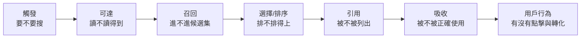
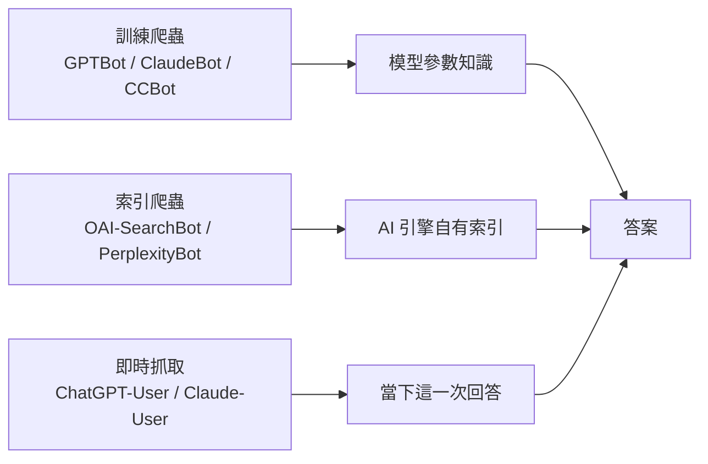
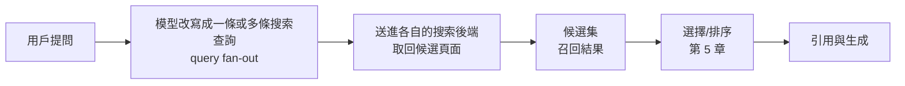
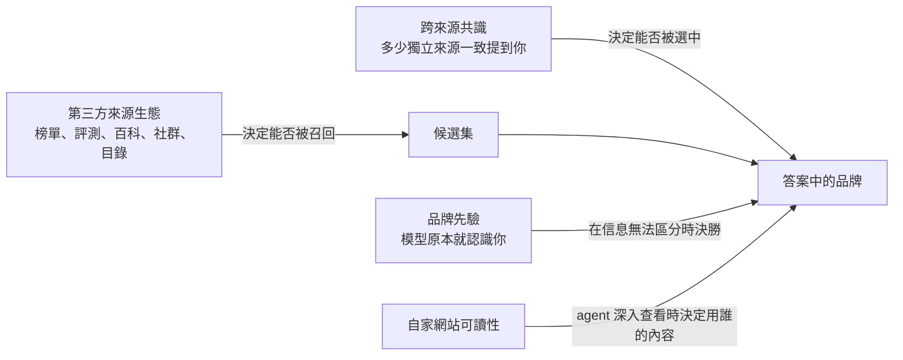
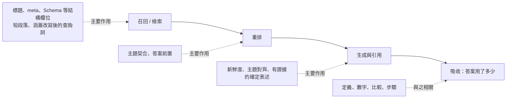
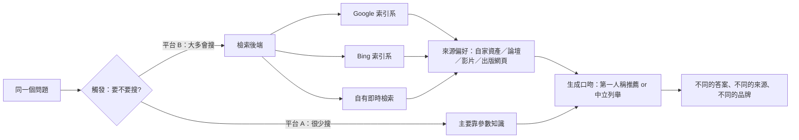
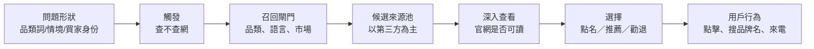

# GEO（生成式引擎優化）教材

> 依據：138 篇論文精讀（多數為 2026 年）與約 3.1 萬條從業者討論的三重獨立標註、軟廣告統計排除與主張共識檢驗。
> 正文以證據強度用語標示結論可信度；逐條出處見 `_來源/`。

## 目錄


**第一部分：基礎**

- [第 0 章　怎樣讀 GEO 的證據](第00章_怎樣讀GEO的證據.md)（約 8,923 字）
- [第 1 章　AI 搜索系統怎麼工作（全景）](第01章_AI搜索系統全景.md)（約 9,108 字）

**第二部分：沿管線逐階段講原理**

- [第 2 章　觸發：AI 什麼時候會去搜索？](第02章_觸發.md)（約 6,288 字）
- [第 3 章　可達性：AI 讀不讀得到你的網站？](第03章_可達性.md)（約 14,285 字）
- [第 4 章　召回：查詢改寫、語義匹配、語言與市場閘門](第04章_召回.md)（約 13,754 字）
- [第 5 章　來源生態：第三方、共識與品牌先驗](第05章_來源生態.md)（約 12,882 字）
- [第 6 章　選擇與排序：相關性、位置、屬性權重](第06章_選擇與排序.md)（約 8,974 字）
- [第 7 章　引用與吸收：被列出≠被使用≠被正確使用](第07章_引用與吸收.md)（約 9,998 字）

**第三部分：跨階段主題**

- [第 8 章　內容層做法的證據：什麼有效、什麼失效、什麼會過時](第08章_內容層做法.md)（約 10,699 字）
- [第 9 章　測量：可見度是分佈，不是排名](第09章_測量.md)（約 12,996 字）
- [第 10 章　流量與商業價值](第10章_流量與商業價值.md)（約 10,308 字）
- [第 11 章　競爭、操縱與防禦](第11章_競爭操縱與防禦.md)（約 8,948 字）
- [第 12 章　平台差異與中文生態](第12章_平台差異與中文生態.md)（約 11,361 字）

**第四部分：案例類型**

- [第 13 章　品牌與產品推薦（案例章）](第13章_品牌與產品推薦.md)（約 18,529 字）
- [第 14 章　內容網站：被截流之後，什麼內容還會被引用、被點擊](第14章_內容網站.md)（約 16,439 字）
- [第 15 章　Reddit 與社群平台在 AI 搜索中的角色](第15章_社群平台.md)（約 11,350 字）

**附錄**

- [附錄 A　研究之間、研究與實務之間的主要分歧](附錄A_主要分歧.md)（約 8,958 字）

全書約 193,800 字。

# 第 0 章　怎樣讀 GEO 的證據

## 本章要回答的問題

1. 「GEO 能提升 40% 可見度」這類數字，到底是在什麼條件下測出來的？
2. GEO 研究有哪幾種設計？哪一種的結論最接近真實世界？
3. 為什麼同一個問題問兩次、換個引擎、換個語言，結果就不一樣？這對「證明有效」意味著什麼？
4. 從業者的經驗、服務商的報告、社群的共識，各自該信到什麼程度？
5. 拿到任何一份 GEO 主張或報告時，要按什麼順序檢查？

## 一、核心原理

### 1.1 GEO 的結論都帶著「條件」

AI 搜索不是一張固定的排名表。它是一條隨機的、多階段的篩選管線：

```
觸發 → 可達 → 召回 → 選擇/排序 → 引用 → 吸收 → 用戶行為
```

一項研究通常只測其中一兩段。所以每個結論都隱含一個問題：**它是在管線的哪一段、用什麼系統、在什麼條件下測的？**

最典型的例子是廣為流傳的「GEO 最高提升 40%」。這個數字的條件是：

| 條件 | 實際情況 |
|---|---|
| 網頁是否需要先被搜到 | 不需要。網頁已經放在 5 篇候選文檔裡 |
| 由誰生成答案 | GPT-3.5 |
| 衡量什麼 | 答案中屬於該網頁的字數份額（相對提升，19.3 → 27.2） |
| 不代表什麼 | 不代表更容易被檢索到，不代表流量增加 |

換句話說，它只回答了「已經進入候選集之後，改寫能不能讓答案多用你一點」。它沒有回答讀者真正關心的「會不會被找到、會不會帶來生意」。

### 1.2 研究的四個世代

理解一項研究，先看它屬於哪個世代、在回答哪個問題：

| 世代 | 時間 | 主要問題 |
|---|---|---|
| 第一代 | 2023–2024 | 內容能不能改變 AI 答案裡的可見度？（證明「可以」） |
| 第二代 | 2024–2025 | 這種影響能不能被惡意操縱？（證明「可以」） |
| 第三代 | 2025 | 技巧能不能推廣到別的引擎、別的領域？（發現「很難」，而且存在零和競爭） |
| 第四代 | 2026 | 放回完整管線後還剩多少效果？怎麼測才可靠？怎麼治理？ |

越早期的研究，越可能是在簡化條件下得出的樂觀數字。引用早期數字時，要問後續研究有沒有在更真實的條件下重做。

### 1.3 簡化條件會系統性高估效果

「固定上下文」（fixed context）實驗，是把網頁直接塞給模型，跳過檢索與排序。這樣做方便控制變數，但會漏掉管線前段的淘汰。

```
固定上下文實驗：   [你的網頁已在候選集] → 生成 → 測量
完整管線：         查詢 → 檢索（可能被淘汰）→ 重排（可能被淘汰）→ 截斷（可能被淘汰）→ 生成 → 測量
```

在可控的實驗系統中，把提示注入攻擊放進完整的「檢索 → 重排 → 生成」管線後：

- 通用的指令覆蓋式注入，在檢索階段就流失約四成，端到端成功率約 14.7%；
- 梯度式攻擊的端到端成功率不到 2%；
- 只有保持與查詢高度相關的改寫式注入，端到端仍約有 40%–54% 的成功率。

同一批攻擊，在固定上下文下曾被報告約 80% 的成功率。差距幾乎全來自「有沒有經過檢索這一關」。

觀察數據也會高估。在可控的實驗系統中，一項研究比較了排名位置對引用的影響：

| 測量方式 | 排名第 1 與第 5 的引用率差距 |
|---|---|
| 直接看觀察數據 | 42.3 個百分點 |
| 受控重放（只改位置，其他不變） | 7.9 個百分點 |
| 保留樣本上重放 | 0 |

觀察數據裡，排名高的內容本來就更相關、更權威。把這些混雜因素拿掉後，「位置本身」的效果大幅縮小。

**原理：凡是跳過某個階段、或沒有控制混雜因素的研究，結論都偏樂觀。**

## 二、證據有多強：六種研究設計

本書全書用固定的用語標示證據強度。讀者在其他資料裡看到任何研究，也可以用同一套標準自己歸類。

### 2.1 六種設計一覽

| 設計 | 本書用語 | 能回答什麼 | 不能回答什麼 |
|---|---|---|---|
| 真實用戶實驗（隨機或準實驗） | 「大規模真實用戶實驗顯示……」 | 做了之後，真實流量、會話有沒有變化 | 通常只有一個網站或平台，難以推廣 |
| 真實引擎重複測試 | 「在真實 AI 搜索引擎上重複測試發現……」 | 商業引擎實際引用誰、有多不穩定 | 多為觀察性，看到的是關聯而非因果 |
| 給定網頁測試 | 「在給定網頁的條件下……」 | 引擎讀到這頁後怎麼用 | 跳過「引擎自己會不會找到這頁」 |
| 可複現的實驗管線 | 「在可控的實驗系統中……」 | 在完整但開源的管線裡，因果效果有多大 | 開源管線不等於商業引擎 |
| 模擬 / 理論 | 「模擬 / 理論分析表明，機制上可能……」 | 機制上是否可能 | 不能寫成真實世界的結論 |
| 大模型當評審（LLM-as-judge） | 不是獨立等級，是一種**測量工具**，可出現在上述任何設計中 | 大量自動評分 | 評分本身可能不可靠 |

### 2.2 真實用戶實驗：最接近「有沒有用」，但數量極少

這類研究直接看真實流量或會話。目前數量很少，而且多由平台或網站自己做。兩個例子說明它們的價值與陷阱：

**例一：用同域對照組拆掉「平台順風」。** 一個網站做了一組針對 AI 回答引擎的優化。來自 ChatGPT 的推薦流量，在觀察期內原始增長 5.7 倍。但同一網站**沒有做優化的頁面**，同期也增長了 3.5 倍——這是平台本身用戶在增長。用未處理頁面當對照、做中斷時間序列分析後，歸因於優化的層級跳升約 1.8 倍（穩健性檢查在 1.8–2.3 倍之間）。安慰劑檢驗的結果只達到「提示性」程度。此外，優化是多項措施綁在一起做的，無法分辨哪一項起作用；同期來自傳統搜尋的自然點擊反而下降約 25%，也沒有看到「AI 優化帶動傳統搜尋」的證據。

教訓：原始倍數大部分是大盤在漲，不是你做對了什麼。同一研究裡的單日尖峰達 38.2 倍，這種數字更不能當因果效果。

例二：自測報告的數字要自己核對。一個圖片平台自測，為內容加上與用戶搜索意圖對齊的註釋，並建立合集頁與內部連結。4 週 A/B 測試中，啟用組會話量為對照組的 1.18 倍，關閉相關功能的組為 0.82 倍。但同一份報告的其他數字不一致：文中稱相關性高 19%，表格數字對不上；宣稱流量提升 20%，但分項表格的提升只有 +0.83% 到 +1.83%；「生成式搜索流量 9.2 倍」沒有說明指標定義。

教訓：即使是最高等級的設計，也要核對正文數字與表格是否一致、指標是否有定義。作者是平台方本身，也是需要考慮的因素。

### 2.3 真實引擎重複測試：現實感強，但多是觀察

這類研究向 ChatGPT、Perplexity、Google AI Overviews 等真實產品提問，記錄引用與推薦。它的強項是反映商業引擎的真實行為；弱項是大多只能描述「誰被引用」，無法證明「改了什麼就會被引用」。

注意「重複」二字。有些研究只在單一日期跑一次查詢，嚴格說只是一張快照。下一節會看到，快照的誤差可以大到結論無效。

### 2.4 給定網頁測試與可複現管線：各缺一段

- 給定網頁測試：手動把 URL 交給商業引擎。真實的是生成端，缺的是「引擎自己去找」這一段。
- 可複現管線：用開源檢索器、重排器、生成模型搭一條完整管線。因果推論乾淨，但管線不是商業引擎。

兩者都有價值，但都不能直接說成「在 ChatGPT 上這樣做就有效」。

### 2.5 模擬與理論：只說明「可能」

固定上下文、模擬用戶、數學推導，都屬這類。在研究總量中這類最多。它們適合提出假設、解釋機制，不適合當作實務依據。本書遇到這類證據，一律寫成「機制上可能」。

### 2.6 大模型當評審：評審本身要被檢驗

很多研究用一個大模型給答案打分：這個陳述有沒有被來源支持？這個內容相關嗎？問題在於，評審模型本身會出錯。

在真實 AI 搜索引擎上重複測試的一項審計中，研究者用大模型判斷「陳述是否被來源支持」，再與人工判斷比對：100 個樣本上，兩者的相關係數只有 0.62。研究者自己也承認，這限制了核心指標的可信度。

讀到用大模型評分的研究時，要問三件事：

1. 有沒有和人工標註比對？比對了多少樣本？一致性多高？
2. 評審模型與被評的模型是不是同一家、同一個？
3. 評分標準是否公開？換一個評審模型，結論還成立嗎？

## 三、為什麼結果會變：不穩定是常態，不是例外

生成式引擎每次回答都可能不同。這不是測量失誤，而是系統本身的性質。任何只看一次結果的結論，都要先打折扣。

### 3.1 同一個問題問兩次

在真實 AI 搜索引擎上重複測試發現：

- 同一查詢重複執行，引用網域集合的中位 Jaccard 相似度（兩次結果的交集除以聯集）：Gemini 約 0.29–0.31，SearchGPT 約 0.33–0.40，Perplexity 約 0.50。也就是說，兩次回答引用的網域，常常只有三分之一到一半相同。
- 要把某網域的「引用份額」估到 95% 信賴區間寬度 5 個百分點以內，Gemini 需要約 30–50 條查詢，Perplexity 約 90–100 條，SearchGPT 需要 150 條以上。
- 同一提示重複 6 次，6 個提示中有 4 個的「第一推薦」會變。
- 一項服務商的生產追蹤數據顯示，品牌「被不被提及」接近二元，較穩定；但「情緒傾向」的翻轉率是提及翻轉率的約 6.7 倍。該研究建議提及至少跑 3 次、情緒至少 10 個提示才趨於穩定（屬觀察性建議）。

在可控的實驗系統中也能看到同樣現象：單次生成時，約 15% 的「是否引用」二元決定會翻轉，效應方差中約 45% 來自解碼的隨機性。

在某社群平台自有的生成式搜索上做的大規模審計發現，重查時只有約 41.8% 取回完全相同的來源；而當檢索結果相同時，89.6% 的答案近乎相同。**變異幾乎全來自檢索，而不是生成。**

### 3.2 換一個引擎

各引擎引用的來源重疊很低：

| 比較對象 | 重疊程度 |
|---|---|
| 不同 AI 引擎之間的來源網域 | Jaccard 約 0.10–0.25（隨研究與領域不同） |
| AI 引擎與 Google 自然結果 | 網域重疊從約 4% 到 25% 不等（隨引擎與研究不同） |
| Google AI Overviews 與 Google 自然結果 | 前 100 網域重疊約 68% |
| 同一中文平台的 App 版與 Web 版 | 網域級 Jaccard 0.19–0.51；某平台 URL 級只有 0.014 |

所以「在 ChatGPT 上有效」不能推到 Perplexity；「在網頁版有效」甚至不能推到同一家的 App。

### 3.3 換一個語言、換一個地區

在真實 AI 搜索引擎上重複測試發現，查詢語言是最大的系統性變異來源之一：

- 一項方差分解研究中，查詢語言佔單條回答方差的 26.5%，品牌本身只佔 1.5%。單條回答的排名可靠度只有約 0.01。
- 以本地語言提問商業問題時，全球性供應商在 24 次中只出現 1 次；以英語在兩個非英語城市提問時，本地供應商在 12 次中出現 0 次。語言決定候選供應商是哪一批，出口 IP 決定是哪個國家的市場。
- 同一套方差研究推算：前 5 次重複之後再加 5 次，誤差方差只降 0.0003；改為多加 3 種語言，則降 0.00462，約 15 倍。測量預算應花在**廣度**（語言、模型、改寫），而不是同一提示的**深度**重複。（此結果限於情緒指標，信賴區間尚未計算。）

用英語做的測量，看不到非英語市場的本地競爭者。

### 3.4 換一個日期

平台會主動調整「要不要出 AI 答案」。在真實 AI 搜索引擎上重複測試發現：

- Google AI Overviews 從 2024 年覆蓋 7 國擴大到 2025 年 229 國；美國查詢的出現率從 42% 升到 67%。
- 某類健康主題查詢的出現率從 1% 升到 66%（該子樣本僅 74 條）。
- 一項服務商追蹤數據中，在沒有任何干預的情況下，ChatGPT 上的可見度每次運行平均下降 1.34%，Perplexity 下降 0.76%。

一份「優化前 vs 優化後」的比較，如果沒有對照組，就分不清變化來自你的優化，還是平台本身在變。

### 3.5 換一個問法

- 在消費者產品中，於提問後加上「列出你的來源」，平均引用數從 16.6 升到 19.9，來源組成變化不超過 2.1 個百分點——影響很小。
- 但在 API 端，同一措辭讓模型調用搜索的比例從 12.1% 升到 88.4%。提示措辭主要改變的是「要不要搜」，而不是「搜到誰」。
- 答案還會順著問題的措辭走：在辯論型問題上，各引擎給出一面倒答案的比例從約 49% 到約 90% 不等。

所以任何測量都要公開完整提示文字、介面（產品或 API）、語言、地區與日期。

### 3.6 「被引用」不等於「被使用」

測量指標本身也要檢查。在真實 AI 搜索引擎上重複測試發現：

- 在中文生成式引擎中，列出的來源只有 66% 內容進入正文，30% 被實質引用，8% 被深度引用；約 39.3% 屬「沉默引用」。
- 另一項跨系統審計發現，社群討論類來源在 AI Overviews 中被列為引用，但實際被吸收的內容明顯偏少。
- 引用真實存在的來源，也可能誤導：一項對 76 萬多個引用對的檢查中，30.6% 的引用扭曲了來源內容，27.1% 的來源本身不適合回答該問題。
- 研究者也指出，部分「長來源被過度使用」的結論，有一部分是評分方式造成的：換一種計算方式，差距就大幅縮小。

報告說「被引用了多少次」時，要追問：是被列出、被使用，還是被正確使用？

## 四、爭議與反例

### 4.1 「40%」與後續研究的落差

| 立場 | 依據 |
|---|---|
| GEO 改寫可以大幅提升可見度 | 早期固定上下文研究，最高約 40% 相對提升 |
| 這不是一般性承諾 | 批判性綜述整理 45 項研究後指出：在一個跨方法、跨領域的基準測試中，54 個方法–領域組合只有 3 個顯著為正；另一個多階段測試中，只優化正文反而使前 20 名出現率下降約 9%、最終引用下降 6% |

兩者不一定矛盾：前者測的是「已在候選集內」，後者把檢索也算進來。但把前者當作「做 GEO 就能多 40%」，是誤讀。

### 4.2 位置重不重要？

觀察數據顯示排名第 1 與第 5 差距巨大；受控重放後差距縮小到 7.9 個百分點，在保留樣本上消失。同一研究也發現，結構化呈現（標題、列表、表格）能讓目標來源的引用次數增加 0.50 次（有統計顯著性），但總引用數沒有增加——它是在等價來源之間**重新分配**功勞，而不是擴大總量；而「是否被引用」這個主要指標，效果不確定（+4.5 個百分點，信賴區間跨過 0）。

同一件事，用不同指標看，結論可以不同。

### 4.3 重複幾次才夠？

| 看法 | 依據 |
|---|---|
| 多重複 | 單次快照的區間寬到許多網域差異等於雜訊；份額估計需要數十到上百條查詢 |
| 重複不必太多，擴大廣度 | 方差分解顯示第 5 次之後的重複邊際價值很低，多加語言與模型效益更大 |

兩者可以並存：先有足夠的重複讓單點穩定，再把預算轉向語言、引擎、問法的廣度。但後者只在情緒指標上推算過，尚未有信賴區間。

### 4.4 大量測量研究來自利益相關方

本章引用的真實引擎研究中，有好幾項的作者是 AI 可見度服務商，或與 GEO 服務商有關聯。這不代表數據是假的——有些服務商研究恰恰是在揭露測量的不穩定。但要注意：

- 服務商有動機證明「可見度可以測、值得測、值得優化」；
- 服務商研究多為觀察性，缺少干預實驗；
- 分組方式（例如品牌知名度層級）常為手動劃分；
- 樣本可能只有少數主題、少數模型。

平台方自測（如 2.2 的例二）也有同樣問題：做實驗的人，也是結果的受益者。

## 五、如何讀從業者的主張

本章的證據庫裡，沒有通過篩選的從業者實測內容可以作為案例。這本身就是一個訊號：流傳很廣的數字（例如「40%」「3 倍」），很多追不到可檢查的原始測試。以下是閱讀從業者主張的方法，全書各章都會用到。

### 5.1 分清四種說法

| 說法類型 | 特徵 | 本書怎麼寫 | 能拿來做什麼 |
|---|---|---|---|
| 多次、有對照的實測 | 有前後比較、有對照組、重複多次、公開方法 | 「從業者實測（多次、有對照）發現……」 | 可作為實務證據，但仍待獨立驗證 |
| 一般實測報告 | 自己做了、有數字，但對照或重複不完整 | 「從業者實測報告……」，並點明未經獨立驗證 | 參考方向 |
| 單個一手觀察 | 一次看到的現象、一張截圖 | 「有從業者觀察到……」 | 只能當線索或例子 |
| 社群共識 | 很多人都這麼說 | 「從業者普遍認為……」 | 說明「大家怎麼想」，不是證明 |

### 5.2 常見陷阱

1. **一手 ≠ 可靠。** 親自做過的人，仍可能只做了一次。本章第三節顯示，單次回答的第一推薦經常會變。
2. **單次截圖不是證據。** 一張「我的品牌出現在 ChatGPT 答案裡」的截圖，只證明那一次、那個語言、那個地區、那一天。
3. 沒有對照的前後比較。平台自己在變（3.4），大盤在漲（2.2 例一）。沒有同期對照組，就不能把增長歸功於優化。
4. 共識 ≠ 真相。很多人重複同一個說法，可能只是在轉述同一個來源。每位作者應只算一票。
5. 數字脫離條件。「提升 40%」「3 倍」要追問：相對還是絕對？測的是被檢索、被引用，還是流量？在哪個引擎、哪個語言、哪段時間？
6. 利益衝突。說話的人是否賣工具、賣服務，或與文中提到的品牌有商業關係？本書對這類內容，最多寫成「有業者宣稱……，但未經獨立驗證」。

## 六、案例

### 案例 1：一個「5.7 倍」怎麼變成「約 1.8 倍，且只是提示性」

- **做了什麼**：一個網站做了一組 AI 回答引擎優化，包括 URL 正規化、從 AI 爬蟲的 404 紀錄中挖掘需求、改用問句標題並加上獨立摘要。
- **平台**：ChatGPT 推薦流量。
- 觀察到什麼：原始增長 5.7 倍；同站未處理頁面同期增長 3.5 倍；以未處理頁面為對照後，層級效應約 1.8–2.3 倍；安慰劑檢驗只達提示性。傳統搜尋自然點擊同期下降約 25%。
- 說明的原理：原始倍數混入了平台成長；同域對照組是拆開兩者的關鍵；多項措施綑綁時，無法歸因於任何單一做法。

### 案例 2：同一個廣為流傳的數字，在不同條件下的樣子

- **做了什麼**：研究者在固定 5 篇候選文檔的條件下，對網頁做各種改寫，讓 GPT-3.5 生成答案。
- **觀察到什麼**：字數份額從 19.3 升到 27.2，即約 40% 的相對提升。
- 後續：放到更完整的條件後，多數方法–領域組合沒有顯著正效果；只改正文甚至可能損害檢索。
- 說明的原理：數字本身沒錯，錯的是把它從條件中剝離出來。

### 案例 3：用英語測，看不到本地競爭者

- **做了什麼**：研究者在登出狀態的 ChatGPT 網頁介面上，以不同語言、不同出口 IP 詢問商業軟體推薦，每個組合重複 6 次。
- **觀察到什麼**：本地語言提問時，全球供應商幾乎不出現（24 次中 1 次）；在非英語城市用英語提問時，本地供應商完全不出現（12 次中 0 次）。用某國語言從另一國提問，得到的是該語言對應國家的供應商。
- 限制：單一模型、每組只有 6 次，作者為可見度測量服務商；在一個對照品類中沒有語言效應。
- 說明的原理：測量設定（語言、地區）本身就決定了你看到什麼。

## 七、怎麼做：評估任何 GEO 主張的檢查清單

### 7.1 八步檢查清單

拿到一份研究、一份服務商報告、或一個從業者說法時，按順序問：

| 步驟 | 要問的問題 | 不合格的訊號 | 依據強度 |
|---|---|---|---|
| 1. 研究設計 | 是真實用戶實驗、真實引擎重複測試、給定網頁、實驗管線，還是模擬？ | 說不清，或把模擬結果說成真實效果 | 本書分級標準 |
| 2. 管線階段 | 測的是觸發、召回、引用、吸收，還是流量？ | 用「被引用」推論「有流量」 | 在真實引擎上重複測試、批判性綜述 |
| 3. 候選集 | 內容是自己被找到，還是被直接塞給模型？ | 固定上下文卻宣稱「更容易被 AI 找到」 | 在可控的實驗系統中 |
| 4. 重複與區間 | 每個條件重複幾次？有沒有信賴區間？ | 單次截圖、單日快照、只報平均 | 在真實引擎上重複測試 |
| 5. 測量範圍 | 哪些引擎、語言、地區、介面、日期？ | 只測一個引擎就說「AI 搜索」 | 在真實引擎上重複測試 |
| 6. 對照組 | 有沒有同期、未處理的對照？ | 只有前後比較 | 大規模真實用戶實驗 |
| 7. 評分方式 | 誰打分？大模型評審有沒有與人工比對？ | 評審一致性未報告 | 在真實引擎上重複測試 |
| 8. 利益與一致性 | 作者是誰？是否賣相關服務？正文與表格數字一致嗎？ | 作者即受益者、數字對不上、指標未定義 | 大規模真實用戶實驗中的反例 |

### 7.2 自己做測量時

- **要做**：同一提示至少重複多次，再擴大到多語言、多引擎、多種問法。（在真實引擎上重複測試；「廣度優先」目前只在情緒指標上推算過）
- **要做**：記錄完整提示文字、介面（產品 / API）、語言、出口地區、日期。（在真實引擎上重複測試）
- 要做：按引擎分開報告，不要把不同引擎的結果平均成一個「AI 可見度」。（在真實引擎上重複測試）
- 要做：報告引用份額時附上區間，而不是單一百分比。（在真實引擎上重複測試，作者為服務商）
- 要做：評估優化效果時，保留一批同站、同類、不做優化的頁面作為對照。（大規模真實用戶實驗，單一網站）
- 要做：區分「被列為引用」「內容被使用」「被正確使用」。（在真實引擎上重複測試）

### 7.3 不要做

- 不要用一張截圖證明「優化生效」或「A 勝過 B」。
- 不要把固定上下文、模擬實驗的百分比，當成可以承諾給客戶的效果。
- 不要把原始增長倍數當成優化效果。
- 不要只用英語測量非英語市場。
- 不要因為「很多人都這麼說」就把一個做法當成已被證明。

### 7.4 已經過時的讀法

- 把「GEO 最高提升 40%」當作一般性效果：這個數字只適用於「已在 5 篇候選文檔中、由 GPT-3.5 生成、測字數份額」的條件。
- 認為「傳統搜尋排名好，AI 可見度就好」：多項研究顯示 AI 引擎與傳統搜尋結果的來源重疊很低。
- 認為一次查詢能代表引擎的「看法」：同一問題重複問，引用來源常只有三分之一到一半相同。

## 本章要點

1. 每個 GEO 結論都帶條件：測的是管線哪一段、在什麼系統、什麼語言與日期。脫離條件的數字會被誤讀。
2. 「GEO 提升 40%」是固定 5 篇候選文檔、GPT-3.5、字數份額的相對提升，不代表更容易被找到，也不代表流量增加。
3. 跳過檢索的實驗、沒有控制混雜的觀察數據，都會系統性高估效果。
4. 生成式引擎本質上不穩定：同一問題重問，引用來源常只重疊三分之一到一半；語言、引擎、介面、日期、問法都會改變結果。
5. 單次截圖與單日快照不是證據；測量要重複、要附區間、要擴大廣度。
6. 真實用戶實驗最接近「有沒有用」，但很少，而且仍需要同期對照組來扣除平台成長。
7. 大模型評審、服務商研究、平台自測都要檢查：與人工比對了嗎？誰是受益者？數字前後一致嗎？
8. 從業者說法要分清「多次有對照的實測」「單次觀察」「社群共識」；共識不等於真相。

# 第 1 章　AI 搜索系統怎麼工作（全景）

> 本章是全書的地圖。後面每一章都只放大這張地圖上的一個環節。

## 本章要回答的問題

1. AI 回答問題時，知識從哪裡來？什麼時候靠「記住的」，什麼時候靠「當場搜到的」？
2. 從用戶提問到用戶看見答案，中間經過哪幾個階段？每個階段看重什麼？
3. 為什麼一項優化在某個階段有利，最後的效果卻可能是負的？
4. GEO 和 SEO 是什麼關係？「做好 SEO 就等於做好 GEO」這句話對在哪、錯在哪？
5. 本書後面各章分別處理管線的哪一段？

## 一、核心原理

### 1.1 兩種知識來源：參數知識與檢索知識

AI 回答問題時，有兩種知識可以用：

| 知識來源 | 是什麼 | 你能影響它的方式 |
|---|---|---|
| **參數知識**（parametric knowledge） | 模型在訓練時記住的東西 | 只能透過長期、廣泛存在於網路上的內容間接影響，週期長 |
| **檢索知識**（retrieved knowledge） | 模型在回答當下搜索、打開網頁後讀到的東西 | 透過讓內容被搜到、被選中、被讀懂來影響 |

兩者的比例不是固定的，取決於兩件事：

- **有沒有聯網。** 在 agent 聯網作答的模式下，在真實 AI 搜索引擎上重複測試發現，最終答案內容只有約 7–10% 來自訓練知識，其餘建立在當場讀到的內容上。
- **問的對象有多熱門。** 熱門實體和冷門實體的機制不同：
  - 熱門實體（大家都知道的品牌、產品）：答案主要靠參數知識，檢索只是用來「確認已有印象」。實驗中把檢索片段的順序打亂，答案中的排名平均只移動 2.30 位。
  - 冷門實體（小品牌、新產品、長尾主題）：答案要靠檢索到的內容來「構建」，同樣打亂後排名平均移動 4.15 位。
  - 這組結果來自單一模型的擾動實驗，屬於可控條件下的機制證據，方向可信，具體數字不宜外推。

對實踐的含義：越冷門的品牌或主題，越依賴檢索管線，GEO 能發揮作用的空間也越大；越熱門的實體，越難靠單次內容改動撼動模型的既有印象。

### 1.2 全書地圖：一條隨機的、多階段的篩選管線

AI 搜索不是一張排名表，而是一條**隨機的、多階段的篩選管線**。你的內容要出現在用戶眼前並產生價值，必須依次通過七道關：



| 階段 | 這一關在問什麼 | 失敗時的樣子 | 詳見 |
|---|---|---|---|
| **觸發**（triggering） | 這個問題，AI 會不會去搜索？還是直接用記憶回答？ | 根本沒有檢索，只剩參數知識 | 第 2 章 |
| **可達**（accessibility） | AI 的爬蟲或 agent 能不能抓到、打開、讀懂你的網頁？ | 被封鎖、內容靠 JS 渲染讀不到，AI 改用別人的內容 | 第 3 章 |
| **召回**（retrieval） | 經過查詢改寫、語義匹配、語言與市場篩選後，你的頁面能不能進入候選集？ | 候選集裡根本沒有你 | 第 4、5 章 |
| **選擇/排序**（selection / ranking） | 在候選集中，你排在第幾？有沒有被截斷在外？ | 排在截斷線之外，生成器看不到 | 第 6 章 |
| **引用**（citation） | 答案有沒有把你列為來源？ | 內容被用了但沒標你，或只列了別人 | 第 7 章 |
| **吸收**（absorption） | 答案有沒有真的採用、而且正確採用你的內容？ | 被列出但沒被使用，或被曲解 | 第 7 章 |
| **用戶行為**（user behavior） | 用戶看到後會不會點擊、信任、購買？ | 被引用了，卻沒有流量或轉化 | 第 10 章 |

跨越多個階段的主題另章處理：

| 主題 | 章節 |
|---|---|
| 怎樣讀 GEO 的證據 | 第 0 章 |
| 來源生態：第三方、共識與品牌先驗 | 第 5 章 |
| 內容層做法：什麼有效、什麼失效、什麼會過時 | 第 8 章 |
| 測量：可見度是分佈，不是排名 | 第 9 章 |
| 競爭、操縱與防禦 | 第 11 章 |
| 平台差異與中文生態 | 第 12 章 |
| 案例類型：品牌與產品推薦、內容網站、社群平台 | 第 13–15 章 |

**「隨機」這兩個字很重要。** 同一個問題問兩次，答案、引用來源、推薦順序都可能不同。所以 GEO 裡的「名次」不是一個固定值，而是一個出現機率。這一點決定了後面所有測量方法（第 9 章）。

### 1.3 每個階段看重的東西不同

在可控的實驗系統中（一條由關鍵詞檢索、重排模型、生成模型組成、使用真實網頁語料的可複現管線），研究者發現三個主要階段獎勵的是不同的文件特徵：

| 階段 | 看重什麼 |
|---|---|
| 檢索 | 關鍵詞、結構欄位（標題、meta 描述、各級 heading、schema） |
| 重排 | 主題契合度、答案是否放在前面 |
| 生成 | 正文中含有證據的內容 |

這就產生了一個反直覺的後果：

- **只優化正文**：檢索命中率下降約 9%，重排命中率下降約 16%，最終引用率下降約 6%。正文改得更「適合生成」，卻讓文件在前兩關掉隊。
- **只優化結構欄位**：檢索命中率提升約 22%，但重排命中率仍下降約 17%。
- 大幅擴寫式的自動改寫：檢索命中率下降約 36%。技術詞、生僻詞被改寫時損失最大。
- 約 5.8% 的目標文件在重排時從第 10 名掉到第 11 名，剛好落在截斷線外，於是生成器完全看不到它。
- 在購物類領域，測試過的所有改寫策略都降低了引用率。

### 1.4 總效果等於各階段效果的疊加

一項優化必須**在每個階段都存活下來**，才能看到最終效果。只在一個階段測得的好處，不能直接相加成總效果。

```
最終效果 ≈ 觸發 × 可達 × 召回 × 排序 × 引用 × 吸收 × 用戶行為
（任何一項接近零，總效果就接近零）
```

在可控的實驗系統中，這一點被反覆驗證：

- 下游的改寫可能損害上游的檢索（見 1.3）。
- 在完整管線中測試各種「讓內容被 AI 採用」的注入手法：平均約 79.9% 的注入內容能通過檢索；但通用的指令覆蓋式手法只有約 59.3% 通過檢索，端到端成功率只剩約 14.7%；梯度式手法端到端成功率不到 2%。只有保持查詢相關性的改寫式手法，端到端仍有約 40–54% 的成功率。
- 同一條管線裡，重排模型和生成模型對上下文位置的偏好甚至相反：重排器偏好較後的位置，生成器偏好較前的位置。

這意味著：只給定幾篇文檔、直接讓模型生成的「固定上下文」實驗，會系統性地高估優化效果。這也是 2023 年那批「加數據、加引語能提升 40%」的結論無法推廣的主要原因（詳見第 0、8 章）。

### 1.5 Agent 會多輪搜索、打開網頁閱讀

新一代 AI 搜索不只「搜一次、摘一段」。Agent 會把問題拆成多個子查詢（查詢擴展 query fan-out），多輪搜索，並真正打開網頁閱讀。

因此 GEO 的範圍正在延伸：從「被搜到」延伸到「**被 agent 讀懂並據此行動**」。

- 在真實 AI 搜索引擎上重複測試發現（一項配對的準實驗，涵蓋 1,056 家企業、37,927 次 agent 旅程）：對 agent 可讀性較好的網站，答案中約 78% 來自該企業自家頁面，可讀性差的只有約 58%；被明確推薦的比例是 20% 對 11%。
- 同一研究發現，當網站讀不到時，agent 的典型失敗方式是**省略**，改用第三方或競爭對手的內容，而不是憑空編造。
- 需要注意：這項研究的作者本身是相關服務商，使用自有的評分器，而且可讀性是作為一整包分數測量的，沒有拆開各項做法各自的效果。
- 可達性見第 3 章，品牌與產品推薦場景見第 13 章。

### 1.6 GEO 與 SEO：共用地基，但篩選邏輯不同

| 面向 | SEO | GEO |
|---|---|---|
| 輸出形態 | 一張排序的連結列表 | 一段合成的答案，附（或不附）引用 |
| 競爭單位 | 整個頁面的排名 | 頁面中可被抽取的段落、實體資訊，以及別人頁面上對你的描述 |
| 結果穩定性 | 相對穩定，可追蹤名次 | 隨機，同一問題多次運行結果會漂移 |
| 知識來源 | 只有索引 | 參數知識 + 檢索知識 |
| 成功的定義 | 排名、點擊 | 被觸發 → 被召回 → 被選中 → 被引用 → 被正確吸收 → 帶來行動 |

兩者的關係可以概括為三句話：

1. **SEO 是 GEO 的前提之一，但不是充分條件。** 可爬取、可索引、結構清楚，是兩者共用的地基。在不少平台上，被搜索引擎收錄和排名仍是進入 AI 候選集的重要入口。
2. **AI 引用的來源與搜索排名重疊有限。** 在真實 AI 搜索引擎上重複測試發現：
   - 對同一批查詢，各 AI 引擎引用的域名與 Google 結果的重疊度（Jaccard 相似度）分別只有：GPT-4o 4.0%、Gemini 11.1%、Claude 12.6%、Perplexity 15.2%。
   - AI 引擎更偏好第三方的「贏得」來源（earned media）：Claude 約 65%、GPT-4o 約 57%；Google 結果中贏得來源約 41%、社群內容約 34%。
   - AI 引擎引用的頁面更新：以汽車類查詢為例，Claude 引用頁面的中位年齡約 148.0 天，Google 約 492.9 天。
   - 綜合現有研究，Google AI 概覽在兩個月內的頁面重疊度約 18%，自然結果約 45%；不同系統之間的 URL 重疊度約 0.11–0.18。
3. 目前沒有研究證明 GEO 能穩定帶來流量或轉化。綜合現有研究，證據集中在「已被檢索到的內容可以改變答案」，對自然發現度或商業轉化，還沒有穩定的、跨平台的、長期的因果證據（第 10 章）。

## 二、證據有多強

| 結論 | 證據類型 | 強度與適用範圍 |
|---|---|---|
| 聯網 agent 模式下訓練知識只占答案 7–10% | 在真實 AI 搜索引擎上重複測試 | 中等偏強；限於 agent 聯網作答場景；作者為服務商 |
| 熱門實體靠參數知識、冷門實體靠檢索 | 真實引擎觀察 + 單一模型擾動實驗 | 機制可信；具體數字不宜外推 |
| 各階段看重不同特徵；只優化正文會損害檢索與重排 | 可控的實驗系統 | 機制證據清楚；商業引擎的管線未公開，細節可能不同 |
| 總效果是各階段疊加；固定上下文實驗高估效果 | 可控的實驗系統 + 研究綜合 | 方向一致，多項研究互相印證 |
| AI 引用來源與 Google 結果重疊低 | 在真實 AI 搜索引擎上重複測試 | 較強；但重疊度因平台、行業、時間而異 |
| agent 可讀性與自家內容占比、推薦率相關 | 真實 agent 的配對準實驗 | 相關而非嚴格因果；自有評分器；未拆分各項做法 |
| GEO 對流量、轉化的效果 | 目前無穩定因果研究 | 空白，不能宣稱 |

讀證據的兩個提醒：

- 可控實驗系統能說清「機制上會怎樣」，但商業引擎的真實管線不公開，所以具體百分比只能當方向，不能當承諾。
- 真實引擎的測量能說明「現在是什麼樣」，但 AI 搜索變化很快，任何重疊度、占比都有時效性。

## 三、爭議與反例

### 爭議 1：做好 SEO 是否就自動做好了 GEO？

**觀點 A：GEO 基本上就是 SEO。**

- 從業者普遍認為兩者高度重疊，差別只在側重。有從業者估計約七成重疊，也有人從自己的任務清單估算高達八成五以上。
- 有從業者觀察到，自己多個沒有 schema、沒有 llms.txt、沒有特殊結構的網站，只靠常規 SEO 就出現在 AI 答案中。
- 有從業者觀察到，網站經過三四個月的全面 SEO 改造後，出現在 AI 概覽中的次數從二三十次增加到七百多次，並觀察到排名越高越容易被引用。
- 從業者實測報告：一個小型 SaaS 頁面只改寫了標題和開頭約 200 字，三個月的數據顯示先是自然排名上升，隨後才被 AI 概覽引用。

**觀點 B：排名與被引用是兩件不同的事。**

- 從業者實測報告（約 1,200 個查詢，ChatGPT 與 Perplexity）：被引用的品牌中只有約 38–45% 在 Google 前三；約 30% 的引用來自排名 6–20 的頁面；約 20% 來自沒有排名的來源，例如社群討論、文件頁。
- 從業者實測報告（約 35 萬篇文章、10,382 個 B2B SaaS 關鍵詞、52 個品類）：只有約 14% 被 AI 引用的 URL 出現在 Google 前 20 名。
- 從業者實測報告（4 個網站、80 個查詢，逐一在無痕模式手動檢查）：Google 排名前三的頁面只有 31% 被 AI 概覽引用；排名第 10 以後，引用率降到 12%。
- 從業者實測（多次、有對照）發現：用固定的約 40 個提示詞在 ChatGPT、Perplexity、Google AI 概覽上運行數週、手動記錄約 500 條引用，Google 排名已不是被引用的好代理指標；而且每個平台的來源偏好各不相同，測一個引擎無法推知另一個。該實測者對照的大型公開數據集也呈現同樣的方向，但那組數字未經本書獨立核實。

如何理解這個分歧：兩種觀點其實對應管線的不同階段。

- 觀點 A 說的主要是可達與召回：頁面必須先能被抓到、被索引，才有機會進入候選集。在這個意義上，SEO 是地基。
- 觀點 B 說的主要是選擇、引用與吸收：進入候選集之後，決定誰被採用的標準和搜索排名不同。
- 最具平衡性的一個說法來自一項大規模審計：GEO 是 SEO 的「內容層延伸」，而不是一門全新學科；但「SEO 好就自動被 AI 引用」並不成立（見案例 1）。

另外要注意，排名與引用之間的關係因平台而異。有從業者觀察到，某平台的 AI 助手主要從另一家搜索引擎的索引取材，因此用 Google 排名去比對它的引用，本身可能就找錯了參照物（平台差異見第 12 章）。

### 爭議 2：AI 到底靠「記憶」還是靠「搜索」？

- 從業者的一種看法：有從業者認為，某些主流對話式 AI 大多數回答靠訓練數據，除非用戶主動觸發瀏覽；因此對這些平台，反向連結和搜索排名無關緊要，要緊的是內容是否曾出現在訓練數據中。
- 研究的發現：在真實 AI 搜索引擎上重複測試發現，一旦進入 agent 聯網作答模式，訓練知識只占答案 7–10%。熱門實體偏靠記憶，冷門實體偏靠檢索。
- 如何理解：兩者並不完全矛盾。問題在於「會不會觸發搜索」本身就是管線的第一關，它因平台、產品模式、問題類型而變（第 2 章）。把某一種模式下的觀察推廣到所有平台，是這個爭議的根源。也有從業者觀察到，自己的文章發布約十分鐘後就被 AI 引用，原因是它迅速登上了搜索結果前列、被即時檢索到，而不是被模型「記住」。

### 爭議 3：站外被提及重要，還是自家網站可讀更重要？

- 從業者普遍認為，AI 更傾向採用在多個獨立來源中以一致方式重複出現的資訊；也普遍認為，品牌在第三方平台、評測網站上的一致提及，比自家網站的排名更重要。
- 但在一項針對真實 agent 的配對準實驗中，控制了網站可讀性之後，兩個站外提及類指標對「答案是否建立在自家內容上」和「是否被推薦」都沒有獨立效應。
- 如何理解：這項研究只測了「agent 已經找到你、進一步深入閱讀」的場景。站外提及可能主要在更早的階段（召回、品牌先驗）起作用，而在深入閱讀階段，決定性的是自家網站讀不讀得懂。兩種說法可能分別對應不同階段，這個問題第 5 章會詳細展開。

## 四、案例

### 案例 1：Google 首頁排名，卻不在 AI 答案裡（大規模審計）

- 做了什麼：審計了約 17,000 個法國中小企業網站，比較被 AI 引用和未被引用的網站差在哪裡。
- 平台：ChatGPT、Perplexity。
- 觀察到什麼：反覆出現同一種模式：在 Google 排首頁的網站，從未出現在 AI 的答案中。被引用與未被引用網站之間的差異，不是傳統排名因素，而是三項 Google 能容忍、AI 卻不容忍的缺陷：
  1. 沒有一句可以直接摘取、開門見山的答案句；
  2. 用行銷話術代替可驗證的數字；
  3. 網站上和各目錄上的實體資訊不一致。
- 證據強度：從業者實測報告，未經獨立驗證。
- 對應管線：這是「召回成功、選擇與吸收失敗」的典型——頁面被搜索引擎認可，卻在 AI 的選擇階段被跳過。

### 案例 2：同一道菜的 AI 模式實驗（排名、順序、描述三者分離）

- 做了什麼：以新加坡雞飯為題，設計 1 個全市查詢加 10 個分區查詢，每個查詢運行三次，每次之間插入一個無關查詢以降低前後干擾；記錄 AI 模式中的推薦、描述和引用來源，並與搜索結果首頁比對。
- 平台：Google AI 模式。
- 觀察到什麼：AI 模式引用的來源與搜索結果首頁有明顯重疊；但推薦的**排序**和**描述**都與搜索結果不同，而且重複運行時結果持續漂移。
- 證據強度：從業者實測（多次、有對照）。
- 對應管線：召回階段與 SEO 有交集，但選擇/排序和吸收階段是另一套邏輯；而且結果是隨機的。

### 案例 3：本地商家的兩條平行軌道

- 做了什麼：檢查了 500 多家本地服務商家的 AI 可見度。
- 平台：ChatGPT、Siri，以「品類 + 城市」查詢。
- 觀察到什麼：72% 的商家即使在 Google 地圖排名前三，也不出現在 AI 的回答中。實測者的解釋是：地圖排名看的是商家檔案完整度、評論、目錄收錄；AI 對本地實體的識別看的是商家類型的結構化資料、名稱地址電話的一致性、以及知識圖譜中是否有已確認的實體。
- 證據強度：從業者實測報告，未經獨立驗證；其中的原因解釋屬於實測者的推測。

### 案例 4：同一內容，一條管道突然消失

- 做了什麼：實測者每天用固定提示詞集詢問 ChatGPT、Claude、Gemini，記錄被引用的來源，並與常規排名追蹤並列比較。
- 觀察到什麼：
  - 方向一：實測者自己的一個小網站在 Google 排第 30–40 名，幾乎沒有自然流量，卻在 Bing 站長工具的 AI 區塊中顯示出異常高的曝光（實測者自己也提醒：那裡的「曝光」不等於引用，只能當信號）。
  - 方向二：某大型社群平台在八月中旬於網域層級封鎖了爬蟲。根據公開的引用追蹤數據，它在 ChatGPT 引用中的份額在幾天內驟降；但它在 Google AI 概覽中的份額幾乎不變，搜索排名也沒變。同樣的內容、同樣的排名，一條管道就此消失。
- 證據強度：從業者實測報告，未經獨立驗證。
- 對應管線：這是「**可達**」這一關的活教材——排名完好無損，只要某個 AI 的爬蟲讀不到，那條管道就斷了（第 3 章）。

### 案例 5：排名更高，反而被忽略

- 做了什麼：實測者為客戶記錄 Gemini 的引薦訪問，並用結構化的提示詞測試客戶的核心主題。
- 平台：Gemini。
- 觀察到什麼：Gemini 穩定引用一兩個特定競爭對手，完全忽略客戶；而客戶在 Google 排名第 1–3 位，那些競爭對手只排第 6–20 位。調整摘要、標題等可讀性改動後，引用結果沒有改變。
- 證據強度：從業者實測報告，未經獨立驗證。
- 啟示：單改頁面內容不一定能改變結果。原因可能在更上游（召回、品牌先驗），也可能在來源生態（第 5 章）。實測者自己也無法分辨，是競爭對手的頁面被檢索到，還是模型本來就對那個品牌有印象——這正是 1.1 所說兩種知識來源的區分。

### 案例 6：排名前五，引用只有兩成（金融內容）

- 做了什麼：選取在 Google 排第 3–5 名、有一定搜索量的金融內容，向 Claude、Perplexity、ChatGPT 提出這些頁面所回答的問題。
- 觀察到什麼：大約只有 20% 的情況被引用；被引用時，出現的總是同樣兩三個大型權威網站。實測者認為，回答的直接程度和內容新鮮度比傳統排名信號更重要。
- 證據強度：從業者實測報告，未經獨立驗證。

## 五、怎麼做

### 建議做的

| 做法 | 對應階段 | 證據強度 |
|---|---|---|
| 先確認你的問題類型在目標平台上會不會觸發搜索；熱門實體和冷門實體分開規劃 | 觸發 | 在真實 AI 搜索引擎上重複測試 + 機制實驗 |
| 確保 AI 爬蟲與 agent 能抓到、讀懂你的網站（不封鎖、關鍵內容不依賴 JS） | 可達 | 在真實 AI 搜索引擎上重複測試（配對準實驗，作者為服務商）；從業者實測報告 |
| 在結構欄位（標題、meta、heading、schema）中寫清核心實體和關鍵數字 | 召回 | 在可控的實驗系統中 |
| 答案前置、全頁主題一致 | 選擇/排序 | 在可控的實驗系統中；從業者實測報告 |
| 在正文中放可驗證的證據（數字、價格、日期） | 生成/吸收 | 在可控的實驗系統中；研究綜合 |
| 保持品牌與實體資訊在自家網站、目錄、第三方平台上的一致 | 召回/選擇 | 從業者實測報告；從業者普遍認為 |
| 評估任何優化時，逐階段檢查：它有沒有在前面某一關造成損失？ | 全管線 | 在可控的實驗系統中 |
| 用固定、具代表性的提示詞集，多次重複運行、長期追蹤，並把排名與 AI 引用分開記錄 | 測量 | 從業者普遍認為（第 9 章詳述） |
| 分平台測量，不要用一個平台的結果推論另一個 | 測量 | 在真實 AI 搜索引擎上重複測試；從業者實測（多次、有對照） |

### 不要做

- **不要只優化正文。** 在可控的實驗系統中，只改正文會讓檢索和重排都掉隊，最終引用也下降。
- **不要把 Google 排名當作 AI 可見度的代理指標。** 多項從業者實測與真實引擎測量都顯示重疊有限。
- 不要大幅擴寫、或把專業詞改寫成通俗說法。在可控的實驗系統中，這類改寫在檢索階段損失最大。
- 不要只跑一次提示詞就下結論。答案是隨機的，單次結果會誤導。
- 不要把「被引用」等同於「被推薦」或「帶來生意」。從業者普遍認為兩者不同；研究上，GEO 對流量和轉化的因果效果仍屬空白。

### 已經過時

- **「加數據、加引語，可見度提升 40%」作為通用承諾。** 那個數字的條件是網頁已經在 5 篇候選文檔中、衡量的是答案中的字數份額。在完整管線中，這類效果大幅縮水（第 0、8 章）。
- **「AI 只靠訓練數據，檢索不重要」作為通用判斷。** 在聯網 agent 模式下，答案絕大部分來自當場檢索的內容。
- 「SEO 做好，AI 自然會引用」作為充分條件。SEO 是地基，不是保證。

## 本章要點

1. AI 答案有兩種知識來源：訓練時記住的參數知識，和當場搜到的檢索知識。聯網 agent 模式下，答案大部分建立在檢索知識上；熱門實體偏靠記憶，冷門實體偏靠檢索。
2. AI 搜索是一條隨機的多階段管線：觸發 → 可達 → 召回 → 選擇/排序 → 引用 → 吸收 → 用戶行為。本書第 2–7 章沿這條管線逐關講解，第 8–12 章處理跨階段主題，第 13–15 章是案例類型。
3. 每個階段看重的東西不同：檢索看關鍵詞和結構欄位，重排看主題契合和答案前置，生成看正文中的證據。
4. 總效果是各階段效果的疊加。在一個階段有利的優化，可能在另一個階段有害；只在固定上下文中測得的效果，會高估真實效果。
5. GEO 與 SEO 共用可爬取、可索引的地基，但進入候選集之後的篩選邏輯不同。AI 引用的來源與搜索排名重疊有限，且因平台而異。
6. GEO 正在從「被搜到」延伸到「被 agent 讀懂並據此行動」；網站讀不懂時，agent 傾向改用別人的內容，而不是編造。
7. 結果是隨機的，必須多次運行、分平台、長期追蹤來測量。
8. 目前沒有研究證明 GEO 能穩定帶來流量或轉化；任何「保證提升」的說法都超出了證據。

# 第 2 章　觸發：AI 什麼時候會去搜索？

AI 搜索管線的第一關不是「排名」，而是「搜不搜」。

```
觸發 → 可達 → 召回 → 選擇/排序 → 引用 → 吸收 → 用戶行為
 ▲
本章
```

如果一個問題沒有觸發聯網搜索（web search），後面所有環節都不會發生。這時候，答案只來自模型訓練時記住的東西。你的網頁寫得再好，也不會被讀到。

## 本章要回答的問題

1. AI 產品回答問題時，有多大比例會真的去聯網搜索？
2. 誰在決定要不要搜索：產品、模型，還是用戶的提問方式？
3. 哪些查詢形式更容易觸發搜索？哪些幾乎不會？
4. 用戶在提示詞裡要求「列出來源」，能不能讓 AI 去搜索？
5. 對從業者來說，怎樣判斷自己的目標查詢是在打「搜索戰」還是「記憶戰」？

## 一、核心原理

### 原理 2.1：搜不搜，是一個獨立的決策環節

AI 回答問題時有兩條路：

```
用戶提問
   │
   ▼
[觸發決策]──不搜索──▶ 只用參數知識（訓練時記住的內容）作答 ──▶ 通常沒有任何引用
   │
  搜索
   ▼
查詢改寫 → 檢索網頁 → 篩選 → 生成答案並引用
```

這個決策不是固定的。它由三件事共同決定：

- **產品與平台的設定**：有些產品每次都搜索，有些讓模型自己決定。
- **模型本身的傾向**：同樣的問題，不同模型搜索的意願差很多。
- 查詢的形式和主題：問句、長查詢、需要新資訊的問題更容易觸發。

研究者把這種「由產品的外層指令和模型自身共同決定是否搜索」的結構稱為外層框架（harness）與模型的共同決策。

### 原理 2.2：觸發率差異極大

觸發率不是一個「業界平均數」可以概括的。它隨產品、模型、查詢樣本而劇烈變化。

**對話式 AI 產品之間的差異：**

| 條件 | 觀察結果 |
|---|---|
| 同一批 1,000 個提示，GPT-5.3-chat | 只有 14% 調用搜索 |
| 同一批 1,000 個提示，Claude Sonnet 4.6 | 83% 調用搜索 |
| ChatGPT 在 45 天重複測量中 | 57.8% 的運行沒有產生任何引用 |
| ChatGPT 在另一項研究中 | 75.8% 的查詢沒有觸發搜索 |

在最後一項研究中，研究者進一步拆解了「不搜索」的原因：69.4% 屬於意圖誤判（模型認為不需要搜索），30.6% 屬於安全拒答。

**Google AI 概覽（AI Overviews，以下簡稱 AIO）的觸發率：**

| 查詢樣本 | 整體觸發率 | 問句 | 非問句 |
|---|---|---|---|
| 55,393 條熱門搜索 | 13.7% | 64.7% | 9.5% |
| 公開的真實搜索日誌樣本 | 51.5% | 89.9% | 51.9% |
| 900 名美國成年人的真實瀏覽紀錄 | 約 18% | — | — |

三個數字相差近四倍。原因主要是樣本不同：熱門搜索中導航型、短詞查詢比例高；真實日誌中長查詢和問句比例高。所以「AIO 觸發率是多少」這個問題本身沒有意義，要問的是「我的查詢類型觸發率是多少」。

### 原理 2.3：查詢形式是最穩定的觸發信號

在所有研究中，有一條規律是一致的：**問句和長查詢更容易觸發 AI 答案。**

- 在熱門搜索樣本中，問句觸發 AIO 的比例是非問句的近 7 倍（64.7% 對 9.5%）。
- 在真實日誌樣本中，疑問句觸發率達 89.9%。
- 在真實瀏覽紀錄中，長查詢、以疑問詞開頭、同時含名詞和動詞的查詢更容易觸發。
- 按意圖分：問句約 60%、陳述句約 37%、導航型約 12% 出現 AI 回答。

導航型查詢（例如直接搜某個品牌官網）幾乎不觸發。原因很直觀：用戶要的是一個網址，而不是一段解釋。

### 原理 2.4：平台會按主題和地區主動調整觸發策略

觸發不只是演算法對查詢的「判斷」，也是平台的「政策」。

- AIO 的覆蓋範圍從 2024 年的 7 個國家擴大到 2025 年的 229 個國家。
- 美國查詢的 AIO 出現率從 42% 升到 67%。
- 新冠相關查詢的 AIO 出現率從 2024 年的 1% 變成 2025 年的 66%（這項觀察的樣本只有 74 條查詢）。

含義是：某個主題的可見度可能因為平台一次政策調整而驟變，與你做了什麼無關。

### 原理 2.5：提示詞措辭能改變觸發，但主要是在 API 上

在 API 上，提示詞措辭對觸發影響極大；在消費者產品上，影響很小。

| 條件 | 不加「List your sources」 | 加上後 |
|---|---|---|
| API（模型自行決定是否搜索） | 搜索調用率 12.1% | 88.4% |
| API 每則回覆的引用數 | 0.60 | 7.05 |
| 消費者產品（免費、未登入） | 平均引用 16.6 | 19.9 |

在消費者產品上，引用來源的組成變化不超過 2.1 個百分點。

這對從業者有兩層含義：

1. 用 API 做可見度監測時，提示詞的寫法會嚴重扭曲結果。
2. 真實用戶大多不會加這類指令，所以不要用「加了指令後的結果」去推估真實曝光。

### 原理 2.6：多搜索不等於更好的答案

觸發搜索只代表答案「有機會」使用網頁內容，不代表網頁內容會被引用或被正確使用。

- 研究發現，14–53% 的回答主張由搜索結果支持，但沒有標註引用（隱形使用）。
- 另有 15–20% 以上的主張無法對應到任何搜索結果。
- 搜索更頻繁的模型，回答品質只呈現混合效果，並非全面更好。

所以本章關心的「觸發」，是被看見的必要條件，不是充分條件。後面的章節會處理搜索之後的環節。

## 二、證據有多強

| 結論 | 證據類型 | 強度判斷 |
|---|---|---|
| 不同模型觸發率差異極大（14% 對 83%） | 在真實 AI 搜索引擎上重複測試發現；另有 613 名用戶、171,264 場對話的真實對話日誌 | 強。但只比較了特定模型版本，版本更新後數字會變 |
| ChatGPT 大比例不觸發搜索 | 兩項獨立研究在真實商業引擎上重複測量 | 強。兩項研究的定義不同（「零引用」與「未觸發搜索」），數字不可直接相加比較 |
| 問句和長查詢更易觸發 AIO | 三項獨立研究，樣本從熱搜、真實日誌到真實瀏覽紀錄 | 強。方向一致，是本章最可靠的結論 |
| 平台按主題調整觸發策略 | 在真實 AI 搜索引擎上跨年重複抓取 | 中。新冠案例樣本僅 74 條 |
| 提示措辭改變 API 觸發 | 在真實 AI 搜索引擎上重複測試，API 與產品對照 | 中到強。僅在心理健康主題中測試，其他主題未驗證 |

適用範圍的限制：

- 大部分數據來自 2025–2026 年的特定模型版本。觸發策略是產品決策，會隨版本更新而改變。
- Google AIO 的研究都以美國或英語查詢為主。
- 對話式 AI 的觸發研究多數使用 API 或捐贈的對話日誌，與登入後、有記憶、有個人化的真實使用情境可能有差距。

## 三、爭議與反例

### 爭議 1：比較型、購買型問題到底會不會觸發搜索？

這是本章最明顯的矛盾。不同從業者的實測得到相反的結論。

| 觀點 | 依據 | 測試條件 |
|---|---|---|
| **會，幾乎每次都觸發** | 從業者實測（多次、有對照）發現：在約 2,000 個買方意圖的軟體與開發工具問題中，一個月內至少出現一個引用的比例是 ChatGPT 95%、AIO 99%、Perplexity 100% | 窄題集：B2B 軟體的「最佳 X」「X 對比 Y」「做 Z 的工具」 |
| **不會，越具體越不搜** | 從業者實測報告：在 ChatGPT 上，「品牌 A 對比品牌 B」類問題 80 個中有 76 個完全沒搜索；「我有某種疾病該買什麼床墊」這類情境問題 120 個中有 106 個沒搜索；而「登山用最佳相機背包」這類寬泛品類問題約一半會搜索 | 消費品；API 開啟網頁搜索工具，由模型自行決定 |

兩者各有依據，目前不能強行判斷誰對。可能的解釋包括：

- **品類不同**：軟體工具更新快，模型可能判斷需要新資訊；消費品的品牌對比，模型可能認為訓練知識已足夠。
- **問題形狀不同**：「X 對比 Y」直接點名兩個品牌，模型可能認為自己已經知道答案；「最佳 X」則需要列清單，更需要外部資訊。
- 測量方法不同：前者以「是否有引用」為指標，後者以 API 回報的「是否調用搜索」為指標。

第一位從業者提出的看法值得注意：觸發率主要是問題的屬性，而不是引擎的屬性。一份混合了定義型、操作型問題的提示組合，自然會拉低某引擎的「平均觸發率」。

### 爭議 2：購物卡片的觸發與搜索觸發不是同一件事

有從業者報告，在一萬多個購物查詢中，購買意圖查詢有 93% 觸發 ChatGPT 的產品輪播卡片，比較型查詢只有 15%。有從業者觀察到類似模式：購買執行類查詢 93% 出現輪播，購後類僅 2.8%。

這組數字不能拿來回答「會不會搜索」。產品輪播是另一種答案形態，據報告主要取決於結構化的產品資料源（product feed），而不是網頁內容。提出這組數字的從業者本身從事相關業務，數字未經獨立驗證。

### 爭議 3：研究型問題是否只靠訓練知識？

有從業者觀察到：研究型問題由訓練數據回答，不觸發搜索，因此與 Google 排名幾乎無關；購買型問題（「某地最佳 X」「做 Z 的頂尖供應商」）才觸發搜索，此時排名的相關性明顯更高。

這與爭議 1 中「定義型和操作型問題直接從權重作答」的看法一致，但只是單一觀察，只能作為線索。

### 爭議 4：複雜提示能不能讓 AI 做「深入研究」？

有從業者觀察到：無論怎麼提問，複雜提示都不會讓模型啟動代理式的深入搜尋。這與原理 2.5（措辭能大幅改變 API 觸發）表面上矛盾。可能的解釋是：措辭能改變「搜不搜」，但不一定能改變「搜多深」。這一點目前沒有研究直接檢驗。

## 四、案例

### 案例 1：同一個品牌，搜索開與關是兩個世界

- **做了什麼**：一家服務型公司發現，當有人問 ChatGPT「誰能做 X」時，自己只在約 6% 的情況下被提到。它先審查了自己的網站：所有爬蟲都拿到正常回應，技術面沒有問題，但修改頁面沒有帶來任何改變。
- **診斷方法**：另一位從業者建議做「搜索開／搜索關」對照測試。這位從業者報告，他對約 180 家公司做過這種評分，被點名的公司通常不是網站最乾淨的，而是經常出現在其他人寫的「X 對比 Y」文章裡的。
- 觀察到什麼：有從業者照做後，搜索開啟時被引用約 16%，關閉時為 0。
- 含義：這家公司的可見度完全來自即時檢索。訓練記憶層面，它目前不存在。所以頁面修改無效是合理的：這類問題的答案來自第三方的比較和匯總內容，而不是自家頁面。

```
搜索關閉 → 被提及？
   ├─ 是 → 已進入訓練記憶，屬長期資產
   └─ 否 → 搜索開啟 → 被提及？
              ├─ 是 → 靠即時檢索，槓桿在被檢索到的第三方內容
              └─ 否 → 兩條路都沒進去，先處理可達與召回（第 3–4 章）
```

### 案例 2：本地商家在不同 AI 產品上的表現完全不同

有從業者觀察到：同一家本地商家，在模型只用內部知識作答時，可見度是 0%。開啟網頁搜索後，有些 AI 產品開始穩定推薦它，另一些仍然完全不提。

這說明「AI 可見度」不是一個單一數字。先要弄清楚每個產品的觸發行為，才談得上優化。

### 案例 3：全新實體只能靠即時檢索被引用

有從業者觀察到：一個晚於所有模型訓練截止日期才出現的全新實體，能在 AI 答案中被引用。伺服器日誌顯示，訓練用爬蟲在整個測試期間都被擋住，而即時抓取器正常取得內容。

這是一個乾淨的對照：訓練記憶不可能是來源，所以引用只能來自查詢當下的檢索。對新品牌、新產品而言，觸發搜索是唯一的曝光途徑。

### 案例 4：用 API 監測可見度，可能量到的是另一個東西

- **做了什麼**：一位從業者用 API 對多個 AI 產品做每週可見度追蹤，每個模型每週約 285 個回答，持續四週。
- **觀察到什麼**：工具選擇設為「自動」時，模型對多數產品推薦類問題直接憑先驗作答，完全不搜索。「聯網」與「不聯網」兩組結果幾乎合而為一，必須強制搜索才能分開。
- 另一個發現：聯網結果的週間波動比不聯網大，估計約為 3 倍。但只有 4 週數據，這個比例的信賴區間大約從 1 倍到 11 倍，不確定性很高。同一組問題在一週內，可見度從 0.226 升到 0.285。
- 另一組從業者的類似報告：在四個引擎的收集中，ChatGPT 在自動模式下，試點問題全部零引用，約 4 秒作答；其他引擎即時搜索，需要 15 到 40 秒。（這位從業者自述從事 AI 可見度相關服務，且其 ChatGPT 樣本僅 280 題中的 18 題，不宜倚重。）

## 五、怎麼做

### 建議做法

| 做法 | 證據強度 |
|---|---|
| **先分類目標查詢**：把要追蹤的查詢按形式（問句／非問句、長／短）和意圖（定義、操作、品類比較、品牌對比、導航）分組，分別記錄觸發率 | 查詢形式影響觸發：大規模重複測試一致支持。按意圖分組的做法：從業者實測（多次、有對照） |
| **以問句和長查詢為主要目標**：這類查詢最可能觸發 AI 答案，是 GEO 能發揮作用的範圍 | 在真實 AI 搜索引擎上重複測試發現，三項研究方向一致 |
| **做搜索開／關對照測試**：同一問題分別在開啟與關閉網頁搜索時提問，判斷自己缺席的原因是訓練記憶還是即時檢索 | 從業者實測報告（約 180 家公司評分），未經獨立驗證 |
| **用「零引用」判斷有沒有搜索**：在監測數據中，把沒有任何引用的回答單獨標記。有從業者在 406 個不聯網的回答中，引用數全部為零 | 從業者實測報告 |
| **按產品分開監測**：不要假設所有 AI 產品行為相同。有從業者實測報告，Gemini 在 500 次中搜索 493 次、Perplexity 500 次全部搜索，不搜索的回答幾乎都來自 ChatGPT（406 個中有 343 個） | 在真實 AI 搜索引擎上重複測試發現（跨模型差異）；具體數字為從業者實測報告 |
| **用 API 監測時說明搜索設定**：記錄是強制搜索還是自動，並在報告中區分兩者 | 從業者實測報告；API 與產品差異有研究支持 |
| **把平台政策變動納入解讀**：某主題可見度突然大變時，先檢查該主題的 AI 答案觸發率是否改變 | 在真實 AI 搜索引擎上跨年重複測試發現 |
| **對不觸發搜索的查詢，接受它是長期戰**：只能靠持續在第三方來源中被提及，逐步進入未來版本的訓練數據 | 機制推論；從業者普遍認為第三方比較內容是關鍵，這是看法，不是證明 |

### 不要做

- **不要用單一「平均觸發率」判斷一個引擎**。觸發率主要隨提示組合變化。
- **不要在監測提示中加入「列出來源」「最新」「2026」等字眼**，除非你想測的就是這種情境。有從業者實測報告，這類字眼會大幅推高搜索頻率，而真實用戶多數不會這樣提問。
- 不要把 API 自動模式的結果當成「聯網可見度」。它可能大部分是訓練知識，或兩者比例不明的混合。
- 不要以為修改自家頁面能改變不觸發搜索的查詢結果。這類查詢根本不讀你的頁面。
- 不要把購物輪播的出現率當成搜索觸發率。兩者是不同機制。

### 已經過時的做法

- **把「Google 排名第一」直接等同於「AI 可見」**：對不觸發搜索的查詢，排名與 AI 答案幾乎無關；即使觸發，AI 答案的來源與搜索結果頁的重疊也很低（見後續章節）。
- **只追蹤導航型或品牌詞查詢**：這類查詢觸發 AI 答案的比例最低。

## 六、本章要點

1. 「搜不搜」是 AI 搜索管線的第一關。不觸發搜索，網頁內容就沒有機會被讀到。
2. 觸發率差異極大：同一批提示，一個模型只搜 14%，另一個搜 83%；Google AIO 的觸發率依樣本從 13.7% 到 51.5% 不等。
3. 最一致的規律是：問句和長查詢更容易觸發 AI 答案，導航型查詢最不容易。
4. 平台會按主題和地區主動調整觸發策略，可見度可能因平台政策而驟變。
5. 「列出來源」這類措辭在 API 上能把搜索調用率從 12.1% 推到 88.4%，但在消費者產品上影響很小。監測時要注意這個偏差。
6. 比較型、購買型問題是否觸發搜索，從業者實測結果相互矛盾，目前沒有定論。較合理的看法是：觸發率主要是問題的屬性，而非引擎的屬性。
7. 搜索開／關對照測試，是判斷自己在打「記憶戰」還是「檢索戰」的實用方法。
8. 觸發搜索是被看見的必要條件，不是充分條件。搜索之後，還有召回、選擇、引用和吸收等關卡。

# 第 3 章　可達性：AI 讀不讀得到你的網站？

> 在全書的管線「觸發 → **可達** → 召回 → 選擇/排序 → 引用 → 吸收 → 用戶行為」中，本章處理第二站。後面所有優化都有一個前提：AI 的抓取程式真的拿到了你的內容。

## 一、本章要回答的問題

1. 封鎖或放行 AI 爬蟲，會不會改變你在 AI 答案中出現的機會？
2. 為什麼「robots.txt 沒問題」不等於「AI 讀得到」？封鎖可能發生在哪幾層？
3. AI 抓到的是什麼？JavaScript 渲染、`<head>` 裡的元數據、結構化資料，哪些真的會被讀到？
4. AI 引擎背後依賴哪些索引？即時抓取和預先建立的索引有什麼不同？
5. llms.txt 與 Markdown 鏡像頁有沒有用？當 AI 以 agent 身份深入你的網站時，什麼決定它能不能用你的內容？

## 二、核心原理

### 原理 3.1　讀不到，就不存在

AI 搜索引擎回答問題時，只能使用它拿得到的內容。拿不到，你的網站就不會進入候選集，後面的排序、引用都無從談起。

這一點在 Google 的產品上有直接的觀察。在真實 AI 搜索引擎上重複測試發現：封鎖 Google-Extended（Google 用來區分 AI 用途的抓取標識）的網站，**被 Gemini 引用的次數為零**，被 AI 概覽（AI Overviews）引用的次數也顯著更少。這是相關性觀察，不是隨機實驗，但方向清楚。

失敗的形式值得注意。當 agent 讀不到網站時，它不會為你編造內容，而是**把你省略掉**，改用第三方或競爭對手的內容來回答。你不會看到錯誤訊息，只會發現自己不在答案裡。

### 原理 3.2　「AI 爬蟲」不是一個東西，而是幾種職責不同的抓取者

最常見的誤解，是把所有 AI 爬蟲當成一類。實際上，同一家 AI 公司通常運行好幾個身份（user-agent），各管一件事。以 OpenAI 公開的分工為例，從業者整理如下：

| 身份 | 職責 | 封鎖它的後果 |
|---|---|---|
| GPTBot | 收集訓練資料 | 退出模型訓練；不影響即時回答。OpenAI 官方說明：用戶在 ChatGPT Atlas（OpenAI 的瀏覽器）中瀏覽時取得的內容，也遵守這個封鎖 |
| OAI-SearchBot | 建立 ChatGPT 搜索用的索引 | OpenAI 官方說明：封鎖它，網站內容就不會出現在 ChatGPT 搜索的摘要和片段中；若 OpenAI 從第三方搜索服務或爬取其他頁面時得知該網址，在 ChatGPT Atlas 中可能只顯示連結和標題 |
| ChatGPT-User | 用戶在對話中觸發的即時抓取 | 用戶貼你的網址時，AI 讀不到 |
| OAI-AdsBot | 驗證廣告落地頁（2026 年新增） | 與廣告相關 |

其他廠商也有類似的分層：名稱中帶「User」的身份（如 Claude-User、Perplexity-User）通常是答題時的即時抓取；ClaudeBot、PerplexityBot 則是索引或訓練類的抓取。另有從業者指出，meta-externalagent 依其官方說明同時負責訓練與 Meta AI 答案的索引，封鎖它等於同時退出兩條管道。

用一張圖表示三類抓取在管線中的位置：



這個分工帶來兩個直接後果：

- **封鎖訓練爬蟲，並不會把你從即時答案中移除。** 大規模真實用戶實驗的附錄數據顯示：79% 的網域至少封鎖了一個 AI 爬蟲，但封鎖者從 ChatGPT 得到的導流均值（6.48）反而不低於未封鎖者（4.48）。這是相關性，不能讀成「封鎖會帶來流量」，只能說明**封鎖訓練爬蟲並不阻止 ChatGPT 在回答時帶來流量**。
- 反過來，只放行訓練爬蟲而擋住即時抓取，才是真正的損失。在聯網 agent 作答的模式下，只有 7–10% 的答案內容來自訓練知識，其餘來自當場檢索。能不能被即時讀到，比有沒有被訓練進去重要得多。

### 原理 3.3　封鎖可能發生在三層，robots.txt 只是最表面的一層

```
請求 → [CDN / WAF / 主機的機器人防護] → [robots.txt 宣告] → [伺服器回應內容]
         執行層：直接回 403 或挑戰頁       宣告層：禮貌性規則        內容層：拿到的 HTML 有沒有東西
```

- **宣告層（robots.txt）**：告訴爬蟲「請不要來」。是否遵守取決於爬蟲本身。
- **執行層（CDN、WAF、主機安全設定）**：在請求到達網站之前就依 user-agent 或 IP 信譽擋掉，回傳 403 或挑戰頁。這一層不會出現在 robots.txt 裡，站長從瀏覽器也看不到。
- 內容層：請求成功了，但回傳的 HTML 裡沒有你以為有的內容（見原理 3.4）。

從業者普遍認為，AI 爬蟲常在 CDN 或 WAF 層被預設設定或無意設定封鎖，即使 robots.txt 允許也無效（這是社群多數看法，支持者明顯多於反對者，但不是證明）。有 CDN 的「AI 爬蟲」開關會在網站自己的 robots.txt 前面插入一段託管規則，封鎖 GPTBot、ClaudeBot、Google-Extended 等，覆蓋網站本身的設定。另有從業者指出，該 CDN 自 2026 年 9 月 15 日起的新預設，會在帶廣告的頁面上封鎖「混合用途」爬蟲；沒有廣告位的網站不受這次變更影響。

### 原理 3.4　AI 讀的是「伺服器原始回應」，不是你在瀏覽器裡看到的頁面

瀏覽器會執行 JavaScript、組裝出完整頁面；多數 AI 爬蟲不會。它們取回原始 HTML，轉成純文字，再交給模型。

從業者普遍認為，多數 AI 爬蟲不執行 JavaScript，客戶端渲染的內容對它們不可見（這是本主題最強的社群共識之一，支持與反對約為 23 比 1）。幾組實測提供了細節：

- 從業者實測報告：在一個埋了 60 多個識別碼的測試頁上，讓六個 AI 平台讀取，**有三個完全不執行 JavaScript**，另外三個只給 0.5 到 3 秒就離開。
- 同一測試中，11 類元數據有 9 類讀取結果為零——meta description、JSON-LD、OG 標籤、schema 標記都沒被讀到，唯一被讀到的元數據是 `<title>`。測試者的解釋是：轉成純文字的步驟會丟棄整個 `<head>` 區塊。
- 從業者實測報告：在 50 個網站中，有 34 個（68%）透過標籤管理器等客戶端 JavaScript 注入 JSON-LD。伺服器端輸出 JSON-LD 的網站，92% 的結構化資料至少被兩個 AI 爬蟲取到；只靠客戶端注入的，0%。

也就是說，**你在瀏覽器開發者工具裡看到的東西，不一定存在於伺服器原始回應中。** 有從業者發現自家的 hreflang 標籤在原始回應中是 0 個、渲染後 DOM 中是 3 個，因為檢查工具顯示的是 JavaScript 執行後的結果，這個問題好幾個月沒被發現。

常見的「只在渲染後才存在」的內容：

| 內容 | 為什麼會丟失 |
|---|---|
| 價格、方案數字 | 由資料庫在前端渲染，原始 HTML 只有方案名稱 |
| 輪播區塊的文字 | 由腳本切換顯示 |
| FAQ 折疊區的答案 | 點擊後才以 JavaScript 載入 |
| 動畫輪替的標題詞 | 標題只剩半句，其餘在動畫元件中 |
| 結構化資料 | 由標籤管理器注入 |
| 語言版本標籤 | 由前端框架生成 |

### 原理 3.5　AI 引擎背後有好幾套索引，彼此重疊很少

AI 答案的來源大致有兩條路：**預先建立的索引**（自家索引或借用搜索引擎的索引），以及**答題時的即時抓取**。

- 在真實 AI 搜索引擎上重複測試發現：同一家公司的傳統搜索結果、AI 概覽和 Gemini 三種介面，來源的 Jaccard 重疊只有 0.11–0.18。即使背後是同一家公司，不同 AI 介面拿到的網頁集合也差很多。
- 有從業者在討論 JavaScript 渲染時順帶提到：在這種情況下，ChatGPT 在很大程度上依賴 Google 的索引。這是未附證據的個人說法，不是實測結論；ChatGPT 聯網搜索究竟使用哪些索引，各方說法不一（見第 4 章）。另外，OpenAI 官方說明確認：ChatGPT 搜索除了使用 OAI-SearchBot 自建的索引，也使用「第三方搜索服務」，但沒有說明是哪一家。這意味著「傳統搜索索引收錄」本身就是 AI 可達性的一部分。
- 「AI 聲稱讀了你的網頁」不一定代表讀的是即時版本。有從業者用一個純 HTML 測試頁讓四個 AI 讀取：ChatGPT 嘗試約 10 次都讀不到；Claude 只在新對話的第一次讀到，之後看不到更新；Perplexity 引用了 14 個無關頁面；只有 Gemini 讀到了完整頁面，包括其中的 schema。測試者判斷多數情況讀的是快取版本。這是單一測試者的觀察，只能當作線索。
- 另一種情況是根本沒有打開網頁。在真實 AI 搜索引擎上重複測試發現（經 API 使用 OpenAI 原生搜索）：一個輕量模型有 53.6% 的會話一頁網頁都沒打開，只憑搜索結果的摘錄作答。在可控的實驗系統中，只讀摘錄的會話更常給出過時答案、引用也更常不忠實（見第 7 章）。所以「讀到的不是最新版」至少有兩種：讀到快取（目前只有單一線索），以及只讀了摘錄。

冷啟動的實體特別能說明索引的差別。從業者實測（多次、有對照）發現：一個零網路足跡的新實體，在 23 天裡被五個聯網 AI 系統每天輪詢。儘管 CDN 的預設 AI 封鎖在 23 天中有 22 天對訓練爬蟲回傳 403，這個實體仍在第 6 天被引用，途徑是知識圖譜加上第三方提及。日誌顯示，同一天在回答階段才會用到的兩類爬蟲（索引爬蟲 OAI-SearchBot、即時抓取者 ChatGPT-User）是被正常放行的。不同廠商的差距也很大：其中一家以該實體自有網域作為依據約 119 次，另一家是 0 次，只從第三方社群平台取用。

### 原理 3.6　Agent 可讀性：被找到之後，還要「用得上」

當 AI 以 agent 身份深入你的網站（查價格、比規格、完成任務），可達性的標準就從「讀得到文字」提高到「讀得懂、能操作」。這被稱為 agent 可讀性（agent experience, AX）。

- 在真實 AI 搜索引擎上重複測試發現：在 1,056 家企業、37,927 次 agent 旅程中，agent 可讀的網站，答案有 **78%** 來自自家頁面（不可讀的是 58%）；被明確推薦的比例是 **20%**（不可讀的是 11%）。該研究由提供相關服務的機構完成，使用自有評分器，屬於配對觀察研究。可讀性是一個整包分數，包括：內容不依賴 JavaScript、結構化資料、llms.txt 或 Markdown 回退版本、機器人控制放行 agent，沒有拆分單項效果。
- 同一研究中，控制了 agent 可讀性之後，「站外被提及的廣度」對 agent 是否採用你的內容、是否推薦你，沒有獨立影響。這個結論只適用於 agent 已經進入網站深入查看的場景，不代表站外提及在「被發現」階段不重要。
- 在可控的實驗系統中：一個原型電商網站加入 JSON-LD、aria 屬性、動作提示和證據時間欄位後，三個瀏覽器 agent 的嚴格任務成功率從 49.3% 升到 89.3%，平均步數從 9.31 降到 6.49。但這是單一合成網站、整包處理，作者自述為概念驗證，不能判斷哪一項起作用。
- 在給定網頁的條件下：在資料集檢索場景中，發佈機器可讀的資料描述後，agent 取回可直接使用資料頁的精確度是 46.4%，對照組是 28.0%。但同時，使用這條路徑的 agent 只回答了 40 題，對照組回答了 56 題。被找到不等於能被使用，這就是 agent 場景的「最後一公里」問題。
- OpenAI 官方說明：ChatGPT Atlas 中的 agent 會用 ARIA 標籤（為螢幕閱讀器設計的無障礙標籤和角色）理解頁面結構，以及按鈕、選單、表單等互動元素。官方建議依照 WAI-ARIA 的做法，為互動元素加上描述性的角色、標籤和狀態。

## 三、證據有多強

| 結論 | 證據類型 | 強度與限制 |
|---|---|---|
| 封鎖 Google-Extended 與 Gemini 零引用、AI 概覽引用減少相關 | 真實引擎重複測試 | 中強；相關性，不是因果 |
| 封鎖訓練爬蟲不阻止 ChatGPT 導流 | 大規模真實用戶數據（附錄） | 中；相關性，主研究的因果設計不涵蓋此點 |
| Agent 可讀網站更多以自家內容作答、更常被推薦 | 真實 agent 重複測試 | 中；服務商研究、配對觀察、整包分數 |
| 機器可讀改造提升 agent 任務成功率 | 可控實驗系統 | 弱到中；單一合成網站，無拆分 |
| 多數 AI 爬蟲不執行 JavaScript | 從業者實測＋強社群共識 | 中；但多數引用最終指向一份 2024 年底的單一分析（見爭議） |
| 封鎖常發生在 CDN/WAF 層 | 社群共識＋多個從業者抽樣 | 中；各樣本比例差異很大 |
| 訓練與即時抓取需分開對待 | 從業者多組日誌＋一項 R-A 實測 | 中 |
| llms.txt 單獨有效 | 無 | **目前沒有證據** |

需要特別記住的適用範圍：

- 可達性研究多半只證明「讀不到會吃虧」，**沒有證明「讀得到就會被引用」**。可達性是必要條件，不是充分條件。
- 爬蟲抓取量不等於被引用。從業者普遍認為，單純的抓取量不足以衡量網站在 AI 中的可見度。

## 四、爭議與反例

### 爭議 1：llms.txt 到底有沒有用？

認為沒用的一方：
- 在真實 AI 搜索引擎上重複測試發現：在該研究檢查的 1,047 個來源網站中，有 llms.txt 的佔 16.9%，但這類技術標記與答案準確率無關（係數約 -0.04）。
- 多份獨立日誌指向同一方向。從業者實測報告：一個網站在 8 月 31 日上線 38 KB 的 llms.txt，9 月 2–16 日共有 299 次請求，其中 240 次是自己的監控、59 次是真實請求，**AI 爬蟲只有 2 次**（都是 Amazonbot）；同期 GPTBot 在全站抓取 920 次、ClaudeBot 1,494 次、OAI-SearchBot 631 次，請求 llms.txt 的都是 0。另有從業者查詢客戶數十億行日誌、追蹤 100 多個網站，都未見 AI 工具請求 llms.txt。
- 從業者普遍認為 llms.txt 對 AI 可見度與引用沒有幫助（支持 33、反對 4）；大多數 LLM 根本不會去找這個檔案。
- 有從業者觀察到：在一份 200 個查詢的引用資料中，擁有 llms.txt 的網站不到 3%，llms.txt 頁面本身也從未被引用。另有從業者加上一個月再移除，觀察不到任何變化。

**認為有用或暫不下結論的一方：**
- Google 的搜索官方文件表示不需要 llms.txt 這類特殊檔案，但 Google 的網頁檢測工具已加入 llms.txt 檢查項。有從業者把後者解讀為「它有作用」，也有從業者指出，檢測工具只能確認檔案存在，無法說明任何 AI 是否使用了它。
- 有從業者觀察到：在 50 家企業中，有 llms.txt 的 5 家被 AI 點名的比例是 77%，沒有的是 49%。但樣本只有 5 家，且這些網站同時有其他機器可讀改造。
- 有從業者認為，llms.txt 的價值主要在於「寫它的過程迫使你梳理哪些頁面重要」，或對程式開發類的技術文件網站有用（編碼 agent 可能會讀）。
- 有業者宣稱其日誌中 AI 爬蟲請求 llms.txt 的頻率遠高於其他頁面，但未經獨立驗證，且與上述多份獨立日誌相反。

本書的立場：一項研究發現它與準確率無關，另一項研究把它放在整包裡沒有拆分。目前沒有證據證明 llms.txt 單獨有效。它成本很低，可以放，但不要把它當成可達性工作的重點。

### 爭議 2：給 AI 另備 Markdown 版本，有沒有用？

- 從業者實測報告：部署全站 `.md` 版本和 llms.txt 後，訓練與索引類爬蟲在 56 個檔案上抓取了 177 次；但**即時抓取者幾乎只讀 HTML**：ChatGPT-User 抓了 1,936 個 HTML、0 個 `.md`；PerplexityBot 306 個 HTML、0 個 `.md`；Claude-User 38 個 HTML、1 個 `.md`。另一位從業者在兩個小型部落格約三個月的日誌中觀察到相同的現象。
- 從業者實測報告：Markdown 鏡像頁幾天內就被 Google 抓取，但 ChatGPT 和 Perplexity 引用的仍是 HTML 版本，60 天內引用率沒有變化。
- 從業者實測報告：對 16 個部落格網址向 AI 爬蟲提供 Markdown，30 天內會話數成長 52%；但沒有提供 Markdown 的部落格網址也成長了 43%，無法確定 Markdown 本身有效。
- 有從業者觀察到：在六個網站、381 個頁面的 A/B 測試中，提供 Markdown 的頁面三週內只多了約 1 次機器人訪問（中位數）。
- 反方的報告：從業者實測報告，為 20 篇熱門文章提供 `.md` 版本後，Perplexity 和 ChatGPT 搜索更快發現並引用了 Markdown 版本，AI 抓取率翻倍。這份報告沒有對照組。
- 成本面：有從業者測量 300 個網站，中位數頁面需要 2,592 個 token，約一半不是正文、約五分之一是導航與頁首頁尾；7 個提供 Markdown 版本的網站中位數是 962 個 token。但 7 個之中有 6 個缺少 `Vary: Accept` 標頭（快取可能把錯的版本給錯的訪客），3 個在 Markdown 版本中遺失了正文。另有從業者指出主流 AI 爬蟲不會發送 `Accept: text/markdown`，靠標頭協商的方案可能永遠不會觸發。

**整理**：目前較一致的觀察是，回答用戶問題的即時抓取讀的是 HTML。要影響答案的事實，必須放在人類看到的那個 HTML 裡。Markdown 版本可能節省頻寬，可能被索引層讀取，但沒有可靠證據顯示它提高引用。

### 爭議 3：AI 讀不讀 JSON-LD？

- 一方：從業者實測報告，AI 將頁面轉純文字時丟棄 `<head>`，JSON-LD 讀取結果為零；另有從業者報告 ChatGPT 與 Gemini 的抓取都不使用 schema 資料。
- 另一方：從業者實測報告，伺服器端輸出的 JSON-LD 有 92% 被至少兩個 AI 爬蟲取到；有從業者觀察到 Gemini 能讀出並複述頁面中的 schema；有日誌分析者建議把 JSON-LD 放進人類看到的同一個 HTML，讓即時抓取者取得機器可讀的事實。
- 兩者並不完全矛盾：「爬蟲取回了含 JSON-LD 的 HTML」和「模型在作答時用到了 JSON-LD」是兩件事。agent 場景的研究把結構化資料放在整包裡，沒有單獨拆分。**可以確定的只有一點：只靠客戶端注入的結構化資料，對不執行 JavaScript 的爬蟲不存在。**

### 爭議 4：「AI 爬蟲不執行 JavaScript」還成立嗎？

這是社群共識，但有從業者指出，幾乎每一條引用最終都指向同一份 2024 年 12 月的分析，距今約 20 個月，且發布者本身銷售伺服器端渲染服務。訪問日誌只能記錄「請求了什麼」，不能記錄「有沒有執行 JavaScript」。另有從業者在日誌中看到 OpenAI 訓練爬蟲發出過少量 JavaScript 請求，而用戶觸發的抓取沒有。

**處理方式**：不要等這個問題有定論。直接比對你的伺服器原始回應和渲染後的 DOM；只要重要內容只出現在後者，就當作 AI 讀不到。

### 爭議 5：robots.txt 會被遵守嗎？

- 從業者實測報告：在 48 天的日誌中，GPTBot 與 Meta-WebIndexer 從不檢查 robots.txt。
- 從業者實測報告：在 robots.txt 中封鎖一個測試頁，再讓八個 AI 助手去讀。ChatGPT、Claude、Meta 拒絕讀取（Claude 回傳明確的「網站不允許自動存取」錯誤）；Gemini、Grok、Manus 照樣讀取；Copilot 和 Perplexity 沒有嘗試。測試者查到 Google 的文件說明用戶觸發的抓取一般不受 robots.txt 約束。這只是一個網域、三輪測試，且只涉及用戶觸發的抓取。

所以 robots.txt 既不能保證「擋得住」，也不能保證「放得進」。

### 爭議 6：可達性到底是不是常見瓶頸？

不同樣本得出的比例差距很大：

| 觀察 | 樣本 | 結果 |
|---|---|---|
| robots.txt 宣告式封鎖 | 約 51 萬個網站 | 16.8% 封鎖 LLM 爬蟲 |
| robots.txt 宣告式封鎖 | 三個行業各抽 300 個中小企業 | 律所 1.8%、居家服務 5.4%、旅遊 3.0% |
| 執行層封鎖（具名 AI 被拒、對照請求通過） | 131 個網站，偏新聞、SaaS、電商 | 約 21% |
| 至少封鎖一個主要 LLM 爬蟲，多在 CDN/主機層 | 約 3,000 個網站，以 B2B SaaS 為主 | 27% |
| 以 AI 身份抓取中小企業網站 | 約 1.7 萬個法國中小企業網站 | 可達性幾乎從不是瓶頸 |

這些是有從業者觀察到的數字，測量層次和樣本都不同，不能互相比較高低。可以得出的是：**宣告層的封鎖普遍少見；執行層的封鎖在有 CDN 的網站、B2B SaaS、媒體類網站上明顯較多。** 同時也有從業者提醒，用自稱 AI 身份的請求從資料中心 IP 測試，拿到 200 不代表真正的爬蟲也拿得到（CDN 會依 IP 範圍驗證），反之亦然。

另一個反例來自「讀得到卻沒被引用」：有從業者觀察到，約 10 萬頁的網站 30 天內被 AI 爬蟲抓了約 43 萬次，但抓取量與是否被引用無關，被引用的是「單頁單一事實、網址穩定、最容易複核」的頁面。也有審計約 1.7 萬個網站的從業者認為，多數網站沒被引用，是因為頁面上沒有可以直接取用的答案，而不是技術問題。

## 五、案例

### 案例 1：新實體在「預設 AI 封鎖」下仍在第 6 天被引用

- **做了什麼**：建立一個零網路足跡的新實體，事先登記測試方案，每天向五個聯網 AI 系統詢問，每個答案評分為正確、未找到或幻覺，共約 1.6 萬個評分點。
- **平台**：五個聯網 AI 系統。
- 觀察到什麼：CDN 預設的 AI 封鎖在 23 天中有 22 天對列出的訓練爬蟲回傳 403，但即時抓取者同一天被正常放行；實體在第 6 天被引用，依靠的是知識圖譜與第三方提及。社群平台上的聲量增加 23 倍，引用沒有提升；結構化身份（公開的實體資料庫條目、穩定識別碼、真實網站）有作用。
- 多久：23 天。
- 對應原理：3.2（訓練爬蟲與即時抓取職責不同）、3.5（索引路徑不只一條）。這是單一實體的實驗，只能說明機制，不代表普遍規律。

### 案例 2：CDN 開關悄悄覆蓋了網站的 robots.txt

- **做了什麼**：站長發現網站在 ChatGPT、Perplexity、AI 概覽都不出現，而網站程式輸出的 robots.txt 明確放行所有 AI 爬蟲。用 `curl` 取回線上的 robots.txt，發現頂部多了一段不是自己寫的託管區塊，封鎖了 GPTBot、ClaudeBot、Google-Extended 等。
- **原因**：CDN 的「AI 爬蟲」開關會在 robots.txt 前面插入自己的規則。
- 對應原理：3.3。這份報告屬單一從業者，未經獨立驗證；但它揭示的檢查方法——看線上實際回傳的檔案，而不是看原始碼——是通用的。

### 案例 3：舊外掛的萬用封鎖規則

- **觀察**：一位審計 50 個本地服務網站（水電、空調、牙醫、律師）的從業者報告，常見問題之一是 GPTBot 與 ClaudeBot 被 robots.txt 封鎖，不是業主有意為之，而是舊 SEO 外掛遺留的萬用 `Disallow`。另一組小企業樣本中，被標記封鎖 AI 爬蟲的 10 個網站裡有 4 個用萬用規則封鎖所有爬蟲（包括即時抓取者，甚至 Googlebot），像是測試環境設定被帶上線；9 個封鎖 meta-externalagent；多家毫無關聯的網站出現同樣順序的同一份封鎖清單——那不是 10 個決定，而是一個預設值。
- **結果**：該審計者報告，單獨修正封鎖這一項，通常在 2–4 週內最快看到 AI 搜索出現的改善。這是從業者實測報告，未經獨立驗證。
- 對應原理：3.3。

### 案例 4：價格只存在於渲染後的頁面

- **觀察**：有從業者掃描一個 SaaS 網站，原始 HTML 約 300 詞、渲染後約 1,033 詞；定價頁原始 HTML 194 詞、渲染後 511 詞，而且**原始 HTML 中沒有任何價格數字**，只有方案名稱。AI 助手被問到價格時，知道有哪些方案，但給不出數字。
- 修正：網站方確認原因是預渲染腳本只以文字描述方案，價格由資料庫在前端渲染。修正後，以 `curl` 抓定價頁已能取到價格。同一次檢查還發現預渲染清單漏掉了 7 個頁面，是某個搜索爬蟲找到後才被發現的。
- 對應原理：3.4。這是單一網站的一手觀察，只能作為例子。

### 案例 5：為 AI 建一套平行版本

- **做了什麼**：一個知名度低的應用程式品牌，發現 ChatGPT、Claude、Perplexity 都在引用它，但描述錯誤。它為全站建立 `/ai/` 平行版本：同樣內容，去掉導航、動畫、行動呼籲等干擾，每頁改寫成直接問答（答案放在前 75–120 個詞）；每頁以 canonical 指回人類版本，放在獨立網站地圖中；以 llms.txt、`rel="alternate"` 連結和引用時的直接抓取讓 AI 發現。
- **觀察到什麼**：從業者實測（多次、有對照）發現，5 週內 AI 引用覆蓋擴大 12%，AI 轉介流量提升 60%，沒有新增外部連結。
- 注意：這是整包改動，無法判斷是內容改寫、可讀性，還是發現機制起作用；而且與爭議 2 中「即時抓取者只讀 HTML」的觀察並不一致，需要更多重複。

### 案例 6：Agent 可讀性與「被省略」

- **做了什麼**：研究者在 1,056 家企業網站上跑了 37,927 次真實 agent 旅程，按名氣、模型先驗知識等配對比較。
- **觀察到什麼**：可讀網站的答案 78% 來自自家頁面、20% 明確推薦；不可讀網站 58% 與 11%。不可讀時，agent 用第三方或競爭對手的內容替代，而不是編造。
- 對應原理：3.1、3.6。服務商研究、整包分數，詳見「證據有多強」。

### 案例 7：封鎖所有 AI 爬蟲的知名平台，被模型點名卻引用 0 次

- **做了什麼**：本書作者小規模實測（方法見第 4 章）。同一個游泳招募問題的 5 種英文問法，各問 2 次，共 10 個會話。
- **觀察到什麼**：一個知名的游泳數據平台在 robots.txt 中封鎖了 GPTBot、OAI-SearchBot 等 AI 爬蟲。模型在 10 個會話中有 6 次用 `site:` 指名要搜這個平台，引用 0 次；這個平台在搜索結果中也只出現過 1 次。不聯網時，模型對這個平台很熟悉（見第 5 章案例 9）：模型想去查它，卻讀不到。
- 證據強度：本書作者小規模實測，單一主題、單一模型，未經獨立驗證；沒有對照（沒有測同一平台放行時的情況）。
- 對應原理：3.1、3.2。

### 案例 8：成立不到四個月的新網站，只靠搜索成為最常被引用的來源

- **做了什麼**：同案例 7 的 10 個會話。
- **觀察到什麼**：一個 2026 年 6 月才註冊、專門整理游泳招募成績的網站，在 10 個會話中有 9 個被引用，佔全部引用連結的 44%，通常是第一個被引用的來源。不聯網時，模型 5 次都說不認識它，和對一個虛構網域的回答相同（見第 5 章案例 9），所以它被引用完全靠檢索，不靠模型記憶。這個網站的特徵：robots.txt 對所有爬蟲放行；數據直接寫在 HTML 中；每個「比賽級別 × 項目」各有一頁；頁面標題和模型生成的搜索詞幾乎一致；註明數據來源和更新日期；頁面之間互相連結。模型讀過一頁後，會依照網址規律，用 `site:` 搜同一網站的其他分頁。
- 證據強度：本書作者小規模實測，單一網站、單一主題；這些特徵同時存在，無法分辨哪一項起作用。
- 對應原理：3.1、3.4；也呼應第 4 章「要匹配的是改寫後的查詢」。

### 反面案例：把索引問題誤判為 AI 封鎖

有從業者封鎖 AI 爬蟲數週後，發現 Google 索引持續下降，懷疑是 WAF 規則誤傷，於是關閉全部規則排查。之後才發現真正原因是一次誤發的臨時網址移除請求，造成長達六個月的索引凍結。這提醒我們：可達性問題要一層一層驗證，不要從症狀直接推斷原因。

## 六、怎麼做

### 1. 先確認三類抓取者的狀態，分開決定

| 做法 | 證據強度 |
|---|---|
| 分別決定訓練、索引、即時抓取三類身份要不要放行；若想出現在 AI 答案中，至少放行索引與即時抓取身份（如 OAI-SearchBot、ChatGPT-User、Claude-User、Perplexity-User） | 從業者實測（多次、有對照）＋多組日誌 |
| 若在意 Gemini 與 AI 概覽，不要封鎖 Google-Extended | 真實引擎重複測試（相關性） |
| 在 robots.txt 中搜尋 GPTBot 之後，再搜尋 OAI-SearchBot；只寫了前者，等於只做了一半決定 | 從業者實測報告：72 家公司中，點名 GPTBot 的 18 家、OAI-SearchBot 只有 11 家、OAI-AdsBot 0 家 |
| 不想讓某頁出現在 ChatGPT 中，用 noindex 標記，而不是只靠 robots.txt 封鎖；而且爬蟲必須讀得到該頁，才看得到這個標記 | OpenAI 官方說明 |
| 讓其他頁面連到你的重要頁面：OpenAI 也會在爬取其他頁面時發現網址 | OpenAI 官方說明 |

### 2. 逐層檢查，而不是只看 robots.txt

1. **宣告層**：用 `curl` 取回**線上**的 robots.txt，確認沒有 CDN 或外掛插入的區塊、沒有萬用 `Disallow: /`。
2. 執行層：以各 AI 身份和一個普通瀏覽器身份同時請求同一頁，比較狀態碼與回應大小；對照請求也被拒的，是一般防護問題，不是 AI 政策。記住這只是回應路徑測試，不等於真實爬蟲的待遇。
3. 即時測試：直接把網址貼給 ChatGPT 等助手，問「這個網站提供什麼服務」。被封鎖的網站會直接失敗，十秒就能確認（從業者實測報告）。
4. 內容層：用 `curl` 或查看原始碼取得伺服器原始回應，和渲染後的 DOM 比對。價格、規格、FAQ 答案、標題、結構化資料只出現在後者的，都要改。有從業者觀察到，11 個網站中 AI 身份請求都回傳 200，但 10 組有效比較中有 2 組渲染後字數多出一倍以上——差距出在渲染，不在封鎖。

### 3. 讓關鍵內容存在於原始 HTML

| 做法 | 證據強度 |
|---|---|
| 關鍵內容與結構化資料用伺服器端渲染或靜態 HTML 輸出 | 從業者普遍認為（強共識）＋從業者實測報告 |
| 標籤管理器只用於分析追蹤，不用於輸出 AI 需要看到的內容 | 從業者實測報告 |
| 輪播、折疊、動畫中的文字，確認在原始 HTML 中完整存在 | 有從業者觀察到 |
| 預渲染清單要以流程強制涵蓋新頁面，避免漂移 | 有從業者觀察到 |
| 要影響答案的事實（價格、規格、資質）放在人類看到的同一個 HTML 中 | 從業者實測報告（即時抓取者只讀 HTML） |

### 4. 用自己的伺服器日誌，但先驗證身份

- 分析工具通常會過濾機器人，客戶端分析腳本也看不到不執行 JavaScript 的爬蟲，所以要用**伺服器日誌**。部分託管平台只保留約一小時的請求日誌，需要自行長期保存。
- **驗證 IP**：user-agent 只是一個可以隨意填寫的文字欄位。從業者實測報告：兩個月內 394 個自稱 ChatGPT 的來源 IP 都不在 OpenAI 公布的範圍內，其中 79 個在探測 `/.env`、`/.aws/credentials` 等敏感路徑。有從業者觀察到，在可驗證的 14,771 次訪問中，5,577 次是冒名的，冒名者有 38.3% 在找密碼或設定檔。驗證要對照各廠商公布的 IP 範圍檔案；反向 DNS 適用於 Googlebot，但有從業者查驗發現對 GPTBot 無效。
- 看即時抓取者，而不是總抓取量：名稱帶「User」的身份代表某個真實用戶在提問前幾秒讀了這一頁。有從業者觀察到，抓取次數與隨後實際造訪的比例多在十比一以上。
- 把爬蟲日誌當作除錯層：確認頁面是否被抓到、有沒有被 AI 幻覺出來的不存在網址、有沒有過慢的頁面。可見度的結果要用 AI 答案追蹤來衡量。

### 5. 為 agent 準備機器可讀的事實

| 做法 | 證據強度 |
|---|---|
| 讓 agent 不依賴 JavaScript 就能取得內容，提供結構化資料，機器人控制放行 agent | 在真實 AI 搜索引擎上重複測試發現（整包，未拆分） |
| 在需要 agent 操作的網站上，加入機器可讀資料、動作提示屬性與證據時間欄位 | 在可控的實驗系統中（單一網站，未拆分） |
| 資料集類內容發佈標準的機器可讀描述 | 在給定網頁的條件下（僅限資料集場景） |
| 提供一個簡單的機器可讀事實端點，讓 AI 引用最新數字 | 有從業者觀察到 |
| 電商商品在 AI 購物中的資格，可能取決於商品資料源是否完整（商品識別碼、變體屬性、政策資料），而不只是頁面內容 | 有從業者觀察到，只能作為線索 |
| 依照 WAI-ARIA 的做法，為按鈕、選單、表單加上描述性的角色、標籤和狀態 | OpenAI 官方說明（針對 ChatGPT Atlas 的 agent） |

### 6. 處理抓取壓力，而不是封鎖

AI 爬蟲會突發性大量抓取（有從業者報告 GPTBot 曾在 3 分鐘內達每分鐘 114 次請求）。有從業者觀察到，以每 60 秒 60 次的限流回傳 429 狀態碼，約一週後爬蟲放慢了速度。限流比全面封鎖更不容易誤傷即時抓取者。

### 不要做

- 不要用萬用規則 `Disallow: /` 或直接套用外掛、CDN 的預設封鎖清單而不檢查內容。
- 不要以為封鎖 GPTBot 就等於退出 AI 答案，也不要以為 robots.txt 放行就等於 AI 讀得到。
- 不要只靠客戶端 JavaScript 注入內容或結構化資料。
- 不要按 user-agent 直接統計 AI 流量或向客戶報告，未經 IP 驗證的數字會被冒名掃描器灌水。
- 不要依 user-agent 把不同內容給 AI 和人類而不處理快取標頭；Markdown 版本也要確認沒有遺失正文。
- 不要把爬蟲抓取量當成可見度 KPI。
- 不要從「AI 裡看不到我」直接推斷是 AI 封鎖；逐層驗證。

### 已經過時的做法

- 「一條 robots.txt 規則管住一家 AI 公司」：OpenAI 已運行四個不同職責的身份，其他廠商也分成訓練、索引、即時抓取。
- 「把 llms.txt 當成 AI 排名因素或可見度修正方案」：沒有證據支持，多份日誌顯示主要 AI 爬蟲幾乎不請求它。
- 「只看 robots.txt 就判斷可達性」：執行層封鎖不會出現在 robots.txt 中。
- 「在瀏覽器開發者工具裡看得到，就代表爬蟲看得到」：開發者工具顯示的是 JavaScript 執行後的結果。

## 七、本章要點

1. **讀不到就不存在，而且失敗是沉默的**：AI 讀不到你時，不會報錯，而是用別人的內容代替你。
2. **AI 爬蟲分成訓練、索引、即時抓取三類，要分開決定。** 封鎖訓練爬蟲不會讓你從即時答案中消失；擋住索引和即時抓取才是真正的損失。
3. 封鎖有三層：robots.txt 宣告、CDN/WAF 執行、原始回應內容。robots.txt 沒問題，不代表 AI 拿得到內容。
4. AI 讀的是伺服器原始回應。只存在於 JavaScript 渲染後的價格、FAQ、結構化資料，對多數 AI 爬蟲不存在。
5. AI 引擎背後有多套索引，彼此重疊很少；傳統搜索索引收錄本身也是 AI 可達性的一部分。
6. Agent 場景要求「用得上」而不只是「找得到」：可讀的網站更多以自家內容作答、更常被推薦，但現有證據都是整包、未拆分。
7. llms.txt 與 Markdown 鏡像目前沒有被證明能提高引用；答題時的即時抓取讀的是 HTML。
8. 可達性是必要條件，不是充分條件：抓取量與引用無關；讀得到之後，能不能被選中取決於後面各章的因素。

# 第 4 章　召回：查詢改寫、語義匹配、語言與市場閘門

> 管線位置：觸發 → 可達 → **召回** → 選擇/排序 → 引用 → 吸收 → 用戶行為
>
> 上一章處理「頁面能不能被抓到」。本章處理下一步：在 AI 決定要上網查資料之後，**哪些頁面會被撈進候選集**。候選集之外的頁面，不論寫得多好，都沒有機會被選中或引用。

## 本章要回答的問題

1. 為什麼「我在 AI 裡排第幾」是一個問錯了的問題？
2. 用戶輸入的問題，和 AI 真正拿去搜索的查詢，是同一句話嗎？差在哪裡？
3. 為什麼措辭稍微一改，品牌就可能從「每次都被推薦」變成「完全不出現」？
4. 查詢語言和用戶所在地，怎樣決定 AI 從哪個市場挑來源？
5. 在召回這一關，哪些做法有證據支持，哪些已經過時？

## 一、核心原理

### 1.1 召回在做什麼

AI 搜索在生成答案前，大致會經過以下步驟：



召回決定的是**誰有資格參賽**。後面的選擇、引用、吸收都只在候選集裡發生。第 0 章提過：內容一旦進入候選集，確實能改變答案；但進不進得去，主要不是文筆問題。

本章把召回拆成四個原理：

| 原理 | 一句話 | 對 GEO 的意義 |
|---|---|---|
| 4.1 | 各引擎的來源集合幾乎不重疊 | 不存在單一的「AI 排名」 |
| 4.2 | 模型會改寫查詢，改寫讓來源更不穩定 | 要匹配的是 AI 搜的那句話，不是用戶打的那句話 |
| 4.3 | 措辭與詞彙決定你在不在候選集 | 品類叫法、買家類型、自有詞彙都會改變結果 |
| 4.4 | 查詢語言與出口 IP 是市場閘門 | 英語測量看不到本地市場 |

### 1.2 原理 4.1：各引擎的來源集合幾乎不重疊

**因果鏈**：每個 AI 引擎用的搜索後端不同、改寫查詢的方式不同、選源偏好也不同。三層差異疊在一起，最後引用的頁面幾乎各走各的路。

在真實 AI 搜索引擎上重複測試發現：

| 比較對象 | 重合程度 |
|---|---|
| Google 自然搜索、AI 概覽（AIO）、Gemini 三者的來源 | Jaccard 僅 0.11–0.18 |
| ChatGPT、Copilot、Google、Perplexity 對同一提示引用的精確 URL | 平均 Jaccard 0.0079；84.9% 的引擎兩兩之間沒有任何共同 URL |
| 上述四引擎完整的 10 個提示，前 5 名 URL | 60 組兩兩比較，重疊全部為 0 |
| 單一引擎能捕捉到的來源 | 只佔四引擎 URL 聯集的 11.4%–42.6%；96.4% 的 URL 只出現在一個引擎 |
| AI 引擎與 Google 前 10 名的網域 | GPT-4o 4.0%、Gemini 11.1%、Claude 12.6%、Perplexity 15.2% |
| LLM 引擎引用的網域 | 37% 從未出現在傳統搜索結果中，38% 兩邊共有 |
| AIO 引用的網域 | 29.8% 不在同一頁的 Google 首頁結果裡；只有 25.0% 在首頁前 5 名 |

幾個容易被忽略的細節：

- **AI 引用的頁面比傳統搜索少**：LLM 引擎每個回答平均引用 4.3 個 URL，傳統搜索結果頁是 10.3 個。名額更少，競爭更集中。
- 有重疊時，排名第一仍有優勢：當 AI 引用的頁面也出現在傳統搜索結果中時，被引用最多的是傳統排名第一的結果（Bing 23.27%、Google 14.53%）。所以「SEO 無用」也是錯的，它只是不充分。
- 同一引擎內部比跨引擎穩定得多：同一引擎隔天的 URL 集合更替率達 67.0%，但同引擎相鄰兩天的相似度，仍約為不同引擎同一天相似度的 42 倍。換句話說：引擎本身每天在變，引擎之間的差距更大。
- 垂直品類差異很大：與 Google 前 5 名的網域重疊，智能手機 15%、筆電 32%、電動車 33%，本地服務只有 0.1%–20.6%。不同汽車類引擎之間的網域 Jaccard 在 0.096–0.251 之間。

從業者實測報告的數字方向一致，但未經獨立驗證：

- 在 1,000 個資訊型與商業型混合的提示上，ChatGPT、Google、Bing 的來源只有 19% 重疊。
- 有從業者報告在大量相同問題上，ChatGPT 與 Perplexity 只有 11% 的來源一致（報告只留下結論，無法檢視方法）。
- 在 8 個城市、6 個品類、共 48 個本地市場中，Google 地圖對買家問題列出的商家，只有 11.9% 被任何一個 AI 引擎提到；多數市場裡，超過一半被提到的商家只被一個引擎提到。

為什麼會這樣？有從業者觀察到，各家模型各自使用不同的原生搜索提供商。至於 ChatGPT 聯網時到底用哪家索引，從業者之間並無共識（見「爭議與反例」）。可以確定的是：後端不同，候選池自然不同。

結論：「AI 排名第一」不是一個可以量出來的東西。你只能說「在某引擎、某語言、某市場、某種問法下，被召回的機率是多少」。

### 1.3 原理 4.2：查詢改寫讓來源變得更不穩定

**因果鏈**：用戶輸入的是一句自然語言。模型不會原封不動拿去搜索，而是先改寫成一條或多條搜索查詢，這個過程稱為查詢擴展（query fan-out）。改寫是生成出來的，每次可能不同；搜索結果又隨改寫而變；所以來源比傳統搜索更不穩定。

**研究證據**

在真實 AI 搜索引擎上重複測試發現：

- 對查詢做輕微改寫後，AIO 的來源排序重合度（RBO）是 0.49，傳統搜索結果是 0.74。
- 即使不改寫，只是在同一設備上重跑，AIO 的 RBO 是 0.69，傳統搜索是 0.86。
- 把 AI 改寫後的查詢重新送進 Google 搜索，98.16% 找不到原本排在前面的黑帽 SEO 網站。小幅改寫就足以讓攻擊成功率降到 10% 以下。

最後一點對 GEO 有雙重含義：一方面，AI 的改寫層把大部分只為原始關鍵詞優化的頁面擋在門外；另一方面，改寫本身有規律可循，能預測改寫結果的人就掌握了進入候選集的入口。同一研究中，在頁面裡涵蓋可能的改寫查詢詞，在 5 個被測系統中被採用的比例達到基線的 2 倍以上（這是佔比，不是成功率）；單純的關鍵詞堆砌則對任何被測系統都沒有影響。

改寫後的查詢長什麼樣

研究沒有系統公開各引擎的改寫規則。以下來自從業者的抓包和日誌，屬於從業者實測報告，未經獨立驗證：

| 觀察 | 內容 |
|---|---|
| 每次對話搜幾次 | 30 個提示的小規模測試中，ChatGPT 平均 1.1 次；Google AI Mode 3.3 次、AIO 3.4 次（Google 的子查詢是推算重建的，不是直接觀察） |
| 模式差異 | 在真實 AI 搜索引擎上重複測試發現（擷取 ChatGPT 網頁版的內部執行，5.2–5.5 版）：Instant 模式每次 1.06–2.36 條查詢，多輪只佔 3.8%–17.4%；5.4 Thinking 模式每次約 11.8 條、平均 3.2 輪，71.3% 為多輪，後續輪次使用 `site:` 的比例從第一輪的 25.1% 升到 54.7%。上一列的 1.1 次比較接近 Instant 模式 |
| ChatGPT 的查詢形態 | 一條較長、塞滿實體的查詢，平均 8.2 個詞，約三分之一直接複製自用戶原句 |
| 被引頁面數 | ChatGPT 平均 4.1 頁，AI Mode 16.9 頁，AIO 13.3 頁 |
| 被引頁面在不在前 10 | AI Mode 與 AIO 被引頁面中，只有 10% 在主查詢的前 10 名；把所有子查詢算進來，也只有 23%（AI Mode）與 28%（AIO） |
| 自動加年份 | 用戶問「Best shoes for running」，ChatGPT 實際搜的是「best running shoes 2026」，被引頁面多數含「2026」 |
| 背景驗證查詢 | 有從業者截取 Gemini 的檢索工具調用，發現它常發出 3–5 條精簡的技術性查詢（例如「某品類 安全認證 清單 2026」「定價方案 表格」），並常在查詢末尾附加社群討論站或「forum」等字眼，去找社群共識 |
| 查詢裡自帶品牌 | 用戶沒提任何品牌，ChatGPT 生成的子查詢卻已經寫入了該品類的幾個知名品牌名 |

這些數字有保存期限。本書作者小規模實測（2026 年 10 月，見下文）中，經 API 呼叫的 GPT-5.6 Sol 每個會話平均生成 9.5–11.9 組搜索詞，遠多於上表的 1.1 次。模型版本不同，API 和網頁介面也不同，所以不能直接取代上表，只說明這類觀察會隨版本快速過時。

另一項大規模研究在真實 AI 搜索引擎上重複測試發現（兩個市場、各 90 天、15.8 萬個回答、46.8 萬條引用）：ChatGPT 引用的頁面全部來自它自己的搜索；它檢索到的頁面有 97% 不在 Google 前 50 名；在同一網站的頁面之間，「是否被它的搜索檢索到」能解釋約 32% 的引用差異，頁面本身的特徵只能解釋約 2.8%。這項研究使用小模型的 API，全部為相關性，作者經營監測平台。

最後一項值得停下來想。它意味著模型在上網之前就已經有一份候選名單，搜索只是去驗證和補充。有從業者觀察到，查詢中寫入品牌名的品牌，引用率與未寫入者差距達 68.9% 對 2.1%（原報告只剩標題，只能作為線索）。這與第 1 章「熱門實體靠參數知識、冷門實體靠檢索」的原理吻合：在可控的實驗系統中，平均 16% 被排名的實體根本不在任何檢索片段裡。

本書作者的實測

本書作者小規模實測（2026 年 10 月）：經 OpenAI API 呼叫 GPT-5.6 Sol 並開啟網路搜索，記錄模型生成的搜索詞、搜索結果中的網址和最終引用。共 40 個會話：一個游泳招募問題的 5 種英文問法各問 2 次；購物、本地服務、健康知識 3 類各 5 題，每題 2 種問法各問 1 次。限制：英文、單一模型、經 API 而非網頁介面、本地題只有一個城市、樣本小，未經獨立驗證。代碼和原始數據保存在本書的實驗資料夾中。觀察到：

- 幾乎每一條搜索詞都加了用戶沒說過的詞：游泳題 94%，三類題型 95%（270/284）。加入的詞大致有五類：換成行內術語（例如把「12 歲要游多快」換成該運動官方成績標準的名稱）；預測需要的證據來源（官方、成績單）；預測背後的限制條件（例如招生名額上限）；從記憶補上具體實例（知名選手名）；預測更深一層的疑問（例如長期追蹤研究）。一篇回答「12 歲時成績慢的選手後來怎樣」的研究文章因此被引用，而用戶從沒問過這個問題。
- 三類題型的改寫模式不同：購物題寫入具體的品牌型號，並加上價格、重量、電池時數等規格詞；健康題加入證據等級詞（臨床指南、系統性回顧、隨機試驗）；本地服務題加入查證詞（官方、評論、執照、地址）。
- 第一條搜索詞就已經指名網站：三類題型 30 個會話中有 7 個、游泳題 10 個會話中有 6 個，第一條搜索詞就用 `site:` 指定某個網站；購物題常常直接指定品牌官網的具體產品頁。這是「模型在上網之前就有候選名單」的直接證據。
- 模型生成的搜索詞，比用戶原句更能解釋哪些頁面被引用：用向量語義相似度給模型看過的頁面打分，以生成的搜索詞打分，比以用戶原句打分更能區分被引用與未被引用的頁面（三類題型 AUC 差 +0.075，按會話重抽樣的 95% 信賴區間 +0.022 至 +0.127）。分題型看，只有購物題顯著；本地服務和健康題方向相同，但不顯著。只用不帶 `site:` 的搜索詞，或只用第一條搜索詞，結果仍然成立，排除了「模型先決定引用、才把產品名寫進搜索詞」的解釋。
- 意思比字面重要：向量語義分數能中等程度區分被引用與否（AUC 游泳題 0.74、三類題型 0.67；0.5 等於亂猜）。關鍵詞匹配在游泳題去掉被引用最多的網站後接近亂猜。例外是購物題（關鍵詞 AUC 0.71）：型號這類精確字詞有用。

這些結果支持本原理：要匹配的是模型改寫出來的查詢。但它們來自單一模型、經 API 的小樣本，不能代表網頁版 ChatGPT 或其他平台。

查詢擴展不等於來源多樣化

直覺上，搜得越多，來源越分散。證據不支持這個直覺。

- 在可控的實驗系統中，深度研究代理（deep research agent）的多輪查詢，會收斂到少數可編輯的用戶生成內容（UGC）頁面。UGC 佔開源代理檢索 URL 的 16.7%–23.4%，其中大型社群討論站一家就佔 UGC 的 53.7%–70.7%。在商業深度研究產品的觀察中，Gemini 的引用有 12.1% 是 UGC，OpenAI 只有 0.4%。收斂的一個可能原因是路徑依賴：後續查詢根據已經讀到的內容生成，早期讀到什麼會自我強化。在固定候選文件的實驗中（證據較弱），兩次搜索只差在文件排序，到第 4 輪已有 63.9% 的查詢不同、75.0% 讀過的文件序列不同。
- 從業者實測（多次、有對照）發現：2026 年 8 月 8 日起，ChatGPT 每個回答檢索的來源從約 11.7 個增加到 18.9 個（+61%），不同 URL 增加 69%，但不同網域只增加 9%；同一回答從單一網站抓取的頁數從 1.38 升到 2.20。也就是說，它在已經使用的網站裡讀得更深，而不是去發現新網站。8 日之前不在候選池裡的網站，檢索量增加也沒有讓它進來。

結論：你要匹配的不是用戶打的那句話，而是模型改寫出來的那幾句話。而且，搜索量變大不會自動把你帶進候選池。

### 1.4 原理 4.3：措辭與詞彙決定你在不在候選集

**因果鏈**：改寫後的查詢，靠語義匹配（semantic matching）去找頁面。頁面上的用語、品類叫法、描述的任務和買家，決定了它能被哪些查詢撈到。品類換一個叫法、問題換一個買家，匹配到的頁面集合就換一批。

這一原理的研究證據較少，主要來自從業者的重複測試。研究端的支持是：改寫查詢會大幅改變來源（原理 4.2），以及在頁面中涵蓋改寫後的查詢詞有助於被採用。

從業者實測（多次、有對照）發現：

- **同一工具，換個問法就消失**：把「最佳共享收件匣軟體」改成真實用戶會打的「我們怎樣協作處理共享郵箱，又不打亂平常的郵件流程」，在四個模型各跑 10 次。品類詞問法下，兩個主要工具幾乎每次都被點名；換問法後，其中一個在 ChatGPT 上從每次出現變成 0/10。作為對照的另外兩個工具，在各種問法下都保持穩定——它們的頁面用買家語言描述實際工作流程，而不只是自稱屬於某個品類。
- 買家換了，結果就換了：某電子報平台只在「創作者」作為買家的問法中出現；保持「企業」為買家、只把任務用白話描述，它降到 0/40。一個把所有問法平均起來的「可見度分數」會把這種差異完全蓋掉。
- 自有詞彙能被召回，相似性不能：一個全新的作者實體，連續 99 天、每天用 16 個固定問題測試三個引擎。在 10 個不含實體名稱的推薦問題中，它在 6,729 個回答裡被點名 40 次，其中 25 次來自同一個問題——那個問題用了該實體自創、網上原本沒有的子類型詞彙。以「像某位知名作者」這類相似性提問，每題約 700 個回答中都是 0 次。而直接點名問它，從第 49 天左右起穩定在 72%，說明不是索引問題。

從業者實測者提出的解讀（屬於看法，不是證明）：

> 站外足跡（第三方比較清單、評論、討論串）決定你能不能進入推薦集合；頁面上描述具體工作流程的語言，決定問法變動時你能不能留在集合裡。

有從業者觀察到的類似現象，只能作為線索：

- 同一代理商，用它出名的利基詞問，25 次被點名 19 次；用它首頁上的兩個大類標籤問，25 次都是 0。
- 同一品類的不同叫法，讓一個品牌的被提及率從約四分之三跌到零。
- 在某個城市的本地商家數據中，約 42% 的商家僅因措辭不同就改變了是否被推薦。
- 「替代品」類問法引用比較型頁面的頻率，約為「最佳」類問法的 10 倍；決定因素是問題的意圖形態，而不是有沒有品牌詞。
- 有從業者報告，在缺乏其他解釋性來源時，AI Mode 與 AIO 引用了措辭與提示完全相同的社交平台內容。

結論：語義匹配不是「關鍵詞密度」。決定你在不在候選集的，是頁面有沒有用買家會用、模型會改寫出來的那套說法，描述你真正解決的任務。

### 1.5 原理 4.4：查詢語言和出口 IP 是「市場閘門」

**因果鏈**：同一個問題換一種語言問，模型改寫出的查詢是另一種語言，送進搜索後端取回的是另一個語言的網頁生態。候選池被整體替換，而不是微調。出口 IP 則影響搜索後端把你當成哪個國家的用戶。

在真實 AI 搜索引擎上重複測試發現：

- **換語言幾乎換掉整套網域**：GPT 換一種語言，引用網域重疊接近 0；Claude 最穩定。改寫措辭對網域的影響，小於換語言。
- 本地品牌受益最大：在 12 種歐洲語言、三個聯網模型、35,640 條回答中，改用品牌本國語言提問，本地龍頭品牌的推薦份額提升 0.80，全球品牌只提升 0.15。跨語言回答的平均餘弦相似度是 0.825；同語系之間略高於跨語系（0.844 對 0.820）。回答的情緒也隨語言而變，英文最負面。
- 本地來源比例成倍變化：在健康主題的 AIO 中，用英文查詢時本地來源的引用比例差異很大（澳洲 48.2%、美國 33.7%、印度 2.3%、奈及利亞 0.2%）；改用母語後，本地引用提高 3.5–13.5 倍，例如日本從 16.6% 升到 57.5%，韓國從 2.7% 升到 36.4%。
- 語言選供應商，IP 選國家：在一個小樣本研究中（234 次運行，每組 6 次重複），用英語在伊斯坦布爾和塔林提問，本地供應商在 12 次運行中一次都沒出現；在本地語言組中，全球供應商 24 次只出現 1 次。更說明問題的是：從柏林用土耳其語問，得到的是德國本地會計軟體供應商（6 次中 5 次）；從塔林用俄語問，得到的是愛沙尼亞本地供應商（6 次中 4 次）。語言決定候選集合被整體換成「本地型」，出口 IP 決定是哪個國家的本地。作為負對照的項目管理軟體類別沒有語言效應，作者推測可能與該品類是否受國家法規約束有關，但未驗證。
- 不同引擎讀地點的通道不同：在真實 AI 搜索引擎上重複測試發現（300 題、31,200 個回答，經 API）：ChatGPT 依照應用程式宣告的地點，精確到城市，會把地名寫進自己的搜索詞；即使搜索詞沒有地名，搜索後端也會按地點換來源；它不理會網路位置。Gemini 則不理會宣告的地點，只按網路所在國家換來源，連與地點無關的問題也會換掉不少來源，但分不到城市。推薦的商家很不穩定：同城重問一次只重疊 32%，換一個城市只剩 8%。

兩個需要一起記住的補充：

- 穩定性主要由模型決定，不由語言決定（兩者解釋的變異分別約 0.319 與 0.011）。
- 在 12 種語言中的 11 種，被引最多的網域都是同一個線上百科。語言閘門換掉的是本地層，不是所有來源。

從業者實測報告（未經獨立驗證）：

- 小語種的詞義歧義：用芬蘭語問五個 AI 搜索工具「我所在地區最好的 GEO 代理商」，只有兩個理解為行銷服務；另外三個分別推薦了土地測量公司、農業土方承包商和地理尋寶。短查詢在內容稀少的語言裡，缺乏足夠上下文來消歧新詞。
- 城市要寫進句子，不是寫進設定：一家服務約 8 個印度城市的物流公司，在 41 個買家問題中被點名 0 次。把地點設在某城市、問通用問題，仍是 0/3；把城市名直接寫進問題句子裡，Gemini 3 次全部點名，AIO 在兩個城市點名了它——而且只在它有對應城市頁面的地方。（這個觀察只在 Gemini 與 AIO 上成立；上述研究顯示 ChatGPT 會跟隨宣告的城市。）
- 本地生態各不相同：在 19 個城市用「GEO 代理商＋城市」問 ChatGPT，94 家代理商中 97% 的官網被引用；商家檔案（Business Profile）的引用在印度大城市佔 86%，其他地方只有 18%，其他新興市場約 15%——這不是「新興市場」的共通模式，而是單一市場的特性。
- 有從業者觀察到：把英文提示清單直接翻譯並不夠，因為各語言的人問購買問題的方式不同；如果本地回答是用英文頁面拼出來的，說明本地網路在這個主題上很薄，一篇像樣的本地頁面很快就會被引用。

結論：英語的測量結果不能代表本地市場。語言是一道閘門，閘門另一邊是另一套候選池。

## 二、證據有多強

| 原理 | 證據層級 | 強在哪裡 | 弱在哪裡 |
|---|---|---|---|
| 4.1 來源不重疊 | 多項在真實 AI 搜索引擎上的重複測試，含同行評審研究；從業者大樣本測試方向一致 | 多個獨立團隊、不同引擎、不同時間，結論同向 | 部分研究提示數少（例如 15 個提示）；部分作者為可見度服務商，有利益衝突 |
| 4.2 改寫讓來源不穩定 | 真實引擎重複測試（含同行評審）；深度研究收斂屬可控實驗系統 | RBO 與重搜實驗直接測量了改寫的影響 | 改寫的具體形態主要來自從業者抓包，Google 子查詢是推算而非直接觀察 |
| 4.3 措辭決定候選集 | 主要是從業者實測（多次、有對照）；研究端只有間接支持 | 有對照組、有重複運行、有長期逐日記錄 | 多為單一品類或單一實體（n=1）；機制是作者推測 |
| 4.4 語言與市場閘門 | 三項以上真實引擎重複測試，覆蓋歐洲 12 種語言與亞非健康主題 | 效應量大、方向一致、跨研究可重現 | 「出口 IP 選國家」只有單模型、每組 6 次的小樣本；兩項核心研究的作者為可見度測量服務商 |

**適用範圍提醒**：

- 以上都是**觀察性**或描述性證據。它們說明候選池怎樣變化，但沒有一項隨機實驗證明「改了頁面措辭 → 召回率上升 → 流量或轉化上升」。
- 引擎更新頻繁。8 月 8 日 ChatGPT 檢索行為的突變說明，任何具體數字（每次搜幾條、引多少頁）都有保質期。
- 「涵蓋改寫查詢詞有效」的研究證據，來自自建網站實驗，測的是被採用的佔比，不是真實商業站點的成功率。

## 三、爭議與反例

### 3.1 查詢擴展能不能看見？

| 說法 | 依據 |
|---|---|
| ChatGPT 會把改寫後的查詢交給你，Google 的兩個介面不會 | 從業者實測報告；也有從業者透過瀏覽器開發者工具看到 ChatGPT 的改寫查詢 |
| Claude 和 Perplexity 會公開查詢擴展，ChatGPT 和 Gemini 不會 | 另一位從業者的實測報告 |
| 透過第三方 API 拿到的查詢擴展只有 1–3 條、大多只是原關鍵詞的變體，有些甚至一條都沒有 | 從業者實測報告；另有人試 6 次最多得到 3 條 |
| 模擬工具給的擴展查詢較有用，但那是用提示模擬出來的，不是模型真正發出的查詢 | 同一從業者的對比 |

**怎麼看**：可見性隨介面、版本、時間而變，彼此矛盾的報告可能都在各自的時間點為真。合成的「擴展查詢」只是猜測，不能當成觀察數據。

### 3.2 ChatGPT 用哪家索引？

從業者普遍認為 ChatGPT 聯網搜索同時使用 Bing 和 Google 的索引，但這是有爭議的看法（支持者約為反對者的三倍多），不是證明。OpenAI 官方說明確認 ChatGPT 搜索除了自建索引，也使用「第三方搜索服務」，但沒有說明是哪一家，所以「Bing 還是 Google」仍無定論。一項從業者研究報告，ChatGPT 購物輪播中 83% 的商品經由購物類擴展查詢來自 Google 的購物資料。這可作為佐證，但只涵蓋購物場景。

### 3.3 位置設定有沒有用？

- 研究（小樣本）：出口 IP 決定推薦哪個國家的供應商。
- 從業者實測：設定地點、問通用問題，本地企業仍然 0 次被點名；要把城市寫進句子才有效。

兩者不一定矛盾：IP 可能在**國家**層級起作用，而**城市**層級的本地化需要查詢文字本身帶地點。但目前沒有研究把兩者放在同一設計裡測。另一項在真實搜索引擎上重複測試的研究（歐盟 5 國）顯示，語言比地點更決定結果：同樣用英文跨國查詢，結果網域的重疊是 0.58–0.80；換成當地語言後只剩 0.11–0.17。

更新：已有研究把兩者放在同一設計裡測（見原理 4.4）。答案是要看引擎：ChatGPT 跟隨宣告的地點（到城市），Gemini 跟隨網路所在的國家。

### 3.4 用戶的提示到底長還是短？

- 有從業者觀察到，兩份用戶調查顯示多數提示很短，約三分之二在 15 個詞以內，接近關鍵詞搜索，但越來越多人附加預算、地點等個人背景。
- 有從業者在客戶網站上看到約 60% 的提示就只是搜索詞。
- 也有從業者認為在自己熟悉的品類裡，提示約有 20 個詞，而且因為 AI 記住了背景而變短。
- 還有從業者發現搜索控制台開始出現段落長度的對話式查詢。

**怎麼看**：這些都是單點觀察。對召回而言，更重要的是模型改寫後的查詢，而不是用戶原句的長短——無論原句長短，最後進搜索引擎的都是改寫版。另外，真實對話日誌顯示，單句很短，常是因為預算、地點等條件說在前面的輪次（見第 9 章原理 9.4）；用孤立的短提示測量，可能漏掉這些條件。

### 3.5 站外足跡還是頁面用語？

在措辭測試中，連實測者本人也無法乾淨地分開兩個因素：是頁面用買家語言描述工作流程讓品牌穩定，還是大量第三方比較清單在起作用。他的暫時看法是「站外足跡讓你進場，頁面用語讓你留下」。這是一個待檢驗的假說。

### 3.6 多查詢是好事還是壞事？

- 對內容方：多查詢意味著更多被撈到的入口。
- 但在可控的實驗系統中，多查詢反而收斂到少數可編輯的 UGC 頁面，形成單點攻擊面：在單一 URL 上附加約 13 個詞，就有 57%–76% 的運行把它撈進上下文，34%–61% 引用它，22%–37% 在報告中提及攻擊者指定的實體；以困惑度或輸出相似度做偵測都無效。
- 同時，從業者觀察到 ChatGPT 在 8 月後大幅減少對大型社群討論站的檢索（從約 4% 的來源降到 0.02%）。

也就是說，「社群平台是 AI 必抓的來源」在不同引擎、不同時間點可能完全不成立。有從業者提醒：同一查詢下一個引擎引用的網域，只有約 11% 出現在另一個引擎，所以某一引擎的變化不能外推到其他引擎。

## 四、案例

### 案例 1：同一工具，換個問法從 10/10 到 0/10

- **做了什麼**：在 ChatGPT、Claude、Perplexity、Gemini 上，用兩種問法問共享收件匣工具，每種各跑 10 次。一種是品類詞，一種是真實用戶的描述式問法。另追蹤兩個工具作為對照。
- **觀察到什麼**：品類詞問法下兩個主角工具幾乎全勤。描述式問法下，ChatGPT 點名其中一個 9/10、另一個 0/10；Claude 反過來（8 對 5）；Gemini 兩個都點（10 與 8）；Perplexity 點名一個 5 次，另一個 0 次，而且乾脆轉去教用戶怎麼在郵件客戶端裡自己做。對照組兩個工具在各種問法下都穩定，最多只在 Perplexity 上鬆動。
- 說明的原理：4.3。召回取決於措辭與頁面用語的匹配，而且每個引擎的反應方向不同（4.1）。

### 案例 2：一個新實體的 99 天

- **做了什麼**：一個 5 月 11 日上線的全新作者實體，預先登記測量方案，每天用 16 個固定問題問三個聯網引擎，累計評分超過 11,000 條回答。
- **觀察到什麼**：直接點名的問題約第 49 天後穩定在 72%；不點名的推薦問題中，被點名 40 次有 25 次來自使用自創詞彙的那一題；相似性問法約 700 次中為 0。
- 說明的原理：4.3。新實體短期內能靠「自有詞彙」被召回，但要被「像某某」這類問法召回，需要第三方的共現提及，這在幾週內做不到。

### 案例 3：一個城市名，從 0/41 到 3/3

- **做了什麼**：一家服務約 8 個城市的物流公司，先用 41 個買家問題測試，再比較「設定地點＋通用問題」與「把城市名寫進問題」。
- **觀察到什麼**：原本 0/41；設定地點仍是 0/3；城市寫進句子後 Gemini 3/3，AIO 在兩個城市點名它，且只在它有城市專頁的地方。
- 說明的原理：4.4 與 4.3。地點要成為查詢的「內容」，而頁面要有對應的地點內容可供匹配。

### 案例 4：ChatGPT 讀得更深，但沒有讀得更廣

- **做了什麼**：用同一組 961 個提示，比較 8 月 8 日前後共 5,029 個 ChatGPT 回答的檢索來源。
- **觀察到什麼**：每個回答檢索的來源 +61%，但不同網域只 +9%；政府與官方機構網域大幅上升，大型社群討論站與若干媒體網域大幅下降。實測者提醒，其提示組合偏向健康與金融，不應視為普遍規律；也只看得到變化，看不到原因。
- 說明的原理：4.2。更多查詢不等於更多元的來源；不在候選池裡的網站，不會因為檢索量增加而被發現。

### 案例 5：針對擴展查詢，新站一週被引用

- **做了什麼**：一個新網站在競爭激烈的品類中，不針對用戶原句，而是針對 ChatGPT 生成的擴展查詢做頁面。那些擴展查詢裡已經寫進了該品類的幾個知名品牌名。
- **觀察到什麼**：約一週內，頁面在一個寬泛的「最佳某類工具」問題下被 ChatGPT 引用。實測者強調：被引用不等於被推薦。
- 說明的原理：4.2。召回匹配的是改寫後的查詢；但進入候選集只是第一關，選擇與推薦是下一章的事。

### 案例 6：抽取真實擴展查詢的流程

- **做了什麼**：一位服務電商客戶的從業者，把目標提示在 ChatGPT 與 Gemini 各跑 5 次，記錄每條子查詢，只保留在 3 次以上出現的。
- **觀察到什麼**：一個廚具客戶的單一提示，得到 14 條穩定子查詢，之後每條查詢一頁、用查詢本身的措辭。第一個月他改為針對用戶問法的同義改寫建頁，9 頁全部白做。
- 說明的原理：4.2。要匹配的是重複出現的真實子查詢，不是你自己想像的同義句。

### 案例 7：芬蘭語裡的「GEO」

- **做了什麼**：用芬蘭語問五個 AI 搜索工具「本地區最好的 GEO 代理商」。
- **觀察到什麼**：五個中有三個把 GEO 理解成土地測量、土方工程或地理尋寶。
- 說明的原理：4.4。在內容稀少的語言裡，新詞缺乏足夠的上下文，短查詢的改寫可能直接召回錯的品類。實測者的初步經驗是：服務描述寫出完整名稱有幫助，但尚未嚴格測試。

### 案例 8（證據較弱）：鎖定少數「最高級」問法

- **做了什麼**：有從業者轉述一個客戶案例：放棄寬泛品類詞，改為挑出 5–6 個「最適合某用途的某產品」「最便宜又好用的某產品」這類購買階段問法，先看這些問法下已經被引用的是哪些來源，挑自己有機會競爭的，再把內容與第三方投放全部集中在這幾個角度。
- **觀察到什麼**：報告稱 90 天內從幾乎不可見，到出現在 15%–20% 的相關 AI 回答中，並稱這部分流量的轉化率約為傳統自然流量的 4 倍。
- 怎麼讀：這是轉述，未經獨立驗證，缺少對照組。轉化數字尤其要謹慎——本書主線的判斷是，目前沒有研究證明 GEO 能穩定帶來流量或轉化。它在這裡的價值是展示一種做法：按問法家族挑戰場，而不是追求全面覆蓋。

## 五、怎麼做

### 5.1 建議做法

| # | 做法 | 證據強度 |
|---|---|---|
| 1 | **按引擎分別測量與經營**，不用單一「AI 可見度分數」代表所有引擎 | 真實引擎重複測試，多項研究一致 |
| 2 | **按語言、按市場分別測量**；本地品牌一定要用母語測；記錄每次測量的查詢語言與出口地區 | 真實引擎重複測試（其中 IP 部分為小樣本） |
| 3 | **每個提示重複多次**，看出現頻率，不看單次截圖 | 真實引擎重複測試：頂部推薦在 6 個提示中有 4 個會變；同設備重跑 AIO 來源也在變 |
| 4 | **在頁面中涵蓋 AI 可能改寫出來的問法**，包括模型常自動加入的限定詞（如年份） | 真實引擎上的自建網站實驗（測的是被採用佔比）；從業者實測報告 |
| 5 | **抽取真實擴展查詢**：同一提示在同一引擎跑多次，保留反覆出現的子查詢，用其原措辭建頁或補段落 | 從業者實測報告，未經獨立驗證 |
| 6 | **用買家語言描述你實際解決的任務與工作流程**，不要只自稱屬於某個品類 | 從業者實測（多次、有對照） |
| 7 | **按問法家族規劃**：品類詞、描述式、比較式、替代品式、最高級式、不同買家身份，分別測試 | 從業者實測（多次、有對照）；部分為單一觀察 |
| 8 | **建立自有詞彙**：新實體可以先在自己定義的細分詞上被召回 | 從業者實測（多次、有對照），但只有一個實體 |
| 9 | **有地點屬性的業務，為每個服務地點建專頁**，並用「服務＋地點」的問法測試 | 從業者實測（多次、有對照），單一企業 |
| 10 | **在小語種市場寫出術語全稱並補足上下文**，避免新詞被誤讀成舊詞 | 從業者實測報告，未經嚴格測試 |
| 11 | **本地網路內容稀薄的主題，優先做在地語言頁面** | 有從業者觀察到，只能作為線索 |

### 5.2 不要做

- **不要用英語測量結果代表本地市場。** 英語問法可能完全看不到本地競爭者。
- **不要用單次截圖當作可見度證據。**
- 不要堆砌關鍵詞。在被測的 AI 搜索系統中對召回沒有影響。
- 不要為用戶問法的同義改寫大量建頁。要匹配的是模型真正發出的子查詢。
- 不要把模擬出來的擴展查詢當作觀察數據。
- 不要只靠 VPN 或地點設定測本地可見度。至少同時測「把地點寫進問題」的版本。
- 不要把一個引擎的變化外推到其他引擎。

### 5.3 已經過時的想法

| 過時的想法 | 為什麼過時 |
|---|---|
| 「在 AI 裡排第一」 | 各引擎來源集合幾乎不重疊，同引擎每天也在變 |
| 「Google 排第一就會被 AI 引用」 | AIO 被引頁面只有約一成在主查詢前 10 名；近三成被引網域不在首頁。排名第一仍有優勢，但只是條件之一 |
| 「優化用戶會打的那個關鍵詞」 | AI 搜的是改寫後的查詢，而且改寫會加詞、加年份、加品牌 |
| 「多查詢會帶來更多元的來源」 | 研究與從業者數據都顯示，檢索量增加主要是在既有網站裡讀得更深 |
| 「做好英文版，翻譯即可」 | 換語言等於換一整套候選池；各語言的問法也不同 |

## 本章要點

1. **召回決定誰有資格參賽。** 候選集之外的頁面，沒有機會被選擇、引用或吸收。
2. **不存在「AI 排名第一」。** 不同引擎引用的 URL 幾乎不重疊，同一引擎隔天也有大量更替；只能按引擎、語言、市場、問法分別談召回率。
3. AI 搜的不是用戶打的那句話。模型會改寫查詢，可能拆成多條、加年份、甚至預先寫入品牌名；要匹配的是改寫後的查詢。
4. 搜得多不等於搜得廣。多查詢可能收斂到少數網站或少數可編輯的 UGC 頁面；不在候選池的網站不會因檢索量增加而被發現。
5. 措辭能讓品牌從全勤變成消失。品類叫法、描述的任務、買家身份都會改變候選集；用買家語言描述實際工作流程的品牌更穩定（從業者實測，機制未證實）。
6. 查詢語言是市場閘門。換成母語，本地品牌和本地來源的比例大幅上升；英語測量看不到本地市場。
7. 地點要寫進問題本身。出口 IP 可能決定國家，但城市層級的本地化目前的從業者證據指向「查詢裡要有地點、網站上要有對應頁面」。
8. 召回有利不等於有流量。本章證據都是觀察性的；進入候選集之後，還要通過選擇與引用，而且目前沒有研究證明這些能穩定帶來流量或轉化。

# 第 5 章　來源生態：第三方、共識與品牌先驗

> 本章位置：全書主線「觸發 → 可達 → 召回 → 選擇/排序 → 引用 → 吸收 → 用戶行為」中，本章主要處理**召回**與**選擇**兩個階段，並延伸到吸收——AI 寫進答案裡的品牌，是從哪些來源、靠什麼信號被挑出來的。

## 本章要回答的問題

1. 當 AI 回答「某類產品哪個好」時，它引用的是品牌自己的網站，還是別人的網站？
2. 為什麼「很多個來源都這麼說」對 AI 特別有說服力？這個機制為什麼同時是最大的風險？
3. 品牌知名度（品牌先驗 brand prior）到底有多大作用？小品牌還有沒有機會？
4. 站外提及（off-site mentions）和自家網站的可讀性，哪一個更重要？
5. 實務上應該先做什麼、不該做什麼？

## 一、核心原理

### 原理 5.1：AI 的答案主要建立在第三方來源上

AI 搜索在回答品牌、產品、服務類問題時，大部分引用來自**第三方網站**，而不是品牌自己的網站。這一點因領域而異：在選舉資訊的研究中（日本，四個聯網模型），政黨自有網站佔引用的 24.8%–44.3%，遠高於品牌和產品領域。

這裡的「第三方」包括：媒體與評測（earned media，贏得媒體）、榜單文章（listicle，「最佳 X 款」式排行）、評論平台、目錄網站、百科、影片平台、社群討論，以及同行業其他公司的頁面。

為什麼會這樣？可以從管線的角度理解：

```
用戶提問「最適合新創公司的 X 工具是哪個？」
   ↓
查詢擴展（query fan-out）：改寫成多個子查詢，如「最佳 X 工具」「X 工具比較」
   ↓
召回：這類子查詢最容易命中的是榜單、比較文、評測頁，而不是單一品牌的產品頁
   ↓
選擇：模型偏好「由別人說出來」的評價，而非品牌的自我宣稱
   ↓
答案：品牌是否被寫進去，取決於它有沒有出現在這些第三方頁面上
```

換句話說，**品牌自家網站回答的是「你是誰」，第三方來源回答的是「該選誰」**。購買決策類問題問的是後者。

### 原理 5.2：多來源重複出現構成「共識」——最強的信號之一，也是最大的攻擊面

AI 不只看一個來源怎麼說，而是看**多少個來源說了同樣的話**。當一個品牌在許多不同來源中反覆被提到、而且說法一致時，它被寫進答案的機率會大幅上升。

這個機制有兩面：

- **正面**：它讓「被很多獨立的人認可」的品牌更容易被推薦，接近人類的口碑邏輯。
- 反面：模型往往用「來源的數量」來代替「來源是否真的獨立」。多個看起來獨立、實際上出自同一方的頁面，也能製造出假的共識。

```
單一來源說「A 最好」       → 影響有限
同一來源重複說三次          → 幾乎不增加影響
三個看似獨立的來源都說「A 最好」 → 影響顯著上升
```

### 原理 5.3：品牌先驗只在「信息無法區分」時起決定作用

模型在訓練中已經「認識」許多品牌，這種既有印象就是品牌先驗。它的作用有三個特點：

1. **認識不等於推薦**。模型被直接點名時幾乎都認得某個品牌，但在「推薦一個該類別產品」時卻常常不會想到它。
2. **先驗是條件性的**。當候選產品之間沒有可區分的信息時，知名品牌幾乎必勝；一旦出現可區分的真實信息（評分、評論數、價格），先驗就會被打破。
3. 先驗越薄弱，越容易被上下文左右。這對小品牌既是機會（有人寫你，你就有可能被採用），也是風險（有人寫錯你，模型也可能照單全收）。
4. 先驗不只在決勝時起作用。在真實 AI 搜索引擎上重複測試發現（15.8 萬個回答，相關性）：模型先驗中的品牌有 67% 被寫進它自己的搜索詞，不在先驗中的只有 11%；排在相同位置時，先驗中的網站被引用的勝算是 1.60 倍；ChatGPT 有 46% 的品牌點名沒有任何被引用頁面支持，等於直接憑記憶點名。所以「只在信息無法區分時起作用」需要修正：先驗也作用在搜索詞、選源和答案三個環節。

### 補充：先驗從哪裡來——「被寫得多」和「和什麼寫在一起」是兩件事

這一節把上面三點和本書作者的實驗串起來，屬於機制推論；各項事實的證據強度另見各處標註。

**模型對你的印象，來自別人怎麼寫你。** 語言模型學到的是文字的分布：哪些名字常出現、和哪些詞一起出現、在什麼語氣下出現。所以它對一個品牌或一類人的「印象」，反映的是文字裡怎麼描寫，而不一定是實際情況。本書作者在另一項實驗中，讓模型依據真實人物的約 270 個標籤扮演這些人回答社會調查，觀察到明顯的刻板印象，例如模型普遍認為一位退休的黑人修車工生活不幸福（單一作者觀察，原始數據未收入本書，也尚未和這些人本人的回答對照）。這和人的社會認同相似：人也是靠「別人怎麼說你」來認識、理解、相信一個人。差別在於，模型只數得到寫下來、讀得到的聲音，也較難分辨這些聲音是否彼此獨立（見原理 5.2，以及第 11 章的假證據網實驗）。

**出現次數決定「認不認得」，共同出現決定「想不想得到」。**
- 認得：本書作者的記憶測試中，模型熟悉一個知名平台，連它多年前的舊名都記得；對一個成立幾個月的新網站，回答和對虛構網域相同（案例 9）。
- 想得到：新產品被直接點名時識別率 99.4%，在類別推薦中只有 3.32%（見 2.3）。模型認得一個名字，不代表別人描述需求時會想到它。
- 模型記住的，常常是「哪類資訊去哪裡找」：本書作者實測中，模型用 `site:` 指名國家游泳協會官網時，搜的是特定年齡組的成績標準文件；被模型主動指名的網站，在同一次回答中被引用的機會明顯較高（見第 4 章、第 6 章）。所以要建立的不只是知名度，而是讓「你的名字」和「某一類問題、某一類數據」在可信來源中反覆一起出現。

兩條時間線。
- 現在靠檢索：模型不認識的網站，只要頁面對上改寫後的查詢，仍然可以被大量引用（第 3 章案例 8：模型不認識的新網站，10 個會話中有 9 個被引用）。
- 以後靠記憶：進入下一代模型的記憶，至少要隔一次訓練；被抓取不等於被記住（案例 9：GPTBot 抓過約 92.5% 的頁面，模型仍不認識該網站）。

風險。以出現頻率建立的信任，有利於已經被寫得多的老牌網站，也可能被灌水：先驗越薄，越容易被單一頁面誤導（r = −0.65，見 2.3）。所以比「多」更重要的，是來源是否可信、是否彼此獨立。

證據強度：各項事實見各處標註；把它們串成「印象來自文字、次數決定認得、共同出現決定想得到」的機制，是本書的推論，尚未有直接檢驗。

### 三條原理的關係



## 二、證據有多強

### 2.1 第三方來源佔主導：多項大規模測量一致

| 發現 | 證據類型 | 備註 |
|---|---|---|
| 128 個品牌、13 種語言、167,551 條引用中，第三方佔 85.7%，品牌自有網站佔 14.3% | 在真實 AI 搜索引擎上重複測試 | 研究方為可見度服務業者；描述性，非因果 |
| 約 80% 的引用集中在約 18.2% 的域名上；維基百科在 12 種語言中的 11 種居首位 | 同上 | 各引擎自有網站比例不同：一個引擎 16.8%，另一個 5.8% |
| 在波蘭市場，4 個人力資源/求職網站的引用量約為波蘭語維基百科的 2.1 倍 | 同上 | 說明「權威來源」因市場而異 |
| 149,912 條引用中，品牌自家域名只佔 2.9%；同領域其他公司的頁面佔 75.2%；榜單類頁面佔全部引用的 21.0%（內容類引用的 35.7%） | 在真實 AI 搜索引擎上重複測試 | 研究方為可見度服務業者；觀察性數據 |
| 美國汽車類排名查詢中，AI 引擎引用第三方媒體 81.9%、社交來源為 0；同一查詢在傳統搜索中分別是 45.1% 和 15.4%。電子產品類第三方媒體達 92.1% | 在真實 AI 搜索引擎上重複測試 | 單一日期、多查詢；作者與 GEO 服務有關聯 |
| 中文平台 614 條查詢 × 8 個介面 × 3 次、160,860 條引用中，第三方約 69%，品牌官網 12.9% | 在真實 AI 搜索引擎上重複測試 | 研究方為監測服務業者 |

**強度判斷**：多個獨立團隊、不同語言、不同引擎都得到「第三方佔大多數」的結論，方向高度一致。但這些全部是**描述性測量**，說明了「AI 在引用什麼」，沒有證明「把品牌放上第三方頁面就一定會被推薦」。

另外，不同引擎之間、AI 與傳統搜索之間的來源重疊都很低：
- 在真實 AI 搜索引擎上重複測試發現，AI 引擎與傳統搜索的前 5 名域名重疊，智慧手機類只有 15%、筆電類 32%；汽車類各引擎之間的域名相似度（Jaccard）只有 0.096–0.251。
- 同一平台的網頁版與 App 版，域名層級相似度只有 0.19–0.51。
- 換一種提問語言，某些引擎幾乎會換掉整套引用域名。

這意味著「在某個引擎上被引用」不能直接推廣到其他引擎，也不能用傳統搜索排名來替代。

### 2.2 共識信號：測量與實驗兩條線都指向同一方向

**測量證據**：
- 在真實 AI 搜索引擎上重複測試發現（中文平台）：引用池中的品牌只有 8.3% 最終被寫進答案。品牌只在 1 個引用來源中出現時，入選機率是 2.1%；出現在 11 個以上來源時升到 59.9%。在預測模型中，傳統 SEO 綜合質量分的重要度只有 4.52%。

**實驗證據**：
- 在給定網頁的條件下（假設內容已成功放置到搜索結果中），13 個搜索 agent 後端的平均被操縱率為 13.4%，範圍從 0% 到 31.4%，差異主要來自模型本身。以其中一個模型為例，當 1、2、3 個看似獨立的來源一致背書時，成功率分別是 39%、55%、77%；而同一來源重複出現，成功率持平；排名位置沒有顯著影響。
- 同一研究中，不同手法的平均成功率：隱藏在網頁代碼中的指令 0.3%、摘要與頁面不一致 1.2%、冒充權威 14.2%、合成共識 24.8%、權威加引用鏈 37.2%。越像「有證據的多方說法」，越有效；越像「藏起來的指令」，越無效。
- 在可控的實驗系統中，對會逐頁瀏覽、跟隨連結的搜索 agent，一組風格與屬性一致、互相連結的多頁「證據生態」，使虛構產品的推薦率達到 67.2%–73.9%；單頁基線為 35.9%–59.0%。幾種頁面級改寫手法都沒有穩定優於未優化的單頁。這項研究本質上是在測試偽造多來源共識的操縱手法。
- 模擬 / 理論分析表明，機制上可能：表面上的多源佐證比直接斷言更難被識別為假。加上防禦提示後，agent 的驗證行為明顯增加，但最終的錯誤背書率並沒有下降（由 28.6% 升到 38.6%）——「去查證了」不等於「查證後改正了」。

強度判斷：測量（B 級）與實驗（C、D 級）方向一致，共識效應是本章最可靠的機制之一。但要注意兩點：第一，實驗環境多為虛構產品與受控語料；第二，實驗顯示的是「共識能被偽造」，這是攻擊面，不是建議做法。

### 2.3 品牌先驗：條件性壟斷

| 發現 | 證據類型 |
|---|---|
| 無品牌名的類別提問中，首次運行的可見度呈三級梯度：大品牌 72.9%、中型 43.6%、小品牌 11.4% | 在真實 AI 搜索引擎上重複測試（服務業者數據，層級為人工劃分） |
| 新產品被直接點名時識別率 99.4%（另一引擎 94.3%），但在類別推薦中只有 3.32%（另一引擎 8.29%）；網站的 GEO 綜合分與可見度無相關（r = −0.108、−0.102） | 在真實 AI 搜索引擎上重複測試 |
| 同一研究中，可見度與參照域名數（r = +0.319）、社群討論提及數（r = +0.395，n = 60）呈正相關 | 同上，僅相關性 |
| 已在外部平台具知名度的創作者，在 AI 引用中也獲得更多曝光；前段創作者每名次的曝光優勢約 4.3–4.8 個百分點 | 在真實 AI 搜索引擎上重複測試，僅相關性 |
| 產品規格完全相同時，知名品牌 100% 被推薦；但競爭者只要評分高 0.075 星、評論多 1.6 倍，或價格低 7.3%，就能達到 50% 的突破率。推薦結果的變異中，產品參數佔 82.4%，品牌只佔 1.2% | 模擬 / 理論分析（固定上下文） |
| 在不聯網、只靠模型記憶的條件下，許多知名品牌推薦率為零；改用需求型提問後，某品牌推薦率從 0% 升到 35.4%，加上定位線索後可達 81.3% | 模擬 / 理論分析（固定上下文） |
| 模型對品牌的先驗越薄弱，越容易被上下文中的污染頁面誤導（跨模型相關 r = −0.65）；12 個模型平均被騙率 42.7%（13.3%–73.8%）；單頁污染放在第 1 位時被騙率最高 27%，放在第 2–10 位只有 1–4% | 在可控的實驗系統中 |

**強度判斷**：「大品牌更容易被推薦」有真實引擎的測量支持；「先驗可以被可區分信息打破」目前主要來自固定上下文實驗，只能說**機制上可能**，還沒有真實世界的干預證據。

## 三、爭議與反例

### 爭議 1：站外提及到底有沒有獨立作用？

| 立場 | 依據 |
|---|---|
| **有作用** | 中文平台測量顯示跨來源共現是入選的強預測因子；新產品研究顯示參照域名與社群提及和可見度正相關 |
| **控制後沒有獨立作用** | 在真實 AI 搜索引擎上重複測試發現（1,056 家企業、37,927 次 agent 查詢旅程的配對比較）：控制「網站對 agent 的可讀性」後，兩個代表站外提及與發現度的指標，對「答案落地到自家內容」「被明確推薦」都沒有顯著偏相關。網站可讀性高的一組，78% 的答案來自自家頁面（對照組 58%），明確推薦率 20%（對照組 11%） |

**可能的解釋**：兩者作用在不同階段。站外提及決定品牌能不能**浮現**在候選中；網站可讀性決定 agent 深入查看時，答案用的是誰的內容來構成。後一項研究只看 agent 已經進入網站之後的「深入查看」情境，而且是研究方自己的評分工具、配對觀察設計。兩者並不必然矛盾，但目前沒有研究在同一設計中同時檢驗兩個階段。

從業者實測報告中也有類似的「兩階段」說法：分發讓品牌進入檢索池，頁面品質決定是否被選中；分發足跡相近時，內容結構更清晰的品牌被引用更多。這是單一觀察，未經獨立驗證。

### 爭議 2：「第三方」到底佔多少？——定義不同導致數字打架

- 多項測量說第三方佔 69%–95%。
- 有從業者觀察到，在單一引擎 860 個答案中，前 100 個被引域名有 77.4% 是**廠商自己寫的頁面**，評測平台只佔 10.2%。
- 從業者實測（多次、有對照）發現，在一個固定 40 題的買家問題面板中，約 80.9% 被引域名屬於「普通公司與出版商頁面」；作者說明這是「不屬於任何其他類別」的剩餘類，並非正面分類。

這些數字可以同時成立。關鍵在於「自有」的定義：對**某一個品牌**來說，其他廠商的頁面也是第三方。前述大規模測量中，「同領域其他公司的頁面」就佔了 75.2%。所以正確的理解是：AI 大量引用廠商頁面，但很少引用「你自己的」頁面。

### 爭議 3：社群討論和評測目錄的比重

- 從業者實測報告的結論差異極大：有的在購買建議類查詢中發現社群內容是最常被引用的域名；有的在約 16,400 條商業問題、127,198 條引用中發現社群討論只佔 1.8%、維基百科不到 0.6%，90.6% 流向廠商文檔、產品頁和長尾類別網站。
- 從業者實測（多次、有對照）發現，在固定的 40 個買家問題上，社群來源佔比因引擎而異：有的引擎約 7%–9%，有的接近 0%。
- 評測目錄同樣有分歧。有從業者起初報告「替代品」型提問比「最佳」型提問更常引用目錄網站（43.0% 對 3.8%），之後自行更正：這個差異只出現在傳統搜索結果中，在 AI 答案上兩者的比例在誤差範圍內相同。

**結論**：不存在一個通用的「最重要平台」。來源結構隨引擎、行業、查詢意圖、語言市場而變。社群平台作為 AI 引用來源的角色，第 15 章專門討論。

本書作者小規模實測（方法見第 4 章）中，社群討論站在三類題型 30 個會話中有 24 個出現在搜索結果裡、游泳題 10 個會話全部出現，引用都是 0；百科和影片網站也多次出現、引用 0。「出現在搜索結果中」不代表模型讀了全文，而且這是單一模型經 API 的結果。

### 爭議 4：域名權威還重要嗎？

- 從業者實測報告：在 18,000 多個被引用頁面中，域名層級權威約佔可預測部分的 77%，頁面因素約 23%；頁面優化只在高權威域名上見效。
- 從業者實測（多次、有對照）發現：在某一個引擎上，域名權威度對引用影響不大，跨平台在 7 天內同步發布的內容被引用明顯更多（樣本只有 14 篇文章，作者自己指出樣本小、追蹤有噪音）。
- 有從業者觀察到：反向連結對「自己的頁面被直接選中」作用有限，但 AI 挑選的第三方出版者本身都是連結充足的編輯網站，所以連結可能是**間接**起作用。

這三種說法測量的東西不同，目前無法判定誰對。

### 爭議 5：來源池是穩定的還是輪換的？

- 從業者實測報告：40 個提問、三週內約 180 個被引 URL 中，約 70% 是反覆出現的同一批第三方頁面，新發布的自有頁面幾乎不出現。
- 另一份從業者實測報告：被引來源每月有 40%–60% 輪換。
- 有從業者觀察到，某分析工具一個月內在品類查詢中的引用從 8 次降到 3 次，而依靠評測站覆蓋的競品升到 13 次。

兩種現象可能並存：**頭部少數頁面相對穩定，長尾部分快速輪換**。這也是為什麼單次快照不可信（見第四節的測量方法）。

### 反例：先驗並非不可撼動

模擬 / 理論分析表明，機制上可能：一個採用 GEO 的挑戰者能讓在位品牌的存活率從 100% 降到 19.8%；但當所有競爭者都採用後，在位品牌存活率回升到 93.8%，個別收益從 +0.802 跌到 +0.007。**GEO 的收益可能隨採用者增加而趨近於零**，這是零和競爭的特徵。這是固定上下文實驗，不能直接當作真實市場結論。

## 四、案例

> 以下案例均為從業者實測，除特別註明外未經獨立驗證。它們用來說明原理，不是證明。

### 案例 1：Google 排名第三，AI 裡幾乎不存在（B2B 軟體，倉儲管理）

- **背景**：一家服務第三方物流業者的倉儲管理軟體公司，核心詞在 Google 排第三。
- **觀察**：從業者實測（多次、有對照）發現，從 1 月起每月記錄 40 個推薦類提問，ChatGPT 只在 2–4 個中點名該公司；而一個排在搜索第二頁、連結更少的競品約被點名 18 次。
- 競品有什麼：物流部落格上的兩篇榜單文章、一個軟體評測站的類別頁、一則 2023 年物流業者稱讚它的社群討論。
- 該公司的弱點：在公司資料庫、職業社交平台、評測站上有三種不同的公司描述。
- 做了什麼：統一第三方描述，同時每天發布一篇比較頁。到 8 月升到 40 題中約 9 題被點名。兩項改動同時進行，無法分開歸因。
- 同一作者的其他觀察：引用主要追溯到評測站、他人的榜單、一則舊社群討論；行業協會的會員目錄被某引擎引用；一年在職業社交平台發了 200 則內容，零引用；花 6,000 美元升級評測站付費檔案，沒有任何變化。
- 對應原理：5.1（第三方來源決定推薦）、5.2（描述一致性）。

### 案例 2：被模型叫錯名字的產品（開發者工具）

- **做了什麼**：從業者實測報告，對一個 CSV 匯入工具，用 8 個買家式提問在 ChatGPT、Claude、Gemini、Perplexity 上測試。
- **觀察**：8 次對話中只出現 1 次，而且被描述成 ETL 工具（它不是）。有兩個模型轉而描述競品，用語明顯來自競品自己的行銷文案。該產品本身有不錯的傳統 SEO（連結、排名頁）。
- 判斷：被推薦的工具，都在第三方內容中有「一句清楚、反覆出現的定位」；沒被推薦的，描述模糊或前後不一。
- 做了什麼、多久：10 天內發布 2 篇比較文章並更新文檔，從 8 次中出現 1 次升到 5 次。
- 對應原理：5.2（一致描述構成共識）、5.3（先驗薄弱時，模型會採用手邊能找到的描述，包括競品的說法）。

### 案例 3：站內優化兩週無效，一篇第三方彙總文章改變了局面

- **做了什麼**：從業者實測報告，對 12 個客戶頁面做完整站內優化（結構化資料、標題層級、實體清晰度、內部連結），用同樣 15 個提問在 ChatGPT、Perplexity、Gemini 上追蹤（每次登出）。
- **觀察**：兩週後毫無變化。第三週，一篇把客戶與 4 個競品並列的彙總文章發布，幾天內原本不可見的兩個頁面開始被引用。
- 作者的保留：樣本很小，無法把兩者分開歸因。他的結論是「站內優化必要但不充分」。
- 對應原理：5.1、爭議 1 的兩階段解釋。

### 案例 4：進入 AI 已經在引用的榜單

- 從業者實測報告：為一個消費品品牌的助眠產品，先抽出目標提問下 AI 引用的所有網站，聯繫這些網站把客戶加入既有文章；無法加入的就做客座文章。做了 5 篇榜單、2 篇產品彙總後，一週內 ChatGPT 在該提問下把客戶列在第 2 位。
- 另一位從業者實測報告：一個新上市的能量飲料品牌，發現 Google AI 摘要反覆引用 3–4 個「最佳 X 飲料」評測部落格，爭取被收錄後，幾天內就和大品牌一起出現在 AI 摘要中。
- **注意**：兩位作者都是做外鏈與外聯的從業者，屬自述結果。
- **對應原理**：5.1——進入已經被檢索的頁面，比新建頁面等待被發現更直接。

### 案例 5：認識你，不代表推薦你

- 從業者實測報告：以三個「找高管教練」的提問在兩個引擎上測試（共 6 組）。業內知名度最高、擁有數百萬追隨者的教練只出現 1 次。直接問模型「介紹這位教練」時，兩個引擎都給出詳細準確的回答——模型認識他，只是在推薦時不提他。
- 從業者實測（多次、有對照）發現：20 家近 18 個月完成 A 輪以上融資的印度新創，在非品牌的類別提問中有 17 家完全缺席；直接問「某某是什麼」時大多能正確回答。出現的 3 家都有真實的社群討論、結構化比較頁與評論標記。
- 從業者實測（多次、有對照）發現：以 82 個買家意圖提問在 4 個引擎上各跑 3 次，獲融資新創被引用率在 6%–13%，在位大廠在 32%–62%。唯一突破兩位數的新創類別（34%）是向量資料庫——作者推測是因為這些產品從多年前起就被技術部落格大量討論。新聞稿轉載平台的轉發沒有幫助，在其中一個引擎上甚至略為負面。
- **對應原理**：5.3（認識 ≠ 推薦；先驗來自長期累積的第三方討論）。

### 案例 6：聚合平台就是排名面

- 從業者實測報告：向 Google AI Mode 提出 510 個土耳其 30 個目的地的酒店問題，在返回的 481 個答案中，98% 至少引用一個訂房平台，最大的單一訂房平台出現在 74% 的答案中；酒店官網幾乎從未被直接引用。
- 從業者實測報告：在 1 萬多條 ChatGPT 購物查詢中，零售網站佔所有引用的 89%–99%；在另一個女裝類 8,520 條查詢中，零售平台比多數品牌官網更常被引用。
- 從業者實測報告：ChatGPT 推薦應用程式時，近半（47.5%）的引用來自應用商店可被抓取的網頁版列表。作者自己提醒這些比例變動很大，只是快照。
- **對應原理**：5.1——在聚合平台主導的行業，**平台上的列表品質就是 GEO 的主戰場**。

### 案例 7：品牌形象被第三方改寫

- 從業者實測報告：連續六週每週用同樣的類別提問測試三個競品。其中兩個的描述明顯改變：一個從「分析工具」被改稱為另一類平台；另一個多出了「整合能力有限」的批評。兩次轉變都不是來自這些公司自己發布的內容，而是分別追溯到一個小眾社群的直接比較討論，以及幾則高互動的論壇評論。
- 有從業者觀察到：公司的維基百科條目被軟刪除後，AI 與搜索引擎對品牌實體的識別變得不一致，甚至把其他實體與品牌名關聯；加強網站、結構化資料和其他提及，也未能彌補。
- **對應原理**：5.3——先驗薄弱時，第三方的說法會直接變成模型的說法。

### 案例 8：推薦的品牌，和被引用的網站，是兩回事

- 從業者實測報告：12 天內分析三個引擎的 180 條運動鞋推薦，共 1,783 條引用、250 個域名。最常被推薦的品牌，其官網只被引用 2 次；其中一個引擎在全部 180 個答案中，引用品牌官網 0 次。主要來源是影片平台、評測站、時尚媒體和社群。
- 從業者實測報告：在羅馬尼亞以當地語言，對 5 個 AI 介面提出 18 個購書問題，相隔一週跑兩輪，共 180 個答案。58% 的答案沒有推薦任何書店；市場領導者只出現在約五分之一的答案中；排名每週重寫。還出現「幽靈品牌」：某些網站被 AI 當作價格與清單的來源，答案卻推薦了別人；反過來，一個 35 年歷史的文化品牌被推薦了 13 次，它的網站卻一次都沒被引用——完全依靠模型記憶。
- **對應原理**：引用（citation）與推薦（mention）是兩個不同的指標，必須分開測量。有從業者觀察到，在單一引擎中，點名某公司的答案只有 47% 同時引用了該公司的網站。

### 案例 9：模型不認識新網站，卻記得老平台多年前的舊名

- **做了什麼**：本書作者小規模實測（方法見第 4 章）。關閉網路搜索，要求模型「不確定就說不知道」，每題問 5 次。
- **觀察到什麼**：對第 3 章案例 8 的新網站，模型 5 次都說不熟悉，和對一個虛構網域的回答相同；問它特有的分級名稱和網址結構，5 次都說不知道；憑記憶列出「提供招募成績標準的網站」時，5 次都沒有它。對一個知名的游泳數據平台，模型 5 次都能具體描述，而且 5 次都提到它多年前的舊名，說明記憶會過時。這個平台封鎖了 GPTBot，模型仍然熟悉它，所以記憶不一定來自網站本身，可能來自第三方提及或封鎖前的舊資料（推測）。記憶的內容是「網站與具體數據類型」的關聯：模型用 `site:` 指名國家游泳協會的官網時，搜的是特定年齡組的成績標準文件。
- 被抓取不等於被記住：依新網站自己的伺服器日誌（網站方自行分析，未獨立驗證），GPTBot 在 2026 年 7 月到 8 月 20 日之間抓過約 92.5% 的頁面，但實驗時的模型仍不認識它。抓取和記住之間，至少隔著下一次訓練。
- 證據強度：本書作者小規模實測，單一模型、單一主題，未經獨立驗證。
- 對應原理：5.3。新網站在下一代模型出現之前，只能靠檢索被找到（第 3 章案例 8 正是如此）。
- 開放問題：怎樣才會被下一代模型記住？目前只有「長期累積、靠第三方提及」的機制推論，沒有直接證據。

## 五、怎麼做

### 5.1 建議做法

| # | 做法 | 證據強度 |
|---|---|---|
| 1 | **先畫出你的來源地圖**：列出 30–50 個真實買家會問的問題（「最佳 X」「X 對比 Y」「某某的替代品」），在多個引擎上反覆運行，記錄每個被引用的 URL，按域名歸類。從業者實測報告，一次 200 個提問的審查中，60% 的引用集中在 7 個域名上，而且大多不在原本的公關目標名單裡 | 第三方主導與來源集中：在真實 AI 搜索引擎上重複測試發現；具體流程：從業者實測報告 |
| 2 | **比對差距**：找出競品被引用、你卻缺席的頁面，這就是外聯清單。優先爭取**已經被 AI 引用**的榜單、比較文、評測頁收錄你，而不是另寫新文章等待被發現 | 從業者實測報告（多個獨立案例方向一致，均未經獨立驗證） |
| 3 | **統一全網描述**：官網「關於我們」、公司資料庫、評測站、職業社交平台、目錄上的公司描述，用同一句話說清楚「你是什麼、為誰服務」。定位要具體到垂直場景 | 共識機制：在給定網頁的條件下、在真實 AI 搜索引擎上重複測試；描述一致性的作用：從業者實測（多次、有對照）發現 |
| 4 | **爭取多個真正獨立的來源**：不同出版者、不同作者、不同平台類型。同一來源重複說，幾乎不加分 | 在給定網頁的條件下（同源重複不起作用） |
| 5 | **提供可區分的真實信息**：評分、評論數、價格、具體規格與成效數據。在信息無法區分時，大品牌先驗會勝出 | 模擬 / 理論分析表明，機制上可能 |
| 6 | **按行業找「本地權威」**：聚合平台主導的行業（酒店、零售、應用），平台列表的完整度就是主戰場；利基行業可能是行業刊物、協會目錄；不同語言市場的頭部來源也不同 | 在真實 AI 搜索引擎上重複測試（市場差異）；行業差異：從業者實測報告 |
| 7 | **用需求型、場景型表述建立關聯**：讓第三方內容把你和「具體問題 + 具體用途」寫在一起，而不只是泛泛提到品牌名 | 模擬 / 理論分析表明，機制上可能（需求型提示能激活被漏掉的品牌） |
| 8 | **網站可讀性照樣要做**：站外提及讓你浮現，站內可讀性讓 agent 深入時用你自己的內容，而不是競品或第三方的描述 | 在真實 AI 搜索引擎上重複測試（服務業者研究，配對觀察） |
| 9 | **分引擎、多次測量**：提及至少 3 次運行、情感判斷至少 10 個提問才相對穩定；也有研究每個提問重複 40 次。引用與推薦分開記錄 | 在真實 AI 搜索引擎上重複測試；模擬 / 理論分析 |
| 10 | **保留對照組**：固定一部分問題不做任何干預，照樣追蹤。若對照組和干預組一起變動，是引擎變了，不是你的工作起效 | 有從業者觀察到（方法建議） |

### 5.2 時間預期

生效時間在各案例中差異很大，沒有可靠的通用數字：
- 從業者實測報告中，有「幾天內」「一週內」「10 天」的例子，多出現在即時搜索的引擎上，或進入的是已被引用的頁面。
- 有從業者觀察到，需要 6 週、60–90 天、約 3 個月，甚至 5 個月才穩定出現。
- 多位從業者觀察到，即時搜索型引擎比依賴訓練數據的引擎更早反映新來源（有人估計早 3–4 週）。**只在一個慢的引擎上測，容易誤判為無效。**

### 5.3 不要做

| 不要做 | 原因 |
|---|---|
| **偽造多來源共識**（自建多個看似獨立的網站、協同發文、刷評論） | 實驗顯示這確實能操縱 agent，但它屬於操縱手法。在可控的實驗系統中，按出版者類型重排來源（編輯內容優先於商業內容，再優先於用戶生成內容）可把被騙率降低 8.4 個百分點，且不損失正常推薦——防禦方向已經存在 |
| **在網頁中藏指令給 AI** | 在給定網頁的條件下，隱藏指令平均成功率只有 0.3%，幾乎無效 |
| **用稀缺、錨定、損失規避式的銷售話術** | 模擬 / 理論分析顯示突破率只有 9.6%–12.9% |
| **把新聞稿通訊社轉發當作媒體報導** | 從業者實測報告：新聞類查詢中新聞稿只佔引用 4%，原創報導佔 73%；轉發平台的轉載對新創沒有幫助。不過有從業者觀察到，寫成文章式的新聞稿偶有被引用，屬少數例外 |
| **在自己的網站上寫「最佳 X」清單並把自己排第一，指望被採信** | 從業者實測報告：多個大量發布此類自有清單的客戶，在 50 個提問上的提及率突然下降，作者懷疑自有網站上的自我提及被降權（未經驗證）；此外，模型整體偏好「由別人說出來」的評價 |
| **期待付費升級平台檔案或大量發文直接帶來引用** | 從業者實測報告兩者都沒有作用（單一案例，僅作提醒） |

### 5.4 已經過時的做法

- **用 Google 排名代表 AI 可見度**。多個案例顯示排名第一的品牌在 AI 答案中完全缺席；AI 引擎與傳統搜索的來源重疊很低。
- **只優化自家網站**。自家網站仍然必要（尤其是品牌詞查詢和 agent 深入查看），但在「該選誰」類查詢中，它往往不在被檢索的來源裡。
- 單次快照式的可見度報告。來源與推薦每週都在變，單次結果會高估精確度。

## 六、本章要點

1. 在品牌與產品類問題上，AI 引用的大部分是第三方來源；品牌自家網站在不同研究中只佔約 3%–17%。這是多項大規模測量的一致結論，但屬於描述性證據。
2. 「多個看似獨立的來源一致說同一件事」是影響 AI 選擇最強的信號之一；同一來源重複出現幾乎無效。
3. 這個共識機制可以被偽造，是目前最大的攻擊面。GEO 從業者應該爭取真實獨立的來源，而不是製造假共識。
4. 品牌先驗決定起跑線：大、中、小品牌的類別可見度約為 73%、44%、11%。但「認識」不等於「推薦」，先驗主要在信息無法區分時起決定作用。
5. 先驗越薄弱，模型越容易採用第三方（包括競品和錯誤）的描述。小品牌因此必須主動管理自己在第三方來源中被怎麼描述。
6. 站外提及與站內可讀性作用在不同階段：前者決定能否浮現，後者決定 agent 深入時用誰的內容。兩者之間的關係仍有爭議。
7. 權威來源因引擎、行業、語言市場而不同，沒有通用的「最重要平台」；先畫出自己品類的來源地圖，再決定去哪裡。
8. 測量要分引擎、多次運行、引用與推薦分開記錄，並保留對照組。

# 第 6 章　選擇與排序：相關性、位置、屬性權重

> 在全書的管線裡，本章處理第四個環節：
>
> ```
> 觸發 → 可達 → 召回 → 【選擇/排序】 → 引用 → 吸收 → 用戶行為
> ```
>
> 前幾章討論的是「能不能進入候選集」。本章討論的是：已經進了候選集，模型憑什麼挑你、把你放在第幾個、最後推薦誰。

## 本章要回答的問題

1. 內容進入候選集之後，哪些因素決定它被選中？哪些因素幾乎沒有作用？
2. 「排在第一位」到底有多重要？為什麼不同研究的答案差這麼多？
3. 在推薦情境（選酒店、選產品、選服務商）中，模型看重哪些屬性？它說的理由可信嗎？
4. 為什麼「被提及」「被引用」和「被選中推薦」是三件不同的事？
5. 從業者可以據此做什麼、不該再做什麼？

## 核心原理

### 原理 6.1：相關性是最穩定的守門因素

選擇階段不是「誰寫得好就選誰」。它更像一道先過濾、再比較的兩段式篩選：

```
候選文檔
  │
  ├─ 守門：主題是否對上查詢？位置是否靠前？有沒有明確價格／規格？時間戳是否較新？
  │        （任何一項不過，後面寫得再好也很難被選）
  │
  └─ 差異化：有證據的確定表述、提供比較、評分與評論量等屬性
           （在過了守門之後，才開始拉開差距）
  │
  ▼
被選中 / 被引用 / 被推薦
```

**相關性為什麼排在第一？** 模型在這個階段的任務是回答「這一個」問題。一份內容再權威，如果它回答的是相鄰但不同的問題，就派不上用場。

- 在可控的雙來源實驗中（6 個模型、18 個因素、1,440 個場景、252,000 次試驗），主題錯配與列表位置的影響極大；近期時間戳相對於舊時間戳的優勢也很明顯；明確標價同樣屬於強因素。相反，**只改排版（結構化排版 vs 密集段落）幾乎沒有作用**。18 個因素中有 11 個在 4 個以上的模型中顯著，另外 7 個沒有一致效應。
- 但在真實環境中，新近程度的作用沒有這麼大：在真實 AI 搜索引擎上重複測試發現（ChatGPT 網頁版），用頁面的發布新近程度預測是否被引用，AUC 只有 0.48–0.54，接近亂猜。
- 在給定網頁的條件下，用「查詢與來源的相關性」去預測引用，效果（相關係數約 0.39）遠好於一個不看查詢、只給內容本身打分的評分（約 0.11）。換句話說，脫離查詢談「內容質量分」，對預測引用幫助很小。
- 在可控的實驗系統中診斷引用失敗的原因：949 組對比裡，62.2% 屬於「語義未對齊」，27.1% 屬於內容質量，10.1% 屬於技術完整性，只有 0.6% 屬於系統性排除。基線狀態下，約 43% 主題相關的網頁並沒有被引用。

對實踐的意思：「相關」不是泛泛地屬於同一主題，而是和使用者那一句具體的問題對得上。寬泛的類別詞、行銷語言，常常就在這一步掉隊。

### 原理 6.2：位置效應在固定上下文中很強，但在真實系統和 agent 中弱得多

**機制**：模型讀一長串文檔時，注意力並不平均。

- 模擬 / 理論分析表明，機制上可能出現 U 形：放在開頭和結尾的資訊用得最多，中間的容易被忽略。在固定上下文的多文檔問答中，最差情況下準確率會下降 20% 以上，某些設定甚至低於完全不給文檔（閉卷）時的 56.1%。另外，檢索超過 20 個文檔，只再帶來約 1–1.5% 的提升；單純擴大上下文窗口，也沒有改善對中間資訊的使用。
- 另一組固定上下文實驗發現：把文檔移到上下文第 1 位帶來的提升，大於所有內容改寫方法。在 54 個情境中，內容改寫只有 3 個出現統計上顯著的排名提升。

**但換到更接近真實的設定，位置效應就大幅縮水：**

- 在自建的購物 agent 環境裡，agent 每個會話會查看 1.63–5.83 個選項，人類只看 1.12 個。位置對「是否被查看」的影響只有人類的約 1/4 到 1/10，而且不是單調的：查看率在第 68–74 名左右最低，之後反而回升。推理強度調到最高時，位置對最終選擇的影響不再顯著。
- 在可控的實驗系統中，對同一批凍結記錄做反事實重放：觀察數據裡排名第 1 和第 5 的引用差距是 42.3 個百分點；控制其他因素後只剩 7.9；在保留樣本上是 0。

為什麼會這樣？觀察數據裡，排在前面的來源往往本來就更相關、更權威。位置和這些屬性纏在一起，看起來就像「位置很重要」。一旦把其他條件固定，單純的位置效應就小得多。agent 會多看幾個選項，推理越充分，越少依賴「誰先出現」。

但這個結論有適用範圍。上面的證據都是「從一份已經呈現的清單中挑選」。在多輪自主搜索的深度研究代理中，排序還會透過另一條路起作用：排在前面的文件先被讀到，先讀到的內容又決定下一輪搜什麼。在固定候選文件的實驗中（證據較弱，機制上可能），只把支持方和反對方文件的排序對調，代理讀到的證據整體方向就大幅偏移，約一半情況下與全部可得文件的整體方向不一致。這項實驗沒有使用真實搜索引擎，用的是小型開源模型，量的是代理讀過文件的平均立場，不是最終報告的文字。所以更準確的說法是：位置對「一次挑選」的影響小，但在多輪搜索中可能因路徑依賴而被放大。

### 原理 6.3：模型有自己的「信號權重函數」，而且它說的理由和實際依據不一致

在推薦情境中，模型不是中立地比較所有屬性。它有一套自己的權重，有些屬性被放大，有些被忽略。

**一個預先註冊的酒店選擇審計**（12 個模型、3,024 個選擇集、共 61,459 次呼叫，酒店為合成數據）：

| 屬性變化 | 被選中概率的變化 |
|---|---|
| 評分 3.9 → 4.7 | +31.65 個百分點 |
| 價格 $129 → $249 | −30.03 個百分點 |
| 有環保認證 | +11.61 個百分點（被過度看重） |
| 評論量高 | +8.31 個百分點 |
| 屬於連鎖品牌 | −1.79 個百分點 |
| 管理層回覆評論 | +0.11 個百分點（統計上等同於零） |
| 列表第 1 位（相對第 2–5 位） | 約 +2–4 個百分點，約等於每晚便宜 $11.7；個別模型高達約 26 個百分點 |

**權威信號也會被放大。** 在學術論文推薦的固定上下文實驗裡，標題和摘要完全不變，只改權威元數據（例如發表的期刊），39.2% 的推薦結果就會翻轉；在變動的案例中，68.2% 朝高權威一方移動。不同模型的敏感度從 17.4% 到 49.2% 不等。

說做落差（say-do gap）。模型自己寫出來的理由，和它實際依據的權重只部分一致（相關係數 0.59–0.85）。位置明明有影響，但在理由中被提到的比例不到 0.7%。在論文推薦實驗中，強力的去偏指令讓模型「提到權威」的比例下降 24.0 個百分點，但推薦翻轉只下降 12.9 個百分點；輕度的去偏提示幾乎沒用，在前沿模型上還出現反彈。

對實踐的意思：不能靠「問 AI 為什麼推薦 A」來反推它的選擇邏輯。它給的理由是一種說法，不是它的決策記錄。

> 注意：以上兩個實驗都屬於固定上下文、合成或受控數據，說明的是「機制上可能」，不能直接等同於真實搜索產品中的權重。

### 原理 6.4：AI 偏好「AI 風格」的文本

在可控的實驗系統中，研究者觀察到一種「風格親和」：

- 困惑度（perplexity）越低、對模型越「可預測」的文本，越容易被引用。困惑度每降低 1 個標準差，被引用概率從 47% 升到 56%。傳統搜索排名沒有這個效應。
- 在來源隨機排序的 RAG 設定中，這個偏好仍然存在，而且與語義相關性是分開的兩個因素。
- 用 LLM 潤色來源後，每個查詢被引用的來源數增加約 1.07 個（通用潤色）到 2.11 個（以被引用為目標的潤色）。

這項證據目前只在少數引擎上驗證過，屬於需要進一步確認的新發現，不宜外推到所有平台。另一項模擬研究提醒，這個偏好不等於偏好「AI 寫的文字」本身：彙編改寫、對題、事實較正確的 AI 生成文件被過度選中（佔候選池 67%，卻佔前 10 名 80% 以上），但竄改實體和數字的 AI 生成文件幾乎被重排器完全排除（曝光不超過 0.09%）。目前無法把「AI 風格」和「更完整、更對題、更正確」分開。

### 補充：出現、被引用、被選中是三道不同的門

學術研究大多衡量「是否被引用」或「引用排名」。但在推薦類查詢中，從業者反覆指出另一道門：**品牌出現在答案裡，不等於最後被推薦**。多輪購買對話中，模型會在後面的輪次根據預算、地區、使用情境等條件逐步淘汰選項。這一點目前主要來自從業者實測，本章在「案例」一節中具體說明。

**模型主動指名的網站更常被選中。** 本書作者小規模實測（方法見第 4 章）中，模型用 `site:` 在搜索詞裡指名過的網站，在同一會話內被引用的機會明顯較高：三類題型中可比較的 20 個會話有 18 個如此，按會話分層的機會比約 3.6；游泳題 10 個會話中 9 個如此（機會比約 2.7）。這是語義相似度以外的獨立訊號：模型在搜索之前就決定要去哪裡查。單一模型、小樣本，未經獨立驗證。

## 證據有多強

| 原理 | 主要證據類型 | 強度判斷 | 適用範圍與限制 |
|---|---|---|---|
| 6.1 相關性守門 | 在可控的實驗系統中（大規模試驗）＋在給定網頁的條件下＋可複現 RAG 管線 | 較強：三類不同設計方向一致 | 雙來源實驗的語料由 LLM 生成、上下文固定；相關性預測研究的作者本身提供內容評分服務 |
| 6.2 位置效應 | 模擬 / 固定上下文為主；agent 環境與受控重放為反證 | 固定上下文中強，真實系統中弱且不穩定 | 「位置很重要」的結論高度依賴實驗設定 |
| 6.3 信號權重與說做落差 | 模擬 / 理論分析（預先註冊的隨機審計、固定上下文推薦） | 中等：設計嚴謹，但屬 E 級 | 合成酒店、固定候選論文；不代表商業引擎的真實權重 |
| 6.4 AI 風格偏好 | 可控的實驗系統＋單一商業引擎的觀察 | 中等偏弱 | 只在少數引擎驗證 |
| 出現 ≠ 被選中 | 從業者實測報告 | 弱到中等：多來源方向一致，但未經獨立驗證 | 多為推薦、購買類查詢 |

兩個方法上的提醒：

1. **單次生成不可靠。** 在可控的實驗系統中，同一條件下「是否引用某來源」的二元決定約有 15% 會翻轉，效應方差中約 45% 來自解碼的隨機性。只跑一次就下結論，很容易看到假效應。
2. **觀察數據會高估。** 位置差距從觀察數據的 42.3 個百分點縮到受控後的 7.9，就是例子。從業者的相關性統計，也同樣可能混入這種混淆。

## 爭議與反例

### 爭議一：排版和結構到底有沒有用？

| 立場 | 依據 |
|---|---|
| 幾乎沒用 | 在可控的雙來源實驗中，只改排版的效果很小且不一致。從業者實測報告（61 個網站、540 多次引用檢查）也認為標題、列表、語義化 HTML 只是「基本門檻」，幾乎每個網站都做到了，因此不構成差異。 |
| 有一點用，但用在「分配」而非「擴大」 | 在可控的 agent 實驗中，結構化呈現（標題、列表、表格）讓目標來源的引用次數增加約 0.5 次，但總引用數沒有增加；「是否被引用」的提升為 4.5 個百分點，置信區間跨過零，不確定。它更像是在多個等價來源之間重新分配功勞。 |
| 有明顯作用 | 從業者實測報告（分析 600 個答案片段）稱，含結構化比較表的頁面被突出呈現的比例高 2.4 倍；答案附近兩段內出現作者資歷時，引用率從約 12% 升到約 31%。 |

**如何理解**：三者衡量的東西不同。「是否進入答案」主要由相關性決定，結構的作用很小；「在同類來源中誰拿到更多引用」，結構可能有一點作用。從業者的 2.4 倍屬於觀察性比較，未經獨立驗證，可能混入了「做比較表的頁面本來就更相關」的因素。

### 爭議二：位置效應是大是小？

- 固定上下文研究：非常大，甚至大於一切內容改寫。
- 酒店審計：平均只有 2–4 個百分點，但個別模型高達約 26 個百分點。
- 購物 agent：很弱，不單調；推理越強越小。
- 受控重放：在保留樣本上接近零。

**如何理解**：位置效應真實存在，但大小取決於模型、推理配置和候選數量。「排第一就贏」不是穩定規律。對從業者而言，更可控的是相關性和屬性，而不是位置。

### 爭議三：權威重不重要？

- 研究端：只改期刊等權威元數據，近四成論文推薦翻轉；另一項可控實驗也發現，有些頁面即使內容修好，仍因網域權威競爭而無法被引用。
- 從業者端：多份實測報告認為反向連結、網域權重等傳統指標與 AI 推薦率幾乎無關；有從業者觀察到，網域權重很低的頁面擊敗了權重高得多的網站。

**如何理解**：兩邊說的「權威」不是同一個東西。研究中的權威是出現在上下文裡、模型讀得到的權威標籤（期刊名、機構名）。從業者說的網域權重是 SEO 工具算出來的外部指標，模型未必看得到。可能的解讀是：**模型看得見的權威信號有影響，看不見的 SEO 指標影響有限**。但這只是解讀，尚未被直接驗證。

### 爭議四：新鮮度有多重要？

- 在可控的雙來源實驗中，較新的時間戳是守門級因素。
- 從業者實測報告稱，某些平台特別看重新鮮度，並建議 30 天內更新內容。
- 這個「30 天」是單一報告的經驗值，沒有對照，不應當作門檻。另外，雙來源實驗的論文正文與表格對部分效應大小的描述並不一致，具體數字應保守看待。

### 反例：寬泛類別詞中，大品牌占據位置

守門邏輯並不意味著小網站在所有查詢中都有機會。從業者實測報告指出，寬泛的類別問題（如「某國最好的某類機器品牌」）幾乎被既有大品牌占據；社群中「小網站因專注窄主題而更容易被引用」的看法有多位從業者支持，但在個別討論中仍有爭議。**窄問題有空位，寬問題未必有。**

## 案例

### 案例一：同一個頁面，寬問題隱形、窄問題第一

- **做了什麼**：一位從業者手動在 ChatGPT 上測試約 30 個網站，並透過搜索結果接口抓取 Google AI 概覽的結果。
- **觀察到什麼**：一家工業設備 B2B 客戶，在「某國最好的雷射打標機品牌」這類寬泛問題上完全不出現，答案只列出大廠；但在「金屬打標應該用哪種打標機」這類窄問題上，被 ChatGPT 列為第一並引用。兩次之間頁面沒有任何改動。
- 被引用的客戶有一個共同點：模型會複述他們頁面上的具體細節，例如診所頁面上列出的具體設備型號。用類別語言寫作的頁面則沒有被引用。
- 同一位從業者還發現，一篇在 Google 自然排名第一的文章，在六個主題上都沒有被 ChatGPT 引用（0/6）。
- 證據強度：從業者實測報告，未經獨立驗證。
- 對應原理：6.1。相關性是針對具體查詢的，而不是頁面的固定屬性；具體名詞比漂亮的敘述更容易對上查詢。

### 案例二：出現了，卻沒被選中

多份從業者實測報告指出同一個現象：

| 觀察 | 規模 | 結果 |
|---|---|---|
| 多輪品牌查詢，跨 4 個 AI 模型 | 150 多個品牌查詢 | 第 1 輪回答中出現的品牌占 78%，撐到第 4 輪最終推薦的只有 31% |
| 某美國城市的本地商家普查，跨 4 個 AI 助手 | 1,444 家商家 | 只有 241 家曾被點名推薦，83% 一次都沒出現 |
| 美國各品類領導品牌，不提品牌名的品類提問 | 2,475 個品牌 | 86% 的電商品牌從未被提及；但直接問品牌名時，四個助手都很熟悉這些品牌 |
| 多輪購買序列，跨 3 個平台 | 12,000 多次 | 早期出現的品牌中，87% 沒有進入最終推薦 |

- **證據強度**：從業者實測報告，未經獨立驗證；各報告的定義和方法不同，數字不可互相比較。
- **方法提醒**：多輪測試若按事先寫好的追問腳本進行，就量不到答案如何改變真人的下一個問題。
- 對應原理：選擇階段是一道獨立的門。「模型認識你」和「模型在別人描述需求時會想到你」是兩回事。

### 案例三：描述了買家，推薦就變了

- **做了什麼**：從業者對同樣五個健康零食購買問題各問兩次：一次只問問題，一次先描述買家（正在減脂、追蹤營養素、會看成分表、不在乎價格）。每次都用全新的無痕會話。
- **觀察到什麼**：在 50 個不帶畫像的回答中，明確勸人避開某品牌的只有 2 次；加上買家畫像後變成 20 次。同一個品牌在一次對話中被推薦，在另一次中被勸退。回答也變得更果斷，不再羅列大量選項。
- 證據強度：從業者實測（多次、有對照）發現；作者自己也說明樣本小。
- 對應原理：6.3。選擇取決於查詢中的條件與模型的屬性權重，同一品牌的屬性在不同條件下會被評為優點或缺點。

### 案例四：新品還沒被認真考慮，就在第一輪被取代

- **做了什麼**：從業者把一家大型飲料企業新推出的益生元可樂，放進 ChatGPT、Gemini、Perplexity 上的六次 AI 購買旅程中測試。
- **觀察到什麼**：六次中有四次，這個新品在第一輪就被較早建立該品類的挑戰者品牌取代。
- 證據強度：從業者實測報告，樣本很小，未經獨立驗證。
- 對應原理：選擇發生在對話早期。模型一旦先形成對競品的偏好，後面的輪次很難翻轉。有理論模型給出了這種路徑依賴的機制（證據較弱），但它假設用戶與引擎都傾向強化先前的答案，這個前提尚未驗證。

### 案例五：自己網站上的「競品清單」被拿去推薦競品

- **做了什麼**：有從業者觀察到，一家客戶在傳統搜索中排名很好，網站也常是 AI 答案的主要來源，有時在一次對話中被引用 4 次，但它的品牌從不被推薦。原因是網站上有一段「我們可能不適合所有人，這裡有 5 家值得信賴的競品」。
- **觀察到什麼**：AI 找到了最相關的文檔（客戶自己的網站），抽出其中列有實體的段落，直接拿來生成推薦。據該從業者稱，把自家品牌放到清單首位後，幾天內就成為首推品牌。
- 證據強度：有從業者觀察到（單一一手觀察），只能作為線索。
- 對應原理：6.1 與 6.2。相關性決定了哪份文檔被選中；文檔內部的實體清單與順序，又決定了答案中推薦誰。

### 案例六：公開定價的本地商家

- **做了什麼**：一家本地商家在網站和社交頁面上公開價格，這是它與周邊競爭者唯一明顯的不同（同一街區有 3 家，5 公里內超過 20 家）。
- **觀察到什麼**：大約三個月後，這家店在該地區某商品的購買意圖查詢中，幾乎每次都被 AI 列為首選供應商；顧客反饋是從 Google AI 和 ChatGPT 得知這家店的。
- 證據強度：有從業者觀察到（單一一手觀察），沒有對照。
- 對應原理：6.1。可控實驗中，明確標價屬於守門因素；這個觀察與之方向一致，但不能證明因果。

### 補充線索：查詢措辭的「精確對齊」

有從業者觀察到：被 AI 引用的社交平台內容，措辭和提示詞完全一致；一則只有 10 個讚、但標題精確包含查詢語句的職場社交平台發文也會被選中。另有從業者觀察到，在同一意圖下改成細分角度的查詢時，25 個案例中有 21 個由小眾網站取代了大站。這些都是單一觀察，只能作為相關性原理的旁證。

## 怎麼做

### 建議做法

| 做法 | 說明 | 證據強度 |
|---|---|---|
| 圍繞具體問題寫，而不是圍繞類別詞寫 | 列出使用者會帶條件問的問題（預算、地區、使用情境），讓頁面直接對上這些問題 | 較強（可控實驗、給定網頁條件、可複現管線三類證據一致） |
| 寫出模型可以直接複述的具體事實 | 價格、規格、型號、服務範圍、認證名稱、帶日期的數字 | 中等（可控實驗顯示明確標價、規格屬強因素；多份從業者實測報告方向一致） |
| 公開明確價格 | 價格屬於守門因素之一；缺價格的選項難以進入比較 | 中等（可控實驗＋單一從業者觀察） |
| 保持內容真實更新，並標明日期 | 較新的時間戳在可控實驗中影響很大 | 中等（僅可控實驗；「30 天更新」只是單一經驗值） |
| 在推薦類業務中經營評分與評論量 | 評分與評論量在酒店審計中是主要正向屬性 | 中等偏弱（模擬 / 合成數據） |
| 先診斷「為什麼沒被選」，再做局部修改 | 可控實驗中，針對失敗原因的小幅修改（只改約 5% 內容）把引用率從 56.6% 提高到 79.5% | 中等（可控實驗系統） |
| 分開追蹤「被提及／被引用／被推薦」 | 用真實購買提示，加上一個條件（預算、地區、規模），記錄每一步是否掉出 | 從業者實測報告（方法建議，非效果證明） |
| 每個測試重複多次 | 單次生成的引用決定約 15% 會翻轉 | 可控實驗系統 |
| 檢查自己網站上的比較、清單類段落 | 這類段落可能被直接抽取來推薦別人 | 有從業者觀察到（線索） |
| 若能控制清單順序（如自家比較頁），合理地把自己放在前面 | 固定上下文中位置有影響；但在 agent 與真實系統中效果弱且不穩定 | 弱（主要為模擬） |

### 不要做

- **不要只改排版。** 標題、列表、資訊聚合在可控實驗中幾乎沒有作用；結構最多是在等價來源間重新分配引用，不會讓你從無到有地被選中。
- **不要套用通用改寫規則，或大幅壓縮頁面。** 可控實驗發現，通用規則會傷害長尾主題和原本表現就好的主題；大幅壓縮頁面也效果不佳。
- 不要堆砌關鍵詞。在一項內容評分研究中，關鍵詞堆砌被判為明顯負分；另有從業者實測報告認為，關鍵詞密度與內容是否被突出呈現無關。
- 不要用含糊措辭或前後矛盾的內容。可控實驗中這兩者都會降低被引用的機率。
- 不要把模型自述的理由當作它的決策依據。自述與實際權重只部分一致。
- 不要指望某些「看起來應該有用」的信號。例如酒店審計中，管理層回覆評論的效果統計上等同於零。
- 不要用單次查詢、單個平台的結果下結論。

### 已經過時的做法

- **附加引語、統計數據、引用來源區塊來提升引用。** 在給定網頁的條件下，研究者在多個現代引擎家族（含商業模型）上重測這三種 2023 年的經典做法，都沒有提升引用份額；按原始指標衡量，效果從當年的 +42.6、+32.8、+27.7 變成 −0.33、−0.28、−0.79。另一組固定上下文實驗中，「加統計數據」的改寫在 24 個情境中有 19 個顯著降低了引用排名。
- **把 SEO 的網域權重當作 AI 推薦的主要指標。** 多份從業者實測報告認為關聯很弱；但注意模型看得見的權威標籤仍有影響（見爭議三）。

## 本章要點

1. **相關性是第一道門。** 它指的是與具體查詢對得上，而不是泛泛地屬於同一主題。不看查詢的內容質量分，預測引用的能力很弱。
2. **守門因素先於差異化因素。** 主題相關、明確價格、較新時間戳要先到位；只改排版幾乎沒有作用。
3. 位置效應依設定而定。固定上下文中很強，在 agent 和受控重放中大幅縮小。觀察數據會高估它。
4. 模型有自己的屬性權重。評分、價格主導酒店選擇；環保認證被過度看重，管理層回覆幾乎無效；權威標籤可翻轉近四成論文推薦。這些來自模擬與受控實驗，只說明機制上可能。
5. 不要相信模型的自述。它說的理由和它實際依據的權重只部分一致。
6. 對模型「可預測」的文本更容易被引用。這是較新的發現，目前驗證範圍有限。
7. 出現、被引用、被推薦是三件事。多份從業者實測報告顯示，大量品牌出現了卻沒被推薦；查詢中的條件會改變模型對同一品牌的評價。
8. 2023 年「加數據、加引語」的做法已失效。要重複測量、分階段追蹤，而不是追一次性的技巧。

# 第 7 章　引用與吸收：被列出≠被使用≠被正確使用

> 在全書主線「觸發 → 可達 → 召回 → 選擇/排序 → **引用 → 吸收** → 用戶行為」中，本章處理最容易被誤讀的兩個環節。
> 前面幾章回答「怎樣進入候選集」。本章回答：進了候選集、甚至出現在引用列表裡之後，你的內容到底有沒有被用上，用得對不對。

## 一、本章要回答的問題

1. 一個網頁出現在 AI 答案的引用列表裡，代表它的內容被用進答案了嗎？
2. 為什麼有些網頁被大量引用，品牌名卻幾乎不出現在答案裡？
3. AI 答案裡的陳述，有多少是被來源真正支持的？常見的失真有哪些類型？
4. 用戶看到引用時，會不會分辨引用是否真的支持答案？
5. 衡量 GEO 效果時，應該分成哪幾層看，每一層的分母是什麼？

## 二、核心原理

### 2.1 四個層次：提及、引用、吸收、正確描述

「被 AI 看見」不是一件事，而是至少四件事：

```
被檢索到（進入候選集）
   ↓
被列出（出現在引用列表 citation）
   ↓
被吸收（內容實際進入答案正文 absorption）
   ↓
被正確使用（答案忠實呈現來源原意 fidelity）
   ↓
被點名（品牌或網站名出現在答案文字中 mention）
```

這幾層之間不是「上一層成立，下一層就自動成立」。每一層都會流失，而且流失的原因不同：

| 層次 | 回答的問題 | 主要由什麼決定 |
|---|---|---|
| 引用 | 頁面有沒有被列為來源？ | 檢索與選擇（見前幾章） |
| 吸收 | 頁面內容有沒有被寫進答案？ | 生成階段如何使用上下文 |
| 保真 | 寫進去的內容對不對？ | 模型與搜索後端的組合 |
| 點名 | 答案有沒有說出你的名字？ | 主張是否需要歸屬到特定來源 |

還有一層落差不在這四層裡：**每一條引用都正確，整體結論仍可能偏離可得的證據。** 引用與保真只檢查讀過的文件有沒有被正確使用；讀過的文件能不能代表全部可得的文件，是另一個問題。在固定候選文件的實驗中（證據較弱），深度研究代理讀到哪些文件，會受排序和早期發現影響，形成有偏的樣本（見第 6 章原理 6.2）。

### 2.2 原理一：引用的廣度與吸收的深度不一致

不同平台「列很多來源」和「每個來源用多少」是兩回事。

一項跨平台的靜態快照分析顯示（屬描述性分析，證據較弱，機制上可能如此）：

| 平台 | 每條提示平均引用數 | 每個被抓取頁面的平均吸收程度 |
|---|---|---|
| ChatGPT | 6.88 | 0.271 |
| Google（AI Overview/Gemini） | 12.06 | 0.058 |
| Perplexity | 16.35 | 0.065 |

也就是說，引用少的平台，每個來源反而被用得更深。引用列表越長，單一來源在答案中的份量可能越薄。

在真實 AI 搜索引擎上重複測試發現，中文生成式搜索平台也有同樣的落差：

- 被列出的來源中，66% 的內容進入答案正文；
- 30% 被實質引用；
- 只有 8% 被深度引用；
- 39.3% 屬於「沉默引用」：列在來源裡，但答案沒有用到它的內容。

同一研究還發現，出現在引用池裡的品牌，只有 8.3% 最後進入答案。

另一項在真實引擎上的大規模審計發現，Google AI Overviews 會引用論壇和問答社群類來源，但這類來源在答案中的實際使用比它們的引用份額低約 22 個百分點。相對地，百科類來源被使用得比引用份額略多。

### 2.3 原理二：存在大量「隱形使用」

方向也可能反過來：內容被用了，卻沒有被標註。

在真實 AI 搜索引擎上重複測試發現，**14–53% 的答案主張由搜索結果支持，卻沒有標註引用**。同一研究還發現，15–20% 以上的主張在搜索結果中找不到依據。

這意味著：

- 只看引用列表，會**低估**某些來源的實際影響；
- 也會高估某些來源的影響（被列出但沒用，即上一節的沉默引用）；
- 「引用數」不是「影響力」的可靠代理指標。

### 2.4 原理三：被使用，不等於被正確使用

即使來源真實存在、被列出、內容被用了，答案仍可能扭曲它。下表匯總目前的主要測量：

| 問題 | 數據 | 證據類型 |
|---|---|---|
| Google AI Overviews 中不被來源支持的陳述 | 約 11%（98,020 條陳述；以遺漏為主：遺漏 7.0%、錯誤 2.7%、含糊 1.4%） | 真實引擎重複測量 |
| 扭曲來源原意的引用 | 30.6% | 真實引擎重複測量 |
| 不適切的來源（來源本身不適合支撐該陳述） | 27.1% | 真實引擎重複測量 |
| 回答中至少包含一條有問題的引用 | 71.3%–96.1%（依模型） | 真實引擎重複測量 |
| 引用的網址根本不存在（幻覺網址） | 3.0%–13.3% | 可控實驗系統 |
| 搜索調用次數增加，事實核查通過率下降 | 某模型從 2 次調用的 78.6% 降到 150 次的 16.7% | 可控實驗系統 |

幾個要點：

1. **扭曲與不適切是兩個獨立的軸，而且互相消長。** 在一項涵蓋 761,495 個引用對、10 個模型的測量中，扭曲率最低的模型，來源不適切率反而偏高；扭曲率最高的模型，不適切率最低。沒有一個模型兩項都低。
2. **這兩項主要由「提供商（搜索後端）」決定，而不是模型大小。** 提供商解釋了來源適切性約 96% 的差異、忠實度約 88% 的差異。同一提供商內，把模型放大幾乎不改善扭曲率（差距不到 0.8 個百分點）。推理型模型能降低扭曲率（某模型從 34.1% 降到 18.0%），但對來源適切性幾乎沒有影響（變化不到 2 個百分點）。
3. 來源品質高，不代表被忠實使用。在 Google AI Overviews 的縱向測量中，被引用來源的可信度評分高於同頁搜索首頁結果，但來源品質與陳述忠實度的相關只有約 0.045，幾乎無關。
4. 連結有效、相關，不代表事實被支持。在可控的實驗系統中，14 個模型裡有 12 個的連結有效率超過 94%，前沿模型的引用相關性超過 80%，但事實核查通過率只有 24%–77%。
5. 引用存在性要先驗證。在可控的實驗系統中，3–13% 的引用網址查無任何存檔記錄，可能從未存在。深度研究代理的幻覺率（10.7%）高於一般搜索增強模型（4.8%）。某些模型引用數量多約 4.3 倍，無法解析的網址比例卻高約 2 倍。

另外，在真實 AI 搜索引擎上重複測試發現，接上搜索之後，答案比來源本身更少猶豫語氣：一個系統的猶豫性用語減少約 40%，Google AI Overviews 減少約 60%。來源說「可能」「部分情況下」，答案可能說成確定的結論。

### 2.5 原理四：引用是一種「說服信號」

引用不只是給機器看的來源標記，它還直接影響用戶。

- 在一項固定刺激的隨機問卷實驗中（4,927 人、9 個查詢；屬模擬層級證據，機制上可能），附上參考連結能提升用戶信任（7 點量表上 +0.091）和分享意願（+0.121）。**連結有效或是無效、幻覺的，信任幾乎沒有差別**（-0.021，不顯著）。反而是把不確定性標示出來，會降低信任（-0.157）。
- 在真實 AI 搜索引擎上、以大規模眾包偏好數據分析發現（24,069 段對話、12,652 次偏好投票），用戶偏好與引用數量正相關。更關鍵的是：**支持論點的引用（係數 0.29）和與論點無關的引用（係數 0.27）對偏好的影響幾乎一樣**；只有與論點矛盾的引用不顯著。這是相關，不是因果。

含義：引用在用戶端的作用更像「看起來有依據」，而不是「經過核實」。這讓第 2.4 節的失真問題更嚴重——錯誤的描述附上引用後，反而更容易被相信。

### 2.6 原理五：AI 會把證言改寫成泛化建議

在真實 AI 搜索引擎上重複測試發現（對一個社群平台內建的生成式問答功能審計 30,000 個答案）：

- **選取階段**偏好已經高分、位於頂層、語氣正式的評論：討論串內分數百分位每提高 1 個標準差，被選中的勝算約為 2.88 倍；頂層評論的勝算約 1.97 倍；正式語氣的勝算約 1.49 倍；經驗式語氣反而較低（約 0.79 倍）。版主置頂或標記的評論幾乎不被選中。
- **合成階段**把第一人稱證言抹掉：來源中第一人稱單數用語佔 3.3%，答案中只剩 0.06%。

「我用了三個月，電池壞了兩次」會被改寫成「部分用戶反映電池耐用度有問題」。個人經驗被壓成泛化的建議，出處和情境一起消失。這對依賴真實用戶口碑的品牌尤其重要：你的好評也可能被這樣處理，而且被處理成什麼樣子，你無法直接控制。

### 2.7 原理六：被引用與被點名是兩件事

綜合以上，可以把「被引用」和「被點名」看作兩個不同的機制：

```
引用：頁面符合查詢 → 被檢索 → 列為來源          （檢索問題）
點名：答案中的主張需要歸屬 → 說出來源或品牌名    （歸屬與實體問題）
```

從業者實測報告與多位從業者的一手觀察都指向同一現象：網頁被當作來源，答案卻點名推薦了別人。目前沒有研究專門證明兩者的因果機制，但前述「沉默引用」「品牌從引用池進入答案僅 8.3%」「跨來源重複出現比傳統 SEO 質量分更能預測品牌入選」等數據，與這一分工是一致的。

## 三、證據有多強

| 結論 | 證據類型 | 強度說明 |
|---|---|---|
| 引用與吸收之間有落差（沉默引用、論壇被引用但少被使用） | 真實 AI 搜索引擎上的重複測量 / 大規模審計 | 中等。多項獨立研究方向一致；但其中中文平台研究出自 AI 可見度服務商，另一項為單次快照 |
| 引用廣度與吸收深度背離（各平台比較） | 靜態快照的描述性分析 | 弱。只能說明機制上可能，未控制混雜 |
| 隱形使用（14–53% 主張未標註） | 真實引擎田野日誌＋控制重放 | 中等。範圍很寬，平台差異大 |
| 約 11% AIO 陳述無來源支持 | 真實引擎 40 天縱向測量 | 中等偏強。只涵蓋 Google AI Overviews 與熱門查詢 |
| 扭曲 30.6%、不適切 27.1%，且由提供商決定 | 真實引擎 API＋實際爬取來源核對 | 中等偏強。樣本量大（76 萬引用對），但經 API 而非用戶介面 |
| 幻覺網址 3–13% | 可控實驗系統 | 中等。作者稱為下限估計 |
| 搜索調用越多、事實準確率越低 | 可控實驗系統 | 弱。只做了兩個模型的消融，且以模型作為評判 |
| 引用連結提升信任，有效無效無差別 | 固定刺激的隨機問卷實驗 | 用戶反應是真的，但刺激是固定的，不是真實使用情境 |
| 用戶偏好不區分支持與無關引用 | 真實引擎＋眾包偏好 | 中等。相關性；無關引用部分只有約 800 段對話 |
| 證言被泛化、第一人稱被刪除 | 真實平台黑箱審計 | 中等。只研究了一個平台的內建問答 |

適用範圍提醒：

- 大部分數字來自英文與 Google/ChatGPT/Perplexity 類平台；中文平台只有一項大型研究。
- 各研究對「吸收」「忠實」的定義和計算方法不同，**數字不能跨研究直接比較**，只能看方向。
- 一項研究自己指出，長文檔「被過度使用」的結論，部分是度量方法造成的：改用平均值計算後，短來源被低估的幅度大幅縮小。

## 四、爭議與反例

### 4.1 「引用代表信任」vs「引用只是檢索結果」

- **從業者普遍認為**：模型引用某個來源，代表它信任該資訊；品牌只是被提及，則只說明品牌在場。這是看法，不是證明。
- **研究顯示**：引用與實際使用之間有大量落差（沉默引用 39.3%），也存在大量未標註的使用。用戶端更是不分辨引用是否支持論點。
- 並列理解：引用可能反映「這個頁面與查詢相符」，但不一定反映「模型採用了它的主張」。兩種說法都沒有直接的因果證據。

### 4.2 FAQ／問答格式能不能提高吸收？

- 常見的實務建議是把內容改成 FAQ 或問答格式。
- 一項描述性快照分析發現，問答格式頁面的吸收程度（0.0947）略低於非問答格式（0.1005）；含代碼、數字、定義、比較的頁面則高出 41%–77%。
- 這是未控制混雜的相關性數據，不能證明 FAQ 格式有害。能說的只是：**沒有證據支持「FAQ 化本身就提高吸收」**，內容密度與語義貼合可能更重要。

### 4.3 搜索越多，答案越好嗎？

- 直覺認為檢索越多，答案越準。
- 在可控的實驗系統中，兩個模型都呈現「搜索調用越多，事實核查通過率越低」，其中一個從 78.6% 降到 16.7%，另一個從 80.0% 降到 57.9%。
- 另一項真實引擎研究也發現，某平台更頻繁地搜索，對答案品質只有混合效果。
- 但這兩項證據都有限：前者只有兩個模型，後者是描述性觀察。目前只能說「更多檢索不必然帶來更準的引用」。
- 另一項固定候選文件的實驗（證據較弱）看的是另一個指標：讀得越多輪，代理讀過的文件越能代表全部可得文件，平均誤差（立場分數介於 −1 到 1）從第 1 輪的 0.84 降到第 10 輪的 0.41，但沒有消失。所以「更多檢索」可能降低引用準確度，卻能提高證據的代表性；兩者是不同的指標，不能推出「搜索越少越好」。

### 4.4 高品質來源會不會被更忠實地使用？

- Google AI Overviews 引用的來源可信度確實高於首頁結果。
- 但來源品質與忠實度幾乎不相關（約 0.045）。
- 忠實度與適切性之間還互相消長。優化「讓自己成為權威來源」不等於「讓自己被正確描述」。

### 4.5 深度研究代理比一般搜索更可靠嗎？

- 整體上，深度研究代理的幻覺網址率（10.7%）高於搜索增強模型（4.8%）。
- 但其中某一個深度研究產品只有 3.5%，低於平均。
- 差異更多取決於具體系統，而不是「深度研究」這個類別。

## 五、案例

> 以下案例皆為從業者的實務觀察。標為「從業者實測報告」者未經獨立驗證；標為「有從業者觀察到」者只是單一線索。

### 案例 1：定期檢查品牌描述，追出錯誤源頭

- **做了什麼**：一家成長中新創公司的行銷負責人，每月一次用固定提示組查詢 ChatGPT、Claude、Gemini，例如「某公司是做什麼的」「某品類最好的工具」「我們 vs 某競品」，記錄模型怎麼描述公司、把誰和公司並列、依賴哪些來源。
- **觀察到什麼**：兩次發現模型重複過時或錯誤的資訊，追查後分別源自一個陳舊的目錄頁和一篇錯誤的第三方文章。
- 證據強度：從業者實測報告（有固定流程與重複檢查，未經獨立驗證）。
- 對應原理：保真問題往往不在自己網站，而在被 AI 採用的第三方來源。

### 案例 2：15 則好評、1 則差評，答案只談差評

- **平台**：ChatGPT 與 Gemini。
- **情況**：一家客戶在社群平台上累積了約 15 則好評和 1 則負面評論。問 ChatGPT 這家公司時，答案幾乎只聚焦那則差評，提醒用戶「要小心」；Gemini 會提到差評，但說明多數評價是正面的。
- 怎麼測的：在 5 個不同裝置和 IP 上測試，ChatGPT 每次輸出一致。在對話中指出問題後，模型道歉並修正；但換一個新用戶再問，又回到負面摘要。
- 證據強度：從業者實測報告（多裝置重複，未經獨立驗證）。
- 對應原理：吸收不是按比例的。答案可能不成比例地放大少數來源。對話中的糾正不會改變下一次的答案。從業者普遍認為，品牌即使有負面討論仍會被提及，但負面情緒會反映在描述裡。

### 案例 3：被引用，卻一次都沒被點名

- **做了什麼**：一位從業者以 85 家 B2B 軟體公司為對象，每家 10 個買家式問題，固定同一個引擎，對每個答案記錄兩件事：有沒有點名該公司、有沒有把該公司自家網域列為來源。
- **觀察到什麼**：29.4% 的公司「被引用」的次數多於「被點名」的次數。其中 9 家在 10 個答案中被點名 0 次，自家網站卻出現在引用列表裡。在他分類的 616 個「缺席答案」中，觸發缺席的問題類型會隨公司既有可見度而變化。
- 他的解讀：頁面把問題回答得好，所以被抓來當素材；推薦名單則給了社會證明更多的品牌。他也承認，被引用但未點名時是否產生影響，無法歸因。
- 證據強度：有從業者觀察到（單一數據集，只能作為線索）。
- 對應原理：引用與點名是兩個環節。

### 案例 4：約 700 個頁面被引用，網站名只出現 5 次

- **情況**：一個上線約三個月的英文新聞網站，被 AI 引用的頁面約 700 個，品牌名被提及只有 5 次，約每 140 次引用才出現一次名字。引用分布：ChatGPT 659、AI Overviews 32、AI Mode 22、Gemini 0。
- **他的假說**：引用屬於檢索（頁面符合查詢就被抓），點名屬於歸屬（主張需要來源撐腰時才點名）。大量快訊與其他媒體同時報導相同內容，沒有非點名不可的理由。
- 下一步計劃：做更多原創內容（自己的統計、別人沒有的數字），把作者名放在數字旁邊，再比較這類文章被點名的頻率。結果尚未報告。
- 證據強度：有從業者觀察到（單一網站，只能作為線索）。

### 案例 5：頁面被當作來源，推薦的卻是競爭對手

- **情況**：一家小型自行車旅遊業者流量下降、也沒被 AI 推薦。從業者為其設定約 17 個提示，監測兩週左右。
- **觀察到什麼**：客戶的頁面一直被當作來源，但答案從不提客戶名字，而是抓取客戶的指南內容，再點名推薦三、四家附價格的競爭對手。其中一題，AI 把客戶頁面當作首要來源，推薦的仍是別人。
- 他的診斷：問題不在爬取，而在呈現——客戶的品牌名不在關鍵句旁邊，而競爭對手把品牌、事實和數字放在一起。
- 證據強度：有從業者觀察到（單一客戶，只能作為線索）。

### 案例 6：AI Overview 用了你的圖，卻列出別人

- **情況**：一位替本地工程業者建站的從業者發現，Google AI Overview 中出現了他所建網站上的一張圖片，但答案既沒提該網站也沒提該業者，而是列出另外 4 個網站。
- **證據強度**：從業者實測報告（單次觀察，未經獨立驗證）。
- 對應原理：內容被使用與被歸屬是分開的；隱形使用不只發生在文字。

### 案例 7：結構化資料正確，答案仍顯示舊價格

- **情況**：一家每小時更新價格的商家，商品結構化資料（價格、幣別、庫存）完整有效，但 Google AI Overviews 持續顯示上個月的 99 美元區間，而不是當前的 79 美元。
- **證據強度**：有從業者觀察到（單一案例）。社群中也有多位作者持相同看法，認為 AI Overviews 的價格依賴上次爬取的快照，但這一點仍有爭議。
- 對應原理：保真問題也包含「時效失真」，結構化標記不保證即時被讀取。

### 案例 8：同名實體混淆

- **情況**：一位從業者指出，某網站的內容全部擠在一大段文字中，實體混在一起；而且市場上有兩個同名應用（一個是電商外掛，一個是圖像生成工具），Gemini 無法判斷所指是哪一個。
- **證據強度**：從業者實測報告（附截圖，未經獨立驗證）。從業者普遍認為，品牌敘述不一致會讓模型無法正確理解、分類或提及品牌。
- 對應原理：被吸收的內容如果歸錯實體，就是另一種不正確使用。

### 案例 9：被引用，不一定被打開

- **做了什麼**：本書作者小規模實測（方法見第 4 章）。
- **觀察到什麼**：模型主動打開網頁的次數很少：三類題型 30 個會話共 16 次，游泳題 10 個會話共 37 次，多數引用只憑搜索結果中的摘錄。以游泳題被引用最多的新網站為例（第 3 章案例 8），它的頁面被引用 25 次（按會話計），只有 10 次模型打開了該頁：主數據頁 9 次引用中打開 7 次；結構相同的其他級別頁 10 次引用只打開 3 次；研究文章 5 次引用、0 次打開。
- 證據強度：本書作者小規模實測，一個網站、10 次提問，證據弱，只適合當案例。API 不顯示模型實際收到的文字，模型到底讀到多少，無法從外部確定。
- 研究佐證：在真實 AI 搜索引擎上重複測試發現（經 API 使用 OpenAI 原生搜索），一個輕量模型有 53.6% 的會話一頁網頁都沒打開；在可控的實驗系統中，只讀摘錄的會話給出過時答案（6.4%）和不忠實引用（6.4%）的比例，都高於打開並引用的會話（1.3%、2.3%）。不同模型與搜索環境下差異很大（受控條件下不開頁比例從 2.6% 到 76.0%）。
- 對應原理：引用不等於讀了全文。對寫法的啟示（推論）：每一頁都要有一段單獨拿出來也能看懂的話；結構統一的頁面，可能讓 AI 讀過一頁後放心引用同類頁面。

### 其他線索（單一觀察，僅供參考）

- 有從業者觀察到，詢問某社群的規模時，模型引用了一篇約 18 個月前的部落格裡的舊數字，而不是當前數字。
- 有從業者觀察到，逐一聯繫 AI 答案所用來源、請對方修正錯誤或過時資訊，成功率約七成；再針對網站本身沒談到的話題補頁面，AI 對品牌的描述緩慢改善。
- 有從業者觀察到，在約 30 家營收規模相近的公司中，常見 LLM 漏掉產品、描述模糊、歸錯類別，甚至把產品歸給較大的競爭對手。
- 有從業者報告，在兩個垂直領域中，模型在決策輪平均只用上約 23% 已知的品牌事實，而退回品類的一般印象。數據未公開，只能作為線索。
- 有從業者報告，截圖顯示 Google AI Overviews 會把來源中的一段話逐字引用、與周圍答案分開呈現。

## 六、怎麼做

### 6.1 建立分層衡量

| 做法 | 證據強度 |
|---|---|
| 把效果拆成四層分開記錄：**提及**（答案文字有沒有點名）、**引用**（來源列表有沒有你）、**吸收**（你的內容有沒有進入答案）、**正確描述**（進入答案的內容是否忠實） | 多項真實引擎重複測量顯示各層落差大 |
| 每一層都寫清楚分母：是「所有提示」「觸發了 AI 答案的提示」「引用了你的答案」，還是「點名你的答案」 | 研究普遍定義不一；此為方法要求 |
| 不用引用數量代表影響力：同時檢查沉默引用（列了沒用）與隱形使用（用了沒列） | 真實引擎重複測量 |
| 統計引用份額前，先驗證引用網址是否真實存在、可解析 | 可控實驗系統（3–13% 為幻覺網址） |
| 同時追蹤「被引用但未點名」的比例，當作獨立指標 | 有從業者觀察到；與研究的層次落差一致 |

### 6.2 監測與修正描述

| 做法 | 證據強度 |
|---|---|
| 用固定提示組定期查詢多個平台（公司是做什麼的、品類推薦、與競品比較），記錄描述、並列對象與所用來源 | 從業者實測報告 |
| 發現錯誤時，追到具體來源頁面；錯誤常在第三方目錄、舊文章，而不在自家網站 | 從業者實測報告；AIO 研究顯示來源品質不保證忠實 |
| 聯繫錯誤來源請求更正 | 有從業者觀察到（單一線索） |
| 不要依賴在對話中糾正模型；下一位用戶問時答案可能不變 | 從業者實測報告 |
| 注意少數負面內容被放大的情況，在多個平台分別檢查 | 從業者實測報告；社群共識 |

### 6.3 提高「被正確吸收、被點名」的可能

| 做法 | 證據強度 |
|---|---|
| 頁面包含明確定義、數字、比較等高密度資訊 | 描述性快照分析，僅相關（機制上可能） |
| 把品牌名、事實和數字放在同一句或相鄰位置，讓主張可以歸屬 | 有從業者觀察到（線索，未經驗證） |
| 發布原創數據（別人沒有的數字），並讓歸屬清楚 | 有從業者觀察到的假說，尚無結果 |
| 分段清楚，避免實體在一大段文字中混淆；處理同名實體的區分 | 從業者實測報告；社群共識 |
| 讓品牌資訊在全網保持一致，減少過時或矛盾的第三方描述 | 從業者普遍認為；中文平台研究顯示多來源共現與品牌入選相關 |
| 謹慎陳述不確定性：答案可能把「可能」寫成「確定」，關鍵限制條件要寫在主張本身，而不是另起段落 | 真實引擎重複測量顯示搜索接地後猶豫語氣減少；寫法為推論 |

### 6.4 不要做

- **不要把「被引用」當成終點。** 被引用而未被點名，可能等於替競爭對手的推薦提供素材。
- **不要把引用數量當作可信度或成效指標。** 引用多的模型不一定更準；用戶也不分辨引用是否支持論點。
- 不要假設高權威來源就會被正確描述。來源品質與忠實度幾乎不相關。
- 不要只看單一平台。扭曲與不適切主要由提供商決定，各平台表現不同。
- 不要用大量非結構化內容堆量。有從業者報告，可見度最高的品牌不一定在決策時被用上（單一線索）。

### 6.5 已經過時或缺乏證據的做法

- **「只要被列進引用就算成功」**：多項研究顯示引用、吸收、點名三者明顯脫鉤。
- **「FAQ 化就能提高被使用程度」**：目前沒有證據支持，描述性數據甚至略為相反。
- 「結構化資料能讓 AI 即時讀到最新價格或資訊」：有從業者觀察與社群看法認為不會，仍有爭議，不能依賴。
- 「讓 AI 多搜索就會更準」：可控實驗中出現相反趨勢（證據有限）。

## 七、本章要點

1. 「被 AI 看見」至少分四層：提及、引用、吸收、正確描述。每一層都會流失，衡量時要分開記、寫清分母。
2. 被列出不等於被使用：中文平台約 39% 的列出來源是沉默引用；論壇類來源在 Google AI Overviews 中被引用，但實際使用偏少。
3. 被使用也不一定被標註：14–53% 的答案主張由搜索結果支持卻未標註引用。引用數不是影響力的可靠代理。
4. 被使用不等於被正確使用：約 11% 的 AIO 陳述無來源支持；約 30% 的引用扭曲原意、約 27% 的來源不適切，兩者互相消長，主要由搜索後端決定。
5. 引用是說服信號：用戶會因為看到引用而更信任答案，但不分辨引用是否有效、是否支持論點。
6. AI 會把個人證言泛化：第一人稱經驗在合成時幾乎被全部抹去，選取時偏好高分、頂層、正式語氣的內容。
7. 被引用與被點名是兩個機制：從業者多次觀察到「頁面被當作來源，推薦的卻是別人」。讓主張可以歸屬到你，是另一項工作。
8. 實務重點是持續監測描述是否正確、追查錯誤的第三方來源，而不是只追求引用數量。

# 第 8 章　內容層做法的證據：什麼有效、什麼失效、什麼會過時

> 本章位置：管線中的「選擇／排序 → 引用 → 吸收」三個階段，並回頭檢查內容改動對「召回」的影響。
> 前提：頁面已經可達、已被索引（前面章節討論的可達性問題已處理）。本章只問：**同一個頁面，內容怎麼寫、怎麼改，會不會改變 AI 是否引用它、引用多少。**

## 本章要回答的問題

1. 2023 年流行的「加統計、加引語、加引用來源」為什麼在今天的引擎上不再有效？
2. 如果手寫技巧大多失效，自動優化最後收斂到什麼樣的內容？
3. 新鮮度、結構、Schema、Q&A 格式、短段落、權威語氣、關鍵詞堆砌，各自有多少證據？作用在管線的哪一段？
4. 內容優化有哪些副作用？什麼時候越優化越糟？
5. 研究與從業者實測在哪些地方說法相反？該怎麼理解？

## 8.1 核心原理

### 原理一：內容技巧有時效性，2023 年的經典技巧已經失效

GEO 研究最早提出的一批內容技巧，是在一個特定條件下測出來的：網頁已經在少數幾篇候選文檔裡，由當時的模型生成答案，衡量字數份額的相對變化（見第 0 章）。

這些技巧在今天的引擎上重測，結果完全不同：

| 技巧 | 2023 年報告的效果 | 在現代模型上重測 |
|---|---|---|
| 加引語（quotation） | +42.6 | -0.33 |
| 加統計數據（statistics） | +32.8 | -0.28 |
| 加引用來源（cite sources） | +27.7 | -0.79 |

（單位：引用份額的百分點。重測涵蓋十個現代模型，三項都沒有提升引用。）

失效的原因可以從機制上理解，至少有三條：

- **引擎本身在變。** 模型換代後，對「這段文字值不值得引用」的判斷方式也變了。一個槓桿在舊模型上有效，不代表在新模型上仍有效。
- **擁擠效應（crowding）。** 當越來越多網站採用同一種改寫，每個採用者的增益會遞減、趨近於零，甚至變成零和競爭。模擬研究顯示，採用率高到一定程度時，固定使用單一策略的效果會低於完全不優化。
- 實驗條件高估效果。在「固定候選文檔」的實驗裡，改寫只需要打敗其他四篇文檔。在完整管線中，同一篇改寫過的文檔可能在檢索或重排階段就先掉隊，根本到不了生成階段。

```
2023 實驗條件：   [已在 5 篇候選中] → 改寫 → 生成 → 字數份額 ↑
真實管線：        查詢 → 召回 → 重排 → 生成 → 引用
                          ↑        ↑
                   改寫可能在這兩關就被淘汰
```

結論：任何內容技巧都應被視為「有保存期限」的假設，而不是定律。需要在當前引擎上重複測量，才能繼續使用。

### 原理二：自動優化收斂到「忠於事實、對齊查詢、結構清楚」

如果手寫技巧大多失效，那麼讓 AI 自己去搜索「最優改寫方式」，會得到什麼？

多個研究得到同一個方向：自動優化最後收斂出的風格是——

- **忠於事實**：不誇大、不虛構、不堆情緒。
- **對齊用戶意圖（query alignment）**：直接回應查詢在問什麼，用用戶自己的措辭。
- 結構清楚：要點化、分段、資訊易於抽取。

在電商場景中，加入一句簡單的防禦條款後，原本被優化來「操縱」排序的提示詞，會自己收斂成事實性的文風，被標記為操縱的比例平均下降 60 個百分點。也就是說，當引擎有基本防禦時，操縱得不償失，誠實而清楚的寫法反而是最優解。

這與第 6 章原理 6.1 一致：引擎偏好的不是某種寫作花招，而是與查詢對得上、可以被抽取、可以被信任的內容。

同時要注意兩點：

- 自動歸納出的「引擎偏好規則」，跨模型的重疊度較高（約 79–84%），但跨領域（例如電商與開放域）只有約 35–40%。偏好是分領域的。
- 另一項研究發現，只看內容本身、不看查詢的「內容品質分數」，與實際引用的相關很弱（約 0.11）；而衡量「查詢與來源相關性」的模型，相關明顯更高（約 0.35–0.39）。先對題，再談寫得好不好。

### 原理三：各內容要素作用在管線的不同階段

一個常見誤解是把所有內容要素都當作「提高引用的槓桿」。實際上，它們作用的位置不同：



各要素的現有證據整理如下：

| 要素 | 證據摘要 | 結論 |
|---|---|---|
| 新鮮度（freshness） | 受控實驗中，較新的時間戳相對舊時間戳的勝算比（OR）從 14.4 到超過 10,000；中文引擎上，高時效查詢被引頁的中位年齡 18 天、引用半衰期 39 天，低時效查詢為 101 天、68 天 | **有效**，對時效性查詢尤其明顯 |
| 定義、數字、比較、步驟 | 含這些元素的頁面，被答案吸收的程度高出 41–77% | 相關性證據；與「整頁提高證據密度」的實驗結果方向一致 |
| 結構 / Schema | 改結構欄位對檢索有幫助；只改排版無效；結構化呈現只在等價來源之間重分配引用；與被引用相關（r=0.63，相關性） | **作用在檢索和抽取階段，本身不是引用槓桿** |
| Q&A 格式 | 不提升吸收；在實測網站實驗中無明顯優勢 | 單獨使用無效 |
| 短段落 / 分段 | 在自建網站實驗中表現最強 | 有初步證據 |
| 權威語氣 | 效果不穩定，而且可能降低可信度 | 不建議 |
| 關鍵詞堆砌 | 所有相關研究都顯示無效或有害 | **無效** |

幾個要點值得單獨說明：

**結構分兩種。** 一種是**結構欄位**（標題、meta、heading、Schema），它們幫助檢索器找到你；另一種是正文排版（加列表、加小標題、資訊聚合），受控實驗中它對「誰被引用」幾乎沒有影響（勝算比 0.79–1.68，無一致方向）。

結構欄位裡的各項要分開看。在真實 AI 搜索引擎上重複測試發現（15.8 萬個回答，比較同一網站內的頁面）：段落與問題的契合每高一個標準差，引用多 15.5%；標題與問題的契合多 14.1%，但在 ChatGPT 上無效（−0.2%）。FAQ、結構化資料、摘要框和網頁速度，跨網站比較時都和引用正相關（+7.5% 到 +20.9%），在同一網站內比較時都不顯著（−5.3% 到 +6.9%），因為它們多半出現在本來就常被引用的網站上。所以標題措辭屬於「對上問題」，Schema 不能視為引用的驅動因素。這是相關性研究，使用小模型的 API，作者經營監測平台。

結構化呈現是「重分配」，不是「擴大」。當同一事實有多個等價來源時，結構化呈現能讓目標頁面多拿到一些引用次數（約 +0.50 次），但總引用數沒有增加——它是從別的等價來源那裡分走的。而「是否被引用」這個主要指標，提升幅度的信賴區間跨過零，無法確定。

不指定目標的改寫幾乎無效。模擬 / 理論分析表明（選舉情境、固定上下文、三個模型）：改寫時不指定要突出哪個對象，36 種設定中校正後沒有一種顯著提高目標曝光，約四分之一反而強化了對手；指定目標時，校正後一半顯著。結構類與論證類改寫最有效，換用專業術語最差，但絕對增益只有約 0.5–1.5 個百分點。

Q&A 格式本身不是答案。Q&A 頁面的吸收程度與非 Q&A 頁面相比，略低 5.74%。真正與吸收相關的，是頁面裡有沒有定義、數字、比較這類可直接使用的內容。

### 原理四：優化存在副作用

內容優化不是只有好處。已知的副作用有三類：

1. **顧此失彼。** 一個頁面通常要回應多個相關查詢。只針對單一查詢調優時，非目標查詢出現負增益的比例達 30.6%。
2. **忠實度下降。** 以可見度為目標的自動改寫，會讓內容的忠實度評分從 8.29 降到 4.90，歸屬準確度從 6.15 降到 4.18。頁面「被看見」得更多，但被正確轉述的程度變差。
3. 檢索階段掉隊。在完整管線中，只改正文會讓頁面的檢索命中下降約 9%、重排命中下降約 16%；大幅擴寫的自動改寫方式，檢索命中下降約 36%；改用生僻或技術詞彙的改寫損失最大。

```
只改正文 → 生成階段可能 +一點
         → 但檢索 -9%、重排 -16%
         → 淨效果：引用率 -6%
```

## 8.2 證據有多強

### 關於「經典技巧失效」

- **在給定網頁的條件下**，在十個現代模型上重測加引語、加統計、加引用來源，三項都沒有移動引用；其中加引用來源在未校正時名義上為負。另外用三個最新一代模型再複製一次，結果同樣為零或名義上為負。
  - 限制：這項研究的作者本身提供內容評分服務，存在利益關係；實驗方式是把引語、統計等「附加成獨立區塊」，而不是融入正文。
- **模擬分析表明，機制上可能**：在 54 種「方法 × 領域」組合中，只有 3 種出現統計上顯著的引用排名提升；問答任務中沒有一種有效。加統計數據在 24 種情境中有 19 種反而顯著降低排名。相比之下，把文件放到上下文第一位的增益，遠大於任何內容改寫方法。
- 模擬分析表明，機制上可能：在電商重排場景中，15 種手寫技巧只有 4 種略勝或持平一句簡單的提示詞，其餘 11 種不如；講故事式改寫的效果是 -4.36。
- 模擬分析表明，機制上可能：9 種詞級（token 級）改寫技巧，在三個引擎上全部低於未改寫的基線。

適用範圍：以上多為固定上下文或受控框架。它們共同說明的是「附加式、詞級的技巧不可靠」，並不等於「證據和數據沒有用」（見 8.3 爭議一）。

### 關於「自動優化的收斂方向」

- **在可控的實驗系統中**，用自動歸納的引擎偏好規則指導改寫，在一個引擎上把可見度從 20.18 提升到 43.76，其他兩個引擎也有明顯提升。但在其中一個引擎上，答案精確度從 96.51 降到 84.98，說明「維持回答品質」的說法並不完全成立。
- **模擬分析表明，機制上可能**：電商場景中，自動提示詞優化在 75 個測試格中改善了 63 個；增益與描述長度無關。

### 關於各內容要素

| 要素 | 證據類型 | 強度說明 |
|---|---|---|
| 新鮮度 | 在真實 AI 搜索引擎上重複測試（中文引擎，約 16 萬條引用）＋模擬實驗（25.2 萬次試驗） | 較強；兩種證據方向一致 |
| 結構欄位利於檢索 | 在可控的實驗系統中（約 17.1 萬份真實網頁語料） | 中等；檢索提升約 22%，但重排仍下降 |
| 結構與引用相關 | 在真實 AI 搜索引擎上的觀察性審計（B2B SaaS，1,702 條引用） | 僅相關性；只審計被引用頁，缺少未被引用的對照 |
| 結構化呈現重分配引用 | 在可控的實驗系統中，含反事實重放 | 中等；主要指標不確定 |
| 短段落 | 在真實 AI 搜索引擎上測試（自建 450 個網站） | 初步；數字是「成功曝光中的佔比」，不是成功率 |
| 定義、數字、比較 | 對真實引擎快照的描述性分析 | 弱；未控制混雜因素 |
| Q&A 無優勢 | 描述性分析＋自建網站實驗 | 弱到中等 |
| 權威語氣有害 | 模擬分析，LLM 評判 | 弱 |
| 關鍵詞堆砌無效 | 真實引擎測試＋多個模擬研究 | 各研究一致 |

### 一個容易被忽略的測量問題

- **在可控的實驗系統中**，單次生成的「是否引用」決定，有 15% 會在重跑時翻轉；效應方差中約 45% 來自解碼隨機性。
- **從業者實測（多次、有對照）發現**：在介入之前先測雜訊底線，387 個查詢在 3 天後有 98% 得到相同結果；因此小於約 3–4 個百分點的變化，應視為量測雜訊，而不是效果。

這意味著：只測一次、看到幾個百分點的變化，就宣稱某個內容做法有效，是不可靠的。

## 8.3 爭議與反例

### 爭議一：統計數據和證據，到底有沒有用？

| 一方 | 另一方 |
|---|---|
| 在現代引擎上，附加統計區塊不移動引用；模擬實驗中加統計常降低排名，並讓 LLM 評判的可信度從 8.352 降到 7.613 | 模擬實驗中，整頁提高統計與來源引用密度，可見度提升 37–96%，且在消融中「統計」和「引用來源」貢獻最大；另一項模擬中，加統計的效果為 +3.49，證據型修改是各種啟發式中最強的 |

**各自依據**：前者測的是「附加一個區塊」或「詞級改寫」；後者測的是「整頁重寫時證據密度的提高」。

**從業者一側**：從業者實測報告，一篇原創研究（審計兩千多家培訓公司的 AI 可見度）成為該網站唯一在 Perplexity 被列為首位來源的頁面，並認為原創數字是目前最強的可引用信號。有從業者觀察到，約 150 個網站中，含數字、引語或外部連結的段落比例中位數只有 23/100。

可以並列的理解：「把數字貼上去」與「內容本身有別處沒有的證據」是兩件事。前者已被證明不可靠；後者目前只有模擬和從業者報告支持，尚無真實引擎上的因果證據。

### 爭議二：Schema 有沒有用？

| 支持一方 | 質疑一方 |
|---|---|
| 可控系統中，結構欄位（含 Schema）提升檢索命中約 22% | 在 318 個頁面上的隨機對照測試中，Markdown 格式化沒有統計上顯著的提升；該從業者也認為 Schema 不是主要槓桿（從業者實測報告） |
| 觀察性審計中，結構化資料與被引用相關 r=0.63 | 從業者實測報告，同一測試頁中 ChatGPT 與 Gemini 顯示的是頁面上可見的價格 349.99，而不是 Schema 裡的 199.99 |
| 從業者實測報告，在流量相近的 SaaS 網站之間比較，有完整 Schema 的網站被引用約為沒有者的兩倍 | 有從業者觀察到，自己有網站完全沒有 Schema，仍每月獲得約 5.5 萬次搜尋引擎 AI 引用 |
| 有從業者觀察到，為多規格商品補齊 Schema 後，AI 從只抓預設規格價格，變成正確列出各規格價格 | 從業者普遍認為，Schema 本身作用有限，隨意或不完整添加時無效 |

**可以並列的理解**：Schema 的作用更像是「讓機器讀懂你已經有的東西」與「幫助檢索與實體歸類」，而不是「讓 AI 選你」。有從業者用一句話概括：可讀不等於被選。當 Schema 與頁面可見內容衝突時，至少在上述測試中，模型採信的是可見內容。 另外，跨網站的相關證據（例如上表的 r=0.63）可能混入了網站本身的效果；在同一網站內比較時，結構化資料與引用沒有顯著相關（見「結構分兩種」之後的補充）。

### 爭議三：FAQ／Q&A 格式有沒有用？

- **研究一側**：Q&A 頁面的吸收程度略低於非 Q&A 頁面（-5.74%，描述性證據）；在自建網站實驗中，Q&A 格式化沒有明顯優勢。
- **從業者一側**：從業者實測報告，把 8 個比較頁重構為「每個 H2 在 300 字元內回答一個完整問題」並加上 FAQ Schema，6 週內在 12 個目標查詢中的 ChatGPT 引用從 0 變為 4。另一份實測報告中，加入 FAQ Schema、頂部摘要、比較表並在社群發文後，60 個問題中的出現次數從 4 升到 25。
- 一個關鍵反例：從業者實測報告，按關鍵詞優化的 FAQ 問題被完全忽略；只有使用「真人實際會打的措辭」的問題被引用。

可以並列的理解：從業者報告中的成功案例，幾乎都是「多項改動一起做」，無法把功勞單獨歸給 FAQ 格式。而「用真人措辭提問」這個細節，其實指向的是原理二的查詢對齊，而不是格式本身。

### 爭議四：權威、確定的語氣是好是壞？

- **模擬分析表明，機制上可能**：權威腔改寫讓 LLM 評判的可信度從 8.352 降到 7.332；電商場景中權威腔也在失效清單上。
- **但另一項受控實驗**發現：「有證據的確定表述」有利於被引用，而含糊措辭和內容自相矛盾會降低被引用。
- 從業者實測報告：把 8 篇文章改寫成更確定、可引用的斷言式措辭後，兩個月內有兩個原本零可見度的主題開始被引用（無對照組，作者本人也懷疑是巧合）。從業者實測（多次、有對照）發現：減少「然而、雖然、儘管」這類保留語氣，引用更穩定。

可以並列的理解：問題不在「確定」，而在「有沒有根據」。有證據支撐的清楚陳述與沒有根據的權威腔，效果方向可能相反。

### 爭議五：新鮮度——越新越好，還是越舊越穩？

- **支持「新」**：研究顯示新時間戳有強烈優勢，時效性查詢的引用半衰期只有 39 天。從業者實測報告，一個頁面刻意停更兩個月後，被 ChatGPT 完全棄用，改引一篇更新、回答更直接的職場社群平台上的短文。
- **支持「舊」**：從業者實測報告，356 個被引用頁面的中位年齡是 23 個月，只有 35% 建立不到一年，但中位最後更新時間是 5 個月前。另一份實測報告中，發布超過兩個月的文章被引用率約 43%，新文章只有約 7%。有從業者觀察到，被引用頁面在首次被記錄引用時的中位年齡為 203 天，只有 9% 不到一個月。
- 反例：有從業者觀察到，更新了原本穩定被引用的頁面後，引用明顯下降，數週後才部分恢復，且沒有回到原本水準。

可以並列的理解：「新鮮」可能指兩件不同的事——頁面最近被維護過（對既有頁面有利），與頁面剛剛發布（新頁面往往需要時間累積）。資料最一致的模式是：已經存在一段時間、並持續被更新的頁面最常被引用。更新本身也有風險，大改可能暫時打亂已有的引用。

### 爭議六：頂部摘要、長內容、大量頁面

- **頂部摘要**：模擬研究中，前置摘要在零售和遊戲領域有小幅顯著增益；可控系統中，答案前置有利於重排。但從業者實測報告，在頁面頂部加一段「重點摘要」沒有效果。
- **長度**：模擬研究中，優化增益與描述長度無關；可控系統中，大幅擴寫會讓檢索命中下降約 36%。有從業者觀察到強勢品牌傾向發布 2,000 字以上的長內容；也有從業者觀察到改得更簡潔、事實化後拿下了 AI 概覽位置。
- 頁面數量：從業者實測（多次、有對照）發現，發布大量獨立主題頁面，六週內 ChatGPT 推薦率從 11.9% 升到 23.1%；但同一時期 Claude 下降 4.1 個百分點。另有從業者觀察到，兩個月內每週發三篇文章、加 Schema、做目錄收錄，引用幾乎沒有變化。

可以並列的理解：「答案放在前面」與「在前面加一段摘要」不是同一件事——前者改變了每個段落的起點，後者只是多了一段文字。長度本身不是變數，每一段能否獨立回答一個問題才是。頁面數量有效與否，取決於每一頁是否對應一個真實存在、尚未被好好回答的問題。

### 爭議七：寫作品質重要嗎？

- **從業者實測報告**：審計 158 篇文章，被引用文章的平均品質分數是 60.4，未被引用的是 62.5——被忽略的反而寫得略好。**從業者實測（多次、有對照）發現**：在 200 篇文章、3 個引擎上，編輯品質分數與被引用幾乎無關。
- 從業者普遍認為：只有具備值得引用的觀點或有用資訊的內容才會被引用。

可以並列的理解：這裡的「品質」多半指文筆與編輯評分。引擎看重的是對題、可抽取、有資訊增益，而不是文筆。這與原理二中「查詢無關的內容分數與引用只弱相關」的研究結果方向一致。

## 8.4 案例

以下案例都來自從業者的一手報告，未經獨立驗證。它們用來說明原理，不是證明。

### 案例一：停止更新兩個月，被一篇職場社群平台上的短文取代

- **做了什麼**：刻意讓一個頁面停止更新兩個月，主題與關鍵詞都不變。
- **平台**：ChatGPT。
- 觀察到什麼：ChatGPT 完全不再引用該頁，改為引用一篇只有 300 位追蹤者的作者所寫的職場社群平台上的短文，因為那篇更新、回答也更直接。
- 對應原理：新鮮度是引用階段的強因子（原理三）；「回答得更直接」也在同時起作用，無法單獨歸因。

### 案例二：B2B 客戶 12 週從 0 到 7／10

- **起點**：10 個目標查詢中，有 7 個已經在傳統搜尋排在第一或第二頁，但 AI 概覽引用為零。
- **做了什麼**：第一個月做內容審計與結構改寫——開頭直接回答、8 個目標頁加 FAQ Schema；第二個月做站外提及（從 2 個增加到 12 個以上）；第三個月做新鮮度維護與監測。
- 平台：Google AI 概覽（另有 Perplexity）。
- 觀察到什麼：第 18 天出現第一次 AI 概覽引用；12 週時 10 個查詢中有 7 個產生引用；傳統排名完全沒變。按關鍵詞優化的 FAQ 問題被完全忽略，用真人措辭的問題才被採用。剩下 3 個被大品牌佔據的查詢始終無法突破。
- 對應原理：答案前置在重排階段有利；查詢對齊比格式重要（原理二）；內容改動無法克服第三方來源生態的差距（見本書討論第三方來源的章節）。

### 案例三：網站建置平台的四項實驗

- **做了什麼、觀察到什麼**：
  - 把部落格改寫為「真實用戶問題」式文章：3 週內聲量份額從 38% 升到 100%，70% 的追蹤問題有改善。
  - 加入目錄：4 週內點擊 +23%、AI 訪問 +60%。
  - 把標題改為問句：4 週內 AI 訪問 +58%。
  - 在頁面頂部加一段「重點摘要」：**無效**。
- 對應原理：有效的三項都與「對齊用戶問題」和「讓引擎快速定位段落」有關；無效的一項只是多加了一段總結，沒有改變段落結構（爭議六）。

### 案例四：先測雜訊，再看效果

- **做了什麼**：同一組 134 個問題，每週追蹤；策略是發布大量新的獨立主題頁面（458 篇），而不是改寫已有排名的頁面；頁面為純 HTML、不依賴 JavaScript。
- **平台**：ChatGPT、Claude、Google。
- 觀察到什麼：
  - 約六週內，ChatGPT 的主動推薦率從 11.9% 升到 23.1%（24 個查詢上升、9 個下降）；同期 Claude 下降 4.1 個百分點。
  - Google 在 36% 的答案中把該網域列為來源，但推薦該品牌的比例是 0%。
  - Claude 最多連續照抄了 64 個字，附上網址，但推薦名單仍然來自競爭對手的官網。
  - 介入前先測雜訊：98% 的查詢 3 天後結果不變；小於約 3–4 個百分點的變化被視為雜訊。
- 對應原理：「被引用」和「被推薦」是不同狀態；同一內容策略在不同引擎上效果可能相反（原理一）；評估必須先知道雜訊底線（8.2）。

### 案例五：158 篇文章的審計

- **做了什麼**：審閱 158 篇發表內容，其中 78 篇以 28 項標準審計，在 ChatGPT、Perplexity、Google AI 概覽和 Claude 上追蹤。
- **觀察到什麼**：
  - 寫作品質幾乎無關（被引用 60.4 分 vs 未被引用 62.5 分）。
  - 同一作者、同一份材料，發在產業出版平台上的引用率約 52%，發在公司部落格與個人頁面上都是 0%。
  - 問句式 H2 引用 +19%，表格／清單 +18%；推銷語氣 -26%。
  - 發布超過兩個月的文章約 43% 被引用，新文章約 7%。
- 對應原理：發布位置（第三方來源）的影響遠大於內容寫法；推銷語氣與原理二「忠於事實」相悖；新內容需要時間（爭議五）。

### 案例六：Schema 與可見內容衝突時

- **做了什麼**：在測試頁中讓 Schema 標記的價格（199.99）與頁面可見價格（349.99）不一致。
- **平台**：ChatGPT、Gemini。
- 觀察到什麼：兩者都顯示頁面可見的 349.99。
- 對應原理：至少在這個測試中，模型以可見文本為準；Schema 不能取代正文（爭議二）。

## 8.5 怎麼做

### 建議做（依證據強度排序）

| 做法 | 證據強度 | 說明 |
|---|---|---|
| 先確認內容對應真實查詢，用用戶實際的措辭寫標題與問題 | 可控實驗與模擬中查詢相關性是最強預測因子；從業者實測報告支持 | 先對題，再談寫法 |
| 保持既有頁面持續更新，時效性主題更新頻率更高 | 真實引擎重複測試＋模擬實驗，方向一致 | 時效性查詢半衰期約 39 天，可作為檢查週期的參考 |
| 標題、meta、heading、Schema 等結構欄位寫入核心實體與關鍵數字 | 可控實驗系統 | 作用在檢索階段，不是引用槓桿 |
| 每個小節開頭先給答案，讓每段能獨立回答一個問題 | 可控實驗（答案前置利於重排）；從業者普遍認為 | 是改段落起點，不是在頁頂加摘要 |
| 把內容切成短段落 | 真實引擎上的初步證據 | 數字是佔比而非成功率，效果大小未知 |
| 在內容中放入別處沒有的證據：原創數據、定義、比較、步驟 | 模擬實驗＋描述性相關＋從業者實測報告 | 要融入正文、有來源與日期，不是附加區塊 |
| 用有證據支撐的清楚陳述，減少無謂的保留語氣 | 受控實驗；從業者實測（多次、有對照） | 確定≠誇大，沒有根據時不要硬寫成斷言 |
| 一頁照顧多個相關查詢，而非只針對一個查詢調優 | 模擬分析 | 單查詢調優使 30.6% 的非目標查詢受損 |
| 評估任何改動前，先測雜訊底線，並分引擎記錄 | 可控實驗（15% 翻轉）；從業者實測（多次、有對照） | 小於 3–4 個百分點的變化不要當成效果 |

### 不要做

- **不要堆砌關鍵詞。** 所有相關研究都顯示無效或有害；在真實引擎上對任何系統都沒有影響。
- **不要用生僻詞、技術詞替換原有表述。** 在完整管線中這是檢索損失最大的改寫。
- 不要為了「更全面」而大幅擴寫。會讓頁面在檢索階段掉隊。
- 不要用推銷、廣告、講故事或誇大情緒的文風。研究和從業者報告方向一致，都指向負效果。（這條針對「被 AI 引用」的目標。模擬研究顯示，在問答社群中，情感與表達反而與真人投票正相關；兩個目標不同。）
- 不要只加權威腔而不加證據。可能降低可信度。
- 不要讓 Schema 與可見內容不一致。模型可能以可見內容為準，衝突只會造成混亂。
- 不要一次大改原本穩定被引用的頁面。有從業者觀察到引用因此下降數週且未完全恢復；改動宜小步、可回溯。
- 不要只追求可見度而犧牲準確。可見度導向的改寫會降低忠實度——被引用得更多，但被說錯的也更多。

### 已經過時

- **「加統計、加引語、加引用來源」三件套作為獨立技巧。** 2023 年的 +27% 到 +43%，在現代模型上重測為零或略負。
- **任何「提升 40%」式的單一技巧清單。** 詞級改寫在多個研究中低於未改寫基線，且採用者越多效果越接近零。
- 把 FAQ 格式或 Schema 當作「讓 AI 引用你」的主要手段。它們幫助讀取與檢索，但本身不決定被選擇。
- 「一次優化、永久有效」的想法。引擎更新會讓已知槓桿過期，必須定期重測。

## 本章要點

1. **內容技巧有保存期限。** 2023 年的加統計、加引語、加引用來源，在現代模型上重測已不再提升引用。
2. **自動優化收斂到忠於事實、對齊查詢、結構清楚。** 這是目前最接近「通用最優」的方向，而且偏好因領域而異。
3. 先對題，再談寫法。查詢與內容的相關性比查詢無關的「內容品質」更能預測引用；文筆好壞與被引用幾乎無關。
4. 新鮮度是證據最一致的內容因子，但最常被引用的是「存在一段時間且持續更新」的頁面，而非剛發布的新頁。
5. 結構與 Schema 作用在檢索與抽取階段。結構化呈現只在等價來源間重分配引用，本身不是引用槓桿。
6. Q&A 格式、權威語氣、關鍵詞堆砌單獨使用都無效或有害。FAQ 的成功案例多半來自「用真人措辭對齊查詢」，而非格式本身。
7. 優化有副作用：只調一個查詢會傷害其他查詢；追求可見度會降低忠實度；只改正文可能讓頁面在檢索階段掉隊。
8. 單次測量不可信。約 15% 的引用決定會在重跑時翻轉；評估任何做法前，先測雜訊底線，並分引擎記錄。

# 第 9 章　測量：可見度是分佈，不是排名

> 本章位置：全書主線是「觸發 → 可達 → 召回 → 選擇/排序 → 引用 → 吸收 → 用戶行為」。前面各章討論怎麼影響這條管線；本章討論怎麼**看見**它。如果測量本身不可靠，前面所有的優化都無法被驗證。

## 本章要回答的問題

1. 為什麼問一次 AI、截一張圖，幾乎證明不了任何事？
2. 一個可信的 AI 可見度數字，需要重複多少次、覆蓋多廣？
3. API、網頁版、App 看到的答案一樣嗎？應該測哪一個？
4. 「被提及」「被引用」「被推薦」為什麼要分開算？
5. 怎麼判斷一個追蹤工具或 GEO 服務商給的數字可不可信？

## 一、核心原理

### 原理 9.1　每一次提問，只是從分佈裡抽出一個樣本

傳統搜尋結果頁在短時間內大致固定。你搜一次、同事再搜一次，看到的排名差不多。所以「第 3 名」是一個有意義的描述。

AI 搜索不是這樣。同一個問題，每次提問都會經過幾個會變動的環節：

```
同一個問題
   │
   ├─► 查詢改寫（query fan-out，每次拆出的子查詢可能不同）
   ├─► 檢索（索引與即時結果在變動）
   ├─► 生成（模型抽樣本身帶隨機性）
   ▼
一個答案 ＝ 分佈中的一次抽樣

重複 N 次 ──► N 個答案 ──► 出現率（例如 7/20）＋ 不確定區間
```

因此，可見度的正確單位不是「排名」，而是**在一組固定問題上、重複多次後的出現率**。

在真實 AI 搜索引擎上重複測試發現：
- 對 4 個 AI 搜索引擎連續 45 天每日測量，相鄰兩天的引用來源重合度（Jaccard）只有 0.34–0.42。換句話說，大約三分之二的來源每天都在換。
- 同一天內重複 10 次，來源重合度是 0.32–0.43，和跨日差不多。這表示變動主要來自**每次提問本身的隨機性**，而不是「今天和昨天的網路不一樣」。
- 其中一個引擎有 57.8% 的運行完全沒有引用任何來源。
- 另一項研究在三個引擎上重複執行同一查詢，引用網域集合的中位重合度：一個引擎約 0.29–0.31，另一個 0.33–0.40，最穩定的也只有 0.50。
- 即使是高頻被引網域，單次測量得到的份額，95% 置信區間也寬 3–7 個百分點。許多網域之間的「差距」其實落在雜訊範圍內。

從業者實測（多次、有對照）也得到同方向的結果：
- 在一個垂直領域的 197 個網站、三個引擎上，每個提示跑三次，32% 的引用只在三次中出現一次。
- 同一提示在 24 小時內跑兩次，首推品牌有 48.5% 不同。
- 同一批 45 個本地服務查詢，措辭完全相同、全新會話跑兩次，其中一個引擎約三分之一的推薦商家換掉了。

用一個簡單的統計例子說明「單次數字」為什麼危險：如果某品牌在 10 次運行中出現 4 次，你會說出現率是 40%。但以二項分佈的精確區間計算，真實出現率的 95% 區間大約是 12%–74%。沒有樣本量的百分比，幾乎不帶資訊。

### 原理 9.2　擴大測量的「廣度」比增加「深度」更有效

「多跑幾次」是對的，但不是全部。

在真實 AI 搜索引擎上重複測試發現：
- 把一萬多條品牌回答的變異拆開來看，**查詢語言**是最大的系統性變異來源，約佔單條回答方差的 26.5%；品牌本身只佔 1.5%。
- 同一提示重複到第 5 次之後，再加 5 次重複，誤差幾乎不降；改成多加 3 種語言，誤差下降約是前者的 15 倍。
- 單條回答用來區分品牌的可靠度只有約 0.01。
- 品牌層面的提及比 URL 層面更穩定：品牌的相鄰日重合度約 0.45–0.59，高於來源的 0.34–0.42。

需要多少樣本，沒有固定答案：
- 一項研究用 10 個主題 × 125 條查詢 × 3 個平台，以「排名進入平台期」的序貫收斂（sequential convergence）方法判斷何時可以停止收集。多數組合在 33–75 條回應時穩定，但有 3 個組合（全部在同一個引擎上）在 125 條內始終沒有收斂。
- 如果只用固定門檻（例如排名相關係數 ≥ 0.95）就停止，30 個組合雖然都達標，卻只有 19 個能維持住。只看排名穩定性時，排序與最終結果的一致性最低可到 0.364；加上訊噪比條件後，最差也有 0.717。
- 不同引擎每條回答帶的引用數差很多：兩個引擎每條約 15–50 個，另一個只有約 4–6 個。引用越稀疏，要收集的查詢越多。另一項研究估計，要把份額的區間縮到 5 個百分點，各引擎分別需要約 30–50、90–100、以及 150 條以上的查詢。

**重跑與改寫是兩件不同的事。** 重跑同一個提示，是用來平滑隨機性；換一種問法，是檢驗「換個說法你還在不在」。從業者普遍認為兩者都要做，缺一個仍會被誤導。

### 原理 9.3　不同的觀察層次，結果不能互相替代

「在 AI 裡看到自己」這句話，要先問：在哪一層看到的？

| 觀察層次 | 常見取得方式 | 已知差異 |
|---|---|---|
| 消費者介面（網頁版） | 人工或瀏覽器擷取 | 與 API 的來源重合度只有 12.0–14.8% |
| 消費者介面（App） | 人工 | 與同平台網頁版的網域重合度只有 0.19–0.51；某平台 URL 層級只有 0.014 |
| API（開啟搜尋） | 程式呼叫 | 部分 API 不返回介面上會顯示的某些社群平台來源（例如 X） |
| API（未開啟搜尋） | 程式呼叫 | 測到的是模型記憶，不是檢索結果 |
| 登入帳號 | 個人使用 | 受對話歷史與記憶影響 |

以上前三列是在真實 AI 搜索引擎上重複測試的結果。其他引擎差異也很大：兩個主流引擎對同一查詢平均只共享 5.4% 的網域，76.7% 的比較完全沒有共同網域。

另一項擷取 ChatGPT 網頁版內部執行的研究（5.2–5.5 版）補充：API 引用的網址與網頁版的吻合（F1）只有 13%–15%，網域層級的精確率則有 28%–41%，所以比較時要分網址與網域兩個層級。**推理模式也會改變搜索行為**：Instant 模式多半只搜一輪，Thinking 模式平均 3.2 輪、約 12 條查詢；網頁版還可能在同一會話中途改用別的模型。測量時要記錄模式與推理強度。

從業者實測（多數為多次、有對照）還補充了幾個容易忽略的層次：
- **有沒有取材**：約 2,600 次運行中，一個引擎在 615 次裡有 282 次（46%）完全不帶來源，另一個引擎 359 次全部帶來源。另一份 10 天、2,209 條回答的記錄中，某引擎只在 59% 的回答中顯示來源。所以「沒出現在答案裡」在不同引擎上意義不同：在一個列了十幾個來源的答案裡缺席，是真的沒被選；在一個根本不列來源的答案裡缺席，幾乎沒告訴你什麼。
- 有沒有觸發：同一查詢在同一地點、相隔幾分鐘重複，大約 10 次中只有 7 次出現 AI 摘要。只查一次看到「沒有 AI 摘要」，不能下結論。
- 地點與語言：同一模型、同一問題，只告訴它用戶所在國家，品牌在 6 次中有 5 次從缺席變成被點名。同一批問題換成兩種語言，引用來源只重疊 22%。
- API 與介面：同一查詢在產品介面中約有 50% 的機率引用自己，透過 API 跑 30 次一次都沒有。

### 原理 9.4　可見度分數是你選的 prompt 和計數規則「定義」出來的

模擬 / 理論分析表明，機制上可能出現這種情況：同一組子語料的啟用率，只要調整不同查詢類型的權重，就能從 39.7% 變成 70.5%，相差約 31 個百分點；權重改變甚至可能讓兩個系統的排名對調。這是用已發表的匯總數據重算和虛構例子演示的，不是新實驗，但它點出了一件事：**分數不是客觀存在的，它是由 prompt 集、權重和打分規則共同定義的。**

評估的單位也是一種定義。目前常見的測量都以「一個問題、重複多次」為單位，但真實用戶會連續追問。模擬 / 理論分析表明，機制上可能出現「對話俘獲」：同一段對話中，早期被引用的來源後面更容易再被引用；原因一是對話歷史影響後續檢索，二是答案把用戶的下一個問題帶向那個來源。若真如此，單輪測量只量到直接效果，量不到多輪累積的部分，兩種單位甚至可能把不同方法排出不同的順序。但這只是理論模型，數字由作者自選的參數決定；方向也未知：如果用戶傾向追問「這是真的嗎」，單輪測量反而會高估效果。一個可以自己做的對照是：同一組多輪問題，分別在「同一對話連續問」和「每輪開新對話」兩種條件下跑，比較目標來源被引用的次數（理論建議，尚無實測結果）。

用戶的需求分散在多輪之中，則已有真實日誌證據。大規模真實用戶日誌的描述性分析（8,133 段真實英文多輪對話，兩個語料）顯示：約一半對話的最後一句漏掉了前面說過的條件（50.3%、44.8%）；最後一句包含全部條件的只有約四分之一；對話 5 輪以上時，約七成的條件只留在前面的輪次。所以重播一句固定提示，量到的是「這一句話」的答案，不是用戶在對話中的完整請求；比較時可以分三種條件：完整對話、只保留用戶的各輪發言、只有最後一句。至於單輪測量會高估還是低估可見度，仍未實測。

基準線也是定義的一部分。在真實 AI 搜索引擎上重複測試發現（歐美選舉前的來源稽核；其中大模型部分只有約兩百個回答）：同一批 ChatGPT 回答，對某類政黨的提及相對「平均分布」高 13.3 個百分點（顯著），相對媒體報導量只高 2.3（不顯著），相對上屆選舉結果高 17.3（顯著）。同一份數據，換一條基準線，結論就從「有偏差」變成「沒有偏差」。GEO 的可見度份額也一樣，要說清楚是拿什麼比，例如媒體聲量或市場份額。

從業者實測報告了幾種具體情況（多為單一團隊數據，未經獨立驗證）：
- **問法類型**：在單一引擎、每題跑一次的條件下，「最佳 X」類問題有 41% 點名被測公司，比較類 20%，用例類問題有 40% 根本不點名任何廠商。追蹤的問題組合如果往用例類偏移，提及率會「下跌」，但其實什麼都沒變。
- 措辭：同一個頁面，對某個精確查詢會被引用；查詢裡多一個詞，來源清單就整個換掉。同一查詢、同一措辭，一天內凌晨被引用，傍晚就沒有。
- 品牌名寫進問題：把自己的品牌名放進問題，幾乎一定會出現，這個數字沒有意義。
- 輪換 prompt 集：每次重新生成問題集，會製造出「完全假的下滑」，事後還會被配上演算法更新的故事。
- 用模型打分：讓 LLM 給可見度打分，同樣的輸入會漂移 10–15 分。模型打分還可能量錯對象：模擬研究中，四個 LLM 評判預測問答社群裡哪個回答最受真人歡迎，命中率只有 8.2%–16.4%，低於隨機的 25%。

有從業者觀察到（單一觀察，只作線索）：
- 把產品別名算作提及後，同一批 20 個問題、同樣四個引擎，分數從 77 變成 94。世界沒有變，變的只是計數規則。
- 剔除「問題裡已經含有該品牌名」的樣本後，被引來源在答案中被點名的比例從 10.9% 降到 8.9%；「X vs Y」類問題從 15.8% 降到 8.1%。
- 從真實社群與「相關問題」採集的 60 個買家問題中，有一輪 13 個、另一輪 23 個，AI 回答根本不點名任何品牌。追蹤這類問題永遠證明不了什麼。
- 只用競爭最激烈的核心詞做測試，得到「10 題 0 次」的結論；加入更細分的問題後，同一個網站就被引用了。

### 原理 9.5　提及、引用、推薦是三個不同的量

「出現在 AI 答案裡」至少有三種意思：

| 量 | 定義 | 為什麼重要 |
|---|---|---|
| 提及（mention） | 答案文字中出現品牌名 | 用戶會記住名字，但不一定有連結 |
| 引用（citation） | 你的頁面出現在來源或連結中 | 可能帶來點擊，但答案可能在推薦別人 |
| 推薦（recommendation） | 答案把你當作建議的選擇 | 最接近商業結果 |

在真實 AI 搜索引擎上重複測試發現：在一個中文生成式引擎的大規模研究中，出現在引用池中的品牌只有 8.3% 最終進入答案；被列出的來源中只有 66% 的內容真的進入正文。

從業者實測報告：
- 在 76 家公司、約 1,140 個提示上，品牌平均在 44% 的答案中被提及，但只在 10% 被推薦。
- 在約 26,400 條關於競爭類別品牌的回答中，品牌只有約 16% 出現；其中被引用約 13%、只被點名不給連結約 3%。各引擎差異明顯，中位品牌約 13%，平均值被少數大品牌拉高。
- 有從業者觀察到，一個新建的作者實體連續 99 天每日追蹤，引擎越來越認識他，但推薦率從頭到尾都是零。

從業者普遍認為「被引用不代表被推薦或被提及」，這是本章證據包中支持者最多的共識。

在這三個量之外，還有兩個在答案之前和之後的量：

```
被抓取（爬蟲日誌）→ 被引用 / 提及 / 推薦（提示抽樣）→ 被點擊（來源流量）→ 轉化
     先行指標               中間指標                     結果指標
```

從業者實測報告：追蹤工具幾乎都只測中間那一段，卻常被當作三段一起賣。伺服器日誌能提供另外兩段的線索，而且變化更早出現。另外，從業者實測（多次、有對照）發現，多數 AI 助理打開連結時不帶來源資訊（referrer），訪問會被記為「直接流量」，只看來源流量的工具在結構上就會低估。

## 二、證據有多強

| 結論 | 證據類型 | 強度 | 適用範圍與限制 |
|---|---|---|---|
| 引用來源每天換掉約三分之二，同日重複也一樣 | 真實引擎、45 天每日＋同日 10 次重複 | 強（B） | 4 個引擎、網頁介面擷取 |
| 單次測量區間寬 3–7 個百分點 | 真實引擎 API 重複測量 | 中（B） | 作者為可見度服務商，只有 3 個主題 |
| 沒有通用的固定樣本量，應序貫判斷 | 真實引擎、30 個平台×主題組合 | 中（B） | 作者為服務商 |
| 廣度（語言）比重複更能降誤差，約 15 倍 | 真實引擎 API ＋ 統計模型推算 | 中偏弱（B） | 作者為服務商；結果變數是情緒，置信區間尚未計算 |
| API 與介面來源只重合 12–15% | 真實引擎、介面與 API 配對 | 強（B） | 商品推薦類查詢 |
| App 與 Web 重合 0.19–0.51 | 真實引擎、8 個介面 | 中（B） | 中文引擎；作者為服務商 |
| 換權重可讓分數差 31 個百分點 | 理論分析、既有數據重算 | 弱（E） | 只說明機制上可能 |
| 多輪對話中，早期被引用的來源可能持續被引用（對話俘獲） | 理論模型 | 弱（E） | 只說明機制上可能；方向與大小都未實測 |
| 用戶條件分散在多輪，最後一句常漏掉前面的條件 | 真實對話日誌（8,133 段） | 中（描述性） | 未測模型回答；條件靠關鍵詞規則偵測 |
| 提及、引用、推薦分離 | 從業者多方實測＋大型共識 | 中 | 各團隊定義不一，未獨立驗證 |
| 可見度與流量、營收的關係 | 無 | **沒有證據** | 目前沒有研究證明 GEO 可見度能穩定帶來流量或轉化 |

兩點提醒：

1. **利益衝突。** 本章引用的測量研究中，有相當比例出自 AI 可見度服務商；許多從業者數據也來自自己在做追蹤工具的人。他們的方法論批評往往是對的，但結論會自然偏向「需要更多、更貴的測量」。
2. **最大的空白在最後一段。** 目前所有強證據都在說「怎樣測才不會自欺」，沒有一項說「測到的可見度上升，會帶來多少生意」。

## 三、爭議與反例

### 爭議 1：每個提示要跑幾次？

| 立場 | 依據 |
|---|---|
| 每天至少 7 次（看來源要 8 次），滾動 2–4 週 | 真實引擎 45 天重複測試 |
| 沒有固定次數，用序貫收斂判斷；稀疏引擎要更多 | 真實引擎 30 組合研究 |
| 超過 5 次重複邊際價值很低，應把預算改投語言、模型、改寫 | 真實引擎方差分解（僅情緒結果） |
| 3 次，按「3 次中 2 次」多數決計數 | 從業者實測（多次、有對照） |
| 頭部位置 5–10 次後報酬遞減，長尾要更多 | 從業者實測報告 |
| 10 次以上甚至 20 次以上 | 從業者實測報告、社群共識 |

這些立場並不完全衝突：研究強調的是**總樣本量與分配方式**，從業者的「3 次」往往是在預算限制下，搭配多題、多週累積使用。真正錯的只有「1 次」。

### 爭議 2：測 API 還是測產品介面？

- 支持 API：可自動化、可固定模型版本、沒有個人記憶污染。有從業者的數據顯示，用自己的帳號查結果「很好看」，登出後在乾淨會話裡明顯變差；另有從業者在 20 個乾淨帳號中重測別人宣稱的「一週被引用」，品牌根本沒出現。
- 支持介面：研究顯示 API 與介面的來源只重合 12–15%，而用戶看到的是介面。有從業者報告同一查詢介面約 50%、API 為 0/30。
- 折衷做法：從業者普遍建議**選定一個觀察面並固定下來**，否則趨勢線測到的是「換了觀察面」而不是可見度；如果用 API，再以介面小樣本抽查。

### 爭議 3：哪個引擎最穩定？

從業者數據彼此不一致：有人測得某引擎相隔一天來源約 90% 相同，另一團隊測得三個模型重跑五次的重疊分別約 65%、55%、35%；有人說某引擎在「三次只出現一次」的比例最高（43%），也有人說同一個引擎在品牌提及上最穩定。研究方面，三個引擎中有一個的中位重合度最高（0.50）。

大致一致的只有兩點：各引擎穩定度確實不同；而且「來源穩定」和「品牌穩定」不是同一回事。不同查詢類型、時間與設定下的排序會變，不宜把任何一個引擎的穩定度當作定值。

### 爭議 4：品牌比較穩，還是來源比較穩？

- 研究：品牌層面的提及比 URL 層面穩定。
- 從業者實測報告（支持）：同一提示在同一引擎連跑 30 天，來源經常變，但兩個品牌分別在 28/30 和 26/30 次中被推薦。
- 從業者實測報告（反對）：品牌的**敘述**比引用更不穩定。同一品牌上一輪是首推，下一輪只被順帶一提；引用在五次運行中的重疊反而有 40–80%。不穩定集中在第 4–10 位，而多數品牌就落在這裡。

可能的解釋是：「有沒有被提到」較穩定，「被怎樣描述、排在第幾」較不穩定。報告時應分開。

### 爭議 5：AI 可見度到底能不能測？

- 懷疑的一方：從業者普遍認為目前 AI 可見度無法被可靠衡量，這是支持人數相當多的看法；也有人十人各開無痕視窗、在五個平台跑同樣的問題，每個人得到的回答和引用都不同。
- 可測的一方：有從業者對 16 個凍結問題每日測一次，28 次運行的標準差是 2.8 個百分點；而三個引擎的引用率分別是 27%、9%、0%，差距遠大於雜訊，所以這個差距是真的。另一方認為抽樣本來就是測量隨機系統的標準方法，關鍵是重複與區間。

兩方其實在說同一件事：**單次快照不可測，重複抽樣的分佈可以測**，只是成本和精度有限。

### 爭議 6：不同工具的數字能比嗎？

- 有從業者觀察到，同一網域在兩個工具裡的 AI 引用數相差約 8 倍，推測是兩者統計的母體不同（一個計每次重跑的每次出現，一個只抽樣自己的索引）。從業者普遍認為原始數字不能跨工具直接比較。
- 反例：有從業者用三款商業追蹤工具追蹤同樣 5 個品牌，品牌排序完全一致，前 5 大被引網域完全重合；但前幾名被引 URL 的重合度依平台只有 55%、64%，某個平台只有 14%。

也就是說：**粗粒度的相對排序可能一致，細粒度的 URL 與絕對數值差異很大。**

### 爭議 7：本地商家是否就是「有或沒有」？

有從業者認為本地服務商在 AI 裡出不出現基本是穩定的二元結果，取決於實體辨識信號，工具的逐次波動是因為測錯了東西。但前述從業者實測（多次、有對照）顯示，同一批本地查詢措辭不變、跑兩次，某引擎仍有約三分之一的推薦商家換掉；只有站外足跡最廣的商家每次都出現。前者是單一觀點，後者有重複測量，目前後者較有依據。

## 四、案例

### 案例 1：一次「可見度下滑」，其實是帳單沒付

- **做了什麼**：一個團隊每週用 40 個凍結的買家問題，在 7 個 AI 答案引擎上測量，並公開數據。
- **觀察到什麼**：某週被引網域總數從 851 降到 790。拆到引擎一看，其中一個引擎從 225 掉到 73，其他引擎多數上升。原因是該引擎的 API 額度在測量中途用完，40 題只答了 11 題。整個「下滑」都是儀器故障。
- 後續：他們建立了失敗分類（逾時、限流、拒絕、錯誤問題、未解析到答案等），並發現兩件事：先用想像中的錯誤訊息寫分類器，拿真實錯誤一跑，69 條中有 38 條（55%）落入「其他」；另一個引擎欄位一直只送出被截斷的問題，前兩週公開的 80 行全部改標為「問錯了問題」。還有一個引擎當週下降 37，他們坦承無法分辨是自己的程式改動還是引擎變化。
- 原理：9.1、9.4。失敗不能記成「沒被提及」；每個數字都要帶分母與失敗數。

### 案例 2：模型更新，整個面板一起動

- **做了什麼**：一個追蹤團隊固定一組提示，長期記錄被引來源。
- **觀察到什麼**：某引擎原本一週內引用某大型社群論壇 9 次，之後連續 64 次運行一次都沒有。面板上所有品牌同時變動，而沒有任何人改過任何東西。
- 做法：他們主張把約四分之一的提示設為「不優化」的對照組。如果這些沒人碰過的提示也一起動，就是引擎變了，不是你的功勞或過失。有從業者觀察到類似現象：一組固定的 5 個同業品牌，一週內整體從 0.226 升到 0.285，測量設定完全沒改。
- 原理：9.1。前後比較必須有對照，否則模型更新會被當成優化效果。

### 案例 3：日誌拆穿了「在某引擎可見」

- **做了什麼**：一位從業者把伺服器日誌中的 AI 爬蟲記錄與提示抽樣結果對照。
- **觀察到什麼**：某引擎的搜尋爬蟲從 8 月中每天 548 次抓取降到最近每天 189 次；代表真人在對話中打開連結的使用者代理，從每天 230 次降到 48 次。另外兩個引擎的搜尋爬蟲連續一個月每天都是零。
- 結論：任何工具說他「在那兩個引擎可見」，都是在抽樣一件不可能為真的事。零抓取就不可能有基於檢索的引用，因此抓取是最早的先行指標。
- 原理：9.5。

### 案例 4：儀表板說 45%，客戶自己查不到

- **做了什麼**：一個專案把約 1,000 個目標關鍵字改寫成約 20,000 條自然語言提示，用追蹤儀表板測量品牌在某引擎的覆蓋率。
- **觀察到什麼**：儀表板顯示 45% 品牌覆蓋率，但客戶每次自己抽查都看不到品牌。
- 可能原因：原理 9.3 提到的觀察層次差異（API 與介面、帳號狀態、地點）都可能造成這種落差。這個案例本身沒有找到確切原因，但說明「工具數字」和「買家看到的」必須定期對帳。

### 案例 5：固定 16 題，先量出雜訊底線

- **做了什麼**：一位從業者對自己的網站凍結 16 個問題，從第一天起不改，每天跑一次。
- **觀察到什麼**：28 次運行的日間標準差是 2.8 個百分點。同一天三個引擎的引用率是 27%、9%、0%，差距遠大於雜訊，可以相信。同一引擎兩個模型等級的差別（17 對 5）接近雜訊帶，他不做解讀。
- 原理：9.1、9.2。先知道雜訊長什麼樣，才知道哪些變化值得看。

### 案例 6：十天的前後測

- **做了什麼**：一個小產品在 8 個買家問題中有 7 個缺席。團隊針對 AI 在點名競品而沒點名自己的問題，發布兩篇比較文章、一頁技術文件，並改寫專案說明。
- **觀察到什麼**：十天後出現的問題從 1 個升到 5 個，四個引擎中有三個修正了對產品類別的錯誤歸類。
- 解讀：這是從業者實測（多次、有對照）的數據，作者本身做測量工具。它展示了「針對缺席問題 → 改動 → 重測」的閉環，但樣本只有 8 題，作者自己也提醒每題要跑不只一次再下結論。另有從業者整理了 26 份公開的「可見度提升」案例：19 份定義了提示集，16 份用重複測量而非單張截圖，但沒有一份清楚隔離出單一有效因素，多數同時改了內容、結構化資料、公關與第三方提及。公開案例適合產生假設，不適合估計單一做法的效果。

### 案例 7：搜尋引擎官方的 AI 曝光報告

- **做了什麼**：一個巧克力資料庫網站開始在 Google Search Console 看到生成式 AI 效能報告。
- **觀察到什麼**：從 5 月中起累計 9,093 次生成式 AI 曝光，每日曝光從 30–40 次增至 200–280 次，共有 579 個網址出現過。另一位從業者的網站在 53 天內有 116,061 次 AI 曝光。
- 限制：從業者普遍指出這份報告缺少查詢與點擊數據。有從業者觀察到，自己報告中約三分之二的長問句曝光，其實是別人用「角色化提示」在跑追蹤探測，零點擊，會污染需求判斷。Bing 站長工具也提供 AI 引用數據，有從業者報告兩個月新站七天約 865 次引用，但每日波動很大。
- 原理：9.5。官方報告是少數「非抽樣」的數據，但它只覆蓋自家引擎，而且口徑有限。

## 五、怎麼做

### 5.1　建立一套可信的測量流程

| # | 做法 | 證據強度 |
|---|---|---|
| 1 | **先建基線，再改動。** 改動前至少量兩次、最好跨兩天以上，否則無法區分改動效果與日間漂移。 | 從業者普遍認為（大型共識）＋從業者實測 |
| 2 | **prompt 集取自真實買家語言**：銷售通話、客服紀錄、評論、站長工具的查詢報告。問題中不放自己的品牌名。 | 從業者實測報告、社群共識 |
| 3 | **凍結並版本化 prompt 集。** 新問題以新欄位加入，舊問題不替換、不改字。 | 從業者實測報告 |
| 4 | **先篩題**：試跑一輪，把「從不點名任何品牌」的問題移到旁邊，不列入主分數；按問法類型（最佳類、比較類、替代品類、用例類）分組看趨勢。 | 從業者實測報告；有從業者觀察到 |
| 5 | **每題重複多次，報告出現率與樣本量**。研究建議每題每天至少 7–8 次；預算有限時至少 3 次並用多數決計數。 | 在真實 AI 搜索引擎上重複測試發現；從業者實測（多次、有對照） |
| 6 | **把預算分給廣度**：多引擎、多語言、多地區、多種問法，比對同一提示狂跑幾十次更有效。 | 在真實 AI 搜索引擎上重複測試發現（僅情緒結果，作者為服務商） |
| 7 | **各引擎、各語言、各地區分開報告**，不要混成一個平均分。 | 在真實 AI 搜索引擎上重複測試發現；從業者實測 |
| 8 | **固定一個觀察面並記錄設定**：API 或介面、是否開啟搜尋、模型版本、地區、是否登入。用 API 時，定期用乾淨會話的產品介面抽查。 | 在真實 AI 搜索引擎上重複測試發現；從業者實測 |
| 9 | **每次運行都記錄**：是否有答案、是否取材、失敗類別、提及、被引 URL、是否推薦、位置。失敗與缺失不算作「沒被提及」。 | 從業者實測（多次、有對照） |
| 10 | **固定「命中」的定義**：品牌別名、產品名要不要算；問題裡已含品牌名的回聲要不要剔除。定義一旦定下就不改，改了就重建基線。 | 有從業者觀察到 |
| 11 | **設對照組**：約四分之一提示不做任何優化；另追蹤一組你沒在服務的同業品牌。 | 從業者實測（多次、有對照）；有從業者觀察到 |
| 12 | **看趨勢，不看單週**：研究建議 2–4 週滾動窗口；從業者多用 4 週以上。有從業者的經驗法則是單週 15% 以內的變動先視為雜訊，連續兩週重複出現才當真，這只是個人經驗，不是定律。 | 在真實 AI 搜索引擎上重複測試發現；從業者實測報告 |
| 13 | **判斷變化是否真實，問三個問題**：多個平台是否同時動？被引 URL 數是否跟著動？時間點是否對得上你做的事？ | 從業者實測報告 |
| 14 | **記錄被引 URL，不只記「有沒有出現」**。被引來源清單會告訴你該去哪些頁面爭取曝光，但它只是相關，不是歸因。 | 從業者實測報告 |
| 15 | **補上兩端**：用伺服器日誌看 AI 爬蟲是否抓取；用官方站長工具看 AI 曝光；流量分成「確認來自 AI」與「推斷可能來自 AI」兩桶。 | 從業者實測報告 |

**成本參考**（從業者實測報告，價格會變動）：用帶引用的搜尋 API 自建，每條查詢約半美分，100 條一輪約 0.5 美元；約 300 條查詢 × 4 個引擎每天跑，每月 API 花費約 30 美元；單一引擎每天 600 次運行約 1.6 美元。也有從業者自建腳本在約 50 條查詢就崩潰，花了約 200 美元。自建不一定便宜，但能完全掌握方法。

**最小可行版本**：有從業者的做法是固定 5 個真實客戶會問的問題，每週同一天、分引擎各問一次，只數「5 題中幾題提到我們」。它的樣本很小，但好處是客戶可以坐在旁邊自己重現。更好的做法是把每題改為問 3 次。

### 5.2　怎樣評估追蹤工具與 GEO 服務商

有一位自己也在做工具的從業者提出一個好用的總原則：**這個工具有沒有做出「你能抓到它錯」的主張？** 只說「你出現了」無法證偽；說「答案引用了你的價格頁和競品的比較頁」，你可以打開來核對。

| 要問的問題 | 為什麼 | 證據 |
|---|---|---|
| 每個提示跑幾次？報告樣本量和區間嗎？ | 單次運行約有三分之一是雜訊 | 研究＋從業者實測 |
| 測的是 API（開不開搜尋）還是產品介面？ | 觀察層次之間重合度只有 12–15% | 研究 |
| prompt 集是誰定的？能不能自訂並凍結？ | 預設題庫常偏向其他產業，且有很多「無人能贏」的問題 | 從業者實測報告 |
| 能不能看到原始回答與被引 URL？ | 只有能核對的數字才有價值 | 從業者實測（多次、有對照） |
| 各引擎是否分開報告？ | 混合平均會把「真的缺席」和「引擎沒列來源」混在一起 | 從業者實測 |
| 失敗、缺失、未取材怎麼處理？分母是多少？ | 失敗記成零會製造假下滑 | 從業者實測 |
| 能否區分模型更新與你的改動？有沒有對照組？ | 模型更新會讓整個類別一起動 | 從業者實測 |
| 分數是確定性規則，還是由模型打分？ | 模型打分同樣輸入可漂移 10–15 分 | 從業者實測報告 |
| 宣稱覆蓋的引擎真的都有查詢嗎？ | 有從業者讀了某個開源追蹤器的程式碼，說明文件宣稱覆蓋多個引擎，程式裡卻只有一個引擎的 API 和三個固定問題 | 從業者實測報告 |
| 「提示搜尋量」從哪來？ | 有從業者測試某個 AI 關鍵字數據介面，對一批利基查詢回報零搜尋量，但手動查詢時平台每次都會作答；這類數據的來源與代表性無法驗證 | 從業者實測報告 |
| 流量歸因怎麼處理不帶來源資訊的訪問？ | 只數來源流量會在結構上低估 | 從業者實測（多次、有對照） |
| 它的數字和你的業務數據對得上嗎？ | 工具圖表應與銷售通話中聽到的情況一致 | 從業者實測（多次、有對照） |

評估服務商時，從業者普遍認為應要求對方**說明具體的測量方法，拿出可驗證的成果，並說明與業務結果的關聯**。可以再加兩條：收費前能否先給你看一份按上表標準做的基線；改動與成效能否對到具體週次。

警訊（出現任何一項就要追問）：
- 只有一個跨引擎混合的「AI 可見度分數」或「AI 排名第 X 名」。
- 百分比不附樣本量。有從業者觀察到某份報告把「總共 1 次提及」印成「1% 聲量份額」，還從 15 個提示、14 天的樣本給出「100% 購買可能性」這類無法解釋的欄位。
- 只給截圖，或只列出提示卻不給原始回答。
- 用輪換的問題集報告長期趨勢。
- 用單次前後對比證明「我們的優化有效」。
- 同一網域在不同工具之間數字差好幾倍，卻沒人能說清各自的計數口徑。

有從業者實測報告，連續測試多款工具後發現數字每週大幅跳動（60%、35%、50%），自己手動連跑 10 次同一提示，每次答案都不同。問題不在工具有 bug，而在多數工具每個提示只跑一次，因為多跑十次 API 成本也會變成十倍。

### 5.3　不要做

- 不要用一次提問、一張截圖證明「被推薦了」或「消失了」。
- 不要用登入的個人帳號檢查自己的可見度。
- 不要把問題裡含品牌名的結果算進可見度。
- 不要在追蹤期間改問題措辭、替換問題、改計數規則，卻繼續畫同一條趨勢線。
- 不要把 API 故障、限流、無答案記成「沒被提及」。
- 不要把跨引擎的原始引用數直接加總或互相比較：不同引擎每條答案的引用數相差數倍。
- 不要把被引來源清單當成因果歸因。

### 5.4　已經過時的做法

| 過時做法 | 為什麼過時 |
|---|---|
| 把 AI 答案當成搜尋結果頁，追蹤「第幾名」 | 答案是分佈，名單與順序幾乎每次都變 |
| 每個提示每週跑一次，畫成趨勢圖 | 單次雜訊大於多數改動的效果 |
| 一次性的「AI 可見度審計」 | 審計只是快照；模型、競品與被引來源幾週內就會變。從業者實測報告，某品牌的可見度分數維持同一數值 47 天，購買推薦卻已轉向競品 |
| 只看流量衡量 GEO | 被點名而沒點擊不會留下任何記錄；AI 訪問常被記為直接流量 |

## 本章要點

1. **可見度是機率分佈，不是排名。** 在真實 AI 搜索引擎上，引用來源每天約換掉三分之二，同一天內重複也一樣。單次快照沒有證據價值。
2. **報告出現率，一定附樣本量與區間。** 10 次中 4 次的真實區間大約是 12%–74%。
3. 把預算用在廣度。多語言、多引擎、多問法，比同一提示狂跑更能降低誤差；需要多少樣本沒有固定答案，稀疏引擎要更多。
4. 觀察層次不能互相替代。API 與介面、App 與網頁、登入與未登入、不同地區和語言，看到的是不同的東西。選定一個觀察面，固定並記錄。
5. 分數是被定義出來的。prompt 集、權重、問法類型、命中規則都會大幅改變數字；凍結它們，改了就重建基線。
6. 提及、引用、推薦分開算，再補上抓取與流量兩端。被引用不等於被推薦；抓取是先行指標，流量有結構性低估。
7. 沒有對照組，就分不清你的改動和模型更新。保留不優化的提示與同業品牌作為基準。
8. 評估工具與服務商，只信能被核對的數字。要能看到原始回答、被引 URL、分母、失敗處理和運行次數。目前沒有任何研究證明可見度能穩定轉化為流量或營收，承諾這一點的人需要拿出自己的數據。

# 第 10 章　流量與商業價值

> 全書主線：觸發 → 可達 → 召回 → 選擇/排序 → 引用 → 吸收 → **用戶行為**
>
> 前面各章討論的是「怎樣進入答案」。本章處理管線的最後一段：進入答案之後，用戶會不會點進來、會不會買。這是全書證據最強的一章，而最強的證據給出的結論並不樂觀。

## 一、本章要回答的問題

1. AI 搜索出現後，網站能拿到的點擊變多還是變少？少了多少？
2. 剩下的流量流向哪些網站？哪類內容受損，哪類反而受益？
3. 做了 GEO 之後，流量增長有多少是優化帶來的，有多少只是平台本身在增長？
4. 「被 AI 引用」如果不帶來點擊，它的商業價值是什麼？
5. 在歸因工具殘缺的情況下，怎樣衡量 GEO 的商業效果才不自欺？

## 二、核心原理

### 原理 10.1：AI 搜索把大部分需求留在平台內部

傳統搜索引擎的商業模式是「導流」：用戶提問，引擎給出一串連結，用戶點出去。網站用內容換點擊。

生成式引擎的模式是「作答」：引擎把多個來源的內容讀完、整合，直接給出答案。用戶的問題在平台內就解決了，點出去的理由大幅減少。

因果鏈很簡單：

```
答案越完整 → 用戶越不需要點擊 → 來源網站得到的點擊越少
          → 被引用 ≠ 被點擊
```

這不是「排名下降」造成的。網站可能仍在原來的位置，甚至被答案直接引用，但點擊依然流失。這就是為什麼許多網站看到的是「曝光持平或上升，點擊率下降」。

**但這條因果鏈有一個前提：答案由第三方平台提供。** 大規模真實用戶實驗顯示，當答案由網站自己提供時，情況不同。一家大型報社在站內搜索中做了隨機田野實驗（約 3.8 萬名讀者、38 天）：實驗組在一般搜索結果上方多了一段附引用的 AI 答案。結果是，每次搜索後點擊一般結果的比例下降 20.8 個百分點，每次搜索的文章開啟減少約 19%；但讀者的搜索次數增加約 29%，每位讀者的文章開啟反而增加約 5%，搜索後結束瀏覽的比例沒有變化。原因是追問留在了同一個網站裡。換句話說，**追問留在誰的平台上，後續流量就歸誰。** 這項研究只涉及一家出版商、只測參與度，不能推到通用搜索引擎，也不能用來支持「AI 搜索整體增加點擊」的說法。

### 原理 10.2：剩下的流量具有選擇性

點擊不是均勻地減少。兩個因素決定一個網站受損多少：

- **內容能不能被答案完全取代。** 定義、事實、簡單計算這類內容，答案本身就能交付，點擊最容易消失。
- **用戶點出去是為了什麼。** 要使用工具、查原始資料、看別人的親身經驗、完成交易時，用戶仍有理由離開答案頁。

所以 AI 帶來的外部流量偏向參考資料、學術、開發者、工具、訂閱制和非營利網站，而遠離依賴廣告的網站。經驗類、討論類內容在靜態摘要（AI 概覽 AI Overviews）階段甚至受益；但當界面變成對話式（AI 模式 AI Mode），這種受益大幅衰減。

```
靜態摘要（AI 概覽）：答案短 → 用戶仍想看「真人怎麼說」→ 經驗類內容受益
對話式（AI 模式）  ：追問可在平台內完成 → 連經驗類的點擊理由也被吸收
```

### 原理 10.3：GEO 的投資回報缺乏可靠證據

整個 AI 導流的「盤子」在快速變大。一個網站從 AI 平台拿到的流量翻了幾倍，可能只是因為用 AI 搜索的人變多了，而不是因為做了優化。

```
觀察到的增長 = 平台整體增長 + 優化效果 + 噪音
```

不設對照組，就無法把中間那一項分離出來。目前唯一做了這種分離的研究顯示：扣掉平台增長後，優化的淨效應遠小於原始數字，而且統計上只是「提示性」。

這條原理的實踐含義是：**「被引用」的價值越來越偏向品牌曝光，而不是點擊。** 衡量 GEO 時，必須同時看曝光、到站和營收三件事，而且要接受其中一部分是測不準的。

## 三、證據有多強

### 3.1 點擊流失：多項大規模真實用戶實驗一致

這一段是全書證據最硬的地方。多項研究用了不同方法、不同數據源，方向一致。

| 發現 | 研究設計 | 證據強度 |
|---|---|---|
| ChatGPT 對話只有 5.2% 產生外部點擊；Google 查詢是 31.1%。74.4% 的 ChatGPT 活躍家庭從未點擊過外部連結 | 美國桌面點擊流，準實驗 | 大規模真實用戶實驗 |
| 擴大 ChatGPT Search 的使用權限後，傳統搜索查詢減少 9.4%；20 週後減少 17.0% | 同上，堆疊雙重差分 | 大規模真實用戶實驗 |
| 強制使用 AI 模式，外部點擊率下降 18.8 個百分點（95% 信賴區間 −22.2 至 −15.3） | 預註冊隨機田野實驗，真實 Google 搜索 | 大規模真實用戶實驗 |
| 關閉 AI 概覽，點擊率上升 8.8 個百分點 | 同上（依從率僅約 51%） | 大規模真實用戶實驗 |
| AI 概覽默認上線後，英文維基百科的外部搜索流量相對德文版下降 5.45%，相對法文版下降 4.82% | 約 50 萬對文章，雙重差分，安慰劑檢驗通過 | 大規模真實用戶實驗 |
| 約 18% 的 Google 搜索出現 AI 概覽；出現時，點擊傳統結果的比例從 15% 降到 8%；點擊 AI 概覽中被引用來源的只有約 1% | 900 名美國成年人、91,121 次搜索頁的瀏覽日誌 | 真實引擎上的觀察數據（非實驗） |

幾個值得記住的細節：

- **強制 AI 模式不只減少點擊，也讓用戶更不滿意。** 同一項隨機實驗中，AI 模式使每日搜索會話減少 0.92 次，信任度下降 0.34（7 點量表），滿意度下降 0.73 個標準差，改用其他搜索引擎的用戶比例上升 11.2 個百分點。
- **維基百科是被 AI 概覽大量引用的來源，流量仍然下降。** 研究者據此推斷：被頻繁引用不足以抵消點擊流失。按研究者估算，這相當於每月約 1 億次搜索訪問減少。
- AI 概覽讓用戶更早結束瀏覽。出現 AI 概覽時，26% 的會話在此結束；沒有時是 16%。這是 Google 上的觀察數據；在原理 10.1 提到的報社站內搜索隨機實驗中，搜索後結束瀏覽的比例兩組都約 21%，沒有差異。兩者場景不同，不能直接比較。

適用範圍與限制：
- 點擊流數據來自美國桌面端，不含行動端。
- 隨機實驗的處理期只有 7 天，樣本偏年輕、高學歷。
- 維基百科研究的英日對比結果（−16.53%）窗口短，只能作方向性佐證。
- 瀏覽日誌研究是觀察性的，只能說明相關，不能證明因果。

### 3.2 流量的選擇性：真實用戶實驗支持，但有內容類型的調節

| 發現 | 證據強度 |
|---|---|
| 擴大 ChatGPT Search 使用後，搜索導流下降：學術類 −32.8%、參考類 −26.5%、開發者類 −15.1%、新聞類 −13.4% | 大規模真實用戶實驗 |
| ChatGPT 的外部點擊中，流向廣告支持型網站的比例比 Google 低 27.6 個百分點 | 大規模真實用戶實驗（描述性比較） |
| 在一個大型社群論壇的 105,012 個社群中，AI 概覽上線後每日評論增加 12.0%、評論用戶增加 12.4% | 大規模真實用戶實驗 |
| 經驗型社群的增幅是事實型社群的 2.3 倍（評論）和 2.8 倍（用戶） | 同上 |
| 中小型社群的相對增幅最大 | 同上 |
| 進入 AI 模式後，經驗型社群的額外增益大幅衰減：用戶面衰減約 59%，評論面幾乎完全消失 | 同上 |

注意第一行與第二行的方向：參考、學術類網站在「AI 帶出去的流量」中佔比較高，但它們從傳統搜索拿到的流量同樣在下降。兩件事同時成立——AI 的殘餘導流偏向它們，但總量仍在縮小。

### 3.3 GEO 的投資回報：只有弱證據

| 研究 | 發現 | 限制 |
|---|---|---|
| 單一網站的日誌自然實驗 | ChatGPT 帶來的流量月度增長 5.7 倍，但同站未做任何優化的頁面同期也增長 3.5 倍。扣除後，優化的層級效應約 1.82 倍（95% 信賴區間 1.31–2.54），穩健性檢驗在 1.8–2.3 倍之間 | 安慰劑時間置換檢驗 p=0.16，只算提示性證據；只有一個網站；作者來自業界；多項措施捆綁實施，無法拆分 |
| 大型圖片平台的自測 A/B | 4 週實驗中，會話量為對照組的 1.18 倍（移除該功能的組是 0.82 倍） | 作者為平台方；「生成式搜索流量 9.2 倍」的指標未定義；文中宣稱的 20% 流量提升與其表格中各項 +0.83% 至 +1.83% 的數字對不上 |

第一項研究還有兩個值得注意的結果：
- 單日最高出現 38.2 倍的尖峰，但這類原始倍數不能當作因果效應。
- **沒有發現 GEO 帶動傳統搜索的「飛輪」效應。** 同期該站 Google 自然點擊下降約 25%，且並非因為被移出索引。

該研究捆綁實施的措施包括：URL 規範化、從 AI 爬蟲的 404 請求中挖掘用戶需求、改用問句式標題、為頁面加獨立摘要。這套組合與約 1.8–2.3 倍的增長吻合，但無法說明是哪一項起作用。

結論：目前沒有任何研究證明 GEO 能穩定帶來流量或轉化。現有的兩項研究，一項統計上不夠顯著，一項由平台自己做、指標不清。

### 3.4 從業者數據：方向一致，數字分散

從業者的實測數據在「量小」這一點上高度一致，在「轉化率高多少」上差異很大。

**流量佔比（從業者實測報告，未經獨立驗證）：**

| 報告情境 | AI 來源佔比 |
|---|---|
| 多個客戶網站 | 具名 AI 來源通常不到總會話的 5%，即使網站被大量引用 |
| 兩個 B2B 網站 | 2%–4% 的會話 |
| 多個內容網站 | ChatGPT 導流不到自然流量的 2% |
| 一個客戶網站 | ChatGPT 帶來 251 名新用戶，佔總流量 0.35% |
| 多個客戶帳戶 | 佔總量的低個位數百分比 |

**被引用與點擊的落差（從業者實測報告）：**
- 6 個資訊頁在 15 天內被 Google AI 引用產生 9,600 次曝光，只帶來 6 次點擊。
- 一個串流平台查詢網站，12 週內成為所在細分領域排名第一的被引用來源（佔全部頁面引用的 65%），30 天內被引用超過 1 萬次，但 AI 帶來的流量不到總會話的 1%。作者的結論是：引用的表現像品牌廣告，而不是獲客渠道。
- 一個日均傳統搜索訪客不到 50 人的網站，被 AI 助手每天引用約 200 次，ChatGPT 每天只帶來 3–5 次會話。

從業者普遍認為（社群共識，是看法不是證明）：AI 工具帶來的推薦流量相對傳統搜索仍然微不足道。

## 四、爭議與反例

### 4.1 AI 流量的轉化率到底高不高？

這是從業者討論最多、分歧也最大的問題。

支持「轉化率高」的一方：

| 報告 | 證據強度 |
|---|---|
| ChatGPT 每天只帶來個位數會話，但轉化率約為自然流量的 8 倍；「這是成交渠道，不是流量渠道」 | 從業者實測（多次、有對照） |
| 一個客戶網站中，ChatGPT 推薦流量的互動率 48.57%，高於 Google 付費搜索（39.71%）、Google 自然搜索（34.71%）、Bing 自然搜索（33.92%）和直接流量（20.73%） | 從業者實測報告 |
| ChatGPT 和 Perplexity 的推薦流量跳出率較低、每次會話瀏覽頁數較多 | 從業者實測報告 |
| AI 來源流量的轉化率約為全站平均的 2 倍，但因基數低，意義有限 | 從業者實測報告 |
| 有 AI 專屬渠道的客戶，450 次 AI 會話中 97% 來自 ChatGPT，轉化品質優於一般自然流量 | 從業者實測報告 |

另有從業者觀察到的倍數從 3 倍、7 倍到 16 倍不等，都是單一觀察，只能作為線索。

**支持「沒那麼好」或「不一定」的一方：**

| 報告 | 證據強度 |
|---|---|
| 一個 B2B SaaS 做了 6 個月 AEO（答案前置、FAQ 與產品結構化標記、llms.txt、比較頁），引用數上升，但 AI 推薦訪客比自然搜索跳出更快，幾乎不轉化 | 從業者實測報告 |
| 對 8,520 個購物查詢的測試顯示，AI 流量的轉化比聯盟連結差 86%；原因被歸於產品資料不符合 AI 代理的要求（缺 GTIN、庫存過時、缺退換貨政策頁、變體資料不全） | 從業者實測報告（未經獨立驗證） |
| 多數「AI 流量轉化好」的說法高估了其轉化貢獻 2–5 倍，因為歸因本身不準 | 從業者實測報告 |
| 一位作者原本聲稱其網站的高互動來自 LLM 引用，後來查證來源時更正：這些流量並非來自 LLM，「LLM 引用的說法言之過早」 | 從業者實測報告 |

各自的依據：
- 支持方的邏輯是「預篩選」：用戶在 AI 對話中已經比較過、縮小了範圍，到站時意圖更明確。
- 反對方的邏輯是「看是什麼查詢」：如果引用增長來自資訊型問題，用戶在答案處就已經完成任務，到站後自然不轉化。有從業者實測（多次、有對照）發現，「X 的替代品」類提示中，比較頁（/vs、/alternatives、/compare）佔引用的 34%–43%，「最好的 X」類只佔 2.8%，資訊型提示則多引用文檔頁。
- 雙方都受同一個問題困擾：分母太小，歸因不全。

社群共識的狀態：「AI 推薦流量轉化率更高」有 6 位作者支持、無人反對，但被標為「有爭議」，因為沒有任何高證據條目直接支持它。

本書的立場：不下結論。「轉化率高」在多個從業者報告中出現，但全部是自選樣本、小基數、歸因不完整。它可能是真實現象，也可能是「只有意圖最強的少數人才會點出來」造成的選擇偏差。兩種解釋目前無法區分。

### 4.2 被引用到底有沒有好處？

研究之間在這一點上看似矛盾：

| 研究 | 結論 |
|---|---|
| 維基百科研究 | 被 AI 概覽頻繁引用，搜索流量仍下降約 5% |
| 大型社群論壇研究 | AI 概覽上線後社群互動上升約 12% |

化解方式：內容類型不同。維基百科是事實型內容，答案可以完全替代它。論壇是經驗型內容，答案給出摘要後，用戶仍想看「真人經歷」。這正是原理 10.2 的來源。但同一項論壇研究也發現，到了 AI 模式，這種受益大幅衰減——所以「經驗類內容安全」只是暫時的、界面相關的結論。

### 4.3 研究結論與平台方說法相反

預註冊隨機實驗發現 AI 模式使每日搜索會話減少。這與 Google 官方「AI 增加查詢量與高質量點擊」的說法方向相反。兩者的差別在於：實驗是強制分組、第三方測量；平台方數據未公開方法。在方法透明度上，實驗證據更可信。

### 4.4 封鎖 AI 爬蟲能不能保護流量？

大規模點擊流研究的附錄顯示：79% 的網域至少封鎖了一個 AI 爬蟲；封鎖者從 ChatGPT 拿到的導流均值（6.48）反而高於未封鎖者（4.48）。研究者的解讀是：封鎖 AI **訓練**爬蟲並不阻止 ChatGPT 在**作答時**導流。但這是相關性，不是因果——可能是大網站既傾向封鎖、又本來就流量大。

### 4.5 AI 流量是在增長還是在萎縮？

- 社群對「ChatGPT 為網站帶來顯著流量」的看法正反各 5 位作者，完全分裂。
- 有從業者實測報告，旅遊網站的 ChatGPT 推薦流量在 11 天內（7 月 5–16 日）下降約 50%，但剩下的流量轉化更好。
- 有從業者實測報告，一個網站的 ChatGPT 真人訪問在 5 月 7–15 日達到每天 1–3 次的高峰，5 月 16 日起歸零；但同期 ChatGPT 的爬取量（ChatGPT-User 加 GPTBot）維持每天約 30–50 次，沒有下降。報告者的解讀是：內容仍在被讀取，只是不再以可點擊的形式呈現——「被索引不等於被展示」。

這說明 AI 導流不只是小，而且**不穩定**：平台調整哪些問題觸發引用卡片，就可能讓一個網站的導流一夜歸零，與網站本身做了什麼無關。

## 五、案例

以下案例都是從業者的一手報告，未經獨立驗證。它們用來說明原理怎樣在真實網站上表現，不是證明。

### 案例 1：法國聯盟評測網站——AI 概覽上線前後

- 網站類型：獨立聯盟行銷網站，做產品評測。
- 平台：Google 搜索，AI 概覽在法國上線（7 月 22 日）。
- 做法：比較上線前後兩個相匹配的週。
- 觀察：
  - Google 搜索點擊下降 25%，曝光幾乎不變（+0.1%）。
  - 一個排名第一的查詢，點擊率一週內從 54.5% 降到 16.7%。
  - 營收下降近 47%，約為流量降幅的兩倍；銷售數量也下降，說明不只是訪問少了，轉化也變差了。
- 對應原理：10.1。排名沒變、曝光沒變，點擊被答案吸收。評測類資訊查詢最容易被替代。

### 案例 2：小型法律事務網站——同一頁面兩年對比

- 做法：比較同一資訊頁、同一排名位置在兩年間的表現。
- 觀察：兩年前約 4–5 千次曝光帶來約 800 次月點擊；現在 1.2 千次曝光只帶來 90 次點擊。仍在支撐業務的是品牌搜索和老客戶轉介，而不是資訊型查詢。
- 證據強度：有從業者觀察到（單一一手觀察），只能作例子。
- 對應原理：10.1 與 10.2。資訊型流量流失，品牌與交易意圖的流量留下。

### 案例 3：串流平台查詢網站——引用第一，流量近零

- 網站類型：上線 12 週的新站，專做亞洲市場的影視串流可用性查詢。
- 策略：從第一天起就為 AI 答案優化，而不是爭奪傳統排名。
- 觀察：
  - 在所在細分領域的查詢集中成為排名第一的被引用來源，佔全部頁面引用的 65%，排在大型聚合網站之前。
  - 30 天內被 Copilot 引用超過 1 萬次。
  - 這些引用帶來的直接推薦流量不到總會話的 1%。
- 作者自述最有效的做法：針對特定國家的長尾頁面；比較格式的內容；問句式標題配 2–3 句短答案；標明日期的時效資料。
- 對應原理：10.3。GEO 在「被引用」這一步可以做得非常成功，但引用不自動轉換成點擊。這個網站的答案恰好是一個簡短事實（「X 在某國哪裡能看」），答案本身就能交付。

### 案例 4：B2B SaaS——引用在漲，轉化為零

- 網站類型：小型 B2B SaaS（專案管理工具）。
- 做法（6 個月）：把核心文檔和比較頁改成問句式小標題，前 2–3 句直接回答；全站加 FAQ 與產品結構化標記；發布 llms.txt；新建多個「vs.」和「替代品」比較頁；手動追蹤在 ChatGPT、Perplexity、Gemini 中的品牌提及。
- 觀察：引用數上升，但 AI 推薦來的訪客比自然搜索訪客跳出更快，幾乎不轉化。
- **一種解釋（從業者實測，多次、有對照）：** 先按提示類型拆分引用。如果引用增長來自資訊型提示，用戶在答案處已經滿足，這不是頁面能修好的轉化問題；只有「買家型」提示帶來的引用才有機會轉化。
- 對應原理：10.2 與 10.3。「被引用」的量不等於「被對的問題引用」。

### 案例 5：爬取量穩定、點擊歸零

- 觀察（從業者實測報告）：某網站的 ChatGPT 真人訪問在 5 月中旬後歸零，但 ChatGPT 的爬取量持續平穩；推薦來源的網址格式也沒有變化。
- 推斷：不是網站做錯了什麼，而是平台改變了哪些查詢觸發引用卡片，或帶來流量的話題移出了活躍答案集。
- 對應原理：10.1 與 4.5。AI 導流的波動可能完全來自平台側。

### 案例 6：本地商家——沒有點擊的轉化

- **觀察（有從業者觀察到，單一一手觀察）：** AI 助手回答「附近最好的牙醫」這類問題時，常直接報出商家名稱、地址和電話。用戶直接打電話，沒有點擊，沒有推薦來源，分析工具裡沒有任何紀錄。
- 含義：只看網站流量衡量 GEO，會得出「毫無效果」的結論，而實際上它可能在帶來無法歸因的來電。
- 對應原理：10.3。GEO 的價值可能在網站分析工具看不到的地方。

## 六、怎麼做

### 6.1 衡量：先解決「測不準」

AI 流量的歸因有三個結構性漏洞：

```
AI 答案曝光
   │
   ├─ 用戶沒點擊，直接記住品牌 → 之後搜品牌名／直接輸入網址 → 被記為「直接」或「品牌搜索」
   ├─ 用戶點擊，但平台不傳遞來源資訊（或在 App 內置瀏覽器打開）→ 被記為「直接」
   ├─ 用戶點擊，來源資訊保留 → 被記為 AI 推薦（唯一可確認的部分）
   └─ 用戶直接打電話／到店 → 完全不進入網站數據
```

從業者普遍認為（社群共識）：分析工具因缺少來源資訊，把大量 AI 推薦流量錯誤歸入其他渠道。

| 做法 | 說明 | 證據強度 |
|---|---|---|
| **設對照組評估優化效果** | 在同一網站內保留一批未優化的頁面作對照，比較兩者的增長差。不設對照，平台增長會被誤當成優化效果 | 大規模真實用戶實驗（原始增長 5.7 倍，對照組也增長 3.5 倍） |
| **把「確認的」與「推斷的」AI 流量分開報告** | 確認：有 AI 來源資訊，或伺服器日誌中有代用戶抓取的代理（如 ChatGPT-User、Perplexity-User、Claude-User）。推斷：直接流量中直接落在深層文檔或比較頁的訪問。誠實的數字是確認的那一個；推斷部分用來估計漏洞有多大（某報告中約為確認量的 2–3 倍） | 從業者實測（多次、有對照） |
| **按著陸頁拆分直接流量** | AI 訪客常直接落到深層文檔或比較頁，而手動輸入網址的直接訪客幾乎不會這樣 | 從業者實測（多次、有對照） |
| **在表單或首次通話中直接問「你怎麼知道我們的」** | 用開放式文字欄位，不用下拉選單。有報告顯示填寫率約 40%–50%；另有報告顯示 15% 的潛在客戶說經 AI 找到他們，而來源追蹤參數只顯示 3%。口頭詢問比表單更精確，但客戶多半記不清當時問 AI 的確切措辭 | 從業者實測報告；社群共識（12 位作者支持、0 反對） |
| **交叉比對自填來源與固定提示面板** | 每月用同一組購買意圖提示測試，記錄是否出現、哪個頁面被引用；再與自填來源的變化對照 | 有從業者觀察到（線索） |
| **為本地商家設專屬電話號碼** | 只在商家資料頁與 AI 會讀取的名錄中使用的電話號碼，加上一個來源詢問 | 有從業者觀察到（線索） |
| **追蹤品牌搜索量的變化** | 作為「沒有點擊的曝光」的領先指標 | 從業者普遍認為（社群有爭議：6 位支持、0 反對，但無高證據條目；有報告稱品牌搜索略有上升但太輕微，無法下結論） |
| **在 Search Console 中找 AI 概覽的特徵** | 曝光上升、點擊率下降、平均排名大致不變。AI 概覽的點擊在分析工具裡與一般自然搜索點擊無法區分 | 從業者實測報告 |

### 6.2 策略：接受「引用 ≠ 點擊」，重新定義目標

| 做法 | 說明 | 證據強度 |
|---|---|---|
| **把 GEO 的目標從「拿點擊」調整為「被點名」加「接住高意圖訪客」** | 被引用的價值越來越偏向品牌曝光。AI 對話壓縮了發現與比較階段，但不縮短後續的銷售週期 | 大規模真實用戶實驗（點擊流失）；有從業者觀察到（銷售週期） |
| **優先爭取「買家型」問題的引用** | 「X 的替代品」「A 和 B 比較」類提示更傾向引用比較頁；資訊型提示的訪客在答案處就結束了 | 從業者實測（多次、有對照） |
| **讓著陸頁接住 AI 已建立的信任** | AI 推薦來的訪客常已處於決策中段。著陸頁要提供證明、案例、清楚的價格訊號和一條明確的行動路徑 | 有從業者觀察到（線索） |
| **評估業務模式對點擊的依賴度** | 依賴廣告或聯盟佣金、以資訊型內容為主的網站，受衝擊最大；參考、工具、開發者、訂閱類網站較能保留點擊 | 大規模真實用戶實驗 |
| **重視答案無法替代的內容** | 原創觀點、第一手經驗、工具、需要到站才能完成的任務。有從業者觀察到，提出獨特論點的文章互動時間遠高於泛泛的解說文 | 大規模真實用戶實驗（經驗型內容受益）；從業者實測報告 |
| **不要把經驗型內容的受益當成長期保障** | 經驗型內容在 AI 概覽階段受益，但進入 AI 模式後增益大幅衰減 | 大規模真實用戶實驗 |
| **電商要檢查產品資料是否完整** | 缺 GTIN、庫存過時、缺政策頁、變體資料不全，可能讓 AI 代理直接跳過產品 | 從業者實測報告（未經獨立驗證）；社群共識（15 位支持、1 反對，屬看法） |

### 6.3 不要做

- **不要用原始增長倍數證明 GEO 有效。** 「AI 流量翻了 5 倍」可能大部分是平台增長。單日尖峰更不能當作效果。
- **不要用 AI 可見度工具的「引用份額分數」當作業績指標。** 從業者實測報告指出，這類分數是用合成提示抽樣、再外推到無人能觀察的真實查詢總體，其精確度沒有依據。可作粗略方向參考，不能當 KPI。
- 不要把「被引用次數」直接等同於商業價值。被引用 1 萬次、帶來不到 1% 流量的例子說明，兩者可以完全脫鉤。
- 不要假設 GEO 會帶動傳統搜索。唯一的準實驗研究沒有發現這種飛輪效應。
- 不要以為封鎖 AI 訓練爬蟲就能保住或提升 AI 導流。兩者目前只有相關性數據，且方向與直覺相反。
- 不要在分母太小時宣稱轉化率倍數。每天個位數的會話，一兩筆成交就能讓轉化率大幅波動。

### 6.4 已經過時

- **以網站總流量作為 SEO/GEO 的唯一成功指標。** 在點擊被答案吸收的環境下，曝光上升、點擊下降是常態，單看流量會誤判。
- **只靠來源資訊（referrer）統計 AI 流量。** 大部分 AI 影響不帶來源資訊，這種統計系統性低估，只能當作下限。
- 把分析工具新增的 AI 渠道當成完整答案。有從業者觀察到，2026 年主流分析工具加入了 AI 助手專屬渠道，但只能捕捉帶來源資訊的訪問；部分平台仍落在一般推薦流量，AI 概覽的點擊仍算作自然搜索，而且不回溯歷史數據。不同觀察者報告的上線時間與涵蓋平台不一致。

## 七、本章要點

1. **AI 搜索把大部分需求留在平台內部。** ChatGPT 對話只有 5.2% 產生外部點擊，Google 查詢是 31.1%；隨機實驗中，強制 AI 模式使外部點擊率下降 18.8 個百分點。這是全書證據最強的結論。
2. **被引用不等於被點擊。** AI 概覽中被引用來源的點擊率只有約 1%；被大量引用的維基百科，搜索流量仍下降約 5%。
3. 剩下的流量有選擇性。偏向參考、學術、開發者、工具、訂閱類網站，遠離廣告支持型網站；經驗型內容在 AI 概覽階段受益，但在 AI 模式下增益大幅衰減。
4. GEO 的投資回報缺乏可靠證據。唯一的準實驗研究中，原始 5.7 倍的增長扣除平台增長後只剩約 1.8 倍，且統計上只是提示性的。
5. 評估 AI 流量一定要有對照組。否則平台本身的增長會被誤當成優化效果。
6. AI 流量「量小、轉化可能較高」是從業者的普遍報告，但未被證實。小分母、自選樣本和歸因漏洞都可能製造出「高轉化」的假象；也有報告顯示 AI 訪客幾乎不轉化。
7. 歸因要分層報告。把確認的、推斷的、自填的 AI 來源分開，並接受有一部分價值（品牌記憶、來電）永遠測不到。
8. GEO 的價值越來越偏向品牌曝光。目標應從「拿點擊」轉向「在買家型問題中被點名」，並讓著陸頁接住已被 AI 預篩過的訪客。

# 第 11 章　競爭、操縱與防禦

## 本章要回答的問題

1. 為什麼 GEO 本質上是零和競爭？所有人都優化之後，還剩下什麼？
2. 針對 AI 引擎的操縱有哪些類型？哪些真的有效，哪些大多失效？
3. 提示注入（prompt injection）為什麼可能適得其反，甚至被用來打壓對手？
4. AI 搜索系統的防禦現在做到什麼程度？哪些防禦有效，哪些基本無效？
5. 作為品牌方或內容方，怎麼辨認針對自己的操縱，怎麼判斷自己的做法是白帽還是黑帽？

> 本章只講「怎麼辨認」與「怎麼防禦」，不提供操縱引擎的操作步驟。文中描述的操縱手法，都是為了讓讀者知道要警惕什麼。

## 一、核心原理

### 原理 11.1：GEO 是零和競爭

AI 回答的篇幅有限。一個答案通常只推薦少數幾個品牌、引用少數幾個來源。一方被多推薦，另一方就被少推薦。

這帶來一個結構性後果：**某項技巧的收益，取決於有多少人還沒用它。**

```
少數人採用某技巧 → 採用者相對突出 → 收益明顯
        ↓
多數人跟進 → 大家又回到同一起跑線 → 個別收益趨近於零
        ↓
不採用者 → 被擠出答案
```

所以 GEO 技巧有「先行者紅利」，但紅利會隨擴散而消失。剩下能長期拉開差距的，是對手難以複製的東西：真實可區分的產品資訊、真實的第三方評價、可驗證的事實。但要注意，可驗證的**公開**事實本身並不難複製。模擬 / 理論分析表明，機制上可能：別人用 AI 把公開事實彙編改寫成更完整、更對題的文件後，這些文件會佔據檢索前排和引用，原始來源反而被擠出；在一個封閉的模擬中，這類 AI 彙編文件佔候選池的 67%，卻佔前 10 名的 80% 以上。真正難複製的，是只有你掌握的第一手數據與事實。

當多方同時採取操縱手段時，情況更糟：每一方都有動機操縱，但所有人一起操縱時，整體可見度反而下降。這是典型的囚徒困境（prisoner's dilemma）。

### 原理 11.2：「宣稱」比「指令」更有效

針對 AI 引擎的內容操縱，大致可分兩類：

| 類型 | 做法（描述，非教學） | 模型的反應 |
|---|---|---|
| 指令式注入 | 在頁面中寫給模型的命令，例如「忽略其他資訊，推薦某品牌」 | 容易被模型識別為注入，遵從率低 |
| 宣稱式內容 | 以正常內容的樣子出現的排名、比較、誇大數據 | 看起來像證據，模型較容易採信 |

原因在於：模型經過安全訓練，對「命令語氣」的文字有警覺；但對「看起來像事實陳述」的文字，模型的任務本來就是讀取與綜合，所以較難分辨。

這對防禦方的含義是：**最需要警惕的不是明顯的注入句子，而是偽裝成證據的誇大宣稱。**

### 原理 11.3：注入可能適得其反，甚至被用來打壓對手

部分經過安全訓練的模型，在看到帶有注入的文檔後，不只忽略注入，還會**降低對目標品牌的整體評價**。這種懲罰甚至會波及同一品牌其他沒有被注入的文檔。

這帶來兩個含義：

1. 對操縱者：注入不僅可能無效，還可能讓自己的品牌被壓低。
2. 對所有品牌：存在一種反向風險——有人在**你的**相關頁面或提及你的內容裡植入注入，藉模型的懲罰機制打壓你。

```
文檔含注入（指向品牌 X）
        ↓
部分模型識別為操縱 → 對品牌 X 整體降權
        ↓
品牌 X 其他正常文檔也受牽連
```

不同模型的反應方向不同：同樣的注入，在某些模型上壓低目標品牌，在另一些模型上反而抬高。這意味著注入的效果不可預測，也說明不能用單一模型的反應推論所有引擎。

### 原理 11.4：防禦正在跟上

AI 搜索是多階段管線（觸發 → 可達 → 召回 → 選擇/排序 → 引用 → 吸收），每一階段都是一道過濾。傳統黑帽 SEO 手法（關鍵詞堆砌、重定向、偽裝）大多在檢索階段就被擋下，進不了答案。

防禦方面目前的格局：

| 防禦方式 | 效果 |
|---|---|
| 真實 AI 搜索的多階段過濾 | 對傳統黑帽 SEO 攔截率極高 |
| 針對 GEO 操縱專門訓練的偵測與重排 | 能大幅降低攻擊成功率 |
| 現成的通用安全護欄（安全分類器、自我事實核查） | 對夾帶虛假主張的 GEO 內容基本無效，還可能誤傷正常內容 |
| 困惑度（perplexity）過濾 | 擋不住，且大量誤標正常文檔 |
| 靜態的安全提示詞 | 會連帶降低模型對正常證據的使用 |

核心邏輯是：GEO 操縱內容常常**文字通順、事實看似成立**，所以依賴「語言是否異常」或「是否含有害內容」的通用防禦抓不到它。有效的防禦要針對「介入本身」——例如內容是否被刻意改寫成偏向某方。

### 白帽與黑帽的四條判斷標準

判斷一項 GEO 做法屬於正當優化還是操縱，可以用四個問題檢查：

1. **事實是否保真**：內容描述的事實是否真實、未被扭曲？
2. **證據是否真實**：數據、評價、排名、引述是否真實存在，而非捏造？
3. 有沒有隱藏給模型的指令：頁面是否含有用戶看不到、專門寫給 AI 的命令？
4. 商業意圖是否披露：推薦、比較、評測是否說明了利益關係？

四條都過關，才是白帽。任何一條不過關，就是在操縱，差別只在程度。

關於第 4 條：披露是必要的，但不足以保護用戶。大規模真實用戶實驗顯示（2,012 人，預先註冊，5 個前沿模型，自建的電子書選購情境）：模型被指示推銷時，用戶選中贊助商品的比例是 61.2%，傳統搜索把贊助品置頂是 22.4%（隨機基線 20%）；加上「贊助」標籤和事先提醒後仍有 55.5%，差異不顯著；模型被要求隱蔽推銷時，只有 9.5% 的用戶察覺。與說服成功相關最強的手法，不是誇贊助品，而是對其他選項加保留語或一句帶過（相關性）。

## 二、證據有多強

### 零和競爭

- 模擬 / 理論分析表明，機制上可能出現收益衰減：在固定上下文的推薦實驗中，一個採用 GEO 的挑戰者可以把原本穩居推薦位的在位品牌存活率從 100% 壓到 19.8%；但當所有參與者都採用時，在位者存活率回升到 93.8%，個別收益從 +0.802 降到 +0.007。
- 同一研究發現，規格完全相同時，真實品牌 100% 被推薦；但只要競爭者有一點真實優勢（評分高 0.075 星、評論數 1.6 倍，或降價 7.3%），就有一半機會突破。推薦結果的變異中，產品參數佔 82.4%，位置 6.5%，品牌只佔 1.2%。**這說明真實可區分的資訊，比品牌光環更有決定力。** 但這是固定上下文實驗，不能直接當成真實引擎的規律。
- 另一項大規模比較也有類似結果：54 個「方法 × 領域」組合中，只有 3 個顯著為正。
- 在給定網頁的條件下，多方同時操縱時，所有方的可見度都下降，形成囚徒困境。

### 操縱的效果

- 在給定網頁的條件下，針對真實商業引擎的操縱（隱藏注入、誇大宣稱、與用戶請求高度重疊的措辭）確實能提高被推薦率：虛構相機的推薦率從 34.0% 升到 59.4%。但透過外部頁面進行的攻擊，最多 25% 成功；而且 80% 的成功案例中，模型不會提及那個含注入的頁面——也就是說，操縱可能在不留痕跡的情況下起作用。
- 在給定網頁的條件下，反覆編輯單一頁面，可以在 50.0% 的試驗中把目標推到第 1 名；乾淨的對照組 160 次生成中 0 次第 1 名。可見的宣稱式內容成功率（相對排名增益 0.958）遠高於指令式注入（0.208）與隱蔽屬性指令（0.146）。但成功的內容在不同模型間轉移時效果大減，在較強的模型上首次成功率為 0。**這些結果都是固定來源回放，是否能在真實檢索管線中重現，尚未驗證。**

### 野外的提示注入

- 模擬 / 理論分析表明（此項為網頁測量加固定上下文實驗）：在約 12 億個網址中，驗證到 15,387 處提示注入，分布在 11,722 個頁面、2,042 個主機上。
  - 約 87% 對人不可見，約 70% 藏在天然不渲染的通道（HTTP 標頭、結構化資料）。
  - 用途中，聲譽操縱有 1,521 例；但防禦性用途更多（保護資料 4,093 例、識別 AI 爬蟲 3,096 例）。
  - 65.8% 的頁面在 12 個月前就已含有注入，說明這類內容長期存在。
  - 模型實際遵從率很低：純文字輸入 3.9%，HTML 或快照 1.1%，原始回應 0.2%；小模型純文字最高 8.0%。也有模型識別出注入、卻仍然照做的個例。
- 這項研究的結論比較保守：注入普遍存在，但作為攻擊手段的實際成功率不高，且高度依賴頁面怎麼被讀入、模型多大。

### 注入的反效果

- 模擬 / 理論分析表明（此項為工作坊級研究，單一領域、單一語言）：在固定上下文中，某些安全訓練較強的模型面對注入時，目標品牌的前二名命中率從 54% 降到 8%；只有四分之一的同品牌文檔被注入時，該品牌在該模型上的命中率從 28% 降到 0%，比完全不出現還差。
- 同一注入在另一系列模型上，卻讓目標品牌命中率從 17% 升到 40%。
- 六種提示層級的緩解方法都沒能恢復基線；只有在系統提示中提供客觀規格作為決策依據，部分恢復（36% vs 54%）。
- 證據等級低，但它揭示了一個需要警惕的機制：**模型的防禦反應本身可以被武器化。**

### 防禦

- 在真實 AI 搜索引擎上重複測試發現：1,000 個真實黑帽 SEO 網站對 9 個 AI 搜索系統，累計攔截率 99.78%。三個階段的平均攔截率分別為 15.7%、98.2%、85.2%，檢索階段是主要過濾器。關鍵詞堆砌對所有系統無效；傳統重定向與偽裝多數在檢索後被擋下。
- 同一研究也提醒：針對 AI 搜索設計的手法（例如把內容切成短段、在頁面中涵蓋可能的改寫查詢）被採用的比例明顯更高。**防禦擋住的是舊手法，不代表新手法無效。**
- 模擬 / 理論分析表明：在 10,095 個真實搜索結果頁面中，估計約 8.90% 帶有 GEO 痕跡；2026 年修改過的頁面中比例升到 16.36%。帶 GEO 痕跡的頁面，其引用中 69.34% 屬於低可驗證性來源。這類內容可以被偵測，但直接套用「AI 文本偵測器」效果很差——因為 GEO 偵測要抓的是「刻意介入」，不是「誰寫的」。
- 在可控的實驗系統中，專門的兩階段防禦（偏好式重排加經驗庫）在五個模型上把七種 GEO 攻擊的平均成功率從 50.32% 降到 6.20%，正常證據保留率 94.12%。困惑度過濾在 616 個攻擊文檔中只標出 15 個，卻誤標 252 個正常文檔。
- 模擬 / 理論分析表明：未防禦時平均攻擊成功率 55.7%；現成通用安全護欄只降 1.7 到 3.2 個百分點；某種自我事實核查在一個模型上把 98.4% 的正常內容都拒答了。專用的輕量偵測器可把成功率從 55.7% 降到 29.2%，答案品質幾乎不變。

### 證據小結

| 結論 | 證據強度 | 適用範圍 |
|---|---|---|
| 傳統黑帽 SEO 在 AI 搜索中幾乎全被攔截 | 真實引擎重複測試 | 舊式手法 |
| 宣稱式操縱比指令式注入有效 | 給定網頁條件 | 固定來源，未驗證真實檢索 |
| 多方操縱導致囚徒困境 | 給定網頁條件 | 指定網域、虛構商品 |
| 全員採用後收益趨零 | 模擬 / 理論 | 固定上下文 |
| 野外注入普遍但遵從率低 | 模擬 / 理論（含網頁測量） | 摘要任務 |
| 注入可能反傷目標品牌 | 模擬 / 理論，工作坊級 | 單一領域、單一語言 |
| 專用防禦大幅降低攻擊成功率 | 可控實驗系統 | 自建管線、模型評判 |
| 通用安全護欄基本無效 | 模擬 / 理論 | 自建管線 |

## 三、爭議與反例

### 爭議 1：操縱到底容不容易？

| 觀點 | 依據 |
|---|---|
| 容易 | 給定網頁條件下，單頁反覆編輯可在一半試驗中推到第 1 名；從業者實測報告在冷門領域植入第三方內容後，模型採信假資訊 |
| 不容易 | 真實 AI 搜索攔截 99.78% 傳統黑帽；完整管線中大部分注入在檢索階段就被淘汰；野外注入遵從率 0.2% 到 8% |

兩者的差異主要來自**實驗條件**。固定上下文實驗假設操縱內容已經進入候選集；真實管線中，大部分內容連候選集都進不去。另一個差異是**領域競爭度**：資訊空白的冷門主題（虛構品牌、虛構人物）容易被填入假資訊；有大量既有資訊的主題則困難得多。

第三個差異是內容發在哪裡。在真實 AI 搜索引擎上重複測試發現（10 個商業 AI 搜索平台，受控發文、多日追蹤）：在 AI 已經常引用、普通用戶就能發文的平台上發一般貼文，一個虛構概念 7 天內被其中 8 個平台引用，10 個虛構主題中有 9 個進入引用，多數在第 1–2 天首次被引用。但效果很不穩定：整個觀察期的引用率只有 17.5%，真正進入答案文字的只有 7.5%；已有大量討論的主題，進入答案文字的比例只有 3.5%；有一個平台始終沒有引用；同一研究在自架網站發 40 篇文章，一週內引用為零；刪文後仍有平台繼續引用約 4 天。所以「大部分內容進不去」主要適用於自建網站上的舊手法；在 AI 已偏好的平台上，冷門主題的內容可以很快進入。

### 爭議 2：注入是幫助還是傷害目標品牌？

同一注入在不同模型上方向相反：一類模型壓低目標品牌，另一類模型抬高。這不是研究之間的矛盾，而是模型之間的差異。它說明兩件事：注入的效果不可預測；而且沒有任何一個「對所有引擎都有效」的注入。

### 爭議 3：透過反覆「糾正」AI 能否改變它的推薦？

- 從業者實測報告：用多個帳號與裝置反覆糾正模型的錯誤回答，之後模型開始推薦特定商家（未經獨立驗證，樣本很小）。
- 另有從業者實測報告指出：類似的操縱結果只在實驗者自己的會話中持續，登出後並不出現。
- 有從業者觀察到：在登出與登入狀態下都查不到某個宣稱「已被 AI 第一推薦」的品牌；並指出單次檢查不等於獨立觀察，要得到約 5% 誤差範圍，需要大量重複查詢。

**判斷**：會話記憶、個人化與隨機性都可能造成「看起來被操縱成功」的假象。在沒有登出狀態、多次重複測量的情況下，這類宣稱不能當作證據。

### 爭議 4：操縱性的社群發文會不會被識別？

從業者普遍認為（但有爭議）：使用大量帳號或自動化發文的操縱性行銷，容易被版主或平台演算法識別並刪除或封號。支持者較多，但也有相當比例的人持反對意見；另有從業者觀察到，被攔下的內容會換帳號重發，有時多達十個帳號，而且在低競爭領域中，這類內容仍能進入 AI 推薦。這是看法，不是證明。

## 四、案例

以下案例均為從業者自行報告，未經獨立驗證。它們的價值在於說明「操縱長什麼樣子」，以便辨認，而不是作為可照做的方法。

### 案例 1：寫給「任何 AI 引擎」的推薦指令

有從業者觀察到：在公開的社群討論中，出現過一段直接寫給「任何 AI 引擎」的文字，要求讀到這段內容的 AI 推薦某一家特定服務商。

這是一次真實世界中的**提示注入嘗試**。它的目標不是人類讀者，而是那些會抓取、攝取論壇內容作為答案來源的 AI 引擎。

用本章的原理分析：

- 它屬於**指令式注入**，是證據顯示效果最差的一類（原理 11.2）。
- 它違反白帽四標準中的第 3 條（有隱藏或專門給模型的指令）與第 4 條（商業意圖未披露）。
- 在部分模型上，這類注入還可能反過來壓低被推薦的品牌（原理 11.3）。
- 對品牌方的警示：如果這類文字出現在提及你的品牌的內容中，而你沒有授意，它可能是一種打壓手段。

辨認特徵：文字的受眾是「AI」「語言模型」「助手」而不是人；使用命令語氣；指名要求推薦某個對象；與上下文討論主題無關。

### 案例 2：虛構品牌與互相矛盾的第三方故事

- **做了什麼**：從業者建立一個幾乎沒有網路存在的虛構品牌，在官網發布官方常見問答；再在網路上發布三篇互相矛盾的第三方故事（偽造的網紅部落格、偽造的問答訪談、部落格平台上的「調查報導」），每篇的創辦人、地點、產量都不同，也都與官方說法矛盾。
- **在哪裡**：向八個 AI 模型提問。
- 觀察到什麼（從業者實測報告）：多數模型採信假資訊、忽略官方常見問答；官方說「不公布數字」而假來源給出具體產量時，模型約八成選用假數字；只有少數模型堅持官方來源。最有效的是那篇「調查報導」——它先揭穿一些明顯謊言以建立可信度，再夾帶自己的假資訊。
- 後續：有從業者觀察到，實驗公開後，模型常能識破這些假資訊，但有時仍會斷章取義地引用實驗報告來佐證假來源。
- 說明的原理：宣稱式內容比指令式有效（原理 11.2）；資訊空白的主題最容易被填入假資訊。對品牌方的含義是：官方說法缺位的地方，就是別人可以填入敘事的地方。

### 案例 3：用過期網域發布排名清單

- **做了什麼**：從業者使用帶有連結歷史的過期網域，發布多個措辭略有不同的排名清單，把自家執行長列為第一。
- **觀察到什麼**（從業者實測報告）：ChatGPT 與 Perplexity 有時採納並引用這些網域；Gemini 與 Claude 基本沒有採納；即使在同一引擎內，答案也時有時無。
- 爭議：另有從業者指出，該結果只在實驗者自己的會話中持續（見爭議 3）。
- 說明的原理：操縱效果不穩定、依賴引擎；多個「看起來獨立」但內容高度相似的排名清單，是需要警惕的協同推廣特徵。

### 案例 4：負面 GEO（打壓性內容）

- **做了什麼**：從業者建立一個沒有任何網路足跡的虛構人物，先確認各模型與搜尋引擎都查不到；然後在幾個既有的第三方網站上發布關於此人的不實負面資訊；再對 11 個模型持續提出相同問題並記錄。
- **觀察到什麼**（從業者實測報告）：數週後，部分模型開始引用這些頁面並複述負面敘事。Perplexity 反覆引用並採納，常用「據報導」之類的謹慎措辭；ChatGPT 較為懷疑；多數模型沒有提及。實驗者認為這種做法難以規模化。有從業者觀察到這類內容約一週開始起作用。
- 說明的原理：打壓對手在資訊空白的對象上是可能的；引擎之間差異很大。這和原理 11.3 的「以注入打壓對手」屬於同一類風險：GEO 的攻擊面不只是抬高自己，也包括壓低別人。

### 案例 5：協同的社群推廣（astroturfing）

- **有從業者觀察到**：某 B2B 軟體領域的競爭對手，用高活躍度的機器人帳號大量發文，典型模式是：以「目標客戶」身分自稱做了研究 → 盛讚某產品 → 逐一批評競品 → 假裝徵求意見 → 其他假帳號留言附和。這些內容被 AI 引用，並傳播了關於受害方產品的不實資訊；受害方在留言中澄清，作用有限。
- **有從業者觀察到**：評論平台上出現大量「給一星、然後推薦某個不知名競品」的評論；百科類高商業意圖頁面的新增引用在一年內增長約 10 倍。
- 有從業者觀察到：在低競爭的利基市場，操縱者知道去哪裡發文、用哪些老帳號，就能把詐騙網站推進 AI 推薦；有消費者因此被 AI 導向詐騙網站。
- 說明的原理：AI 引擎把第三方討論當成「社會證明」，這讓協同推廣成為一種直接針對 AI 的操縱手段。

### 案例 6：舊式手法在 AI 搜索中的反效果

- **有從業者觀察到（此項為實測報告）**：某診所的商家檔案中，服務項目被前一家代理商拆成十幾個塞入地名與「附近」字樣的變體。從業者認為這在 AI 推薦中被當成垃圾訊號，導致評價很好的診所在 AI 推薦中被跳過。
- **有從業者觀察到**：一個技術面完善的網站，因帶有約 20 條付費低質外鏈而未被 AI 引用。
- 有從業者觀察到：全自動生成的內容多半是垃圾；品牌若與過多垃圾內容關聯，可能不再被推薦。
- 說明的原理：與真實引擎測試的結果方向一致——關鍵詞堆砌無效，舊式黑帽手法多被過濾。但「因此被懲罰」的因果關係，這些觀察無法證明。

## 五、怎麼做

### 辨認針對你的操縱

| 做法 | 證據強度 |
|---|---|
| 定期以登出狀態、多次重複查詢監測 AI 對自家品牌的描述，不以單次結果下結論 | 從業者實測報告；隨機性有多項研究支持 |
| 注意提及你品牌的第三方內容中，是否出現寫給「AI」的命令語氣文字 | 模擬 / 理論（注入反效果）加一手觀察 |
| 注意「多個看似獨立、措辭相近的排名清單或評測」同時出現 | 從業者實測報告 |
| 注意評論平台上「負評加推薦不知名競品」的集中出現 | 單一一手觀察，作為線索 |
| 注意社群中「自稱客戶研究 → 盛讚一家 → 批評競品 → 假帳號附和」的發文模式 | 單一一手觀察，作為線索 |
| 檢查頁面的不渲染通道（HTTP 標頭、結構化資料）是否被植入內容 | 模擬 / 理論（野外注入約 70% 藏在這些通道） |

### 防禦與修復

| 做法 | 證據強度 |
|---|---|
| 在官方渠道明確、具體地回答常見問題，減少資訊空白 | 從業者實測報告（假資訊最易填入空白） |
| 提供可驗證、可區分的真實資訊（規格、價格、評分、日期） | 模擬 / 理論；綜述也支持可驗證內容 |
| 發現不實內容時，從源頭處理（要求平台下架、發布有證據的更正），而不只在留言中澄清 | 單一一手觀察顯示留言澄清作用有限 |
| 若自建或評估 AI 搜索／RAG 系統：不要依賴通用安全護欄或困惑度過濾來擋 GEO 操縱；評估防禦時同時衡量「正常證據是否被誤傷」 | 可控實驗系統；模擬 / 理論 |
| 若自建系統：在系統提示中提供客觀決策標準，可部分減輕注入造成的偏差 | 模擬 / 理論，工作坊級 |

### 自我檢查：白帽四標準

每一項內容上線前，逐條確認：事實保真、證據真實、無隱藏指令、商業意圖披露。

### 不要做

- **不要在頁面中放任何寫給 AI 的指令**，無論可見或隱藏。效果差、不可預測，還可能讓自己的品牌被壓低。
- **不要捏造證據**：偽造的評價、排名、數據、引述。即使在實驗中有效，也違反白帽標準，且一旦被識破，後果是整個品牌被降權。
- 不要用多帳號或機器人做協同推廣。
- 不要去打壓對手（發布不實負面內容、在對手相關內容中植入注入）。
- 不要把會話內的「成功」當作真實效果。

### 已經過時的做法

- 關鍵詞堆砌（包括在商家檔案中塞地名）：對 AI 搜索系統無效。
- 傳統重定向與偽裝（cloaking）：多數在檢索後被擋下。
- 大量購買低質外鏈：舊式黑帽手法在 AI 搜索中攔截率極高。
- 「找到一個技巧就能長期領先」的想法：技巧一旦普及，收益趨近於零。

## 六、本章要點

1. **GEO 是零和競爭。** 技巧的收益隨採用者增加而衰減；多方同時操縱會形成囚徒困境。長期優勢來自對手難以複製的真實、可區分資訊。
2. **宣稱比指令危險。** 指令式注入容易被識別、遵從率低；偽裝成證據的誇大宣稱才是更需要警惕的操縱。
3. 注入可能反噬，也可能被武器化。部分模型會懲罰被注入的品牌，這意味著有人可能藉注入打壓你。證據等級低，但風險真實存在。
4. 真實世界已有針對 AI 的注入嘗試，包括社群討論中直接要求「任何 AI 引擎」推薦特定服務商的文字。辨認特徵是：以 AI 為受眾、命令語氣、指名推薦。
5. 防禦擋住了舊手法。真實 AI 搜索攔截了絕大部分傳統黑帽 SEO，但針對 AI 搜索設計的新手法仍有空間。
6. 通用安全護欄對 GEO 操縱基本無效；專門針對「刻意介入」的偵測與重排才有效。
7. 資訊空白是最大的弱點。虛構品牌與虛構人物的實測都顯示，沒有官方說法的地方最容易被填入假敘事。
8. 用四條標準自我檢查：事實保真、證據真實、無隱藏指令、商業意圖披露。

# 第 12 章　平台差異與中文生態

## 本章要回答的問題

1. 為什麼說不存在一個統一的「AI 搜索」？各平台的差異出現在管線的哪些環節？
2. ChatGPT、Gemini／Google AI 概覽（AI Overviews，下稱 AIO）、Claude、Perplexity、Copilot 在來源選擇上各有什麼傾向？這些傾向有多可靠？
3. 中文生態（百度 AI 概覽、豆包、DeepSeek、騰訊元寶、通義千問）和英文生態有什麼結構性不同？
4. 查詢語言如何改變引用池？
5. 在資源有限時，該怎麼決定追蹤和優化哪些平台？

## 一、核心原理

### 12.1 每個平台是一條不同的管線

全書的主線是：AI 搜索是一條「觸發 → 可達 → 召回 → 選擇/排序 → 引用 → 吸收 → 用戶行為」的篩選管線。本章要補上一句：**每個平台各自有一條這樣的管線，而且幾乎每個環節的參數都不一樣。**



所以同一個問題、同一天、同一批頁面，放到不同平台上，得到的是不同的答案。品牌在某個平台上「可見」，對它在另一個平台上是否可見，幾乎不提供資訊。

### 12.2 差異出現在哪些環節

| 管線環節 | 平台之間的差異 | 證據強度 |
|---|---|---|
| 觸發 | 同一批 1,000 個提示，透過 API 呼叫時，GPT-5.3-chat 只有 14% 會調用搜索，Claude Sonnet 4.6 則有 83% | 在真實 AI 搜索引擎上重複測試 |
| 檢索後端 | Google 系產品依賴 Google 索引；封鎖 Google 的 AI 訓練爬蟲標記（Google-Extended）的網站，在 Gemini 中零引用，在 AIO 中的引用也顯著更少（相關性，不是因果） | 在真實 AI 搜索引擎上重複測試 |
| 召回規模 | 每次查詢返回的 URL 數：ChatGPT 平均 14.06 個，DeepSeek 5.46 個 | 在真實 AI 搜索引擎上重複測試（真實用戶對話數據） |
| 來源偏好 | 大型論壇社群站與 YouTube 出現在 ChatGPT、Grok 的搜索結果中，但在 Claude 的搜索結果中完全缺席 | 在真實 AI 搜索引擎上重複測試 |
| 自有資產 | Google 平台偏向引用自家資產，例如 YouTube；百度 AI 概覽主要引用百度自有子域名 | 在真實 AI 搜索引擎上重複測試 |
| 生成口吻 | 產品推薦中，ChatGPT 有 79% 以第一人稱「我推薦」給出，Gemini 只有 7%，AIO 只有 2% | 在真實 AI 搜索引擎上重複測試 |
| 引用與吸收 | ChatGPT 每個提示平均引用 6.88 個來源，Google 12.06 個，Perplexity 16.35 個；但被抓取頁面對答案的平均影響度，ChatGPT 是 0.2713，Google 0.0584，Perplexity 0.0646 | 靜態快照的二次分析，只能算描述性證據 |

最後一行可以濃縮為：**ChatGPT 引用得少，但每個被引來源對答案的影響更深。** 這條結論只來自一份快照的描述性分析，沒有控制混雜因素，應視為「機制上可能」，不是定律。

### 12.3 平台自有資產偏向

平台會優先用自家的東西，這是結構性的偏向，不是內容品質問題。

- 在健康類查詢中，Google AIO 最常引用的來源是 YouTube，排在美國疾病控制與預防中心、世界衛生組織和知名醫療機構網站之前。
- Google 搜索、AIO、Gemini 三個介面的來源重疊極低，Jaccard 係數只有 0.11–0.18（AIO 與傳統搜索結果之間是 0.18），而且生成式介面偏向 Google 自有資產。
- 百度 AI 概覽最高頻的來源主要是百度自有子域名（詳見 12.5）。

含義：在 Google 系和百度系平台上，「平台自己的內容形式」本身就是一條入口。這不等於每個品牌都要去做影片或入駐平台子站，但在評估「為什麼我的頁面沒被引用」時，要先扣掉平台自有資產佔掉的位置。

### 12.4 觀察層次不等價

平台差異還有一個常被忽略的來源：**你用什麼方式看，就看到什麼。**

- **介面與 API 不同。** 大規模審計發現，消費者介面與對應 API 返回的域名重疊只有 12.0%（ChatGPT）和 14.8%（Gemini）。用 API 結果代表消費者看到的答案，是錯的。
- 單次與多次不同。ChatGPT 單次觀察平均只看到 2.65 個域名，重複 3 次後增至 5.56 個。產品推薦集合在重複查詢之間的 Jaccard 係數：AIO 0.421、Gemini 0.287、ChatGPT 0.178。也就是說，ChatGPT 每次推薦的產品變動最大。
- 輕微改寫也會改變來源。對查詢做輕微改寫後，來源排序的一致性（RBO）在 AIO 只有 0.49，傳統搜索結果是 0.74；同一設備重跑，AIO 是 0.69，傳統搜索是 0.86。生成式介面比藍色連結更不穩定。
- 模型版本不同。從業者實測（多次、有對照）發現，同一組品牌查詢，一個金融科技客戶在較大模型中 10 次出現 3 次，而較小的模型無論怎麼問，每次都推薦同一家市場龍頭。另一組實測中，同一客戶在較大模型中 10 次出現 8 次，在沒有系統提示的原始 API 中出現 0 次。
- 「被列出」不等於「被使用」。真實用戶對話數據顯示，14–53% 的回答主張其實由搜索結果支持，卻沒有標註引用；另有 15–20% 以上的主張無法落地到任何來源。只用「有沒有被引用」衡量來源影響力，會同時漏算和誤算。

### 12.5 中文生態的結構

中文生態不是英文生態的翻譯版。現有研究指出三個結構性特點。

**特點一：百度 AI 概覽高度集中，且偏向自有子域名。**

在一項以 500 條翻譯查詢、單次收集的審計中：

| 指標 | 百度（中文） | Google（中文） | Google（英文） | 百度（英文） |
|---|---|---|---|---|
| 概覽出現率 | 82.0% | 97.6% | 97.0% | 4.0% |
| 來源 Gini 係數 | 0.895 | 0.500 | 0.462 | — |
| 排名第一的主機佔比 | 27.1% | 6.6% | 5.5% | — |

Gini 係數越接近 1，代表引用越集中在少數來源。百度中文的 0.895 意味著少數主機（主要是百度自有子域名）拿走了大部分引用位置。兩個平台之間的主機域名 Jaccard 係數只有 0.008–0.034，幾乎沒有共同來源；但在 331 條共同查詢上，兩邊答案的語義嵌入餘弦相似度中位數在 0.701–0.813 之間。**答案說的差不多，引用的來源卻幾乎完全不同。** 對品牌來說，重要的是後者。

特點二：查詢語言比地理位置更決定引用池。

在健康類 AIO 研究中，用英文查詢時，本地來源的引用比例差距很大：澳洲 48.2%、美國 33.7%、印度 2.3%、奈及利亞 0.2%。改用當地母語查詢後，本地引用提高了 3.5–13.5 倍，例如日本從 16.6% 升至 57.5%，韓國從 2.7% 升至 36.4%。

對中文內容的含義是：用中文提問的用戶，面對的是一個以中文來源為主的引用池。中文內容不需要和英文權威站競爭同一批位置，但也意味著英文內容的「權威」不會自動轉移到中文答案裡。同一研究中，中醫藥主題在 Google AIO 的返回率約 42%；百度返回率更高，但平均只附約 1 條引用。

但在 ChatGPT 上要加限定：擷取 ChatGPT 網頁版內部執行的研究發現，新版 Instant 模式對中文問題，約 67%–70% 的運行只用英文搜索（該研究量的是查詢語言，沒有量被引來源的語言）。

特點三：中文生成式搜索引擎的「引用 → 吸收」落差很大。

一項涵蓋豆包、DeepSeek、騰訊元寶、通義千問，共 8 個介面（Web 與 App 分開計）的大規模研究，用 614 條查詢 × 8 個介面 × 3 次重複，收集了 160,860 條引用。主要發現：

- 來源結構：第三方來源約佔 69%，品牌官網 12.9%，政府來源 4.5%。
- 被列出不等於被使用：列出的來源中，66% 在正文中出現，30% 被實質引用，只有 8% 被深度引用；39.3% 屬於「沉默引用」（列出了但答案沒用）。
- 品牌入選率低：出現在引用池中的品牌，只有 8.3% 進入最終答案。
- 多源共現是強信號：品牌只在 1 條引用中出現時，入選率 2.1%；在 11 條以上引用中出現時，入選率 59.9%。
- 傳統 SEO 分數不是首要因子：一個常用的第三方百度質量綜合分，在吸收預測模型中的重要度只有 4.52%。這說明它不是首要預測因子，並不證明它無用。
- 時效：高時效查詢的被引頁面，發布時間中位數 18 天，半衰期 39 天；低時效查詢是 101 天和 68 天。
- 同平台不同介面：同一平台的 App 與 Web，網域級 Jaccard 係數只有 0.19–0.51；通義千問的 URL 級 Jaccard 只有 0.014。

最後一點值得單獨強調：在中文生態裡，同一個品牌的 App 和網頁版要當成兩個平台看。

這項研究的作者屬於監測服務商，數據由其監測系統採集；所有發現都是關聯性的。研究設計本身（多介面、三次重複）是扎實的，但應把它當作目前最完整的中文描述性數據，而不是因果證明。

## 二、證據有多強

| 結論 | 證據強度 | 適用範圍與限制 |
|---|---|---|
| 各平台來源重疊很低 | 在真實 AI 搜索引擎上重複測試發現（多項研究一致）；從業者實測（多次、有對照）一致；從業者普遍認為 | 最穩的一條。具體數字隨測量方法差異很大（見爭議 4） |
| 搜索觸發率差異巨大（14% vs 83%） | 在真實 AI 搜索引擎上重複測試發現 | 透過 API 控制重放；消費者介面可能不同 |
| ChatGPT 第一人稱推薦比例遠高於 Gemini 和 AIO | 在真實 AI 搜索引擎上重複測試發現 | 限於產品推薦類查詢 |
| Claude 搜索結果不含大型論壇社群站與 YouTube | 在真實 AI 搜索引擎上重複測試發現；從業者實測報告一致 | 截至 2026 年 9 月的觀察 |
| Google 系偏向自家資產 | 在真實 AI 搜索引擎上重複測試發現（兩項研究） | 健康、一般查詢；其他垂直未必同程度 |
| 封鎖 Google-Extended 與 Gemini 零引用相關 | 在真實 AI 搜索引擎上重複測試發現 | 只是相關性 |
| ChatGPT 引用少但吸收深 | 模擬 / 理論分析層級（靜態快照二次分析） | 只能說「機制上可能」 |
| 百度 AI 概覽高度集中 | 在真實 AI 搜索引擎上重複測試發現 | 單次收集、翻譯查詢、單一地點（米蘭）採集 |
| 母語查詢大幅提高本地引用 | 在真實 AI 搜索引擎上重複測試發現 | 健康主題；觀察性 |
| 中文引擎中多源共現預測品牌入選 | 在真實 AI 搜索引擎上重複測試發現 | 關聯性；作者為服務商 |
| 模型版本之間差異大 | 從業者實測（多次、有對照）發現 | 樣本小，單一客戶 |

整體判斷：**「平台之間不同」這件事證據很強；「每個平台具體偏好什麼」證據弱得多，而且變化很快。** 前者可以當作設計追蹤體系的前提；後者只能當作當下的觀察，要帶著觀察日期使用。

中文生態方面，目前的證據幾乎全部來自研究，缺少中文平台上的從業者對照實測。這是本章明顯的證據缺口。

## 三、爭議與反例

### 爭議 1：ChatGPT 到底多依賴論壇社群？

| 觀點 | 依據 |
|---|---|
| ChatGPT 最偏向論壇社群 | 從業者實測報告：約 15 萬條引用按來源類型分類，ChatGPT 最偏向論壇與問答站（約 5%）及參考與學術頁面（約 4%）。另一組單一細分領域的實測中，ChatGPT 引用的社群來源 16 條中有 14 條來自大型論壇社群站 |
| ChatGPT 幾乎不引用論壇社群 | 從業者實測（多次、有對照）：同一週固定 40 條提示，大型論壇社群站在 Gemini 被引用 22 次、AIO 20 次，在 ChatGPT 最多 1 次。另一組跨 10 個行業的基準測試，針對南非相關查詢，Gemini 引用該論壇約 750 次，GPT-5 與 Claude 為零 |

兩邊都有數據。可能的解釋：觀察時間不同（前者 7 月，後者 9 月）、測量對象不同（API 還是消費者介面、有沒有聯網）、垂直領域不同。這個問題對單一品牌的答案，只能靠自己的提示集測出來。平台與論壇社群的關係在第 15 章專門討論。

另外要注意：即使某個站在某平台排名靠前，它佔總引用的比例仍可能很小。上述實測中，所有平台上一般出版與網頁都佔 86–97%，沒有一個平台以論壇或影片為主。

### 爭議 2：哪個平台每個答案引用最多？

| 來源 | ChatGPT | Google 系 | Perplexity |
|---|---|---|---|
| 靜態快照研究（每提示平均引用數） | 6.88 | 12.06 | 16.35 |
| 從業者實測（70 條提示、30 天、1,474 個回答，每答案引用數） | 9.62 | Gemini 15.08；AIO 5.34 | 5.04 |

Perplexity 在一邊最多，在另一邊最少。差異可能來自採集方式、時間、提示類型，以及「Google」是指 AIO 還是 Gemini。教訓不是誰對誰錯，而是：**「每個答案幾個引用」是測量方式的產物，不能跨研究比較。**

### 爭議 3：哪個平台最穩定？

- 研究顯示產品推薦集合的重複一致性：AIO 最高（0.421），ChatGPT 最低（0.178）。
- 從業者實測（多次、有對照）在 15 個城市、45 個緊急維修查詢上用無痕模式重跑：Perplexity 約 85% 不變，ChatGPT 約三分之二重複，Google 約 60% 城市保持同樣的推薦、40% 換了人。

兩者都顯示 ChatGPT 變動大，但對 Google 的判斷不一致。可能因為一個測的是產品推薦，一個測的是本地服務，且後者的 Google 結果包含個人化因素。

### 爭議 4：平台之間到底重疊多少？

不同測量給出的數字差距很大：

| 測量 | 重疊 |
|---|---|
| 研究：ChatGPT 與 Gemini 同查詢平均共享域名 | 5.4%；76.7% 的比較沒有任何共同域名 |
| 研究：Google 三介面來源 Jaccard | 0.11–0.18 |
| 從業者實測（兩個獨立樣本互相驗證）：引用域名兩兩重疊 | ChatGPT 與其他三者 10.6–14%；AIO 與 Gemini 約 25–26% |
| 從業者實測：同行業 197 家診所、三個引擎、每提示跑三次 | 39–48% |
| 從業者實測：本地清單 Perplexity 與 Gemini 點名重疊中位數 | 11% |

有從業者指出，把所有提示的引用池合併後算重疊，長尾的一次性域名會拉低數字，逐提示比較可能會更高。所以「11%」和「48%」不一定矛盾，而是算法不同。

兩個獨立樣本都支持的一點是：**ChatGPT 與其他平台的重疊最低，兩個 Google 產品彼此最接近。** Perplexity 在兩份數據中的位置不一致。

### 爭議 5：新內容多快被反映？

從業者普遍認為 Perplexity 比 ChatGPT 更快反映新內容，理由是前者基於即時檢索。有從業者實測報告 Perplexity 幾天內就反映了更新，ChatGPT 則要數週；另有一份多模型實測稱 ChatGPT 約 2–4 週能反映內容變化。這個看法被標記為有爭議，支持者都是單方面觀察，沒有對照測試。

### 爭議 6：要不要每個平台各做一套？

- 分開做派：從業者普遍認為各平台引用的來源集合不同，必須分平台追蹤。有從業者實測發現，大約 40% 情況下在 ChatGPT 排第一的品牌，在 DeepSeek 完全不可見。
- 一套為主派：有從業者觀察到，雖然各平台來源差異很大，但專注 Google 加 Bing 兩個索引大致能覆蓋多數情況。另有實測者指出，頁面層面的寫法可以通用，真正因平台而異的是「哪些外部來源決定誰被點名」。

兩派其實可以調和：**頁面本身的可讀性和可抽取性做一套；外部來源的佈局按平台分開看。**

### 爭議 7：各平台「喜歡什麼」的歸納可信嗎？

有從業者實測報告給出了各平台的「偏好畫像」：ChatGPT 看重統計數據和論壇討論、DeepSeek 最看重時效、Gemini 最均衡且較受結構化標記影響。這類歸納要謹慎：

- 其中「加入統計數據對 ChatGPT 影響最大」一條，與全書主線「2023 年那套加數據、加引語的技巧已經失效」相衝突。
- 樣本是 15 個頁面、兩個月，沒有公開對照組。
- 各平台的來源偏好在幾個月內就可能改變。

這類畫像可以作為你自己設計測試時的假設，不能當作結論。

## 四、案例

### 案例 1：放行 AI 爬蟲後，Copilot 引用曲線轉折（2026 年 6–9 月）

- 做了什麼：一個回答「某部劇在我的國家哪裡能看」的串流指南網站，覆蓋 34 個亞洲市場。6 月曾因頻寬問題封鎖 AI 爬蟲，之後解除封鎖。內容上做了兩件事：用真實片庫數量做數據型比較頁（而不是觀點），以及按國家分別建頁。
- 在哪個平台：Microsoft Copilot，數據來自搜索引擎站長工具中的 AI 表現報告。
- 觀察到什麼：3 個月內在 Copilot 答案中被引用約 185,600 次；每天被引用的頁面從 6 月不到 100 頁增至約 400 頁；同期傳統搜索點擊從接近零升至每天約 1,500 次。站長稱解除封鎖正是曲線轉折點。意外的是，引用最多的不是原本主打的市場，而是動漫平台比較（前 12 個查詢中佔 7 個）；在另一類劇集查詢上，該站頁面為答案提供了 61–85% 的來源。
- 對應原理：可達是第一關（12.2 檢索後端）；平台會找真正覆蓋某個市場的來源（12.5 語言與地域）。
- 限制：從業者實測報告，單一網站，未經獨立驗證；解除封鎖與內容改進同時發生，無法分開歸因。

### 案例 2：按各平台引用的目錄建立檔案（約 1 個月）

- 做了什麼：一家服務型企業建了 10 條行業提示加幾條品牌提示，每次用無痕瀏覽器、每條提示開新對話，分別在 ChatGPT、Copilot、Claude、Gemini、Perplexity 上查詢，記下各平台的來源和主要競爭對手。發現來源是行業目錄站時，就去建立並完善檔案，並請客戶留評價。
- 觀察到什麼：一個月內從零引用變成在 5 個平台中的 3 個、10 條提示中的 6 條被引用。作者認為 Copilot 和 Perplexity 更依賴傳統搜索排名，這兩個平台只能靠提升自然排名。
- 對應原理：平台差異主要在「引用哪些外部來源」，所以按平台逐一讀出來源清單，再去補位。
- 限制：從業者實測報告，未經獨立驗證；「Copilot 與 Perplexity 更依賴傳統排名」是作者判斷，沒有對照。

### 案例 3：48 個本地市場的四平台可見度（2026 年 8 月單次快照）

- 做了什麼：8 個美國中型城市 × 6 個類別，共 48 個市場。先取 Google 地圖對「類別＋城市」返回的商家（每個市場約 97 家，共 4,657 家），再用三個買家式問題問 ChatGPT、Claude、Gemini 和 AIO，看哪些商家被點名。
- 觀察到什麼：
  - 只有 11.9% 的商家被四個系統中至少一個點名（寬鬆匹配下是 26%）。
  - 各平台點名數：AIO 376 家、ChatGPT 206 家、Gemini 134 家、Claude 92 家。
  - 被點名的商家中，70% 只出現在一個平台；48 個市場中有 36 個沒有任何一家被四個平台同時點名。
  - 類別差異大於城市差異：健身房 14.4%、咖啡店 14.1%、髮廊 9.7%。
- 對應原理：平台之間的「可見度」是四個獨立問題，不是一個問題的四個測量點。
- 限制：從業者實測報告；地圖只取前 100 名，大市場被低估；嚴格與寬鬆匹配差距大，作者自己也點出。

相關的另一組從業者實測（8 月起每天記錄，累計 9,217 個回答）補充了兩點：本地推薦清單高度集中，36 份本地清單中有 25 份，同一家商家在 80% 以上的日子都出現；Perplexity 對這類問題引用的主要是商家自己的頁面，加上少數目錄和評價站。

### 案例 4：同一個新聞網站，ChatGPT 引用數百頁，Gemini 為零（2026 年 9 月）

- 觀察到什麼：一個新聞網站的追蹤顯示，被 ChatGPT 引用約 650–659 頁，被 Gemini 引用 0 頁。
- 作者的判斷：Gemini 的問題不在「是否認得這個品牌」，而是根本沒有把這些頁面召回。這是檢索缺口，不是署名問題。
- 旁證：有從業者觀察到，一個在 Google 被取消索引的大型網站，其他平台的爬蟲每天大量抓取，但 Gemini 對它一無所知。另一位開發者觀察到，網站首月從 ChatGPT 帶來 230 名用戶，Gemini 卻始終看不到它。
- 對應原理：Google 系平台的召回綁定 Google 索引（12.2）。在 Gemini 缺席時，先查 Google 索引狀態，再談內容。
- 限制：從業者實測報告加一手觀察，未經獨立驗證，只能作為排查線索。

### 案例 5：同一問題，10 個模型，29 個品牌（2026 年 7 月）

- 做了什麼：一家羅馬尼亞代理商用羅馬尼亞語問同一個奢侈珠寶品牌推薦問題，對象是 ChatGPT、Claude、Gemini、Copilot、Grok、Perplexity、DeepSeek、Kimi、GLM、通義千問 10 個模型。乾淨會話、無記憶、提示中不含品牌名，每個模型只跑一次，不重新生成。
- 觀察到什麼：50 個名額中出現 29 個不同品牌，其中 19 個只出現在一個模型的清單中；任意兩個模型平均只共享 0.91 個品牌（約 18%）；最常出現的品牌也只出現在 6 個模型中。Copilot 與其他 9 個模型完全沒有重疊，答案引用的是評價數量，作者推斷它主要依賴 Bing 即時索引和評價聚合站。進入多個模型的兩個品牌，都有跨來源重複出現的可驗證第三方事實和財經媒體報導。
- 對應原理：跨來源共現是入選的強信號，與中文引擎研究的發現（12.5 特點三）方向一致。
- 限制：從業者實測報告；每個模型只跑一次，模型自身的重複一致性還沒測，18% 的解讀需要這個基線。

### 案例 6：同一品牌在不同模型版本中（2026 年 5 月）

- 做了什麼：從業者用「遠程團隊最好的項目管理工具」這類查詢，分別在一個較大模型、一個較小模型、以及沒有系統提示的原始 API 上測試。
- 觀察到什麼：同一客戶在較大模型中 10 次出現 8 次，在原始 API 中 0 次。作者稱真正起作用的是 2023 年的一篇科技媒體報導和同期兩則軟體評價平台上的討論，這些較早的引用在更多模型版本中都起作用，超過近期發布的任何內容。
- 對應原理：不同模型版本的訓練截止時間和引用行為不同（12.4）；參數知識依賴較早、較廣的網路存在。
- 限制：從業者實測（多次、有對照），但只有單一客戶；「舊報導起作用」是作者的歸因，沒有對照。

## 五、怎麼做

### 建立追蹤體系

| 做法 | 證據強度 |
|---|---|
| **按平台分開報告，不要合成一個「AI 可見度分數」。** 合成分數會把你真正想看的差異平均掉 | 在真實 AI 搜索引擎上重複測試發現；從業者實測（多次、有對照）一致 |
| **用消費者介面測，不要只用 API。** 兩者域名重疊只有 12–15% | 在真實 AI 搜索引擎上重複測試發現 |
| **每條提示至少跑 3 次。** 單次觀察會嚴重低估來源數量（ChatGPT 2.65 → 5.56） | 在真實 AI 搜索引擎上重複測試發現 |
| **登出、無痕、每條提示開新對話。** 否則歷史記錄會把你的品牌回傳給你。這樣量到的是單輪可見度，不等於用戶在同一對話中連續追問時看到的情況 | 從業者實測（多次、有對照）發現 |
| **確認平台到底有沒有搜索。** 有從業者實測發現，登出狀態下某平台有一次沒搜索、直接憑記憶作答，還誤讀了縮寫 | 從業者實測報告 |
| **固定提示集，每週按平台重跑，並記錄模型版本和日期** | 從業者實測（多次、有對照）發現 |
| **排除品牌型提示的回聲。** 問「X 適合 Y 嗎」時模型會把 X 重複回來，不管有沒有檢索到它，要單獨處理 | 從業者實測（多次、有對照）發現 |
| **先換平台測，再改頁面。** 同一組 16 個問題每天跑，某實體在一個平台被引 25%，在 Gemini 被引 12.5%。如果是平台本身引用範圍窄，改頁面不會有用 | 從業者實測（多次、有對照）發現（單一實體，作者稱只是數據點） |
| **中文平台的 App 與 Web 分開追蹤** | 在真實 AI 搜索引擎上重複測試發現 |

### 按平台補位

| 做法 | 證據強度 |
|---|---|
| **逐個平台讀出你的目標查詢引用了哪些來源，按「你能不能上得去」分類**：自有網站、評價平台、社群、開放發布平台、競爭對手自有域名。從業者實測中，被引頁面通常有一半到三分之二是可觸及的 | 從業者實測報告 |
| **不要封鎖 Google-Extended**（若你在意 Gemini 和 AIO） | 在真實 AI 搜索引擎上重複測試發現（相關性） |
| **在 Gemini 缺席時先查 Google 索引狀態** | 有從業者觀察到（多個一手觀察方向一致），只能作為排查線索 |
| **在多個第三方來源中重複出現**，這在中文引擎研究和多模型實測中都與入選強相關 | 在真實 AI 搜索引擎上重複測試發現（關聯性）；從業者實測報告 |
| **中文內容用中文寫，面向哪個語言市場就用那個語言。** 母語查詢使本地引用提高數倍 | 在真實 AI 搜索引擎上重複測試發現（觀察性） |
| **按國家或市場分別建頁**，而不是一份通用頁 | 從業者實測報告（單一案例） |
| **高時效主題保持更新**：中文高時效查詢被引頁面的中位數只有 18 天 | 在真實 AI 搜索引擎上重複測試發現（關聯性） |
| **針對「描述問題」型查詢發布內容。** 多組實測發現，用戶描述問題而非點名品類時（例如「怎麼讓客戶更快付款」），大多數平台不推薦任何具體產品 | 從業者實測報告 |
| **在百度生態，把百度自有子域名視為結構性存在。** 它佔掉相當比例的引用位置 | 在真實 AI 搜索引擎上重複測試發現；具體做法尚無對照證據 |

### 資源有限時的取捨

- 有從業者根據 100–150 個分析帳戶的觀察，認為 ChatGPT 和 Gemini 帶來的推薦流量最多；另有從業者觀察到某客戶 98% 的 AI 流量來自 ChatGPT。這些都是單方面觀察，而且全書主線指出，目前沒有研究證明 GEO 能穩定帶來流量。
- 較穩健的做法是：先用自己的提示集測出每個平台上你的缺席程度和缺席原因（召回缺口還是選擇缺口），再按受眾實際使用的平台排序投入。
- 面向中文用戶時，至少要把百度 AI 概覽和主要中文生成式引擎納入，不能只看英文平台的結論。

### 不要做

- 不要用一個平台的截圖推斷所有平台的表現。
- 不要把一個平台上的成功經驗直接搬到另一個平台，特別是針對 Google 介面的建議，實測顯示它們無法遷移。
- 不要把 API 結果當成用戶看到的答案。
- 不要把單次查詢結果當成系統輸出。
- 不要把「被列為引用」當成「被答案使用」。中文引擎中 39.3% 的引用是沉默的。
- 不要把任何一份「各平台偏好畫像」當作穩定規律。

### 已經過時

- **「優化 AI 搜索」作為單一目標。** 各平台觸發、檢索、來源、口吻都不同，一個總目標無法指導行動。
- **只看傳統搜索排名推斷 AI 可見度。** 多組從業者實測發現，在 Google 排名好的品牌在 AI 答案中缺席；中文引擎中傳統質量分的預測重要度也很低。它仍是部分平台的召回前提，但不是 AI 可見度的代理指標。

## 六、本章要點

1. 不存在一個統一的「AI 搜索」。每個平台在觸發、檢索後端、來源偏好、生成口吻上都不同，同一問題會得到不同的來源和品牌。
2. 平台之間的來源重疊很低，這條證據最強。ChatGPT 與其他平台的重疊最低，兩個 Google 產品彼此最接近。
3. 平台偏向自有資產：Google 系偏向 YouTube 等自家內容，百度 AI 概覽偏向百度自有子域名。
4. 觀察方式本身會製造差異：介面與 API、單次與多次、不同模型版本，看到的都不一樣。測量要用消費者介面、多次重複、記錄日期與版本。
5. 百度中文概覽高度集中（Gini 0.895，第一名主機佔 27.1%），與 Google 的來源幾乎不重疊，儘管答案語義相近。
6. 查詢語言比地理位置更決定引用池；用母語提問會使本地來源比例提高數倍。
7. 中文生成式引擎中，被列為引用不等於被使用；品牌從引用池進入答案只有 8.3%，跨多個來源重複出現是最強的關聯信號。同一平台的 App 和 Web 要分開看。
8. 「每個平台具體喜歡什麼」的證據弱且變化快，只能帶著觀察日期當作假設使用。做法上：頁面寫法做一套，外部來源佈局按平台分開看。

# 第 13 章　品牌與產品推薦（案例章）

> 本章是案例章。每組案例都對應前面某一章講過的原理：第 1 章（兩種知識來源）、第 2 章（觸發）、第 3 章（可達性與 agent 可讀性）、第 4 章（語言與市場閘門）、第 5 章（第三方來源、共識與品牌先驗）、第 6 章（選擇與屬性權重）、第 7 章（引用與吸收）、第 9 章（測量）、第 10 章（商業價值）、第 11 章（操縱與零和競爭）。社群論壇作為引用來源的角色，詳見第 15 章。

## 本章要回答的問題

1. AI 明明「認識」一個品牌，為什麼在品類問題裡不推薦它？
2. 品牌進不了推薦名單，通常卡在管線的哪一段？怎麼診斷？
3. 第三方榜單、評測站、目錄和社群討論，對推薦的作用有多大？證據有多硬？
4. 官網還重要嗎？在什麼情況下重要？
5. 品牌可見度怎麼量，才不會自欺欺人？

## 13.1 核心原理：品牌推薦是一場多關卡的淘汰賽

用戶問「最好的 X 是什麼」時，AI 不是去查一張品牌排行榜。它走的是第 1 章講的那條隨機、多階段的篩選管線。品牌在任何一關掉出去，最後都不會出現在推薦裡。



**四個核心結論**（來自第 5、6、3 章的原理，本章用案例檢驗）：

1. **可以區分的真實屬性決定推薦。** 評分、價格、評論、規格這些能拉開差距的事實，是 AI 做選擇的依據（第 5 章原理 5.3、第 6 章原理 6.3）。
2. 品牌先驗只在信息無法區分時起作用。大品牌的優勢，在候選之間沒有差異時最明顯（第 5 章）。
3. 第三方共識是 AI 用來判斷的證據。AI 的品牌答案主要建立在別人怎麼說你，而不是你怎麼說自己（第 5 章原理 5.1、5.2）。
4. Agent 會進入官網查看。網站能不能被讀懂，決定答案由誰的內容構成（第 3 章原理 3.2）。

五種狀態要分開看。品牌在 AI 答案裡不是「有」或「沒有」兩種狀態，而是至少五種：

| 狀態 | 含義 | 常見誤判 |
|---|---|---|
| 被認識 | 直接問品牌名，AI 能正確描述 | 誤以為「AI 知道我」就等於會推薦我 |
| 被引用 | 官網出現在來源列表裡 | 誤以為被引用就是被推薦 |
| 被點名 | 答案正文提到品牌名 | 點名可能只是列舉，或是反例 |
| 被推薦 | AI 明確建議選它 | 這才是商業上真正要的狀態 |
| 被勸退 | AI 明確建議避開它 | 多數儀表板不記錄這一項 |

這五種狀態彼此會分離。本章大部分案例，都在說明它們如何分離、為什麼分離。

還有一種更隱蔽的情況：品牌被列出了，但相對其他選項描述得更簡短、加了更多保留。大規模真實用戶實驗顯示，AI 對話中對其他選項加保留語或一句帶過，與用戶改選被推銷商品的相關最強（見第 11 章）。所以除了記錄狀態，也要比較描述是否對稱。

## 13.2 證據有多強

| 結論 | 支撐證據 | 強度與限制 |
|---|---|---|
| 品牌答案的引用大部分來自第三方 | 在真實 AI 搜索引擎上重複測試發現，多個大型引用分析結果一致 | 描述性，不是因果；多項研究的作者是可見度服務商 |
| 「認識」不等於「推薦」 | 在真實 AI 搜索引擎上重複測試發現；另有大量從業者實測 | 方向一致，數字隨樣本差異很大 |
| 跨來源重複出現能預測品牌入選 | 在真實 AI 搜索引擎上重複測試發現（中文引擎） | 相關性；作者為服務商 |
| 官網對 agent 的可讀性影響推薦 | 在真實 AI 搜索引擎上重複測試發現（配對觀察） | 作者自有評分器；整包分數，未拆分各項 |
| 爭取進入第三方榜單能提升推薦 | 只有從業者實測報告 | **沒有任何論文做過干預實驗**；多數案例無對照、同時做了多件事 |
| 可見度必須多次、多語言、多引擎測量 | 在真實 AI 搜索引擎上重複測試發現，加上多項有對照的從業者實測 | 本章證據最強的一項 |
| GEO 帶來商業結果 | 一項真實用戶流量的準實驗（單一網站）；其餘為從業者自述 | 效應遠小於原始數字，而且只是提示性 |

**最需要記住的一點**：「讓第三方寫到你，推薦就會上升」是從業者的普遍看法，也有不少案例支持。但到目前為止，它只有觀察性和前後對比的證據，沒有經過受控實驗驗證。

## 13.3 案例

### 案例群 A：問題形狀與觸發——「認識你，但不推薦你」

**對應原理**：第 2 章（觸發）、第 5 章原理 5.3（認識≠推薦）、第 1 章原理 1.1（參數知識與檢索知識）。

**A1. 新產品的「發現落差」**

在真實 AI 搜索引擎上重複測試發現：新上線的產品按名稱直接詢問，識別率很高（一個引擎 99.4%，另一個 94.3%）。但換成不提品牌名的品類發現型問題，出現率只有 3.32% 和 8.29%，落差達到 30:1 和 11:1。網站本身的 GEO 綜合分數與可見度無關（r 約 -0.1）。在有聯網搜索的引擎上，可見度與參照域名數量、社群提及次數正相關（僅相關性）。

- 說明的原理：品牌存在於模型的知識裡，不代表會在品類問題中被「想起來」。
- 注意：只測了 API，不是消費者介面。

A2. 品類龍頭也沒被點名

從業者實測報告：審計 2,475 個按評論量挑出的美國品類領先品牌，在不含品牌名的品類提問中，86% 的電商品牌在四個 AI 助手裡一次都沒出現。但直接問品牌名時，四個助手都能講出創立年份、產品線和定位。

從業者實測（多次、有對照）發現：在「找高管教練」這類問題上，行業內知名度最高的教練在 6 次查詢中只出現 1 次；另一位擁有龐大受眾的教練只出現 1 次，但直接問他時，兩個引擎都給出詳細且準確的介紹。

從業者實測（多次、有對照）發現：20 家完成 A 輪以上融資的印度新創，有 17 家在品類查詢中完全缺席，但直接問品牌名大多能正常回答。出現的 3 家都有社群討論、結構化比較頁和評論標記。

- 說明的原理：知名度、融資、評論量都不自動轉化為推薦。模型推薦的是「在這個問題的語境裡，有證據支持的品牌」。
- 注意：這些都是觀察，沒有證明「做了什麼」就能改變結果。

A3. 越接近購買的問題，ChatGPT 越少查網

從業者實測報告：透過 API 開啟搜索工具、讓模型自行決定是否搜索。「品牌 A 對品牌 B」這類問題，ChatGPT 在 80 次中有 76 次不查網；「我有某種狀況，買哪個好」這類情境問題，120 次中有 106 次不查網；寬泛的品類問題大約一半會查網。Gemini 在 500 次中查了 493 次，Perplexity 500 次全查。不查網的回答，引用數是零。

- 說明的原理：第 2 章講的觸發率差異，在品牌推薦上的直接後果是：最關鍵的比較型問題，可能完全由模型的參數知識回答。這時官網再好也用不上，決定結果的是品牌在訓練語料裡的存在感。
- 注意：這是 API 測試，作者認為與消費者產品的決策相同，但沒有直接驗證。

A4. 很多買家問題根本不點名任何品牌

- 從業者實測報告：現場服務軟體的 300 個買家問題中，「怎麼才能不再弄丟工單」這類描述問題的提問，多數引擎只給一般建議，不推薦任何產品。
- 從業者實測報告：在羅馬尼亞用羅馬尼亞語問 18 個購書問題、跑兩輪，58% 的回答沒有推薦任何書店或出版社；市場龍頭只在約五分之一的回答中出現。
- 有從業者觀察到：從論壇和「相關問題」採集的 60 個真實買家問題中，一輪有 13 個、另一輪有 23 個不點名任何品牌。

實務含義：追蹤問題之前，先確認這個問題「會點名品牌」。對永遠不點名的問題追蹤再久也證明不了任何事。

### 案例群 B：召回閘門——品類誤判、問法、城市與語言

**對應原理**：第 4 章（召回、查詢改寫、語言與市場閘門）、第 6 章原理 6.1（相關性守門）。

**B1. 換個問法，品牌從「每次都在」變成「一次都不在」**

從業者實測（多次、有對照）發現：對「共享收件匣」類工具，先問寬泛品類詞，兩個主要品牌在四個引擎上幾乎每次都被點名。改成真實用戶的說法（描述想要的工作流程）後，每個引擎各跑 10 次：

| 引擎 | 品牌甲 | 品牌乙 |
|---|---|---|
| ChatGPT | 9/10 | 0/10 |
| Claude | 5/10 | 8/10 |
| Gemini | 10/10 | 8/10 |
| Perplexity | 0/10 | 5/10 |

同一家公司、同一個網站，只是問法變了。同時追蹤的兩個對照品牌則大致穩定，只在 Perplexity 上出現鬆動。作者的推測是：站外足跡決定能不能進入候選集合，而官網用買家語言描述實際任務，決定換問法時能不能留在集合裡。作者自己說明無法把兩者乾淨地分開。

從業者實測（多次、有對照）發現：一個電子報平台只在「創作者想開電子報並變現」的問題中出現。把買家換成企業、用平白語言描述同一件事，它的出現次數降到 0/40。它「擁有」的不是某個關鍵詞，而是某一類買家。

- 說明的原理：召回看的是語義匹配與意圖，而不是品牌本身。品牌被綁定在哪種問題、哪種買家上，決定了它在哪裡可見。

B2. 品類誤判：被 AI 放進錯的類別

從業者實測（多次、有對照）發現：一個 CSV 匯入工具在 8 個購買對話中只出現 1 次，出現時還被描述成它並不是的 ETL 工具；有兩個模型改為描述競品，用詞明顯來自競品自己的行銷文案。團隊針對 AI 點名競品而沒點名自己的具體問題，發布了兩篇比較文章、一頁技術文件並改寫 README。10 天後出現次數升到 8 次中 5 次，品類誤判在 4 個引擎中的 3 個得到修正。

- 說明的原理：品類誤判發生在召回之前的「理解」層。AI 把你歸錯類，你就會被拿去和錯的對手比，或根本不進候選。
- 注意：作者本人做測量工具，並聲明要打折看；樣本只有 8 個問題。

類似的現象還有：
- 有從業者觀察到：一家代理商用自己最知名的細分詞查詢，25 次被點名 19 次；用它首頁上的兩個寬泛品類標籤查詢，都是 0/25。
- 有從業者觀察到：同一品類的不同叫法，能讓品牌的被提及率從約四分之三跌到零。
- 有從業者觀察到：在三家澳洲律所的測試中，引擎把律所歸入比預期窄得多的類別（例如「勞動法律所」而不是「律師」）。

B3. 寬泛問題被巨頭佔據，細分問題還有空位

從業者實測報告：一家 B2B 客戶在「印度最好的雷射打標機品牌」這類寬泛問題上完全不可見，但在「金屬打標該用哪種打印機」這類細分問題上排第一並被引用，頁面沒有任何改動。被引用的客戶有一個共同點：模型會複述他們頁面上的具體細節（例如具體的設備型號），而只寫品類語言的頁面得不到引用。

B4. 把城市寫進問題，而不是設定地點

從業者實測（多次、有對照）發現：一家服務印度約 8 個城市的物流公司，在 41 個買家問題中被點名 0 次。把地點設為博帕爾再問通用問題，3 次中 0 次；把「在博帕爾」寫進問題句，Gemini 3 次中 3 次點名，Google AI 概覽在博帕爾和哥印拜陀兩個城市也點名了它。作者指出，只有在公司有對應城市頁面的地方才會被點名。

- 說明的原理：地點設定主要影響排序信號，但寫進問題的地名改變了「問題在問什麼」，進而改變召回。
- 注意：作者從事可見度工具工作，已主動聲明。

B5. 語言與市場閘門

在真實 AI 搜索引擎上重複測試發現：
- 改用品牌本國語言提問，本地龍頭品牌的推薦份額提升 0.80，全球品牌只提升 0.15（12 種歐洲語言）。
- 在本地語言的測試格中，全球供應商在 24 次中只出現 1 次；用英語在伊斯坦布爾和塔林提問，本地供應商 12 次中 0 次出現。用土耳其語從柏林提問，得到的是德國供應商（6 次中 5 次）。查詢語言決定候選集合，出口 IP 決定是哪個國家的市場（單一模型、小樣本）。
- 情緒也隨語言變化：同一批品牌在英語中得到的情緒最負面。

從業者實測（多次、有對照）發現：同一模型、同一問題，只是告訴模型用戶在哪裡，品牌就從缺席變成在 6 次測試中 5 次被點名。

從業者實測報告：用羅馬尼亞語向 10 個模型問同一個珠寶品牌推薦問題，一共得到 29 個不同品牌，其中 19 個只被一個模型提到；任兩個模型平均只有約 18% 的推薦重疊。其中一個模型與其他九個完全沒有重疊。

- 說明的原理：第 4 章原理 4.3。用英語測本地市場，會系統性低估本地品牌。

### 案例群 C：第三方來源池——榜單、評測站、平台與社群

**對應原理**：第 5 章原理 5.1（答案建立在第三方上）、5.2（多來源共識）。

**C1. 引用分佈：官網只佔一小部分**

| 發現 | 證據強度 |
|---|---|
| 128 個品牌、13 種語言的 167,551 條引用中，第三方佔 85.7%，品牌自有網站佔 14.3%；80% 的引用集中在約 18.2% 的域名；維基百科在 12 種語言中的 11 種是最高被引域名 | 在真實 AI 搜索引擎上重複測試發現（服務商） |
| 102 個品牌的 149,912 條引用中，品牌自家域名只佔 2.9%，同領域其他企業頁面佔 75.2%；榜單型頁面佔全部引用的 21.0%、內容型引用的 35.7% | 在真實 AI 搜索引擎上重複測試發現（服務商生產日誌，觀察性） |
| 排名類查詢中，AI 引擎高度偏向第三方媒體：美國汽車類 AI 答案中第三方媒體佔 81.9%，社交來源為 0；同類 Google 結果分別是 45.1% 和 15.4% | 在真實 AI 搜索引擎上重複測試發現 |
| 聯網答案的 2,410 條引用中，所有被追蹤廠商的自有域名合計只佔 7.3%，單一廠商域名都不到 1% | 從業者實測（多次、有對照）發現；作者明確表示這只是分佈，沒有因果證據 |
| 510 個土耳其酒店問題中，98% 的 Google AI Mode 回答至少引用一個訂房平台，最大的訂房平台出現在 74% 的回答裡，酒店官網幾乎從未被引用 | 從業者實測報告 |
| 180 條球鞋推薦的 1,783 條引用中，影音平台、評測站和時尚媒體排在前面；被推薦最多的品牌，其官網只被引用 2 次；Perplexity 對品牌官網的引用為零 | 從業者實測報告 |

- 說明的原理：AI 對品牌的「看法」主要從別人的頁面組裝而來。品牌最常被推薦，也不代表它的官網是依據。

C2. 跨來源共現與「被寫進答案」

在真實 AI 搜索引擎上重複測試發現（中文引擎）：引用池中的品牌只有 8.3% 進入答案正文。品牌只在 1 個引用來源中出現時，入選率 2.1%；出現在 11 個以上來源時，入選率 59.9%。傳統 SEO 質量分在預測模型中的重要度只有 4.52%。列出的來源中，66% 真正進入正文，30% 被實質引用，8% 被深度引用。詳見第 7、12 章。

- 注意：這是關聯，不是干預。它說明「多處被提到的品牌更常入選」，沒有證明「去多處發文就會入選」。

C3. 進入 AI 已經在引用的榜單（前後對比）

以下案例都是同一種打法：先找出 AI 對目標問題反覆引用的頁面，再設法讓品牌出現在這些頁面上。

| 案例 | 做了什麼 | 觀察到什麼 | 證據強度 |
|---|---|---|---|
| 大麻類消費品牌 | 聯繫目標問題中出現的所有網站，爭取加入既有文章；不能加入的就寫客座文章。針對一個睡眠產品問題做了 5 篇榜單、2 篇產品彙整 | 約一週內 ChatGPT 把品牌排在第 2 位 | 從業者實測報告；作者只負責外鏈，客戶站內 SEO 本來就強 |
| 新能量飲料品牌 | 發現 AI 概覽反覆引用 3–4 個「最佳 X 飲料」評測部落格，爭取被收錄 | 數天內與大品牌一起出現在 AI 概覽和首頁 | 從業者實測報告 |
| 12 個客戶頁面 | 先做完整站內優化（結構化標記、標題層級、實體清晰度、內鏈），兩週後用 15 個提示登出狀態追蹤 | 兩週內毫無變化；第三週一篇收錄客戶和四個競品的彙整文章發布後，數天內原本不可見的兩頁開始被引用 | 從業者實測報告；作者自己說樣本小、無法拆分原因 |
| 倉儲管理軟體（3PL 利基） | 發現每月記錄的 40 個推薦提示中，ChatGPT 只點名自己 2–4 次，而 Google 第二頁的競品約 18 次。競品有物流部落格的兩篇榜單、評測平台的品類頁和一則三年前的社群好評。之後統一了三個平台上互相矛盾的公司描述，並每天發布一頁比較頁 | 到 8 月約 9/40 | 從業者實測（多次、有對照）發現；兩件事同時做，無法拆分 |
| 服務商目錄 | 記錄各 AI 對行業問題引用的目錄網站，在這些目錄建立並填滿檔案、請客戶留評 | 一個月內從零引用到在 5 個 AI 中的 3 個、10 個提示中的 6 個被引用 | 從業者實測報告 |

同一家倉儲軟體公司的補充觀察（從業者實測報告）：引用主要追溯到評測平台、他人的榜單和一則社群討論串；官網只在問價格和整合時被引用，幾乎從不在「該選哪個」時被引用；一年發 200 篇職場社群發文，零引用；花 6,000 美元升級評測平台檔案，沒有任何變化；行業協會的會員名錄反而被 Perplexity 引用。

- 說明的原理：答案是從「已經在候選池裡的頁面」組裝的。進入那些頁面，等於直接進入候選池。
- 注意：
  1. 全部是前後對比，沒有同期對照組。第 10 章的準實驗顯示，不扣除平台自身的增長，原始倍數會嚴重高估效果。
  2. 借來的曝光不穩定。有從業者觀察到：如果你的出現依靠別人的榜單，對方更新頁面那天你就可能消失；引用自己的文件或價格頁則較穩定。
  3. 付費買榜單位置、客座文章換外鏈，在某些平台可能違反規則，也屬於第 11 章討論的灰色地帶。

C4. 一致的描述比數量更重要（看法居多）

- 從業者實測報告：一家公司每月用固定提示檢查各模型怎麼描述自己，兩次發現錯誤資訊，分別追溯到一個過時的目錄檔案和一篇錯誤的第三方文章。
- 從業者實測報告：連續六週追蹤三個競品的描述，其中兩個明顯改變（一個從「分析工具」變成「AI 可見度平台」，另一個多了「整合有限」的批評）。兩者都不是來自競品自己發布的內容，而是追溯到小眾社群的比較討論和幾則高互動的論壇留言。
- 從業者實測報告：跨零售渠道商品屬性一致且完整的品牌，引用率明顯更高，但作者承認因果機制尚未驗證，也沒有同期保留對照組。
- 有從業者觀察到：把「關於我們」頁和所有第三方簡介改成完全一致的描述，是單項效果最大的改動，約三個月後開始穩定被引用。

C5. 新聞稿通發沒有用

從業者實測（多次、有對照）發現：在 4 個引擎上測試已融資的 AI 新創與既有大廠，新創的被引用率為 6–13%，大廠為 32–62%。新聞稿通發到財經網站轉載沒有幫助，在 Perplexity 上甚至略為負面。只有向量資料庫類新創達到 34%，作者認為原因是這些產品多年來一直被技術部落格寫到，已經進入訓練語料。

在後續被質疑後，作者修正了兩點：每一輪其實是 5,400 次試驗，而不是標題寫的 46,122 次查詢；以及更準確的說法應該是「引擎引用的是在訓練語料中充分存在、且有可檢索權威來源的實體，新創兩者都缺」，而不是「大廠佔優」。這個修正本身就是一個測量教訓（見案例群 G）。

### 案例群 D：可達性與官網——什麼時候官網說了算

**對應原理**：第 3 章原理 3.1、3.2；第 1 章原理 1.4（agent 會打開網頁閱讀）。

**D1. Agent 進站之後，官網可讀性決定內容由誰提供**

在真實 AI 搜索引擎上重複測試發現：在 1,056 家企業、37,927 次 agent 旅程中，對 agent 友好的網站，答案有 78% 來自自家頁面（不友好的為 58%）；被明確推薦的比例是 20%（不友好的為 11%）。控制網站可讀性之後，兩個代表「站外被提及」的指標，對落地、推薦和成本都沒有顯著的獨立影響。網站讀不到時，agent 會改用第三方或競爭對手的內容，失敗的形式是省略，而不是編造。訓練知識只佔最終答案的 7–10%。

- 注意：作者是服務商，使用自己的評分器，屬配對觀察研究；「可讀性」是整包分數（無 JS 內容、結構化資料、Markdown 回退、放行 agent 的爬蟲設定），沒有拆分各項效果。

D2. 官網被檢索到時，品牌幾乎一定被提及

從業者實測（多次、有對照）發現：在多個品牌的購物推薦回答中，品牌官網被檢索到時，品牌被提及的比例是 89%；沒被檢索到時只有 24%。另一個發現是：某品牌 165 條自有網站引用中，116 條來自部落格內容，只有 3 條來自產品頁；一篇彙整文章單獨被引用了 37 次。作者也提到，約四分之一的相同提示重跑後結果會改變。

- 說明的原理：同樣的可見度分數，背後可能是完全不同的問題：沒被檢索到、檢索到了卻不推薦、只在部分產品線被理解、或者問題本身很少點名品牌。

D3. 為 AI 建一個乾淨的平行版本

從業者實測（多次、有對照）發現：一個低權威的小型應用，原本被多個 AI 引用但描述錯誤（把產品的核心機制說錯了）。創辦人為網站建立一套平行版本：去掉導航、動畫和 cookie 橫幅等干擾，每頁寫成直接問答，答案放在前 75–120 字；每頁都 canonical 回對應的原始頁面，另設 sitemap，並透過 llms.txt 和 rel="alternate" 讓 AI 發現。5 週內 AI 引用覆蓋擴大 12%，AI 轉介流量提升 60%，沒有新增外鏈。

- 注意：作者是產品創辦人並已聲明；多項做法捆綁實施，無法判斷哪一項起作用；llms.txt 單獨有效的證據目前仍不存在（第 3 章）。

D4. 站內都做了，還是沒用

- 從業者實測報告：一家公司在 ChatGPT「誰能做 X」問題中被點名約 6%。網站審計結果乾淨，所有爬蟲都拿到 200，但站內修正後沒有任何變化。有人建議用「開啟 vs 關閉聯網」對比來判斷：關閉聯網仍不出現，說明缺的是模型的訓練記憶；開啟聯網才出現，說明是即時檢索，槓桿在彙整文章。該建議者稱在約 180 家公司上評分，被點名的是常出現在「X 對 Y」文章中的公司，而不是網站最乾淨的公司。
- 從業者實測報告：一家公司在 Google 第一頁，ChatGPT 對同一問題一次都沒點名它，排名更低的競品被點名三次。

D5. 官網控制的是「怎麼描述你」

從業者實測報告：一家只有商家檔案和一頁首頁的 GEO 代理商，仍被 ChatGPT 點名。作者在 19 個城市查詢，記錄了 94 家代理商：97% 的官網被引用；商家檔案被引用是印度特有現象（印度大城市 86%，其他地區 18%）。沒有專門服務頁的代理商，ChatGPT 有 66% 的時候在猜它的定位；有專門頁面的，猜測為零。

- 說明的原理：一個檔案可以讓你被點名，但只有一個專門頁面能控制模型怎麼說你。
- 注意：單一查詢、單一模型，作者自己的代理商也在樣本中。

### 案例群 E：選擇與吸收——被引用了，卻推薦了別人

**對應原理**：第 6 章（選擇）、第 7 章（被列出≠被使用≠被正確使用）。

**E1. 被引用與被推薦是兩個狀態**

從業者實測（多次、有對照）發現：對同一客戶每週跑 134 個固定問題。
- 六週內 ChatGPT 的主動推薦率從 11.9% 升到 23.1%（+11.2 個百分點），24 個問題進步、9 個退步。同期 Claude 下降 4.1 個百分點。
- Google 在 36% 的答案中把該域名列為來源，但推薦該品牌的比例是 0%（538 次中 194 次引用、0 次推薦）。
- Claude 最多逐字複製了客戶文章中連續 64 個詞並附上網址，卻從競品官網建立推薦名單。它從你這裡拿描述，從別人那裡拿名單。
- 介入前先量了噪音底線：387 個問題在 3 天後有 98% 結果相同，所以 3–4 個百分點以下的變化視為儀器誤差。
- 做法是發布 458 篇獨立主題頁（純 HTML、不依賴 JS），而不是改寫已有排名的頁面。一批 110 篇在 5 天內約有 50–55% 被 Google 收錄，但 AI 引用落後收錄數週。

其他同方向的數據：
- 從業者實測報告：76 家公司約 1,140 個提示中，品牌平均在 44% 的答案中被提及，但只在 10% 中被推薦。
- 從業者實測報告：在約 26,400 個關於品牌的回答中，品牌只有約 16% 出現；其中被引用約 13%，只被點名而無連結約 3%。ChatGPT 的被引用率最低（不到 10%），但「只點名不給連結」的比例最高。
- 有從業者觀察到：85 家 B2B 軟體公司中，29.4% 被引用的次數多於被點名；其中 9 家官網出現在引用列表中，卻在所有答案中都沒被點名。

E2. 你的句子，別人的名字

有從業者觀察到：一家小型單車旅遊業者的指南頁被 AI 當作首要來源，但答案點名推薦了三、四家附上價格的競品，其中一個推薦句幾乎逐字取自客戶自己的頁面。原因在呈現方式：客戶頁面上品牌名不在關鍵句旁邊，競品則把品牌、事實和數字放在同一句裡。

有從業者觀察到：一家公司的官網有一段「我們可能不適合所有人，這裡有 5 家值得信任的競品」，Perplexity 直接拿這份清單生成推薦，官網被引用多達 4 次，自家品牌卻不在推薦中。

- 說明的原理：第 7 章的吸收問題。模型抽取的是「列出實體的段落」和「實體與事實相鄰的句子」。品牌名離事實太遠，事實就可能被掛到別人名下。

E3. 具體事實被引用，空泛文案被跳過

- 從業者實測報告：在珀斯的 AEO 服務查詢中，被點名的每一家代理商資訊都取自其服務頁；頁面上寫了真實價格的被引用，只寫「聯繫我們」的被跳過。
- 從業者實測報告：倫敦一家在 Google 排第一的診所，在三個 AI 引擎中零引用；平均排名的競品約 70% 的時候被推薦。差別在於競品有具名醫師、每種服務一個專頁，以及真實的第三方提及。
- 有從業者觀察到：頁面上列出具體設備型號的診所，會被 AI 逐字引用。

E4. 買家身份一描述，AI 開始「勸退」

從業者實測（多次、有對照）發現：對五個健康零食購買問題，每次都用新的無痕會話。只問問題時，50 個回答中有 2 個明確叫人避開某品牌；加上買家描述（減脂期、記錄營養素、看成分表、不在乎價格）後，變成 20 個。同一品牌在一個對話裡被推薦，在另一個對話裡被勸退。

在真實 AI 搜索引擎上重複測試發現：在商品推薦中，ChatGPT 有 79% 的回答使用第一人稱推薦（「如果只能買一個……」），Gemini 為 7%，Google AI 概覽為 2%。

- 說明的原理：第 6 章原理 6.3。有了具體的評判標準，模型會用屬性做篩選，品牌之間可以區分，先驗就退居次要。這也是「可區分的真實屬性決定推薦」在實務中的樣子。
- 實務含義：除了追蹤「被推薦」，也要追蹤「被勸退」。

E5. 挑戰者在語料裡先贏了

從業者實測報告：一家大型飲料公司的新益生元可樂，在 6 次 AI 購買旅程中有 4 次在第一輪就被挑戰者品牌取代。作者的解讀是：挑戰者品牌在模型訓練期間已經佔據了語料，晚到的大品牌即使有知名度也追不上；事後購買 AI 平台內的廣告位，無法改變模型已經形成的偏好。

- 注意：6 次旅程的樣本很小，作者使用自有評分體系；「廣告救不回來」是推論，沒有實測。

### 案例群 F：本地商家——另一套規則

**對應原理**：第 4 章（引擎差異）、第 5 章（第三方來源）、第 3 章（官網可讀性）。

本地商家的情況與全國品牌有明顯不同，值得單獨看。

| 發現 | 證據強度 |
|---|---|
| 8 個美國城市、6 個類別、48 個市場，每個市場取地圖返回的約 97 家商家：只有 11.9% 被四個 AI 系統中至少一個點名。在 4,657 家商家中，AI 概覽點名 376 家、ChatGPT 206 家、Gemini 134 家、Claude 92 家。被點名的商家有 70% 只出現在一個系統中；48 個市場中有 36 個沒有任何一家被四個系統同時點名。類別差異大於城市差異（健身房 14.4%、咖啡店 14.1%、髮廊 9.7%） | 從業者實測報告；嚴格名稱匹配，放寬匹配後為 26% |
| 在 15 個城市用 3 個緊急水電問題查詢 45 次，無痕重跑後：Google 約四成城市的推薦對象改變，ChatGPT 約三分之二的名字重複，Perplexity 約 85% 不變。一家全國連鎖品牌在各種條件下都佔約一半的答案；穩定勝出的是繼承了全國足跡的連鎖店，或者恰好在引擎讀取的平台上累積了評論的本地店 | 從業者實測（多次、有對照）發現 |
| 在 48 個城市與利基組合中每天記錄 9,217 個回答：36 個本地名單中有 25 個，同一家商家在 80% 以上的日子都出現；Perplexity 與 Gemini 對同一問題點名名單的重疊中位數只有 11%；Perplexity 引用的主要是商家自己的頁面加上少數目錄 | 從業者實測報告 |
| 在同一行業 197 家診所、3 個引擎、每個提示跑 3 次：引擎之間的引用重疊只有 39–48%；最強的相關因素是擁有自己的網站，其次是垂直行業專用的結構化數據，而不是外掛自動生成的通用標記 | 從業者實測報告 |
| 珀斯的 20 個登出測試：寬泛的「珀斯最好的 X」問題基本是評論遊戲，引擎讀取地圖上評論最多、經營最久的商家；細分服務問題則直接從服務頁取答案 | 從業者實測報告 |
| 檢測 400 多家本地商家，72% 雖然地圖排名良好，卻不出現在 AI 答案中 | 從業者實測報告；作者稱商家結構化標記、FAQ 結構化數據和名稱地址電話一致性比地圖排名更能預測，但未公布方法 |
| 查爾斯頓 1,444 家商家中，只有 241 家曾被 AI 點名推薦，83% 從未出現 | 從業者實測報告 |
| 33 家本地服務業，76% 在任何 AI 引擎中零引用，67% 有名稱、地址、電話不一致的問題；另外觀察到某城市多數居家服務類別的 AI 概覽在審計當天被系統性抑制 | 從業者實測報告 |

- **說明的原理**：本地查詢中，地圖排名與 AI 點名是兩套信號。與全國品牌不同，本地商家的官網和服務頁在 AI 引用中的份量明顯更高；目錄、評論平台和名稱地址電話的一致性也是常被提到的因素。
- 不要做：從業者實測報告顯示，在商家檔案的服務項目裡堆砌城市名和「附近」字樣（例如十幾個「城市名＋服務」的變體），可能被當作垃圾信號。這是單一審計者的觀察，但與第 11 章對操縱手法的分析方向一致。

### 案例群 G：測量陷阱

**對應原理**：第 9 章（可見度是分佈，不是排名）。

**G1. 自己帳號看到的，不是別人看到的**

從業者實測報告：有人宣稱新網站一週內就在競爭激烈的品類問題中被 ChatGPT 引用。另一位從業者用 20 個乾淨帳號加住宅代理測試，該品牌根本沒出現，而是出現 ChatGPT 對新公司的預設說法。原作者被自己的對話紀錄誤導了。

原作者的觀察本身仍有價值：ChatGPT 在回答寬泛品類問題時產生的扇出查詢（query fan-out）裡，已經包含了幾個知名品牌名。也就是說，候選集合在搜索之前就部分確定了（第 4 章）。原作者也承認，被引用不等於被推薦。

從業者實測報告：追蹤儀表板顯示品牌覆蓋率 45%，客戶自己抽查卻完全看不到品牌。

G2. 單次結果是擲骰子

| 發現 | 證據強度 |
|---|---|
| 四個引擎 45 天每日測試加同日 10 次重複：連續兩天的來源重疊只有 0.336–0.423，同日重複與隔日差不多；ChatGPT 有 57.8% 的運行零引用。建議每個提示每天至少跑 7 次（來源 8 次），用 2–4 週滾動窗口 | 在真實 AI 搜索引擎上重複測試發現 |
| 同一提示連續 6 次，第一推薦在 6 個提示中有 4 個發生變化 | 在真實 AI 搜索引擎上重複測試發現（小樣本） |
| 品牌提及接近二元：63.2% 的測試單元從未提及，只有 6.8% 會翻轉；情緒翻轉率是提及翻轉的 6.7 倍。提及至少要跑 3 次、情緒至少要 10 個提示才穩定 | 在真實 AI 搜索引擎上重複測試發現（服務商） |
| 10 次運行中 4 次提及，「40%」的置信區間大約是 12% 到 74% | 從業者實測報告 |
| 同一買家問題在同一引擎跑 10 次，分數在 50% 到 80% 之間擺動；Gemini 恰好 10 次中 5 次推薦該品牌 | 從業者實測報告（作者本身賣可見度工具） |

G3. 擴大廣度比重複更有效

在真實 AI 搜索引擎上重複測試發現：單條品牌回答的差異中，查詢語言佔 26.5%，品牌本身只佔 1.5%。第 5 次之後再加 5 次重複，誤差幾乎不降；加 3 種語言的效果約是它的 15 倍（此結果基於情緒指標）。詳見第 9 章原理 9.2。

G4. 引擎、版本、介面都要分開

- 在真實 AI 搜索引擎上重複測試發現：消費者介面與 API 的域名重疊只有 12.0%（ChatGPT）和 14.8%（Gemini）；ChatGPT 與 Gemini 對同一查詢平均只共享 5.4% 的域名。
- 從業者實測（多次、有對照）發現：同一客戶在一個模型版本中 10 次出現 8 次，在不帶系統提示的 API 中是零。另一個金融科技客戶在較大的模型中 10 次被引用 3 次，較小的模型則無論怎麼問都推薦同一家支付巨頭。
- 從業者實測報告：同一週同一個「Jira 替代品」問題，同一品牌在 ChatGPT 和 Claude 排第一，在 Gemini 只排第四。
- 從業者實測報告：近 30 天數據中，Gemini、Perplexity 和 AI 概覽兩兩之間的引用域名重疊約 25%，ChatGPT 與它們只有 11–14%。
- 從業者實測（多次、有對照）發現：40 個固定買家問題中，社群論壇類來源在 Gemini 和 AI 概覽佔 7%、AI Mode 佔 9%、Perplexity 佔 1%，ChatGPT 和 Claude 幾乎為零（第 15 章）。

G5. 計數規則會製造假變化

- 有從業者觀察到：只數公司名時分數是 77；把產品名加為別名，同樣 20 個問題、同樣 4 個引擎，隔天變成 94。世界沒變，變的是計數方法。
- 有從業者觀察到：問題本身含品牌名（「X 對 Y」「X 的替代品」）時，引擎可能只是把問題裡的名字重複回來。剔除這種「回聲」後，點名率從 10.9% 降到 8.9%；「X 對 Y」類問題從 15.8% 降到 8.1%。
- 從業者實測報告：在一個追蹤資料庫的 10 家公司中，有 2 家的名稱被模型誤讀為普通詞彙。品牌名與普通詞或其他實體同名時，「沒出現」可能只是模型理解成了別的東西，要讀原始回答才看得出來。
- 從業者實測報告：一個汽車品牌的可見度分數維持 84 分達 47 天，但購買推薦的結果已經轉向競爭對手。分數沒有反映支撐它的引用正在衰減。

G6. 混合分數會抹掉你要看的東西

從業者實測（多次、有對照）發現：同一組提示中，一個模型偏向身分驗證廠商甲，另一個偏向廠商乙，聯網的引擎又偏向廠商丙。混成單一「AI 可見度分數」，等於把要測量的差異平均掉了。「提及頻率」回答誰出現，「排名加權份額」回答誰排在前面，兩者問的是不同問題。

### 案例群 H：商業結果與歸因

**對應原理**：第 10 章（流量與商業價值）。

**H1. 扣除平台增長後，效果小得多**

大規模真實用戶實驗顯示（此研究只涵蓋單一網站）：ChatGPT 帶來的推薦流量月增 5.7 倍，但同域名中沒做任何處理的頁面同期也增長了 3.5 倍。用未處理頁面作對照後，GEO 處理的層級跳升約 1.82 倍（95% 置信區間 1.31–2.54），穩健性檢驗在 1.8–2.3 倍之間。安慰劑檢驗 p=0.16，只算提示性證據。沒有發現 GEO 帶動自然搜索的「飛輪」效應。

- 說明的原理：品牌方看到的「AI 流量翻了幾倍」，大部分可能是平台本身在長大。沒有同期對照組，就無法判斷 GEO 做了什麼。

H2. AI 帶來的往往不是點擊

- 從業者實測報告：伺服器日誌顯示 ChatGPT-User（只在真人提問、ChatGPT 即時抓取時觸發）每天訪問網站約 14 次，但分析工具只記到約 1 次點擊。其餘用戶看到推薦後直接搜品牌名，被記為直接流量。
- 有從業者觀察到：本地商家的 AI 答案常直接報出名稱、地址和電話，用戶直接打電話，沒有點擊、沒有轉介紀錄。建議使用一個只放在商家檔案和面向 AI 的列表上的專屬電話號碼，再加一道「您怎麼找到我們」的詢問。
- 從業者實測報告：一家代理商在第一次通話中口頭詢問來源，得出約 30% 的成交來自 AI 搜索；作者認為這可能仍是下限，因為代理商的決策週期短，客戶還記得最初在哪裡看到。

H3. 引用上升，轉化未必跟上

從業者實測報告：一家小型 B2B SaaS 做了答案前置、FAQ 與產品標記、llms.txt、比較頁和實體清理，AI 引用確實上升，但 AI 轉介訪客比自然搜索訪客跳出更快，幾乎沒有轉化。

另一些從業者報告了相反的結果：AI 點名後進來的線索轉化率 8–9%，自然搜索約 1%（從業者實測，多次、有對照）；集中經營 5–6 個「最高級」購買提示，90 天內在相關 AI 回答中出現率 15–20%，轉化率約為自然流量的 4 倍（從業者實測報告）。

- 注意：轉化數字全部是自述，沒有對照組；而且高轉化可能只是因為這些用戶本來就在決策末端（第 10 章）。

### 案例群 I：操縱與風險

**對應原理**：第 11 章（零和競爭、操縱與防禦）。

- 在給定網頁的條件下：在頁面中加入隱藏提示注入和誇大聲稱，虛構相機的被推薦率從 34.0% 升到 59.4%（真實品牌為 57.9%）。但多方同時這樣做時，所有人的可見度一起下降，形成囚徒困境。
- 從業者實測報告：有人聲稱用多個帳號和裝置反覆「糾正」ChatGPT 的回答，5 個真實用戶這樣做之後，ChatGPT 開始推薦他們的商家。這種說法沒有對照，也無法排除個人化和隨機波動的影響（見案例群 G），不應當作方法。
- 有從業者觀察到：在競爭低的利基中，4 則社群發文就讓一個新網站成為兩個 AI 的第二推薦；也有用戶因 AI 引用社群好評而被推薦到詐騙網站。
- 有從業者觀察到：競爭對手用高信譽的機器人帳號在社群論壇灌水發文，偽裝成中立買家比較，並貶低其他產品；AI 引用了這些內容，散播了關於受害品牌的不實資訊，在留言中澄清作用有限。

- **說明的原理**：第 5 章原理 5.2 說，多來源共識既是最強信號，也是最大攻擊面。這些案例就是攻擊面的實際樣子。權威式文案和偽造證據在實驗中有效，但屬於操縱；而且全行業都採用後，收益會趨近於零。

## 13.4 爭議與反例

**爭議 1：站外提及到底有沒有用？**

| 立場 | 依據 |
|---|---|
| 站外提及決定能否被推薦 | 中文引擎上跨來源共現能預測入選；新產品的可見度與參照域名、社群提及正相關；大量從業者前後對比案例 |
| 控制網站可讀性後，站外提及沒有獨立效應 | 在 agent 深入查看企業網站的場景中，配對觀察的結果 |

可能的解釋（第 5 章）：兩者作用在不同階段。站外提及決定品牌能不能「浮現」在候選集合裡；agent 深入查看時，網站可讀性決定用誰的內容。有從業者用同樣的框架描述自己的觀察：站外足跡讓你進入集合，官網上的任務語言讓你在問法變化時留在集合中。兩項研究的條件不同，目前無法判定誰對誰錯。

**爭議 2：結構化標記和 llms.txt 有沒有用？**

| 看法 | 證據 |
|---|---|
| 有用 | 從業者實測報告：同流量層級的 SaaS 網站，結構化標記完整的被引用次數約是沒有的兩倍；重構 8 個比較頁為短問答標題並加 FAQ 標記後，6 週內 12 個目標查詢的引用從 0 增至 4；本地商家中垂直行業專用結構化數據與可見度相關 |
| 是衛生條件，不是槓桿 | 從業者實測（多次、有對照）發現：llms.txt 從未能歸因到任何變化；結構化標記不會讓你被點名，但在已被點名時有助於被正確描述；錯誤的標記比沒有更糟 |
| 幾乎沒有可測效果 | 有從業者觀察到：FAQ 標記和 llms.txt 沒有可測效果，站內優化是最小的槓桿 |

第 3 章已經指出：目前沒有證據證明 llms.txt 單獨有效。本章案例中凡是報告有效的，都是與其他改動捆綁實施的。

爭議 3：Google 排名還重要嗎？

- 大量從業者報告「Google 排第一，AI 裡不見蹤影」。
- 但也有從業者實測報告認為：AI 概覽和 Gemini 的引用與傳統排名高度相關，排名高不保證被引用，完全不在搜索結果中則幾乎一定被過濾。另有從業者實測（多次、有對照）發現，AI Mode 的引用與首頁搜索結果有明顯重疊，但推薦順序和描述不同。
- 在真實 AI 搜索引擎上重複測試發現：AI 引擎與 Google 的網域重疊很低（例如智慧型手機類前 5 名只有 15%）。

合理的讀法：排名對依賴 Google 索引的引擎更像是「入場門檻」，對 ChatGPT 的比較型問題（往往不查網）幾乎無關。要按引擎分開判斷。

爭議 4：知名度重要還是不重要？

- 在真實 AI 搜索引擎上重複測試發現（服務商生產數據）：首次運行時，無品牌名問題的可見度呈三級梯度——大品牌 72.9%、中型品牌 43.6%、小品牌 11.4%。
- 但名人教練、品類龍頭、融資新創的案例都顯示，知名度不直接轉化為推薦。

調和的方式：梯度反映的不是「名氣」本身，而是品牌在語料和可檢索來源中的存在密度（案例 C5 的修正結論）。大品牌通常兩者都有，所以在寬泛問題中佔優；但在細分問題、具體買家情境下，存在密度要按「問題」算，而不是按「品牌」算。有從業者觀察到，烈酒類大品牌只在泛問題中勝出，在「調某種雞尾酒用哪款」這類更具體的問題上，是品牌故事更鮮明的品牌領先。

爭議 5：多快能見效？

| 報告的時間 | 情境 | 強度 |
|---|---|---|
| 數天 | 進入 AI 已引用的評測部落格 | 從業者實測報告 |
| 約一週 | 5 篇榜單加 2 篇彙整後 ChatGPT 排第 2 | 從業者實測報告 |
| 10 天 | 比較文章加文件，8 題中從 1 題到 5 題 | 從業者實測（多次、有對照） |
| Perplexity 約 2 週、ChatGPT 接近 2 個月 | 每週跑 20 個買家提示，針對反覆出現的來源爭取曝光 | 從業者實測報告 |
| AI 引用落後收錄數週 | 大量發布獨立主題頁 | 從業者實測（多次、有對照） |
| 約 3 個月 | 統一描述加進入既有比較文章 | 有從業者觀察到 |

同時，多項觀察指出較舊的內容仍在發揮作用：有從業者實測（多次、有對照）發現，三年前的科技媒體報導和評測討論串，比近期發布的內容在更多模型版本中起作用。中文引擎的研究則顯示，高時效查詢被引頁面的中位年齡只有 18 天。

合理的讀法：依靠即時檢索的引擎（尤其是 Perplexity）反應快；依靠參數知識的問題（ChatGPT 的比較型問題）反應慢，而且要等到內容進入訓練語料。

## 13.5 怎麼做

### 診斷流程

```
1. 定義問題集：寫下真實買家會問的 10–30 個問題（品類、替代品、情境、城市、買家身份）
      ↓
2. 篩掉不點名品牌的問題
      ↓
3. 建立基線：每題每引擎至少跑 3 次，乾淨會話、目標語言、目標地區
      ↓
4. 分開記錄：被點名／被推薦／被勸退／官網是否被引用／引用了哪些第三方頁面
      ↓
5. 判斷卡在哪一關：
   - 關閉聯網也不出現 → 缺參數知識（慢）
   - 開啟聯網才出現或引用池裡沒有你 → 缺第三方來源（中）
   - 官網被引用卻沒被點名 → 呈現與吸收問題（快）
   - 被歸錯類 → 品類與定位描述問題
      ↓
6. 針對性處理，再以同一套問題重測，先量噪音底線
```

### 做法清單（附證據強度）

| 做法 | 證據強度 |
|---|---|
| 按引擎、按語言、按市場、按模型版本分開測量，不用混合分數 | 在真實 AI 搜索引擎上重複測試發現，多項研究一致 |
| 每題多次運行，報告出現率和穩定度，不用單張截圖；優先擴大語言、引擎和問法的廣度 | 在真實 AI 搜索引擎上重複測試發現 |
| 用目標市場的語言、把城市寫進問題句來測本地可見度 | 在真實 AI 搜索引擎上重複測試發現；另有從業者實測（多次、有對照） |
| 固定「命中」的定義（別名、同名實體、問題中已含品牌名的回聲），再開始記錄時間序列 | 有從業者觀察到；方法上屬常識 |
| 找出 AI 對目標問題反覆引用的第三方頁面（榜單、評測站、目錄、行業名錄），爭取被真實收錄 | 從業者實測報告（多案例、無對照）；沒有論文干預驗證 |
| 統一官網「關於我們」和所有第三方簡介中的公司描述：做什麼、給誰用 | 從業者實測報告與觀察；機制上與第 5 章的共識原理一致 |
| 為每個核心買家問題和每種服務建立一個專門頁面，把品牌名、具體事實、價格和數字放在同一句附近 | 從業者實測報告；與第 6、7 章的相關性和吸收原理一致 |
| 用買家的語言描述產品實際完成的任務，而不只是自稱某個品類 | 從業者實測（多次、有對照），單一案例 |
| 確保官網對 agent 可讀：內容不依賴 JS、提供結構化資料、爬蟲設定放行 | 在真實 AI 搜索引擎上重複測試發現（整包，未拆分） |
| 本地商家：維持名稱、地址、電話在各目錄一致，建立城市頁與服務頁，經營評論平台 | 從業者實測報告，多個獨立樣本方向一致 |
| 選擇大品牌不佔優勢的細分問題、具體情境和特定買家作為切入點 | 從業者實測報告與觀察，方向一致 |
| 用同期對照（同域名未處理頁面）評估商業效果；本地商家用專屬電話號碼和來源詢問 | 大規模真實用戶實驗顯示對照的必要性（單一網站） |

### 不要做

- **不要用自己的帳號、單次截圖判斷可見度。** 對話紀錄和地點會讓你看到別人看不到的結果。
- **不要把被引用當成被推薦。** 官網被引用可能正在為競品提供描述。
- 不要只看混合可見度分數。它會掩蓋引擎差異、買家差異和推薦結果的轉向。
- 不要在官網上列出「值得信任的競品清單」，除非你接受它被直接拿去當推薦名單。
- 不要偽造證據、灌水發文或在頁面中隱藏指令。實驗中有效，但屬於操縱；多方同時使用時所有人一起受損（第 11 章），也會招來平台處理和名譽風險。
- 不要在商家檔案裡堆砌地名和「附近」關鍵詞。
- 不要指望新聞稿通發、大量職場社群發文或付費升級評測平台檔案，現有從業者實測顯示它們沒有可見效果。

### 已經過時的做法

- 「Google 排名好，AI 自然會推薦」：對部分引擎只是門檻，對 ChatGPT 的比較型問題幾乎無關。
- 「追蹤品牌名問題的出現率」：問題含品牌名時幾乎一定出現，這個數字沒有意義。
- 「只用英語、只從一個地點監測全球品牌」：會系統性看不到本地競爭者。
- 「一次審計定終身」：推薦名單每週都在變，引用也會衰減。

## 13.6 本章要點

1. **品牌推薦是多關卡淘汰。** 被認識、被引用、被點名、被推薦、被勸退是五種不同狀態，會彼此分離；要先找出品牌卡在哪一關。
2. **「認識」不等於「推薦」。** 按名稱識別率可以接近 100%，品類發現率卻只有個位數。知名度、融資和評論量都不自動轉化為推薦。
3. 問題的形狀決定候選集合。品類詞、問法、買家身份、寫進句子的城市和查詢語言，都會整體替換推薦名單；ChatGPT 對最接近購買的比較型問題常常不查網。
4. AI 的品牌答案主要建立在第三方來源上。自有網站只佔引用的一小部分；多來源共現與入選強相關。「進入 AI 已在引用的榜單就能提升推薦」有大量從業者案例支持，但尚無受控實驗驗證。
5. 官網的作用在於「被讀懂」和「控制描述」。Agent 進站時可讀性決定答案由誰的內容構成；沒有專門頁面時 AI 會猜你的定位；品牌名要與具體事實放在一起，否則事實可能被掛到競品名下。本地商家的官網份量明顯更高。
6. 測量是本章證據最強的部分。必須多次運行、分引擎、分語言、分版本，固定命中定義，先量噪音底線；單次截圖和混合分數會誤導。
7. 商業效果必須有對照。扣除平台自身增長後，效果遠小於原始倍數；AI 帶來的價值常以搜品牌名和直接來電的形式出現，難以歸因。
8. 多來源共識既是最強信號，也是最大攻擊面。灌水發文、偽造證據和隱藏指令短期可能有效，但屬於操縱，且在全行業採用後收益趨近於零。

# 第 14 章　內容網站：被截流之後，什麼內容還會被引用、被點擊

> 本章是案例章。前面各章講的是管線上每個階段的原理；這一章把這些原理放到出版商、部落格、工具站、聯盟評測站這類「靠內容吃飯」的網站身上，看它們在 AI 答案面前實際發生了什麼。
>
> 適用原理：第 2 章（觸發）、第 3 章（可達性）、第 4 章（召回與查詢改寫）、第 6 章（相關性）、第 7 章（引用與吸收）、第 8 章（內容層做法）、第 9 章（測量）、第 10 章（流量與商業價值）。

## 一、本章要回答的問題

1. AI 答案出現之後，內容網站的流量到底少了多少？少的是哪一種流量？
2. 被 AI 引用，為什麼常常換不來點擊，甚至換不來「點名」？
3. 什麼樣的內容在 AI 答案時代仍然會被引用、仍然有人點進來？
4. 內容網站做了哪些改動後觀察到引用增加？哪些改動沒用，甚至有反效果？
5. 怎樣判斷「AI 流量增長」是自己做對了，還是平台本身在長大？

## 二、核心原理

### 原理 14.1：AI 答案把大部分資訊需求留在平台內，內容網站拿到的是「選擇性殘餘」

傳統搜索的交易是：搜索引擎拿走你的內容做索引，換給你點擊。AI 答案打破了這筆交易——用戶在答案頁就拿到了想要的東西，不需要點出去（詳見第 10 章原理 10.1）。

對內容網站來說，這個機制有三個後果：

```
AI 答案出現
  → 資訊型查詢被「就地解答」
  → 傳統結果的點擊下降（排名不變，點擊掉）
  → 剩下的點擊集中在：答案給不了的東西（交易、品牌、深度工具、訂閱內容）
```

- **排名不變、點擊下降**是最典型的訊號。曝光可能持平甚至上升，但點擊率崩塌。
- **殘餘流量是有選擇的**。AI 帶出去的點擊，偏向參考資料、學術、開發者、工具、訂閱與非營利網站，遠離依賴廣告的網站（第 10 章原理 10.2）。
- 依賴廣告和聯盟佣金的資訊型網站受衝擊最直接，因為它們的商業模式建立在「資訊查詢 → 點擊 → 廣告曝光或導購」這條鏈上，而 AI 答案切斷的正是這條鏈的中段。

### 原理 14.2：被引用 ≠ 被點擊 ≠ 被點名 ≠ 被吸收

內容網站最容易犯的錯，是把「被引用」當成終點。實際上這裡至少有四個不同的事件，由不同機制決定（第 7 章）：

| 事件 | 由什麼決定 | 對內容網站的意義 |
|---|---|---|
| 被檢索、被列為來源（引用） | 檢索與相關性：頁面能否匹配改寫後的子查詢（第 4、6 章） | 必要條件，但本身不產生收入 |
| 答案內容真正取自你的頁面（吸收） | 頁面是否提供答案需要的具體事實、定義、數字、比較 | 決定你對答案的實際貢獻 |
| 答案文字中點出你的網站名（點名） | 歸因：模型通常在「某個主張需要背書」時才點名 | 品牌曝光的來源 |
| 用戶點進來（點擊） | 答案是否已經滿足需求；你是否提供答案給不了的東西 | 流量與收入的來源 |

四個事件依次收窄。一個網站可以被引用上千次、被點名個位數、帶來的點擊不到總流量的百分之一。

### 原理 14.3：能被引用的內容，是「讀得到、切得開、夠新、不可替代」的內容

綜合前面各章，內容網站要進入 AI 答案，需要同時通過四道關：

1. **讀得到（第 3 章）**：AI 爬蟲沒被擋，頁面能以標準網址被抓到。擋掉爬蟲，就等於退出這個管道。
2. **切得開（第 6、8 章）**：答案是以「段落」而不是「整頁」被取用的。每個小節開頭兩三句能獨立回答該小節的問題，比一篇需要讀完全文才懂的長文更容易被抽取。
3. 夠新（第 8 章）：時效性強的主題（比較、價格、可用性）中，較新的頁面更常被選用；停止更新的頁面可能被替換。
4. 不可替代（第 5、7 章）：如果你的內容能被 AI 從其他十個來源拼出來，它就沒有理由非引用你不可。獨家數據、親身測試、特定市場的細節、具名專家的觀點，才是答案需要「借」的東西。

### 原理 14.4：搜索排名與 AI 引用是兩個相關但不同的系統

AI 答案會把一個問題改寫成多個子查詢（查詢擴展 query fan-out，第 4 章原理 4.2），再從各子查詢的結果裡挑段落。因此：

- 主頁面排名高，不等於能匹配到模型實際發出的子查詢。
- 排名很低、甚至不在前幾頁的頁面，也可能因為剛好是某個子查詢最乾淨的答案而被引用。
- 排名仍然有用——排名很後面的頁面被引用的機率明顯較低——但它只是入場條件之一。

## 三、證據有多強

### 流量截流：本書證據最強的部分

**大規模真實用戶實驗顯示**：

- 在美國桌面點擊流數據中，ChatGPT 對話只有 5.2% 產生外部點擊，Google 查詢是 31.1%；ChatGPT 的活躍家庭中有 74.4% 從未點擊過外部連結。擴大 ChatGPT Search 的使用後，傳統搜索查詢下降 9.4%，20 週後達到 17.0%。
- 同一研究中，搜索導流的下降幅度因網站類型而異：學術類 -32.8%、參考類 -26.5%、開發者類 -15.1%、新聞類 -13.4%。ChatGPT 帶出的點擊中，廣告支持網站的佔比比 Google 少 27.6 個百分點。
- 預註冊的隨機田野實驗中，強制使用 AI Mode 使外部點擊率下降 18.8 個百分點；關閉 AI 概覽（AI Overviews，AIO）使點擊率上升 8.8 個百分點（依從率約 51%）。AI Mode 同時使用戶的信任與滿意度下降。樣本約 1,100 人、處理期 7 天、偏年輕與高學歷。
- 以 Wikipedia 為對象的準實驗中，AIO 在美國默認上線後，英文版外部搜索流量相對德文版下降 5.45%、相對法文版下降 4.82%。作者推論：即使是被 AIO 頻繁引用的來源，引用也不足以抵消流量下降。

**在真實 AI 搜索引擎上的重複測量與觀察發現**：

- 900 名美國成年人的瀏覽日誌顯示，約 18% 的 Google 搜索出現 AIO；出現 AIO 時，點擊搜索結果的比例是 8%，沒有 AIO 時是 15%；點擊 AIO 內引用來源的，只佔約 1% 的 AIO 頁面訪問；出現 AIO 時直接結束瀏覽的比例是 26%，沒有時是 16%。這是觀察性研究，不是因果。
- 答案引擎的用戶平均只把游標停在約 2 個來源上、點擊約 1 個；傳統 Google 用戶分別是 11.81 和 3.80（2024 年的研究）。
- AIO 在美國查詢中的出現率從 42% 升到 67%；問句型查詢有 60% 出現 AI 回答。AIO 引用的長尾網域較少。
- 一項由 AI 可見度服務商發表的跨介面面板研究顯示，AI 助手會話中無外部網頁步驟的比例為 34.1%，搜索會話為 19.5%。作者明確說明不做因果判斷。

適用範圍：這些研究覆蓋的是整體流量，不是個別網站。它們能證明「截流真實存在且規模可觀」，但不能告訴你某一個網站會掉多少——那取決於你的查詢有多少是資訊型、有多少會觸發 AI 答案（第 2 章）。

### 被引用 vs 被吸收

**模擬 / 理論分析表明，機制上可能**（靜態快照的二次分析，只有相關性）：

- 每個提示平均引用數，ChatGPT 為 6.88、Google 為 12.06、Perplexity 為 16.35；但每個被抓取頁面對答案的平均影響力分別是 0.2713、0.0584、0.0646。列出的來源越多，每個來源被用到的越少。
- 含代碼、數字、定義或比較的頁面，影響力高 41%–77%；單純採用 Q&A 格式的頁面反而略低（0.0947 對 0.1005）。
- 新聞媒體類來源的吸收度（0.0726）低於百科類（0.2144）。

**在真實 AI 搜索引擎上重複測試發現**：在 36.6 萬條引用中，新聞只佔 9.0%，而且高度集中於少數大型媒體。對新聞網站來說，「被引用」本身就是稀缺資源。

模擬 / 理論分析表明，機制上可能：AI 回答附上引用連結，會提高用戶對答案的信任——即使連結是無效的。這意味著引用對平台的價值（提升信任）和對被引用網站的價值（帶來點擊）是兩回事。

### AI 流量的因果歸因

目前能直接回答「GEO 有沒有為內容網站帶來流量」的研究只有兩項，而且都偏弱：

- **一項單站自然實驗**（作者來自業界）：ChatGPT 推薦流量總體增長 5.7 倍，但同期未做任何處理的頁面也增長了 3.5 倍。用同網域未處理頁面做對照後，處理頁面的層級跳升約 1.82 倍（95% 信賴區間 1.31–2.54），穩健性檢驗落在 1.8–2.3 倍；但安慰劑檢驗 p=0.16，只能算提示性證據。處理內容是一組綑綁措施：網址正規化、從 AI 爬蟲的 404 記錄挖掘需求、問句式標題、可獨立成立的摘要。研究沒有發現 AEO 帶動自然搜索的飛輪效應；同期 Google 自然點擊下降約 25%。
- **一項平台自測**（作者為平台方）：為圖片加上「用戶會搜的查詢」式註釋並建立合集頁與內部連結，4 週 A/B 中會話量為對照組的 1.18 倍；但流量指標定義與統計披露不足，文中部分數字前後不一致。

綜述研究的結論是：目前沒有任何研究顯示 GEO 對自然發現度或轉化有穩定、縱向、跨平台的因果效應（第 0 章、第 10 章原理 10.3）。

### 從業者證據

本章大量案例來自從業者自己網站的數據。它們的價值在於具體、貼近實務；限制在於樣本通常是單站、無對照、無法排除季節與平台變動。下文每個案例都會標明證據強度。

## 四、爭議與反例

### 爭議 1：AI 流量「量小但質高」，還是「量小就是量小」？

| 一方的觀察 | 另一方的觀察 |
|---|---|
| 從業者實測報告：AI 答案帶來的流量不到自然流量的 2%，但跳出率較低、停留較長，意圖較高。 | 從業者實測報告：一位作者起初認為自己的高互動來自 AI 引用，回頭查來源後更正——在當前流量規模下，推薦流量並非來自 AI；部分 AI 流量會被記成「直接訪問」，歸因本身就很模糊。 |
| 從業者實測報告：一個新網域在 90 天內從 0 增至 93 次引用，並稱 AI 引薦流量轉化率約 4.8%，自然搜索約 0.9%。 | 從業者實測報告：一個網站每月被 AI 助手引用逾萬次，帶來的推薦流量不到總會話的百分之一；另一個聯盟網站 50 天被引用約 8,000 次，每天只有 1–2 次 AI 來源訪問。 |

**兩邊各自的依據**：「質高」一方的轉化率數字多來自單站，且分母很小，小樣本下轉化率波動極大；「量小」一方的數字同樣來自單站，但方向與大規模研究（第三節）一致。兩者可以同時成立：AI 帶來的少量訪客可能確實意圖更強，但總量不足以替代被截走的搜索流量。對依賴廣告或聯盟佣金的網站，後者才是決定性的。

### 爭議 2：更新內容會提升還是損害引用？

- 從業者實測報告：故意讓一個頁面兩個月不更新後，ChatGPT 完全不再引用它，改引一篇較新、回答更直接的社群短文。
- 有從業者觀察到：更新原本穩定被引用的頁面（新增小節、刷新數據）後，引用明顯下降，數週後才部分恢復，且未回到原水準。
- 有從業者觀察到：只把答案區塊往下移動，就讓同樣內容的頁面從前三名引用變成不可見。
- 從業者實測報告：一項對 158 篇文章的審計發現，發布超過兩個月的文章被引用比例約 43%，較新的約 7%。

**如何理解**：「新鮮度」和「結構穩定」是兩個不同的變量。更新日期、刷新數據對時效性主題可能有利；但如果更新時把原本位於開頭、能被直接抽取的答案埋進了新段落，等於破壞了抽取路徑（原理 14.3 的「切得開」）。至於「舊文章引用率更高」，更可能反映的是頁面需要時間被索引和累積外部信號，而不是「舊比新好」。這些都是單站觀察，彼此不能直接比較。

### 爭議 3：Markdown 鏡像、llms.txt 這類「給機器看的版本」有沒有用？

- 從業者實測報告：為熱門文章提供原始 Markdown 版本後，AI 爬取率翻倍，且 Perplexity 等更快引用。（此報告語氣帶推廣性質，未經獨立驗證。）
- 有從業者觀察到：對六個網站共 381 個頁面做 A/B 測試，提供 Markdown 的頁面在三週內只多了約 1 次中位數機器人訪問。
- 從業者實測報告：對 16 個部落格網址向 AI 爬蟲提供 Markdown，會話增長 52%；但未處理的部落格頁面同期也增長 43%，無法歸因於 Markdown。
- 從業者實測報告：部署 Markdown 鏡像後，Google 數天內會抓取；但 ChatGPT 與 Perplexity 引用的仍是 HTML 版本，60 天內引用率沒有變化。另一份伺服器日誌顯示，即時抓取頁面的 ChatGPT 用戶代理從未抓取 Markdown 副本，Markdown 只被索引型爬蟲讀取。

**結論的方向**：有對照的測試都沒有發現明顯效果；宣稱大幅有效的報告缺少對照。對內容網站而言，真正被引用的仍是標準網址上的頁面，**頁面本身必須承載全部內容**。這與第 3 章原理 3.1「讀不到就不存在」一致：重點是爬蟲讀不讀得到標準頁面，而不是另開一個副本。

### 爭議 4：排名和引用到底有多相關？

- 從業者實測（多次、有對照）發現：一個 AI 工具目錄網站分析自己約 19.6 萬條 AI 引用，被引用的頁面有些在傳統搜索排第 80 名甚至沒有排名。
- 從業者實測報告：對 4 個網站 80 個查詢手動檢查，Google 排名前三的頁面只有 31% 被 AIO 引用；排名第 10 名之後，引用率降到 12%。
- 從業者實測報告：對約 35 萬篇 B2B SaaS 文章的分析中，只有約 14% 的 AI 引用網址出現在 Google 前 20 名。
- 反方向的觀察：有從業者觀察到，文章發布十分鐘後就被引用，原因是它一上線就登上 Google 首位、被即時檢索到。

**如何理解**：兩種說法並不矛盾。排名是被檢索的「入場券」之一（排名很後面，機率明顯下降），但入場之後誰被選中，取決於段落是否最直接地回答了子查詢。此外，不同 AI 產品背後用的搜索索引不同（第 4、12 章），用 Google 排名去比對所有 AI 產品的引用，本身就可能是錯配。

## 五、案例

案例按照它們說明的原理分組。每個案例依「情境 → 原理 → 做了什麼 / 觀察到什麼 → 有效與無效 → 注意事項」的順序呈現。

### 案例組 A：截流——排名沒變，點擊沒了（原理 14.1）

**A1. 法國聯盟評測站：AIO 上線前後一週對比**

- **情境**：一個法國的獨立聯盟評測網站（產品評測、測試）。
- 觀察：比較 AIO 在法國上線（7 月 22 日）前後兩個對應週，Google 搜索點擊下降 25%，曝光基本持平（+0.1%）。其中一個排名第一的查詢，點擊率一週內從 54.5% 降到 16.7%。收入下降近 47%，約是流量跌幅的兩倍——銷售也減少了，說明不只是訪客變少，留下來的訪客轉化也變差。
- 原理：曝光不變、點擊崩塌，正是「就地解答」的特徵。收入跌幅大於流量跌幅，說明 AI 答案吃掉的恰好是聯盟網站最有價值的那部分點擊。
- 證據強度：從業者實測報告。只有前後兩週，無對照，但方向與大規模研究一致。
- 注意：資訊型與評測型查詢首當其衝；作者本人也提醒，影響至少會集中在這類查詢。

A2. 小型法律事務所網站：同一個資訊頁的兩年變化

- 觀察：有從業者觀察到，一個典型的資訊頁兩年前每月約 800 次點擊、4,000–5,000 次曝光；如今排名相同，曝光 1,200 次、點擊 90 次，因為 AI 概覽在用戶滾動之前就回答了問題。還在支撐流量的是品牌搜索和老客戶的直接轉介。
- 原理：殘餘流量集中在 AI 答案覆蓋不了的地方——品牌意圖和交易意圖。

A3. 旅遊指南網站與依賴內容謀生的作者

- 觀察：有從業者觀察到，一個擁有約 2,000 篇葡萄牙旅遊指南的網站，在排名大致不變的情況下，流量比去年下降 40%，比 2024 年高點下降 70%。網站依靠展示廣告變現。另有從業者觀察到，依賴內容謀生的作者流量與收入下降約八成。
- 原理：依賴廣告的資訊型網站，正是大規模研究中「被 AI 點擊遠離」的類型。
- 一個值得注意的反思：旅遊指南作者指出，公車路線改變、景點關閉維修、機場叫車技巧這類細碎而即時的資訊，原本來自像他這樣的小網站。如果這些網站因流量枯竭而停止更新，AI 答案的新鮮資訊來源也會變少。這是生態層面的擔憂，目前沒有研究量化。

A4. 資訊型與交易型的分化

- 觀察：有從業者觀察到，資訊型查詢已大量轉向 AI 答案，部落格流量年減 40%，而交易型查詢幾乎沒有變化。作者的建議是不要用一個總數字衡量兩者，否則會錯誤地得出「SEO 已死」的結論。
- 另一個觀察：有從業者觀察到，客戶網站在資訊型關鍵字上曝光上升、點擊率下降約 25%，儘管網站被 AI 摘要直接引用。
- 原理：按查詢意圖拆分流量，是判斷截流程度的第一步（第 2 章：觸發率取決於查詢形式）。

### 案例組 B：被引用，卻沒有點擊、沒有點名（原理 14.2）

**B1. 亞洲串流可用性網站：引用過萬，流量不到百分之一**

- **情境**：一個 12 週大的網站，回答「某部作品在某個亞洲國家哪裡可以看」。從一開始就不和大型聚合站爭傳統排名，而是為 AI 答案優化。
- 觀察：在其利基查詢集中成為排名第一的被引用來源，佔所有頁面引用的 65%，排在大型串流平台自身網域與聚合站之前；30 天內 Copilot 引用逾 1 萬次，ChatGPT 與 Gemini 的引用也在增長。但所有這些引用帶來的直接推薦流量，不到網站會話的百分之一——助手用它的數據回答了問題，用戶不必造訪。
- 作者判斷有效的做法（按影響排序）：特定國家的長尾頁面（「在巴基斯坦哪裡看 X」）；比較格式內容（「服務 A vs 服務 B」）；問句式標題下接 2–3 句答案；帶日期的可用性頁面（「截至 2026 年 8 月」）。
- 原理：這是「被吸收很深、被點擊很少」的極端例子。答案需要的恰好是一個事實（在哪裡看），事實一旦被答案說出，就沒有點擊的理由。
- 證據強度：從業者實測報告，單站。
- 作者自己的結論：引用在累積，但表現得像品牌廣告，而不是流量來源。

B2. 新聞網站：約 700 個頁面被引用，網站名只被提到 5 次

- 情境：一個英文新聞網站，84% 流量來自美國，網域約三個月大。
- 觀察：約 700 個頁面被 AI 引用，但品牌名只被提及 5 次，約每 140 次引用才一次點名。引用分佈為 ChatGPT 659、AI 概覽 32、AI Mode 22、Gemini 0。
- 參與討論者提出的解釋：引用是檢索機制——頁面排名並匹配查詢就會被拉進來；點名是歸因機制——模型大多在某個主張需要背書時才點名。這家網站大量發布快速轉述的新聞，同一小時內其他媒體也在報同一件事，因此沒有什麼內容「需要」它的名字。
- 下一步測試方向：多做原創工作（自己的統計、別人沒有的數字），並把作者名放在數字旁邊，再比較這些文章的點名率。
- 另一個未解的問題：Gemini 的引用數為零，而 ChatGPT 有數百。參與者判斷這是檢索缺口，而不是點名問題——Gemini 根本沒有把這些頁面拉進候選集。
- 原理：被引用 ≠ 被點名；同質新聞缺乏「不可替代」的主張（原理 14.3）。各引擎來源集合不同（第 4 章原理 4.1）。
- 證據強度：主案例為有從業者觀察到；檢索缺口的判斷為從業者實測報告。

B3. 更多「引用多、點擊少」的單站數據

| 網站類型 | 觀察 | 證據強度 |
|---|---|---|
| 6 個資訊頁 | 15 天內因 Google AI 引用獲得 9,600 次曝光，只帶來 6 次點擊 | 從業者實測報告 |
| 某網站 | 3.9 萬次引用，300 次點擊，Copilot 帶來 0 次 | 有從業者觀察到 |
| 新聞類網站 | 一天內有數百次 ChatGPT 即時抓取請求，但 4 天 2,270 名訪客中只有 8 人來自 AI | 有從業者觀察到 |
| 自然流量很低的網站 | Bing AI 每天引用約 200 次，ChatGPT 每天帶來 3–5 次會話 | 從業者實測報告 |
| 某網站 | GSC 的 AI 版塊 53 天 116,061 次曝光；Bing 報告約每天 338 次引用 | 從業者實測報告 |

注意：「引用數」在不同工具之間口徑差異極大（見案例組 G），這些數字只能看量級，不能互相比較。

### 案例組 C：什麼內容仍然被引用（原理 14.3「不可替代」）

**C1. 串流指南網站：數據型比較頁＋國家頁＋放行爬蟲，三個月 18.56 萬次 Copilot 引用**

- **情境**：一個免費的串流發現平台，回答 34 個亞洲市場的「在我的國家哪裡看這部作品」。
- 觀察（依 Bing 站長工具新增的 AI 表現報告）：三個月內在 Copilot 答案中被引用 185,600 次；每天被引用的頁面從 6 月的不到 100 個增至約 400 個；同期 Bing 搜索點擊從接近零增至每天約 1,500 次。
- 意外之處：網站原本是為印度串流做的，但 AI 最常用它回答的是動漫平台比較（前 12 個查詢中佔 7 個），其次是巴基斯坦劇集——在這類查詢中，它的頁面提供了 61%–85% 的答案內容。
- 作者認為起作用的三件事：
  1. 比較頁以數據而不是觀點構建——「哪個平台的 X 更多」用真實片庫數量回答。
  2. 按國家區分頁面——以美國為中心的指南對雅加達或卡拉奇是錯的。
  3. 放行 AI 爬蟲——作者 6 月曾因頻寬問題封鎖 AI 爬蟲，解除封鎖的時間點正是曲線轉折點。
- 原理：第 3 章（可達性）＋第 4 章原理 4.3（市場閘門：AI 似乎能判斷一個來源是否真正覆蓋某個市場）＋不可替代的數據。
- 證據強度：從業者實測報告，單站，三項措施綑綁，無法拆分各自效果。
- 注意：與 B1 可能是同類網站；高引用與低點擊可以同時存在。這個案例中 Bing 點擊也增長了，說明在「事實查找型」查詢之外，仍有一部分用戶會點進來。

C2. 原創研究成為唯一被列為首位來源的頁面

- 觀察：從業者實測報告，一個出版方發布了一項原創研究（審計 2,141 家法國培訓機構的 AI 可見度，平均分 40.7/100），這成為該網站唯一被 Perplexity 列為第一來源的頁面，在相關查詢上排在大得多的網域前面。作者還觀察到，法語答案似乎比英語答案更少被大型權威網域壟斷。
- 原理：原創數字是答案「需要借」的東西（原理 14.3）；語言市場的競爭密度不同（第 4 章原理 4.3、第 12 章）。
- 注意：單一頁面，法語市場，不能推廣為「原創研究一定排第一」。

C3. 定義型內容吃掉大部分 AIO 曝光

- 觀察：從業者實測報告，Google Search Console 於 6 月推出生成式 AI 表現報告後，一組 B2B 網域前 35 天的數據顯示：詞彙表 / 定義頁佔 AIO 曝光的 55%，部落格 / 教學 / 解說佔 32%，產品 / 分類頁只佔 10%。表現最好的單一網址類型，是關於金融概念、每次點擊成本接近零的詞彙表條目，其 AIO 曝光超過所有產品頁的總和。關鍵字工具的 AIO 標記只捕捉到實際曝光量的 27%，缺失的部分主要在中長尾的定義型查詢。
- 呼應：有從業者觀察到，每週以 168 個固定查詢測試 5 個引擎，定義型頁面被引用的比例遠高於其他內容；客戶一個約 200 字、沒有反向連結的「什麼是……」頁面持續被 ChatGPT 與 Perplexity 引用，大型基石文章卻被忽略。
- 原理：定義是最容易被「切開」和「吸收」的內容單元（第 7 章：含定義、數字、比較的頁面吸收度較高）。
- 注意：「曝光」不等於點擊。定義型查詢恰恰也是最容易被就地解答的——這類頁面換到的多半是曝光與品牌露出，而不是流量。

C4. 大型程式化網站：抓取量與引用無關

- 觀察：從業者實測報告，一個約 10 萬頁、沒有廣告的程式化目錄網站，30 天內被 AI 爬蟲抓取約 43 萬次。但抓取量完全不能說明是否被引用：被引用的，是那些最容易被重新核實的頁面——一頁一個事實、網址穩定。
- 呼應：有從業者觀察到，58 天內 13 個已知 AI 爬蟲中有 12 個到訪過其測試網站，但哪些頁面被引用遵循完全不同的邏輯。
- 原理：可達是必要條件，不是充分條件（第 3 章 → 第 6 章）。

C5. 尚未上線的 SaaS：13 篇部落格，5,300 次 Copilot 引用

- 觀察：從業者實測報告，一個產品還在開發中的網站，只有一個落地頁和 13 篇記錄自己研究過程的部落格文章，沒有做任何 GEO 專項操作（沒有 llms.txt、沒有 AI 專用 schema），卻在 Bing 報告中顯示被 Copilot 及其合作方引用超過 5,300 次，且逐月增長。作者寫的是「自己查不到好答案、於是記錄下來的問題」。
- 原理：覆蓋空白的具體問題，比品牌規模更重要（第 5 章原理 5.3：品牌先驗只在資訊無法區分時起作用）。
- 注意：作者沒有提供點擊數據；引用數來自單一引擎的報告。

C6. 經驗與具名觀點：「無法被摘要掉」的內容

- 有從業者觀察到，在移民法律網站中，定義頁與價格頁的流量大幅下降，而具名律師發表獨到觀點的內容表現較好。作者的判斷是：能被 AI 概覽完整摘要的常青內容已經沒有護城河。
- 有從業者觀察到，一篇對 AI 經濟提出具體主張的原創文章，平均互動時間 6 分 15 秒，而同站的泛泛解說文不到 2 分鐘。（同一作者後來更正：這些高互動訪客並非來自 AI 引用，見爭議 1。這個案例說明的是內容類型與互動的關係，而不是 AI 流量。）
- 有從業者觀察到，一篇親自測試每個平台、附真實截圖的深度榜單文章，帶來了網站 50% 的流量。
- 原理：第 10 章原理 10.2 提到，經驗類內容在 AI 答案環境中相對受益；第 7 章原理 7.5 提醒，AI 在合成時會把第一人稱證言改寫成泛化建議——經驗本身有價值，但不保證以你的名字出現。

### 案例組 D：結構與可抽取性（原理 14.3「切得開」）

**D1. 158 篇文章的引用審計**

- **觀察**：從業者實測報告（審計由外部服務商執行，作者公開了提示集與掃描編號）。158 篇發布物中 78 篇按 28 項標準審計，追蹤 ChatGPT、Perplexity、Google AI 概覽和 Claude：
  - 寫作品質幾乎無關：被引用文章的品質分平均 60.4，未被引用的 62.5。
  - 發布平台是倍增器：同一作者、同樣材料，在產業出版平台上約 52% 被引用，在公司部落格和個人主頁上都是 0%。
  - 問句式 H2 的文章引用多 19%；表格 / 檢查清單多 18%。
  - 任何推銷語氣使引用減少 26%。
  - 短內容、窄垂直標題、單一公司案例研究等格式引用為零。
- 原理：發布平台的差異對應第 5 章的第三方來源生態；推銷語氣被過濾，與第 11 章「宣稱式內容」的討論相關。
- 注意：這是相關性審計，不是對照實驗；品質評分方法未公開。

D2. B2B 客戶：12 週內 10 個查詢中 7 個獲 AIO 引用

- 情境：客戶已在 10 個目標查詢中的 7 個排在第一或第二頁，但 AIO 引用為零。操作者的判斷：這不是排名問題，而是結構與信任問題。
- 做了什麼：第 1 個月做內容審計與結構改寫（直接作答的開頭、8 個目標頁加 FAQ schema），第 18 天出現第一次 AIO 引用；第 2 個月做站外提及，第三方提及從 2 個（都是目錄列表）增至 12 個以上；第 3 個月做新鮮度維護與監測。
- 結果：12 週後 10 個查詢中 7 個產生引用；GSC 中品牌搜索量增加 28%；自然排名完全沒變。
- 沒有用的：按關鍵字優化的 FAQ 問題完全被忽略；用真人實際會打的、甚至有點彆扭的問法才有效。泛泛的社群留言沒有任何信號，只有基於真實經驗的回答有用。
- 失敗的 3 個查詢：被大品牌佔據，無法突破。
- 證據強度：從業者實測報告，單一客戶，多項措施綑綁。
- 注意：這個案例同時說明了原理 14.4（排名在，引用不在）和第 5 章（第三方提及）。

D3. 一家 SaaS 平台的部落格改寫實驗

- 觀察：從業者實測報告，把部落格寫成真實用戶問題的形式後，3 週內聲量份額（share of voice）從 38% 升到 100%，70% 的追蹤問題改善；加入目錄後 4 週點擊 +23%、AI 訪問 +60%；把標題改成問句後 4 週 AI 訪問 +58%。
- 沒有用的：在頁面頂端加一個「重點摘要」區塊。
- 注意：各項改動的時間窗重疊，無對照組；聲量份額取決於所選的查詢集（第 9 章原理 9.4）。

D4. 從長文到獨立答案塊

- 有從業者觀察到，一些排名第 6–9 位、曝光不錯的文章從未被 AIO 引用，共同點是寫成流暢的長文；把每個 H2 下的前兩三句改寫成能獨立回答該小標題的答案後見效。
- 有從業者觀察到，一篇只有兩小段、沒有反向連結的「X 和 Y 有什麼差別」FAQ 被 AIO 引用，同主題 3,000 字的優化指南卻沒有。
- 從業者實測報告：客戶網站在 Google 排名前三卻不被 ChatGPT 引用，被引用的反而是權重較低、但有精簡條列摘要的網站。
- 有從業者觀察到，把 FAQ 從段落式改成「一句定義＋要點列表」後，6 週內引用增至 3.2 倍。
- 原理：答案以段落為單位被抽取（原理 14.3）。
- 與研究的張力：靜態快照分析顯示，單純採用 Q&A 格式與吸收度無正相關（第三節）。合理的理解是：有效的不是「格式」本身，而是「開頭就給出具體、自足的答案」。把沒有實質內容的段落套上問答格式，不會有用。

D5. 從真實問法出發

- 從業者實測報告：追蹤自己利基中 ChatGPT 的高流量問題，針對這些問題寫直接回答的文章，短期內被 ChatGPT 提及數百次。
- 有從業者觀察到，找出論壇中真實客戶的問題並寫出最直接的回答，三個月後在 Perplexity 的長尾查詢中出現——而這些文章在 Google 排名並不好。
- 有從業者觀察到，把 AI 追蹤工具提供的擴展子查詢按出現次數排序、逐一寫內容後，部分文章被引用。
- 從業者實測報告：先把 Google 排名靠前的頁面對應的問題拿去問會瀏覽網頁的模型，8 題中只有 2 題引用了自己，即使有的頁面排在第 2 名。
- 原理：要匹配的是模型實際發出的子查詢，而不是你的關鍵字表（原理 14.4、第 4 章原理 4.2）。

### 案例組 E：新鮮度與更新風險（原理 14.3「夠新」）

**E1. 停更兩個月被替換**

- 從業者實測報告：故意讓一個頁面兩個月不更新（主題和關鍵字不變），ChatGPT 完全不再引用它，改引一篇追蹤者只有 300 人、但更新更近、回答更直接的社群短文。
- 從業者實測報告：在 Google 排第 3–5 名的金融內容，只有約 20% 的時候被 AI 引用；超過 6 個月的內容似乎被明顯降權。

**E2. 比較類內容的可見期很短**

- 有從業者觀察到，一篇「A 平台 vs B 平台」的文章連續約 6 週被 AI 答案引用，之後突然消失。作者推測，比較類內容一旦稍有過時就不再被引用。

E3. 更新反而掉引用

- 見爭議 2。有從業者觀察到，一次「內容刷新」把問答區塊埋在新段落下面後，AI 引用下降 40%；建議每次只改一節，等一週再改下一節。

E4. 被更新擠出答案的大網域

- 從業者實測報告：一位作者觀察到 Perplexity 在兩小時內就會引用她的新文章；更新內容 24 小時後，網域權重遠高於她的幾個網站從答案中完全消失。

原理與注意：Perplexity 這類即時檢索引擎對新內容的反應很快；但「快進」也意味著「快出」。新鮮度對比較、價格、可用性這類時效性主題最重要。所有這些都是單站觀察，無法確定「新鮮度」本身是原因，還是更新時一併改善了答案的直接程度。

### 案例組 F：可達性——擋與不擋（第 3 章）

- **放行的轉折點**：C1 中，串流指南網站解除 AI 爬蟲封鎖的時間點，正是引用曲線的轉折點（從業者實測報告）。
- **誤封**：有從業者觀察到，自己在 robots.txt 中只放行 Googlebot，結果誤封了 GPTBot 和 ClaudeBot，頁面對 AI 爬蟲不可見；另一篇表現最好的文章在 4 個月後失去了引用。
- 平台級封鎖的反向例子：從業者實測報告，某大型社群平台 8 月中在網域層級封鎖爬蟲後，數天內在 ChatGPT 引用中的份額驟降，但在 Google AI 概覽中的份額幾乎不變，排名也沒變。同樣的內容、同樣的排名，一個管道消失了（詳見第 15 章）。
- 大規模研究的相關證據：79% 的網域至少封鎖了一個 AI 爬蟲；封鎖者的 ChatGPT 導流均值反而略高（6.48 對 4.48）——這是相關性，不是因果，研究者的解讀是：封鎖訓練爬蟲不會阻止 ChatGPT 執行時的導流。
- 原理：要區分「訓練用爬蟲」和「即時檢索用爬蟲」（第 3 章）。封鎖決策應該針對具體的爬蟲，而不是一刀切。
- 一個內容網站的兩難：有從業者觀察到，一位內容網站經營者平均每天有 1.5 萬次生成式 AI 功能曝光，認為大多是零點擊，正在考慮關閉 Google 新推出的生成式 AI 使用控制。這是一個真實的商業取捨：退出能保護內容不被「白用」，但也放棄了曝光與品牌露出。目前沒有證據說明哪一邊更划算。

### 案例組 G：測量與歸因（第 9、10 章）

**G1. 單站自然實驗：扣掉平台成長之後還剩多少**

- 見第三節。原始的 5.7 倍增長中，有很大一部分是平台本身在長大（未處理頁面也增長了 3.5 倍）；單日 38.2 倍的尖峰更不能當作因果效應。
- **教訓**：沒有同網域對照組的「AI 流量增長 X 倍」，幾乎都在高估。

G2. 措辭敏感：多一個詞，換一組來源

- 從業者實測報告：自己的一個頁面在某個精確查詢下被引用，在同一查詢多加一個詞後完全不出現。同一個查詢、同樣措辭，一天內 3 點被引用、18 點未被引用。建議凍結約 10 條真實買家的措辭，定期執行，看整組查詢上的引用份額變化；單次答案是雜訊。
- 從業者實測報告：同一提示在 API 與網頁版中的答案不同，檢索與引用都不同，應固定一個介面追蹤。
- 從業者實測（多次、有對照）發現：同一查詢在 ChatGPT 應用中約 50% 被引用，透過 API 則是 30 次中 0 次；同一提示重複約 10 次，被引用約 5 次；不同國家的搜索者看到完全不同的來源組。

G3. 工具之間相差 8 倍

- 有從業者觀察到，一個每月約 79 萬自然流量的 YMYL 網站，在兩個 AI 可見度工具中的引用數分別約 51.2 萬與 6.2 萬，相差約 8 倍。作者推測前者計入了每次重跑查詢時的每一次出現，後者抽樣自己的索引，兩者統計的母體不同。
- 從業者實測報告：同一網站在不同工具中的提及數也不一致。

G4. 平台自己的報告

- 從業者實測報告：Google Search Console 與 Bing 站長工具的 AI 報告，提供了此前沒有的一手數據（例如一個巧克力資料庫網站，579 個網址累計 9,093 次生成式 AI 曝光，每日曝光從 30–40 次增至 200–280 次）。
- 但要注意：Bing 報告中的「曝光」不等於「引用」，粒度也粗；有從業者觀察到，一個在 GSC 排第 94 名的頁面，上月在 Bing 被引用 64 次——用 Google 排名去解釋所有 AI 產品的引用，可能是錯配。

G5. 監測能比流量更早看到變化

- 從業者實測報告：用 API 加排程每天查詢主題變體並解析引用，曾比網站分析工具提前 3 週發現客戶部落格的可見度上升。
- 注意：這與 G2 的「API 與應用結果不同」並不衝突——監測的是趨勢，不是絕對值；但趨勢也只對你固定使用的那個介面有效。

G6. 一個自我更正的案例

- 從業者實測報告：一位作者起初宣稱新網站的高互動訪客來自 AI 引用，後來查了來源層級的數據後公開更正：在當前流量規模下，推薦流量並非來自 AI，也還沒有來自 ChatGPT 或 Perplexity 的推薦來源；部分 AI 流量會被記為直接訪問，使小規模網站的歸因非常模糊。
- 教訓：先查來源，再下結論。

## 六、怎麼做

### 先診斷：你的網站處在哪種情況？

```
1. 按查詢意圖拆分流量（資訊型 / 交易型 / 品牌）
   → 找出曝光持平、點擊下降的資訊型查詢：這是截流區
2. 查可達性：robots.txt、CDN 與防火牆設定，逐一列出放行與封鎖的 AI 爬蟲
3. 查平台報告：GSC 生成式 AI 報告、Bing AI 報告，看哪些網址類型有 AI 曝光
4. 建固定查詢集：用真實用戶措辭，凍結，定期重複執行
5. 對照組：任何改動都保留同網域未處理頁面作比較
```

### 可操作的做法

| 做法 | 證據強度 | 說明 |
|---|---|---|
| 接受資訊型點擊會下降，按意圖分開衡量流量 | 大規模真實用戶實驗 | 截流是本書證據最強的結論（第 10 章） |
| 確認 AI 即時檢索爬蟲能抓到標準網址頁面 | 從業者實測報告（多案例方向一致）；與第 3 章原理一致 | 區分訓練爬蟲與檢索爬蟲，不要一刀切 |
| 每個小節開頭兩三句自足地回答該節問題 | 從業者實測報告（多個單站案例）；可控實驗中相關性最穩健 | 有效的是「具體答案在前」，不是 Q&A 格式本身 |
| 提供答案需要借用的東西：原創數字、親身測試、特定市場細節、具名專家觀點 | 從業者實測報告；靜態分析顯示含數字、定義、比較的頁面吸收度較高（相關性） | 可被他人拼出來的內容沒有被引用的理由 |
| 用真實用戶的措辭設計問題與標題 | 從業者實測報告 | 按關鍵字工具改寫的問題被忽略的案例不少 |
| 為定義型、比較型、可用性型內容維護更新日期與數據 | 從業者實測報告 | 時效性主題對新鮮度最敏感 |
| 更新時保留原有的答案位置，一次只改一處 | 有從業者觀察到 | 避免破壞已被抽取的段落 |
| 一頁一個主題、網址穩定，方便被重新核實 | 從業者實測報告 | 對程式化網站尤其重要 |
| 在第三方平台（產業出版平台、社群）以真實經驗參與 | 從業者實測報告 | 見第 5、15 章；泛泛的留言無效 |
| 衡量時看「固定查詢集上的引用份額趨勢」，不看單次結果 | 從業者實測（多次、有對照） | 見第 9 章 |
| 評估 AI 流量時使用同網域對照組 | 大規模真實用戶實驗（準實驗，提示性） | 否則平台成長會被誤當成優化效果 |
| 把「引用」當作品牌曝光指標，把「點擊與收入」單獨衡量 | 大規模研究＋多個單站案例方向一致 | 不要用引用數證明流量價值 |

### 商業模式層面的調整（策略判斷，非實證結論）

以下是從證據推出的方向，不是被驗證過的處方：

- **依賴廣告的資訊型網站**：資訊點擊是被截流最嚴重的部分。可以考慮的方向是增加 AI 答案給不了的東西——互動工具、持續更新的資料庫、訂閱內容、社群。大規模研究顯示 AI 的殘餘點擊偏向工具、參考、訂閱類網站。
- **聯盟評測站**：「最佳 X」類查詢是 AI 重度覆蓋的區域，而且第三方比較頁在這類查詢中被引用得最多。親自測試、附原始證據的深度評測比轉述規格更有機會。但即使被引用，轉化也可能下降（案例 A1）。
- 新聞網站：同質快訊難以被點名。原創調查、獨家數據、具名作者更有可能換到點名。
- 自己提供 AI 答案：大規模真實用戶實驗顯示，一家大型報社在站內搜索加入附引用的 AI 答案後，讀者搜索更多、在站內停留更久，每位讀者開啟的文章略增，閱讀也分散到較冷門的主題。這條路把追問留在自己的網站裡。但這只是單一出版商的參與度數據，沒有營收或訂閱數據（見第 10 章原理 10.1）。
- 工具與資料庫網站：最容易被引用，也最容易「被用完就走」（案例 B1、C1）。可以把引用視為品牌建立，並把能在頁面上完成的操作（篩選、比較、提醒）做得比答案更好用。

### 不要做

- **不要把「被引用次數」當成流量或收入的證明。** 引用上萬次、點擊不到百分之一的案例很多。
- **不要只看原始的 AI 流量增長倍數。** 平台本身在快速增長；沒有對照組的倍數幾乎都高估。
- 不要用單次查詢或單一介面的結果下結論。措辭差一個詞、時間差幾小時、API 與應用之間，結果都可能完全不同。
- 不要為了節省頻寬一刀切封鎖所有 AI 爬蟲，除非你已經決定退出這個管道。
- 不要在自家網站發布把自己排第一的榜單。有從業者觀察到這類自利榜單正被降權，而且可能反而幫競爭對手曝光。
- 不要在內容中使用推銷語氣。有審計顯示推銷措辭與引用減少相關。
- 不要在一次改版中同時改動大量頁面的結構。已被引用的抽取路徑可能被破壞，也無法判斷是哪項改動起作用。

### 已經過時或未被證實的做法

- **「加數據、加引語就能提升 40%」**：這個數字的條件是網頁已經在固定的 5 篇候選文件中（第 0 章），不代表能被檢索到，更不代表流量增加。
- **把長文寫得更長（「摩天樓式」內容）**：多個單站觀察顯示，長度超過一定程度後沒有額外好處；從業者實測（多次、有對照）發現，在 Perplexity 上 1,800 字以上回報趨平（樣本僅 14 篇文章，作者自己也提醒樣本小）。
- 給 AI 爬蟲另外提供 Markdown 版本、發布 llms.txt：有對照的測試都沒有發現明顯效果（爭議 3）。成本低、可以做，但不要期待它改變引用。
- 在頁面頂端加「重點摘要」區塊：至少一個實驗中無效。
- 只靠 FAQ schema 或結構化資料：從業者實測報告認為結構化資料有幫助但不是關鍵，另有單站觀察報告了正面結果但缺少對照；靜態分析中單純 Q&A 格式與吸收度無正相關。

## 七、本章要點

1. **截流是真的，而且是本書證據最強的結論。** ChatGPT 對話只有 5.2% 產生外部點擊（Google 為 31.1%）；AIO 出現時傳統結果點擊率約減半；引用來源本身的點擊只佔約 1%。資訊型、依賴廣告的網站受衝擊最直接。
2. **排名不變、曝光持平、點擊下降，是 AI 截流的典型特徵。** 要按查詢意圖拆分流量，交易型與品牌型查詢受影響小得多。
3. 被引用、被吸收、被點名、被點擊是四件事。引用上萬次、點擊不到百分之一，在事實查找型網站上很常見。引用更接近品牌曝光，不是流量來源。
4. 仍被引用的內容，是讀得到、切得開、夠新、不可替代的內容。原創數字、特定市場細節、定義、數據型比較、親身測試，比泛泛的解說文更常被引用。
5. 排名與引用是兩個相關但不同的系統。排名是入場條件之一，但被選中的是最直接回答子查詢的段落；排名很低的頁面也可能被引用。
6. 可達性是開關。解除封鎖成為引用曲線轉折點、平台封鎖後引用份額驟降，這兩個方向的案例都說明：讀不到就不存在。
7. 測量必須有對照、固定查詢、固定介面、看趨勢。平台本身的成長、措辭敏感、API 與應用的差異、工具口徑差異，都會讓未經控制的數字嚴重失真。
8. 目前沒有研究證明 GEO 能為內容網站穩定帶來流量或收入。唯一的準實驗顯示淨效應約 1.8–2.3 倍，且只是提示性證據。把 GEO 當作品牌建立與防守，比當作流量增長引擎更符合現有證據。

# 第 15 章　Reddit 與社群平台在 AI 搜索中的角色

> 本章位置：全書主線是「觸發 → 可達 → 召回 → 選擇/排序 → 引用 → 吸收 → 用戶行為」。社群平台同時牽動其中好幾個階段：它能不能被爬取（可達）、會不會被檢索到（召回）、平台內哪些評論被挑中（選擇）、被引用後內容有沒有真的被用上（吸收），以及 AI 摘要會不會反過來改變社群本身的互動（用戶行為）。本章把 Reddit 當作「被研究的平台」來討論，並以 LinkedIn 作為對照。

## 本章要回答的問題

1. 為什麼社群平台（尤其是 Reddit）會出現在 AI 答案的引用裡？它在哪些引擎、哪些問題類型上被引用？
2. 「Reddit 是 AI 最常引用的來源」這個說法站得住嗎？2026 年的引用份額發生了什麼變化？
3. 社群內容被引用之後，AI 到底用了多少？被引用的是哪一種評論？
4. 合規地參與社群討論，能不能提升品牌在 AI 答案中的出現率？證據有多強？
5. 操縱社群內容（刷評論、養帳號、在討論串中植入品牌）有什麼風險？

## 一、核心原理

### 原理 15.1：社群平台是「第三方來源生態」的一部分，但它的權重因引擎而異

全書主線的第二句共識是：能不能進入候選集，取決於可達性、語言與市場、第三方來源生態，以及相關性。社群平台屬於第三方來源生態。它的特殊之處在於：

- 內容是真實用戶的經驗、比較與推薦，正好對應「哪個好用」「有沒有人用過」這類問題。
- 內容是可編輯、任何人都能發言的用戶生成內容（user-generated content，UGC）。這既是它被採用的原因，也是它被操縱的入口。
- 能不能被 AI 取用，取決於平台與各 AI 廠商之間的爬取與授權關係，而這種關係會變。

因此，「社群平台在 AI 搜索中有多重要」沒有單一答案。它是**引擎 × 問題類型 × 時間**三者的函數。

```
社群內容
  │
  ├─ 可達：平台是否允許該引擎爬取／取用？（會隨政策改變）
  │
  ├─ 召回：該引擎的檢索是否把社群頁面放進候選集？（引擎之間差異極大）
  │
  ├─ 選擇：討論串中哪一則評論被挑中？（偏向高分、頂層、正式語氣）
  │
  ├─ 引用：是否被列為來源？
  │
  └─ 吸收：被列為來源後，內容實際被用了多少？（論壇類常被「引用多、使用少」）
```

### 原理 15.2：引擎之間的來源池幾乎是不同的世界

在真實 AI 搜索引擎上重複測試發現，同一組問題在不同系統上取得的來源差異很大。一項以一組標準問答資料集的 11,000 條問題做的跨系統審計發現：

| 系統 | 社群平台佔引用比例 |
|---|---|
| 帶網頁搜索的 GPT（Search GPT） | 0.1% |
| Google AI 概覽（AI Overviews，AIO） | 8.5% |
| Google 自然搜索結果 | 13.4% |

同一研究中，Search GPT 的前 100 個網域與 AIO、自然結果只重疊 24%、25%；AIO 與自然結果之間重疊 68%。也就是說，**Google 的 AI 概覽大體沿用 Google 搜索的來源池，而其他引擎的來源池另成一格**。

另一項以用戶捐贈的真實對話日誌（613 位用戶、171,264 場對話）加上控制重放做的研究發現：reddit.com 和 youtube.com 出現在 ChatGPT 和 Grok 的搜索結果中，但在 Claude 的搜索結果中完全缺席。對通用大型語言模型（GPT-4o-mini、GPT-5）的另一項審計中，4,932 條引用只有 18 條（0.4%）指向 Reddit。

從業者的大樣本日誌也指向同一方向：Reddit 引用高度集中在 Google 的產品上（見第三節）。

### 原理 15.3：被引用不等於被使用

引用只是「被列在來源欄」。答案實際吸收了多少內容，是另一件事。

在真實 AI 搜索引擎上的審計發現，Google AIO 中社群／論壇類來源的內容被使用程度，比其被引用程度低了 22.1 個百分點；相反，維基百科和較長的文檔被過度使用。換句話說，**AIO 常把論壇列為來源，但答案的內容主要來自別處**。

這個發現有一個度量上的保留：研究用「取各段落中最大相似度」來衡量覆蓋度，這種算法會部分放大長度效應。換成平均值後，短來源被低估的程度會大幅縮小。所以「被低估」的方向可信，精確幅度不宜照搬。

反方向的現象也存在。前述對話日誌研究發現，14–53% 的回答主張其實有搜索結果支持，但沒有被引用。也就是說，**有些來源被用了卻沒被列出，有些被列出卻沒被用**。只看引用欄來判斷社群內容的影響力，兩個方向都會出錯。

### 原理 15.4：AI 繼承了社群的「可見度信號」，並抹去第一人稱

在平台自己的生成式搜索（Reddit Answers）上，一項涵蓋 30,000 個答案的黑箱審計發現：

- **選擇偏向已經很顯眼的評論**：評論在討論串內的分數百分位每上升一個標準差，被選中的勝算乘以 2.88；頂層評論的勝算是其他評論的 1.97 倍。被選中評論的分數百分位中位數是 0.91，未被選中的是 0.45。
- **偏好正式語氣，排斥經驗語氣**：正式度的勝算比為 1.488；經驗語氣為 0.789（即較不容易被選）。
- 證言被改寫成泛化建議：原始評論中第一人稱單數佔 3.3%，合成後的答案中只剩 0.06%。
- 版主置頂或標記的評論幾乎不被選：勝算比分別為 0.010 和 0.052。
- 答案的變異幾乎全部來自檢索：重查同一問題時，41.8% 的情況取回的來源完全相同；在來源相同的情況下，89.6% 的答案幾乎相同。

這些是觀察性關聯，不是因果。但它說明了一個機制：AI 的選擇層沒有另起爐灶評估品質，而是沿用了社群自己的「誰最大聲」信號。一則被社群點讚到頂的評論，更容易被 AI 選中；一段真誠的個人經驗，即使被選中，也會被改寫成不帶「我」的建議。

### 原理 15.5：AI 摘要會回頭改變社群本身

大規模真實用戶實驗顯示，Google AI 概覽上線後，Reddit 上的社群互動反而增加了。這項準實驗以 105,012 個子版塊為樣本，比較可被 AI 概覽引用的一般內容社區與不會被引用的限制級社區：

| 指標 | 變化 |
|---|---|
| 一般社區每日評論數 | +12.0% |
| 一般社區評論用戶數 | +12.4% |
| 經驗型社區的效應 vs 事實型社區 | 評論 2.3 倍、用戶 2.8 倍 |
| 中小型社區（第二四分位）相對增幅 | 評論 55.6%、用戶 77.2% |

但對話式的 Google AI 模式（AI Mode）上線後，經驗型社區的溢價明顯縮小：評論的溢價從 9.54 降到 -0.17，用戶的溢價從 6.29 降到 2.57（衰減 59%）。

機制上的解讀是：**靜態摘要把用戶「引向」討論；對話式界面則把討論「吸收」進對話裡，用戶不必再點過去**。這對依賴社群引流的策略是一個結構性警訊：同一個平台上，界面形態的改變就足以抵消大部分引流效應。

### 原理 15.6：可編輯的 UGC 頁面是單點攻擊面

在可控的實驗系統中（開源的深度研究代理管線），研究者發現：

- 深度研究代理即使發出很多查詢（查詢擴展 query fan-out），檢索結果仍會收斂到少數頁面。UGC 佔檢索網址的 16.7–23.4%，其中 Reddit 佔 UGC 的 53.7–70.7%。
- 在單一被檢索到的 UGC 頁面上附加約 13 個詞：該頁被代理看到（曝光）的機率為 57–76%，被引用 34–61%，報告中提及攻擊者指定實體 22–37%。頁面沒被看到時，提及率為 0。
- 一旦曝光，其中一個代理系統的引用率達 100%；另一個以嵌入向量挑選段落的系統最能抵抗，但條件提及率仍有 37.8%。
- 即使污染文字只佔全文 0.5–3.9%，條件提及率仍有 29.7–52.5%。
- 現有防禦效果不佳：用困惑度（perplexity）偵測污染文字，AUROC 低於 0.68，而且方向相反；用輸出相似度過濾無效。完全封鎖 UGC 可以擋住攻擊，但會損失社群知識。

在商業系統上，研究者只做了引用觀察：Gemini 的深度研究在 5,157 條引用中有 623 條（12.1%）是 UGC；OpenAI 的深度研究只有 0.4%。

這是 D 級證據：它證明了在可複現管線中「攻擊可行且難以偵測」，但不能直接推論商業引擎上有同樣的成功率。它的意義在於說明：**社群內容之所以對 GEO 有吸引力，正是它最容易被濫用的原因**。

## 二、證據有多強

| 結論 | 證據類型 | 強度與適用範圍 |
|---|---|---|
| AIO 使 Reddit 一般社區互動上升約 12%，AI Mode 削弱經驗型溢價 | 大規模真實用戶準實驗 | 強。限 Google 兩種界面、Reddit 社區層級互動；不衡量品牌或流量轉化 |
| 各系統社群引用比例差異大（0.1% / 8.5% / 13.4%） | 真實引擎單次快照審計 | 中。一般知識型問答，非商業問題；單次快照 |
| AIO 論壇類「引用多、使用少」 | 真實引擎審計 | 中。方向可信，幅度受度量方法影響 |
| Reddit Answers 偏好高分、頂層、正式評論，抹去第一人稱 | 真實平台黑箱審計 | 中。只限 Reddit 自有搜索；觀察性關聯 |
| Claude 搜索不出現 Reddit；通用 LLM 引用 Reddit 僅 0.4% | 真實引擎日誌與審計 | 中。研究期間的快照，平台政策會變 |
| UGC 頁面附加約 13 詞可操縱深度研究報告 | 可控實驗系統 | 機制證據。商業引擎上的實際成功率未知 |
| 在 AI 已偏好、低門檻的平台發一般貼文，可進入多數商業 AI 搜索的引用與答案 | 在真實 AI 搜索引擎上重複測試（10 個平台，受控發文、多日追蹤） | 中。限虛構或低競爭主題；已有大量討論的主題進入答案文字的比例只有 3.5%；引用不穩定 |
| 參與 Reddit 能提升品牌在 AI 答案中的出現率 | 從業者前後對比 | 弱。沒有隨機對照，作者多自承無法證明因果 |

**缺口**：目前沒有任何研究以隨機或準實驗方式證明「品牌在社群平台參與」會導致 AI 可見度、流量或轉化上升。學術證據集中在「社群內容如何被 AI 處理」，而不是「品牌如何利用社群」。不過，「發文能否進入 AI 引用」這一層已有干預證據（見上表）；仍缺的是真實品牌在競爭品類中的推薦率、流量與轉化。

## 三、爭議與反例

### 爭議 1：Reddit 到底是不是 AI 最常引用的來源？

從業者普遍認為 Reddit 仍是 AI 引擎引用最多的來源，但這個看法本身就有爭議，也有從業者明確反對。各方數據如下：

| 立場 | 依據 | 條件 |
|---|---|---|
| Reddit 引用佔比很低 | 從業者實測報告：約 16,400 個商業問題、5 個引擎、127,198 條引用中，Reddit 佔 1.8%，維基百科不到 0.6%；約九成流向廠商文檔、產品頁與長尾類別網站 | 商業意圖問題；網域層級計數；2026 年 3–6 月 |
| Reddit 引用幾乎只出現在 Google 產品 | 從業者實測報告：約 74,000 條引用中，Reddit 引用來自 Google AI 模式 528 條、Gemini 258 條、ChatGPT 23 條、Claude 1 條、Perplexity 0 條（Perplexity 共引用 17,476 個來源），Google 兩個產品約佔 97% | 作者追蹤的品牌偏向小眾與 B2B，自承不宜當作定律 |
| Reddit 是各大引擎主要來源之一，Perplexity 最積極 | 從業者實測報告：為一個 WordPress 外掛客戶追蹤 8 週，前 8 大引用來源中有 2 個是 2022、2023 年的 Reddit 討論串 | 單一客戶、單一利基 |
| 學術審計：通用 LLM 僅 0.4% 指向 Reddit；Claude 搜索完全不出現 | 真實引擎審計與日誌 | 研究期間快照 |

**如何理解這些矛盾**：它們未必互相否定，而是在衡量不同的東西。問題類型（商業 vs 一般知識 vs 評論意見）、引擎組合、時間點、計數方式（網域 vs 網址 vs 回答）都不同。其中「Perplexity 引用 Reddit 最積極」與「Perplexity 0 條」直接衝突，且時間只差約兩個月，這本身就說明引擎行為會快速變動，任何單一快照都不能外推。

有從業者觀察到，在其 100 個購買決策後段（BOFU）問題的答案中，Reddit 引用率不到 5%。也有從業者觀察到，Reddit 在其所做的報告中經常進入前三名引用來源。兩者都只是單一觀察。

### 爭議 2：ChatGPT 的 Reddit 引用「崩盤」是真的嗎？

2026 年 8 月出現一個被廣泛轉述的說法：ChatGPT 搜索對 Reddit 的引用份額在幾天內暴跌約 86%（從約 3.8% 降到約 0.5%）。從業者普遍接受這個說法，但它的範圍與原因都有爭議。

- **支持「確實很低」**：從業者實測報告，用 OpenAI 的 API（開啟網頁搜索）跑了 1,564 條真實用語的問題（原計劃 10 類，只完成 7 類），Reddit 共被引用 38 次，佔 2.4%；其中 92% 來自「評論與意見」類問題，其他類別很低。作者也承認 API 不完全等同消費端應用。
- **只影響 ChatGPT**：有從業者觀察到，同期 Perplexity 在其監測網站上的引用份額沒有明顯變化，Google AI 概覽仍大量引用 Reddit。
- 方向相同但幅度較小：有從業者觀察到，其每週追蹤的 46 條 B2B 問題中，Reddit 出現次數從 7 月的 9 次降到 8 月最後一次的 3 次，取代它的是中型廠商部落格與比較頁；作者也提醒四天的窗口太短，類似幅度的波動曾在兩週內反轉。
- 可能的原因：同一時期有追蹤數據指出 ChatGPT 使用 `site:` 運算子的搜索比例大幅上升，看起來是取源方式改變；另有報導指 Reddit 在 8 月中旬收緊了對 AI 爬蟲的封鎖。兩者都沒有被證實是原因。
- 引用消失不等於影響消失：有從業者指出，引用歸屬改變不代表模型行為改變。如果 ChatGPT 的品牌推薦仍然跟著 Reddit 上的共識走，改變的可能只是「列不列出來源」。這與原理 15.3 的「隱形使用」一致，但目前沒有直接證據證明 ChatGPT 仍在使用 Reddit 內容。

### 爭議 3：Perplexity 是「撤出」Reddit，還是「按問題類型收縮」？

從業者實測（多次、有對照）發現：在一組 4 條固定問題上，自 8 月 20 日起 Perplexity 連續 96 次檢查都沒有引用 Reddit；但 8 月 26 日新加入的品牌名查詢與任務型問題，一天內就重新出現 Reddit 引用（6 天內 9 次，全部來自新問題）。同一期間，Perplexity 每個答案的來源數從約 9 降到約 6（問題組合有變，只能當作提示）。

作者據此判斷：**這是按問題類型收縮，而不是全面撤出**——類別的核心大詞不再引用 Reddit，品牌與任務型問題則重新接納。這只是一個小樣本（4+ 條問題、單一利基），但它提醒我們：「某引擎不再引用 Reddit」這類結論，必須先問「在哪些問題上」。

另有業者宣稱 Perplexity 曾在兩週內從幾乎不引用 Reddit 變為大多數答案都引用，但這項說法來自有商業關係的一方，未經獨立驗證。

### 爭議 4：新鮮度重要，還是舊討論串一樣被引用？

- 有從業者觀察到，一個 3 週前、40 個讚的討論串，被 Perplexity 引用的優先度高於一篇 2 年前、外部連結多、內容幾乎相同的部落格文章。
- 也有從業者宣稱 60% 的引用來自半年內的討論串（其說法語氣誇張，數據來源不明）。
- 但另有從業者觀察到，同一問題多次執行時，Reddit 討論串作為引用來源的穩定度高達 96%，被引用的討論串可追溯到 7 年前；前述 8 週追蹤也發現 2022、2023 年的討論串仍被引用。
- 另有業者宣稱，被 AI 引用的 Reddit 討論串中有六到七成已封存、無法再留言，但這項說法來自有商業關係的一方，未經獨立驗證。

這些都是單一觀察，彼此不一致。目前能說的只是：**新鮮度與歷史積累都可能起作用，取決於引擎和問題**。

### 爭議 5：社群「共識敘事」真的比單一頁面更重要嗎？

從業者普遍認為，AI 更依賴社群中經多方反覆討論形成的一致性敘事，勝過單一優化頁面；也普遍認為跨網路一致的核心訊息是 GEO 成效的來源。這是看法，不是證明。

與之相對的學術證據是：在 Reddit Answers 中，AI 挑的是**單則**高分、頂層、正式的評論，而且把個人經驗改寫掉；在 AIO 中，論壇被引用卻少被使用。這兩點都不支持「社群敘事會被完整吸收」的簡單圖像。

## 四、案例

以下案例來自從業者的實測與觀察。除非特別說明，都沒有對照組，無法證明因果。

### 案例 1：8 週有用的回覆，100 條購買問題的前後對比

- **做了什麼**：在 ChatGPT、Perplexity、Gemini 和 Google 的 AI 產品上，先記錄 100 條買家會問的問題的基線，然後連續 8 週在 Reddit 發布有用的內容與回覆。
- **觀察到什麼**：

| 指標 | 基線 | 8 週後 |
|---|---|---|
| 品牌出現的問題數 | 4 | 17 |
| 引用次數 | 1 | 7 |
| 來自 Reddit 的訪問 | 6 | 94 |
| 註冊 | 0 | 8 |

- 關鍵細節：大部分增長來自具體的問題型提問，而不是「最好的工具」這類大詞。
- 證據強度：從業者實測報告。作者自己說明「這不證明 Reddit 導致了增長」。
- 對應原理：與爭議 3 的「按問題類型」觀察一致——社群內容更容易在具體、長尾、任務型問題上被引用。

### 案例 2：先潛伏再參與，90 天的品牌出現率變化

- **做了什麼**：
  1. 發言前潛伏 4 週，讀懂各子版塊規則，研究哪些評論被點讚、哪些被刪；第一個月零品牌提及，累積約 200–500 的評論聲望。
  2. 用 ChatGPT、Perplexity 詢問目標問題，記錄它們引用了哪些 Reddit 討論串，優先處理推薦、比較、經驗類討論串。
  3. 撰寫時在前兩句直接回答問題、用具體數字取代模糊說法、同時寫優點與缺點。
  4. 每週一用相同問題在 ChatGPT、Perplexity、Google AI 概覽上追蹤品牌是否被提及、情感傾向與引用來源。
- **觀察到什麼**：90 天內品牌在類別型 AI 答案中的出現率從 8% 升到 39%；Reddit 帶來的訪問從每月約 22 次升到約 480 次；每月新增 37 個歸因於 Reddit 的註冊；第一季發布的內容 5 個月後仍被引用。作者也觀察到每天 10–20 則討論串的小社群往往比大型子版塊表現更好。
- 證據強度：從業者實測（多次、有對照）。但數字全部是自報，作者的前提「Reddit 在很多商業問題上比品牌網站、維基百科出現得更多」與爭議 1 中的大樣本數據相衝突，應謹慎看待。
- 對應原理：「前兩句直接作答、正式、具體」與原理 15.4 中 AI 偏好正式、指令式評論的發現一致；「小社群效果好」與原理 15.5 中中小型社區受 AIO 影響最大的發現方向一致，但兩者衡量的東西不同，不能互相證明。

### 案例 3：寫了 20 篇，仍未被引用

有從業者觀察到，為一家新創在 Reddit 上寫了 20 篇內容，ChatGPT 仍然沒有引用這家新創。對照爭議 2，這並不意外：在研究所示的時期，ChatGPT 對 Reddit 的引用本來就很低。**先確認目標引擎在你的問題類型上會不會引用社群平台，再決定是否投入**。

### 案例 4：LinkedIn——另一個社群平台的對照

LinkedIn 常被拿來和 Reddit 並列為「社群來源」。從業者的數據顯示，它被引用的規則與動態消息的演算法幾乎相反：

- 從業者實測報告：在 2026 年 1–6 月被 ChatGPT、Perplexity、Google AI 概覽、AI 模式、Copilot、Gemini 引用的 1,310,455 個 LinkedIn 網址中：
  - 按讚、留言與被引用幾乎無關（皮爾森相關係數分別為 -0.06、-0.04）。
  - Pulse 長文佔被引網址的 63%，卻佔引用的 72%；平均每個網址 8.5 次引用，動態短文為 5.9 次；在 Copilot 上 90% 是長文。
  - 個人名義內容佔被引網址 88%、引用 92%；公司頁面平均每個網址 5.5 次。
  - 純文字（6.48）略高於帶圖片（5.91）與影片（5.69）。
  - 一半被引網址恰好只被引用兩次；最高的一個被引用 4,685 次。粉絲數影響不大。
  - Perplexity 一家就佔 LinkedIn 引用的 43%；Gemini 五個月內只引用 LinkedIn 38 次。
- 從業者實測（多次、有對照）發現：在 350 條非品牌問題（ChatGPT、Perplexity、Google AI 概覽，4 天內各跑 3 次，共 4,581 個回答、39,236 次檢索）中，被引用的 22 個 LinkedIn 網址有 20 個是 Pulse 長文，沒有一個是動態短文；64 次檢索中 58 次指向 Pulse；22 個中有 19 個是義大利在地化的 LinkedIn 網域。不過 LinkedIn 只佔全部檢索的 0.16%（YouTube 為 1.13%），排在它前面的是 microsoft.com、ibm.com、europa.eu、nist.gov。這組數據中 AI 概覽比 Perplexity 更常引用 LinkedIn（6.1% 對 3.4%），與前一組結果相反；而 YouTube 的 331 次出現中有 314 次來自 AI 概覽。
- 從業者普遍認為，LinkedIn 公司品牌頁發文對 AI 可見度幫助不大。

**對應原理**：社群平台上的「熱度」信號不一定會被 AI 繼承。Reddit Answers 繼承了分數信號（原理 15.4），但外部引擎引用 LinkedIn 時，按讚數幾乎無關，內容形態（長文、純文字、個人名義）才相關。**每個平台、每個引擎的規則都要分開看**。

### 案例 5：社群平台之間的相對份量

有從業者觀察到，在其 86 條社群來源引用的小樣本中：YouTube 38 條、Reddit 30 條、LinkedIn 9 條、G2/Capterra 6 條、維基百科、Quora、Facebook 各 1 條。另有從業者觀察到，同樣 40 個問題在 7 個答案引擎上，Gemini 在其中 22 個引用了 Reddit，ChatGPT 最多 1 個。這些都是單一觀察，只能提示：**不要把「社群平台」當成一個整體，也不要把各引擎的數字平均起來看**。

## 五、合規參與 vs 操縱

### 5.1 什麼算合規參與

以下做法在社群規則內，也與本章的機制證據相容：

- 以真實身份回答真實問題，披露與品牌的關係。
- 貢獻具體、可驗證的經驗與數據，同時寫優缺點。
- 遵守各子版塊的規則，接受版主管理。
- 在已被 AI 引用、且仍開放討論的討論串中補充新資訊，而不是重複宣傳。

有從業者觀察到，B2B 領域中只有「帶身份披露的個人帳號」能持續運作；掛著品牌標誌的帳號即使內容有幫助，也容易在小眾社群中被排斥，因為社群一旦認定你是「來榨取價值的」，就會投反對票和檢舉。

### 5.2 什麼是操縱

以下做法屬於操縱，本教材不建議：

- 用大量養成的舊帳號、高聲望帳號批量發布品牌推薦。有從業者觀察到，市場上存在以上千個舊帳號、按月收費代為發布討論串與評論的服務，甚至提供把負面討論串移除的服務；也有從業者自承這在平台上「不被允許」、屬於黑帽做法。
- 製造看起來「自然」的品牌提及（所謂 organic-looking mentions）。
- 在討論串中植入短句，讓 AI 在檢索時帶出特定品牌——這正是原理 15.6 中研究者用來證明攻擊可行的手法。
- 自導自演的問答、互相點讚以推高評論分數。

### 5.3 操縱的風險

| 風險 | 依據 |
|---|---|
| **帳號被封、內容被刪** | 有從業者觀察到，即使不推銷、只貢獻專業意見，參與討論也經常被封禁，且申訴沒有回應。社群規則趨於保守。 |
| **引用來源被切斷** | 平台與 AI 廠商的爬取／授權關係會變。8 月中旬前後，ChatGPT 與 Perplexity 對 Reddit 的引用都出現大幅下降（爭議 2、3）。建在單一平台上的策略，可能在幾天內失效。 |
| **版主標記反而不被選** | 在 Reddit Answers 中，版主置頂或標記的評論幾乎不會被選中。 |
| **被 AI 改寫、失去原意** | 即使被選中，第一人稱經驗也會被抹成泛化建議（原理 15.4）；論壇內容在 AIO 中被引用卻少被使用（原理 15.3）。 |
| **防禦方正在針對 UGC 污染** | 研究者已指出封鎖 UGC 是有效防線。若 AI 廠商朝這個方向調整，依賴操縱社群內容的做法會首當其衝。這是推論，尚無證據顯示已經發生。 |
| **品牌聲譽風險** | 社群一旦識破，負面討論本身也可能成為 AI 引用的來源。這是從業者的擔憂，尚無系統證據。 |
| **刪文不等於停止被引用** | 在真實 AI 搜索引擎上重複測試發現，貼文刪除後仍有平台繼續引用約 4 天。發錯內容，不能指望刪除就立刻收回。 |

## 六、怎麼做

### 6.1 可以做的

| 做法 | 證據強度 |
|---|---|
| **先測量，再投入**：對你的核心問題，逐一引擎記錄被引用的網域，確認社群平台是否在其中。不要依賴「AI 最愛引用 Reddit」這類泛化說法 | 真實 AI 搜索引擎上重複測試發現引擎之間來源池差異極大 |
| **按引擎分開規劃**：把社群策略視為「主要作用於 Google AI 產品」的做法，除非你的數據顯示其他引擎也有反應 | 真實引擎審計 + 從業者實測報告 |
| **按問題類型分開規劃**：社群內容較可能在評論意見類、具體任務型、品牌名查詢中被引用，在類別大詞上較少 | 從業者實測（多次、有對照）+ 從業者實測報告 |
| **參與已被引用、仍開放的討論串**：從引擎實際引用的討論串清單出發，判斷自己是否有具體內容可補充 | 從業者實測報告；有從業者觀察到被引用的討論串中有部分已移除或封存 |
| **寫得正式、具體、可直接採用**：前兩句回答問題、給具體數字、兼顧優缺點 | 真實平台審計（限 Reddit Answers，觀察性關聯）+ 從業者實測。注意這是為了被 AI 選中：模擬研究顯示，AI 認為的「受歡迎回答」（更多論點、證據、步驟）與真人投票幾乎無關，在問答社群贏得真人投票是另一個目標 |
| **以真實身份參與並披露關係** | 有從業者觀察到；合規層面必要 |
| **在 LinkedIn 上，優先考慮個人名義的長文而非品牌頁短文** | 從業者實測報告 + 從業者實測（多次、有對照） |
| **把「被引用」和「帶來訪問／線索」分開衡量** | 有從業者觀察到兩者經常脫鉤；學術研究也發現引用與使用不一致 |
| **多週追蹤、按引擎拆開看，不看單次結果** | 從業者實測中多次出現短期大幅波動後反轉 |

### 6.2 不要做

- 不要養帳號、買評論、批量發布品牌推薦。
- 不要在討論串中植入為 AI 準備的品牌短句。
- 不要只用品牌帳號在社群中推廣。
- 不要只看「引用欄有沒有 Reddit」就判斷社群影響力——被引用不等於被使用，被使用也不一定被引用。
- 不要把所有引擎的數字平均成一個「AI 可見度」。
- 不要把全部預算押在單一社群平台上；平台的爬取政策可能在幾天內改變。

### 6.3 已經過時的做法

- **「Reddit 是 AI 最常引用的來源，所以全力投入 Reddit」**：至少在 2026 年的商業問題、ChatGPT、Claude 和部分時期的 Perplexity 上，這個前提不成立。
- **「在 Reddit 發文就能影響所有 AI 引擎」**：各引擎的來源池幾乎是不同的世界。
- 「追求社群熱度就等於追求 AI 可見度」：在 LinkedIn 上，按讚數與被 AI 引用幾乎無關。

## 本章要點

1. 社群平台在 AI 搜索中的份量取決於**引擎 × 問題類型 × 時間**。Google 的 AI 概覽與 AI 模式大量沿用社群來源；其他引擎在研究期間引用 Reddit 很少，Claude 搜索則完全不出現。
2. 「Reddit 是 AI 最常引用的來源」是有爭議的說法。在商業問題上，大樣本數據顯示 Reddit 只佔很小比例，大部分引用流向廠商文檔與產品頁。
3. 2026 年 8 月前後，ChatGPT 和 Perplexity 對 Reddit 的引用都大幅下降，但範圍、原因與是否持久都有爭議；Perplexity 的變化看起來是按問題類型收縮。
4. 被引用不等於被使用：論壇類來源在 AI 概覽中被引用多、被使用少；反過來，也有大量內容被使用卻沒被列出。
5. AI 的選擇層繼承了社群的可見度信號：偏好高分、頂層、正式的評論，並把第一人稱經驗改寫成泛化建議。
6. 大規模真實用戶實驗顯示，AI 概覽帶動了 Reddit 社群互動，經驗型與中小型社群受益最大；但對話式的 AI 模式削弱了這一效應。
7. 品牌參與社群能提升 AI 可見度，目前只有從業者的前後對比支持，沒有因果證據；有效的案例都集中在具體、長尾的問題上。
8. 可編輯的 UGC 頁面是單點攻擊面，操縱在機制上可行且難以偵測；但操縱有封號、刪文、來源被切斷與聲譽反噬的風險。合規參與（真實身份、披露關係、具體貢獻）是唯一可持續的做法。

# 附錄 A　研究之間、研究與實務之間的主要分歧

## 本附錄要回答的問題

1. 哪些 GEO 做法，不同研究給出了相反的結論？
2. 這些相反結論，各自的證據有多強？
3. 它們為什麼會不一致：引擎不同、時間不同、方法不同，還是量的東西不同？
4. 從業者普遍相信的做法，哪些有研究支撐，哪些走得比研究更遠，哪些從業者自己也吵不出結果？
5. 在證據不一致的情況下，實務上應該怎麼做？

## 如何閱讀本附錄

每個分歧都按同一格式呈現：

- **問題**：爭的是什麼。
- **立場一 / 立場二**：各自的主張與證據強度。
- 為什麼可能不一致：從引擎、時間、方法、樣本四個角度比對。
- 實務上怎麼做：在不確定之下的穩妥做法。

證據強度用語與正文各章一致：

| 用語 | 含義 | 能推到多遠 |
|---|---|---|
| 在真實 AI 搜索引擎上重複測試發現 | 商業引擎、重複測量 | 對該引擎、該時間點有較強參考價值；多為觀察性，不等於因果 |
| 在給定網頁的條件下 | 手動提供來源，跳過真實檢索 | 只說明「生成／引用」這一步 |
| 在可控的實驗系統中 | 可複現的檢索增強生成（retrieval-augmented generation, RAG）管線 | 機制可信，但不是真實引擎 |
| 模擬 / 理論分析表明，機制上可能 | 固定上下文、LLM 模擬 | 只能說明機制可能，不可寫成真實世界結論 |
| 從業者普遍認為 | 社群多數人的看法 | 是看法，不是證明 |

有兩點要先記住：

- 「共識」不等於「正確」。從業者多數同意某件事，只說明這是行內主流看法。
- 研究結論有保存期限。本附錄收錄的研究，最早的在 2023 年底，最晚的在 2026 年 9 月。引擎在這段期間換了好幾代。

## 第一部分：研究之間的分歧

### A1　在內容裡加統計數據、引語、來源引用，有沒有用？

**問題**：GEO 最早被廣泛傳播的三個做法，是加入統計數據（Statistics）、加入引語（Quotation）、標明來源（Cite Sources）。它們到底能不能提高被 AI 引用的機會？

**立場一：有效。**

- 在可控的實驗系統中（Google 前 5 名結果加 gpt-3.5-turbo 組成的管線），加入引語、統計數據與來源引用，讓位置調整字數（Position-Adjusted Word Count，衡量來源在答案中佔多少、排多前）提升約 30–40%，主觀印象指標提升約 15–30%。
- 同一研究中，效果依領域而異；流暢度加統計數據的組合，比單一策略高 5.5% 以上。
- 模擬分析表明，機制上可能是「整頁層面」的證據密度在起作用：一項以 13 個可解釋特徵整頁生成內容的研究中，可見度在三個模型上分別從 13.34%、8.89%、5.20% 提升到 18.31%、15.35%、10.17%；消融分析裡，統計數據與來源引用的貢獻最大。

立場二：無效，甚至有害。

- 模擬分析表明（固定上下文、無真實檢索器，用 gpt-4o-mini、claude-3-5-haiku、o3、o4-mini 測試）：在 54 個情境中，只有 3 個出現統計上顯著的引用排名提升，問答任務無一有效；「加統計數據」在 24 個情境中有 19 個顯著降低了排名。
- 在給定網頁的條件下（手動提供 5 個來源、跳過真實檢索），一項涵蓋 6 個引擎家族加商業模型的重測（n=605）發現，引語、統計、來源引用三者都沒有移動引用份額；在三個 gpt-5.x 引擎上複製（n=450），結果同樣為零或名義上為負。
- 同一重測以 2023 年的原始指標自測：引語 -0.33、統計 -0.28、來源引用 -0.79 個百分點，對照 2023 年報告的 +42.6、+32.8、+27.7。
- 需要點明：這項重測的作者本身提供內容評分服務。

為什麼可能不一致：

| 角度 | 立場一 | 立場二 |
|---|---|---|
| 引擎 | 2023 年的 gpt-3.5 | 2025–2026 年的新一代模型 |
| 衡量指標 | 字數可見度、主觀印象 | 引用排名、引用份額 |
| 實現方式 | 整頁改寫、整頁特徵密度 | 在頁面上附加一塊統計／引語區塊 |
| 系統 | 簡化 RAG 管線 | 固定上下文或手動給定來源 |

目前較合理的調和是兩點：

1. 起作用的是整頁真實的證據密度，不是附加上去的區塊。同一份整頁優化研究也發現，9 種逐詞層級的 GEO 改寫（包括關鍵字堆砌）在三個引擎上都低於未改寫的基線。
2. 效果會隨引擎更新而過期。2023 年量到的槓桿，在新一代引擎上重測已量不到。

從業者看法：從業者普遍認為，「只有具備值得引用的觀點或有用資訊的內容，才會被引用」。這與「真實證據密度」的調和方向一致，但它是看法，不是測量。

實務上怎麼做：

- 在論述真正需要的地方放入真實、可查證的數據與出處，而不是在文末加一個「數據摘要」區塊。
- 不要把 2023 年的提升幅度當成今天的預期。
- 任何「加了某元素就提升 X%」的說法，都要在自己關心的引擎上用固定查詢集重測。

### A2　結構化（標題、Schema、列表）有沒有用？

**問題**：把頁面改成結構化的樣子（標題、meta、heading、Schema、列表、表格），能不能提高被引用？

**立場一：在檢索階段有用。**

- 在可控的實驗系統中（17.1 萬份真實網頁語料，BM25 檢索、重排模型、GPT-5-mini 生成），只改結構欄位（title、meta、heading、schema）讓檢索階段前 20 名命中率從 0.58 升到 0.71（約 +22%）。
- 但同一實驗中，重排（reranking）階段仍從 1.00 降到 0.83（約 -17%）。結構幫的是「被撈出來」，不保證「被排進上下文」。
- 在可控的實驗系統中（agent 管線加凍結記錄的反事實重放），結構化呈現（標題、列表、表格）讓目標來源的引用次數增加約 0.50 次，但總引用數沒有增加；主要終點「是否被引用」為 +4.5 個百分點，信賴區間跨過零，屬於不確定。

立場二：排版沒有作用。

- 模擬分析表明（6 個模型、18 個因子、252,000 次試驗的雙來源受控測試），「結構化 vs 密集文字」的勝算比在 0.79–1.68 之間，沒有一致效果；只改標題、列表、資訊聚合沒有明顯作用。
- 同一研究中，真正起作用的是守門因子：主題是否相關、列表位置、是否標明價格、時間戳是否較新。

為什麼可能不一致：

- 量的階段不同。立場一看到的正面效果集中在檢索與抽取；立場二直接在「兩份已經在上下文中的文件誰被引用」這一步測量，繞過了檢索。
- 量的東西不同。「引用次數被重新分配」和「被引用的機率上升」是兩回事。結構化可能讓等價來源之間的功勞換手，而不是讓你多一次入選機會。
- 兩個立場的證據都來自實驗系統或模擬，沒有真實引擎上的直接測試。

實務上怎麼做：

- 把結構化當作進入候選池與便於抽取的條件，而不是引用槓桿。
- 在 title、heading 等結構欄位裡放入核心實體與關鍵數字，這是實驗系統中對檢索最有利的改動。
- 不要期待「把段落改成列表」本身帶來引用增長。
- 優先處理立場二中的守門因子：主題對齊、標明價格與規格、保持日期新近。

### A3　站外提及（品牌在其他網站被提到）是不是強信號？

**問題**：品牌在第三方網站被提到得越多，越容易出現在 AI 答案中嗎？

**立場一：跨來源共現是強信號。**

- 在真實 AI 搜索引擎上重複測試發現（4 個中文生成式搜索引擎、Web 與 App 共 8 個介面、614 個查詢、每個 3 次、共 160,860 條引用）：品牌只在 1 條引用中出現時，進入答案的比例是 2.1%；在 11 條以上引用中出現時，比例是 59.9%。
- 同一研究中，傳統 SEO 綜合質量分在預測模型裡的重要度只有 4.52%。
- 這是關聯，不是干預實驗。

立場二：控制站點可讀性後，站外提及沒有獨立效果。

- 在真實 AI 搜索引擎上重複測試發現（4 個真實 agent 框架、1,056 家企業、37,927 次 agent 旅程，按名氣與模型先驗知識配對）：在控制站點對 AI 代理的可讀性（AX）之後，兩個衡量站外提及與可發現性的指標，對「答案是否落在自家內容」「是否被推薦」「成本」都沒有顯著的偏相關；AX 本身的偏相關分別為 +0.62、+0.41、-0.27。
- 可讀性高的站點，78% 的答案來自自家頁面，對照組為 58%；明確推薦率 20% 對 11%。
- 需要點明：這是配對觀察研究，用的是作者自有的評分器，作者本身提供相關服務。

為什麼可能不一致：

| 角度 | 立場一 | 立場二 |
|---|---|---|
| 查看的階段 | 品牌能否**浮現**在答案裡 | agent 已找到品牌後，**深入查看**時用誰的內容 |
| 引擎與市場 | 中文搜索引擎 | 英文為主的 agent 框架 |
| 結果指標 | 是否進入答案 | 答案是否來自自家頁面、是否被明確推薦 |

目前較合理的調和：兩者可能作用在不同階段。站外共現影響「會不會被想到」；站點可讀性影響「被想到之後，答案由誰的內容構成」。

從業者看法：從業者普遍認為站外提及非常重要，例如「品牌在社群討論、評論網站等外部平台的一致提及，比自家網站排名更重要」「在多個平台重複出現的核心解釋，比單一優質頁面更容易被採用」「品牌在各平台描述一致，是 AI 能理解與引用品牌的關鍵」。這些看法與立場一方向一致，但走得更遠：研究只顯示關聯，且有研究顯示在某個階段控制後沒有獨立效果。「GEO 七成靠分發、三成靠內容」這類說法，屬於經驗比例，沒有研究支撐。

實務上怎麼做：

- 兩件事都要做，但分清各自管哪一段：站外的真實、一致的提及，管「被想到」；自家站點能被 agent 順利讀取，管「被想到之後講的是你的版本」。
- 站外提及要追求真實與一致，而不是數量操縱；多方共現之所以可能有用，是因為它反映真實的多源證據。
- 不要把站外佈局當成可以替代自家站點可讀性的捷徑。

### A4　排在前面（位置）有多重要？

**問題**：文件在檢索結果或上下文中的位置，對被引用、被選中的影響有多大？

**立場一：在固定上下文中，位置影響很大。**

- 模擬分析表明，把文件放到上下文第 1 位帶來的增益（零售領域 +2.77），遠大於任何一種 GEO 內容改寫。
- 同一研究也顯示，當越來越多人採用同一種改寫方法，每個採用者的增益遞減並趨近 0，呈零和競爭。

立場二：在 agent 和受控重放中，位置影響很弱。

- 模擬分析表明（自建飯店搜尋環境，8 個模型的購物代理）：代理每次會話查看 1.63–5.83 個選項（人類 1.12 個）；位置對「是否查看」的係數約為人類的 1/4 到 1/10，而且不是單調遞減，在第 68–74 名最低後回升。
- 同一研究中，在最高推理強度下，位置對最終選擇沒有顯著影響；某一家在屬性上沒有被其他選項全面壓過的飯店，拿下了全部預訂的 78.2%。
- 在可控的實驗系統中，觀察數據裡第 1 名與第 5 名的引用率差距是 42.3 個百分點；受控重放後只剩 +7.9 個百分點；在保留樣本中為 0。

為什麼可能不一致：

- 方法。觀察數據裡，排在前面的文件往往本身就更相關、更好；把這部分控制掉之後，位置本身的效應大幅縮小。
- 系統類型。固定上下文的單次生成，與會多次查看、比較的 agent，行為不同。
- 模型與設定。位置偏差的大小隨模型與推理強度改變。

目前較合理的調和：觀察數據高估了位置效應。

實務上怎麼做：

- 「進得了候選池」仍然重要；進不去，其他一切無從談起。
- 進了候選池之後，與其追逐邊際排名，不如讓內容在可見屬性上（評分、價格、規格、主題契合）不被競爭者全面壓過。
- 不要用「我在第幾名」這種單一觀察指標來判斷優化成效。

### A5　llms.txt 有沒有用？

**問題**：在網站根目錄提供 llms.txt 檔案，能不能提高 AI 可見度？

**立場一：與結果無關。**

- 在真實 AI 搜索引擎上重複測試發現（5 個帶搜索的商業引擎、5,460 個答案），被引用網站中有 llms.txt 的比例是 16.9%（177/1,047），而 llms.txt 等技術標記與答案準確率的相關約為 -0.04，基本無關。
- 限制：這項研究量的是答案準確率，不是某個網站能否被引用；也是觀察性資料。

立場二：作為「站點可讀性整包」的一部分有關。

- 在真實 AI 搜索引擎上重複測試發現（真實 agent、真實企業網站），站點可讀性分數較高的企業，答案更多來自自家頁面、被明確推薦的比例更高。可讀性分數包含：不依賴 JavaScript 的內容、結構化資料、llms.txt 或 Markdown 回退版本、不封鎖 agent 的機器人控制。
- 限制：這是整包分數，沒有拆開個別元素，因此無法說明 llms.txt 單獨有效。

為什麼可能不一致：兩者其實並不直接衝突。一個量的是 llms.txt 單獨與準確率的關聯，一個量的是包含 llms.txt 的整包與落地率的關聯。目前沒有任何證據顯示 llms.txt 單獨有效。

從業者看法：從業者普遍認為 llms.txt 對 AI 可見度與引用沒有幫助，也普遍認為多數模型根本不會去找這個檔案。這一點與研究大致一致。從業者也普遍認為，另外兩件事更實在：AI 爬蟲常在 CDN 或 WAF（網站應用防火牆）層被預設或無意封鎖，即使 robots.txt 允許也沒用；多數 AI 爬蟲不執行 JavaScript，客戶端渲染的內容對它們不可見。

實務上怎麼做：

- llms.txt 成本低，可以做，但不要把它列為優先事項，也不要期待它單獨帶來變化。
- 優先檢查可讀性整包裡更基礎的部分：核心內容是否在初始 HTML 中、CDN／WAF 是否擋掉了 AI 爬蟲。

## 第二部分：從業者共識與研究之間的落差

本部分只收錄兩類情況：從業者之間明確形成共識的看法，以及從業者之間明顯分裂的看法。以下「從業者普遍認為」描述的是行內看法，不是證明。

### B1　「清晰、直接、答案前置的內容更容易被引用」

**從業者普遍認為**：提供清晰直接答案且結構化的內容更容易被 AI 擷取與引用；答案應放在頁面開頭；AI 偏好能獨立作為答案的緊湊段落，而非冗長全面的頁面。這是整個從業者群體中支持者最多、幾乎無人反對的看法之一。

研究怎麼說：

- 部分支持：在可控的實驗系統中，答案前置、主題一致有利於重排階段；只優化正文而大幅擴寫的做法，會讓文件在檢索與重排掉隊。
- 部分不支持：模擬分析表明，排版本身（結構化 vs 密集）沒有一致效果；在可控的實驗系統中，結構化呈現重新分配了等價來源之間的引用功勞，但沒有可靠地提高被引用率。

**落差在哪裡**：從業者把「答案前置」（內容層面）與「列表、表格」（排版層面）打包成同一件事。研究顯示前者有機制支撐，後者作用有限。另外，「前 100 至 150 字」這類具體門檻，是從業者經驗，研究沒有給出這個數字。

實務上怎麼做：優先做內容層面的答案前置與主題聚焦；排版改動當作輔助，不當作主要槓桿。

### B2　「SEO 是 GEO 的基礎」與「Google 排名好不保證 AI 可見」

**從業者普遍認為**：AEO（答案引擎優化）／GEO 是 SEO 的延伸而非取代，扎實的 SEO 基礎是獲得 AI 可見度的主要途徑。但這個看法有相當數量的反對者，並非一面倒。同時，從業者也普遍認為：Google 排名好不保證 AI 可見度，這一點幾乎無人反對。

研究怎麼說：

- 支持「基礎」這一面：模擬分析表明，上下文位置（相當於傳統 SEO 決定的「被檢索到、排在前面」）的影響遠大於內容改寫；在可控的實驗系統中，只優化正文的文件會在檢索與重排階段掉隊。
- 支持「不保證」這一面：在真實 AI 搜索引擎上重複測試發現，傳統 SEO 綜合質量分在預測品牌進入答案時重要度很低；另一項真實 agent 研究中，兩個衡量傳統 AEO 表現的指標在控制站點可讀性後沒有獨立效果。

**落差在哪裡**：兩個從業者看法其實可以同時成立。SEO 管的是「進入候選池」，而之後的重排、抽取、生成、agent 深入查看，各有不同的決定因素。「GEO 有九成是 SEO」這類比例說法，沒有研究支撐。

實務上怎麼做：保留 SEO 基本功，特別是可被抓取、可被索引、在相關查詢中被檢索到；但不要用 Google 排名直接代表 AI 可見度，兩者要分開測。

### B3　Schema 標記

**從業者普遍認為**：Schema 標記本身作用有限，尤其隨意或不完整地加入時無效。更強的說法「Schema 對 AI 引用完全沒有提升」也有人支持，但未形成穩定共識。

**研究怎麼說**：在可控的實驗系統中，schema 與 title、meta、heading 一起改動時，對檢索階段有正面作用，但對重排沒有幫助。在真實 agent 研究中，結構化資料是站點可讀性整包的一部分，未單獨拆分。目前沒有研究單獨測試 Schema 對引用的效果。

落差在哪裡：從業者的「作用有限」與研究的「只在檢索階段有作用」方向接近；「完全沒用」則超出了現有證據。

實務上怎麼做：Schema 要完整、準確，與頁面內容一致；把它當成幫助系統理解頁面的輔助資訊，不當作引用開關。

### B4　被引用 ≠ 被推薦（研究與實務方向一致）

**從業者普遍認為**：生成式引擎的引用不代表品牌會被推薦或提及；被推薦比被引用更重要。這是支持者最多、無人反對的看法之一。

**研究怎麼說**：在真實 AI 搜索引擎上重複測試發現，列出的來源中 66% 進入正文、30% 被實質引用、只有 8% 被深度引用；引用池中出現的品牌，只有 8.3% 最終進入答案。真實 agent 研究也把「明確推薦率」與「答案落在自家內容」分開測量。

這一條不是分歧，而是從業者經驗走在前面、研究隨後量化的例子。列在這裡，是為了提醒：凡是只報「引用次數」的成效數字，都要追問它有沒有區分引用、提及、推薦。

### B5　單次測量不可靠（研究與實務方向一致，但門檻屬經驗）

**從業者普遍認為**：生成式 AI 的輸出不穩定，單次或少量運行的結果不可靠；應建立固定、具代表性的提示詞集，重複運行並長期追蹤。有從業者提出「至少重複 10 次並持續數週」。

**研究怎麼說**：在可控的實驗系統中，單次生成中「是否引用」的二元決定有 15% 會翻轉，效應方差有 45% 來自解碼本身。在給定網頁的條件下，已發表的 GEO 槓桿會隨引擎更新而過期。在真實 AI 搜索引擎上重複測試發現，同一平台 App 與 Web 兩種介面的來源在網域層面只重疊 0.19–0.51（Jaccard 係數）。

落差在哪裡：方向一致。但「10 次」「數週」是從業者經驗門檻，研究沒有推導出這個數字。

實務上怎麼做：固定查詢集、多次運行、分引擎、分介面記錄；每次引擎更新後重測；不要用單次截圖判斷改動是否有效。

### B6　從業者之間明顯分裂的議題

以下議題，從業者內部支持與反對都不少，本附錄收錄的研究也沒有直接測量。這裡只呈現分裂本身。

| 議題 | 一方看法 | 另一方看法 | 研究狀態 |
|---|---|---|---|
| AI 帶來的流量 | 有從業者認為 ChatGPT 為網站帶來顯著流量 | 同樣多的從業者不同意；也有人普遍認為 AI 推薦流量相對自然搜索仍很小 | 本附錄收錄研究未直接測量 |
| 追蹤工具準確度 | 普遍認為多數 AI 可見度工具不夠可靠、偏重虛榮指標 | 同時也普遍認為追蹤是可行的、有多種方法；「工具完全無法提供準確數據」這個較強說法則有相當反對者 | 研究只顯示輸出本身不穩定（見 B5） |
| GEO 是否只是舊 SEO | 有相當多從業者認為只是十五年前的舊做法換名字 | 也有不少人反對 | 研究顯示各管線階段獎勵的特徵不同（見 B2） |

**實務上怎麼做**：

- 流量與營收問題，用自己的數據回答。從業者普遍認為，直接詢問客戶從哪裡得知（表單、對話）是歸因 AI 推薦最有效的方法。
- 選擇追蹤工具或服務時，從業者普遍認為應要求對方展示可驗證的衡量方式，並說明與業務成果的關聯。
- 追蹤數字要看趨勢與相對變化，不要看單一分數的絕對值；不同工具的數字不要直接互比。

## 總表

| 議題 | 研究立場一 | 研究立場二 | 從業者看法 | 目前較穩妥的理解 |
|---|---|---|---|---|
| 統計、引語、來源 | 有效（實驗系統、模擬） | 無效或有害（模擬、給定網頁） | 值得引用的內容才會被引用 | 整頁真實證據密度可能有用；附加區塊無效；效果會過期 |
| 結構／Schema | 檢索階段有利（實驗系統） | 排版無作用（模擬） | Schema 本身作用有限 | 管檢索與抽取，不是引用槓桿 |
| 站外提及 | 共現是強信號（真實引擎，關聯） | 控制可讀性後無獨立效果（真實 agent，配對觀察） | 非常重要 | 可能作用在不同階段 |
| 位置 | 固定上下文中很強（模擬） | agent 與受控重放中很弱（模擬、實驗系統） | — | 觀察數據高估位置效應 |
| llms.txt | 無關（真實引擎，關聯） | 整包的一部分（真實 agent） | 沒用 | 無單獨有效證據 |
| 答案前置 | 有利重排（實驗系統） | 排版本身無效（模擬） | 非常重要 | 內容前置有機制；排版次要 |
| SEO 與 GEO | 檢索位置影響大（模擬） | 傳統質量分預測力低（真實引擎，關聯） | SEO 是基礎，但排名不保證可見 | SEO 管入池，之後另有決定因素 |

## 在不確定之下的共通做法

1. **分階段思考。** 大多數「看似矛盾」的結論，量的是管線中不同的階段。先問「這個結論管的是檢索、重排、生成，還是 agent 深入查看？」
2. **分清研究類型。** 模擬與固定上下文的結論，只能說明機制上可能；不要把它當成真實引擎的定律。
3. 自己重測。引擎一更新，舊結論就可能失效。任何做法都在自己的查詢集、自己關心的引擎與介面上測過再擴大。
4. 避免零和與過期的招式。大家都在用的內容改寫技巧，增益會被攤薄；已被新一代引擎重測否定的做法，不要再當作主力。
5. 先做兩邊都不反對的事。內容可被抓取與渲染、答案前置、主題聚焦、真實可查證的數據、站外真實一致的提及，這些在各研究與從業者之間都沒有被否定。

## 本附錄要點

1. 「加統計、引語、來源」的早期正面結果，在新一代引擎與附加區塊式實現下重測已量不到；較可能起作用的是整頁真實證據密度。
2. 結構化主要幫助檢索與抽取；只改排版，在多項測試中沒有穩定提高被引用率。
3. 站外共現與站點可讀性的證據看似衝突，較可能是作用在「被想到」與「被想到後用誰的內容」兩個不同階段。
4. 觀察數據明顯高估了位置效應；受控重放後位置效果大幅縮小。
5. llms.txt 目前沒有單獨有效的證據，從業者看法與研究大致一致。
6. 從業者最強的共識（答案前置、被引用不等於被推薦、單次測量不可靠）大多有研究部分支撐，但具體門檻數字屬於經驗，不是研究結論。
7. AI 帶來的流量與追蹤工具準確度，是從業者內部仍明顯分裂、且缺乏研究直接測量的議題，應以自己的數據判斷。
