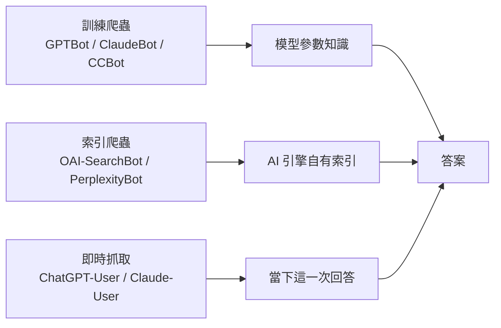

# 第 3 章　可達性：AI 讀不讀得到你的網站？

> 在全書的管線「觸發 → **可達** → 召回 → 選擇/排序 → 引用 → 吸收 → 用戶行為」中，本章處理第二站。後面所有優化都有一個前提：AI 的抓取程式真的拿到了你的內容。

---

## 一、本章要回答的問題

1. 封鎖或放行 AI 爬蟲，會不會改變你在 AI 答案中出現的機會？
2. 為什麼「robots.txt 沒問題」不等於「AI 讀得到」？封鎖可能發生在哪幾層？
3. AI 抓到的是什麼？JavaScript 渲染、`<head>` 裡的元數據、結構化資料，哪些真的會被讀到？
4. AI 引擎背後依賴哪些索引？即時抓取和預先建立的索引有什麼不同？
5. llms.txt 與 Markdown 鏡像頁有沒有用？當 AI 以 agent 身份深入你的網站時，什麼決定它能不能用你的內容？

---

## 二、核心原理

### 原理 3.1　讀不到，就不存在

AI 搜索引擎回答問題時，只能使用它拿得到的內容。拿不到，你的網站就不會進入候選集，後面的排序、引用都無從談起。

這一點在 Google 的產品上有直接的觀察。在真實 AI 搜索引擎上重複測試發現：封鎖 Google-Extended（Google 用來區分 AI 用途的抓取標識）的網站，**被 Gemini 引用的次數為零**，被 AI 概覽（AI Overviews）引用的次數也顯著更少。這是相關性觀察，不是隨機實驗，但方向清楚。

失敗的形式值得注意。當 agent 讀不到網站時，它不會為你編造內容，而是**把你省略掉**，改用第三方或競爭對手的內容來回答。你不會看到錯誤訊息，只會發現自己不在答案裡。

### 原理 3.2　「AI 爬蟲」不是一個東西，而是幾種職責不同的抓取者

最常見的誤解，是把所有 AI 爬蟲當成一類。實際上，同一家 AI 公司通常運行好幾個身份（user-agent），各管一件事。以 OpenAI 公開的分工為例，從業者整理如下：

| 身份 | 職責 | 封鎖它的後果 |
|---|---|---|
| GPTBot | 收集訓練資料 | 退出模型訓練；不影響即時回答。OpenAI 官方說明：用戶在 ChatGPT Atlas（OpenAI 的瀏覽器）中瀏覽時取得的內容，也遵守這個封鎖 |
| OAI-SearchBot | 建立 ChatGPT 搜索用的索引 | OpenAI 官方說明：封鎖它，網站內容就不會出現在 ChatGPT 搜索的摘要和片段中；若 OpenAI 從第三方搜索服務或爬取其他頁面時得知該網址，在 ChatGPT Atlas 中可能只顯示連結和標題 |
| ChatGPT-User | 用戶在對話中觸發的即時抓取 | 用戶貼你的網址時，AI 讀不到 |
| OAI-AdsBot | 驗證廣告落地頁（2026 年新增） | 與廣告相關 |

其他廠商也有類似的分層：名稱中帶「User」的身份（如 Claude-User、Perplexity-User）通常是答題時的即時抓取；ClaudeBot、PerplexityBot 則是索引或訓練類的抓取。另有從業者指出，meta-externalagent 依其官方說明同時負責訓練與 Meta AI 答案的索引，封鎖它等於同時退出兩條管道。

用一張圖表示三類抓取在管線中的位置：



這個分工帶來兩個直接後果：

- **封鎖訓練爬蟲，並不會把你從即時答案中移除。** 大規模真實用戶實驗的附錄數據顯示：79% 的網域至少封鎖了一個 AI 爬蟲，但封鎖者從 ChatGPT 得到的導流均值（6.48）反而不低於未封鎖者（4.48）。這是相關性，不能讀成「封鎖會帶來流量」，只能說明**封鎖訓練爬蟲並不阻止 ChatGPT 在回答時帶來流量**。
- **反過來，只放行訓練爬蟲而擋住即時抓取，才是真正的損失。** 在聯網 agent 作答的模式下，只有 7–10% 的答案內容來自訓練知識，其餘來自當場檢索。能不能被即時讀到，比有沒有被訓練進去重要得多。

### 原理 3.3　封鎖可能發生在三層，robots.txt 只是最表面的一層

```
請求 → [CDN / WAF / 主機的機器人防護] → [robots.txt 宣告] → [伺服器回應內容]
         執行層：直接回 403 或挑戰頁       宣告層：禮貌性規則        內容層：拿到的 HTML 有沒有東西
```

- **宣告層（robots.txt）**：告訴爬蟲「請不要來」。是否遵守取決於爬蟲本身。
- **執行層（CDN、WAF、主機安全設定）**：在請求到達網站之前就依 user-agent 或 IP 信譽擋掉，回傳 403 或挑戰頁。這一層**不會出現在 robots.txt 裡**，站長從瀏覽器也看不到。
- **內容層**：請求成功了，但回傳的 HTML 裡沒有你以為有的內容（見原理 3.4）。

從業者普遍認為，AI 爬蟲常在 CDN 或 WAF 層被預設設定或無意設定封鎖，即使 robots.txt 允許也無效（這是社群多數看法，支持者明顯多於反對者，但不是證明）。有 CDN 的「AI 爬蟲」開關會在網站自己的 robots.txt 前面插入一段託管規則，封鎖 GPTBot、ClaudeBot、Google-Extended 等，覆蓋網站本身的設定。另有從業者指出，該 CDN 自 2026 年 9 月 15 日起的新預設，會在帶廣告的頁面上封鎖「混合用途」爬蟲；沒有廣告位的網站不受這次變更影響。

### 原理 3.4　AI 讀的是「伺服器原始回應」，不是你在瀏覽器裡看到的頁面

瀏覽器會執行 JavaScript、組裝出完整頁面；多數 AI 爬蟲不會。它們取回原始 HTML，轉成純文字，再交給模型。

從業者普遍認為，多數 AI 爬蟲不執行 JavaScript，客戶端渲染的內容對它們不可見（這是本主題最強的社群共識之一，支持與反對約為 23 比 1）。幾組實測提供了細節：

- 從業者實測報告：在一個埋了 60 多個識別碼的測試頁上，讓六個 AI 平台讀取，**有三個完全不執行 JavaScript**，另外三個只給 0.5 到 3 秒就離開。
- 同一測試中，11 類元數據有 9 類讀取結果為零——meta description、JSON-LD、OG 標籤、schema 標記都沒被讀到，唯一被讀到的元數據是 `<title>`。測試者的解釋是：轉成純文字的步驟會丟棄整個 `<head>` 區塊。
- 從業者實測報告：在 50 個網站中，有 34 個（68%）透過標籤管理器等客戶端 JavaScript 注入 JSON-LD。伺服器端輸出 JSON-LD 的網站，92% 的結構化資料至少被兩個 AI 爬蟲取到；只靠客戶端注入的，0%。

也就是說，**你在瀏覽器開發者工具裡看到的東西，不一定存在於伺服器原始回應中。** 有從業者發現自家的 hreflang 標籤在原始回應中是 0 個、渲染後 DOM 中是 3 個，因為檢查工具顯示的是 JavaScript 執行後的結果，這個問題好幾個月沒被發現。

常見的「只在渲染後才存在」的內容：

| 內容 | 為什麼會丟失 |
|---|---|
| 價格、方案數字 | 由資料庫在前端渲染，原始 HTML 只有方案名稱 |
| 輪播區塊的文字 | 由腳本切換顯示 |
| FAQ 折疊區的答案 | 點擊後才以 JavaScript 載入 |
| 動畫輪替的標題詞 | 標題只剩半句，其餘在動畫元件中 |
| 結構化資料 | 由標籤管理器注入 |
| 語言版本標籤 | 由前端框架生成 |

### 原理 3.5　AI 引擎背後有好幾套索引，彼此重疊很少

AI 答案的來源大致有兩條路：**預先建立的索引**（自家索引或借用搜索引擎的索引），以及**答題時的即時抓取**。

- 在真實 AI 搜索引擎上重複測試發現：同一家公司的傳統搜索結果、AI 概覽和 Gemini 三種介面，來源的 Jaccard 重疊只有 0.11–0.18。即使背後是同一家公司，不同 AI 介面拿到的網頁集合也差很多。
- 有從業者在討論 JavaScript 渲染時順帶提到：在這種情況下，ChatGPT 在很大程度上依賴 Google 的索引。這是未附證據的個人說法，不是實測結論；ChatGPT 聯網搜索究竟使用哪些索引，各方說法不一（見第 4 章）。另外，OpenAI 官方說明確認：ChatGPT 搜索除了使用 OAI-SearchBot 自建的索引，也使用「第三方搜索服務」，但沒有說明是哪一家。這意味著「傳統搜索索引收錄」本身就是 AI 可達性的一部分。
- 「AI 聲稱讀了你的網頁」不一定代表讀的是即時版本。有從業者用一個純 HTML 測試頁讓四個 AI 讀取：ChatGPT 嘗試約 10 次都讀不到；Claude 只在新對話的第一次讀到，之後看不到更新；Perplexity 引用了 14 個無關頁面；只有 Gemini 讀到了完整頁面，包括其中的 schema。測試者判斷多數情況讀的是快取版本。這是單一測試者的觀察，只能當作線索。
- 另一種情況是**根本沒有打開網頁**。在真實 AI 搜索引擎上重複測試發現（經 API 使用 OpenAI 原生搜索）：一個輕量模型有 53.6% 的會話一頁網頁都沒打開，只憑搜索結果的摘錄作答。在可控的實驗系統中，只讀摘錄的會話更常給出過時答案、引用也更常不忠實（見第 7 章）。所以「讀到的不是最新版」至少有兩種：讀到快取（目前只有單一線索），以及只讀了摘錄。

冷啟動的實體特別能說明索引的差別。從業者實測（多次、有對照）發現：一個零網路足跡的新實體，在 23 天裡被五個聯網 AI 系統每天輪詢。儘管 CDN 的預設 AI 封鎖在 23 天中有 22 天對訓練爬蟲回傳 403，這個實體仍在**第 6 天**被引用，途徑是知識圖譜加上第三方提及。日誌顯示，同一天在回答階段才會用到的兩類爬蟲（索引爬蟲 OAI-SearchBot、即時抓取者 ChatGPT-User）是被正常放行的。不同廠商的差距也很大：其中一家以該實體自有網域作為依據約 119 次，另一家是 0 次，只從第三方社群平台取用。

### 原理 3.6　Agent 可讀性：被找到之後，還要「用得上」

當 AI 以 agent 身份深入你的網站（查價格、比規格、完成任務），可達性的標準就從「讀得到文字」提高到「讀得懂、能操作」。這被稱為 agent 可讀性（agent experience, AX）。

- 在真實 AI 搜索引擎上重複測試發現：在 1,056 家企業、37,927 次 agent 旅程中，agent 可讀的網站，答案有 **78%** 來自自家頁面（不可讀的是 58%）；被明確推薦的比例是 **20%**（不可讀的是 11%）。該研究由提供相關服務的機構完成，使用自有評分器，屬於配對觀察研究。可讀性是一個整包分數，包括：內容不依賴 JavaScript、結構化資料、llms.txt 或 Markdown 回退版本、機器人控制放行 agent，**沒有拆分單項效果**。
- 同一研究中，控制了 agent 可讀性之後，「站外被提及的廣度」對 agent 是否採用你的內容、是否推薦你，沒有獨立影響。這個結論**只適用於 agent 已經進入網站深入查看的場景**，不代表站外提及在「被發現」階段不重要。
- 在可控的實驗系統中：一個原型電商網站加入 JSON-LD、aria 屬性、動作提示和證據時間欄位後，三個瀏覽器 agent 的嚴格任務成功率從 **49.3% 升到 89.3%**，平均步數從 9.31 降到 6.49。但這是單一合成網站、整包處理，作者自述為概念驗證，不能判斷哪一項起作用。
- 在給定網頁的條件下：在資料集檢索場景中，發佈機器可讀的資料描述後，agent 取回可直接使用資料頁的精確度是 46.4%，對照組是 28.0%。但同時，使用這條路徑的 agent 只回答了 40 題，對照組回答了 56 題。**被找到不等於能被使用**，這就是 agent 場景的「最後一公里」問題。
- OpenAI 官方說明：ChatGPT Atlas 中的 agent 會用 ARIA 標籤（為螢幕閱讀器設計的無障礙標籤和角色）理解頁面結構，以及按鈕、選單、表單等互動元素。官方建議依照 WAI-ARIA 的做法，為互動元素加上描述性的角色、標籤和狀態。

---

## 三、證據有多強

| 結論 | 證據類型 | 強度與限制 |
|---|---|---|
| 封鎖 Google-Extended 與 Gemini 零引用、AI 概覽引用減少相關 | 真實引擎重複測試 | 中強；相關性，不是因果 |
| 封鎖訓練爬蟲不阻止 ChatGPT 導流 | 大規模真實用戶數據（附錄） | 中；相關性，主研究的因果設計不涵蓋此點 |
| Agent 可讀網站更多以自家內容作答、更常被推薦 | 真實 agent 重複測試 | 中；服務商研究、配對觀察、整包分數 |
| 機器可讀改造提升 agent 任務成功率 | 可控實驗系統 | 弱到中；單一合成網站，無拆分 |
| 多數 AI 爬蟲不執行 JavaScript | 從業者實測＋強社群共識 | 中；但多數引用最終指向一份 2024 年底的單一分析（見爭議） |
| 封鎖常發生在 CDN/WAF 層 | 社群共識＋多個從業者抽樣 | 中；各樣本比例差異很大 |
| 訓練與即時抓取需分開對待 | 從業者多組日誌＋一項 R-A 實測 | 中 |
| llms.txt 單獨有效 | 無 | **目前沒有證據** |

需要特別記住的適用範圍：

- 可達性研究多半只證明「讀不到會吃虧」，**沒有證明「讀得到就會被引用」**。可達性是必要條件，不是充分條件。
- 爬蟲抓取量不等於被引用。從業者普遍認為，單純的抓取量不足以衡量網站在 AI 中的可見度。

---

## 四、爭議與反例

### 爭議 1：llms.txt 到底有沒有用？

**認為沒用的一方：**
- 在真實 AI 搜索引擎上重複測試發現：在該研究檢查的 1,047 個來源網站中，有 llms.txt 的佔 16.9%，但這類技術標記與答案準確率無關（係數約 -0.04）。
- 多份獨立日誌指向同一方向。從業者實測報告：一個網站在 8 月 31 日上線 38 KB 的 llms.txt，9 月 2–16 日共有 299 次請求，其中 240 次是自己的監控、59 次是真實請求，**AI 爬蟲只有 2 次**（都是 Amazonbot）；同期 GPTBot 在全站抓取 920 次、ClaudeBot 1,494 次、OAI-SearchBot 631 次，請求 llms.txt 的都是 0。另有從業者查詢客戶數十億行日誌、追蹤 100 多個網站，都未見 AI 工具請求 llms.txt。
- 從業者普遍認為 llms.txt 對 AI 可見度與引用沒有幫助（支持 33、反對 4）；大多數 LLM 根本不會去找這個檔案。
- 有從業者觀察到：在一份 200 個查詢的引用資料中，擁有 llms.txt 的網站不到 3%，llms.txt 頁面本身也從未被引用。另有從業者加上一個月再移除，觀察不到任何變化。

**認為有用或暫不下結論的一方：**
- Google 的搜索官方文件表示不需要 llms.txt 這類特殊檔案，但 Google 的網頁檢測工具已加入 llms.txt 檢查項。有從業者把後者解讀為「它有作用」，也有從業者指出，檢測工具只能確認檔案存在，無法說明任何 AI 是否使用了它。
- 有從業者觀察到：在 50 家企業中，有 llms.txt 的 5 家被 AI 點名的比例是 77%，沒有的是 49%。但樣本只有 5 家，且這些網站同時有其他機器可讀改造。
- 有從業者認為，llms.txt 的價值主要在於「寫它的過程迫使你梳理哪些頁面重要」，或對程式開發類的技術文件網站有用（編碼 agent 可能會讀）。
- 有業者宣稱其日誌中 AI 爬蟲請求 llms.txt 的頻率遠高於其他頁面，但未經獨立驗證，且與上述多份獨立日誌相反。

**本書的立場**：一項研究發現它與準確率無關，另一項研究把它放在整包裡沒有拆分。**目前沒有證據證明 llms.txt 單獨有效。** 它成本很低，可以放，但不要把它當成可達性工作的重點。

### 爭議 2：給 AI 另備 Markdown 版本，有沒有用？

- 從業者實測報告：部署全站 `.md` 版本和 llms.txt 後，訓練與索引類爬蟲在 56 個檔案上抓取了 177 次；但**即時抓取者幾乎只讀 HTML**：ChatGPT-User 抓了 1,936 個 HTML、0 個 `.md`；PerplexityBot 306 個 HTML、0 個 `.md`；Claude-User 38 個 HTML、1 個 `.md`。另一位從業者在兩個小型部落格約三個月的日誌中觀察到相同的現象。
- 從業者實測報告：Markdown 鏡像頁幾天內就被 Google 抓取，但 ChatGPT 和 Perplexity 引用的仍是 HTML 版本，60 天內引用率沒有變化。
- 從業者實測報告：對 16 個部落格網址向 AI 爬蟲提供 Markdown，30 天內會話數成長 52%；但沒有提供 Markdown 的部落格網址也成長了 43%，無法確定 Markdown 本身有效。
- 有從業者觀察到：在六個網站、381 個頁面的 A/B 測試中，提供 Markdown 的頁面三週內只多了約 1 次機器人訪問（中位數）。
- 反方的報告：從業者實測報告，為 20 篇熱門文章提供 `.md` 版本後，Perplexity 和 ChatGPT 搜索更快發現並引用了 Markdown 版本，AI 抓取率翻倍。這份報告沒有對照組。
- 成本面：有從業者測量 300 個網站，中位數頁面需要 2,592 個 token，約一半不是正文、約五分之一是導航與頁首頁尾；7 個提供 Markdown 版本的網站中位數是 962 個 token。但 7 個之中有 6 個缺少 `Vary: Accept` 標頭（快取可能把錯的版本給錯的訪客），3 個在 Markdown 版本中遺失了正文。另有從業者指出主流 AI 爬蟲不會發送 `Accept: text/markdown`，靠標頭協商的方案可能永遠不會觸發。

**整理**：目前較一致的觀察是，**回答用戶問題的即時抓取讀的是 HTML**。要影響答案的事實，必須放在人類看到的那個 HTML 裡。Markdown 版本可能節省頻寬，可能被索引層讀取，但沒有可靠證據顯示它提高引用。

### 爭議 3：AI 讀不讀 JSON-LD？

- 一方：從業者實測報告，AI 將頁面轉純文字時丟棄 `<head>`，JSON-LD 讀取結果為零；另有從業者報告 ChatGPT 與 Gemini 的抓取都不使用 schema 資料。
- 另一方：從業者實測報告，伺服器端輸出的 JSON-LD 有 92% 被至少兩個 AI 爬蟲取到；有從業者觀察到 Gemini 能讀出並複述頁面中的 schema；有日誌分析者建議把 JSON-LD 放進人類看到的同一個 HTML，讓即時抓取者取得機器可讀的事實。
- 兩者並不完全矛盾：「爬蟲取回了含 JSON-LD 的 HTML」和「模型在作答時用到了 JSON-LD」是兩件事。agent 場景的研究把結構化資料放在整包裡，沒有單獨拆分。**可以確定的只有一點：只靠客戶端注入的結構化資料，對不執行 JavaScript 的爬蟲不存在。**

### 爭議 4：「AI 爬蟲不執行 JavaScript」還成立嗎？

這是社群共識，但有從業者指出，幾乎每一條引用最終都指向同一份 2024 年 12 月的分析，距今約 20 個月，且發布者本身銷售伺服器端渲染服務。訪問日誌只能記錄「請求了什麼」，不能記錄「有沒有執行 JavaScript」。另有從業者在日誌中看到 OpenAI 訓練爬蟲發出過少量 JavaScript 請求，而用戶觸發的抓取沒有。

**處理方式**：不要等這個問題有定論。直接比對你的伺服器原始回應和渲染後的 DOM；只要重要內容只出現在後者，就當作 AI 讀不到。

### 爭議 5：robots.txt 會被遵守嗎？

- 從業者實測報告：在 48 天的日誌中，GPTBot 與 Meta-WebIndexer 從不檢查 robots.txt。
- 從業者實測報告：在 robots.txt 中封鎖一個測試頁，再讓八個 AI 助手去讀。ChatGPT、Claude、Meta 拒絕讀取（Claude 回傳明確的「網站不允許自動存取」錯誤）；Gemini、Grok、Manus 照樣讀取；Copilot 和 Perplexity 沒有嘗試。測試者查到 Google 的文件說明用戶觸發的抓取一般不受 robots.txt 約束。這只是一個網域、三輪測試，且只涉及用戶觸發的抓取。

所以 robots.txt 既不能保證「擋得住」，也不能保證「放得進」。

### 爭議 6：可達性到底是不是常見瓶頸？

不同樣本得出的比例差距很大：

| 觀察 | 樣本 | 結果 |
|---|---|---|
| robots.txt 宣告式封鎖 | 約 51 萬個網站 | 16.8% 封鎖 LLM 爬蟲 |
| robots.txt 宣告式封鎖 | 三個行業各抽 300 個中小企業 | 律所 1.8%、居家服務 5.4%、旅遊 3.0% |
| 執行層封鎖（具名 AI 被拒、對照請求通過） | 131 個網站，偏新聞、SaaS、電商 | 約 21% |
| 至少封鎖一個主要 LLM 爬蟲，多在 CDN/主機層 | 約 3,000 個網站，以 B2B SaaS 為主 | 27% |
| 以 AI 身份抓取中小企業網站 | 約 1.7 萬個法國中小企業網站 | 可達性幾乎從不是瓶頸 |

這些是有從業者觀察到的數字，測量層次和樣本都不同，不能互相比較高低。可以得出的是：**宣告層的封鎖普遍少見；執行層的封鎖在有 CDN 的網站、B2B SaaS、媒體類網站上明顯較多。** 同時也有從業者提醒，用自稱 AI 身份的請求從資料中心 IP 測試，拿到 200 不代表真正的爬蟲也拿得到（CDN 會依 IP 範圍驗證），反之亦然。

另一個反例來自「讀得到卻沒被引用」：有從業者觀察到，約 10 萬頁的網站 30 天內被 AI 爬蟲抓了約 43 萬次，但抓取量與是否被引用無關，被引用的是「單頁單一事實、網址穩定、最容易複核」的頁面。也有審計約 1.7 萬個網站的從業者認為，多數網站沒被引用，是因為頁面上沒有可以直接取用的答案，而不是技術問題。

---

## 五、案例

### 案例 1：新實體在「預設 AI 封鎖」下仍在第 6 天被引用

- **做了什麼**：建立一個零網路足跡的新實體，事先登記測試方案，每天向五個聯網 AI 系統詢問，每個答案評分為正確、未找到或幻覺，共約 1.6 萬個評分點。
- **平台**：五個聯網 AI 系統。
- **觀察到什麼**：CDN 預設的 AI 封鎖在 23 天中有 22 天對列出的訓練爬蟲回傳 403，但即時抓取者同一天被正常放行；實體在第 6 天被引用，依靠的是知識圖譜與第三方提及。社群平台上的聲量增加 23 倍，引用沒有提升；結構化身份（公開的實體資料庫條目、穩定識別碼、真實網站）有作用。
- **多久**：23 天。
- **對應原理**：3.2（訓練爬蟲與即時抓取職責不同）、3.5（索引路徑不只一條）。這是單一實體的實驗，只能說明機制，不代表普遍規律。

### 案例 2：CDN 開關悄悄覆蓋了網站的 robots.txt

- **做了什麼**：站長發現網站在 ChatGPT、Perplexity、AI 概覽都不出現，而網站程式輸出的 robots.txt 明確放行所有 AI 爬蟲。用 `curl` 取回線上的 robots.txt，發現頂部多了一段不是自己寫的託管區塊，封鎖了 GPTBot、ClaudeBot、Google-Extended 等。
- **原因**：CDN 的「AI 爬蟲」開關會在 robots.txt 前面插入自己的規則。
- **對應原理**：3.3。這份報告屬單一從業者，未經獨立驗證；但它揭示的檢查方法——看線上實際回傳的檔案，而不是看原始碼——是通用的。

### 案例 3：舊外掛的萬用封鎖規則

- **觀察**：一位審計 50 個本地服務網站（水電、空調、牙醫、律師）的從業者報告，常見問題之一是 GPTBot 與 ClaudeBot 被 robots.txt 封鎖，不是業主有意為之，而是舊 SEO 外掛遺留的萬用 `Disallow`。另一組小企業樣本中，被標記封鎖 AI 爬蟲的 10 個網站裡有 4 個用萬用規則封鎖所有爬蟲（包括即時抓取者，甚至 Googlebot），像是測試環境設定被帶上線；9 個封鎖 meta-externalagent；多家毫無關聯的網站出現同樣順序的同一份封鎖清單——那不是 10 個決定，而是一個預設值。
- **結果**：該審計者報告，單獨修正封鎖這一項，通常在 2–4 週內最快看到 AI 搜索出現的改善。這是從業者實測報告，未經獨立驗證。
- **對應原理**：3.3。

### 案例 4：價格只存在於渲染後的頁面

- **觀察**：有從業者掃描一個 SaaS 網站，原始 HTML 約 300 詞、渲染後約 1,033 詞；定價頁原始 HTML 194 詞、渲染後 511 詞，而且**原始 HTML 中沒有任何價格數字**，只有方案名稱。AI 助手被問到價格時，知道有哪些方案，但給不出數字。
- **修正**：網站方確認原因是預渲染腳本只以文字描述方案，價格由資料庫在前端渲染。修正後，以 `curl` 抓定價頁已能取到價格。同一次檢查還發現預渲染清單漏掉了 7 個頁面，是某個搜索爬蟲找到後才被發現的。
- **對應原理**：3.4。這是單一網站的一手觀察，只能作為例子。

### 案例 5：為 AI 建一套平行版本

- **做了什麼**：一個知名度低的應用程式品牌，發現 ChatGPT、Claude、Perplexity 都在引用它，但描述錯誤。它為全站建立 `/ai/` 平行版本：同樣內容，去掉導航、動畫、行動呼籲等干擾，每頁改寫成直接問答（答案放在前 75–120 個詞）；每頁以 canonical 指回人類版本，放在獨立網站地圖中；以 llms.txt、`rel="alternate"` 連結和引用時的直接抓取讓 AI 發現。
- **觀察到什麼**：從業者實測（多次、有對照）發現，5 週內 AI 引用覆蓋擴大 12%，AI 轉介流量提升 60%，沒有新增外部連結。
- **注意**：這是整包改動，無法判斷是內容改寫、可讀性，還是發現機制起作用；而且與爭議 2 中「即時抓取者只讀 HTML」的觀察並不一致，需要更多重複。

### 案例 6：Agent 可讀性與「被省略」

- **做了什麼**：研究者在 1,056 家企業網站上跑了 37,927 次真實 agent 旅程，按名氣、模型先驗知識等配對比較。
- **觀察到什麼**：可讀網站的答案 78% 來自自家頁面、20% 明確推薦；不可讀網站 58% 與 11%。不可讀時，agent 用第三方或競爭對手的內容替代，而不是編造。
- **對應原理**：3.1、3.6。服務商研究、整包分數，詳見「證據有多強」。

### 案例 7：封鎖所有 AI 爬蟲的知名平台，被模型點名卻引用 0 次

- **做了什麼**：本書作者小規模實測（方法見第 4 章）。同一個游泳招募問題的 5 種英文問法，各問 2 次，共 10 個會話。
- **觀察到什麼**：一個知名的游泳數據平台在 robots.txt 中封鎖了 GPTBot、OAI-SearchBot 等 AI 爬蟲。模型在 10 個會話中有 6 次用 `site:` 指名要搜這個平台，引用 0 次；這個平台在搜索結果中也只出現過 1 次。不聯網時，模型對這個平台很熟悉（見第 5 章案例 9）：模型想去查它，卻讀不到。
- **證據強度**：本書作者小規模實測，單一主題、單一模型，未經獨立驗證；沒有對照（沒有測同一平台放行時的情況）。
- **對應原理**：3.1、3.2。

### 案例 8：成立不到四個月的新網站，只靠搜索成為最常被引用的來源

- **做了什麼**：同案例 7 的 10 個會話。
- **觀察到什麼**：一個 2026 年 6 月才註冊、專門整理游泳招募成績的網站，在 10 個會話中有 9 個被引用，佔全部引用連結的 44%，通常是第一個被引用的來源。不聯網時，模型 5 次都說不認識它，和對一個虛構網域的回答相同（見第 5 章案例 9），所以它被引用完全靠檢索，不靠模型記憶。這個網站的特徵：robots.txt 對所有爬蟲放行；數據直接寫在 HTML 中；每個「比賽級別 × 項目」各有一頁；頁面標題和模型生成的搜索詞幾乎一致；註明數據來源和更新日期；頁面之間互相連結。模型讀過一頁後，會依照網址規律，用 `site:` 搜同一網站的其他分頁。
- **證據強度**：本書作者小規模實測，單一網站、單一主題；這些特徵同時存在，無法分辨哪一項起作用。
- **對應原理**：3.1、3.4；也呼應第 4 章「要匹配的是改寫後的查詢」。

### 反面案例：把索引問題誤判為 AI 封鎖

有從業者封鎖 AI 爬蟲數週後，發現 Google 索引持續下降，懷疑是 WAF 規則誤傷，於是關閉全部規則排查。之後才發現真正原因是一次誤發的臨時網址移除請求，造成長達六個月的索引凍結。這提醒我們：可達性問題要一層一層驗證，不要從症狀直接推斷原因。

---

## 六、怎麼做

### 1. 先確認三類抓取者的狀態，分開決定

| 做法 | 證據強度 |
|---|---|
| 分別決定訓練、索引、即時抓取三類身份要不要放行；若想出現在 AI 答案中，至少放行索引與即時抓取身份（如 OAI-SearchBot、ChatGPT-User、Claude-User、Perplexity-User） | 從業者實測（多次、有對照）＋多組日誌 |
| 若在意 Gemini 與 AI 概覽，不要封鎖 Google-Extended | 真實引擎重複測試（相關性） |
| 在 robots.txt 中搜尋 GPTBot 之後，再搜尋 OAI-SearchBot；只寫了前者，等於只做了一半決定 | 從業者實測報告：72 家公司中，點名 GPTBot 的 18 家、OAI-SearchBot 只有 11 家、OAI-AdsBot 0 家 |
| 不想讓某頁出現在 ChatGPT 中，用 noindex 標記，而不是只靠 robots.txt 封鎖；而且爬蟲必須讀得到該頁，才看得到這個標記 | OpenAI 官方說明 |
| 讓其他頁面連到你的重要頁面：OpenAI 也會在爬取其他頁面時發現網址 | OpenAI 官方說明 |

### 2. 逐層檢查，而不是只看 robots.txt

1. **宣告層**：用 `curl` 取回**線上**的 robots.txt，確認沒有 CDN 或外掛插入的區塊、沒有萬用 `Disallow: /`。
2. **執行層**：以各 AI 身份和一個普通瀏覽器身份同時請求同一頁，比較狀態碼與回應大小；對照請求也被拒的，是一般防護問題，不是 AI 政策。記住這只是回應路徑測試，不等於真實爬蟲的待遇。
3. **即時測試**：直接把網址貼給 ChatGPT 等助手，問「這個網站提供什麼服務」。被封鎖的網站會直接失敗，十秒就能確認（從業者實測報告）。
4. **內容層**：用 `curl` 或查看原始碼取得伺服器原始回應，和渲染後的 DOM 比對。價格、規格、FAQ 答案、標題、結構化資料只出現在後者的，都要改。有從業者觀察到，11 個網站中 AI 身份請求都回傳 200，但 10 組有效比較中有 2 組渲染後字數多出一倍以上——差距出在渲染，不在封鎖。

### 3. 讓關鍵內容存在於原始 HTML

| 做法 | 證據強度 |
|---|---|
| 關鍵內容與結構化資料用伺服器端渲染或靜態 HTML 輸出 | 從業者普遍認為（強共識）＋從業者實測報告 |
| 標籤管理器只用於分析追蹤，不用於輸出 AI 需要看到的內容 | 從業者實測報告 |
| 輪播、折疊、動畫中的文字，確認在原始 HTML 中完整存在 | 有從業者觀察到 |
| 預渲染清單要以流程強制涵蓋新頁面，避免漂移 | 有從業者觀察到 |
| 要影響答案的事實（價格、規格、資質）放在人類看到的同一個 HTML 中 | 從業者實測報告（即時抓取者只讀 HTML） |

### 4. 用自己的伺服器日誌，但先驗證身份

- 分析工具通常會過濾機器人，客戶端分析腳本也看不到不執行 JavaScript 的爬蟲，所以要用**伺服器日誌**。部分託管平台只保留約一小時的請求日誌，需要自行長期保存。
- **驗證 IP**：user-agent 只是一個可以隨意填寫的文字欄位。從業者實測報告：兩個月內 394 個自稱 ChatGPT 的來源 IP 都不在 OpenAI 公布的範圍內，其中 79 個在探測 `/.env`、`/.aws/credentials` 等敏感路徑。有從業者觀察到，在可驗證的 14,771 次訪問中，5,577 次是冒名的，冒名者有 38.3% 在找密碼或設定檔。驗證要對照各廠商公布的 IP 範圍檔案；反向 DNS 適用於 Googlebot，但有從業者查驗發現對 GPTBot 無效。
- **看即時抓取者，而不是總抓取量**：名稱帶「User」的身份代表某個真實用戶在提問前幾秒讀了這一頁。有從業者觀察到，抓取次數與隨後實際造訪的比例多在十比一以上。
- 把爬蟲日誌當作**除錯層**：確認頁面是否被抓到、有沒有被 AI 幻覺出來的不存在網址、有沒有過慢的頁面。可見度的結果要用 AI 答案追蹤來衡量。

### 5. 為 agent 準備機器可讀的事實

| 做法 | 證據強度 |
|---|---|
| 讓 agent 不依賴 JavaScript 就能取得內容，提供結構化資料，機器人控制放行 agent | 在真實 AI 搜索引擎上重複測試發現（整包，未拆分） |
| 在需要 agent 操作的網站上，加入機器可讀資料、動作提示屬性與證據時間欄位 | 在可控的實驗系統中（單一網站，未拆分） |
| 資料集類內容發佈標準的機器可讀描述 | 在給定網頁的條件下（僅限資料集場景） |
| 提供一個簡單的機器可讀事實端點，讓 AI 引用最新數字 | 有從業者觀察到 |
| 電商商品在 AI 購物中的資格，可能取決於商品資料源是否完整（商品識別碼、變體屬性、政策資料），而不只是頁面內容 | 有從業者觀察到，只能作為線索 |
| 依照 WAI-ARIA 的做法，為按鈕、選單、表單加上描述性的角色、標籤和狀態 | OpenAI 官方說明（針對 ChatGPT Atlas 的 agent） |

### 6. 處理抓取壓力，而不是封鎖

AI 爬蟲會突發性大量抓取（有從業者報告 GPTBot 曾在 3 分鐘內達每分鐘 114 次請求）。有從業者觀察到，以每 60 秒 60 次的限流回傳 429 狀態碼，約一週後爬蟲放慢了速度。限流比全面封鎖更不容易誤傷即時抓取者。

### 不要做

- 不要用萬用規則 `Disallow: /` 或直接套用外掛、CDN 的預設封鎖清單而不檢查內容。
- 不要以為封鎖 GPTBot 就等於退出 AI 答案，也不要以為 robots.txt 放行就等於 AI 讀得到。
- 不要只靠客戶端 JavaScript 注入內容或結構化資料。
- 不要按 user-agent 直接統計 AI 流量或向客戶報告，未經 IP 驗證的數字會被冒名掃描器灌水。
- 不要依 user-agent 把不同內容給 AI 和人類而不處理快取標頭；Markdown 版本也要確認沒有遺失正文。
- 不要把爬蟲抓取量當成可見度 KPI。
- 不要從「AI 裡看不到我」直接推斷是 AI 封鎖；逐層驗證。

### 已經過時的做法

- 「一條 robots.txt 規則管住一家 AI 公司」：OpenAI 已運行四個不同職責的身份，其他廠商也分成訓練、索引、即時抓取。
- 「把 llms.txt 當成 AI 排名因素或可見度修正方案」：沒有證據支持，多份日誌顯示主要 AI 爬蟲幾乎不請求它。
- 「只看 robots.txt 就判斷可達性」：執行層封鎖不會出現在 robots.txt 中。
- 「在瀏覽器開發者工具裡看得到，就代表爬蟲看得到」：開發者工具顯示的是 JavaScript 執行後的結果。

---

## 七、本章要點

1. **讀不到就不存在，而且失敗是沉默的**：AI 讀不到你時，不會報錯，而是用別人的內容代替你。
2. **AI 爬蟲分成訓練、索引、即時抓取三類，要分開決定。** 封鎖訓練爬蟲不會讓你從即時答案中消失；擋住索引和即時抓取才是真正的損失。
3. **封鎖有三層**：robots.txt 宣告、CDN/WAF 執行、原始回應內容。robots.txt 沒問題，不代表 AI 拿得到內容。
4. **AI 讀的是伺服器原始回應。** 只存在於 JavaScript 渲染後的價格、FAQ、結構化資料，對多數 AI 爬蟲不存在。
5. **AI 引擎背後有多套索引，彼此重疊很少**；傳統搜索索引收錄本身也是 AI 可達性的一部分。
6. **Agent 場景要求「用得上」而不只是「找得到」**：可讀的網站更多以自家內容作答、更常被推薦，但現有證據都是整包、未拆分。
7. **llms.txt 與 Markdown 鏡像目前沒有被證明能提高引用**；答題時的即時抓取讀的是 HTML。
8. **可達性是必要條件，不是充分條件**：抓取量與引用無關；讀得到之後，能不能被選中取決於後面各章的因素。
