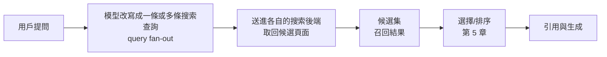

# 第 4 章　召回：查詢改寫、語義匹配、語言與市場閘門

> 管線位置：觸發 → 可達 → **召回** → 選擇/排序 → 引用 → 吸收 → 用戶行為
>
> 上一章處理「頁面能不能被抓到」。本章處理下一步：在 AI 決定要上網查資料之後，**哪些頁面會被撈進候選集**。候選集之外的頁面，不論寫得多好，都沒有機會被選中或引用。

## 本章要回答的問題

1. 為什麼「我在 AI 裡排第幾」是一個問錯了的問題？
2. 用戶輸入的問題，和 AI 真正拿去搜索的查詢，是同一句話嗎？差在哪裡？
3. 為什麼措辭稍微一改，品牌就可能從「每次都被推薦」變成「完全不出現」？
4. 查詢語言和用戶所在地，怎樣決定 AI 從哪個市場挑來源？
5. 在召回這一關，哪些做法有證據支持，哪些已經過時？

## 一、核心原理

### 1.1 召回在做什麼

AI 搜索在生成答案前，大致會經過以下步驟：

召回決定的是**誰有資格參賽**。後面的選擇、引用、吸收都只在候選集裡發生。第 0 章提過：內容一旦進入候選集，確實能改變答案；但進不進得去，主要不是文筆問題。

本章把召回拆成四個原理：

| 原理 | 一句話 | 對 GEO 的意義 |
|---|---|---|
| 4.1 | 各引擎的來源集合幾乎不重疊 | 不存在單一的「AI 排名」 |
| 4.2 | 模型會改寫查詢，改寫讓來源更不穩定 | 要匹配的是 AI 搜的那句話，不是用戶打的那句話 |
| 4.3 | 措辭與詞彙決定你在不在候選集 | 品類叫法、買家類型、自有詞彙都會改變結果 |
| 4.4 | 查詢語言與出口 IP 是市場閘門 | 英語測量看不到本地市場 |

### 1.2 原理 4.1：各引擎的來源集合幾乎不重疊

**因果鏈**：每個 AI 引擎用的搜索後端不同、改寫查詢的方式不同、選源偏好也不同。三層差異疊在一起，最後引用的頁面幾乎各走各的路。

在真實 AI 搜索引擎上重複測試發現：

| 比較對象 | 重合程度 |
|---|---|
| Google 自然搜索、AI 概覽（AIO）、Gemini 三者的來源 | Jaccard 僅 0.11–0.18 |
| ChatGPT、Copilot、Google、Perplexity 對同一提示引用的精確 URL | 平均 Jaccard 0.0079；84.9% 的引擎兩兩之間沒有任何共同 URL |
| 上述四引擎完整的 10 個提示，前 5 名 URL | 60 組兩兩比較，重疊全部為 0 |
| 單一引擎能捕捉到的來源 | 只佔四引擎 URL 聯集的 11.4%–42.6%；96.4% 的 URL 只出現在一個引擎 |
| AI 引擎與 Google 前 10 名的網域 | GPT-4o 4.0%、Gemini 11.1%、Claude 12.6%、Perplexity 15.2% |
| LLM 引擎引用的網域 | 37% 從未出現在傳統搜索結果中，38% 兩邊共有 |
| AIO 引用的網域 | 29.8% 不在同一頁的 Google 首頁結果裡；只有 25.0% 在首頁前 5 名 |
| 健康問題中，Google 傳統前 5 名頁面被 AIO 引用的比例 | 約 44%（頁面層級，3,611 條健康問題、單次收集）；只看短的單輪問題約 47% |

幾個容易被忽略的細節：

- **AI 引用的頁面比傳統搜索少**：LLM 引擎每個回答平均引用 4.3 個 URL，傳統搜索結果頁是 10.3 個。名額更少，競爭更集中。
- 有重疊時，排名第一仍有優勢：當 AI 引用的頁面也出現在傳統搜索結果中時，被引用最多的是傳統排名第一的結果（Bing 23.27%、Google 14.53%）。所以「SEO 無用」也是錯的，它只是不充分。
- 同一引擎內部比跨引擎穩定得多：同一引擎隔天的 URL 集合更替率達 67.0%，但同引擎相鄰兩天的相似度，仍約為不同引擎同一天相似度的 42 倍。換句話說：引擎本身每天在變，引擎之間的差距更大。
- 垂直品類差異很大：與 Google 前 5 名的網域重疊，智能手機 15%、筆電 32%、電動車 33%，本地服務只有 0.1%–20.6%。不同汽車類引擎之間的網域 Jaccard 在 0.096–0.251 之間。
- 健康領域的來源組成也不同：在真實 AI 搜索引擎上的一次大規模審計中（美國英文健康問題，只收集一次），AIO 引用的頁面相對同題的傳統前 5 名，偏向商業健康資訊網站；大型學術醫療機構與政府衛生機構的份額較低。效應都小。這項審計排除了影片和論壇來源，比較只在可讀取的網頁之間成立。

從業者實測報告的數字方向一致，但未經獨立驗證：

- 在 1,000 個資訊型與商業型混合的提示上，ChatGPT、Google、Bing 的來源只有 19% 重疊。
- 有從業者報告在大量相同問題上，ChatGPT 與 Perplexity 只有 11% 的來源一致（報告只留下結論，無法檢視方法）。
- 在 8 個城市、6 個品類、共 48 個本地市場中，Google 地圖對買家問題列出的商家，只有 11.9% 被任何一個 AI 引擎提到；多數市場裡，超過一半被提到的商家只被一個引擎提到。

為什麼會這樣？有從業者觀察到，各家模型各自使用不同的原生搜索提供商。至於 ChatGPT 聯網時到底用哪家索引，從業者之間並無共識（見「爭議與反例」）。可以確定的是：後端不同，候選池自然不同。

結論：「AI 排名第一」不是一個可以量出來的東西。你只能說「在某引擎、某語言、某市場、某種問法下，被召回的機率是多少」。

### 1.3 原理 4.2：查詢改寫讓來源變得更不穩定

**因果鏈**：用戶輸入的是一句自然語言。模型不會原封不動拿去搜索，而是先改寫成一條或多條搜索查詢，這個過程稱為查詢擴展（query fan-out）。改寫是生成出來的，每次可能不同；搜索結果又隨改寫而變；所以來源比傳統搜索更不穩定。

**研究證據**

在真實 AI 搜索引擎上重複測試發現：

- 對查詢做輕微改寫後，AIO 的來源排序重合度（RBO）是 0.49，傳統搜索結果是 0.74。
- 即使不改寫，只是在同一設備上重跑，AIO 的 RBO 是 0.69，傳統搜索是 0.86。
- 把 AI 改寫後的查詢重新送進 Google 搜索，98.16% 找不到原本排在前面的黑帽 SEO 網站。小幅改寫就足以讓攻擊成功率降到 10% 以下。

最後一點對 GEO 有雙重含義：一方面，AI 的改寫層把大部分只為原始關鍵詞優化的頁面擋在門外；另一方面，改寫本身有規律可循，能預測改寫結果的人就掌握了進入候選集的入口。同一研究中，在頁面裡涵蓋可能的改寫查詢詞，在 5 個被測系統中被採用的比例達到基線的 2 倍以上（這是佔比，不是成功率）；單純的關鍵詞堆砌則對任何被測系統都沒有影響。

改寫後的查詢長什麼樣

研究沒有系統公開各引擎的改寫規則。以下來自從業者的抓包和日誌，屬於從業者實測報告，未經獨立驗證：

| 觀察 | 內容 |
|---|---|
| 每次對話搜幾次 | 30 個提示的小規模測試中，ChatGPT 平均 1.1 次；Google AI Mode 3.3 次、AIO 3.4 次（Google 的子查詢是推算重建的，不是直接觀察） |
| 模式差異 | 在真實 AI 搜索引擎上重複測試發現（擷取 ChatGPT 網頁版的內部執行，5.2–5.5 版）：Instant 模式每次 1.06–2.36 條查詢，多輪只佔 3.8%–17.4%；5.4 Thinking 模式每次約 11.8 條、平均 3.2 輪，71.3% 為多輪，後續輪次使用 `site:` 的比例從第一輪的 25.1% 升到 54.7%。上一列的 1.1 次比較接近 Instant 模式 |
| ChatGPT 的查詢形態 | 一條較長、塞滿實體的查詢，平均 8.2 個詞，約三分之一直接複製自用戶原句 |
| 被引頁面數 | ChatGPT 平均 4.1 頁，AI Mode 16.9 頁，AIO 13.3 頁 |
| 被引頁面在不在前 10 | AI Mode 與 AIO 被引頁面中，只有 10% 在主查詢的前 10 名；把所有子查詢算進來，也只有 23%（AI Mode）與 28%（AIO） |
| 自動加年份 | 用戶問「Best shoes for running」，ChatGPT 實際搜的是「best running shoes 2026」，被引頁面多數含「2026」 |
| 背景驗證查詢 | 有從業者截取 Gemini 的檢索工具調用，發現它常發出 3–5 條精簡的技術性查詢（例如「某品類 安全認證 清單 2026」「定價方案 表格」），並常在查詢末尾附加社群討論站或「forum」等字眼，去找社群共識 |
| 查詢裡自帶品牌 | 用戶沒提任何品牌，ChatGPT 生成的子查詢卻已經寫入了該品類的幾個知名品牌名 |

這些數字有保存期限。本書作者小規模實測（2026 年 10 月，見下文）中，經 API 呼叫的 GPT-5.6 Sol 每個會話平均生成 9.5–11.9 組搜索詞，遠多於上表的 1.1 次。模型版本不同，API 和網頁介面也不同，所以不能直接取代上表，只說明這類觀察會隨版本快速過時。

另一項大規模研究在真實 AI 搜索引擎上重複測試發現（兩個市場、各 90 天、15.8 萬個回答、46.8 萬條引用）：ChatGPT 引用的頁面全部來自它自己的搜索；它檢索到的頁面有 97% 不在 Google 前 50 名；在同一網站的頁面之間，「是否被它的搜索檢索到」能解釋約 32% 的引用差異，頁面本身的特徵只能解釋約 2.8%。這項研究使用小模型的 API，全部為相關性，作者經營監測平台。

最後一項值得停下來想。它意味著模型在上網之前就已經有一份候選名單，搜索只是去驗證和補充。有從業者觀察到，查詢中寫入品牌名的品牌，引用率與未寫入者差距達 68.9% 對 2.1%（原報告只剩標題，只能作為線索）。這與第 1 章「熱門實體靠參數知識、冷門實體靠檢索」的原理吻合：在可控的實驗系統中，平均 16% 被排名的實體根本不在任何檢索片段裡。

本書作者的實測

本書作者小規模實測（2026 年 10 月）：經 OpenAI API 呼叫 GPT-5.6 Sol 並開啟網路搜索，記錄模型生成的搜索詞、搜索結果中的網址和最終引用。共 40 個會話：一個游泳招募問題的 5 種英文問法各問 2 次；購物、本地服務、健康知識 3 類各 5 題，每題 2 種問法各問 1 次。限制：英文、單一模型、經 API 而非網頁介面、本地題只有一個城市、樣本小，未經獨立驗證。代碼和原始數據保存在本書的實驗資料夾中。觀察到：

- 幾乎每一條搜索詞都加了用戶沒說過的詞：游泳題 94%，三類題型 95%（270/284）。加入的詞大致有五類：換成行內術語（例如把「12 歲要游多快」換成該運動官方成績標準的名稱）；預測需要的證據來源（官方、成績單）；預測背後的限制條件（例如招生名額上限）；從記憶補上具體實例（知名選手名）；預測更深一層的疑問（例如長期追蹤研究）。一篇回答「12 歲時成績慢的選手後來怎樣」的研究文章因此被引用，而用戶從沒問過這個問題。
- 三類題型的改寫模式不同：購物題寫入具體的品牌型號，並加上價格、重量、電池時數等規格詞；健康題加入證據等級詞（臨床指南、系統性回顧、隨機試驗）；本地服務題加入查證詞（官方、評論、執照、地址）。
- 第一條搜索詞就已經指名網站：三類題型 30 個會話中有 7 個、游泳題 10 個會話中有 6 個，第一條搜索詞就用 `site:` 指定某個網站；購物題常常直接指定品牌官網的具體產品頁。這是「模型在上網之前就有候選名單」的直接證據。
- 模型生成的搜索詞，比用戶原句更能解釋哪些頁面被引用：用向量語義相似度給模型看過的頁面打分，以生成的搜索詞打分，比以用戶原句打分更能區分被引用與未被引用的頁面（三類題型 AUC 差 +0.075，按會話重抽樣的 95% 信賴區間 +0.022 至 +0.127）。分題型看，只有購物題顯著；本地服務和健康題方向相同，但不顯著。只用不帶 `site:` 的搜索詞，或只用第一條搜索詞，結果仍然成立，排除了「模型先決定引用、才把產品名寫進搜索詞」的解釋。
- 意思比字面重要：向量語義分數能中等程度區分被引用與否（AUC 游泳題 0.74、三類題型 0.67；0.5 等於亂猜）。關鍵詞匹配在游泳題去掉被引用最多的網站後接近亂猜。例外是購物題（關鍵詞 AUC 0.71）：型號這類精確字詞有用。

這些結果支持本原理：要匹配的是模型改寫出來的查詢。但它們來自單一模型、經 API 的小樣本，不能代表網頁版 ChatGPT 或其他平台。

查詢擴展不等於來源多樣化

直覺上，搜得越多，來源越分散。證據不支持這個直覺。

- 在可控的實驗系統中，深度研究代理（deep research agent）的多輪查詢，會收斂到少數可編輯的用戶生成內容（UGC）頁面。UGC 佔開源代理檢索 URL 的 16.7%–23.4%，其中大型社群討論站一家就佔 UGC 的 53.7%–70.7%。在商業深度研究產品的觀察中，Gemini 的引用有 12.1% 是 UGC，OpenAI 只有 0.4%。收斂的一個可能原因是路徑依賴：後續查詢根據已經讀到的內容生成，早期讀到什麼會自我強化。在固定候選文件的實驗中（證據較弱），兩次搜索只差在文件排序，到第 4 輪已有 63.9% 的查詢不同、75.0% 讀過的文件序列不同。
- 從業者實測（多次、有對照）發現：2026 年 8 月 8 日起，ChatGPT 每個回答檢索的來源從約 11.7 個增加到 18.9 個（+61%），不同 URL 增加 69%，但不同網域只增加 9%；同一回答從單一網站抓取的頁數從 1.38 升到 2.20。也就是說，它在已經使用的網站裡讀得更深，而不是去發現新網站。8 日之前不在候選池裡的網站，檢索量增加也沒有讓它進來。

結論：你要匹配的不是用戶打的那句話，而是模型改寫出來的那幾句話。而且，搜索量變大不會自動把你帶進候選池。

### 1.4 原理 4.3：措辭與詞彙決定你在不在候選集

**因果鏈**：改寫後的查詢，靠語義匹配（semantic matching）去找頁面。頁面上的用語、品類叫法、描述的任務和買家，決定了它能被哪些查詢撈到。品類換一個叫法、問題換一個買家，匹配到的頁面集合就換一批。

這一原理的研究證據較少，主要來自從業者的重複測試。研究端的支持是：改寫查詢會大幅改變來源（原理 4.2），以及在頁面中涵蓋改寫後的查詢詞有助於被採用。

從業者實測（多次、有對照）發現：

- **同一工具，換個問法就消失**：把「最佳共享收件匣軟體」改成真實用戶會打的「我們怎樣協作處理共享郵箱，又不打亂平常的郵件流程」，在四個模型各跑 10 次。品類詞問法下，兩個主要工具幾乎每次都被點名；換問法後，其中一個在 ChatGPT 上從每次出現變成 0/10。作為對照的另外兩個工具，在各種問法下都保持穩定——它們的頁面用買家語言描述實際工作流程，而不只是自稱屬於某個品類。
- 買家換了，結果就換了：某電子報平台只在「創作者」作為買家的問法中出現；保持「企業」為買家、只把任務用白話描述，它降到 0/40。一個把所有問法平均起來的「可見度分數」會把這種差異完全蓋掉。
- 自有詞彙能被召回，相似性不能：一個全新的作者實體，連續 99 天、每天用 16 個固定問題測試三個引擎。在 10 個不含實體名稱的推薦問題中，它在 6,729 個回答裡被點名 40 次，其中 25 次來自同一個問題——那個問題用了該實體自創、網上原本沒有的子類型詞彙。以「像某位知名作者」這類相似性提問，每題約 700 個回答中都是 0 次。而直接點名問它，從第 49 天左右起穩定在 72%，說明不是索引問題。

從業者實測者提出的解讀（屬於看法，不是證明）：

> 站外足跡（第三方比較清單、評論、討論串）決定你能不能進入推薦集合；頁面上描述具體工作流程的語言，決定問法變動時你能不能留在集合裡。

有從業者觀察到的類似現象，只能作為線索：

- 同一代理商，用它出名的利基詞問，25 次被點名 19 次；用它首頁上的兩個大類標籤問，25 次都是 0。
- 同一品類的不同叫法，讓一個品牌的被提及率從約四分之三跌到零。
- 在某個城市的本地商家數據中，約 42% 的商家僅因措辭不同就改變了是否被推薦。
- 「替代品」類問法引用比較型頁面的頻率，約為「最佳」類問法的 10 倍；決定因素是問題的意圖形態，而不是有沒有品牌詞。
- 有從業者報告，在缺乏其他解釋性來源時，AI Mode 與 AIO 引用了措辭與提示完全相同的社交平台內容。

結論：語義匹配不是「關鍵詞密度」。決定你在不在候選集的，是頁面有沒有用買家會用、模型會改寫出來的那套說法，描述你真正解決的任務。

### 1.5 原理 4.4：查詢語言和出口 IP 是「市場閘門」

**因果鏈**：同一個問題換一種語言問，模型改寫出的查詢是另一種語言，送進搜索後端取回的是另一個語言的網頁生態。候選池被整體替換，而不是微調。出口 IP 則影響搜索後端把你當成哪個國家的用戶。

在真實 AI 搜索引擎上重複測試發現：

- **換語言幾乎換掉整套網域**：GPT 換一種語言，引用網域重疊接近 0；Claude 最穩定。改寫措辭對網域的影響，小於換語言。
- 本地品牌受益最大：在 12 種歐洲語言、三個聯網模型、35,640 條回答中，改用品牌本國語言提問，本地龍頭品牌的推薦份額提升 0.80，全球品牌只提升 0.15。跨語言回答的平均餘弦相似度是 0.825；同語系之間略高於跨語系（0.844 對 0.820）。回答的情緒也隨語言而變，英文最負面。
- 本地來源比例成倍變化：在健康主題的 AIO 中，用英文查詢時本地來源的引用比例差異很大（澳洲 48.2%、美國 33.7%、印度 2.3%、奈及利亞 0.2%）；改用母語後，本地引用提高 3.5–13.5 倍，例如日本從 16.6% 升到 57.5%，韓國從 2.7% 升到 36.4%。
- 語言選供應商，IP 選國家：在一個小樣本研究中（234 次運行，每組 6 次重複），用英語在伊斯坦布爾和塔林提問，本地供應商在 12 次運行中一次都沒出現；在本地語言組中，全球供應商 24 次只出現 1 次。更說明問題的是：從柏林用土耳其語問，得到的是德國本地會計軟體供應商（6 次中 5 次）；從塔林用俄語問，得到的是愛沙尼亞本地供應商（6 次中 4 次）。語言決定候選集合被整體換成「本地型」，出口 IP 決定是哪個國家的本地。作為負對照的項目管理軟體類別沒有語言效應，作者推測可能與該品類是否受國家法規約束有關，但未驗證。
- 不同引擎讀地點的通道不同：在真實 AI 搜索引擎上重複測試發現（300 題、31,200 個回答，經 API）：ChatGPT 依照應用程式宣告的地點，精確到城市，會把地名寫進自己的搜索詞；即使搜索詞沒有地名，搜索後端也會按地點換來源；它不理會網路位置。Gemini 則不理會宣告的地點，只按網路所在國家換來源，連與地點無關的問題也會換掉不少來源，但分不到城市。推薦的商家很不穩定：同城重問一次只重疊 32%，換一個城市只剩 8%。

兩個需要一起記住的補充：

- 穩定性主要由模型決定，不由語言決定（兩者解釋的變異分別約 0.319 與 0.011）。
- 在 12 種語言中的 11 種，被引最多的網域都是同一個線上百科。語言閘門換掉的是本地層，不是所有來源。

從業者實測報告（未經獨立驗證）：

- 小語種的詞義歧義：用芬蘭語問五個 AI 搜索工具「我所在地區最好的 GEO 代理商」，只有兩個理解為行銷服務；另外三個分別推薦了土地測量公司、農業土方承包商和地理尋寶。短查詢在內容稀少的語言裡，缺乏足夠上下文來消歧新詞。
- 城市要寫進句子，不是寫進設定：一家服務約 8 個印度城市的物流公司，在 41 個買家問題中被點名 0 次。把地點設在某城市、問通用問題，仍是 0/3；把城市名直接寫進問題句子裡，Gemini 3 次全部點名，AIO 在兩個城市點名了它——而且只在它有對應城市頁面的地方。（這個觀察只在 Gemini 與 AIO 上成立；上述研究顯示 ChatGPT 會跟隨宣告的城市。）
- 本地生態各不相同：在 19 個城市用「GEO 代理商＋城市」問 ChatGPT，94 家代理商中 97% 的官網被引用；商家檔案（Business Profile）的引用在印度大城市佔 86%，其他地方只有 18%，其他新興市場約 15%——這不是「新興市場」的共通模式，而是單一市場的特性。
- 有從業者觀察到：把英文提示清單直接翻譯並不夠，因為各語言的人問購買問題的方式不同；如果本地回答是用英文頁面拼出來的，說明本地網路在這個主題上很薄，一篇像樣的本地頁面很快就會被引用。

結論：英語的測量結果不能代表本地市場。語言是一道閘門，閘門另一邊是另一套候選池。

## 二、證據有多強

| 原理 | 證據層級 | 強在哪裡 | 弱在哪裡 |
|---|---|---|---|
| 4.1 來源不重疊 | 多項在真實 AI 搜索引擎上的重複測試，含同行評審研究；從業者大樣本測試方向一致 | 多個獨立團隊、不同引擎、不同時間，結論同向 | 部分研究提示數少（例如 15 個提示）；部分作者為可見度服務商，有利益衝突 |
| 4.2 改寫讓來源不穩定 | 真實引擎重複測試（含同行評審）；深度研究收斂屬可控實驗系統 | RBO 與重搜實驗直接測量了改寫的影響 | 改寫的具體形態主要來自從業者抓包，Google 子查詢是推算而非直接觀察 |
| 4.3 措辭決定候選集 | 主要是從業者實測（多次、有對照）；研究端只有間接支持 | 有對照組、有重複運行、有長期逐日記錄 | 多為單一品類或單一實體（n=1）；機制是作者推測 |
| 4.4 語言與市場閘門 | 三項以上真實引擎重複測試，覆蓋歐洲 12 種語言與亞非健康主題 | 效應量大、方向一致、跨研究可重現 | 「出口 IP 選國家」只有單模型、每組 6 次的小樣本；兩項核心研究的作者為可見度測量服務商 |

**適用範圍提醒**：

- 以上都是**觀察性**或描述性證據。它們說明候選池怎樣變化，但沒有一項隨機實驗證明「改了頁面措辭 → 召回率上升 → 流量或轉化上升」。
- 引擎更新頻繁。8 月 8 日 ChatGPT 檢索行為的突變說明，任何具體數字（每次搜幾條、引多少頁）都有保質期。
- 「涵蓋改寫查詢詞有效」的研究證據，來自自建網站實驗，測的是被採用的佔比，不是真實商業站點的成功率。

## 三、爭議與反例

### 3.1 查詢擴展能不能看見？

| 說法 | 依據 |
|---|---|
| ChatGPT 會把改寫後的查詢交給你，Google 的兩個介面不會 | 從業者實測報告；也有從業者透過瀏覽器開發者工具看到 ChatGPT 的改寫查詢 |
| Claude 和 Perplexity 會公開查詢擴展，ChatGPT 和 Gemini 不會 | 另一位從業者的實測報告 |
| 透過第三方 API 拿到的查詢擴展只有 1–3 條、大多只是原關鍵詞的變體，有些甚至一條都沒有 | 從業者實測報告；另有人試 6 次最多得到 3 條 |
| 模擬工具給的擴展查詢較有用，但那是用提示模擬出來的，不是模型真正發出的查詢 | 同一從業者的對比 |

**怎麼看**：可見性隨介面、版本、時間而變，彼此矛盾的報告可能都在各自的時間點為真。合成的「擴展查詢」只是猜測，不能當成觀察數據。

### 3.2 ChatGPT 用哪家索引？

從業者普遍認為 ChatGPT 聯網搜索同時使用 Bing 和 Google 的索引，但這是有爭議的看法（支持者約為反對者的三倍多），不是證明。OpenAI 官方說明確認 ChatGPT 搜索除了自建索引，也使用「第三方搜索服務」，但沒有說明是哪一家，所以「Bing 還是 Google」仍無定論。一項從業者研究報告，ChatGPT 購物輪播中 83% 的商品經由購物類擴展查詢來自 Google 的購物資料。這可作為佐證，但只涵蓋購物場景。

### 3.3 位置設定有沒有用？

- 研究（小樣本）：出口 IP 決定推薦哪個國家的供應商。
- 從業者實測：設定地點、問通用問題，本地企業仍然 0 次被點名；要把城市寫進句子才有效。

兩者不一定矛盾：IP 可能在**國家**層級起作用，而**城市**層級的本地化需要查詢文字本身帶地點。但目前沒有研究把兩者放在同一設計裡測。另一項在真實搜索引擎上重複測試的研究（歐盟 5 國）顯示，語言比地點更決定結果：同樣用英文跨國查詢，結果網域的重疊是 0.58–0.80；換成當地語言後只剩 0.11–0.17。

更新：已有研究把兩者放在同一設計裡測（見原理 4.4）。答案是要看引擎：ChatGPT 跟隨宣告的地點（到城市），Gemini 跟隨網路所在的國家。

### 3.4 用戶的提示到底長還是短？

- 有從業者觀察到，兩份用戶調查顯示多數提示很短，約三分之二在 15 個詞以內，接近關鍵詞搜索，但越來越多人附加預算、地點等個人背景。
- 有從業者在客戶網站上看到約 60% 的提示就只是搜索詞。
- 也有從業者認為在自己熟悉的品類裡，提示約有 20 個詞，而且因為 AI 記住了背景而變短。
- 還有從業者發現搜索控制台開始出現段落長度的對話式查詢。

**怎麼看**：這些都是單點觀察。對召回而言，更重要的是模型改寫後的查詢，而不是用戶原句的長短——無論原句長短，最後進搜索引擎的都是改寫版。另外，真實對話日誌顯示，單句很短，常是因為預算、地點等條件說在前面的輪次（見第 9 章原理 9.4）；用孤立的短提示測量，可能漏掉這些條件。

### 3.5 站外足跡還是頁面用語？

在措辭測試中，連實測者本人也無法乾淨地分開兩個因素：是頁面用買家語言描述工作流程讓品牌穩定，還是大量第三方比較清單在起作用。他的暫時看法是「站外足跡讓你進場，頁面用語讓你留下」。這是一個待檢驗的假說。

### 3.6 多查詢是好事還是壞事？

- 對內容方：多查詢意味著更多被撈到的入口。
- 但在可控的實驗系統中，多查詢反而收斂到少數可編輯的 UGC 頁面，形成單點攻擊面：在單一 URL 上附加約 13 個詞，就有 57%–76% 的運行把它撈進上下文，34%–61% 引用它，22%–37% 在報告中提及攻擊者指定的實體；以困惑度或輸出相似度做偵測都無效。
- 同時，從業者觀察到 ChatGPT 在 8 月後大幅減少對大型社群討論站的檢索（從約 4% 的來源降到 0.02%）。

也就是說，「社群平台是 AI 必抓的來源」在不同引擎、不同時間點可能完全不成立。有從業者提醒：同一查詢下一個引擎引用的網域，只有約 11% 出現在另一個引擎，所以某一引擎的變化不能外推到其他引擎。

## 四、案例

### 案例 1：同一工具，換個問法從 10/10 到 0/10

- **做了什麼**：在 ChatGPT、Claude、Perplexity、Gemini 上，用兩種問法問共享收件匣工具，每種各跑 10 次。一種是品類詞，一種是真實用戶的描述式問法。另追蹤兩個工具作為對照。
- **觀察到什麼**：品類詞問法下兩個主角工具幾乎全勤。描述式問法下，ChatGPT 點名其中一個 9/10、另一個 0/10；Claude 反過來（8 對 5）；Gemini 兩個都點（10 與 8）；Perplexity 點名一個 5 次，另一個 0 次，而且乾脆轉去教用戶怎麼在郵件客戶端裡自己做。對照組兩個工具在各種問法下都穩定，最多只在 Perplexity 上鬆動。
- 說明的原理：4.3。召回取決於措辭與頁面用語的匹配，而且每個引擎的反應方向不同（4.1）。

### 案例 2：一個新實體的 99 天

- **做了什麼**：一個 5 月 11 日上線的全新作者實體，預先登記測量方案，每天用 16 個固定問題問三個聯網引擎，累計評分超過 11,000 條回答。
- **觀察到什麼**：直接點名的問題約第 49 天後穩定在 72%；不點名的推薦問題中，被點名 40 次有 25 次來自使用自創詞彙的那一題；相似性問法約 700 次中為 0。
- 說明的原理：4.3。新實體短期內能靠「自有詞彙」被召回，但要被「像某某」這類問法召回，需要第三方的共現提及，這在幾週內做不到。

### 案例 3：一個城市名，從 0/41 到 3/3

- **做了什麼**：一家服務約 8 個城市的物流公司，先用 41 個買家問題測試，再比較「設定地點＋通用問題」與「把城市名寫進問題」。
- **觀察到什麼**：原本 0/41；設定地點仍是 0/3；城市寫進句子後 Gemini 3/3，AIO 在兩個城市點名它，且只在它有城市專頁的地方。
- 說明的原理：4.4 與 4.3。地點要成為查詢的「內容」，而頁面要有對應的地點內容可供匹配。

### 案例 4：ChatGPT 讀得更深，但沒有讀得更廣

- **做了什麼**：用同一組 961 個提示，比較 8 月 8 日前後共 5,029 個 ChatGPT 回答的檢索來源。
- **觀察到什麼**：每個回答檢索的來源 +61%，但不同網域只 +9%；政府與官方機構網域大幅上升，大型社群討論站與若干媒體網域大幅下降。實測者提醒，其提示組合偏向健康與金融，不應視為普遍規律；也只看得到變化，看不到原因。
- 說明的原理：4.2。更多查詢不等於更多元的來源；不在候選池裡的網站，不會因為檢索量增加而被發現。

### 案例 5：針對擴展查詢，新站一週被引用

- **做了什麼**：一個新網站在競爭激烈的品類中，不針對用戶原句，而是針對 ChatGPT 生成的擴展查詢做頁面。那些擴展查詢裡已經寫進了該品類的幾個知名品牌名。
- **觀察到什麼**：約一週內，頁面在一個寬泛的「最佳某類工具」問題下被 ChatGPT 引用。實測者強調：被引用不等於被推薦。
- 說明的原理：4.2。召回匹配的是改寫後的查詢；但進入候選集只是第一關，選擇與推薦是下一章的事。

### 案例 6：抽取真實擴展查詢的流程

- **做了什麼**：一位服務電商客戶的從業者，把目標提示在 ChatGPT 與 Gemini 各跑 5 次，記錄每條子查詢，只保留在 3 次以上出現的。
- **觀察到什麼**：一個廚具客戶的單一提示，得到 14 條穩定子查詢，之後每條查詢一頁、用查詢本身的措辭。第一個月他改為針對用戶問法的同義改寫建頁，9 頁全部白做。
- 說明的原理：4.2。要匹配的是重複出現的真實子查詢，不是你自己想像的同義句。

### 案例 7：芬蘭語裡的「GEO」

- **做了什麼**：用芬蘭語問五個 AI 搜索工具「本地區最好的 GEO 代理商」。
- **觀察到什麼**：五個中有三個把 GEO 理解成土地測量、土方工程或地理尋寶。
- 說明的原理：4.4。在內容稀少的語言裡，新詞缺乏足夠的上下文，短查詢的改寫可能直接召回錯的品類。實測者的初步經驗是：服務描述寫出完整名稱有幫助，但尚未嚴格測試。

### 案例 8（證據較弱）：鎖定少數「最高級」問法

- **做了什麼**：有從業者轉述一個客戶案例：放棄寬泛品類詞，改為挑出 5–6 個「最適合某用途的某產品」「最便宜又好用的某產品」這類購買階段問法，先看這些問法下已經被引用的是哪些來源，挑自己有機會競爭的，再把內容與第三方投放全部集中在這幾個角度。
- **觀察到什麼**：報告稱 90 天內從幾乎不可見，到出現在 15%–20% 的相關 AI 回答中，並稱這部分流量的轉化率約為傳統自然流量的 4 倍。
- 怎麼讀：這是轉述，未經獨立驗證，缺少對照組。轉化數字尤其要謹慎——本書主線的判斷是，目前沒有研究證明 GEO 能穩定帶來流量或轉化。它在這裡的價值是展示一種做法：按問法家族挑戰場，而不是追求全面覆蓋。

## 五、怎麼做

### 5.1 建議做法

| # | 做法 | 證據強度 |
|---|---|---|
| 1 | **按引擎分別測量與經營**，不用單一「AI 可見度分數」代表所有引擎 | 真實引擎重複測試，多項研究一致 |
| 2 | **按語言、按市場分別測量**；本地品牌一定要用母語測；記錄每次測量的查詢語言與出口地區 | 真實引擎重複測試（其中 IP 部分為小樣本） |
| 3 | **每個提示重複多次**，看出現頻率，不看單次截圖 | 真實引擎重複測試：頂部推薦在 6 個提示中有 4 個會變；同設備重跑 AIO 來源也在變 |
| 4 | **在頁面中涵蓋 AI 可能改寫出來的問法**，包括模型常自動加入的限定詞（如年份） | 真實引擎上的自建網站實驗（測的是被採用佔比）；從業者實測報告 |
| 5 | **抽取真實擴展查詢**：同一提示在同一引擎跑多次，保留反覆出現的子查詢，用其原措辭建頁或補段落 | 從業者實測報告，未經獨立驗證 |
| 6 | **用買家語言描述你實際解決的任務與工作流程**，不要只自稱屬於某個品類 | 從業者實測（多次、有對照） |
| 7 | **按問法家族規劃**：品類詞、描述式、比較式、替代品式、最高級式、不同買家身份，分別測試 | 從業者實測（多次、有對照）；部分為單一觀察 |
| 8 | **建立自有詞彙**：新實體可以先在自己定義的細分詞上被召回 | 從業者實測（多次、有對照），但只有一個實體 |
| 9 | **有地點屬性的業務，為每個服務地點建專頁**，並用「服務＋地點」的問法測試 | 從業者實測（多次、有對照），單一企業 |
| 10 | **在小語種市場寫出術語全稱並補足上下文**，避免新詞被誤讀成舊詞 | 從業者實測報告，未經嚴格測試 |
| 11 | **本地網路內容稀薄的主題，優先做在地語言頁面** | 有從業者觀察到，只能作為線索 |

### 5.2 不要做

- **不要用英語測量結果代表本地市場。** 英語問法可能完全看不到本地競爭者。
- **不要用單次截圖當作可見度證據。**
- 不要堆砌關鍵詞。在被測的 AI 搜索系統中對召回沒有影響。
- 不要為用戶問法的同義改寫大量建頁。要匹配的是模型真正發出的子查詢。
- 不要把模擬出來的擴展查詢當作觀察數據。
- 不要只靠 VPN 或地點設定測本地可見度。至少同時測「把地點寫進問題」的版本。
- 不要把一個引擎的變化外推到其他引擎。

### 5.3 已經過時的想法

| 過時的想法 | 為什麼過時 |
|---|---|
| 「在 AI 裡排第一」 | 各引擎來源集合幾乎不重疊，同引擎每天也在變 |
| 「Google 排第一就會被 AI 引用」 | AIO 被引頁面只有約一成在主查詢前 10 名；近三成被引網域不在首頁。在健康問題上，傳統前 5 名頁面也只有約 44% 被 AIO 引用。排名第一仍有優勢，但只是條件之一 |
| 「優化用戶會打的那個關鍵詞」 | AI 搜的是改寫後的查詢，而且改寫會加詞、加年份、加品牌 |
| 「多查詢會帶來更多元的來源」 | 研究與從業者數據都顯示，檢索量增加主要是在既有網站裡讀得更深 |
| 「做好英文版，翻譯即可」 | 換語言等於換一整套候選池；各語言的問法也不同 |

## 本章要點

1. **召回決定誰有資格參賽。** 候選集之外的頁面，沒有機會被選擇、引用或吸收。
2. **不存在「AI 排名第一」。** 不同引擎引用的 URL 幾乎不重疊，同一引擎隔天也有大量更替；只能按引擎、語言、市場、問法分別談召回率。
3. AI 搜的不是用戶打的那句話。模型會改寫查詢，可能拆成多條、加年份、甚至預先寫入品牌名；要匹配的是改寫後的查詢。
4. 搜得多不等於搜得廣。多查詢可能收斂到少數網站或少數可編輯的 UGC 頁面；不在候選池的網站不會因檢索量增加而被發現。
5. 措辭能讓品牌從全勤變成消失。品類叫法、描述的任務、買家身份都會改變候選集；用買家語言描述實際工作流程的品牌更穩定（從業者實測，機制未證實）。
6. 查詢語言是市場閘門。換成母語，本地品牌和本地來源的比例大幅上升；英語測量看不到本地市場。
7. 地點要寫進問題本身。出口 IP 可能決定國家，但城市層級的本地化目前的從業者證據指向「查詢裡要有地點、網站上要有對應頁面」。
8. 召回有利不等於有流量。本章證據都是觀察性的；進入候選集之後，還要通過選擇與引用，而且目前沒有研究證明這些能穩定帶來流量或轉化。
