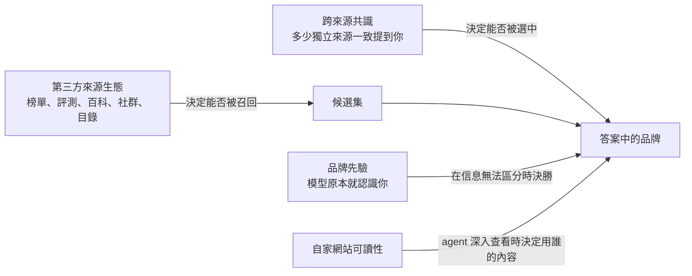

# 第 5 章　來源生態：第三方、共識與品牌先驗

> 本章位置：全書主線「觸發 → 可達 → 召回 → 選擇/排序 → 引用 → 吸收 → 用戶行為」中，本章主要處理**召回**與**選擇**兩個階段，並延伸到吸收——AI 寫進答案裡的品牌，是從哪些來源、靠什麼信號被挑出來的。

## 本章要回答的問題

1. 當 AI 回答「某類產品哪個好」時，它引用的是品牌自己的網站，還是別人的網站？
2. 為什麼「很多個來源都這麼說」對 AI 特別有說服力？這個機制為什麼同時是最大的風險？
3. 品牌知名度（品牌先驗 brand prior）到底有多大作用？小品牌還有沒有機會？
4. 站外提及（off-site mentions）和自家網站的可讀性，哪一個更重要？
5. 實務上應該先做什麼、不該做什麼？

## 一、核心原理

### 原理 5.1：AI 的答案主要建立在第三方來源上

AI 搜索在回答品牌、產品、服務類問題時，大部分引用來自**第三方網站**，而不是品牌自己的網站。這一點因領域而異：在選舉資訊的研究中（日本，四個聯網模型），政黨自有網站佔引用的 24.8%–44.3%，遠高於品牌和產品領域。

這裡的「第三方」包括：媒體與評測（earned media，贏得媒體）、榜單文章（listicle，「最佳 X 款」式排行）、評論平台、目錄網站、百科、影片平台、社群討論，以及同行業其他公司的頁面。

為什麼會這樣？可以從管線的角度理解：

```
用戶提問「最適合新創公司的 X 工具是哪個？」
   ↓
查詢擴展（query fan-out）：改寫成多個子查詢，如「最佳 X 工具」「X 工具比較」
   ↓
召回：這類子查詢最容易命中的是榜單、比較文、評測頁，而不是單一品牌的產品頁
   ↓
選擇：模型偏好「由別人說出來」的評價，而非品牌的自我宣稱
   ↓
答案：品牌是否被寫進去，取決於它有沒有出現在這些第三方頁面上
```

換句話說，**品牌自家網站回答的是「你是誰」，第三方來源回答的是「該選誰」**。購買決策類問題問的是後者。

### 原理 5.2：多來源重複出現構成「共識」——最強的信號之一，也是最大的攻擊面

AI 不只看一個來源怎麼說，而是看**多少個來源說了同樣的話**。當一個品牌在許多不同來源中反覆被提到、而且說法一致時，它被寫進答案的機率會大幅上升。

這個機制有兩面：

- **正面**：它讓「被很多獨立的人認可」的品牌更容易被推薦，接近人類的口碑邏輯。
- 反面：模型往往用「來源的數量」來代替「來源是否真的獨立」。多個看起來獨立、實際上出自同一方的頁面，也能製造出假的共識。

```
單一來源說「A 最好」       → 影響有限
同一來源重複說三次          → 幾乎不增加影響
三個看似獨立的來源都說「A 最好」 → 影響顯著上升
```

### 原理 5.3：品牌先驗只在「信息無法區分」時起決定作用

模型在訓練中已經「認識」許多品牌，這種既有印象就是品牌先驗。它的作用有四個特點：

1. **認識不等於推薦**。模型被直接點名時幾乎都認得某個品牌，但在「推薦一個該類別產品」時卻常常不會想到它。
2. **先驗是條件性的**。當候選產品之間沒有可區分的信息時，知名品牌幾乎必勝；一旦出現可區分的真實信息（評分、評論數、價格），先驗就會被打破。
3. 先驗越薄弱，越容易被上下文左右。這對小品牌既是機會（有人寫你，你就有可能被採用），也是風險（有人寫錯你，模型也可能照單全收）。
4. 先驗不只在決勝時起作用。在真實 AI 搜索引擎上重複測試發現（15.8 萬個回答，相關性）：模型先驗中的品牌有 67% 被寫進它自己的搜索詞，不在先驗中的只有 11%；排在相同位置時，先驗中的網站被引用的勝算是 1.60 倍；ChatGPT 有 46% 的品牌點名沒有任何被引用頁面支持，等於直接憑記憶點名。所以「只在信息無法區分時起作用」需要修正：先驗也作用在搜索詞、選源和答案三個環節。

### 補充：先驗從哪裡來——「被寫得多」和「和什麼寫在一起」是兩件事

這一節把上面四點和本書作者的實驗串起來，屬於機制推論；各項事實的證據強度另見各處標註。

**模型對你的印象，來自別人怎麼寫你。** 語言模型學到的是文字的分布：哪些名字常出現、和哪些詞一起出現、在什麼語氣下出現。所以它對一個品牌或一類人的「印象」，反映的是文字裡怎麼描寫，而不一定是實際情況。本書作者在另一項實驗中，讓模型依據真實人物的約 270 個標籤扮演這些人回答社會調查，觀察到明顯的刻板印象，例如模型普遍認為一位退休的黑人修車工生活不幸福（單一作者觀察，原始數據未收入本書，也尚未和這些人本人的回答對照）。這和人的社會認同相似：人也是靠「別人怎麼說你」來認識、理解、相信一個人。差別在於，模型只數得到寫下來、讀得到的聲音，也較難分辨這些聲音是否彼此獨立（見原理 5.2，以及第 11 章的假證據網實驗）。

**出現次數決定「認不認得」，共同出現決定「想不想得到」。**
- 認得：本書作者的記憶測試中，模型熟悉一個知名平台，連它多年前的舊名都記得；對一個成立幾個月的新網站，回答和對虛構網域相同（案例 9）。
- 想得到：新產品被直接點名時識別率 99.4%，在類別推薦中只有 3.32%（見 2.3）。模型認得一個名字，不代表別人描述需求時會想到它。
- 模型記住的，常常是「哪類資訊去哪裡找」：本書作者實測中，模型用 `site:` 指名國家游泳協會官網時，搜的是特定年齡組的成績標準文件；被模型主動指名的網站，在同一次回答中被引用的機會明顯較高（見第 4 章、第 6 章）。所以要建立的不只是知名度，而是讓「你的名字」和「某一類問題、某一類數據」在可信來源中反覆一起出現。

兩條時間線。
- 現在靠檢索：模型不認識的網站，只要頁面對上改寫後的查詢，仍然可以被大量引用（第 3 章案例 8：模型不認識的新網站，10 個會話中有 9 個被引用）。
- 以後靠記憶：進入下一代模型的記憶，至少要隔一次訓練；被抓取不等於被記住（案例 9：GPTBot 抓過約 92.5% 的頁面，模型仍不認識該網站）。

風險。以出現頻率建立的信任，有利於已經被寫得多的老牌網站，也可能被灌水：先驗越薄，越容易被單一頁面誤導（r = −0.65，見 2.3）。所以比「多」更重要的，是來源是否可信、是否彼此獨立。

證據強度：各項事實見各處標註；把它們串成「印象來自文字、次數決定認得、共同出現決定想得到」的機制，是本書的推論，尚未有直接檢驗。

### 三條原理的關係



## 二、證據有多強

### 2.1 第三方來源佔主導：多項大規模測量一致

| 發現 | 證據類型 | 備註 |
|---|---|---|
| 128 個品牌、13 種語言、167,551 條引用中，第三方佔 85.7%，品牌自有網站佔 14.3% | 在真實 AI 搜索引擎上重複測試 | 研究方為可見度服務業者；描述性，非因果 |
| 約 80% 的引用集中在約 18.2% 的域名上；維基百科在 12 種語言中的 11 種居首位 | 同上 | 各引擎自有網站比例不同：一個引擎 16.8%，另一個 5.8% |
| 在波蘭市場，4 個人力資源/求職網站的引用量約為波蘭語維基百科的 2.1 倍 | 同上 | 說明「權威來源」因市場而異 |
| 149,912 條引用中，品牌自家域名只佔 2.9%；同領域其他公司的頁面佔 75.2%；榜單類頁面佔全部引用的 21.0%（內容類引用的 35.7%） | 在真實 AI 搜索引擎上重複測試 | 研究方為可見度服務業者；觀察性數據 |
| 美國汽車類排名查詢中，AI 引擎引用第三方媒體 81.9%、社交來源為 0；同一查詢在傳統搜索中分別是 45.1% 和 15.4%。電子產品類第三方媒體達 92.1% | 在真實 AI 搜索引擎上重複測試 | 單一日期、多查詢；作者與 GEO 服務有關聯 |
| 中文平台 614 條查詢 × 8 個介面 × 3 次、160,860 條引用中，第三方約 69%，品牌官網 12.9% | 在真實 AI 搜索引擎上重複測試 | 研究方為監測服務業者 |

**強度判斷**：多個獨立團隊、不同語言、不同引擎都得到「第三方佔大多數」的結論，方向高度一致。但這些全部是**描述性測量**，說明了「AI 在引用什麼」，沒有證明「把品牌放上第三方頁面就一定會被推薦」。

另外，不同引擎之間、AI 與傳統搜索之間的來源重疊都很低：
- 在真實 AI 搜索引擎上重複測試發現，AI 引擎與傳統搜索的前 5 名域名重疊，智慧手機類只有 15%、筆電類 32%；汽車類各引擎之間的域名相似度（Jaccard）只有 0.096–0.251。
- 同一平台的網頁版與 App 版，域名層級相似度只有 0.19–0.51。
- 換一種提問語言，某些引擎幾乎會換掉整套引用域名。

這意味著「在某個引擎上被引用」不能直接推廣到其他引擎，也不能用傳統搜索排名來替代。

### 2.2 共識信號：測量與實驗兩條線都指向同一方向

**測量證據**：
- 在真實 AI 搜索引擎上重複測試發現（中文平台）：引用池中的品牌只有 8.3% 最終被寫進答案。品牌只在 1 個引用來源中出現時，入選機率是 2.1%；出現在 11 個以上來源時升到 59.9%。在預測模型中，傳統 SEO 綜合質量分的重要度只有 4.52%。

**實驗證據**：
- 在給定網頁的條件下（假設內容已成功放置到搜索結果中），13 個搜索 agent 後端的平均被操縱率為 13.4%，範圍從 0% 到 31.4%，差異主要來自模型本身。以其中一個模型為例，當 1、2、3 個看似獨立的來源一致背書時，成功率分別是 39%、55%、77%；而同一來源重複出現，成功率持平；排名位置沒有顯著影響。
- 同一研究中，不同手法的平均成功率：隱藏在網頁代碼中的指令 0.3%、摘要與頁面不一致 1.2%、冒充權威 14.2%、合成共識 24.8%、權威加引用鏈 37.2%。越像「有證據的多方說法」，越有效；越像「藏起來的指令」，越無效。
- 在可控的實驗系統中，對會逐頁瀏覽、跟隨連結的搜索 agent，一組風格與屬性一致、互相連結的多頁「證據生態」，使虛構產品的推薦率達到 67.2%–73.9%；單頁基線為 35.9%–59.0%。幾種頁面級改寫手法都沒有穩定優於未優化的單頁。這項研究本質上是在測試偽造多來源共識的操縱手法。
- 模擬 / 理論分析表明，機制上可能：表面上的多源佐證比直接斷言更難被識別為假。加上防禦提示後，agent 的驗證行為明顯增加，但最終的錯誤背書率並沒有下降（由 28.6% 升到 38.6%）——「去查證了」不等於「查證後改正了」。

強度判斷：測量（B 級）與實驗（C、D 級）方向一致，共識效應是本章最可靠的機制之一。但要注意兩點：第一，實驗環境多為虛構產品與受控語料；第二，實驗顯示的是「共識能被偽造」，這是攻擊面，不是建議做法。

### 2.3 品牌先驗：條件性壟斷

| 發現 | 證據類型 |
|---|---|
| 無品牌名的類別提問中，首次運行的可見度呈三級梯度：大品牌 72.9%、中型 43.6%、小品牌 11.4% | 在真實 AI 搜索引擎上重複測試（服務業者數據，層級為人工劃分） |
| 新產品被直接點名時識別率 99.4%（另一引擎 94.3%），但在類別推薦中只有 3.32%（另一引擎 8.29%）；網站的 GEO 綜合分與可見度無相關（r = −0.108、−0.102） | 在真實 AI 搜索引擎上重複測試 |
| 同一研究中，可見度與參照域名數（r = +0.319）、社群討論提及數（r = +0.395，n = 60）呈正相關 | 同上，僅相關性 |
| 已在外部平台具知名度的創作者，在 AI 引用中也獲得更多曝光；前段創作者每名次的曝光優勢約 4.3–4.8 個百分點 | 在真實 AI 搜索引擎上重複測試，僅相關性 |
| 產品規格完全相同時，知名品牌 100% 被推薦；但競爭者只要評分高 0.075 星、評論多 1.6 倍，或價格低 7.3%，就能達到 50% 的突破率。推薦結果的變異中，產品參數佔 82.4%，品牌只佔 1.2% | 模擬 / 理論分析（固定上下文） |
| 在不聯網、只靠模型記憶的條件下，許多知名品牌推薦率為零；改用需求型提問後，某品牌推薦率從 0% 升到 35.4%，加上定位線索後可達 81.3% | 模擬 / 理論分析（固定上下文） |
| 模型對品牌的先驗越薄弱，越容易被上下文中的污染頁面誤導（跨模型相關 r = −0.65）；12 個模型平均被騙率 42.7%（13.3%–73.8%）；單頁污染放在第 1 位時被騙率最高 27%，放在第 2–10 位只有 1–4% | 在可控的實驗系統中 |

**強度判斷**：「大品牌更容易被推薦」有真實引擎的測量支持；「先驗可以被可區分信息打破」目前主要來自固定上下文實驗，只能說**機制上可能**，還沒有真實世界的干預證據。

## 三、爭議與反例

### 爭議 1：站外提及到底有沒有獨立作用？

| 立場 | 依據 |
|---|---|
| **有作用** | 中文平台測量顯示跨來源共現是入選的強預測因子；新產品研究顯示參照域名與社群提及和可見度正相關 |
| **控制後沒有獨立作用** | 在真實 AI 搜索引擎上重複測試發現（1,056 家企業、37,927 次 agent 查詢旅程的配對比較）：控制「網站對 agent 的可讀性」後，兩個代表站外提及與發現度的指標，對「答案落地到自家內容」「被明確推薦」都沒有顯著偏相關。網站可讀性高的一組，78% 的答案來自自家頁面（對照組 58%），明確推薦率 20%（對照組 11%） |

**可能的解釋**：兩者作用在不同階段。站外提及決定品牌能不能**浮現**在候選中；網站可讀性決定 agent 深入查看時，答案用的是誰的內容來構成。後一項研究只看 agent 已經進入網站之後的「深入查看」情境，而且是研究方自己的評分工具、配對觀察設計。兩者並不必然矛盾，但目前沒有研究在同一設計中同時檢驗兩個階段。

從業者實測報告中也有類似的「兩階段」說法：分發讓品牌進入檢索池，頁面品質決定是否被選中；分發足跡相近時，內容結構更清晰的品牌被引用更多。這是單一觀察，未經獨立驗證。

### 爭議 2：「第三方」到底佔多少？——定義不同導致數字打架

- 多項測量說第三方佔 69%–95%。
- 有從業者觀察到，在單一引擎 860 個答案中，前 100 個被引域名有 77.4% 是**廠商自己寫的頁面**，評測平台只佔 10.2%。
- 從業者實測（多次、有對照）發現，在一個固定 40 題的買家問題面板中，約 80.9% 被引域名屬於「普通公司與出版商頁面」；作者說明這是「不屬於任何其他類別」的剩餘類，並非正面分類。

這些數字可以同時成立。關鍵在於「自有」的定義：對**某一個品牌**來說，其他廠商的頁面也是第三方。前述大規模測量中，「同領域其他公司的頁面」就佔了 75.2%。所以正確的理解是：AI 大量引用廠商頁面，但很少引用「你自己的」頁面。

### 爭議 3：社群討論和評測目錄的比重

- 從業者實測報告的結論差異極大：有的在購買建議類查詢中發現社群內容是最常被引用的域名；有的在約 16,400 條商業問題、127,198 條引用中發現社群討論只佔 1.8%、維基百科不到 0.6%，90.6% 流向廠商文檔、產品頁和長尾類別網站。
- 從業者實測（多次、有對照）發現，在固定的 40 個買家問題上，社群來源佔比因引擎而異：有的引擎約 7%–9%，有的接近 0%。
- 評測目錄同樣有分歧。有從業者起初報告「替代品」型提問比「最佳」型提問更常引用目錄網站（43.0% 對 3.8%），之後自行更正：這個差異只出現在傳統搜索結果中，在 AI 答案上兩者的比例在誤差範圍內相同。

**結論**：不存在一個通用的「最重要平台」。來源結構隨引擎、行業、查詢意圖、語言市場而變。社群平台作為 AI 引用來源的角色，第 15 章專門討論。

本書作者小規模實測（方法見第 4 章）中，社群討論站在三類題型 30 個會話中有 24 個出現在搜索結果裡、游泳題 10 個會話全部出現，引用都是 0；百科和影片網站也多次出現、引用 0。「出現在搜索結果中」不代表模型讀了全文，而且這是單一模型經 API 的結果。

### 爭議 4：域名權威還重要嗎？

- 從業者實測報告：在 18,000 多個被引用頁面中，域名層級權威約佔可預測部分的 77%，頁面因素約 23%；頁面優化只在高權威域名上見效。
- 從業者實測（多次、有對照）發現：在某一個引擎上，域名權威度對引用影響不大，跨平台在 7 天內同步發布的內容被引用明顯更多（樣本只有 14 篇文章，作者自己指出樣本小、追蹤有噪音）。
- 有從業者觀察到：反向連結對「自己的頁面被直接選中」作用有限，但 AI 挑選的第三方出版者本身都是連結充足的編輯網站，所以連結可能是**間接**起作用。

這三種說法測量的東西不同，目前無法判定誰對。

### 爭議 5：來源池是穩定的還是輪換的？

- 從業者實測報告：40 個提問、三週內約 180 個被引 URL 中，約 70% 是反覆出現的同一批第三方頁面，新發布的自有頁面幾乎不出現。
- 另一份從業者實測報告：被引來源每月有 40%–60% 輪換。
- 有從業者觀察到，某分析工具一個月內在品類查詢中的引用從 8 次降到 3 次，而依靠評測站覆蓋的競品升到 13 次。

兩種現象可能並存：**頭部少數頁面相對穩定，長尾部分快速輪換**。這也是為什麼單次快照不可信（見第五節的測量方法）。

### 反例：先驗並非不可撼動

模擬 / 理論分析表明，機制上可能：一個採用 GEO 的挑戰者能讓在位品牌的存活率從 100% 降到 19.8%；但當所有競爭者都採用後，在位品牌存活率回升到 93.8%，個別收益從 +0.802 跌到 +0.007。**GEO 的收益可能隨採用者增加而趨近於零**，這是零和競爭的特徵。這是固定上下文實驗，不能直接當作真實市場結論。

## 四、案例

> 以下案例均為從業者實測，除特別註明外未經獨立驗證。它們用來說明原理，不是證明。

### 案例 1：Google 排名第三，AI 裡幾乎不存在（B2B 軟體，倉儲管理）

- **背景**：一家服務第三方物流業者的倉儲管理軟體公司，核心詞在 Google 排第三。
- **觀察**：從業者實測（多次、有對照）發現，從 1 月起每月記錄 40 個推薦類提問，ChatGPT 只在 2–4 個中點名該公司；而一個排在搜索第二頁、連結更少的競品約被點名 18 次。
- 競品有什麼：物流部落格上的兩篇榜單文章、一個軟體評測站的類別頁、一則 2023 年物流業者稱讚它的社群討論。
- 該公司的弱點：在公司資料庫、職業社交平台、評測站上有三種不同的公司描述。
- 做了什麼：統一第三方描述，同時每天發布一篇比較頁。到 8 月升到 40 題中約 9 題被點名。兩項改動同時進行，無法分開歸因。
- 同一作者的其他觀察：引用主要追溯到評測站、他人的榜單、一則舊社群討論；行業協會的會員目錄被某引擎引用；一年在職業社交平台發了 200 則內容，零引用；花 6,000 美元升級評測站付費檔案，沒有任何變化。
- 對應原理：5.1（第三方來源決定推薦）、5.2（描述一致性）。

### 案例 2：被模型叫錯名字的產品（開發者工具）

- **做了什麼**：從業者實測報告，對一個 CSV 匯入工具，用 8 個買家式提問在 ChatGPT、Claude、Gemini、Perplexity 上測試。
- **觀察**：8 次對話中只出現 1 次，而且被描述成 ETL 工具（它不是）。有兩個模型轉而描述競品，用語明顯來自競品自己的行銷文案。該產品本身有不錯的傳統 SEO（連結、排名頁）。
- 判斷：被推薦的工具，都在第三方內容中有「一句清楚、反覆出現的定位」；沒被推薦的，描述模糊或前後不一。
- 做了什麼、多久：10 天內發布 2 篇比較文章並更新文檔，從 8 次中出現 1 次升到 5 次。
- 對應原理：5.2（一致描述構成共識）、5.3（先驗薄弱時，模型會採用手邊能找到的描述，包括競品的說法）。

### 案例 3：站內優化兩週無效，一篇第三方彙總文章改變了局面

- **做了什麼**：從業者實測報告，對 12 個客戶頁面做完整站內優化（結構化資料、標題層級、實體清晰度、內部連結），用同樣 15 個提問在 ChatGPT、Perplexity、Gemini 上追蹤（每次登出）。
- **觀察**：兩週後毫無變化。第三週，一篇把客戶與 4 個競品並列的彙總文章發布，幾天內原本不可見的兩個頁面開始被引用。
- 作者的保留：樣本很小，無法把兩者分開歸因。他的結論是「站內優化必要但不充分」。
- 對應原理：5.1、爭議 1 的兩階段解釋。

### 案例 4：進入 AI 已經在引用的榜單

- 從業者實測報告：為一個消費品品牌的助眠產品，先抽出目標提問下 AI 引用的所有網站，聯繫這些網站把客戶加入既有文章；無法加入的就做客座文章。做了 5 篇榜單、2 篇產品彙總後，一週內 ChatGPT 在該提問下把客戶列在第 2 位。
- 另一位從業者實測報告：一個新上市的能量飲料品牌，發現 Google AI 摘要反覆引用 3–4 個「最佳 X 飲料」評測部落格，爭取被收錄後，幾天內就和大品牌一起出現在 AI 摘要中。
- **注意**：兩位作者都是做外鏈與外聯的從業者，屬自述結果。
- **對應原理**：5.1——進入已經被檢索的頁面，比新建頁面等待被發現更直接。

### 案例 5：認識你，不代表推薦你

- 從業者實測報告：以三個「找高管教練」的提問在兩個引擎上測試（共 6 組）。業內知名度最高、擁有數百萬追隨者的教練只出現 1 次。直接問模型「介紹這位教練」時，兩個引擎都給出詳細準確的回答——模型認識他，只是在推薦時不提他。
- 從業者實測（多次、有對照）發現：20 家近 18 個月完成 A 輪以上融資的印度新創，在非品牌的類別提問中有 17 家完全缺席；直接問「某某是什麼」時大多能正確回答。出現的 3 家都有真實的社群討論、結構化比較頁與評論標記。
- 從業者實測（多次、有對照）發現：以 82 個買家意圖提問在 4 個引擎上各跑 3 次，獲融資新創被引用率在 6%–13%，在位大廠在 32%–62%。唯一突破兩位數的新創類別（34%）是向量資料庫——作者推測是因為這些產品從多年前起就被技術部落格大量討論。新聞稿轉載平台的轉發沒有幫助，在其中一個引擎上甚至略為負面。
- **對應原理**：5.3（認識 ≠ 推薦；先驗來自長期累積的第三方討論）。

### 案例 6：聚合平台就是排名面

- 從業者實測報告：向 Google AI Mode 提出 510 個土耳其 30 個目的地的酒店問題，在返回的 481 個答案中，98% 至少引用一個訂房平台，最大的單一訂房平台出現在 74% 的答案中；酒店官網幾乎從未被直接引用。
- 從業者實測報告：在 1 萬多條 ChatGPT 購物查詢中，零售網站佔所有引用的 89%–99%；在另一個女裝類 8,520 條查詢中，零售平台比多數品牌官網更常被引用。
- 從業者實測報告：ChatGPT 推薦應用程式時，近半（47.5%）的引用來自應用商店可被抓取的網頁版列表。作者自己提醒這些比例變動很大，只是快照。
- **對應原理**：5.1——在聚合平台主導的行業，**平台上的列表品質就是 GEO 的主戰場**。

### 案例 7：品牌形象被第三方改寫

- 從業者實測報告：連續六週每週用同樣的類別提問測試三個競品。其中兩個的描述明顯改變：一個從「分析工具」被改稱為另一類平台；另一個多出了「整合能力有限」的批評。兩次轉變都不是來自這些公司自己發布的內容，而是分別追溯到一個小眾社群的直接比較討論，以及幾則高互動的論壇評論。
- 有從業者觀察到：公司的維基百科條目被軟刪除後，AI 與搜索引擎對品牌實體的識別變得不一致，甚至把其他實體與品牌名關聯；加強網站、結構化資料和其他提及，也未能彌補。
- **對應原理**：5.3——先驗薄弱時，第三方的說法會直接變成模型的說法。

### 案例 8：推薦的品牌，和被引用的網站，是兩回事

- 從業者實測報告：12 天內分析三個引擎的 180 條運動鞋推薦，共 1,783 條引用、250 個域名。最常被推薦的品牌，其官網只被引用 2 次；其中一個引擎在全部 180 個答案中，引用品牌官網 0 次。主要來源是影片平台、評測站、時尚媒體和社群。
- 從業者實測報告：在羅馬尼亞以當地語言，對 5 個 AI 介面提出 18 個購書問題，相隔一週跑兩輪，共 180 個答案。58% 的答案沒有推薦任何書店；市場領導者只出現在約五分之一的答案中；排名每週重寫。還出現「幽靈品牌」：某些網站被 AI 當作價格與清單的來源，答案卻推薦了別人；反過來，一個 35 年歷史的文化品牌被推薦了 13 次，它的網站卻一次都沒被引用——完全依靠模型記憶。
- **對應原理**：引用（citation）與推薦（mention）是兩個不同的指標，必須分開測量。有從業者觀察到，在單一引擎中，點名某公司的答案只有 47% 同時引用了該公司的網站。

### 案例 9：模型不認識新網站，卻記得老平台多年前的舊名

- **做了什麼**：本書作者小規模實測（方法見第 4 章）。關閉網路搜索，要求模型「不確定就說不知道」，每題問 5 次。
- **觀察到什麼**：對第 3 章案例 8 的新網站，模型 5 次都說不熟悉，和對一個虛構網域的回答相同；問它特有的分級名稱和網址結構，5 次都說不知道；憑記憶列出「提供招募成績標準的網站」時，5 次都沒有它。對一個知名的游泳數據平台，模型 5 次都能具體描述，而且 5 次都提到它多年前的舊名，說明記憶會過時。這個平台封鎖了 GPTBot，模型仍然熟悉它，所以記憶不一定來自網站本身，可能來自第三方提及或封鎖前的舊資料（推測）。記憶的內容是「網站與具體數據類型」的關聯：模型用 `site:` 指名國家游泳協會的官網時，搜的是特定年齡組的成績標準文件。
- 被抓取不等於被記住：依新網站自己的伺服器日誌（網站方自行分析，未獨立驗證），GPTBot 在 2026 年 7 月到 8 月 20 日之間抓過約 92.5% 的頁面，但實驗時的模型仍不認識它。抓取和記住之間，至少隔著下一次訓練。
- 證據強度：本書作者小規模實測，單一模型、單一主題，未經獨立驗證。
- 對應原理：5.3。新網站在下一代模型出現之前，只能靠檢索被找到（第 3 章案例 8 正是如此）。
- 開放問題：怎樣才會被下一代模型記住？目前只有「長期累積、靠第三方提及」的機制推論，沒有直接證據。

## 五、怎麼做

### 5.1 建議做法

| # | 做法 | 證據強度 |
|---|---|---|
| 1 | **先畫出你的來源地圖**：列出 30–50 個真實買家會問的問題（「最佳 X」「X 對比 Y」「某某的替代品」），在多個引擎上反覆運行，記錄每個被引用的 URL，按域名歸類。從業者實測報告，一次 200 個提問的審查中，60% 的引用集中在 7 個域名上，而且大多不在原本的公關目標名單裡 | 第三方主導與來源集中：在真實 AI 搜索引擎上重複測試發現；具體流程：從業者實測報告 |
| 2 | **比對差距**：找出競品被引用、你卻缺席的頁面，這就是外聯清單。優先爭取**已經被 AI 引用**的榜單、比較文、評測頁收錄你，而不是另寫新文章等待被發現 | 從業者實測報告（多個獨立案例方向一致，均未經獨立驗證） |
| 3 | **統一全網描述**：官網「關於我們」、公司資料庫、評測站、職業社交平台、目錄上的公司描述，用同一句話說清楚「你是什麼、為誰服務」。定位要具體到垂直場景 | 共識機制：在給定網頁的條件下、在真實 AI 搜索引擎上重複測試；描述一致性的作用：從業者實測（多次、有對照）發現 |
| 4 | **爭取多個真正獨立的來源**：不同出版者、不同作者、不同平台類型。同一來源重複說，幾乎不加分 | 在給定網頁的條件下（同源重複不起作用） |
| 5 | **提供可區分的真實信息**：評分、評論數、價格、具體規格與成效數據。在信息無法區分時，大品牌先驗會勝出 | 模擬 / 理論分析表明，機制上可能 |
| 6 | **按行業找「本地權威」**：聚合平台主導的行業（酒店、零售、應用），平台列表的完整度就是主戰場；利基行業可能是行業刊物、協會目錄；不同語言市場的頭部來源也不同 | 在真實 AI 搜索引擎上重複測試（市場差異）；行業差異：從業者實測報告 |
| 7 | **用需求型、場景型表述建立關聯**：讓第三方內容把你和「具體問題 + 具體用途」寫在一起，而不只是泛泛提到品牌名 | 模擬 / 理論分析表明，機制上可能（需求型提示能激活被漏掉的品牌） |
| 8 | **網站可讀性照樣要做**：站外提及讓你浮現，站內可讀性讓 agent 深入時用你自己的內容，而不是競品或第三方的描述 | 在真實 AI 搜索引擎上重複測試（服務業者研究，配對觀察） |
| 9 | **分引擎、多次測量**：提及至少 3 次運行、情感判斷至少 10 個提問才相對穩定；也有研究每個提問重複 40 次。引用與推薦分開記錄 | 在真實 AI 搜索引擎上重複測試；模擬 / 理論分析 |
| 10 | **保留對照組**：固定一部分問題不做任何干預，照樣追蹤。若對照組和干預組一起變動，是引擎變了，不是你的工作起效 | 有從業者觀察到（方法建議） |

### 5.2 時間預期

生效時間在各案例中差異很大，沒有可靠的通用數字：
- 從業者實測報告中，有「幾天內」「一週內」「10 天」的例子，多出現在即時搜索的引擎上，或進入的是已被引用的頁面。
- 有從業者觀察到，需要 6 週、60–90 天、約 3 個月，甚至 5 個月才穩定出現。
- 多位從業者觀察到，即時搜索型引擎比依賴訓練數據的引擎更早反映新來源（有人估計早 3–4 週）。**只在一個慢的引擎上測，容易誤判為無效。**

### 5.3 不要做

| 不要做 | 原因 |
|---|---|
| **偽造多來源共識**（自建多個看似獨立的網站、協同發文、刷評論） | 實驗顯示這確實能操縱 agent，但它屬於操縱手法。在可控的實驗系統中，按出版者類型重排來源（編輯內容優先於商業內容，再優先於用戶生成內容）可把被騙率降低 8.4 個百分點，且不損失正常推薦——防禦方向已經存在 |
| **在網頁中藏指令給 AI** | 在給定網頁的條件下，隱藏指令平均成功率只有 0.3%，幾乎無效 |
| **用稀缺、錨定、損失規避式的銷售話術** | 模擬 / 理論分析顯示突破率只有 9.6%–12.9% |
| **把新聞稿通訊社轉發當作媒體報導** | 從業者實測報告：新聞類查詢中新聞稿只佔引用 4%，原創報導佔 73%；轉發平台的轉載對新創沒有幫助。不過有從業者觀察到，寫成文章式的新聞稿偶有被引用，屬少數例外 |
| **在自己的網站上寫「最佳 X」清單並把自己排第一，指望被採信** | 從業者實測報告：多個大量發布此類自有清單的客戶，在 50 個提問上的提及率突然下降，作者懷疑自有網站上的自我提及被降權（未經驗證）；此外，模型整體偏好「由別人說出來」的評價 |
| **期待付費升級平台檔案或大量發文直接帶來引用** | 從業者實測報告兩者都沒有作用（單一案例，僅作提醒） |

### 5.4 已經過時的做法

- **用 Google 排名代表 AI 可見度**。多個案例顯示排名第一的品牌在 AI 答案中完全缺席；AI 引擎與傳統搜索的來源重疊很低。
- **只優化自家網站**。自家網站仍然必要（尤其是品牌詞查詢和 agent 深入查看），但在「該選誰」類查詢中，它往往不在被檢索的來源裡。
- 單次快照式的可見度報告。來源與推薦每週都在變，單次結果會高估精確度。

## 六、本章要點

1. 在品牌與產品類問題上，AI 引用的大部分是第三方來源；品牌自家網站在不同研究中只佔約 3%–17%。這是多項大規模測量的一致結論，但屬於描述性證據。
2. 「多個看似獨立的來源一致說同一件事」是影響 AI 選擇最強的信號之一；同一來源重複出現幾乎無效。
3. 這個共識機制可以被偽造，是目前最大的攻擊面。GEO 從業者應該爭取真實獨立的來源，而不是製造假共識。
4. 品牌先驗決定起跑線：大、中、小品牌的類別可見度約為 73%、44%、11%。但「認識」不等於「推薦」，先驗主要在信息無法區分時起決定作用。
5. 先驗越薄弱，模型越容易採用第三方（包括競品和錯誤）的描述。小品牌因此必須主動管理自己在第三方來源中被怎麼描述。
6. 站外提及與站內可讀性作用在不同階段：前者決定能否浮現，後者決定 agent 深入時用誰的內容。兩者之間的關係仍有爭議。
7. 權威來源因引擎、行業、語言市場而不同，沒有通用的「最重要平台」；先畫出自己品類的來源地圖，再決定去哪裡。
8. 測量要分引擎、多次運行、引用與推薦分開記錄，並保留對照組。
