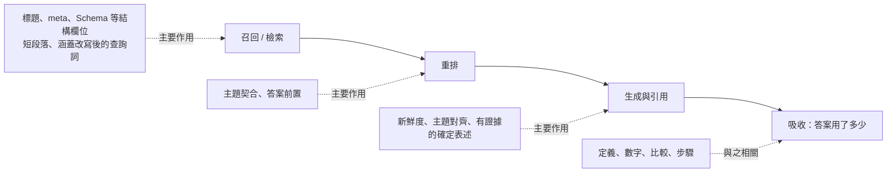

# 第 8 章　內容層做法的證據：什麼有效、什麼失效、什麼會過時

> 本章位置：管線中的「選擇／排序 → 引用 → 吸收」三個階段，並回頭檢查內容改動對「召回」的影響。
> 前提：頁面已經可達、已被索引（前面章節討論的可達性問題已處理）。本章只問：**同一個頁面，內容怎麼寫、怎麼改，會不會改變 AI 是否引用它、引用多少。**

## 本章要回答的問題

1. 2023 年流行的「加統計、加引語、加引用來源」為什麼在今天的引擎上不再有效？
2. 如果手寫技巧大多失效，自動優化最後收斂到什麼樣的內容？
3. 新鮮度、結構、Schema、Q&A 格式、短段落、權威語氣、關鍵詞堆砌，各自有多少證據？作用在管線的哪一段？
4. 內容優化有哪些副作用？什麼時候越優化越糟？
5. 研究與從業者實測在哪些地方說法相反？該怎麼理解？

## 8.1 核心原理

### 原理一：內容技巧有時效性，2023 年的經典技巧已經失效

GEO 研究最早提出的一批內容技巧，是在一個特定條件下測出來的：網頁已經在少數幾篇候選文檔裡，由當時的模型生成答案，衡量字數份額的相對變化（見第 0 章）。

這些技巧在今天的引擎上重測，結果完全不同：

| 技巧 | 2023 年報告的效果 | 在現代模型上重測 |
|---|---|---|
| 加引語（quotation） | +42.6 | -0.33 |
| 加統計數據（statistics） | +32.8 | -0.28 |
| 加引用來源（cite sources） | +27.7 | -0.79 |

（單位：引用份額的百分點。重測涵蓋十個現代模型，三項都沒有提升引用。）

失效的原因可以從機制上理解，至少有三條：

- **引擎本身在變。** 模型換代後，對「這段文字值不值得引用」的判斷方式也變了。一個槓桿在舊模型上有效，不代表在新模型上仍有效。
- **擁擠效應（crowding）。** 當越來越多網站採用同一種改寫，每個採用者的增益會遞減、趨近於零，甚至變成零和競爭。模擬研究顯示，採用率高到一定程度時，固定使用單一策略的效果會低於完全不優化。
- 實驗條件高估效果。在「固定候選文檔」的實驗裡，改寫只需要打敗其他四篇文檔。在完整管線中，同一篇改寫過的文檔可能在檢索或重排階段就先掉隊，根本到不了生成階段。

```
2023 實驗條件：   [已在 5 篇候選中] → 改寫 → 生成 → 字數份額 ↑
真實管線：        查詢 → 召回 → 重排 → 生成 → 引用
                          ↑        ↑
                   改寫可能在這兩關就被淘汰
```

結論：任何內容技巧都應被視為「有保存期限」的假設，而不是定律。需要在當前引擎上重複測量，才能繼續使用。

### 原理二：自動優化收斂到「忠於事實、對齊查詢、結構清楚」

如果手寫技巧大多失效，那麼讓 AI 自己去搜索「最優改寫方式」，會得到什麼？

多個研究得到同一個方向：自動優化最後收斂出的風格是——

- **忠於事實**：不誇大、不虛構、不堆情緒。
- **對齊用戶意圖（query alignment）**：直接回應查詢在問什麼，用用戶自己的措辭。
- 結構清楚：要點化、分段、資訊易於抽取。

在電商場景中，加入一句簡單的防禦條款後，原本被優化來「操縱」排序的提示詞，會自己收斂成事實性的文風，被標記為操縱的比例平均下降 60 個百分點。也就是說，當引擎有基本防禦時，操縱得不償失，誠實而清楚的寫法反而是最優解。

這與第 6 章原理 6.1 一致：引擎偏好的不是某種寫作花招，而是與查詢對得上、可以被抽取、可以被信任的內容。

同時要注意兩點：

- 自動歸納出的「引擎偏好規則」，跨模型的重疊度較高（約 79–84%），但跨領域（例如電商與開放域）只有約 35–40%。偏好是分領域的。
- 另一項研究發現，只看內容本身、不看查詢的「內容品質分數」，與實際引用的相關很弱（約 0.11）；而衡量「查詢與來源相關性」的模型，相關明顯更高（約 0.35–0.39）。先對題，再談寫得好不好。

### 原理三：各內容要素作用在管線的不同階段

一個常見誤解是把所有內容要素都當作「提高引用的槓桿」。實際上，它們作用的位置不同：



各要素的現有證據整理如下：

| 要素 | 證據摘要 | 結論 |
|---|---|---|
| 新鮮度（freshness） | 受控實驗中，較新的時間戳相對舊時間戳的勝算比（OR）從 14.4 到超過 10,000；中文引擎上，高時效查詢被引頁的中位年齡 18 天、引用半衰期 39 天，低時效查詢為 101 天、68 天 | **有效**，對時效性查詢尤其明顯 |
| 定義、數字、比較、步驟 | 含這些元素的頁面，被答案吸收的程度高出 41–77% | 相關性證據；與「整頁提高證據密度」的實驗結果方向一致 |
| 結構 / Schema | 改結構欄位對檢索有幫助；只改排版無效；結構化呈現只在等價來源之間重分配引用；與被引用相關（r=0.63，相關性） | **作用在檢索和抽取階段，本身不是引用槓桿** |
| Q&A 格式 | 不提升吸收；在實測網站實驗中無明顯優勢 | 單獨使用無效 |
| 短段落 / 分段 | 在自建網站實驗中表現最強 | 有初步證據 |
| 權威語氣 | 效果不穩定，而且可能降低可信度 | 不建議 |
| 關鍵詞堆砌 | 所有相關研究都顯示無效或有害 | **無效** |

幾個要點值得單獨說明：

**結構分兩種。** 一種是**結構欄位**（標題、meta、heading、Schema），它們幫助檢索器找到你；另一種是正文排版（加列表、加小標題、資訊聚合），受控實驗中它對「誰被引用」幾乎沒有影響（勝算比 0.79–1.68，無一致方向）。

結構欄位裡的各項要分開看。在真實 AI 搜索引擎上重複測試發現（15.8 萬個回答，比較同一網站內的頁面）：段落與問題的契合每高一個標準差，引用多 15.5%；標題與問題的契合多 14.1%，但在 ChatGPT 上無效（−0.2%）。FAQ、結構化資料、摘要框和網頁速度，跨網站比較時都和引用正相關（+7.5% 到 +20.9%），在同一網站內比較時都不顯著（−5.3% 到 +6.9%），因為它們多半出現在本來就常被引用的網站上。所以標題措辭屬於「對上問題」，Schema 不能視為引用的驅動因素。這是相關性研究，使用小模型的 API，作者經營監測平台。

結構化呈現是「重分配」，不是「擴大」。當同一事實有多個等價來源時，結構化呈現能讓目標頁面多拿到一些引用次數（約 +0.50 次），但總引用數沒有增加——它是從別的等價來源那裡分走的。而「是否被引用」這個主要指標，提升幅度的信賴區間跨過零，無法確定。

不指定目標的改寫幾乎無效。模擬 / 理論分析表明（選舉情境、固定上下文、三個模型）：改寫時不指定要突出哪個對象，36 種設定中校正後沒有一種顯著提高目標曝光，約四分之一反而強化了對手；指定目標時，校正後一半顯著。結構類與論證類改寫最有效，換用專業術語最差，但絕對增益只有約 0.5–1.5 個百分點。

Q&A 格式本身不是答案。Q&A 頁面的吸收程度與非 Q&A 頁面相比，略低 5.74%。真正與吸收相關的，是頁面裡有沒有定義、數字、比較這類可直接使用的內容。

### 原理四：優化存在副作用

內容優化不是只有好處。已知的副作用有三類：

1. **顧此失彼。** 一個頁面通常要回應多個相關查詢。只針對單一查詢調優時，非目標查詢出現負增益的比例達 30.6%。
2. **忠實度下降。** 以可見度為目標的自動改寫，會讓內容的忠實度評分從 8.29 降到 4.90，歸屬準確度從 6.15 降到 4.18。頁面「被看見」得更多，但被正確轉述的程度變差。
3. 檢索階段掉隊。在完整管線中，只改正文會讓頁面的檢索命中下降約 9%、重排命中下降約 16%；大幅擴寫的自動改寫方式，檢索命中下降約 36%；改用生僻或技術詞彙的改寫損失最大。

```
只改正文 → 生成階段可能 +一點
         → 但檢索 -9%、重排 -16%
         → 淨效果：引用率 -6%
```

## 8.2 證據有多強

### 關於「經典技巧失效」

- **在給定網頁的條件下**，在十個現代模型上重測加引語、加統計、加引用來源，三項都沒有移動引用；其中加引用來源在未校正時名義上為負。另外用三個最新一代模型再複製一次，結果同樣為零或名義上為負。
  - 限制：這項研究的作者本身提供內容評分服務，存在利益關係；實驗方式是把引語、統計等「附加成獨立區塊」，而不是融入正文。
- **模擬分析表明，機制上可能**：在 54 種「方法 × 領域」組合中，只有 3 種出現統計上顯著的引用排名提升；問答任務中沒有一種有效。加統計數據在 24 種情境中有 19 種反而顯著降低排名。相比之下，把文件放到上下文第一位的增益，遠大於任何內容改寫方法。
- 模擬分析表明，機制上可能：在電商重排場景中，15 種手寫技巧只有 4 種略勝或持平一句簡單的提示詞，其餘 11 種不如；講故事式改寫的效果是 -4.36。
- 模擬分析表明，機制上可能：9 種詞級（token 級）改寫技巧，在三個引擎上全部低於未改寫的基線。

適用範圍：以上多為固定上下文或受控框架。它們共同說明的是「附加式、詞級的技巧不可靠」，並不等於「證據和數據沒有用」（見 8.3 爭議一）。

### 關於「自動優化的收斂方向」

- **在可控的實驗系統中**，用自動歸納的引擎偏好規則指導改寫，在一個引擎上把可見度從 20.18 提升到 43.76，其他兩個引擎也有明顯提升。但在其中一個引擎上，答案精確度從 96.51 降到 84.98，說明「維持回答品質」的說法並不完全成立。
- **模擬分析表明，機制上可能**：電商場景中，自動提示詞優化在 75 個測試格中改善了 63 個；增益與描述長度無關。

### 關於各內容要素

| 要素 | 證據類型 | 強度說明 |
|---|---|---|
| 新鮮度 | 在真實 AI 搜索引擎上重複測試（中文引擎，約 16 萬條引用）＋模擬實驗（25.2 萬次試驗） | 較強；兩種證據方向一致 |
| 結構欄位利於檢索 | 在可控的實驗系統中（約 17.1 萬份真實網頁語料） | 中等；檢索提升約 22%，但重排仍下降 |
| 結構與引用相關 | 在真實 AI 搜索引擎上的觀察性審計（B2B SaaS，1,702 條引用） | 僅相關性；只審計被引用頁，缺少未被引用的對照 |
| 結構化呈現重分配引用 | 在可控的實驗系統中，含反事實重放 | 中等；主要指標不確定 |
| 短段落 | 在真實 AI 搜索引擎上測試（自建 450 個網站） | 初步；數字是「成功曝光中的佔比」，不是成功率 |
| 定義、數字、比較 | 對真實引擎快照的描述性分析 | 弱；未控制混雜因素 |
| Q&A 無優勢 | 描述性分析＋自建網站實驗 | 弱到中等 |
| 權威語氣有害 | 模擬分析，LLM 評判 | 弱 |
| 關鍵詞堆砌無效 | 真實引擎測試＋多個模擬研究 | 各研究一致 |

### 一個容易被忽略的測量問題

- **在可控的實驗系統中**，單次生成的「是否引用」決定，有 15% 會在重跑時翻轉；效應方差中約 45% 來自解碼隨機性。
- **從業者實測（多次、有對照）發現**：在介入之前先測雜訊底線，387 個查詢在 3 天後有 98% 得到相同結果；因此小於約 3–4 個百分點的變化，應視為量測雜訊，而不是效果。

這意味著：只測一次、看到幾個百分點的變化，就宣稱某個內容做法有效，是不可靠的。

## 8.3 爭議與反例

### 爭議一：統計數據和證據，到底有沒有用？

| 一方 | 另一方 |
|---|---|
| 在現代引擎上，附加統計區塊不移動引用；模擬實驗中加統計常降低排名，並讓 LLM 評判的可信度從 8.352 降到 7.613 | 模擬實驗中，整頁提高統計與來源引用密度，可見度提升 37–96%，且在消融中「統計」和「引用來源」貢獻最大；另一項模擬中，加統計的效果為 +3.49，證據型修改是各種啟發式中最強的 |

**各自依據**：前者測的是「附加一個區塊」或「詞級改寫」；後者測的是「整頁重寫時證據密度的提高」。

**從業者一側**：從業者實測報告，一篇原創研究（審計兩千多家培訓公司的 AI 可見度）成為該網站唯一在 Perplexity 被列為首位來源的頁面，並認為原創數字是目前最強的可引用信號。有從業者觀察到，約 150 個網站中，含數字、引語或外部連結的段落比例中位數只有 23/100。

可以並列的理解：「把數字貼上去」與「內容本身有別處沒有的證據」是兩件事。前者已被證明不可靠；後者目前只有模擬和從業者報告支持，尚無真實引擎上的因果證據。

### 爭議二：Schema 有沒有用？

| 支持一方 | 質疑一方 |
|---|---|
| 可控系統中，結構欄位（含 Schema）提升檢索命中約 22% | 在 318 個頁面上的隨機對照測試中，Markdown 格式化沒有統計上顯著的提升；該從業者也認為 Schema 不是主要槓桿（從業者實測報告） |
| 觀察性審計中，結構化資料與被引用相關 r=0.63 | 從業者實測報告，同一測試頁中 ChatGPT 與 Gemini 顯示的是頁面上可見的價格 349.99，而不是 Schema 裡的 199.99 |
| 從業者實測報告，在流量相近的 SaaS 網站之間比較，有完整 Schema 的網站被引用約為沒有者的兩倍 | 有從業者觀察到，自己有網站完全沒有 Schema，仍每月獲得約 5.5 萬次搜尋引擎 AI 引用 |
| 有從業者觀察到，為多規格商品補齊 Schema 後，AI 從只抓預設規格價格，變成正確列出各規格價格 | 從業者普遍認為，Schema 本身作用有限，隨意或不完整添加時無效 |

**可以並列的理解**：Schema 的作用更像是「讓機器讀懂你已經有的東西」與「幫助檢索與實體歸類」，而不是「讓 AI 選你」。有從業者用一句話概括：可讀不等於被選。當 Schema 與頁面可見內容衝突時，至少在上述測試中，模型採信的是可見內容。 另外，跨網站的相關證據（例如上表的 r=0.63）可能混入了網站本身的效果；在同一網站內比較時，結構化資料與引用沒有顯著相關（見「結構分兩種」之後的補充）。

### 爭議三：FAQ／Q&A 格式有沒有用？

- **研究一側**：Q&A 頁面的吸收程度略低於非 Q&A 頁面（-5.74%，描述性證據）；在自建網站實驗中，Q&A 格式化沒有明顯優勢。
- **從業者一側**：從業者實測報告，把 8 個比較頁重構為「每個 H2 在 300 字元內回答一個完整問題」並加上 FAQ Schema，6 週內在 12 個目標查詢中的 ChatGPT 引用從 0 變為 4。另一份實測報告中，加入 FAQ Schema、頂部摘要、比較表並在社群發文後，60 個問題中的出現次數從 4 升到 25。
- 一個關鍵反例：從業者實測報告，按關鍵詞優化的 FAQ 問題被完全忽略；只有使用「真人實際會打的措辭」的問題被引用。

可以並列的理解：從業者報告中的成功案例，幾乎都是「多項改動一起做」，無法把功勞單獨歸給 FAQ 格式。而「用真人措辭提問」這個細節，其實指向的是原理二的查詢對齊，而不是格式本身。

### 爭議四：權威、確定的語氣是好是壞？

- **模擬分析表明，機制上可能**：權威腔改寫讓 LLM 評判的可信度從 8.352 降到 7.332；電商場景中權威腔也在失效清單上。
- **但另一項受控實驗**發現：「有證據的確定表述」有利於被引用，而含糊措辭和內容自相矛盾會降低被引用。
- 從業者實測報告：把 8 篇文章改寫成更確定、可引用的斷言式措辭後，兩個月內有兩個原本零可見度的主題開始被引用（無對照組，作者本人也懷疑是巧合）。從業者實測（多次、有對照）發現：減少「然而、雖然、儘管」這類保留語氣，引用更穩定。

可以並列的理解：問題不在「確定」，而在「有沒有根據」。有證據支撐的清楚陳述與沒有根據的權威腔，效果方向可能相反。

### 爭議五：新鮮度——越新越好，還是越舊越穩？

- **支持「新」**：研究顯示新時間戳有強烈優勢，時效性查詢的引用半衰期只有 39 天。從業者實測報告，一個頁面刻意停更兩個月後，被 ChatGPT 完全棄用，改引一篇更新、回答更直接的職場社群平台上的短文。
- **支持「舊」**：從業者實測報告，356 個被引用頁面的中位年齡是 23 個月，只有 35% 建立不到一年，但中位最後更新時間是 5 個月前。另一份實測報告中，發布超過兩個月的文章被引用率約 43%，新文章只有約 7%。有從業者觀察到，被引用頁面在首次被記錄引用時的中位年齡為 203 天，只有 9% 不到一個月。
- 反例：有從業者觀察到，更新了原本穩定被引用的頁面後，引用明顯下降，數週後才部分恢復，且沒有回到原本水準。

可以並列的理解：「新鮮」可能指兩件不同的事——頁面最近被維護過（對既有頁面有利），與頁面剛剛發布（新頁面往往需要時間累積）。資料最一致的模式是：已經存在一段時間、並持續被更新的頁面最常被引用。更新本身也有風險，大改可能暫時打亂已有的引用。

### 爭議六：頂部摘要、長內容、大量頁面

- **頂部摘要**：模擬研究中，前置摘要在零售和遊戲領域有小幅顯著增益；可控系統中，答案前置有利於重排。但從業者實測報告，在頁面頂部加一段「重點摘要」沒有效果。
- **長度**：模擬研究中，優化增益與描述長度無關；可控系統中，大幅擴寫會讓檢索命中下降約 36%。有從業者觀察到強勢品牌傾向發布 2,000 字以上的長內容；也有從業者觀察到改得更簡潔、事實化後拿下了 AI 概覽位置。
- 頁面數量：從業者實測（多次、有對照）發現，發布大量獨立主題頁面，六週內 ChatGPT 推薦率從 11.9% 升到 23.1%；但同一時期 Claude 下降 4.1 個百分點。另有從業者觀察到，兩個月內每週發三篇文章、加 Schema、做目錄收錄，引用幾乎沒有變化。

可以並列的理解：「答案放在前面」與「在前面加一段摘要」不是同一件事——前者改變了每個段落的起點，後者只是多了一段文字。長度本身不是變數，每一段能否獨立回答一個問題才是。頁面數量有效與否，取決於每一頁是否對應一個真實存在、尚未被好好回答的問題。

### 爭議七：寫作品質重要嗎？

- **從業者實測報告**：審計 158 篇文章，被引用文章的平均品質分數是 60.4，未被引用的是 62.5——被忽略的反而寫得略好。**從業者實測（多次、有對照）發現**：在 200 篇文章、3 個引擎上，編輯品質分數與被引用幾乎無關。
- 從業者普遍認為：只有具備值得引用的觀點或有用資訊的內容才會被引用。

可以並列的理解：這裡的「品質」多半指文筆與編輯評分。引擎看重的是對題、可抽取、有資訊增益，而不是文筆。這與原理二中「查詢無關的內容分數與引用只弱相關」的研究結果方向一致。

## 8.4 案例

以下案例都來自從業者的一手報告，未經獨立驗證。它們用來說明原理，不是證明。

### 案例一：停止更新兩個月，被一篇職場社群平台上的短文取代

- **做了什麼**：刻意讓一個頁面停止更新兩個月，主題與關鍵詞都不變。
- **平台**：ChatGPT。
- 觀察到什麼：ChatGPT 完全不再引用該頁，改為引用一篇只有 300 位追蹤者的作者所寫的職場社群平台上的短文，因為那篇更新、回答也更直接。
- 對應原理：新鮮度是引用階段的強因子（原理三）；「回答得更直接」也在同時起作用，無法單獨歸因。

### 案例二：B2B 客戶 12 週從 0 到 7／10

- **起點**：10 個目標查詢中，有 7 個已經在傳統搜尋排在第一或第二頁，但 AI 概覽引用為零。
- **做了什麼**：第一個月做內容審計與結構改寫——開頭直接回答、8 個目標頁加 FAQ Schema；第二個月做站外提及（從 2 個增加到 12 個以上）；第三個月做新鮮度維護與監測。
- 平台：Google AI 概覽（另有 Perplexity）。
- 觀察到什麼：第 18 天出現第一次 AI 概覽引用；12 週時 10 個查詢中有 7 個產生引用；傳統排名完全沒變。按關鍵詞優化的 FAQ 問題被完全忽略，用真人措辭的問題才被採用。剩下 3 個被大品牌佔據的查詢始終無法突破。
- 對應原理：答案前置在重排階段有利；查詢對齊比格式重要（原理二）；內容改動無法克服第三方來源生態的差距（見本書討論第三方來源的章節）。

### 案例三：網站建置平台的四項實驗

- **做了什麼、觀察到什麼**：
  - 把部落格改寫為「真實用戶問題」式文章：3 週內聲量份額從 38% 升到 100%，70% 的追蹤問題有改善。
  - 加入目錄：4 週內點擊 +23%、AI 訪問 +60%。
  - 把標題改為問句：4 週內 AI 訪問 +58%。
  - 在頁面頂部加一段「重點摘要」：**無效**。
- 對應原理：有效的三項都與「對齊用戶問題」和「讓引擎快速定位段落」有關；無效的一項只是多加了一段總結，沒有改變段落結構（爭議六）。

### 案例四：先測雜訊，再看效果

- **做了什麼**：同一組 134 個問題，每週追蹤；策略是發布大量新的獨立主題頁面（458 篇），而不是改寫已有排名的頁面；頁面為純 HTML、不依賴 JavaScript。
- **平台**：ChatGPT、Claude、Google。
- 觀察到什麼：
  - 約六週內，ChatGPT 的主動推薦率從 11.9% 升到 23.1%（24 個查詢上升、9 個下降）；同期 Claude 下降 4.1 個百分點。
  - Google 在 36% 的答案中把該網域列為來源，但推薦該品牌的比例是 0%。
  - Claude 最多連續照抄了 64 個字，附上網址，但推薦名單仍然來自競爭對手的官網。
  - 介入前先測雜訊：98% 的查詢 3 天後結果不變；小於約 3–4 個百分點的變化被視為雜訊。
- 對應原理：「被引用」和「被推薦」是不同狀態；同一內容策略在不同引擎上效果可能相反（原理一）；評估必須先知道雜訊底線（8.2）。

### 案例五：158 篇文章的審計

- **做了什麼**：審閱 158 篇發表內容，其中 78 篇以 28 項標準審計，在 ChatGPT、Perplexity、Google AI 概覽和 Claude 上追蹤。
- **觀察到什麼**：
  - 寫作品質幾乎無關（被引用 60.4 分 vs 未被引用 62.5 分）。
  - 同一作者、同一份材料，發在產業出版平台上的引用率約 52%，發在公司部落格與個人頁面上都是 0%。
  - 問句式 H2 引用 +19%，表格／清單 +18%；推銷語氣 -26%。
  - 發布超過兩個月的文章約 43% 被引用，新文章約 7%。
- 對應原理：發布位置（第三方來源）的影響遠大於內容寫法；推銷語氣與原理二「忠於事實」相悖；新內容需要時間（爭議五）。

### 案例六：Schema 與可見內容衝突時

- **做了什麼**：在測試頁中讓 Schema 標記的價格（199.99）與頁面可見價格（349.99）不一致。
- **平台**：ChatGPT、Gemini。
- 觀察到什麼：兩者都顯示頁面可見的 349.99。
- 對應原理：至少在這個測試中，模型以可見文本為準；Schema 不能取代正文（爭議二）。

## 8.5 怎麼做

### 建議做（依證據強度排序）

| 做法 | 證據強度 | 說明 |
|---|---|---|
| 先確認內容對應真實查詢，用用戶實際的措辭寫標題與問題 | 可控實驗與模擬中查詢相關性是最強預測因子；從業者實測報告支持 | 先對題，再談寫法 |
| 保持既有頁面持續更新，時效性主題更新頻率更高 | 真實引擎重複測試＋模擬實驗，方向一致 | 時效性查詢半衰期約 39 天，可作為檢查週期的參考 |
| 標題、meta、heading、Schema 等結構欄位寫入核心實體與關鍵數字 | 可控實驗系統 | 作用在檢索階段，不是引用槓桿 |
| 每個小節開頭先給答案，讓每段能獨立回答一個問題 | 可控實驗（答案前置利於重排）；從業者普遍認為 | 是改段落起點，不是在頁頂加摘要 |
| 把內容切成短段落 | 真實引擎上的初步證據 | 數字是佔比而非成功率，效果大小未知 |
| 在內容中放入別處沒有的證據：原創數據、定義、比較、步驟 | 模擬實驗＋描述性相關＋從業者實測報告 | 要融入正文、有來源與日期，不是附加區塊 |
| 用有證據支撐的清楚陳述，減少無謂的保留語氣 | 受控實驗；從業者實測（多次、有對照） | 確定≠誇大，沒有根據時不要硬寫成斷言 |
| 一頁照顧多個相關查詢，而非只針對一個查詢調優 | 模擬分析 | 單查詢調優使 30.6% 的非目標查詢受損 |
| 評估任何改動前，先測雜訊底線，並分引擎記錄 | 可控實驗（15% 翻轉）；從業者實測（多次、有對照） | 小於 3–4 個百分點的變化不要當成效果 |

### 不要做

- **不要堆砌關鍵詞。** 所有相關研究都顯示無效或有害；在真實引擎上對任何系統都沒有影響。
- **不要用生僻詞、技術詞替換原有表述。** 在完整管線中這是檢索損失最大的改寫。
- 不要為了「更全面」而大幅擴寫。會讓頁面在檢索階段掉隊。
- 不要用推銷、廣告、講故事或誇大情緒的文風。研究和從業者報告方向一致，都指向負效果。（這條針對「被 AI 引用」的目標。模擬研究顯示，在問答社群中，情感與表達反而與真人投票正相關；兩個目標不同。）
- 不要只加權威腔而不加證據。可能降低可信度。
- 不要讓 Schema 與可見內容不一致。模型可能以可見內容為準，衝突只會造成混亂。
- 不要一次大改原本穩定被引用的頁面。有從業者觀察到引用因此下降數週且未完全恢復；改動宜小步、可回溯。
- 不要只追求可見度而犧牲準確。可見度導向的改寫會降低忠實度——被引用得更多，但被說錯的也更多。

### 已經過時

- **「加統計、加引語、加引用來源」三件套作為獨立技巧。** 2023 年的 +27% 到 +43%，在現代模型上重測為零或略負。
- **任何「提升 40%」式的單一技巧清單。** 詞級改寫在多個研究中低於未改寫基線，且採用者越多效果越接近零。
- 把 FAQ 格式或 Schema 當作「讓 AI 引用你」的主要手段。它們幫助讀取與檢索，但本身不決定被選擇。
- 「一次優化、永久有效」的想法。引擎更新會讓已知槓桿過期，必須定期重測。

## 本章要點

1. **內容技巧有保存期限。** 2023 年的加統計、加引語、加引用來源，在現代模型上重測已不再提升引用。
2. **自動優化收斂到忠於事實、對齊查詢、結構清楚。** 這是目前最接近「通用最優」的方向，而且偏好因領域而異。
3. 先對題，再談寫法。查詢與內容的相關性比查詢無關的「內容品質」更能預測引用；文筆好壞與被引用幾乎無關。
4. 新鮮度是證據最一致的內容因子，但最常被引用的是「存在一段時間且持續更新」的頁面，而非剛發布的新頁。
5. 結構與 Schema 作用在檢索與抽取階段。結構化呈現只在等價來源間重分配引用，本身不是引用槓桿。
6. Q&A 格式、權威語氣、關鍵詞堆砌單獨使用都無效或有害。FAQ 的成功案例多半來自「用真人措辭對齊查詢」，而非格式本身。
7. 優化有副作用：只調一個查詢會傷害其他查詢；追求可見度會降低忠實度；只改正文可能讓頁面在檢索階段掉隊。
8. 單次測量不可信。約 15% 的引用決定會在重跑時翻轉；評估任何做法前，先測雜訊底線，並分引擎記錄。
