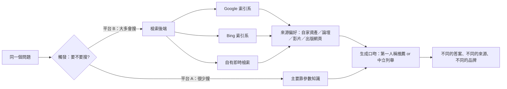

# 第 12 章　平台差異與中文生態

## 本章要回答的問題

1. 為什麼說不存在一個統一的「AI 搜索」？各平台的差異出現在管線的哪些環節？
2. ChatGPT、Gemini／Google AI 概覽（AI Overviews，下稱 AIO）、Claude、Perplexity、Copilot 在來源選擇上各有什麼傾向？這些傾向有多可靠？
3. 中文生態（百度 AI 概覽、豆包、DeepSeek、騰訊元寶、通義千問）和英文生態有什麼結構性不同？
4. 查詢語言如何改變引用池？
5. 在資源有限時，該怎麼決定追蹤和優化哪些平台？

---

## 一、核心原理

### 12.1 每個平台是一條不同的管線

全書的主線是：AI 搜索是一條「觸發 → 可達 → 召回 → 選擇/排序 → 引用 → 吸收 → 用戶行為」的篩選管線。本章要補上一句：**每個平台各自有一條這樣的管線，而且幾乎每個環節的參數都不一樣。**

所以同一個問題、同一天、同一批頁面，放到不同平台上，得到的是不同的答案。品牌在某個平台上「可見」，對它在另一個平台上是否可見，幾乎不提供資訊。

### 12.2 差異出現在哪些環節

| 管線環節 | 平台之間的差異 | 證據強度 |
|---|---|---|
| 觸發 | 同一批 1,000 個提示，透過 API 呼叫時，GPT-5.3-chat 只有 14% 會調用搜索，Claude Sonnet 4.6 則有 83% | 在真實 AI 搜索引擎上重複測試 |
| 檢索後端 | Google 系產品依賴 Google 索引；封鎖 Google 的 AI 訓練爬蟲標記（Google-Extended）的網站，在 Gemini 中零引用，在 AIO 中的引用也顯著更少（相關性，不是因果） | 在真實 AI 搜索引擎上重複測試 |
| 召回規模 | 每次查詢返回的 URL 數：ChatGPT 平均 14.06 個，DeepSeek 5.46 個 | 在真實 AI 搜索引擎上重複測試（真實用戶對話數據） |
| 來源偏好 | 大型論壇社群站與 YouTube 出現在 ChatGPT、Grok 的搜索結果中，但在 Claude 的搜索結果中完全缺席 | 在真實 AI 搜索引擎上重複測試 |
| 自有資產 | Google 平台偏向引用自家資產，例如 YouTube；百度 AI 概覽主要引用百度自有子域名 | 在真實 AI 搜索引擎上重複測試 |
| 生成口吻 | 產品推薦中，ChatGPT 有 79% 以第一人稱「我推薦」給出，Gemini 只有 7%，AIO 只有 2% | 在真實 AI 搜索引擎上重複測試 |
| 引用與吸收 | ChatGPT 每個提示平均引用 6.88 個來源，Google 12.06 個，Perplexity 16.35 個；但被抓取頁面對答案的平均影響度，ChatGPT 是 0.2713，Google 0.0584，Perplexity 0.0646 | 靜態快照的二次分析，只能算描述性證據 |

最後一行可以濃縮為：**ChatGPT 引用得少，但每個被引來源對答案的影響更深。** 這條結論只來自一份快照的描述性分析，沒有控制混雜因素，應視為「機制上可能」，不是定律。

### 12.3 平台自有資產偏向

平台會優先用自家的東西，這是結構性的偏向，不是內容品質問題。

- 在健康類查詢中，Google AIO 最常引用的來源是 YouTube，排在美國疾病控制與預防中心、世界衛生組織和知名醫療機構網站之前。
- Google 搜索、AIO、Gemini 三個介面的來源重疊極低，Jaccard 係數只有 0.11–0.18（AIO 與傳統搜索結果之間是 0.18），而且生成式介面偏向 Google 自有資產。
- 百度 AI 概覽最高頻的來源主要是百度自有子域名（詳見 12.5）。

含義：在 Google 系和百度系平台上，「平台自己的內容形式」本身就是一條入口。這不等於每個品牌都要去做影片或入駐平台子站，但在評估「為什麼我的頁面沒被引用」時，要先扣掉平台自有資產佔掉的位置。

### 12.4 觀察層次不等價

平台差異還有一個常被忽略的來源：**你用什麼方式看，就看到什麼。**

- **介面與 API 不同。** 大規模審計發現，消費者介面與對應 API 返回的域名重疊只有 12.0%（ChatGPT）和 14.8%（Gemini）。用 API 結果代表消費者看到的答案，是錯的。
- **單次與多次不同。** ChatGPT 單次觀察平均只看到 2.65 個域名，重複 3 次後增至 5.56 個。產品推薦集合在重複查詢之間的 Jaccard 係數：AIO 0.421、Gemini 0.287、ChatGPT 0.178。也就是說，ChatGPT 每次推薦的產品變動最大。
- **輕微改寫也會改變來源。** 對查詢做輕微改寫後，來源排序的一致性（RBO）在 AIO 只有 0.49，傳統搜索結果是 0.74；同一設備重跑，AIO 是 0.69，傳統搜索是 0.86。生成式介面比藍色連結更不穩定。
- **模型版本不同。** 從業者實測（多次、有對照）發現，同一組品牌查詢，一個金融科技客戶在較大模型中 10 次出現 3 次，而較小的模型無論怎麼問，每次都推薦同一家市場龍頭。另一組實測中，同一客戶在較大模型中 10 次出現 8 次，在沒有系統提示的原始 API 中出現 0 次。
- **「被列出」不等於「被使用」。** 真實用戶對話數據顯示，14–53% 的回答主張其實由搜索結果支持，卻沒有標註引用；另有 15–20% 以上的主張無法落地到任何來源。只用「有沒有被引用」衡量來源影響力，會同時漏算和誤算。

### 12.5 中文生態的結構

中文生態不是英文生態的翻譯版。現有研究指出三個結構性特點。

**特點一：百度 AI 概覽高度集中，且偏向自有子域名。**

在一項以 500 條翻譯查詢、單次收集的審計中：

| 指標 | 百度（中文） | Google（中文） | Google（英文） | 百度（英文） |
|---|---|---|---|---|
| 概覽出現率 | 82.0% | 97.6% | 97.0% | 4.0% |
| 來源 Gini 係數 | 0.895 | 0.500 | 0.462 | — |
| 排名第一的主機佔比 | 27.1% | 6.6% | 5.5% | — |

Gini 係數越接近 1，代表引用越集中在少數來源。百度中文的 0.895 意味著少數主機（主要是百度自有子域名）拿走了大部分引用位置。兩個平台之間的主機域名 Jaccard 係數只有 0.008–0.034，幾乎沒有共同來源；但在 331 條共同查詢上，兩邊答案的語義嵌入餘弦相似度中位數在 0.701–0.813 之間。**答案說的差不多，引用的來源卻幾乎完全不同。** 對品牌來說，重要的是後者。

**特點二：查詢語言比地理位置更決定引用池。**

在健康類 AIO 研究中，用英文查詢時，本地來源的引用比例差距很大：澳洲 48.2%、美國 33.7%、印度 2.3%、奈及利亞 0.2%。改用當地母語查詢後，本地引用提高了 3.5–13.5 倍，例如日本從 16.6% 升至 57.5%，韓國從 2.7% 升至 36.4%。

對中文內容的含義是：用中文提問的用戶，面對的是一個以中文來源為主的引用池。中文內容不需要和英文權威站競爭同一批位置，但也意味著英文內容的「權威」不會自動轉移到中文答案裡。同一研究中，中醫藥主題在 Google AIO 的返回率約 42%；百度返回率更高，但平均只附約 1 條引用。

但在 ChatGPT 上要加限定：擷取 ChatGPT 網頁版內部執行的研究發現，新版 Instant 模式對中文問題，約 67%–70% 的運行只用英文搜索（該研究量的是查詢語言，沒有量被引來源的語言）。

**特點三：中文生成式搜索引擎的「引用 → 吸收」落差很大。**

一項涵蓋豆包、DeepSeek、騰訊元寶、通義千問，共 8 個介面（Web 與 App 分開計）的大規模研究，用 614 條查詢 × 8 個介面 × 3 次重複，收集了 160,860 條引用。主要發現：

- **來源結構：** 第三方來源約佔 69%，品牌官網 12.9%，政府來源 4.5%。
- **被列出不等於被使用：** 列出的來源中，66% 在正文中出現，30% 被實質引用，只有 8% 被深度引用；39.3% 屬於「沉默引用」（列出了但答案沒用）。
- **品牌入選率低：** 出現在引用池中的品牌，只有 8.3% 進入最終答案。
- **多源共現是強信號：** 品牌只在 1 條引用中出現時，入選率 2.1%；在 11 條以上引用中出現時，入選率 59.9%。
- **傳統 SEO 分數不是首要因子：** 一個常用的第三方百度質量綜合分，在吸收預測模型中的重要度只有 4.52%。這說明它不是首要預測因子，並不證明它無用。
- **時效：** 高時效查詢的被引頁面，發布時間中位數 18 天，半衰期 39 天；低時效查詢是 101 天和 68 天。
- **同平台不同介面：** 同一平台的 App 與 Web，網域級 Jaccard 係數只有 0.19–0.51；通義千問的 URL 級 Jaccard 只有 0.014。

最後一點值得單獨強調：**在中文生態裡，同一個品牌的 App 和網頁版要當成兩個平台看。**

這項研究的作者屬於監測服務商，數據由其監測系統採集；所有發現都是關聯性的。研究設計本身（多介面、三次重複）是扎實的，但應把它當作目前最完整的中文描述性數據，而不是因果證明。

---

## 二、證據有多強

| 結論 | 證據強度 | 適用範圍與限制 |
|---|---|---|
| 各平台來源重疊很低 | 在真實 AI 搜索引擎上重複測試發現（多項研究一致）；從業者實測（多次、有對照）一致；從業者普遍認為 | 最穩的一條。具體數字隨測量方法差異很大（見爭議 4） |
| 搜索觸發率差異巨大（14% vs 83%） | 在真實 AI 搜索引擎上重複測試發現 | 透過 API 控制重放；消費者介面可能不同 |
| ChatGPT 第一人稱推薦比例遠高於 Gemini 和 AIO | 在真實 AI 搜索引擎上重複測試發現 | 限於產品推薦類查詢 |
| Claude 搜索結果不含大型論壇社群站與 YouTube | 在真實 AI 搜索引擎上重複測試發現；從業者實測報告一致 | 截至 2026 年 9 月的觀察 |
| Google 系偏向自家資產 | 在真實 AI 搜索引擎上重複測試發現（兩項研究） | 健康、一般查詢；其他垂直未必同程度 |
| 封鎖 Google-Extended 與 Gemini 零引用相關 | 在真實 AI 搜索引擎上重複測試發現 | 只是相關性 |
| ChatGPT 引用少但吸收深 | 模擬 / 理論分析層級（靜態快照二次分析） | 只能說「機制上可能」 |
| 百度 AI 概覽高度集中 | 在真實 AI 搜索引擎上重複測試發現 | 單次收集、翻譯查詢、單一地點（米蘭）採集 |
| 母語查詢大幅提高本地引用 | 在真實 AI 搜索引擎上重複測試發現 | 健康主題；觀察性 |
| 中文引擎中多源共現預測品牌入選 | 在真實 AI 搜索引擎上重複測試發現 | 關聯性；作者為服務商 |
| 模型版本之間差異大 | 從業者實測（多次、有對照）發現 | 樣本小，單一客戶 |

整體判斷：**「平台之間不同」這件事證據很強；「每個平台具體偏好什麼」證據弱得多，而且變化很快。** 前者可以當作設計追蹤體系的前提；後者只能當作當下的觀察，要帶著觀察日期使用。

中文生態方面，目前的證據幾乎全部來自研究，缺少中文平台上的從業者對照實測。這是本章明顯的證據缺口。

---

## 三、爭議與反例

### 爭議 1：ChatGPT 到底多依賴論壇社群？

| 觀點 | 依據 |
|---|---|
| ChatGPT 最偏向論壇社群 | 從業者實測報告：約 15 萬條引用按來源類型分類，ChatGPT 最偏向論壇與問答站（約 5%）及參考與學術頁面（約 4%）。另一組單一細分領域的實測中，ChatGPT 引用的社群來源 16 條中有 14 條來自大型論壇社群站 |
| ChatGPT 幾乎不引用論壇社群 | 從業者實測（多次、有對照）：同一週固定 40 條提示，大型論壇社群站在 Gemini 被引用 22 次、AIO 20 次，在 ChatGPT 最多 1 次。另一組跨 10 個行業的基準測試，針對南非相關查詢，Gemini 引用該論壇約 750 次，GPT-5 與 Claude 為零 |

兩邊都有數據。可能的解釋：觀察時間不同（前者 7 月，後者 9 月）、測量對象不同（API 還是消費者介面、有沒有聯網）、垂直領域不同。這個問題對單一品牌的答案，只能靠自己的提示集測出來。平台與論壇社群的關係在第 15 章專門討論。

另外要注意：即使某個站在某平台排名靠前，它佔總引用的比例仍可能很小。上述實測中，所有平台上一般出版與網頁都佔 86–97%，沒有一個平台以論壇或影片為主。

### 爭議 2：哪個平台每個答案引用最多？

| 來源 | ChatGPT | Google 系 | Perplexity |
|---|---|---|---|
| 靜態快照研究（每提示平均引用數） | 6.88 | 12.06 | 16.35 |
| 從業者實測（70 條提示、30 天、1,474 個回答，每答案引用數） | 9.62 | Gemini 15.08；AIO 5.34 | 5.04 |

Perplexity 在一邊最多，在另一邊最少。差異可能來自採集方式、時間、提示類型，以及「Google」是指 AIO 還是 Gemini。教訓不是誰對誰錯，而是：**「每個答案幾個引用」是測量方式的產物，不能跨研究比較。**

### 爭議 3：哪個平台最穩定？

- 研究顯示產品推薦集合的重複一致性：AIO 最高（0.421），ChatGPT 最低（0.178）。
- 從業者實測（多次、有對照）在 15 個城市、45 個緊急維修查詢上用無痕模式重跑：Perplexity 約 85% 不變，ChatGPT 約三分之二重複，Google 約 60% 城市保持同樣的推薦、40% 換了人。

兩者都顯示 ChatGPT 變動大，但對 Google 的判斷不一致。可能因為一個測的是產品推薦，一個測的是本地服務，且後者的 Google 結果包含個人化因素。

### 爭議 4：平台之間到底重疊多少？

不同測量給出的數字差距很大：

| 測量 | 重疊 |
|---|---|
| 研究：ChatGPT 與 Gemini 同查詢平均共享域名 | 5.4%；76.7% 的比較沒有任何共同域名 |
| 研究：Google 三介面來源 Jaccard | 0.11–0.18 |
| 從業者實測（兩個獨立樣本互相驗證）：引用域名兩兩重疊 | ChatGPT 與其他三者 10.6–14%；AIO 與 Gemini 約 25–26% |
| 從業者實測：同行業 197 家診所、三個引擎、每提示跑三次 | 39–48% |
| 從業者實測：本地清單 Perplexity 與 Gemini 點名重疊中位數 | 11% |

有從業者指出，把所有提示的引用池合併後算重疊，長尾的一次性域名會拉低數字，逐提示比較可能會更高。所以「11%」和「48%」不一定矛盾，而是算法不同。

兩個獨立樣本都支持的一點是：**ChatGPT 與其他平台的重疊最低，兩個 Google 產品彼此最接近。** Perplexity 在兩份數據中的位置不一致。

### 爭議 5：新內容多快被反映？

從業者普遍認為 Perplexity 比 ChatGPT 更快反映新內容，理由是前者基於即時檢索。有從業者實測報告 Perplexity 幾天內就反映了更新，ChatGPT 則要數週；另有一份多模型實測稱 ChatGPT 約 2–4 週能反映內容變化。這個看法被標記為有爭議，支持者都是單方面觀察，沒有對照測試。

### 爭議 6：要不要每個平台各做一套？

- **分開做派：** 從業者普遍認為各平台引用的來源集合不同，必須分平台追蹤。有從業者實測發現，大約 40% 情況下在 ChatGPT 排第一的品牌，在 DeepSeek 完全不可見。
- **一套為主派：** 有從業者觀察到，雖然各平台來源差異很大，但專注 Google 加 Bing 兩個索引大致能覆蓋多數情況。另有實測者指出，頁面層面的寫法可以通用，真正因平台而異的是「哪些外部來源決定誰被點名」。

兩派其實可以調和：**頁面本身的可讀性和可抽取性做一套；外部來源的佈局按平台分開看。**

### 爭議 7：各平台「喜歡什麼」的歸納可信嗎？

有從業者實測報告給出了各平台的「偏好畫像」：ChatGPT 看重統計數據和論壇討論、DeepSeek 最看重時效、Gemini 最均衡且較受結構化標記影響。這類歸納要謹慎：

- 其中「加入統計數據對 ChatGPT 影響最大」一條，與全書主線「2023 年那套加數據、加引語的技巧已經失效」相衝突。
- 樣本是 15 個頁面、兩個月，沒有公開對照組。
- 各平台的來源偏好在幾個月內就可能改變。

這類畫像可以作為你自己設計測試時的假設，不能當作結論。

---

## 四、案例

### 案例 1：放行 AI 爬蟲後，Copilot 引用曲線轉折（2026 年 6–9 月）

- **做了什麼：** 一個回答「某部劇在我的國家哪裡能看」的串流指南網站，覆蓋 34 個亞洲市場。6 月曾因頻寬問題封鎖 AI 爬蟲，之後解除封鎖。內容上做了兩件事：用真實片庫數量做數據型比較頁（而不是觀點），以及按國家分別建頁。
- **在哪個平台：** Microsoft Copilot，數據來自搜索引擎站長工具中的 AI 表現報告。
- **觀察到什麼：** 3 個月內在 Copilot 答案中被引用約 185,600 次；每天被引用的頁面從 6 月不到 100 頁增至約 400 頁；同期傳統搜索點擊從接近零升至每天約 1,500 次。站長稱解除封鎖正是曲線轉折點。意外的是，引用最多的不是原本主打的市場，而是動漫平台比較（前 12 個查詢中佔 7 個）；在另一類劇集查詢上，該站頁面為答案提供了 61–85% 的來源。
- **對應原理：** 可達是第一關（12.2 檢索後端）；平台會找真正覆蓋某個市場的來源（12.5 語言與地域）。
- **限制：** 從業者實測報告，單一網站，未經獨立驗證；解除封鎖與內容改進同時發生，無法分開歸因。

### 案例 2：按各平台引用的目錄建立檔案（約 1 個月）

- **做了什麼：** 一家服務型企業建了 10 條行業提示加幾條品牌提示，每次用無痕瀏覽器、每條提示開新對話，分別在 ChatGPT、Copilot、Claude、Gemini、Perplexity 上查詢，記下各平台的來源和主要競爭對手。發現來源是行業目錄站時，就去建立並完善檔案，並請客戶留評價。
- **觀察到什麼：** 一個月內從零引用變成在 5 個平台中的 3 個、10 條提示中的 6 條被引用。作者認為 Copilot 和 Perplexity 更依賴傳統搜索排名，這兩個平台只能靠提升自然排名。
- **對應原理：** 平台差異主要在「引用哪些外部來源」，所以按平台逐一讀出來源清單，再去補位。
- **限制：** 從業者實測報告，未經獨立驗證；「Copilot 與 Perplexity 更依賴傳統排名」是作者判斷，沒有對照。

### 案例 3：48 個本地市場的四平台可見度（2026 年 8 月單次快照）

- **做了什麼：** 8 個美國中型城市 × 6 個類別，共 48 個市場。先取 Google 地圖對「類別＋城市」返回的商家（每個市場約 97 家，共 4,657 家），再用三個買家式問題問 ChatGPT、Claude、Gemini 和 AIO，看哪些商家被點名。
- **觀察到什麼：**
  - 只有 11.9% 的商家被四個系統中至少一個點名（寬鬆匹配下是 26%）。
  - 各平台點名數：AIO 376 家、ChatGPT 206 家、Gemini 134 家、Claude 92 家。
  - 被點名的商家中，70% 只出現在一個平台；48 個市場中有 36 個沒有任何一家被四個平台同時點名。
  - 類別差異大於城市差異：健身房 14.4%、咖啡店 14.1%、髮廊 9.7%。
- **對應原理：** 平台之間的「可見度」是四個獨立問題，不是一個問題的四個測量點。
- **限制：** 從業者實測報告；地圖只取前 100 名，大市場被低估；嚴格與寬鬆匹配差距大，作者自己也點出。

相關的另一組從業者實測（8 月起每天記錄，累計 9,217 個回答）補充了兩點：本地推薦清單高度集中，36 份本地清單中有 25 份，同一家商家在 80% 以上的日子都出現；Perplexity 對這類問題引用的主要是商家自己的頁面，加上少數目錄和評價站。

### 案例 4：同一個新聞網站，ChatGPT 引用數百頁，Gemini 為零（2026 年 9 月）

- **觀察到什麼：** 一個新聞網站的追蹤顯示，被 ChatGPT 引用約 650–659 頁，被 Gemini 引用 0 頁。
- **作者的判斷：** Gemini 的問題不在「是否認得這個品牌」，而是根本沒有把這些頁面召回。這是檢索缺口，不是署名問題。
- **旁證：** 有從業者觀察到，一個在 Google 被取消索引的大型網站，其他平台的爬蟲每天大量抓取，但 Gemini 對它一無所知。另一位開發者觀察到，網站首月從 ChatGPT 帶來 230 名用戶，Gemini 卻始終看不到它。
- **對應原理：** Google 系平台的召回綁定 Google 索引（12.2）。在 Gemini 缺席時，先查 Google 索引狀態，再談內容。
- **限制：** 從業者實測報告加一手觀察，未經獨立驗證，只能作為排查線索。

### 案例 5：同一問題，10 個模型，29 個品牌（2026 年 7 月）

- **做了什麼：** 一家羅馬尼亞代理商用羅馬尼亞語問同一個奢侈珠寶品牌推薦問題，對象是 ChatGPT、Claude、Gemini、Copilot、Grok、Perplexity、DeepSeek、Kimi、GLM、通義千問 10 個模型。乾淨會話、無記憶、提示中不含品牌名，每個模型只跑一次，不重新生成。
- **觀察到什麼：** 50 個名額中出現 29 個不同品牌，其中 19 個只出現在一個模型的清單中；任意兩個模型平均只共享 0.91 個品牌（約 18%）；最常出現的品牌也只出現在 6 個模型中。Copilot 與其他 9 個模型完全沒有重疊，答案引用的是評價數量，作者推斷它主要依賴 Bing 即時索引和評價聚合站。進入多個模型的兩個品牌，都有跨來源重複出現的可驗證第三方事實和財經媒體報導。
- **對應原理：** 跨來源共現是入選的強信號，與中文引擎研究的發現（12.5 特點三）方向一致。
- **限制：** 從業者實測報告；每個模型只跑一次，模型自身的重複一致性還沒測，18% 的解讀需要這個基線。

### 案例 6：同一品牌在不同模型版本中（2026 年 5 月）

- **做了什麼：** 從業者用「遠程團隊最好的項目管理工具」這類查詢，分別在一個較大模型、一個較小模型、以及沒有系統提示的原始 API 上測試。
- **觀察到什麼：** 同一客戶在較大模型中 10 次出現 8 次，在原始 API 中 0 次。作者稱真正起作用的是 2023 年的一篇科技媒體報導和同期兩則軟體評價平台上的討論，這些較早的引用在更多模型版本中都起作用，超過近期發布的任何內容。
- **對應原理：** 不同模型版本的訓練截止時間和引用行為不同（12.4）；參數知識依賴較早、較廣的網路存在。
- **限制：** 從業者實測（多次、有對照），但只有單一客戶；「舊報導起作用」是作者的歸因，沒有對照。

---

## 五、怎麼做

### 建立追蹤體系

| 做法 | 證據強度 |
|---|---|
| **按平台分開報告，不要合成一個「AI 可見度分數」。** 合成分數會把你真正想看的差異平均掉 | 在真實 AI 搜索引擎上重複測試發現；從業者實測（多次、有對照）一致 |
| **用消費者介面測，不要只用 API。** 兩者域名重疊只有 12–15% | 在真實 AI 搜索引擎上重複測試發現 |
| **每條提示至少跑 3 次。** 單次觀察會嚴重低估來源數量（ChatGPT 2.65 → 5.56） | 在真實 AI 搜索引擎上重複測試發現 |
| **登出、無痕、每條提示開新對話。** 否則歷史記錄會把你的品牌回傳給你。這樣量到的是單輪可見度，不等於用戶在同一對話中連續追問時看到的情況 | 從業者實測（多次、有對照）發現 |
| **確認平台到底有沒有搜索。** 有從業者實測發現，登出狀態下某平台有一次沒搜索、直接憑記憶作答，還誤讀了縮寫 | 從業者實測報告 |
| **固定提示集，每週按平台重跑，並記錄模型版本和日期** | 從業者實測（多次、有對照）發現 |
| **排除品牌型提示的回聲。** 問「X 適合 Y 嗎」時模型會把 X 重複回來，不管有沒有檢索到它，要單獨處理 | 從業者實測（多次、有對照）發現 |
| **先換平台測，再改頁面。** 同一組 16 個問題每天跑，某實體在一個平台被引 25%，在 Gemini 被引 12.5%。如果是平台本身引用範圍窄，改頁面不會有用 | 從業者實測（多次、有對照）發現（單一實體，作者稱只是數據點） |
| **中文平台的 App 與 Web 分開追蹤** | 在真實 AI 搜索引擎上重複測試發現 |

### 按平台補位

| 做法 | 證據強度 |
|---|---|
| **逐個平台讀出你的目標查詢引用了哪些來源，按「你能不能上得去」分類**：自有網站、評價平台、社群、開放發布平台、競爭對手自有域名。從業者實測中，被引頁面通常有一半到三分之二是可觸及的 | 從業者實測報告 |
| **不要封鎖 Google-Extended**（若你在意 Gemini 和 AIO） | 在真實 AI 搜索引擎上重複測試發現（相關性） |
| **在 Gemini 缺席時先查 Google 索引狀態** | 有從業者觀察到（多個一手觀察方向一致），只能作為排查線索 |
| **在多個第三方來源中重複出現**，這在中文引擎研究和多模型實測中都與入選強相關 | 在真實 AI 搜索引擎上重複測試發現（關聯性）；從業者實測報告 |
| **中文內容用中文寫，面向哪個語言市場就用那個語言。** 母語查詢使本地引用提高數倍 | 在真實 AI 搜索引擎上重複測試發現（觀察性） |
| **按國家或市場分別建頁**，而不是一份通用頁 | 從業者實測報告（單一案例） |
| **高時效主題保持更新**：中文高時效查詢被引頁面的中位數只有 18 天 | 在真實 AI 搜索引擎上重複測試發現（關聯性） |
| **針對「描述問題」型查詢發布內容。** 多組實測發現，用戶描述問題而非點名品類時（例如「怎麼讓客戶更快付款」），大多數平台不推薦任何具體產品 | 從業者實測報告 |
| **在百度生態，把百度自有子域名視為結構性存在。** 它佔掉相當比例的引用位置 | 在真實 AI 搜索引擎上重複測試發現；具體做法尚無對照證據 |

### 資源有限時的取捨

- 有從業者根據 100–150 個分析帳戶的觀察，認為 ChatGPT 和 Gemini 帶來的推薦流量最多；另有從業者觀察到某客戶 98% 的 AI 流量來自 ChatGPT。這些都是單方面觀察，而且全書主線指出，目前沒有研究證明 GEO 能穩定帶來流量。
- 較穩健的做法是：先用自己的提示集測出每個平台上你的缺席程度和缺席原因（召回缺口還是選擇缺口），再按受眾實際使用的平台排序投入。
- 面向中文用戶時，至少要把百度 AI 概覽和主要中文生成式引擎納入，不能只看英文平台的結論。

### 不要做

- 不要用一個平台的截圖推斷所有平台的表現。
- 不要把一個平台上的成功經驗直接搬到另一個平台，特別是針對 Google 介面的建議，實測顯示它們無法遷移。
- 不要把 API 結果當成用戶看到的答案。
- 不要把單次查詢結果當成系統輸出。
- 不要把「被列為引用」當成「被答案使用」。中文引擎中 39.3% 的引用是沉默的。
- 不要把任何一份「各平台偏好畫像」當作穩定規律。

### 已經過時

- **「優化 AI 搜索」作為單一目標。** 各平台觸發、檢索、來源、口吻都不同，一個總目標無法指導行動。
- **只看傳統搜索排名推斷 AI 可見度。** 多組從業者實測發現，在 Google 排名好的品牌在 AI 答案中缺席；中文引擎中傳統質量分的預測重要度也很低。它仍是部分平台的召回前提，但不是 AI 可見度的代理指標。

---

## 六、本章要點

1. 不存在一個統一的「AI 搜索」。每個平台在觸發、檢索後端、來源偏好、生成口吻上都不同，同一問題會得到不同的來源和品牌。
2. 平台之間的來源重疊很低，這條證據最強。ChatGPT 與其他平台的重疊最低，兩個 Google 產品彼此最接近。
3. 平台偏向自有資產：Google 系偏向 YouTube 等自家內容，百度 AI 概覽偏向百度自有子域名。
4. 觀察方式本身會製造差異：介面與 API、單次與多次、不同模型版本，看到的都不一樣。測量要用消費者介面、多次重複、記錄日期與版本。
5. 百度中文概覽高度集中（Gini 0.895，第一名主機佔 27.1%），與 Google 的來源幾乎不重疊，儘管答案語義相近。
6. 查詢語言比地理位置更決定引用池；用母語提問會使本地來源比例提高數倍。
7. 中文生成式引擎中，被列為引用不等於被使用；品牌從引用池進入答案只有 8.3%，跨多個來源重複出現是最強的關聯信號。同一平台的 App 和 Web 要分開看。
8. 「每個平台具體喜歡什麼」的證據弱且變化快，只能帶著觀察日期當作假設使用。做法上：頁面寫法做一套，外部來源佈局按平台分開看。
