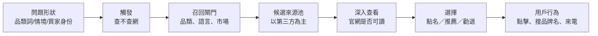

# 第 13 章　品牌與產品推薦（案例章）

> 本章是案例章。每組案例都對應前面某一章講過的原理：第 1 章（兩種知識來源）、第 2 章（觸發）、第 3 章（可達性與 agent 可讀性）、第 4 章（語言與市場閘門）、第 5 章（第三方來源、共識與品牌先驗）、第 6 章（選擇與屬性權重）、第 7 章（引用與吸收）、第 9 章（測量）、第 10 章（商業價值）、第 11 章（操縱與零和競爭）。社群論壇作為引用來源的角色，詳見第 15 章。

## 本章要回答的問題

1. AI 明明「認識」一個品牌，為什麼在品類問題裡不推薦它？
2. 品牌進不了推薦名單，通常卡在管線的哪一段？怎麼診斷？
3. 第三方榜單、評測站、目錄和社群討論，對推薦的作用有多大？證據有多硬？
4. 官網還重要嗎？在什麼情況下重要？
5. 品牌可見度怎麼量，才不會自欺欺人？

## 13.1 核心原理：品牌推薦是一場多關卡的淘汰賽

用戶問「最好的 X 是什麼」時，AI 不是去查一張品牌排行榜。它走的是第 1 章講的那條隨機、多階段的篩選管線。品牌在任何一關掉出去，最後都不會出現在推薦裡。



**四個核心結論**（來自第 5、6、3 章的原理，本章用案例檢驗）：

1. **可以區分的真實屬性決定推薦。** 評分、價格、評論、規格這些能拉開差距的事實，是 AI 做選擇的依據（第 5 章原理 5.3、第 6 章原理 6.3）。
2. 品牌先驗只在信息無法區分時起作用。大品牌的優勢，在候選之間沒有差異時最明顯（第 5 章）。
3. 第三方共識是 AI 用來判斷的證據。AI 的品牌答案主要建立在別人怎麼說你，而不是你怎麼說自己（第 5 章原理 5.1、5.2）。
4. Agent 會進入官網查看。網站能不能被讀懂，決定答案由誰的內容構成（第 3 章原理 3.2）。

五種狀態要分開看。品牌在 AI 答案裡不是「有」或「沒有」兩種狀態，而是至少五種：

| 狀態 | 含義 | 常見誤判 |
|---|---|---|
| 被認識 | 直接問品牌名，AI 能正確描述 | 誤以為「AI 知道我」就等於會推薦我 |
| 被引用 | 官網出現在來源列表裡 | 誤以為被引用就是被推薦 |
| 被點名 | 答案正文提到品牌名 | 點名可能只是列舉，或是反例 |
| 被推薦 | AI 明確建議選它 | 這才是商業上真正要的狀態 |
| 被勸退 | AI 明確建議避開它 | 多數儀表板不記錄這一項 |

這五種狀態彼此會分離。本章大部分案例，都在說明它們如何分離、為什麼分離。

還有一種更隱蔽的情況：品牌被列出了，但相對其他選項描述得更簡短、加了更多保留。大規模真實用戶實驗顯示，AI 對話中對其他選項加保留語或一句帶過，與用戶改選被推銷商品的相關最強（見第 11 章）。所以除了記錄狀態，也要比較描述是否對稱。

## 13.2 證據有多強

| 結論 | 支撐證據 | 強度與限制 |
|---|---|---|
| 品牌答案的引用大部分來自第三方 | 在真實 AI 搜索引擎上重複測試發現，多個大型引用分析結果一致 | 描述性，不是因果；多項研究的作者是可見度服務商 |
| 「認識」不等於「推薦」 | 在真實 AI 搜索引擎上重複測試發現；另有大量從業者實測 | 方向一致，數字隨樣本差異很大 |
| 跨來源重複出現能預測品牌入選 | 在真實 AI 搜索引擎上重複測試發現（中文引擎） | 相關性；作者為服務商 |
| 官網對 agent 的可讀性影響推薦 | 在真實 AI 搜索引擎上重複測試發現（配對觀察） | 作者自有評分器；整包分數，未拆分各項 |
| 爭取進入第三方榜單能提升推薦 | 只有從業者實測報告 | **沒有任何論文做過干預實驗**；多數案例無對照、同時做了多件事 |
| 可見度必須多次、多語言、多引擎測量 | 在真實 AI 搜索引擎上重複測試發現，加上多項有對照的從業者實測 | 本章證據最強的一項 |
| GEO 帶來商業結果 | 一項真實用戶流量的準實驗（單一網站）；其餘為從業者自述 | 效應遠小於原始數字，而且只是提示性 |

**最需要記住的一點**：「讓第三方寫到你，推薦就會上升」是從業者的普遍看法，也有不少案例支持。但到目前為止，它只有觀察性和前後對比的證據，沒有經過受控實驗驗證。

## 13.3 案例

### 案例群 A：問題形狀與觸發——「認識你，但不推薦你」

**對應原理**：第 2 章（觸發）、第 5 章原理 5.3（認識≠推薦）、第 1 章原理 1.1（參數知識與檢索知識）。

**A1. 新產品的「發現落差」**

在真實 AI 搜索引擎上重複測試發現：新上線的產品按名稱直接詢問，識別率很高（一個引擎 99.4%，另一個 94.3%）。但換成不提品牌名的品類發現型問題，出現率只有 3.32% 和 8.29%，落差達到 30:1 和 11:1。網站本身的 GEO 綜合分數與可見度無關（r 約 -0.1）。在有聯網搜索的引擎上，可見度與參照域名數量、社群提及次數正相關（僅相關性）。

- 說明的原理：品牌存在於模型的知識裡，不代表會在品類問題中被「想起來」。
- 注意：只測了 API，不是消費者介面。

A2. 品類龍頭也沒被點名

從業者實測報告：審計 2,475 個按評論量挑出的美國品類領先品牌，在不含品牌名的品類提問中，86% 的電商品牌在四個 AI 助手裡一次都沒出現。但直接問品牌名時，四個助手都能講出創立年份、產品線和定位。

從業者實測（多次、有對照）發現：在「找高管教練」這類問題上，行業內知名度最高的教練在 6 次查詢中只出現 1 次；另一位擁有龐大受眾的教練只出現 1 次，但直接問他時，兩個引擎都給出詳細且準確的介紹。

從業者實測（多次、有對照）發現：20 家完成 A 輪以上融資的印度新創，有 17 家在品類查詢中完全缺席，但直接問品牌名大多能正常回答。出現的 3 家都有社群討論、結構化比較頁和評論標記。

- 說明的原理：知名度、融資、評論量都不自動轉化為推薦。模型推薦的是「在這個問題的語境裡，有證據支持的品牌」。
- 注意：這些都是觀察，沒有證明「做了什麼」就能改變結果。

A3. 越接近購買的問題，ChatGPT 越少查網

從業者實測報告：透過 API 開啟搜索工具、讓模型自行決定是否搜索。「品牌 A 對品牌 B」這類問題，ChatGPT 在 80 次中有 76 次不查網；「我有某種狀況，買哪個好」這類情境問題，120 次中有 106 次不查網；寬泛的品類問題大約一半會查網。Gemini 在 500 次中查了 493 次，Perplexity 500 次全查。不查網的回答，引用數是零。

- 說明的原理：第 2 章講的觸發率差異，在品牌推薦上的直接後果是：最關鍵的比較型問題，可能完全由模型的參數知識回答。這時官網再好也用不上，決定結果的是品牌在訓練語料裡的存在感。
- 注意：這是 API 測試，作者認為與消費者產品的決策相同，但沒有直接驗證。

A4. 很多買家問題根本不點名任何品牌

- 從業者實測報告：現場服務軟體的 300 個買家問題中，「怎麼才能不再弄丟工單」這類描述問題的提問，多數引擎只給一般建議，不推薦任何產品。
- 從業者實測報告：在羅馬尼亞用羅馬尼亞語問 18 個購書問題、跑兩輪，58% 的回答沒有推薦任何書店或出版社；市場龍頭只在約五分之一的回答中出現。
- 有從業者觀察到：從論壇和「相關問題」採集的 60 個真實買家問題中，一輪有 13 個、另一輪有 23 個不點名任何品牌。

實務含義：追蹤問題之前，先確認這個問題「會點名品牌」。對永遠不點名的問題追蹤再久也證明不了任何事。

### 案例群 B：召回閘門——品類誤判、問法、城市與語言

**對應原理**：第 4 章（召回、查詢改寫、語言與市場閘門）、第 6 章原理 6.1（相關性守門）。

**B1. 換個問法，品牌從「每次都在」變成「一次都不在」**

從業者實測（多次、有對照）發現：對「共享收件匣」類工具，先問寬泛品類詞，兩個主要品牌在四個引擎上幾乎每次都被點名。改成真實用戶的說法（描述想要的工作流程）後，每個引擎各跑 10 次：

| 引擎 | 品牌甲 | 品牌乙 |
|---|---|---|
| ChatGPT | 9/10 | 0/10 |
| Claude | 5/10 | 8/10 |
| Gemini | 10/10 | 8/10 |
| Perplexity | 0/10 | 5/10 |

同一家公司、同一個網站，只是問法變了。同時追蹤的兩個對照品牌則大致穩定，只在 Perplexity 上出現鬆動。作者的推測是：站外足跡決定能不能進入候選集合，而官網用買家語言描述實際任務，決定換問法時能不能留在集合裡。作者自己說明無法把兩者乾淨地分開。

從業者實測（多次、有對照）發現：一個電子報平台只在「創作者想開電子報並變現」的問題中出現。把買家換成企業、用平白語言描述同一件事，它的出現次數降到 0/40。它「擁有」的不是某個關鍵詞，而是某一類買家。

- 說明的原理：召回看的是語義匹配與意圖，而不是品牌本身。品牌被綁定在哪種問題、哪種買家上，決定了它在哪裡可見。

B2. 品類誤判：被 AI 放進錯的類別

從業者實測（多次、有對照）發現：一個 CSV 匯入工具在 8 個購買對話中只出現 1 次，出現時還被描述成它並不是的 ETL 工具；有兩個模型改為描述競品，用詞明顯來自競品自己的行銷文案。團隊針對 AI 點名競品而沒點名自己的具體問題，發布了兩篇比較文章、一頁技術文件並改寫 README。10 天後出現次數升到 8 次中 5 次，品類誤判在 4 個引擎中的 3 個得到修正。

- 說明的原理：品類誤判發生在召回之前的「理解」層。AI 把你歸錯類，你就會被拿去和錯的對手比，或根本不進候選。
- 注意：作者本人做測量工具，並聲明要打折看；樣本只有 8 個問題。

類似的現象還有：
- 有從業者觀察到：一家代理商用自己最知名的細分詞查詢，25 次被點名 19 次；用它首頁上的兩個寬泛品類標籤查詢，都是 0/25。
- 有從業者觀察到：同一品類的不同叫法，能讓品牌的被提及率從約四分之三跌到零。
- 有從業者觀察到：在三家澳洲律所的測試中，引擎把律所歸入比預期窄得多的類別（例如「勞動法律所」而不是「律師」）。

B3. 寬泛問題被巨頭佔據，細分問題還有空位

從業者實測報告：一家 B2B 客戶在「印度最好的雷射打標機品牌」這類寬泛問題上完全不可見，但在「金屬打標該用哪種打印機」這類細分問題上排第一並被引用，頁面沒有任何改動。被引用的客戶有一個共同點：模型會複述他們頁面上的具體細節（例如具體的設備型號），而只寫品類語言的頁面得不到引用。

B4. 把城市寫進問題，而不是設定地點

從業者實測（多次、有對照）發現：一家服務印度約 8 個城市的物流公司，在 41 個買家問題中被點名 0 次。把地點設為博帕爾再問通用問題，3 次中 0 次；把「在博帕爾」寫進問題句，Gemini 3 次中 3 次點名，Google AI 概覽在博帕爾和哥印拜陀兩個城市也點名了它。作者指出，只有在公司有對應城市頁面的地方才會被點名。

- 說明的原理：地點設定主要影響排序信號，但寫進問題的地名改變了「問題在問什麼」，進而改變召回。
- 注意：作者從事可見度工具工作，已主動聲明。

B5. 語言與市場閘門

在真實 AI 搜索引擎上重複測試發現：
- 改用品牌本國語言提問，本地龍頭品牌的推薦份額提升 0.80，全球品牌只提升 0.15（12 種歐洲語言）。
- 在本地語言的測試格中，全球供應商在 24 次中只出現 1 次；用英語在伊斯坦布爾和塔林提問，本地供應商 12 次中 0 次出現。用土耳其語從柏林提問，得到的是德國供應商（6 次中 5 次）。查詢語言決定候選集合，出口 IP 決定是哪個國家的市場（單一模型、小樣本）。
- 情緒也隨語言變化：同一批品牌在英語中得到的情緒最負面。

從業者實測（多次、有對照）發現：同一模型、同一問題，只是告訴模型用戶在哪裡，品牌就從缺席變成在 6 次測試中 5 次被點名。

從業者實測報告：用羅馬尼亞語向 10 個模型問同一個珠寶品牌推薦問題，一共得到 29 個不同品牌，其中 19 個只被一個模型提到；任兩個模型平均只有約 18% 的推薦重疊。其中一個模型與其他九個完全沒有重疊。

- 說明的原理：第 4 章原理 4.3。用英語測本地市場，會系統性低估本地品牌。

### 案例群 C：第三方來源池——榜單、評測站、平台與社群

**對應原理**：第 5 章原理 5.1（答案建立在第三方上）、5.2（多來源共識）。

**C1. 引用分佈：官網只佔一小部分**

| 發現 | 證據強度 |
|---|---|
| 128 個品牌、13 種語言的 167,551 條引用中，第三方佔 85.7%，品牌自有網站佔 14.3%；80% 的引用集中在約 18.2% 的域名；維基百科在 12 種語言中的 11 種是最高被引域名 | 在真實 AI 搜索引擎上重複測試發現（服務商） |
| 102 個品牌的 149,912 條引用中，品牌自家域名只佔 2.9%，同領域其他企業頁面佔 75.2%；榜單型頁面佔全部引用的 21.0%、內容型引用的 35.7% | 在真實 AI 搜索引擎上重複測試發現（服務商生產日誌，觀察性） |
| 排名類查詢中，AI 引擎高度偏向第三方媒體：美國汽車類 AI 答案中第三方媒體佔 81.9%，社交來源為 0；同類 Google 結果分別是 45.1% 和 15.4% | 在真實 AI 搜索引擎上重複測試發現 |
| 聯網答案的 2,410 條引用中，所有被追蹤廠商的自有域名合計只佔 7.3%，單一廠商域名都不到 1% | 從業者實測（多次、有對照）發現；作者明確表示這只是分佈，沒有因果證據 |
| 510 個土耳其酒店問題中，98% 的 Google AI Mode 回答至少引用一個訂房平台，最大的訂房平台出現在 74% 的回答裡，酒店官網幾乎從未被引用 | 從業者實測報告 |
| 180 條球鞋推薦的 1,783 條引用中，影音平台、評測站和時尚媒體排在前面；被推薦最多的品牌，其官網只被引用 2 次；Perplexity 對品牌官網的引用為零 | 從業者實測報告 |

- 說明的原理：AI 對品牌的「看法」主要從別人的頁面組裝而來。品牌最常被推薦，也不代表它的官網是依據。

C2. 跨來源共現與「被寫進答案」

在真實 AI 搜索引擎上重複測試發現（中文引擎）：引用池中的品牌只有 8.3% 進入答案正文。品牌只在 1 個引用來源中出現時，入選率 2.1%；出現在 11 個以上來源時，入選率 59.9%。傳統 SEO 質量分在預測模型中的重要度只有 4.52%。列出的來源中，66% 真正進入正文，30% 被實質引用，8% 被深度引用。詳見第 7、12 章。

- 注意：這是關聯，不是干預。它說明「多處被提到的品牌更常入選」，沒有證明「去多處發文就會入選」。

C3. 進入 AI 已經在引用的榜單（前後對比）

以下案例都是同一種打法：先找出 AI 對目標問題反覆引用的頁面，再設法讓品牌出現在這些頁面上。

| 案例 | 做了什麼 | 觀察到什麼 | 證據強度 |
|---|---|---|---|
| 大麻類消費品牌 | 聯繫目標問題中出現的所有網站，爭取加入既有文章；不能加入的就寫客座文章。針對一個睡眠產品問題做了 5 篇榜單、2 篇產品彙整 | 約一週內 ChatGPT 把品牌排在第 2 位 | 從業者實測報告；作者只負責外鏈，客戶站內 SEO 本來就強 |
| 新能量飲料品牌 | 發現 AI 概覽反覆引用 3–4 個「最佳 X 飲料」評測部落格，爭取被收錄 | 數天內與大品牌一起出現在 AI 概覽和首頁 | 從業者實測報告 |
| 12 個客戶頁面 | 先做完整站內優化（結構化標記、標題層級、實體清晰度、內鏈），兩週後用 15 個提示登出狀態追蹤 | 兩週內毫無變化；第三週一篇收錄客戶和四個競品的彙整文章發布後，數天內原本不可見的兩頁開始被引用 | 從業者實測報告；作者自己說樣本小、無法拆分原因 |
| 倉儲管理軟體（3PL 利基） | 發現每月記錄的 40 個推薦提示中，ChatGPT 只點名自己 2–4 次，而 Google 第二頁的競品約 18 次。競品有物流部落格的兩篇榜單、評測平台的品類頁和一則三年前的社群好評。之後統一了三個平台上互相矛盾的公司描述，並每天發布一頁比較頁 | 到 8 月約 9/40 | 從業者實測（多次、有對照）發現；兩件事同時做，無法拆分 |
| 服務商目錄 | 記錄各 AI 對行業問題引用的目錄網站，在這些目錄建立並填滿檔案、請客戶留評 | 一個月內從零引用到在 5 個 AI 中的 3 個、10 個提示中的 6 個被引用 | 從業者實測報告 |

同一家倉儲軟體公司的補充觀察（從業者實測報告）：引用主要追溯到評測平台、他人的榜單和一則社群討論串；官網只在問價格和整合時被引用，幾乎從不在「該選哪個」時被引用；一年發 200 篇職場社群發文，零引用；花 6,000 美元升級評測平台檔案，沒有任何變化；行業協會的會員名錄反而被 Perplexity 引用。

- 說明的原理：答案是從「已經在候選池裡的頁面」組裝的。進入那些頁面，等於直接進入候選池。
- 注意：
  1. 全部是前後對比，沒有同期對照組。第 10 章的準實驗顯示，不扣除平台自身的增長，原始倍數會嚴重高估效果。
  2. 借來的曝光不穩定。有從業者觀察到：如果你的出現依靠別人的榜單，對方更新頁面那天你就可能消失；引用自己的文件或價格頁則較穩定。
  3. 付費買榜單位置、客座文章換外鏈，在某些平台可能違反規則，也屬於第 11 章討論的灰色地帶。

C4. 一致的描述比數量更重要（看法居多）

- 從業者實測報告：一家公司每月用固定提示檢查各模型怎麼描述自己，兩次發現錯誤資訊，分別追溯到一個過時的目錄檔案和一篇錯誤的第三方文章。
- 從業者實測報告：連續六週追蹤三個競品的描述，其中兩個明顯改變（一個從「分析工具」變成「AI 可見度平台」，另一個多了「整合有限」的批評）。兩者都不是來自競品自己發布的內容，而是追溯到小眾社群的比較討論和幾則高互動的論壇留言。
- 從業者實測報告：跨零售渠道商品屬性一致且完整的品牌，引用率明顯更高，但作者承認因果機制尚未驗證，也沒有同期保留對照組。
- 有從業者觀察到：把「關於我們」頁和所有第三方簡介改成完全一致的描述，是單項效果最大的改動，約三個月後開始穩定被引用。

C5. 新聞稿通發沒有用

從業者實測（多次、有對照）發現：在 4 個引擎上測試已融資的 AI 新創與既有大廠，新創的被引用率為 6–13%，大廠為 32–62%。新聞稿通發到財經網站轉載沒有幫助，在 Perplexity 上甚至略為負面。只有向量資料庫類新創達到 34%，作者認為原因是這些產品多年來一直被技術部落格寫到，已經進入訓練語料。

在後續被質疑後，作者修正了兩點：每一輪其實是 5,400 次試驗，而不是標題寫的 46,122 次查詢；以及更準確的說法應該是「引擎引用的是在訓練語料中充分存在、且有可檢索權威來源的實體，新創兩者都缺」，而不是「大廠佔優」。這個修正本身就是一個測量教訓（見案例群 G）。

### 案例群 D：可達性與官網——什麼時候官網說了算

**對應原理**：第 3 章原理 3.1、3.2；第 1 章原理 1.4（agent 會打開網頁閱讀）。

**D1. Agent 進站之後，官網可讀性決定內容由誰提供**

在真實 AI 搜索引擎上重複測試發現：在 1,056 家企業、37,927 次 agent 旅程中，對 agent 友好的網站，答案有 78% 來自自家頁面（不友好的為 58%）；被明確推薦的比例是 20%（不友好的為 11%）。控制網站可讀性之後，兩個代表「站外被提及」的指標，對落地、推薦和成本都沒有顯著的獨立影響。網站讀不到時，agent 會改用第三方或競爭對手的內容，失敗的形式是省略，而不是編造。訓練知識只佔最終答案的 7–10%。

- 注意：作者是服務商，使用自己的評分器，屬配對觀察研究；「可讀性」是整包分數（無 JS 內容、結構化資料、Markdown 回退、放行 agent 的爬蟲設定），沒有拆分各項效果。

D2. 官網被檢索到時，品牌幾乎一定被提及

從業者實測（多次、有對照）發現：在多個品牌的購物推薦回答中，品牌官網被檢索到時，品牌被提及的比例是 89%；沒被檢索到時只有 24%。另一個發現是：某品牌 165 條自有網站引用中，116 條來自部落格內容，只有 3 條來自產品頁；一篇彙整文章單獨被引用了 37 次。作者也提到，約四分之一的相同提示重跑後結果會改變。

- 說明的原理：同樣的可見度分數，背後可能是完全不同的問題：沒被檢索到、檢索到了卻不推薦、只在部分產品線被理解、或者問題本身很少點名品牌。

D3. 為 AI 建一個乾淨的平行版本

從業者實測（多次、有對照）發現：一個低權威的小型應用，原本被多個 AI 引用但描述錯誤（把產品的核心機制說錯了）。創辦人為網站建立一套平行版本：去掉導航、動畫和 cookie 橫幅等干擾，每頁寫成直接問答，答案放在前 75–120 字；每頁都 canonical 回對應的原始頁面，另設 sitemap，並透過 llms.txt 和 rel="alternate" 讓 AI 發現。5 週內 AI 引用覆蓋擴大 12%，AI 轉介流量提升 60%，沒有新增外鏈。

- 注意：作者是產品創辦人並已聲明；多項做法捆綁實施，無法判斷哪一項起作用；llms.txt 單獨有效的證據目前仍不存在（第 3 章）。

D4. 站內都做了，還是沒用

- 從業者實測報告：一家公司在 ChatGPT「誰能做 X」問題中被點名約 6%。網站審計結果乾淨，所有爬蟲都拿到 200，但站內修正後沒有任何變化。有人建議用「開啟 vs 關閉聯網」對比來判斷：關閉聯網仍不出現，說明缺的是模型的訓練記憶；開啟聯網才出現，說明是即時檢索，槓桿在彙整文章。該建議者稱在約 180 家公司上評分，被點名的是常出現在「X 對 Y」文章中的公司，而不是網站最乾淨的公司。
- 從業者實測報告：一家公司在 Google 第一頁，ChatGPT 對同一問題一次都沒點名它，排名更低的競品被點名三次。

D5. 官網控制的是「怎麼描述你」

從業者實測報告：一家只有商家檔案和一頁首頁的 GEO 代理商，仍被 ChatGPT 點名。作者在 19 個城市查詢，記錄了 94 家代理商：97% 的官網被引用；商家檔案被引用是印度特有現象（印度大城市 86%，其他地區 18%）。沒有專門服務頁的代理商，ChatGPT 有 66% 的時候在猜它的定位；有專門頁面的，猜測為零。

- 說明的原理：一個檔案可以讓你被點名，但只有一個專門頁面能控制模型怎麼說你。
- 注意：單一查詢、單一模型，作者自己的代理商也在樣本中。

### 案例群 E：選擇與吸收——被引用了，卻推薦了別人

**對應原理**：第 6 章（選擇）、第 7 章（被列出≠被使用≠被正確使用）。

**E1. 被引用與被推薦是兩個狀態**

從業者實測（多次、有對照）發現：對同一客戶每週跑 134 個固定問題。
- 六週內 ChatGPT 的主動推薦率從 11.9% 升到 23.1%（+11.2 個百分點），24 個問題進步、9 個退步。同期 Claude 下降 4.1 個百分點。
- Google 在 36% 的答案中把該域名列為來源，但推薦該品牌的比例是 0%（538 次中 194 次引用、0 次推薦）。
- Claude 最多逐字複製了客戶文章中連續 64 個詞並附上網址，卻從競品官網建立推薦名單。它從你這裡拿描述，從別人那裡拿名單。
- 介入前先量了噪音底線：387 個問題在 3 天後有 98% 結果相同，所以 3–4 個百分點以下的變化視為儀器誤差。
- 做法是發布 458 篇獨立主題頁（純 HTML、不依賴 JS），而不是改寫已有排名的頁面。一批 110 篇在 5 天內約有 50–55% 被 Google 收錄，但 AI 引用落後收錄數週。

其他同方向的數據：
- 從業者實測報告：76 家公司約 1,140 個提示中，品牌平均在 44% 的答案中被提及，但只在 10% 中被推薦。
- 從業者實測報告：在約 26,400 個關於品牌的回答中，品牌只有約 16% 出現；其中被引用約 13%，只被點名而無連結約 3%。ChatGPT 的被引用率最低（不到 10%），但「只點名不給連結」的比例最高。
- 有從業者觀察到：85 家 B2B 軟體公司中，29.4% 被引用的次數多於被點名；其中 9 家官網出現在引用列表中，卻在所有答案中都沒被點名。

E2. 你的句子，別人的名字

有從業者觀察到：一家小型單車旅遊業者的指南頁被 AI 當作首要來源，但答案點名推薦了三、四家附上價格的競品，其中一個推薦句幾乎逐字取自客戶自己的頁面。原因在呈現方式：客戶頁面上品牌名不在關鍵句旁邊，競品則把品牌、事實和數字放在同一句裡。

有從業者觀察到：一家公司的官網有一段「我們可能不適合所有人，這裡有 5 家值得信任的競品」，Perplexity 直接拿這份清單生成推薦，官網被引用多達 4 次，自家品牌卻不在推薦中。

- 說明的原理：第 7 章的吸收問題。模型抽取的是「列出實體的段落」和「實體與事實相鄰的句子」。品牌名離事實太遠，事實就可能被掛到別人名下。

E3. 具體事實被引用，空泛文案被跳過

- 從業者實測報告：在珀斯的 AEO 服務查詢中，被點名的每一家代理商資訊都取自其服務頁；頁面上寫了真實價格的被引用，只寫「聯繫我們」的被跳過。
- 從業者實測報告：倫敦一家在 Google 排第一的診所，在三個 AI 引擎中零引用；平均排名的競品約 70% 的時候被推薦。差別在於競品有具名醫師、每種服務一個專頁，以及真實的第三方提及。
- 有從業者觀察到：頁面上列出具體設備型號的診所，會被 AI 逐字引用。

E4. 買家身份一描述，AI 開始「勸退」

從業者實測（多次、有對照）發現：對五個健康零食購買問題，每次都用新的無痕會話。只問問題時，50 個回答中有 2 個明確叫人避開某品牌；加上買家描述（減脂期、記錄營養素、看成分表、不在乎價格）後，變成 20 個。同一品牌在一個對話裡被推薦，在另一個對話裡被勸退。

在真實 AI 搜索引擎上重複測試發現：在商品推薦中，ChatGPT 有 79% 的回答使用第一人稱推薦（「如果只能買一個……」），Gemini 為 7%，Google AI 概覽為 2%。

- 說明的原理：第 6 章原理 6.3。有了具體的評判標準，模型會用屬性做篩選，品牌之間可以區分，先驗就退居次要。這也是「可區分的真實屬性決定推薦」在實務中的樣子。
- 實務含義：除了追蹤「被推薦」，也要追蹤「被勸退」。

E5. 挑戰者在語料裡先贏了

從業者實測報告：一家大型飲料公司的新益生元可樂，在 6 次 AI 購買旅程中有 4 次在第一輪就被挑戰者品牌取代。作者的解讀是：挑戰者品牌在模型訓練期間已經佔據了語料，晚到的大品牌即使有知名度也追不上；事後購買 AI 平台內的廣告位，無法改變模型已經形成的偏好。

- 注意：6 次旅程的樣本很小，作者使用自有評分體系；「廣告救不回來」是推論，沒有實測。

### 案例群 F：本地商家——另一套規則

**對應原理**：第 4 章（引擎差異）、第 5 章（第三方來源）、第 3 章（官網可讀性）。

本地商家的情況與全國品牌有明顯不同，值得單獨看。

| 發現 | 證據強度 |
|---|---|
| 8 個美國城市、6 個類別、48 個市場，每個市場取地圖返回的約 97 家商家：只有 11.9% 被四個 AI 系統中至少一個點名。在 4,657 家商家中，AI 概覽點名 376 家、ChatGPT 206 家、Gemini 134 家、Claude 92 家。被點名的商家有 70% 只出現在一個系統中；48 個市場中有 36 個沒有任何一家被四個系統同時點名。類別差異大於城市差異（健身房 14.4%、咖啡店 14.1%、髮廊 9.7%） | 從業者實測報告；嚴格名稱匹配，放寬匹配後為 26% |
| 在 15 個城市用 3 個緊急水電問題查詢 45 次，無痕重跑後：Google 約四成城市的推薦對象改變，ChatGPT 約三分之二的名字重複，Perplexity 約 85% 不變。一家全國連鎖品牌在各種條件下都佔約一半的答案；穩定勝出的是繼承了全國足跡的連鎖店，或者恰好在引擎讀取的平台上累積了評論的本地店 | 從業者實測（多次、有對照）發現 |
| 在 48 個城市與利基組合中每天記錄 9,217 個回答：36 個本地名單中有 25 個，同一家商家在 80% 以上的日子都出現；Perplexity 與 Gemini 對同一問題點名名單的重疊中位數只有 11%；Perplexity 引用的主要是商家自己的頁面加上少數目錄 | 從業者實測報告 |
| 在同一行業 197 家診所、3 個引擎、每個提示跑 3 次：引擎之間的引用重疊只有 39–48%；最強的相關因素是擁有自己的網站，其次是垂直行業專用的結構化數據，而不是外掛自動生成的通用標記 | 從業者實測報告 |
| 珀斯的 20 個登出測試：寬泛的「珀斯最好的 X」問題基本是評論遊戲，引擎讀取地圖上評論最多、經營最久的商家；細分服務問題則直接從服務頁取答案 | 從業者實測報告 |
| 檢測 400 多家本地商家，72% 雖然地圖排名良好，卻不出現在 AI 答案中 | 從業者實測報告；作者稱商家結構化標記、FAQ 結構化數據和名稱地址電話一致性比地圖排名更能預測，但未公布方法 |
| 查爾斯頓 1,444 家商家中，只有 241 家曾被 AI 點名推薦，83% 從未出現 | 從業者實測報告 |
| 33 家本地服務業，76% 在任何 AI 引擎中零引用，67% 有名稱、地址、電話不一致的問題；另外觀察到某城市多數居家服務類別的 AI 概覽在審計當天被系統性抑制 | 從業者實測報告 |

- **說明的原理**：本地查詢中，地圖排名與 AI 點名是兩套信號。與全國品牌不同，本地商家的官網和服務頁在 AI 引用中的份量明顯更高；目錄、評論平台和名稱地址電話的一致性也是常被提到的因素。
- 不要做：從業者實測報告顯示，在商家檔案的服務項目裡堆砌城市名和「附近」字樣（例如十幾個「城市名＋服務」的變體），可能被當作垃圾信號。這是單一審計者的觀察，但與第 11 章對操縱手法的分析方向一致。

### 案例群 G：測量陷阱

**對應原理**：第 9 章（可見度是分佈，不是排名）。

**G1. 自己帳號看到的，不是別人看到的**

從業者實測報告：有人宣稱新網站一週內就在競爭激烈的品類問題中被 ChatGPT 引用。另一位從業者用 20 個乾淨帳號加住宅代理測試，該品牌根本沒出現，而是出現 ChatGPT 對新公司的預設說法。原作者被自己的對話紀錄誤導了。

原作者的觀察本身仍有價值：ChatGPT 在回答寬泛品類問題時產生的扇出查詢（query fan-out）裡，已經包含了幾個知名品牌名。也就是說，候選集合在搜索之前就部分確定了（第 4 章）。原作者也承認，被引用不等於被推薦。

從業者實測報告：追蹤儀表板顯示品牌覆蓋率 45%，客戶自己抽查卻完全看不到品牌。

G2. 單次結果是擲骰子

| 發現 | 證據強度 |
|---|---|
| 四個引擎 45 天每日測試加同日 10 次重複：連續兩天的來源重疊只有 0.336–0.423，同日重複與隔日差不多；ChatGPT 有 57.8% 的運行零引用。建議每個提示每天至少跑 7 次（來源 8 次），用 2–4 週滾動窗口 | 在真實 AI 搜索引擎上重複測試發現 |
| 同一提示連續 6 次，第一推薦在 6 個提示中有 4 個發生變化 | 在真實 AI 搜索引擎上重複測試發現（小樣本） |
| 品牌提及接近二元：63.2% 的測試單元從未提及，只有 6.8% 會翻轉；情緒翻轉率是提及翻轉的 6.7 倍。提及至少要跑 3 次、情緒至少要 10 個提示才穩定 | 在真實 AI 搜索引擎上重複測試發現（服務商） |
| 10 次運行中 4 次提及，「40%」的置信區間大約是 12% 到 74% | 從業者實測報告 |
| 同一買家問題在同一引擎跑 10 次，分數在 50% 到 80% 之間擺動；Gemini 恰好 10 次中 5 次推薦該品牌 | 從業者實測報告（作者本身賣可見度工具） |

G3. 擴大廣度比重複更有效

在真實 AI 搜索引擎上重複測試發現：單條品牌回答的差異中，查詢語言佔 26.5%，品牌本身只佔 1.5%。第 5 次之後再加 5 次重複，誤差幾乎不降；加 3 種語言的效果約是它的 15 倍（此結果基於情緒指標）。詳見第 9 章原理 9.2。

G4. 引擎、版本、介面都要分開

- 在真實 AI 搜索引擎上重複測試發現：消費者介面與 API 的域名重疊只有 12.0%（ChatGPT）和 14.8%（Gemini）；ChatGPT 與 Gemini 對同一查詢平均只共享 5.4% 的域名。
- 從業者實測（多次、有對照）發現：同一客戶在一個模型版本中 10 次出現 8 次，在不帶系統提示的 API 中是零。另一個金融科技客戶在較大的模型中 10 次被引用 3 次，較小的模型則無論怎麼問都推薦同一家支付巨頭。
- 從業者實測報告：同一週同一個「Jira 替代品」問題，同一品牌在 ChatGPT 和 Claude 排第一，在 Gemini 只排第四。
- 從業者實測報告：近 30 天數據中，Gemini、Perplexity 和 AI 概覽兩兩之間的引用域名重疊約 25%，ChatGPT 與它們只有 11–14%。
- 從業者實測（多次、有對照）發現：40 個固定買家問題中，社群論壇類來源在 Gemini 和 AI 概覽佔 7%、AI Mode 佔 9%、Perplexity 佔 1%，ChatGPT 和 Claude 幾乎為零（第 15 章）。

G5. 計數規則會製造假變化

- 有從業者觀察到：只數公司名時分數是 77；把產品名加為別名，同樣 20 個問題、同樣 4 個引擎，隔天變成 94。世界沒變，變的是計數方法。
- 有從業者觀察到：問題本身含品牌名（「X 對 Y」「X 的替代品」）時，引擎可能只是把問題裡的名字重複回來。剔除這種「回聲」後，點名率從 10.9% 降到 8.9%；「X 對 Y」類問題從 15.8% 降到 8.1%。
- 從業者實測報告：在一個追蹤資料庫的 10 家公司中，有 2 家的名稱被模型誤讀為普通詞彙。品牌名與普通詞或其他實體同名時，「沒出現」可能只是模型理解成了別的東西，要讀原始回答才看得出來。
- 從業者實測報告：一個汽車品牌的可見度分數維持 84 分達 47 天，但購買推薦的結果已經轉向競爭對手。分數沒有反映支撐它的引用正在衰減。

G6. 混合分數會抹掉你要看的東西

從業者實測（多次、有對照）發現：同一組提示中，一個模型偏向身分驗證廠商甲，另一個偏向廠商乙，聯網的引擎又偏向廠商丙。混成單一「AI 可見度分數」，等於把要測量的差異平均掉了。「提及頻率」回答誰出現，「排名加權份額」回答誰排在前面，兩者問的是不同問題。

### 案例群 H：商業結果與歸因

**對應原理**：第 10 章（流量與商業價值）。

**H1. 扣除平台增長後，效果小得多**

大規模真實用戶實驗顯示（此研究只涵蓋單一網站）：ChatGPT 帶來的推薦流量月增 5.7 倍，但同域名中沒做任何處理的頁面同期也增長了 3.5 倍。用未處理頁面作對照後，GEO 處理的層級跳升約 1.82 倍（95% 置信區間 1.31–2.54），穩健性檢驗在 1.8–2.3 倍之間。安慰劑檢驗 p=0.16，只算提示性證據。沒有發現 GEO 帶動自然搜索的「飛輪」效應。

- 說明的原理：品牌方看到的「AI 流量翻了幾倍」，大部分可能是平台本身在長大。沒有同期對照組，就無法判斷 GEO 做了什麼。

H2. AI 帶來的往往不是點擊

- 從業者實測報告：伺服器日誌顯示 ChatGPT-User（只在真人提問、ChatGPT 即時抓取時觸發）每天訪問網站約 14 次，但分析工具只記到約 1 次點擊。其餘用戶看到推薦後直接搜品牌名，被記為直接流量。
- 有從業者觀察到：本地商家的 AI 答案常直接報出名稱、地址和電話，用戶直接打電話，沒有點擊、沒有轉介紀錄。建議使用一個只放在商家檔案和面向 AI 的列表上的專屬電話號碼，再加一道「您怎麼找到我們」的詢問。
- 從業者實測報告：一家代理商在第一次通話中口頭詢問來源，得出約 30% 的成交來自 AI 搜索；作者認為這可能仍是下限，因為代理商的決策週期短，客戶還記得最初在哪裡看到。

H3. 引用上升，轉化未必跟上

從業者實測報告：一家小型 B2B SaaS 做了答案前置、FAQ 與產品標記、llms.txt、比較頁和實體清理，AI 引用確實上升，但 AI 轉介訪客比自然搜索訪客跳出更快，幾乎沒有轉化。

另一些從業者報告了相反的結果：AI 點名後進來的線索轉化率 8–9%，自然搜索約 1%（從業者實測，多次、有對照）；集中經營 5–6 個「最高級」購買提示，90 天內在相關 AI 回答中出現率 15–20%，轉化率約為自然流量的 4 倍（從業者實測報告）。

- 注意：轉化數字全部是自述，沒有對照組；而且高轉化可能只是因為這些用戶本來就在決策末端（第 10 章）。

### 案例群 I：操縱與風險

**對應原理**：第 11 章（零和競爭、操縱與防禦）。

- 在給定網頁的條件下：在頁面中加入隱藏提示注入和誇大聲稱，虛構相機的被推薦率從 34.0% 升到 59.4%（真實品牌為 57.9%）。但多方同時這樣做時，所有人的可見度一起下降，形成囚徒困境。
- 從業者實測報告：有人聲稱用多個帳號和裝置反覆「糾正」ChatGPT 的回答，5 個真實用戶這樣做之後，ChatGPT 開始推薦他們的商家。這種說法沒有對照，也無法排除個人化和隨機波動的影響（見案例群 G），不應當作方法。
- 有從業者觀察到：在競爭低的利基中，4 則社群發文就讓一個新網站成為兩個 AI 的第二推薦；也有用戶因 AI 引用社群好評而被推薦到詐騙網站。
- 有從業者觀察到：競爭對手用高信譽的機器人帳號在社群論壇灌水發文，偽裝成中立買家比較，並貶低其他產品；AI 引用了這些內容，散播了關於受害品牌的不實資訊，在留言中澄清作用有限。

- **說明的原理**：第 5 章原理 5.2 說，多來源共識既是最強信號，也是最大攻擊面。這些案例就是攻擊面的實際樣子。權威式文案和偽造證據在實驗中有效，但屬於操縱；而且全行業都採用後，收益會趨近於零。

## 13.4 爭議與反例

**爭議 1：站外提及到底有沒有用？**

| 立場 | 依據 |
|---|---|
| 站外提及決定能否被推薦 | 中文引擎上跨來源共現能預測入選；新產品的可見度與參照域名、社群提及正相關；大量從業者前後對比案例 |
| 控制網站可讀性後，站外提及沒有獨立效應 | 在 agent 深入查看企業網站的場景中，配對觀察的結果 |

可能的解釋（第 5 章）：兩者作用在不同階段。站外提及決定品牌能不能「浮現」在候選集合裡；agent 深入查看時，網站可讀性決定用誰的內容。有從業者用同樣的框架描述自己的觀察：站外足跡讓你進入集合，官網上的任務語言讓你在問法變化時留在集合中。兩項研究的條件不同，目前無法判定誰對誰錯。

**爭議 2：結構化標記和 llms.txt 有沒有用？**

| 看法 | 證據 |
|---|---|
| 有用 | 從業者實測報告：同流量層級的 SaaS 網站，結構化標記完整的被引用次數約是沒有的兩倍；重構 8 個比較頁為短問答標題並加 FAQ 標記後，6 週內 12 個目標查詢的引用從 0 增至 4；本地商家中垂直行業專用結構化數據與可見度相關 |
| 是衛生條件，不是槓桿 | 從業者實測（多次、有對照）發現：llms.txt 從未能歸因到任何變化；結構化標記不會讓你被點名，但在已被點名時有助於被正確描述；錯誤的標記比沒有更糟 |
| 幾乎沒有可測效果 | 有從業者觀察到：FAQ 標記和 llms.txt 沒有可測效果，站內優化是最小的槓桿 |

第 3 章已經指出：目前沒有證據證明 llms.txt 單獨有效。本章案例中凡是報告有效的，都是與其他改動捆綁實施的。

爭議 3：Google 排名還重要嗎？

- 大量從業者報告「Google 排第一，AI 裡不見蹤影」。
- 但也有從業者實測報告認為：AI 概覽和 Gemini 的引用與傳統排名高度相關，排名高不保證被引用，完全不在搜索結果中則幾乎一定被過濾。另有從業者實測（多次、有對照）發現，AI Mode 的引用與首頁搜索結果有明顯重疊，但推薦順序和描述不同。
- 在真實 AI 搜索引擎上重複測試發現：AI 引擎與 Google 的網域重疊很低（例如智慧型手機類前 5 名只有 15%）。

合理的讀法：排名對依賴 Google 索引的引擎更像是「入場門檻」，對 ChatGPT 的比較型問題（往往不查網）幾乎無關。要按引擎分開判斷。

爭議 4：知名度重要還是不重要？

- 在真實 AI 搜索引擎上重複測試發現（服務商生產數據）：首次運行時，無品牌名問題的可見度呈三級梯度——大品牌 72.9%、中型品牌 43.6%、小品牌 11.4%。
- 但名人教練、品類龍頭、融資新創的案例都顯示，知名度不直接轉化為推薦。

調和的方式：梯度反映的不是「名氣」本身，而是品牌在語料和可檢索來源中的存在密度（案例 C5 的修正結論）。大品牌通常兩者都有，所以在寬泛問題中佔優；但在細分問題、具體買家情境下，存在密度要按「問題」算，而不是按「品牌」算。有從業者觀察到，烈酒類大品牌只在泛問題中勝出，在「調某種雞尾酒用哪款」這類更具體的問題上，是品牌故事更鮮明的品牌領先。

爭議 5：多快能見效？

| 報告的時間 | 情境 | 強度 |
|---|---|---|
| 數天 | 進入 AI 已引用的評測部落格 | 從業者實測報告 |
| 約一週 | 5 篇榜單加 2 篇彙整後 ChatGPT 排第 2 | 從業者實測報告 |
| 10 天 | 比較文章加文件，8 題中從 1 題到 5 題 | 從業者實測（多次、有對照） |
| Perplexity 約 2 週、ChatGPT 接近 2 個月 | 每週跑 20 個買家提示，針對反覆出現的來源爭取曝光 | 從業者實測報告 |
| AI 引用落後收錄數週 | 大量發布獨立主題頁 | 從業者實測（多次、有對照） |
| 約 3 個月 | 統一描述加進入既有比較文章 | 有從業者觀察到 |

同時，多項觀察指出較舊的內容仍在發揮作用：有從業者實測（多次、有對照）發現，三年前的科技媒體報導和評測討論串，比近期發布的內容在更多模型版本中起作用。中文引擎的研究則顯示，高時效查詢被引頁面的中位年齡只有 18 天。

合理的讀法：依靠即時檢索的引擎（尤其是 Perplexity）反應快；依靠參數知識的問題（ChatGPT 的比較型問題）反應慢，而且要等到內容進入訓練語料。

## 13.5 怎麼做

### 診斷流程

```
1. 定義問題集：寫下真實買家會問的 10–30 個問題（品類、替代品、情境、城市、買家身份）
      ↓
2. 篩掉不點名品牌的問題
      ↓
3. 建立基線：每題每引擎至少跑 3 次，乾淨會話、目標語言、目標地區
      ↓
4. 分開記錄：被點名／被推薦／被勸退／官網是否被引用／引用了哪些第三方頁面
      ↓
5. 判斷卡在哪一關：
   - 關閉聯網也不出現 → 缺參數知識（慢）
   - 開啟聯網才出現或引用池裡沒有你 → 缺第三方來源（中）
   - 官網被引用卻沒被點名 → 呈現與吸收問題（快）
   - 被歸錯類 → 品類與定位描述問題
      ↓
6. 針對性處理，再以同一套問題重測，先量噪音底線
```

### 做法清單（附證據強度）

| 做法 | 證據強度 |
|---|---|
| 按引擎、按語言、按市場、按模型版本分開測量，不用混合分數 | 在真實 AI 搜索引擎上重複測試發現，多項研究一致 |
| 每題多次運行，報告出現率和穩定度，不用單張截圖；優先擴大語言、引擎和問法的廣度 | 在真實 AI 搜索引擎上重複測試發現 |
| 用目標市場的語言、把城市寫進問題句來測本地可見度 | 在真實 AI 搜索引擎上重複測試發現；另有從業者實測（多次、有對照） |
| 固定「命中」的定義（別名、同名實體、問題中已含品牌名的回聲），再開始記錄時間序列 | 有從業者觀察到；方法上屬常識 |
| 找出 AI 對目標問題反覆引用的第三方頁面（榜單、評測站、目錄、行業名錄），爭取被真實收錄 | 從業者實測報告（多案例、無對照）；沒有論文干預驗證 |
| 統一官網「關於我們」和所有第三方簡介中的公司描述：做什麼、給誰用 | 從業者實測報告與觀察；機制上與第 5 章的共識原理一致 |
| 為每個核心買家問題和每種服務建立一個專門頁面，把品牌名、具體事實、價格和數字放在同一句附近 | 從業者實測報告；與第 6、7 章的相關性和吸收原理一致 |
| 用買家的語言描述產品實際完成的任務，而不只是自稱某個品類 | 從業者實測（多次、有對照），單一案例 |
| 確保官網對 agent 可讀：內容不依賴 JS、提供結構化資料、爬蟲設定放行 | 在真實 AI 搜索引擎上重複測試發現（整包，未拆分） |
| 本地商家：維持名稱、地址、電話在各目錄一致，建立城市頁與服務頁，經營評論平台 | 從業者實測報告，多個獨立樣本方向一致 |
| 選擇大品牌不佔優勢的細分問題、具體情境和特定買家作為切入點 | 從業者實測報告與觀察，方向一致 |
| 用同期對照（同域名未處理頁面）評估商業效果；本地商家用專屬電話號碼和來源詢問 | 大規模真實用戶實驗顯示對照的必要性（單一網站） |

### 不要做

- **不要用自己的帳號、單次截圖判斷可見度。** 對話紀錄和地點會讓你看到別人看不到的結果。
- **不要把被引用當成被推薦。** 官網被引用可能正在為競品提供描述。
- 不要只看混合可見度分數。它會掩蓋引擎差異、買家差異和推薦結果的轉向。
- 不要在官網上列出「值得信任的競品清單」，除非你接受它被直接拿去當推薦名單。
- 不要偽造證據、灌水發文或在頁面中隱藏指令。實驗中有效，但屬於操縱；多方同時使用時所有人一起受損（第 11 章），也會招來平台處理和名譽風險。
- 不要在商家檔案裡堆砌地名和「附近」關鍵詞。
- 不要指望新聞稿通發、大量職場社群發文或付費升級評測平台檔案，現有從業者實測顯示它們沒有可見效果。

### 已經過時的做法

- 「Google 排名好，AI 自然會推薦」：對部分引擎只是門檻，對 ChatGPT 的比較型問題幾乎無關。
- 「追蹤品牌名問題的出現率」：問題含品牌名時幾乎一定出現，這個數字沒有意義。
- 「只用英語、只從一個地點監測全球品牌」：會系統性看不到本地競爭者。
- 「一次審計定終身」：推薦名單每週都在變，引用也會衰減。

## 13.6 本章要點

1. **品牌推薦是多關卡淘汰。** 被認識、被引用、被點名、被推薦、被勸退是五種不同狀態，會彼此分離；要先找出品牌卡在哪一關。
2. **「認識」不等於「推薦」。** 按名稱識別率可以接近 100%，品類發現率卻只有個位數。知名度、融資和評論量都不自動轉化為推薦。
3. 問題的形狀決定候選集合。品類詞、問法、買家身份、寫進句子的城市和查詢語言，都會整體替換推薦名單；ChatGPT 對最接近購買的比較型問題常常不查網。
4. AI 的品牌答案主要建立在第三方來源上。自有網站只佔引用的一小部分；多來源共現與入選強相關。「進入 AI 已在引用的榜單就能提升推薦」有大量從業者案例支持，但尚無受控實驗驗證。
5. 官網的作用在於「被讀懂」和「控制描述」。Agent 進站時可讀性決定答案由誰的內容構成；沒有專門頁面時 AI 會猜你的定位；品牌名要與具體事實放在一起，否則事實可能被掛到競品名下。本地商家的官網份量明顯更高。
6. 測量是本章證據最強的部分。必須多次運行、分引擎、分語言、分版本，固定命中定義，先量噪音底線；單次截圖和混合分數會誤導。
7. 商業效果必須有對照。扣除平台自身增長後，效果遠小於原始倍數；AI 帶來的價值常以搜品牌名和直接來電的形式出現，難以歸因。
8. 多來源共識既是最強信號，也是最大攻擊面。灌水發文、偽造證據和隱藏指令短期可能有效，但屬於操縱，且在全行業採用後收益趨近於零。
