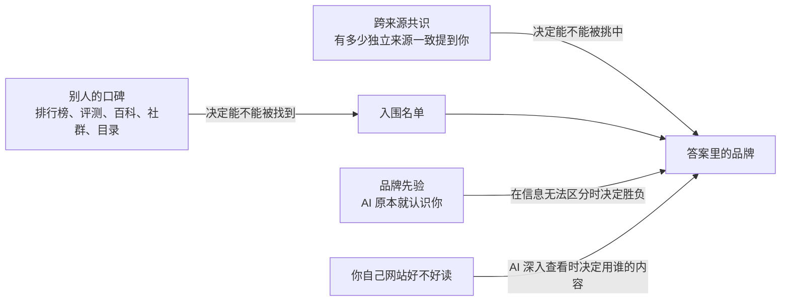

# 第 5 章　AI 比较相信别人怎么说你

> 这一章主要谈七道关的第 3 关“找不找得到你”（召回）和第 4 关“挑不挑你”（选择与排序），也会延伸到第 6 关“有没有真用你、用对没有”（吸收）。

## 先想像一个场景

以下是一个假设的情境。一位网店老板卖精选咖啡豆。她的网站做得很用心，产地介绍、烘焙说明、常见问题一样不缺，在传统搜索结果里也排在第一页。

有一天，她打开一个 AI 助手，问它：“有哪些值得买的精选咖啡豆网店？”AI 列出了五家店，里面没有她的店。她换了一个问法：“请介绍一下我这家咖啡豆网店。”这一次 AI 回答得很完整，连她主打的产地都说对了。

AI 明明认识她，推荐的时候却不提她。这一章要讲的就是这件事，答案可以先说在前面：**在 AI 眼里，别人怎么说你，往往比你怎么说自己更重要。**

## 这一章要回答的五个问题

当 AI 回答“某类产品哪个好”时，它引用的是品牌自己的网站，还是别人的网站？这是第一个问题。第二个问题接着它来：为什么“很多个来源都这么说”对 AI 特别有说服力，而这件事为什么同时也是最大的风险。第三个问题关于品牌的知名度，也就是品牌先验，它到底有多大作用，小品牌还有没有机会。第四个问题是，别人网站上提到你，和你自己网站好不好读，哪一个更重要。最后一个问题最实际：操作上应该先做什么、不该做什么。

把这五个问题放回全书的七道关，核心只有一个：AI 写进答案里的品牌，是从哪些来源、靠什么信号被挑出来的。

## 一、AI 的答案，大多建立在别人的网站上

回到全书那位很忙的图书馆员。你问他“哪一家比较好”，他不会一家一家去翻每间公司自己印的型录，而会去找“十大推荐”“A 和 B 怎么选”“用户评比”这类资料，因为这类资料一次就能比较好几家。

AI 搜索也是这样。在回答品牌、产品、服务类的问题时，它大部分的引用来自别人的网站，很少来自品牌自己的网站。这就是全书说的别人的口碑，也叫第三方来源。这里的“别人”范围很广，媒体报导与专业评测、“最佳 X 款”这一类的排行榜文章、评论平台、目录网站、百科、视频平台、社群讨论都算，连同一个行业里其他公司的页面也算在内。

为什么会这样，可以跟着 AI 走一遍。假设有人问 AI：“最适合新创公司的 X 工具是哪个？”AI 首先会把这个问题改写成几个小问题分头去搜，例如“最佳 X 工具”“X 工具比较”，这个动作叫查询扩展。这类小问题最容易捞到的，是排行榜、比较文章和评测页，某一个品牌的产品页反而不容易被捞到，而这一步决定了谁进入入围名单。接下来挑资料时，AI 比较偏好由别人说出来的评价，对品牌自己的宣传比较保留。到了写答案的时候，一个品牌会不会被写进去，就要看它有没有出现在这些别人的页面上。

所以这里有一个简单的分工。你的网站回答的是“你是谁”，别人的口碑回答的是“该选谁”。而人们在做购买决定之前问 AI 的，大多是后面那一种。

### 数字有多悬殊

研究人员在真实的 AI 搜索上反复测试，而且好几个团队在不同语言、不同 AI 平台上都得到方向一致的结果。

规模最大的一项研究涵盖 128 个品牌、13 种语言，共 167,551 条引用，其中 85.7% 来自第三方网站，只有 14.3% 来自品牌自己的网站。另一项研究分析了 149,912 条引用，品牌自己的网站只占 2.9%，同一个领域里其他公司的页面占了 75.2%；排行榜类的页面占全部引用的 21.0%，如果只看内容类的引用，排行榜占到 35.7%。

一项针对中文 AI 平台的研究用了 614 个问题，在 8 个界面上各问 3 次，共得到 160,860 条引用，其中第三方约占 69%，品牌官方网站占 12.9%。在美国的汽车类排名问题上，AI 引用第三方媒体的比例是 81.9%，引用社群来源的比例是 0；同样的问题放到传统搜索结果里，这两个比例分别是 45.1% 和 15.4%。到了电子产品类，AI 引用第三方媒体的比例更高达 92.1%。

把这几项研究放在一起看，品牌自家网站在 AI 引用中大约只占 3% 到 17%。

> **深入一点：这些数字该怎么读**
>
> 有几项研究是由提供“AI 可见度”或“监测”服务的公司做的。汽车类那一项只在单一日期测量，虽然用了很多问题，但作者本身和 GEO 服务有关联。
>
> 更重要的是，这些研究全部是描述性的测量。它们说明了 AI 现在在引用什么，并没有证明只要把品牌放上第三方页面就一定会被推荐。它们告诉你战场在哪里，不保证你去了就会赢。

引用不但偏向第三方，而且非常集中。在第一项大规模研究里，大约 80% 的引用集中在大约 18.2% 的网域上，少数网站拿走了大部分的引用。在其中 12 种语言里，维基百科在 11 种语言中是被引用最多的网站。不同 AI 引擎引用品牌自家网站的比例也不一样，一个引擎是 16.8%，另一个只有 5.8%。“哪个来源算权威”也会因市场而不同：在波兰市场，4 个人力资源和求职网站被引用的次数，大约是波兰语维基百科的 2.1 倍。

### 换一个 AI、换一种语言，名单就换了

研究人员在真实的 AI 搜索上反复测试，还发现不同来源之间的重叠非常低。把 AI 引擎和传统搜索最常引用的前 5 个网域拿来比，智慧型手机类只有 15% 重叠，笔记型电脑类只有 32%。在汽车类，不同 AI 引擎之间引用网域的相似度只有 0.096 到 0.251（这个相似度的算法是 0 代表完全不同，1 代表完全相同）。就算是同一个 AI 平台，网页版和手机 App 版引用的网域，相似度也只有 0.19 到 0.51。换一种语言提问，某些引擎几乎会换掉整套引用的网域。

这代表你在某一个 AI 上被引用，不代表在其他 AI 上也会被引用；你在传统搜索上排名很好，也不能拿来代表你在 AI 上的表现。这个比例还会因领域而不同。在一项选举信息的研究里（日本，四个会上网的 AI），政党自己的网站占了引用的 24.8% 到 44.3%，远高于品牌和产品领域。

### “第三方”到底占多少

不同的测量，数字会打架。多项测量说第三方占 69% 到 95%。但有业内人士观察到，在单一引擎的 860 个答案里，被引用最多的前 100 个网域中，有 77.4% 是厂商自己写的页面，评测平台只占 10.2%。另一位业内人士自己测过（重复多次、有对照组），在一组固定的 40 个买家问题里，约 80.9% 被引用的网域属于“一般公司与出版商的页面”；作者自己说明，这一类其实是“不属于其他任何类别”的剩余类别，并不是一个明确定义的分类。

这些数字可以同时成立，关键在于“自有”怎么定义。对某一个品牌来说，其他厂商的页面也是第三方，前面那项大规模研究里，“同一个领域其他公司的页面”就占了 75.2%。所以正确的理解是，**AI 很常引用厂商的页面，但很少引用“你自己的”页面。**

## 二、“很多人都这么说”：最强的信号之一，也是最大的漏洞

那位图书馆员还有一个习惯，他特别相信“很多人都这么说”的说法。AI 也一样。它不只看一个来源怎么说，还会看有多少个来源说了同样的话。当一个品牌在许多不同的来源里反复被提到，而且说法一致，它被写进答案的机会就会大幅上升，这就是“共识”。

可以用一个简单的对照来记。一个来源说“A 最好”，影响有限；同一个来源把这句话重复说三次，几乎不会增加影响；三个看起来彼此独立的来源都说“A 最好”，影响就明显上升。关键在于说话的是不同的人，同一个人说很多次并没有用。

这件事有两面。好的一面是，被很多独立的人认可的品牌更容易被推荐，这很接近人类靠口碑做判断的方式。坏的一面是，AI 常常用来源的数量，代替“这些来源是不是真的独立”这个问题。几个看起来各自独立、其实出自同一方的页面，也能做出一个假的共识。

### 真实平台上的观察与给定网页的实验

研究人员在真实的中文 AI 平台上反复测试，发现 AI 捞回来、放进引用里的品牌，最后只有 8.3% 真的被写进答案。一个品牌如果只出现在 1 个引用来源里，被写进答案的概率是 2.1%；如果出现在 11 个以上的来源里，概率升到 59.9%。研究人员用一个模型来预测谁会被写进答案，在这个模型里，传统 SEO 的综合质量分数，重要程度只有 4.52%。

研究人员也做了实验。这个实验是在给定网页的测试条件下做的，也就是先假设设计好的内容已经成功出现在搜索结果里，再看 AI 会不会被它带着走。他们测试了 13 种会自己上网查资料的 AI 搜索系统，平均被操纵的比例是 13.4%，最低 0%，最高 31.4%，差别主要来自 AI 模型本身。以其中一个模型为例，有 1 个来源背书时，操纵成功率是 39%；2 个看似独立的来源一致背书时是 55%；3 个时是 77%。如果是同一个来源重复出现，成功率持平，不会上升。内容在搜索结果里排第几名，则没有明显影响。

同一项研究也比较了不同手法的平均成功率：

| 手法 | 平均成功率 |
|---|---|
| 在网页代码里藏指令给 AI | 0.3% |
| 网页摘要和页面内容不一致 | 1.2% |
| 冒充权威 | 14.2% |
| 制造“多方都这么说”的假共识 | 24.8% |
| 冒充权威，再加上一串互相引用的来源 | 37.2% |

从这张表看得出规律：越像有证据的多方说法，越有效；越像偷偷藏起来的指令，越无效。

### 一整套“假证据网”，以及提醒 AI 小心也没用

下一组结果是在实验室条件下看到的，真实世界还不一定。研究对象是会自己逐页浏览、跟着链接走的 AI 搜索系统。研究人员做出一组多页内容，风格一致、说法一致、互相链接，像一个“证据生态”，结果让一个虚构产品被推荐的比例达到 67.2% 到 73.9%。只有一页内容时，推荐比例是 35.9% 到 59.0%。几种“单页改写”的技巧，都没有稳定地比完全没优化的单页更好。这里要说清楚，这项研究本质上是在测试“伪造多来源共识”这种操纵手法。

还有一个结果目前属于理论上可能、但还没被证实的阶段。模拟分析显示，表面上有好几个来源互相佐证，比单纯直接下结论更难被识别成假的。研究人员还给 AI 加上“请小心查证”的防御提示，结果 AI 确实更常去查证，但最后错误背书的比例并没有下降，反而从 28.6% 升到 38.6%。去查证了，不代表查证之后就改正了。

真实世界的测量和实验这两条线，方向是一致的，所以**共识是这一章里最可靠的机制之一**。但有两点要记住。第一，实验大多用的是虚构产品和受控的资料。第二，实验证明的是共识可以被伪造，这是一个被攻击的弱点，不是建议你去做的方法，本章最后的“别再做了”会再讲一次。

## 三、品牌先验：大品牌有先天优势，但不是无敌

AI 模型在训练的时候已经读过大量资料，所以它本来就“认识”很多品牌。这种在查资料之前就已经有的品牌印象，叫品牌先验，可以把它想成图书馆员脑中的老印象。

品牌先验有三个特点。首先，认识不等于推荐：直接点名问 AI 某个品牌，它几乎都认得，但请它推荐这一类的产品时，它常常想不到这个品牌。其次，先验是有条件的。当几个候选产品之间没有可以区分的信息时，知名品牌几乎一定赢；一旦出现评分、评论数量、价格这类可以区分的真实信息，先验就可能被打破。第三，先验越薄弱，AI 越容易被眼前读到的内容左右。对小品牌来说这是机会，只要有人写你，你就有可能被采用；但这也是风险，如果有人把你写错，AI 也可能照单全收。

### 起跑线不同，而且认识你也不等于推荐你

研究人员在真实的 AI 搜索上反复测试，在不提品牌名称的类别问题里，第一次问的时候，大品牌被提到的比例是 72.9%，中型品牌是 43.6%，小品牌是 11.4%。这份数据来自一家服务业者，而且“大、中、小”是人工划分的。

另一组在真实 AI 搜索上的反复测试看的是新产品。直接点名问某个新产品时，AI 认得它的比例是 99.4%（在另一个引擎上是 94.3%）；但在“推荐这一类产品”时，它被提到的比例只有 3.32%（另一个引擎是 8.29%）。研究人员也给这些网站打了一个“GEO 综合分数”，结果这个分数和 AI 上的可见度没有关系。同一项研究中，可见度和两件事有正相关，一是有多少个不同的网站链接到你，二是社群讨论里提到你的次数。不过这只是相关，不是因果，而且样本只有 60 个。

还有一项在真实 AI 搜索上的测量看到类似的现象：已经在外部平台有名气的创作者，在 AI 引用中也得到更多曝光。在排名靠前的创作者之间，名次每往前一位，曝光的优势大约多 4.3 到 4.8 个百分点。这同样只是相关。

> **深入一点：“相关系数”是什么意思**
>
> 研究里常用一个叫“相关系数”的数字，范围从 −1 到 +1。越接近 +1，代表两件事越常一起变高；越接近 −1，代表一件事变高时另一件事越常变低；接近 0，代表两者几乎没有关系。
>
> 在上面那项新产品研究里，网站的 GEO 综合分数和可见度的相关系数是 −0.108 和 −0.102，几乎没有关系。链接到你的网站数量和可见度是 +0.319，社群讨论提到你的次数和可见度是 +0.395，都有一定的正相关。相关不等于因果，这些数字只说明两件事常常一起出现，没有说明做了一件事就会导致另一件事。

### 先验可以被打破吗

接下来的两个结果，都属于理论上可能、但还没被证实。它们是在固定内容的模拟条件下得到的：研究人员先决定 AI 会读到哪些资料，再看它怎么推荐。

第一个结果是，可以区分的信息比品牌名气重要。当几个产品的规格完全相同时，知名品牌 100% 被推荐。但竞争者只要评分高 0.075 颗星，或评论数量多 1.6 倍，或价格低 7.3%，就有 50% 的机会胜出。在推荐结果的差异中，产品本身的参数可以解释 82.4%，品牌只占 1.2%。

第二个结果是，换一种问法就能唤醒被忽略的品牌。在 AI 不上网、只靠自己记忆的条件下，许多知名品牌的推荐比例是零。把问题改成描述需求的问法之后，某个品牌的推荐比例从 0% 升到 35.4%，再加上说明定位的线索，可以达到 81.3%。

先验薄弱也有坏处，这一点是在实验室条件下看到的，真实世界还不一定。AI 模型对某个品牌的先验越薄弱，就越容易被放进资料里的错误页面误导，跨模型比较的相关系数是 −0.65，这是相当明显的反向关系。12 个模型平均被骗的比例是 42.7%，最低 13.3%，最高 73.8%。如果只有一个被污染的页面，把它放在第 1 位时被骗的比例最高，达到 27%；放在第 2 到第 10 位时，只有 1% 到 4%。

还有一个反例，告诉我们大家都做了以后好处可能会消失。这同样是理论上可能、但还没被证实的固定内容模拟。只有一个挑战者采用 GEO 时，原本领先的品牌“继续被推荐”的比例，会从 100% 掉到 19.8%；但当所有竞争者都采用 GEO 之后，原本领先的品牌又回升到 93.8%，每个采用者得到的好处从 +0.802 降到 +0.007。这表示 GEO 的好处可能会随着采用的人变多而趋近于零，属于“你多拿一点，别人就少拿一点”的竞争。不过这是模拟结果，不能直接当成真实市场的结论。

### 这些说法各有多可靠

“大品牌更容易被推荐”有真实 AI 搜索上的测量支持。“先验可以被可区分的信息打破”目前主要来自固定内容的模拟实验，只能说机制上可能，还没有真实世界的介入实验证据。

至于“先验只在信息分不出高下时才起作用”，这个说法要修正。一项大规模研究（15.8 万个回答，属于相关性研究）发现，AI 记得的品牌，有 67% 被写进它自己的搜索词，不记得的只有 11%；排在同样位置时，它记得的网站被引用的机会是 1.6 倍；ChatGPT 有 46% 的品牌点名，没有任何引用的网页支持，等于直接凭记忆点名。也就是说，**先验在“搜什么、选谁、说谁”三个地方都在起作用。**

### 先验从哪里来：被写得多，还要和对的东西写在一起

想想人是怎么认识、理解、相信一个人的，多半是靠别人怎么说他。听很多人提过，你就记得这个名字；大家的说法一致，你就知道他是做什么的；好几个互不相识的人都说他靠得住，你才会信。AI 也很像这样。它学到的是网络上的文字，哪些名字常出现、和哪些词一起出现、在什么语气下出现。所以 AI 对你的印象，来自别人怎么写你，不一定是你实际怎么样。

我们写这本书时做过另一个实验，让 AI 依照真实人物的约 270 个标签，扮演这些人回答社会调查。结果刻板印象非常明显，例如 AI 普遍认为一位退休的黑人修车工过得不幸福。这是单一观察，原始数据没有收进本书，也还没和这些人本人的回答对照过。

不过，AI 的“别人怎么说”和人的不一样。它只数得到写下来、读得到的声音，而且不太分得出这些声音是不是彼此独立，一整套看起来各自独立、其实出自同一来源的页面，就能改变它的答案（见第二节的“假证据网”）。

再往下拆，被“写得多”和被“想得到”是两件事。写得多，AI 就认得你。在我们的记忆测试里，AI 熟悉一个知名平台，连它多年前的旧名都记得；但对一个成立几个月的新网站，它的回答和对虚构网址一样（见案例 9）。和对的东西写在一起，AI 才想得到你。前面讲过，AI 直接被问到某个新产品时，认得它的比例是 99.4%，但在“推荐这一类产品”时，只有 3.32% 会想到它；认得名字，不代表别人描述需求时会想到你。AI 记住的，也常常是“哪一类信息去哪里找”。在我们的测试里，AI 用 `site:` 点名国家游泳协会的官网时，搜的是某个年龄组的成绩标准文件；而被 AI 主动点名的网站，在同一次回答里被引用的机会明显比较高（见第 4 章、第 6 章）。所以你要累积的不只是知名度，而是让你的名字和某一类问题、某一类数据，在可信的地方反复一起出现。

这也带出两条时间线。现在靠搜索：AI 不认识你也没关系，只要你的页面对上它改写出来的查询，照样可以被大量引用，第 3 章案例 8 那个 AI 不认识的新网站，10 次里被引用 9 次。以后靠记忆：要进入下一代 AI 的记忆，至少要隔一次训练，而被抓取不等于被记住，案例 9 里 GPTBot 抓过大约 92.5% 的页面，AI 仍然不认识那个网站。

还有一个地方要提防。靠出现次数建立的信任，对已经被写得多的老牌网站有利，也可能被灌水。先验越薄，越容易被一个错误页面带偏（相关系数 −0.65，见本节前面的实验室结果）。所以比“多”更重要的，是来源可不可信、彼此是不是独立。

这一小节里每一项事实的证据强度，见各处的标注。把它们串成“印象来自文字、次数决定认得、一起出现决定想得到”，是本书的推论，还没有被直接检验过。

## 四、几股力量怎么合在一起

把前面的内容放在一起看，可以画成这样：

用文字说，别人的口碑决定你能不能进入入围名单，跨来源的共识决定你能不能被挑中，品牌先验在大家信息都差不多时决定胜负。至于你自己网站好不好读，决定的是 AI 深入查看时，答案用的是谁的内容。

### 争议：别人提到你，到底有没有独立的作用

这是目前还没有定论的问题。认为有作用的一方有两份证据。中文 AI 平台的测量显示，一个品牌在多少个来源里同时出现，是它会不会被写进答案的强力预测指标；新产品的研究也显示，链接到你的网站数量、社群提到你的次数，都和可见度正相关。

认为扣除其他因素后就没有独立作用的一方，依据的是另一项研究。研究人员在真实的 AI 搜索上反复测试，比较了 1,056 家企业、37,927 次“会自己上网查资料的 AI”的查询过程，并把条件相近的企业配成对来比较。在扣除“网站对 AI 好不好读”的影响之后，两个代表“别人提到你”和“容易被发现”的指标，对答案有没有以你自己的内容为依据、以及你有没有被明确推荐，都没有明显的额外关系。另一方面，网站好读的那一组，78% 的答案内容来自自家页面，对照组是 58%；被明确推荐的比例是 20%，对照组是 11%。

一个可能的解释是，两者作用在不同的阶段。别人提到你，决定你能不能浮现在入围名单里；你的网站好不好读，决定 AI 深入查看时，答案是用谁的内容写成的。后面那项研究只看 AI 已经进入你的网站、深入查看的情境，用的是研究方自己的评分工具，而且是配对观察，不是实验。所以两种说法不一定互相矛盾，但到目前为止，还没有研究在同一个设计里同时检验这两个阶段。

有业内人士自己测过，也提出类似的“两阶段”说法：把内容分发出去，让品牌进入 AI 会搜索的范围；页面本身的质量，决定你会不会被选中。在分发范围差不多的品牌之间，内容结构比较清楚的品牌被引用得更多。这是单一观察，没有人独立验证过。

## 五、其他还没吵完的问题

### 社群讨论和评测目录，到底有多重要

业内人士自己测出来的结论，差异非常大。有人发现，在“购买建议”类的问题上，社群内容是被引用最多的网域。也有人分析了约 16,400 个商业类问题、127,198 条引用，发现社群讨论只占 1.8%，维基百科不到 0.6%，有 90.6% 流向厂商的说明文件、产品页，以及各种小众的类别网站。另一位业内人士自己测过（重复多次、有对照组），在固定的 40 个买家问题上，社群来源的比例因 AI 引擎而不同，有的引擎约 7% 到 9%，有的接近 0%。

评测目录网站也有分歧。有一位业内人士一开始报告，“某某的替代品”这类问题比“最佳某某”这类问题更常引用目录网站（43.0% 比 3.8%）。后来他自己更正，这个差距只出现在传统搜索结果里；在 AI 的答案上，两者的比例在误差范围内是一样的。

所以，**不存在一个通用的“最重要平台”。** 来源的组成会随着 AI 引擎、行业、提问的目的、语言市场而改变。社群平台作为 AI 引用来源的角色，第 15 章会专门讨论。

我们写这本书时，自己用 API 对 ChatGPT 实际测过（方法见第 4 章；样本很小，还没有其他人独立验证）。社群讨论网站在三类题型 30 次对话里，有 24 次出现在搜索结果中，游泳题 10 次全部出现，但引用都是 0；百科和视频网站也出现过很多次，引用同样是 0。要注意，出现在搜索结果里不代表 AI 读了全文，而且这只是一个模型、通过 API 的结果。

### 网域权威还重要吗

“网域权威”指的是一个网站整体的份量，例如它存在多久、有多少其他网站链接到它。这个问题上有三种说法。有业内人士自己测过，在 18,000 多个被引用的页面里，网域层级的权威大约占“可以预测的部分”的 77%，页面本身的因素约占 23%，而且页面优化只在高权威的网域上才有效。另一位业内人士自己测过（重复多次、有对照组），发现在某一个 AI 引擎上，网域权威对引用的影响不大，反而是在 7 天内同步发布到多个平台的内容被引用得明显更多；不过样本只有 14 篇文章，作者自己也指出样本小、追踪结果有杂讯。还有业内人士观察到，其他网站链接到你，对你自己的页面被直接选中帮助有限，但 AI 挑选的那些第三方出版者，本身都是被大量链接的编辑型网站，所以链接可能是间接在起作用。这三种说法量的东西不一样，目前无法判断谁对。

### AI 引用的来源是固定的，还是一直在换

有业内人士自己测过，40 个问题、三周内大约 180 个被引用的网址里，约 70% 是反复出现的同一批第三方页面，新发布的自有页面几乎不出现。另一位业内人士自己测过，被引用的来源每个月有 40% 到 60% 会换掉。还有业内人士观察到，某个分析工具在类别问题中的被引用次数，一个月内从 8 次降到 3 次，而一个主要靠评测网站报导的竞争对手，升到 13 次。

这两种现象可能同时存在：最前面的少数页面相对稳定，后面的一长串则快速轮换。这也是只看一次结果不可靠的原因。这就像掷骰子，同一个问题问十次，答案可能不一样，所以要看“十次里出现几次”。

## 六、真实案例

以下案例都是业内人士自己测试或观察的结果，除非特别注明，都没有人独立验证过。它们用来帮助理解原理，不是证明。

### 案例 1 到 4：别人的口碑怎么把你带进答案

案例 1 是一家传统搜索排第三、在 AI 里却几乎不存在的公司。它是做仓库管理软件的企业软件公司，客户是专门替别人处理物流的公司，核心关键字在 Google 排第三名。一位业内人士自己测过（重复多次、有对照组），从 1 月开始每个月记录 40 个“推荐类”问题，ChatGPT 只在其中 2 到 4 个问题里点名这家公司。另一个在搜索结果只排第二页、链接更少的竞争对手，大约被点名 18 次。这个竞争对手有物流博客上的两篇排行榜文章、一个软件评测网站的类别页，还有一则 2023 年物流业者称赞它的社群讨论。这家公司的弱点则是，它在公司数据库、职业社交平台、评测网站上有三种不同的公司描述。后来它把第三方网站上的描述统一，同时每天发布一篇比较页，到 8 月，40 个问题中大约有 9 个会点名它。因为两件事同时进行，无法分辨是哪一件起了作用。

同一位作者还有几个观察。引用主要可以追溯到评测网站、别人写的排行榜，以及一则旧的社群讨论；行业协会的会员目录被某个 AI 引擎引用了。相反地，一年在职业社交平台上发了 200 则内容，引用是零；花 6,000 美元升级评测网站上的付费文件，也没有任何变化。这个案例对应的道理是，AI 的推荐靠别人的口碑决定，而描述一致才能形成共识。

案例 2 是一个被 AI 说错身分的产品。一位业内人士自己测过，对一个“CSV 文件汇入工具”用 8 个买家式的问题，在 ChatGPT、Claude、Gemini、Perplexity 上测试。8 次对话里它只出现 1 次，而且被描述成“ETL 工具”（一种资料搬移与转换工具），但它其实不是。有两个模型转而介绍竞争对手，用词明显来自竞争对手自己的营销文案。这个产品在传统搜索上其实做得不错，有链接，也有排名页。作者的判断是，被推荐的工具在第三方内容里都有一句清楚、反复出现的定位，没被推荐的则描述模糊或前后不一致。他在 10 天内发布了 2 篇比较文章，并更新产品说明文件，结果从 8 次出现 1 次升到 8 次出现 5 次。一致的描述构成共识，而先验薄弱时，AI 会采用手边找得到的描述，甚至包括竞争对手的说法。

案例 3 里，自家网站优化了两周没有用，一篇第三方汇整文章却改变了局面。一位业内人士自己测过，对 12 个客户页面做完整的网站内部优化，包括结构化数据、标题层级、让“实体”更清楚、网站内部链接，然后用同样的 15 个问题在 ChatGPT、Perplexity、Gemini 上追踪，每次都登出账号再问。两周后完全没有变化。第三周，有一篇把这个客户和 4 个竞争对手并列比较的汇整文章发布了，几天之内，原本看不到的两个页面开始被引用。作者自己也有保留：样本很小，无法把两件事的作用分开。他的结论是“网站内部优化是必要的，但不够”。这说明别人的口碑决定入围，也呼应前面“两个阶段”的解释。

案例 4 讲的是挤进 AI 已经在引用的排行榜。有业内人士自己测过，替一个消费品牌的助眠产品，先把目标问题下 AI 引用的所有网站列出来，再联络这些网站，请他们把客户加进已有的文章，加不进去的就改写客座文章。做了 5 篇排行榜、2 篇产品汇整之后，一周内，ChatGPT 在这个问题下把客户列在第 2 位。另一位业内人士自己测过，一个新上市的能量饮料品牌，发现 Google 的 AI 摘要反复引用 3 到 4 个“最佳某类饮料”的评测博客，争取被这些博客收录之后，几天内就和大品牌一起出现在 AI 摘要里。要注意的是，这两位作者都是专门替人争取外部链接、做对外联络的从业者，结果属于自己陈述。它们说明的道理是，挤进 AI 已经在读的页面，比自己新写一页、等 AI 发现更直接。

### 案例 5 到 7：认识你、改写你的，都是别人

案例 5 再一次说明，认识你不代表推荐你。有业内人士自己测过，用三个“帮我找高阶主管教练”的问题，在两个 AI 引擎上测试，共 6 组结果。业内知名度最高、有数百万追踪者的一位教练，只出现 1 次；但直接问 AI“请介绍这位教练”，两个引擎都给出详细又正确的回答。AI 认识他，只是推荐时不提他。

另一位业内人士自己测过（重复多次、有对照组），20 家在最近 18 个月内完成 A 轮以上融资的印度新创公司，在不提品牌名的类别问题里，有 17 家完全没出现，但直接问“某某是什么”时，AI 大多能正确回答。有出现的那 3 家，都有真实的社群讨论、有结构的比较页，以及评论的标记。还有一位业内人士自己测过（重复多次、有对照组），用 82 个带购买意图的问题，在 4 个 AI 引擎上各问 3 次。拿到融资的新创公司，被引用的比例是 6% 到 13%；原本就在市场上的大公司是 32% 到 62%。唯一超过两位数的新创类别是“向量数据库”，达到 34%，作者推测原因是这类产品从多年前就被技术博客大量讨论。另外，通过新闻稿发布平台的转载没有帮助，在其中一个引擎上甚至略有负面效果。这些观察都指向同一件事：认识不等于推荐，而先验来自长期累积的第三方讨论。

案例 6 显示，在某些行业，聚合平台就是排名本身。有业内人士自己测过，向 Google 的 AI 模式提出 510 个问题，内容是土耳其 30 个目的地的饭店。在得到的 481 个答案里，98% 至少引用了一个订房平台，最大的单一订房平台出现在 74% 的答案里，饭店自己的网站几乎从来没被直接引用。也有业内人士自己测过，在 1 万多个 ChatGPT 购物问题里，零售网站占了全部引用的 89% 到 99%；在另一组 8,520 个女装类问题里，零售平台被引用的次数比多数品牌官网都多。还有业内人士自己测过，ChatGPT 推荐手机应用程序时，将近一半（47.5%）的引用来自应用程序商店可以被爬虫读取的网页版列表，作者自己提醒，这些比例变动很大，只是某一时刻的状况。在由聚合平台主导的行业，**你在平台上的列表质量，就是 GEO 的主战场。**

案例 7 是品牌形象被别人改写。有业内人士自己测过，连续六周，每周用同样的类别问题测试三个竞争品牌。其中两个品牌的描述明显变了：一个原本被称为“分析工具”，后来被改称为另一类平台；另一个多了“整合能力有限”的批评。这两次改变都不是来自这些公司自己发布的内容，分别追溯到一个小众社群里的直接比较讨论，以及几则互动很多的论坛留言。另有业内人士观察到，一家公司的维基百科条目被“软删除”之后，AI 和搜索引擎对这个品牌的辨识变得不一致，甚至把其他东西和这个品牌名连在一起；这家公司加强了自己的网站、结构化数据和其他地方的提及，也没能补回来。先验薄弱时，别人的说法会直接变成 AI 的说法。

### 案例 8 和 9：被提到、被引用、被记住

案例 8 说明，被推荐的品牌和被引用的网站是两回事。有业内人士自己测过，在 12 天内分析三个 AI 引擎的 180 则运动鞋推荐，共有 1,783 条引用、250 个网域。最常被推荐的品牌，它的官网只被引用 2 次，其中一个引擎在全部 180 个答案里引用品牌官网的次数是 0，主要的来源是视频平台、评测网站、时尚媒体和社群。

另一位业内人士在罗马尼亚用当地语言，向 5 个 AI 界面提出 18 个买书相关的问题，相隔一周各跑一轮，共得到 180 个答案。其中 58% 的答案没有推荐任何一家书店，市场领导者只出现在大约五分之一的答案里，排名每周都被重写。测试里还出现了“幽灵品牌”：有些网站被 AI 拿来当作价格和书单的来源，答案却推荐了别家。反过来，一个有 35 年历史的文化品牌被推荐了 13 次，但它的网站一次都没被引用，完全靠 AI 的记忆被推荐。也有业内人士观察到，在单一引擎里，点名某家公司的答案中，只有 47% 同时引用了这家公司的网站。所以“被引用”（答案附上你的链接）和“被提到”（答案写出你的名字）是两个不同的指标，必须分开测量。

案例 9 是 AI 不认识新网站，却记得老平台多年前的旧名。我们写这本书时，自己用 API 对 ChatGPT 实际测过（方法见第 4 章；样本很小，还没有其他人独立验证）。这次关掉上网搜索，要求 AI“不确定就说不知道”，每个问题问 5 次。对第 3 章案例 8 的新网站，AI 5 次都说不熟悉，和对一个虚构网址的回答一样；问它这个网站特有的分级名称和网址结构，5 次都说不知道；请它凭记忆列出“提供招募成绩标准的网站”，5 次都没有它。对一个知名的游泳数据平台，AI 5 次都能具体描述，而且 5 次都提到它多年前的旧名，可见记忆会过时。

这次测试还看到两件事。第一，记忆不一定来自网站本身。这个知名平台挡掉了 GPTBot，AI 仍然很熟悉它，记忆可能来自别人提到它，或是封锁之前的旧资料，这只是推测。AI 记住的是“哪个网站有哪一类数据”，它用 `site:` 指名国家游泳协会的官网时，搜的是某个年龄组的成绩标准文件。第二，被抓取不等于被记住。根据新网站自己的服务器日志（网站方自己分析的，没有独立验证），GPTBot 在 2026 年 7 月到 8 月 20 日之间抓过大约 92.5% 的页面，但测试时的 AI 仍然不认识它。从被抓取到被记住，中间至少隔着下一次训练。这个测试只有一个模型、一个主题，没有人独立验证。它对应的是第三节讲的品牌先验：新网站在下一代 AI 出现之前，只能靠搜索被找到，第 3 章案例 8 正是这样。

## 本章要点

在品牌和产品类的问题上，AI 引用的大多是第三方来源，品牌自家网站在不同研究中只占约 3% 到 17%。这是多项大规模测量的一致结论，但属于描述性的证据。好几个看似独立的来源都说同一件事，是影响 AI 挑选最强的信号之一；同一个来源重复说，几乎没有用。这个共识机制可以被伪造，是目前最大的被攻击弱点，做 GEO 的人应该争取真正独立的来源，不要制造假共识。

品牌先验决定起跑线，大、中、小品牌在类别问题里的可见度约为 73%、44%、11%。但认识不等于推荐，先验主要在信息无法区分时起决定作用。先验越薄弱，AI 越容易采用第三方的描述，包括竞争对手的说法和错误的说法，所以小品牌必须主动管理自己在别人网站上被怎么描述。

别人提到你，和你自己网站好不好读，作用在不同的阶段：前者决定你能不能浮现，后者决定 AI 深入查看时用谁的内容，两者之间的关系仍有争议。权威来源会因 AI 引擎、行业、语言市场而不同，没有通用的“最重要平台”，应该先画出你自己品类的来源地图，再决定去哪里。测量时要分开不同的 AI 引擎，每个问题问很多次，“被引用”和“被推荐”分开记录，并保留对照组。

## 一句话记住

**你的网站告诉 AI“你是谁”，别人的口碑告诉 AI“该选谁”；而且要很多个真正独立的人，一致地这么说。**

## 你明天就能做的事

1. 先画出你的来源地图。列出 30 到 50 个真实买家会问的问题，例如“最佳某类产品”“A 和 B 比较”“某某的替代品”，在好几个 AI 引擎上反复问，记下每一个被引用的网址，再按网站分类。有业内人士自己测过，在一次 200 个问题的检查中，60% 的引用集中在 7 个网站上，而且大多不在他们原本的公关目标名单里。“第三方占多数”和“引用很集中”，研究人员在真实的 AI 搜索上反复测试过；具体的操作流程，来自业内人士的自己测试。
2. 找出差距，列成对外联络清单。“竞争对手被引用、你却缺席”的页面，就是你的联络清单。优先争取 AI 已经在引用的排行榜、比较文章、评测页把你收进去，不要自己另写一篇新文章等着被发现。这一点业内人士自己测过，好几个互相独立的案例方向一致，但都没有人独立验证过。
3. 统一你在各处的描述。在你网站的“关于我们”、公司数据库、评测网站、职业社交平台、目录网站上，都用同一句话说清楚“你是什么、为谁服务”，定位要具体到某一个行业或使用情境。共识的作用，在给定网页的测试条件下、以及在真实 AI 搜索上都有测量支持；描述一致本身的作用，是业内人士自己测过（重复多次、有对照组）。
4. 争取好几个真正独立的来源，也就是不同的出版者、不同的作者、不同类型的平台。同一个来源重复说，几乎不加分，这是在给定网页的测试条件下看到的：同一来源重复出现不会提高效果。
5. 提供可以区分你的真实信息，例如评分、评论数量、价格、具体规格、实际成效的数据。如果你和别人的信息看起来都差不多，大品牌的先验就会胜出。这一点属于理论上可能，但还没被证实（模拟分析）。
6. 依行业找出真正的“在地权威”。在由聚合平台主导的行业，例如饭店、零售、手机应用程序，你在平台上的列表完不完整就是主战场；在小众行业，关键来源可能是行业刊物、协会的会员目录；不同语言市场，最重要的来源也不一样。市场之间的差异，研究人员在真实的 AI 搜索上反复测试过；行业之间的差异，来自业内人士的自己测试。
7. 让别人把你和具体需求写在一起。让第三方内容把你和“某个具体问题加上某个具体用途”写在一起，不要只是顺便提到你的品牌名。这一点属于理论上可能，但还没被证实（模拟分析显示，描述需求的问法能唤醒原本被漏掉的品牌）。
8. 你自己的网站照样要让 AI 读得懂。别人提到你，让你浮现；你的网站好读，让 AI 深入查看时用的是你自己的内容，而不是竞争对手或第三方的描述。这来自研究人员在真实的 AI 搜索上的反复测试（服务业者做的研究，配对观察）。
9. 分开不同的 AI 引擎，每个问题问很多次。看“有没有被提到”，每个问题至少跑 3 次才相对稳定；看“AI 对你是正面还是负面”，至少要 10 个问题才相对稳定；也有研究让每个问题重复问 40 次。“被引用”和“被推荐”要分开记录。这些做法有研究人员在真实的 AI 搜索上反复测试，也有模拟分析支持。
10. 保留一组对照问题。固定一部分问题不做任何改动，但照样追踪；如果对照组和你改动的那一组一起变化，那是 AI 引擎自己变了，不是你的工作起了作用。这是业内人士观察到的方法建议。

要等多久才会看到效果，目前没有可靠的通用数字，各案例差异很大。业内人士的自己测试里，有“几天内”“一周内”“10 天”的例子，这些大多发生在会即时上网搜索的 AI 引擎上，或是挤进了 AI 本来就在引用的页面。也有业内人士观察到，需要 6 周、60 到 90 天、约 3 个月，甚至 5 个月，结果才稳定出现。好几位业内人士观察到，会即时上网搜索的引擎，比依赖训练数据的引擎更早反映新的来源，有人估计早 3 到 4 周。**如果只在一个反应慢的引擎上测，很容易误以为没有效果。**

## 别再做了

**别再伪造“很多人都这么说”。** 自己架好几个看似独立的网站、协同发文、灌评论，都属于这一类。实验显示这确实能操纵会自己上网查资料的 AI，但它是操纵手法，而且防御方法已经出现：在实验室条件下，如果按照出版者的类型重新排列来源，编辑型内容优先，其次是商业内容，最后是用户自己产生的内容，被骗的比例可以降低 8.4 个百分点，而且不会影响正常的推荐。

别在网页里藏指令给 AI。在给定网页的测试条件下，藏起来的指令平均成功率只有 0.3%，几乎没有用。同样地，制造稀缺感、设置价格锚点、强调“不买就会损失”这类销售话术也不必用，理论上的模拟分析显示，这类写法让品牌胜出的比例只有 9.6% 到 12.9%。

别把新闻稿发布平台的转载当成媒体报导。有业内人士自己测过，在新闻类的问题里，新闻稿只占引用的 4%，原创报导占 73%，转载平台的转发对新创公司没有帮助。不过也有业内人士观察到，写得像一篇正式文章的新闻稿偶尔会被引用，这是少数例外。

别在自己网站上写“最佳某类产品”排行榜、把自己排第一，指望 AI 相信。有业内人士自己测过，好几个大量发布这类自家排行榜的客户，在 50 个问题上的被提到比例突然下降。作者怀疑自家网站上的自我推荐被降低了份量，但这没有经过验证；此外，AI 整体上本来就偏好由别人说出来的评价。

也别期待付费升级平台上的文件，或大量发文，就会直接带来引用。有业内人士自己测过，这两件事都没有作用（见案例 1）。这只是单一案例，当作提醒。

### 已经过时的做法

用 Google 排名代表你在 AI 上的可见度，已经不成立了。好几个案例显示，搜索排名很前面的品牌在 AI 答案里完全缺席，AI 引擎和传统搜索引用的来源重叠也很低。

只优化自己的网站也不够。你的网站仍然必要，尤其是在别人直接搜索你品牌名称的时候，以及 AI 深入查看你网站的时候；但在“该选谁”这类问题上，你的网站常常根本不在 AI 搜索的来源里。

只看一次结果的可见度报告，同样过时了。来源和推荐每周都在变，只看一次，会让你以为结果比实际上更精确。

## 还不确定的事

**别人提到你，有没有独立的作用？** 一方的测量说有；另一方的研究说，扣除“网站好不好读”之后就没有。可能的解释是两者作用在不同阶段，但还没有研究在同一个设计里同时检验。

**“第三方”到底占多少？** 从 69% 到 95% 都有，也有测量显示厂商页面占大多数，差别主要来自“自有”怎么定义。能确定的是，AI 很少引用你自己的页面。

**社群讨论和评测目录有多重要？** 不同的业内测试，从“最常被引用”到“只占 1.8%”都有，而且因 AI 引擎而异，没有通用的“最重要平台”。

**网域权威还重要吗？** 有人说它占可预测部分的 77%，有人说在某个引擎上影响不大，也有人说链接可能是间接起作用。三种说法量的东西不同，目前无法判断。

**AI 引用的来源是稳定的，还是一直在换？** 有测试说约 70% 反复出现，也有测试说每月换掉 40% 到 60%。可能是最前面的少数稳定、后面的一长串轮换。

**品牌先验真的能被打破吗？** 目前主要来自固定内容的模拟实验，机制上可能，但还没有真实世界的介入证据。

**大家都做 GEO 之后，还有没有好处？** 模拟显示好处可能趋近于零，但这不能直接当成真实市场的结论。

**共识效应在真实世界有多强？** 实验多用虚构产品和受控资料，真实世界的效果大小还不确定。

**要多久才见效？** 从几天到 5 个月都有，没有可靠的通用数字。

**怎样才会被下一代 AI 记住？** 目前只有“长期累积、靠别人提到你”的机制推论，没有直接证据。在我们的测试里，一个被 AI 爬虫抓过九成以上页面的新网站，AI 仍然不认识它。
