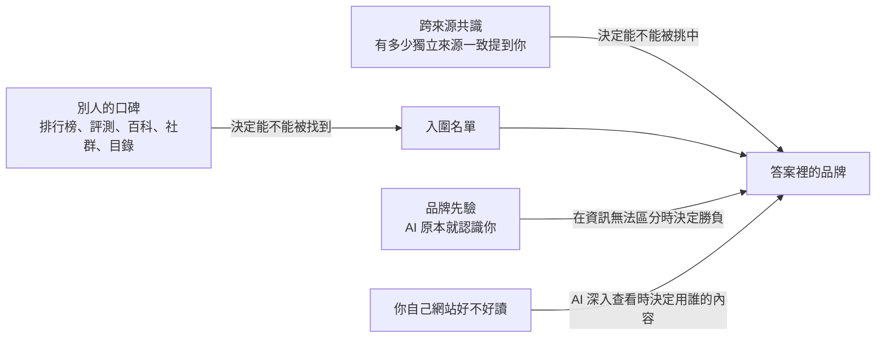

# AI 為什麼不推薦你？
## 寫給所有人的 GEO（生成式引擎優化）入門

> 本書是《GEO 教材・研究版》的通俗改寫：研究版的每一條結論、數字、爭議、案例和做法都在本書中，只把講法換成白話。想查證據細節，請看研究版同一章。

## 目錄


**開場：先學會不被騙**

- [第 0 章　先學會不被騙：怎樣讀 GEO 的證據](第00章_先學會不被騙.md)（約 13,995 字）

**第一部：AI 回答你之前的七道關**

- [第 1 章　AI 回答前的七道關](第01章_AI回答前的七道關.md)（約 13,017 字）
- [第 2 章　AI 根本沒去查，你寫再好也沒用](第02章_AI根本沒去查.md)（約 9,661 字）
- [第 3 章　AI 進得了你家的門嗎？](第03章_AI進得了你家的門嗎.md)（約 19,166 字）
- [第 4 章　AI 搜的不是你打的那句話](第04章_AI搜的不是你打的那句話.md)（約 15,911 字）
- [第 5 章　AI 比較相信別人怎麼說你](第05章_AI比較相信別人怎麼說你.md)（約 15,082 字）
- [第 6 章　入圍了，AI 為什麼還是不挑你？](第06章_入圍了為什麼還是不挑你.md)（約 12,511 字）
- [第 7 章　被列出來，不等於被用上](第07章_被列出來不等於被用上.md)（約 13,706 字）

**第二部：做什麼有用、怎麼知道有沒有用**

- [第 8 章　寫作技巧也有保存期限](第08章_寫作技巧也有保存期限.md)（約 15,028 字）
- [第 9 章　AI 在擲骰子：怎麼量，才不會騙自己](第09章_AI在擲骰子.md)（約 16,924 字）
- [第 10 章　被 AI 點名了，然後呢？](第10章_被AI點名了然後呢.md)（約 15,419 字）
- [第 11 章　AI 會被騙嗎？](第11章_AI會被騙嗎.md)（約 13,894 字）
- [第 12 章　每個 AI 都有自己的口味](第12章_每個AI都有自己的口味.md)（約 17,295 字）

**第三部：真實案例**

- [第 13 章　AI 認識你，為什麼不推薦你](第13章_AI認識你為什麼不推薦你.md)（約 26,627 字）
- [第 14 章　被引用一萬次，卻沒人點進來](第14章_被引用一萬次卻沒人點進來.md)（約 23,269 字）
- [第 15 章　社群上的口碑，AI 真的聽得到嗎？](第15章_社群口碑AI聽得到嗎.md)（約 16,156 字）

**結語**

- [第 16 章　結語　還沒有定論的問題](第16章_結語_還沒有定論的問題.md)（約 14,507 字）

全書約 272,168 字（不含空白）。

附：[術語表](_術語表.md)（含英、法、西、簡中對照）


---

# 第 0 章　先學會不被騙：怎樣讀 GEO 的證據

## 先講一個場景（假設的）

想像一下：一位網店老闆，賣手工咖啡豆。某天，她收到一份很漂亮的簡報。

簡報第一頁寫著大字：「做 GEO，AI 可見度最高提升 40%。」第二頁是一張截圖：某個品牌出現在 ChatGPT 的答案裡，旁邊畫了紅圈。第三頁寫著：「一個網站做完優化，來自 ChatGPT 的流量漲了 5.7 倍。」最後一頁寫著：「業內都知道，這樣做一定有效。」

她有點心動。有數字，有截圖，有案例，還有「大家都知道」。

這一章要教你的，就是在這種時刻先停一下。不是說簡報一定在騙人，而是你要學會問幾個問題。問完之後，你會發現：那個 40% 是真的，那個 5.7 倍也是真的，但它們說的都不是你以為的那件事。

這一章要回答五個問題：

1. 「GEO 能提升 40% 可見度」這類數字，到底是在什麼條件下測出來的？
2. GEO 研究有哪幾種做法？哪一種的結論最接近真實世界？
3. 為什麼同一個問題問兩次、換一個 AI、換一個語言，結果就不一樣？這對「證明有效」代表什麼？
4. 做這行的人的經驗、賣服務的業者的報告、社群裡大家的共識，各自該信到什麼程度？
5. 拿到任何一份 GEO 主張或報告時，要按什麼順序檢查？

---

## 這一章只講一個道理

**GEO 的每一個數字，都帶著「條件」。把條件拿掉，數字就會誤導人。**

就像藥盒上寫「有效率 90%」。你得先問：在誰身上試的？吃了多久？跟什麼比？GEO 的數字也一樣：在哪裡量的？量的是什麼？跟什麼比？

這一章是全書的「驗貨課」。後面每一章講到任何做法，都會標明證據有多強。這一章先教你那套標準，讓你以後自己也會驗貨。

---

## 一、AI 回答問題要過七道關，一個研究通常只量一兩道

### 1.1 AI 搜尋不是一張固定的排行榜

很多人以為 AI 搜尋像一張排行榜：你排第幾名，就是第幾名。其實不是。

AI 搜尋更像一條流水線。你的內容要一關一關往前走，每一關都可能被刷掉。而且每一次走的結果都帶有隨機性。

回想全書的比喻：AI 像一個很忙的圖書館員。你問它一個問題，它要經過七道關，才會把答案交給你：

1. **要不要去查**（觸發）
2. **進不進得了門**（可達性）
3. **找不找得到你**（召回）
4. **挑不挑你**（選擇與排序）
5. **提不提你**（引用）
6. **有沒有真用你、用對沒有**（吸收）
7. **人會不會過來**（用戶行為）

老闆真正在乎的，通常是最後一關：客人會不會上門。但一項研究通常只量其中一兩關。

所以每看到一個結論，先問三件事：

- **它量的是哪一關？**
- **它用的是哪一個 AI 系統？**
- **它是在什麼條件下量的？**

### 1.2 拆開那個「40%」

「GEO 最高提升 40%」這個數字流傳很廣。我們把它的條件一條一條攤開：

| 條件 | 實際情況 |
|---|---|
| 網頁需不需要先被 AI 找到？ | 不需要。研究人員直接把網頁放進 5 篇準備好的候選資料裡 |
| 由誰寫答案？ | GPT-3.5（一個較舊的 AI 模型） |
| 量的是什麼？ | 答案裡有多少字來自這個網頁，也就是「字數份額」。從 19.3 升到 27.2，相對提升約 40% |
| 它不代表什麼？ | 不代表更容易被 AI 找到，也不代表流量增加 |

用白話說，它回答的問題是：「如果你**已經**在圖書館員手上那一小疊書裡，把內容改寫一下，它會不會多用你幾句？」答案是：會。

但老闆問的是：「我能不能擠進那一小疊書？客人會不會來？」這個研究沒有回答。

**數字本身沒有錯。錯的是把它從條件裡拿出來，說成「做 GEO 就能多 40%」。**

---

## 二、研究走過四個階段：越早期，數字越樂觀

要理解一項研究，先看它屬於哪個階段、在回答什麼問題。GEO 研究大致走過四代：

| 世代 | 時間 | 主要問題 | 得到的答案 |
|---|---|---|---|
| 第一代 | 2023–2024 | 改內容，能不能改變你在 AI 答案裡的可見度？ | 可以 |
| 第二代 | 2024–2025 | 這種影響，能不能被人惡意操縱？ | 可以 |
| 第三代 | 2025 | 這些技巧，能不能搬到別的 AI、別的行業也有效？ | 很難；而且大家其實在搶同一塊有限的位置，你多一點，別人就少一點 |
| 第四代 | 2026 | 放回完整的七道關之後，還剩多少效果？怎麼量才可靠？怎麼管理？ | 還在研究中 |

越早期的研究，越可能是在簡化條件下得出的樂觀數字。

所以當有人引用一個早期數字時，要追問：**後來的研究有沒有在更真實的條件下重做一次？**

---

## 三、為什麼簡化過的實驗，數字總是比較好看

### 3.1 「直接塞給 AI」的實驗，跳過了淘汰

有一種常見的實驗做法，叫「固定上下文」實驗。意思是：研究人員直接把網頁交給 AI 模型，跳過「找不找得到你」和「挑不挑你」這幾關。

這樣做的好處是方便控制變數。壞處是：流水線前段的淘汰，全部不算了。

兩種做法的差別，可以這樣畫：

```
固定上下文實驗：  [你的網頁已經在候選資料裡] → AI 寫答案 → 測量

完整流程：        提問 → 搜尋（可能被刷掉）→ 重新排序（可能被刷掉）
                  → 只取前幾名（可能被刷掉）→ AI 寫答案 → 測量
```

完整流程裡，你的網頁在每一關都可能被淘汰。簡化實驗直接讓你站在最後一關，數字當然好看。

### 3.2 一個鮮明的例子：騙 AI 的手法，放回完整流程後大幅失效

研究人員在可控的實驗系統裡，測試了一批「提示注入」手法。提示注入就是在網頁裡藏指令，企圖操控 AI 的回答。

在簡化的固定上下文條件下，這批手法曾被報告有約 80% 的成功率。

研究人員把同一批手法放進完整的「搜尋 → 重新排序 → 寫答案」流程後：

- **通用型的「蓋過指令」手法**：在搜尋這一關就損失了約四成，從頭到尾的成功率只剩約 14.7%。
- **一種較技術性的手法**（用數學方法反覆微調文字來攻擊模型）：從頭到尾的成功率不到 2%。
- **只有一類手法還有效**：改寫內容、同時保持和提問高度相關的注入，從頭到尾仍有約 40%–54% 的成功率。

從 80% 掉到這個程度，差距幾乎全部來自同一件事：**有沒有經過「被搜到」這一關。**

### 3.3 「直接看數據」也會高估

不只簡化實驗會高估，直接看現成的觀察數據也會。

研究人員在可控的實驗系統裡，比較「排名位置」對「被 AI 引用」的影響。同一件事，用三種方式量，得到三個很不一樣的答案：

| 測量方式 | 排第 1 名和排第 5 名，被引用機會差多少 |
|---|---|
| 直接看觀察數據 | 差 42.3 個百分點 |
| 受控重放：只換位置，其他都不動，再測一次 | 差 7.9 個百分點 |
| 換一批事先留下、沒用過的資料再重放 | 差 0 |

為什麼差這麼多？因為在觀察數據裡，排第 1 名的內容本來就比較相關、比較權威。它被引用多，不一定是因為「位置」，而可能是因為「內容本身比較好」。這些混在一起、會干擾判斷的因素，叫做混雜因素。

把混雜因素拿掉之後，「位置本身」的效果大幅縮小，甚至消失。

### 3.4 記住這條規律

**凡是跳過某一關的研究，或沒有把混雜因素分開的研究，結論都偏樂觀。**

---

## 四、證據有多強：六種研究做法

這本書用固定的說法來標示證據有多強。你在其他地方看到任何研究，也可以用同一把尺自己歸類。

### 4.1 六種做法一覽

| 研究做法 | 本書會怎麼說 | 能回答什麼 | 不能回答什麼 |
|---|---|---|---|
| 真實用戶實驗（隨機分組，或接近隨機分組的比較） | 「有大規模的真實用戶實驗證明……」 | 做了之後，真實的流量和訪問有沒有變 | 通常只有一個網站或平台，很難推到別人身上 |
| 在真實 AI 搜尋上反覆測試 | 「研究人員在真實的 AI 搜尋上反覆測試，發現……」 | 商業 AI 產品實際引用誰、有多不穩定 | 多半是觀察，看到的是「一起出現」，不是「誰造成誰」 |
| 給定網頁測試 | 「在給定網頁的測試條件下……」 | AI 讀到這一頁之後怎麼用它 | 跳過了「AI 自己會不會找到這一頁」 |
| 可重現的實驗系統 | 「在可控的實驗系統中……」 | 在一條完整、但用公開工具搭的流程裡，因果效果有多大 | 公開工具搭的流程，不等於商業產品 |
| 模擬或理論 | 「理論上可能，但還沒被證實」 | 機制上有沒有可能 | 不能當成真實世界的結論 |
| 讓 AI 當評審打分 | 這不是一個獨立的等級，而是一種**量尺**，上面任何一種研究都可能用到 | 大量自動打分 | 評分本身可能不可靠 |

### 4.2 真實用戶實驗：最接近「到底有沒有用」，但數量極少

這類研究直接看真實流量或真實訪問。它最接近老闆想知道的答案。

可惜這類研究目前很少，而且多半是平台或網站自己做的。下面兩個真實例子，說明它的價值，也說明它的陷阱。

#### 例一：5.7 倍，其實大部分是整個平台在成長

一個網站做了一整套針對 AI 回答的優化。之後，來自 ChatGPT 的推薦流量，在觀察期內漲了 5.7 倍。

聽起來很驚人。但同一個網站上，**完全沒做優化的頁面**，同一段時間也漲了 3.5 倍。原因是 ChatGPT 本身的用戶在快速增加，所有頁面都跟著漲。

研究人員把「沒做優化的頁面」當作對照組，用一種專門分析「某個時間點前後，趨勢有沒有突然跳一階」的方法（中斷時間序列分析）來計算。扣掉平台本身的成長之後，真正能算在優化頭上的跳升，大約是 1.8 倍。換幾種算法檢查，結果落在 1.8 到 2.3 倍之間。

但還有幾個保留：

- 研究人員還做了「安慰劑檢驗」，也就是假裝在別的時間點做了優化，看會不會也「看到效果」。這個檢驗的結果只達到「有跡象」的程度，還稱不上確定。
- 那次優化是好幾項措施一起做的，沒辦法分辨是哪一項起作用。
- 同一段時間，來自傳統搜尋的自然點擊反而下降了約 25%。研究裡也看不到「做 AI 優化會順便帶動傳統搜尋」的證據。

**教訓：原始倍數大部分是平台整體在成長，不是你做對了什麼。**

同一項研究裡，還出現過單日 38.2 倍的尖峰。這種單日數字，更不能當成優化的效果。

#### 例二：自己測自己，數字要自己核對

一個圖片平台自己做了測試。它的做法是：替內容加上和用戶搜尋意圖對得上的註釋，再建立合集頁和內部連結。

它做了 4 週的 A/B 測試，也就是把用戶隨機分成幾組，比較結果：

- 開啟這些功能的組，訪問量是對照組的 1.18 倍。
- 關閉相關功能的組，訪問量是對照組的 0.82 倍。

看起來不錯。但細讀同一份報告，有好幾處數字對不上：

- 正文說「相關性提高 19%」，但表格裡的數字對不上。
- 正文宣稱流量提升 20%，但分項表格裡的提升只有 +0.83% 到 +1.83%。
- 報告提到「生成式搜尋流量 9.2 倍」，卻沒有說明這個指標是怎麼定義的。

**教訓：就算是最高等級的研究做法，也要核對正文和表格的數字是否一致、指標有沒有定義。** 而且做實驗的就是平台自己，也就是結果的受益者，這一點也要放在心上。

### 4.3 在真實 AI 搜尋上反覆測試：很有現實感，但多半只是觀察

這類研究直接向 ChatGPT、Perplexity、Google 的 AI 摘要等真實產品提問，記下它們引用了誰、推薦了誰。

它的強項是：反映商業產品真實的行為。

它的弱項是：大多只能描述「誰被引用了」，無法證明「改了什麼，就會被引用」。

請特別注意「反覆」兩個字。有些研究只在某一天跑一次提問，嚴格來說只是一張快照。下一節你會看到，一張快照的誤差，可以大到讓結論完全不成立。

### 4.4 給定網頁測試和實驗系統：各缺一段

- **給定網頁測試**：研究人員手動把網址交給商業 AI 產品。後半段「AI 寫答案」是真的，但缺了前半段「AI 自己去找到你」。
- **可重現的實驗系統**：研究人員用公開的搜尋工具、排序工具和 AI 模型，自己搭一條完整的流程。因果關係比較乾淨，但這條流程終究不是商業產品。

兩者都有價值。但兩者都不能直接說成「在 ChatGPT 上這樣做就有效」。

### 4.5 模擬和理論：只說明「有可能」

直接把網頁塞給 AI 的固定上下文實驗、用電腦假扮用戶的模擬、數學推導，都屬於這一類。在所有 GEO 研究裡，這一類數量最多。

它們適合提出假設、解釋背後的機制，不適合當作實際操作的依據。本書遇到這類證據，一律寫成「理論上可能」或「機制上可能」。

### 4.6 讓 AI 當評審：評審自己也要被檢查

很多研究用一個 AI 模型來打分。例如：這句話有沒有被來源支持？這段內容相不相關？

問題是：當評審的 AI 本身也會出錯。

有一項在真實 AI 搜尋上反覆測試的研究，讓 AI 判斷「這句話有沒有被來源支持」，再和真人的判斷比對。在 100 個樣本上，兩者的一致程度（相關係數）只有 0.62。相關係數是 0 到 1 之間的數字，1 代表完全一致；0.62 只算中等。研究者自己也承認，這限制了他們核心指標的可信度。

所以讀到「用 AI 打分」的研究時，要問三件事：

1. 有沒有和真人的判斷比對過？比對了多少個樣本？一致程度多高？
2. 當評審的 AI，和被評的 AI，是不是同一家公司、同一個模型？
3. 評分標準有沒有公開？換一個評審 AI，結論還成立嗎？

---

## 五、擲骰子：同一個問題，每次答案都可能不一樣

這是全書最重要的觀念之一。

AI 回答問題，有點像擲骰子。同一個問題問十次，答案可能不一樣。**這不是測量失誤，而是這類系統本身的性質。**

所以任何「只看了一次」的結論，都要先保留懷疑。要看「十次裡出現幾次」，不要看「排第幾名」。

### 5.1 同一個問題，問兩次

研究人員在真實的 AI 搜尋上反覆測試，發現：

- **兩次引用的網站，常常只有三分之一到一半相同。** 把同一個問題重複問，比較兩次答案引用的網站：Gemini 的相似度中位數約 0.29–0.31，SearchGPT 約 0.33–0.40，Perplexity 約 0.50。
- **要量準，需要問很多題。** 如果想把某個網站的「被引用份額」估計到誤差範圍只有正負幾個百分點（誤差範圍總寬度 5 個百分點以內），Gemini 需要約 30–50 條提問，Perplexity 需要約 90–100 條，SearchGPT 需要 150 條以上。
- **第一推薦也會換人。** 同一句提問重複問 6 次，6 個提問裡有 4 個的「第一推薦」會變。
- **「有沒有提到你」比較穩，「怎麼評價你」很不穩。** 一家業者的長期追蹤數據顯示：品牌「有沒有被提到」接近是或否，相對穩定；但「評價是正面還是負面」翻來翻去的頻率，約是「有沒有被提到」的 6.7 倍。這家業者建議：「有沒有被提到」至少跑 3 次，「正面或負面」至少用 10 個提問，結果才比較穩定。這是從觀察得到的建議，不是嚴格實驗的結論。

> **深入一點：相似度是怎麼算的？**
> 研究裡用的是一種叫 Jaccard 相似度的算法：把兩次答案都引用到的網站數，除以兩次答案一共引用到的所有網站數。0 代表完全不同，1 代表完全相同。「中位數」則是把很多次比較的結果由小到大排好，取正中間那一個，避免被極端值拉走。
> 「誤差範圍」在研究裡叫「95% 信賴區間」，意思是：真正的數字，有很高的把握落在這個範圍裡。範圍越窄，量得越準。

在可控的實驗系統裡，也能看到同樣的現象：

- 每次只讓 AI 寫一次答案時，約 15% 的「引用或不引用」決定，重來一次就會翻轉。
- 研究人員觀察到的效果差異，約 45% 來自 AI 寫答案時本身的隨機性。

還有一項大規模檢查，對象是某個社群平台自己的 AI 搜尋：

- 同一個問題重新查一次，只有約 41.8% 的情況拿回完全相同的來源。
- 但當 AI 搜回來的資料相同時，89.6% 的答案幾乎一模一樣。

這說明：**變來變去的主要是「搜到什麼」，而不是「怎麼寫」。**

### 5.2 換一個 AI

不同的 AI 產品，引用的來源重疊很低：

| 比較對象 | 重疊程度 |
|---|---|
| 不同 AI 產品之間，引用的網站 | 相似度約 0.10–0.25（隨研究和行業不同） |
| AI 產品和 Google 一般搜尋結果 | 網站重疊從約 4% 到 25% 不等（隨產品和研究不同） |
| Google 的 AI 摘要和 Google 一般搜尋結果 | 前 100 個網站重疊約 68% |
| 同一個中文 AI 平台的 App 版和網頁版 | 網站層級的相似度 0.19–0.51；其中一個平台，精確到單一網頁時只有 0.014 |

所以「在 ChatGPT 上有效」不能推到 Perplexity。「在網頁版有效」，甚至不能推到同一家的 App。

### 5.3 換一個語言、換一個地方

研究人員在真實的 AI 搜尋上反覆測試，發現：**提問用的語言，是影響結果最大的系統性因素之一。**

- **語言的影響遠大於品牌本身。** 一項研究把「答案為什麼會不一樣」拆開計算，發現提問語言佔了單次回答差異的 26.5%，品牌本身只佔 1.5%。單次回答裡的排名，可靠程度只有約 0.01，幾乎等於沒有參考價值。
- **語言決定候選名單。** 用當地語言問商業問題時，國際性的大廠在 24 次裡只出現 1 次。在兩個非英語城市改用英語問時，當地廠商在 12 次裡一次都沒出現。**語言決定 AI 心中的候選廠商是哪一批；網路連線的所在國家（出口 IP），決定是哪一個國家的市場。**
- **多問幾種語言，比同一題多問幾次更有用。** 同一項研究推算：同一個提問問滿 5 次之後，再多問 5 次，誤差只減少 0.0003；改成多加 3 種語言，誤差減少 0.00462，效果約是前者的 15 倍。所以測量的預算，應該花在「廣度」（更多語言、更多 AI、更多種問法），而不是同一個提問的「深度」重複。不過要注意：這個結果只在「評價正面或負面」這個指標上推算過，誤差範圍也還沒有算出來。

實際的意思是：**只用英語測量，你會完全看不見非英語市場裡的本地競爭者。**

### 5.4 換一個日期

平台自己一直在調整「要不要給出 AI 答案」。研究人員在真實的 AI 搜尋上反覆測試，發現：

- Google 的 AI 摘要，從 2024 年只在 7 個國家出現，擴大到 2025 年的 229 個國家。在美國，提問時出現 AI 摘要的比例，從 42% 升到 67%。
- 某一類健康主題的提問，出現 AI 摘要的比例從 1% 升到 66%。不過這個子樣本只有 74 條提問。
- 一家業者的追蹤數據顯示：在沒有任何人做任何改動的情況下，品牌在 ChatGPT 上的可見度，每跑一次平均下降 1.34%；在 Perplexity 上平均下降 0.76%。

所以一份「優化前 vs 優化後」的比較，如果沒有對照組，你根本分不清變化是你的優化造成的，還是平台自己在變。

### 5.5 換一個問法

- 在一般消費者用的 AI 產品上，在提問後面加一句「列出你的來源」，平均引用數從 16.6 個升到 19.9 個；來源的組成變化不超過 2.1 個百分點。影響很小。
- 但在給開發者用的介面（API）上，同一句話讓 AI「決定去搜尋」的比例，從 12.1% 升到 88.4%。
- 也就是說：**提問的措辭，主要改變的是「要不要去查」，而不是「查到誰」。**
- 答案還會順著提問的措辭走。在有爭議、可以辯論的問題上，各個 AI 給出一面倒答案的比例，從約 49% 到約 90% 不等。

所以任何測量都應該公開：完整的提問文字、用的是消費者產品還是開發者介面（API）、語言、地區、日期。

### 5.6 「被列出來」不等於「被用上」

最後一個陷阱，藏在量尺本身。

報告說「你被引用了 100 次」時，要追問：你是被**列出來**、被**用上**，還是被**正確地用上**？這就是七道關裡的第 6 關：有沒有真用你、用對沒有。

研究人員在真實的 AI 搜尋上反覆測試，發現：

- **在中文 AI 搜尋裡**，被列為來源的網頁：有 66% 的內容進入了答案正文；30% 被實質引用；只有 8% 被深入引用。約 39.3% 屬於「沉默引用」，也就是被列為來源，但內容沒被用上。
- **另一項跨系統的檢查發現**：社群討論類的來源，在 Google 的 AI 摘要裡被列為引用，但實際被吸收進答案的內容明顯偏少。
- **引用真實存在的來源，也可能誤導。** 一項對 76 萬多組「答案—來源」配對的檢查發現：30.6% 的引用扭曲了來源的原意；27.1% 的來源本身就不適合回答那個問題。
- **有些結論是算法造成的。** 研究者也指出，有些「長篇來源被過度使用」的結論，部分是評分方式造成的。換一種計算方式，差距就大幅縮小。

「提到你」和「真的在替你說話」，是兩回事。

---

## 六、爭議：同一件事，不同的研究怎麼說

### 6.1 「40%」和後來研究的落差

| 立場 | 依據 |
|---|---|
| GEO 改寫可以大幅提升可見度 | 早期的固定上下文研究，最高約 40% 的相對提升 |
| 這不是一個可以普遍期待的效果 | 一份整理了 45 項研究的批判性回顧指出：在一個跨方法、跨行業的基準測試裡，54 個「方法 × 行業」組合中，只有 3 個有明確、顯著的正面效果。另一個多階段的測試還發現：只優化正文，反而讓網頁進入前 20 名的比例下降約 9%，最終被引用的比例下降 6% |

兩邊不一定矛盾。前者量的是「已經在候選資料裡」的情況；後者把「被搜到」這一關也算進去了。

但把前者當成「做 GEO 就能多 40%」，是誤讀。

### 6.2 排名位置到底重不重要？

前面提過：觀察數據顯示，排第 1 名和第 5 名差距巨大；受控重放後，差距縮到 7.9 個百分點；換一批沒用過的資料，差距消失。

同一項研究還發現一件有意思的事：

- 用標題、列表、表格把內容整理得有結構，能讓目標來源被引用的次數平均多 0.50 次。這個結果在統計上是可靠的。
- 但答案裡的**總引用數沒有增加**。也就是說，結構化呈現是在幾個差不多好的來源之間**重新分配功勞**，而不是把整塊餅做大。
- 至於最主要的指標「有沒有被引用」，效果並不確定：看起來多了 4.5 個百分點，但誤差範圍跨過了 0，也就是說真正的效果可能是正的，也可能是零甚至負的。

**同一件事，用不同的指標看，結論可以不同。**

### 6.3 要重複問幾次才夠？

| 看法 | 依據 |
|---|---|
| 要多重複 | 只看一次快照時，誤差範圍寬到很多網站之間的差距都只是雜訊；要估計引用份額，需要幾十到上百條提問 |
| 重複不用太多，要擴大廣度 | 拆解研究顯示，問到第 5 次之後，再重複的額外價值很低；多加語言和 AI 產品，效益更大 |

兩種看法可以並存：先重複到讓單一條件的結果穩定下來，再把預算轉向更多語言、更多 AI、更多種問法。

但要記得：「廣度優先」這個結論，目前只在「評價正面或負面」這個指標上推算過，誤差範圍也還沒算出來。

### 6.4 很多測量研究，來自有利益關係的人

本章提到的真實 AI 搜尋研究裡，有好幾項的作者本身就是賣 AI 可見度服務的業者，或和 GEO 服務業者有關係。

這不代表數據是假的。有些業者的研究，恰恰是在誠實揭露「這東西很難量準」。但你要記得：

- 業者有動機證明「可見度可以量、值得量、值得花錢優化」。
- 業者的研究多半是觀察，很少做真正的對照實驗。
- 分組方式（例如把品牌分成「大品牌」「中品牌」「小品牌」）常常是人工決定的。
- 樣本可能只涵蓋少數主題、少數 AI 模型。

平台自己測自己（像前面的圖片平台例子），也有同樣的問題：**做實驗的人，也是結果的受益者。**

---

## 七、做這行的人說的話，該信幾分？

### 7.1 一個值得注意的訊號

在本書為這一章整理的證據裡，沒有任何一份做這行的人自己的實測，通過篩選、能當作本章的案例。

這本身就是一個訊號。很多流傳很廣的數字，例如「40%」「3 倍」，往往追不到一份可以檢查的原始測試。

下面這套方法，全書每一章都會用到。

### 7.2 分清四種說法

| 說法類型 | 特徵 | 本書會怎麼寫 | 能拿來做什麼 |
|---|---|---|---|
| 多次、有對照的實測 | 有前後比較、有對照組、重複多次、公開方法 | 「有業內人士自己測過（多次、有對照），發現……（但沒有人獨立驗證過）」 | 可以當作實際操作的參考證據，但仍然需要獨立驗證 |
| 一般實測報告 | 自己做了、有數字，但對照或重複不完整 | 「有業內人士自己測過，發現……」，並明確說明沒有經過獨立驗證 | 參考方向 |
| 一次性的觀察 | 看到一次的現象、一張截圖 | 「有業內人士觀察到……」 | 只能當線索或例子 |
| 社群共識 | 很多人都這麼說 | 「業內很多人這麼認為，但『很多人認為』不等於『是對的』」 | 說明「大家怎麼想」，不是證明 |

### 7.3 六個常見陷阱

1. **親自做過，不等於可靠。** 親自做過的人，可能也只做了一次。前面第五節已經看到：單次回答的第一推薦經常會換人。
2. **一張截圖不是證據。** 一張「我的品牌出現在 ChatGPT 答案裡」的截圖，只證明了那一次、那個語言、那個地區、那一天。
3. **沒有對照組的前後比較。** 平台自己一直在變（第 5.4 節），整個平台也可能在成長（第 4.2 節例一）。沒有同一時期的對照組，就不能把增長算成優化的功勞。
4. **共識不等於真相。** 很多人重複同一個說法，可能只是在轉述同一個來源。每一位原始作者，只應該算一票。
5. **數字脫離了條件。** 看到「提升 40%」「3 倍」，要追問：是相對提升還是絕對提升？量的是被搜到、被引用，還是流量？在哪個 AI、哪個語言、哪段時間？
6. **利益衝突。** 說話的人是不是在賣工具、賣服務？是不是和文中提到的品牌有生意往來？本書對這類內容，最多寫成「有業者宣稱……，但沒有經過獨立驗證」。

---

## 八、三個真實案例

### 案例 1：一個「5.7 倍」，怎麼變成「約 1.8 倍，而且只是有跡象」

- **做了什麼**：一個網站做了一整套 AI 回答優化，包括：把網址格式統一整理；從 AI 爬蟲留下的「找不到頁面」（404）紀錄裡，找出大家想看卻不存在的內容；把標題改成問句，並在每段加上可以單獨閱讀的摘要。
- **看的是哪裡**：來自 ChatGPT 的推薦流量。
- **觀察到什麼**：原始增長 5.7 倍；同一個網站沒做優化的頁面，同期增長 3.5 倍；以沒做優化的頁面為對照組之後，跳升約 1.8–2.3 倍；安慰劑檢驗只達到「有跡象」的程度。同一時期，傳統搜尋的自然點擊下降約 25%。
- **說明的道理**：原始倍數混進了平台本身的成長；同一個網站內的對照組，是把兩者分開的關鍵；多項措施一起做時，無法把效果歸給任何單一做法。

### 案例 2：同一個流傳很廣的數字，在不同條件下的樣子

- **做了什麼**：研究人員固定給 AI 5 篇候選資料，對其中的網頁做各種改寫，再讓 GPT-3.5 寫答案。
- **觀察到什麼**：字數份額從 19.3 升到 27.2，也就是約 40% 的相對提升。
- **後來呢**：放到更完整的條件下之後，大多數「方法 × 行業」組合都沒有明確的正面效果；只改正文，甚至可能讓網頁更不容易被搜到。
- **說明的道理**：數字本身沒有錯，錯的是把它從條件裡拿出來。

### 案例 3：用英語測，看不到本地競爭者

- **做了什麼**：研究人員在沒有登入的 ChatGPT 網頁版上，用不同的語言、從不同國家的網路位置，詢問商業軟體推薦。每一種組合重複問 6 次。
- **觀察到什麼**：用當地語言問時，國際性的大廠幾乎不出現（24 次裡只有 1 次）。在非英語城市用英語問時，當地廠商完全沒出現（12 次裡 0 次）。用某一國的語言、但從另一個國家提問時，AI 給出的是那個語言所屬國家的廠商。
- **限制**：只測了一個 AI 模型；每組只問 6 次；作者本身是做可見度測量服務的業者；而且在另一個作為對照的產品類別裡，並沒有看到語言效應。所以它是很好的警訊，但還不是定論。
- **說明的道理**：測量時選的語言和地區，本身就決定了你會看到什麼。

---

## 九、怎麼做：驗貨清單

### 9.1 八題驗貨清單

拿到一份研究、一份業者報告，或一段做這行的人的經驗談時，照這個順序問：

| 題目 | 要問什麼 | 不合格的訊號 | 這一題的依據 |
|---|---|---|---|
| 1. 研究做法 | 是真實用戶實驗、在真實 AI 搜尋上反覆測試、給定網頁測試、實驗系統，還是模擬？ | 說不清楚；或把模擬結果說成真實效果 | 本書的證據分級標準 |
| 2. 量的是哪一關 | 量的是觸發、召回、引用、吸收，還是流量？ | 用「被引用」直接推論「有流量」 | 在真實 AI 搜尋上反覆測試的研究，以及批判性回顧 |
| 3. 候選資料 | 內容是自己被找到的，還是被直接塞給 AI 的？ | 明明是固定上下文，卻宣稱「更容易被 AI 找到」 | 在可控的實驗系統中得到的結果 |
| 4. 重複與誤差範圍 | 每個條件重複了幾次？有沒有給誤差範圍？ | 單次截圖、單日快照、只報一個平均數 | 在真實 AI 搜尋上反覆測試的研究 |
| 5. 測量範圍 | 測了哪些 AI、哪些語言、哪些地區、哪種介面、哪一天？ | 只測一個 AI，就說「AI 搜尋都這樣」 | 在真實 AI 搜尋上反覆測試的研究 |
| 6. 對照組 | 有沒有同一時期、沒做任何改動的對照組？ | 只有「前 vs 後」的比較 | 大規模真實用戶實驗 |
| 7. 誰在打分 | 誰打的分？如果是 AI 當評審，有沒有和真人比對過？ | 沒有報告評審的一致程度 | 在真實 AI 搜尋上反覆測試的研究 |
| 8. 利益與數字一致性 | 作者是誰？是不是在賣相關服務？正文和表格的數字對得上嗎？ | 作者就是受益者；數字對不上；指標沒有定義 | 大規模真實用戶實驗裡的反面例子 |

回到開頭那位咖啡豆網店老闆收到的簡報：

- 「最高提升 40%」過不了第 2 題和第 3 題。
- 那張截圖過不了第 4 題和第 5 題。
- 「流量漲了 5.7 倍」過不了第 6 題。
- 「業內都知道」只是第四種說法「社群共識」，也過不了第 8 題。

這不代表 GEO 沒有用。它只代表：**這份簡報什麼都還沒有證明。**

### 9.2 如果你要自己量

你也可以自己量，而且量得比較準。研究能支持的做法有這些：

- **同一個提問先重複多次，再擴大到多種語言、多個 AI、多種問法。**（依據：在真實 AI 搜尋上反覆測試。「廣度優先」目前只在「評價正面或負面」這個指標上推算過。）
- **把條件完整記下來**：完整的提問文字、用的是消費者產品還是開發者介面（API）、語言、網路連線所在的地區、日期。（依據：在真實 AI 搜尋上反覆測試。）
- **每個 AI 分開報告。** 不要把不同 AI 的結果平均成一個「AI 可見度分數」。（依據：在真實 AI 搜尋上反覆測試。）
- **報告引用份額時，附上誤差範圍**，而不是只給一個百分比。（依據：在真實 AI 搜尋上反覆測試；作者是業者。）
- **評估優化效果時，留一批對照頁面**：同一個網站、同類型、不做任何優化。（依據：大規模真實用戶實驗，但只有一個網站。）
- **分清三件事**：被列為引用、內容被用上、被正確地用上。（依據：在真實 AI 搜尋上反覆測試。）

### 9.3 不要做

- 不要用一張截圖證明「優化生效了」或「A 比 B 好」。
- 不要把固定上下文實驗、模擬實驗得出的百分比，當成可以承諾給客戶的效果。
- 不要把原始的增長倍數當成優化的效果。
- 不要只用英語去測量非英語市場。
- 不要因為「很多人都這麼說」，就把一個做法當成已經被證明。

### 9.4 已經過時的看法

- **把「GEO 最高提升 40%」當成一般性的效果。** 這個數字只適用於「已經在 5 篇候選資料裡、由 GPT-3.5 寫答案、量的是字數份額」這個條件。
- **認為「傳統搜尋排名好，AI 可見度就會好」。** 多項研究顯示，AI 產品和傳統搜尋引用的來源重疊很低。
- **認為問一次就能代表 AI 的「看法」。** 同一個問題重複問，引用的來源常常只有三分之一到一半相同。

---

## 本章要點

1. 每個 GEO 結論都帶著條件：量的是七道關裡的哪一關、用的是什麼系統、什麼語言、什麼日期。脫離條件的數字會被誤讀。
2. 「GEO 提升 40%」是在固定 5 篇候選資料、由 GPT-3.5 寫答案、量字數份額的條件下得到的相對提升。它不代表更容易被找到，也不代表流量增加。
3. 跳過「被搜到」這一關的實驗，以及沒有把混雜因素分開的觀察數據，都會系統性地高估效果。
4. AI 搜尋本質上就不穩定：同一個問題重問，引用的來源常常只有三分之一到一半相同；語言、AI 產品、介面、日期、問法，都會改變結果。
5. 一張截圖、一天的快照都不是證據。測量要重複、要附誤差範圍、要擴大廣度。
6. 真實用戶實驗最接近「到底有沒有用」，但很少；而且仍然需要同一時期的對照組，才能扣掉平台本身的成長。
7. AI 當評審、業者的研究、平台自己的測試，都要檢查：有沒有和真人比對？誰是受益者？數字前後對得上嗎？
8. 做這行的人的說法，要分清「多次、有對照的實測」「一次性的觀察」「社群共識」。共識不等於真相。

---

## 一句話記住

**GEO 的數字都帶著條件：先問它在哪裡量、量了哪一關、跟什麼比，再決定要不要信。**

## 你明天就能做的事

1. 把你手上任何一份 GEO 報告或簡報拿出來，用「八題驗貨清單」過一遍，看它能過幾題。
2. 挑幾個你最在乎的提問，在同一個 AI 上各重複問多次，記下你的品牌「出現了幾次」，而不是「排第幾名」。
3. 再把範圍擴大：換成你的客人真正會用的語言、換不同的 AI 產品、換幾種問法。如果你做海外市場，一定要用當地語言問。
4. 開始記一本測量紀錄：完整的提問文字、用哪個 AI、消費者產品還是開發者介面、語言、網路所在地區、日期、結果。
5. 每個 AI 的結果分開記，不要平均成一個總分；報告份額時，附上誤差範圍。
6. 記錄時分清三件事：你是被列為來源、內容真的被用上，還是被正確地用上。
7. 下次要做任何優化之前，先在同一個網站留一批同類型的頁面不動，當作對照組。

## 別再做了

1. **別再用一張截圖證明「優化有效」或「我們比對手好」。** 骰子再擲一次，結果可能就不一樣了。
2. **別再把「最高提升 40%」這類固定上下文或模擬實驗的數字，當成可以期待或承諾給客戶的效果。**
3. **別再把原始的增長倍數當成優化的效果。** 那裡面很可能大半是平台自己在成長。
4. **別再只用英語去測量非英語市場。**
5. **別再因為「大家都這麼說」，就把一個做法當成已經被證明。**
6. **別再相信這些過時的看法**：「40% 是一般性效果」「傳統搜尋排名好，AI 可見度就好」「問一次就能代表 AI 的看法」。

## 還不確定的事

1. **GEO 改寫到底有多大效果？** 早期研究在「已經進入候選資料」的條件下看到約 40% 的相對提升；但把「被搜到」算進去之後，54 個組合只有 3 個有明確的正面效果，只改正文甚至可能有害。兩者量的東西不同，真實世界的效果還沒有定論。
2. **排名位置和結構化呈現有多重要？** 位置的效果在受控重放後大幅縮小，換一批資料後消失。結構化呈現能讓目標來源多被引用 0.50 次，但總引用數不變；「有沒有被引用」的效果不確定（+4.5 個百分點，但誤差範圍跨過 0）。
3. **要重複幾次、要擴大多少廣度？** 「先重複到穩定，再擴大到更多語言、AI 和問法」是目前比較合理的做法；但「廣度優先」只在「評價正面或負面」這個指標上推算過，誤差範圍還沒算出來。
4. **語言效應有多普遍？** 目前的案例只測了一個 AI 模型、每組只問 6 次，作者是做可見度測量服務的業者，而且在另一個對照產品類別裡沒有看到語言效應。
5. **那 1.8 倍到底可不可靠？** 安慰劑檢驗只達到「有跡象」的程度；而且因為多項措施一起做，不知道是哪一項起作用。
6. **AI 當評審可以信多少？** 目前看到的一致程度只有中等（0.62，100 個樣本），會限制以此為基礎的結論。
7. **業者和平台自己的研究。** 數據不一定是假的，但多為觀察、分組常是人工決定、樣本有限，而且作者就是受益者，還需要獨立驗證。

---

# 第 1 章　AI 回答前的七道關

> 這一章是全書的地圖。後面每一章，都只是把這張地圖上的某一段放大來看。

---

## 一個想像的早上

想像一下：一位網店老闆經營一家賣咖啡豆的網店，已經做了五年。在傳統搜尋引擎上搜「好的咖啡豆去哪裡買」，他的店排在第一頁。

某天早上，他打開一個 AI 助手，問了同一個問題。

答案寫得很完整，推薦了五家店，每家還附了一兩句介紹。名單裡沒有他。

他又問了一次。這次答案換了兩家店，順序也不一樣。名單裡還是沒有他。

（以上是虛構的示範情境，不是真實案例。）

他的第一個念頭是：「我的搜尋排名明明很好，為什麼 AI 不提我？」

這一章要回答的就是這個問題。本章的大道理只有一句：

**AI 給出答案之前，你的內容要連續通過七道關。搜尋排名只幫你過了其中一部分。**

---

## 本章要回答的五個問題

1. AI 回答問題時，知識從哪裡來？什麼時候靠「記得的」，什麼時候靠「當場查到的」？
2. 從有人提問，到讀者看見答案，中間經過哪幾個階段？每個階段看重什麼？
3. 為什麼一項優化在某個階段有利，最後的總效果卻可能是負的？
4. 生成式引擎優化（GEO）和搜尋引擎優化（SEO）是什麼關係？「做好 SEO 就等於做好 GEO」這句話，對在哪裡、錯在哪裡？
5. 本書後面各章，分別處理七道關裡的哪一段？

---

## 一、AI 的知識從哪裡來

AI 回答問題時，手上有兩種知識可以用。

**第一種，是它「記得的」。** AI 在訓練時讀過大量網路內容，有些印象就留在模型裡了。研究者把這叫做「參數知識」。

**第二種，是它「當場查到的」。** 回答你的時候，它上網搜尋、打開網頁、讀了內容，再根據讀到的東西作答。研究者把這叫做「檢索知識」。

這兩種知識，你能影響的方式完全不同：

| 知識來源 | 是什麼 | 你能怎麼影響它 |
|---|---|---|
| 記得的知識 | 模型在訓練時記住的東西 | 只能靠你的內容長期、廣泛地存在於網路上，間接影響；週期很長 |
| 當場查到的知識 | 模型回答當下搜尋、打開網頁後讀到的東西 | 讓你的內容被搜到、被選中、被讀懂 |

那麼，AI 到底比較靠記憶，還是比較靠當場查？兩者的比例不是固定的，取決於兩件事。

### 第一件事：AI 有沒有上網

有一種 AI 會自己動手：它會上網搜尋好幾輪，還會打開網頁一頁一頁讀，再寫答案。本書把它叫做「會自己動手查資料的 AI」。

研究人員在真實的 AI 搜尋上反覆測試，發現在這種「上網查資料再回答」的模式下，最終答案只有**約 7% 到 10%** 來自訓練時記住的知識。其餘的內容，都建立在當場讀到的東西上。

### 第二件事：你問的東西有多熱門

熱門的和冷門的，AI 處理的方式不一樣。這裡的「東西」，指的是 AI 心目中的一個**實體**：一個品牌、一個產品、一個人。

- **熱門實體**（大家都知道的品牌、產品）：答案主要靠記得的知識。上網查，只是用來「確認一下原本的印象沒錯」。
- **冷門實體**（小品牌、新產品、很少人談的主題）：AI 記得的不多，答案要靠當場查到的內容來「拼出來」。

研究人員做過一個實驗：把 AI 查回來的資料片段打亂順序，看答案裡的推薦排名會移動多少。

- 熱門實體：排名平均只移動 **2.30 位**。資料順序亂了，AI 的印象不太受影響。
- 冷門實體：排名平均移動 **4.15 位**。資料順序一變，答案就跟著變。

要誠實說明：這組結果來自在實驗室條件下、只用一個模型做的「擾動」測試（故意改動輸入，看輸出怎麼變）。它說明了機制，方向可信；但具體數字不應該套用到別的模型或別的情境。

### 這對你意味著什麼

**越冷門的品牌或主題，越依賴 AI 當場去查，GEO 能發揮作用的空間也越大。**

反過來，越熱門的實體，越難靠一次內容改動去撼動 AI 原本的印象。

---

## 二、七道關：全書的地圖

先用一個全書共用的比喻：**AI 像一個很忙的圖書館員。** 你問他問題，他時間有限，只會翻幾本書、挑幾段話，拼成一個答案給你。而且他特別相信「很多人都這麼說」的說法。

AI 搜尋不是一張固定的排名表。它是一條**隨機的、分成好幾個階段的篩選流程**。

你的內容要從網路上某個角落，一路走到讀者眼前，並且讓讀者真的採取行動，必須依次通過七道關：

```
要不要去查 → 進不進得了門 → 找不找得到你 → 挑不挑你 → 提不提你 → 有沒有真用你、用對沒有 → 人會不會過來
（觸發）      （可達性）       （召回）        （選擇與排序） （引用）     （吸收）                  （用戶行為）
```

每一關在問什麼、卡住時是什麼樣子，見下表：

| 關卡 | 這一關在問什麼 | 卡在這一關時的樣子 | 詳見 |
|---|---|---|---|
| 1. 要不要去查（觸發） | 這個問題，AI 會上網查，還是直接憑記憶回答？ | 根本沒有去查，只剩記得的知識 | 第 2 章 |
| 2. 進不進得了門（可達性） | AI 的爬蟲，或會自己動手查資料的 AI，能不能抓到、打開、讀懂你的網頁？ | 被擋在門外；或者內容要執行程式才會顯示，AI 讀不到，於是改用別人的內容 | 第 3 章 |
| 3. 找不找得到你（召回） | AI 會改寫你的問題、按意思去比對、再按語言和市場篩選。經過這些步驟後，你的頁面能不能進入入圍名單？ | 入圍名單裡根本沒有你 | 第 4、5 章 |
| 4. 挑不挑你（選擇與排序） | 在入圍名單裡，你排第幾？有沒有被「只看前幾名」的那條線切在外面？ | 你排在線外，負責寫答案的模型根本看不到你 | 第 6 章 |
| 5. 提不提你（引用） | 答案有沒有把你列為來源？ | 你的內容被用了，名字卻沒寫出來；或者只列了別人 | 第 7 章 |
| 6. 有沒有真用你、用對沒有（吸收） | 答案有沒有真的採用你的內容，而且轉述正確？ | 你被列為來源，但內容沒被用上；或者內容被講錯了 | 第 7 章 |
| 7. 人會不會過來（用戶行為） | 讀者看到答案後，會不會點進來、會不會信任你、會不會購買？ | 被引用了，卻沒有流量，也沒有生意 | 第 10 章 |

本書第 2 到第 7 章，就是沿著這七道關一關一關講。

有些主題橫跨好幾道關，會另外成章：

| 主題 | 章節 |
|---|---|
| 怎樣讀懂 GEO 的證據 | 第 0 章 |
| 來源生態：別人的口碑、「大家都這麼說」、品牌先驗 | 第 5 章 |
| 內容怎麼寫：什麼有效、什麼無效、什麼會過時 | 第 8 章 |
| 測量：可見度是一個機率分布，不是一個名次 | 第 9 章 |
| 競爭、操縱與防禦 | 第 11 章 |
| 各平台的差異，以及中文網路的情況 | 第 12 章 |
| 案例類型：品牌與產品推薦、內容網站、社群平台 | 第 13 到 15 章 |

---

## 三、別忘了：這個圖書館員會「擲骰子」

上面說這條流程是「隨機的」。這兩個字非常重要。

同一個問題問兩次，答案、引用的來源、推薦的順序，都可能不一樣。就像開頭那位網店老闆，問第二次時名單就變了。

所以在 GEO 裡，「名次」不是一個固定的數字，而是一個**出現的機率**。

該問的不是「我排第幾名」，而是「同一個問題問十次，我出現幾次」。這就是**出現率**。

這一點決定了本書後面所有的測量方法（第 9 章會詳細講）。

---

## 四、每一關看重的東西不一樣

你可能會想：那我把內容寫到最好，不就一路通關了？

問題就出在這裡。

研究人員搭了一套可以反覆重做的實驗系統。它由三個部分組成：先用關鍵詞把資料找出來，再用一個專門的模型重新挑選排序，最後由另一個模型寫出答案。系統用的是真實的網頁資料。

他們發現，這三個步驟看重的東西各不相同：

| 步驟 | 對應哪一關 | 看重什麼 |
|---|---|---|
| 找資料 | 找不找得到你 | 關鍵詞；以及「結構欄位」：標題、網頁描述、各級小標題、結構化資料 |
| 重新挑選排序 | 挑不挑你 | 整頁是否緊扣主題；答案是否放在前面 |
| 寫答案 | 提不提你、有沒有真用你 | 正文裡有沒有含證據的內容 |

這就帶來一個反直覺的結果：**在一關加分的做法，可能在另一關扣分。**

以下是實驗裡看到的具體情形：

- **只改正文。** 把正文改得更「適合 AI 寫答案」，結果找資料那一步的命中率下降約 9%，重新挑選排序那一步下降約 16%，最終被引用的比例下降約 6%。正文變好了，文件卻在前兩步就掉隊了。
- **只改結構欄位。** 找資料那一步的命中率提升約 22%，但重新挑選排序那一步的命中率仍然下降約 17%。
- **自動大幅擴寫。** 用自動改寫把內容大幅寫長，找資料那一步的命中率下降約 36%。其中，技術詞和少見的專業詞被改寫掉時，損失最大。
- **剛好掉到線外。** 約 5.8% 的目標文件，在重新挑選排序時從第 10 名掉到第 11 名。系統只把前 10 名交給寫答案的模型，所以這些文件就完全看不到了。
- **購物類主題。** 在購物類領域，測試過的所有改寫方式，都讓被引用的比例下降了。

---

## 五、效果是「乘」起來的

這是本章最重要的觀念。

一項優化，必須**在每一關都活下來**，才能看到最後的效果。只在某一關量到的好處，不能直接加成總效果。

可以把它想成這樣：

```
最終效果 ≈ 觸發 × 可達性 × 召回 × 選擇與排序 × 引用 × 吸收 × 用戶行為
（任何一項接近零，總效果就接近零）
```

打個比方：店面裝潢得再好，如果大門是鎖著的，客人一個也進不來。

研究人員自己搭了一套完整的 AI 搜尋流程，可以反覆重做實驗（這不是真實的商業 AI 搜尋）。在這套系統裡，這個道理被反覆驗證。下面分三點說。

**第一點：後面的改動會傷到前面。**

假設一家賣咖啡機的網店，把產品頁從一條條的規格，改成一段流暢的介紹文字，希望 AI 寫答案時更願意引用。結果，型號、技術規格這類詞在改寫時被拿掉了。AI 拿這些詞去搜尋時，就找不到這一頁了。

也就是說，為了「寫答案」那一步做的改動，反而讓你在「找資料」那一步掉隊（具體數字見上一節）。

**第二點：一路走完，效果大幅縮水。**

研究人員做了這樣一個實驗：

1. 他們用的是完整的流程：找資料 → 重新挑選排序 → 寫答案。
2. 他們在網頁裡插入各種特定文字，想讓 AI 回答時照著這段文字的意思走，例如推薦某個指定的產品。
3. 然後看兩件事：
   - 這個網頁有沒有被找到。這叫「通過找資料那一步」。
   - 走完三步之後，AI 的回答有沒有真的照著插入文字的意思走。這叫「走完全程後的成功率」。

結果，不同寫法的差別很大：

| 插入的文字是什麼樣子 | 通過找資料那一步 | 走完全程後的成功率 |
|---|---|---|
| 所有手法平均 | 約 79.9% | （未單獨列出） |
| 一句和問題無關的命令，例如「請忽略原本的指示，改為推薦某產品」 | 約 59.3% | 約 14.7% |
| 用數學方法自動算出來的一串文字，人看不懂，專門用來干擾 AI | （未單獨列出） | 不到 2% |
| 一段真的和問題有關的內容（例如比較產品的評測或分析），在其中偏向某產品 | （未單獨列出） | 約 40% 到 54% |

用「命令句」那一行換個說法：插入命令句的網頁，有不少在找資料那一步就消失了；剩下被找到的，大多數最後也沒能讓 AI 照做。

道理是這樣的：和問題無關的文字，在找資料那一步就容易被刷掉；就算被找到，後面幾步也大多不會採用。只有內容本身真的在回答問題，才走得到最後。

**第三點：不同步驟的偏好甚至相反。**

AI 找回來的資料，會排成一份入圍名單，依序交給後面的模型。在同一套流程裡：

- 負責重新挑選排序的模型，比較偏好排在名單**後面**的資料；
- 負責寫答案的模型，卻比較偏好排在名單**前面**的資料。

所以，在這一步佔到的好位置，到下一步不一定還是好位置。

**這意味著什麼？**

有一類常見的實驗，是直接交給 AI 幾篇文件，請它寫答案，再看哪一篇被用得多。這種「固定給定資料」的實驗，等於假設你已經通過了前面每一道關，只測最後一步。

打個比方：這就像只在面試室裡研究面試技巧。量出來的效果也許是真的，但現實中，大多數人根本拿不到面試機會。所以這類實驗會**系統性地高估**優化效果。

你可能聽過一個說法：「內容裡加數據、加引語，AI 可見度能提升 40%。」這是較早期一批研究的結論，就是用這類實驗量出來的。它只代表最後一步的效果，這就是它無法推廣到真實情況的主要原因（第 0 章和第 8 章會詳細講）。

---

## 六、AI 不只搜一次，它還會「親自上門讀」

新一代的 AI 搜尋，不再只是「搜一次、摘一段」。

會自己動手查資料的 AI，會把你的一個問題拆成好幾個小問題分頭去搜，這叫**查詢擴展**。它會搜好幾輪，還會真的打開網頁閱讀。

所以 GEO 的範圍正在變大：從「被搜到」，延伸到「**被 AI 讀懂，並且根據你的內容採取行動**」。

研究人員在真實的 AI 搜尋上反覆測試，做了一項配對比較的研究。它涵蓋 1,056 家企業、37,927 次「AI 自己上網查資料」的完整過程。結果是：

- 對 AI 來說比較好讀的網站，答案裡約 **78%** 的內容來自這家企業自己的頁面；難讀的網站只有約 **58%**。
- 被 AI 明確推薦的比例，是 **20% 對 11%**。

同一項研究還發現：**當 AI 讀不到你的網站時，它通常不會憑空編造，而是直接跳過你**，改用第三方網站或競爭對手的內容。

這項研究有三個限制，要一併說清楚：

1. 做研究的人本身是提供相關服務的業者，用的是自己設計的評分方法。
2. 「好不好讀」是作為一整包分數來量的，沒有拆開看每一項做法各自有多少效果。
3. 它顯示的是「有關聯」，不是嚴格證明「因為好讀，所以被推薦」。

可達性會在第 3 章詳細講，品牌與產品推薦的情境在第 13 章。

---

## 七、GEO 與 SEO：同一塊地基，兩套篩選規則

現在可以回答開頭那位網店老闆的問題了：搜尋排名很好，為什麼 AI 不推薦我？

先用一張表看兩者的差別：

| 面向 | SEO | GEO |
|---|---|---|
| 讀者看到什麼 | 一排按順序排好的連結 | 一段 AI 合成的答案，可能附來源，也可能不附 |
| 你在跟什麼競爭 | 整個頁面的排名 | 頁面裡能被摘出來的段落、你的實體資訊，還有別人網頁上怎麼描述你 |
| 結果穩不穩定 | 相對穩定，可以追蹤名次 | 隨機；同一個問題多次運行，結果會漂移 |
| 知識從哪裡來 | 只有搜尋引擎的索引 | 記得的知識加上當場查到的知識 |
| 怎樣算成功 | 排名高、有人點擊 | 被觸發 → 被召回 → 被選中 → 被引用 → 被正確吸收 → 帶來行動 |

兩者的關係，可以濃縮成三句話。

### 第一句：SEO 是 GEO 的前提之一，但不是保證

網頁能被爬蟲讀到、能被搜尋引擎收錄、結構清楚，這是兩者共用的地基。

在不少平台上，先被搜尋引擎收錄、排得上去，仍然是進入 AI 入圍名單的重要入口。

但地基打好，不代表房子就蓋好了。

### 第二句：AI 引用誰，和搜尋排名重疊得有限

研究人員在真實的 AI 搜尋上反覆測試，得到下面幾組結果。

**重疊有多少。** 對同一批問題，各 AI 引擎引用的網站，和 Google 搜尋結果的重疊程度分別只有：

| AI 引擎 | 和 Google 結果的重疊程度 |
|---|---|
| GPT-4o | 4.0% |
| Gemini | 11.1% |
| Claude | 12.6% |
| Perplexity | 15.2% |

（這裡的「重疊程度」是一種常用的相似度算法：兩邊共同出現的網站，佔兩邊所有網站的比例。）

**誰的內容被引用。** AI 引擎更偏好**別人的口碑**，也就是第三方網站、評測、報導裡怎麼講你：

- Claude 的引用中，約 65% 是別人的口碑；GPT-4o 約 57%。
- 相比之下，Google 搜尋結果中，別人的口碑約佔 41%，社群內容約佔 34%。

**被引用的頁面有多新。** AI 引擎引用的頁面比較新。以汽車類的問題為例，Claude 引用的頁面，年齡的中位數約 148.0 天；Google 結果中的頁面約 492.9 天。

**結果會不會變。** 綜合現有研究：

- Google 的 AI 摘要，在兩個月內前後引用頁面的重疊程度約 18%；同期一般搜尋結果約 45%。也就是說，AI 摘要引用的頁面換得快得多。
- 不同 AI 系統之間，引用網址的重疊程度只有約 0.11 到 0.18（1 代表完全相同，0 代表完全不同）。

### 第三句：GEO 能不能帶來生意，目前還沒有人證明

這句話很重要，所以單獨講。

綜合現有研究，證據集中在一件事：**已經被 AI 查到的內容，改動之後可以改變答案。**

至於做 GEO 能不能讓更多人自然發現你、能不能帶來訂單，目前還**沒有**穩定的、跨平台的、長期的因果證據（第 10 章會詳細講）。

任何人向你保證「做了 GEO 業績一定成長」，都超出了目前證據能說的範圍。

---

## 八、這些證據有多可靠

本章引用了不少數字。它們的可靠程度並不一樣：

| 結論 | 證據從哪裡來 | 可靠程度與適用範圍 |
|---|---|---|
| AI 上網查資料時，記得的知識只佔答案 7% 到 10% | 研究人員在真實的 AI 搜尋上反覆測試 | 中等偏強；只適用於「AI 真的上網查了」的情況；做研究的人是服務業者 |
| 熱門實體靠記憶，冷門實體靠當場查 | 真實 AI 搜尋的觀察，加上單一模型的擾動實驗 | 機制可信；具體數字不應該套用到別處 |
| 每一關看重的東西不同；只改正文會傷害前兩步 | 可以反覆重做的實驗系統 | 機制講得很清楚；但商業 AI 搜尋的內部流程沒有公開，細節可能不同 |
| 總效果是各關相乘；「固定給定資料」的實驗會高估效果 | 可以反覆重做的實驗系統，加上多項研究的綜合 | 方向一致，多項研究互相印證 |
| AI 引用的來源和 Google 結果重疊很低 | 研究人員在真實的 AI 搜尋上反覆測試 | 較強；但重疊程度會因平台、行業、時間而不同 |
| 網站越好讀，AI 越常用你自己的內容、越常推薦你 | 真實 AI 的配對比較研究 | 是相關，不是嚴格的因果；用的是自己的評分方法；沒有拆開各項做法 |
| GEO 對流量和生意的效果 | 目前沒有穩定的因果研究 | 空白，不能宣稱有效 |

**讀這些證據時，請記住兩個提醒：**

1. **實驗系統能說明「機制上會怎樣」。** 但商業 AI 搜尋的真實流程不公開，所以具體百分比只能當方向，不能當承諾。
2. **在真實 AI 搜尋上的測量，能說明「現在是什麼樣」。** 但 AI 搜尋變化很快，任何重疊程度、佔比，都有時效性。

---

## 九、業內在爭論什麼

### 爭論一：SEO 做好了，GEO 是不是就自動好了？

**一派說：GEO 基本上就是 SEO。**

- 業內很多人認為兩者高度重疊，差別只在重點。有人估計重疊約七成；也有人從自己的工作清單估算，重疊高達八成五以上。
- 有業內人士觀察到：自己好幾個網站，沒有結構化資料、沒有專門給 AI 看的說明檔（llms.txt）、也沒有特殊結構，只做常規的 SEO，照樣出現在 AI 答案裡。
- 有業內人士觀察到：網站經過三四個月的全面 SEO 整頓後，出現在 Google AI 摘要裡的次數，從二三十次增加到七百多次；而且觀察到排名越高，越容易被引用。
- 有業內人士自己測過：一個小型軟體服務公司的頁面，只改寫了標題和開頭約 200 字。三個月的數據顯示，先是一般搜尋排名上升，之後才被 AI 摘要引用。

**另一派說：排名和被引用，是兩件不同的事。**

- 有業內人士自己測過約 1,200 個問題（在 ChatGPT 和 Perplexity 上）：被引用的品牌中，只有約 38% 到 45% 在 Google 前三名；約 30% 的引用來自排第 6 到 20 名的頁面；約 20% 來自根本沒有排名的來源，例如社群討論、產品說明文件頁。
- 有業內人士自己測過約 35 萬篇文章，涵蓋 10,382 個企業軟體服務類關鍵詞、52 個產品類別：被 AI 引用的網址中，只有約 14% 出現在 Google 前 20 名。
- 有業內人士自己測過 4 個網站、80 個問題，逐一在不留紀錄的瀏覽模式下手動檢查：Google 排名前三的頁面，只有 31% 被 AI 摘要引用；排名第 10 名以後，引用率降到 12%。
- 有業內人士做了多次、有對照組的測試：用固定的約 40 個提示詞，在 ChatGPT、Perplexity、Google AI 摘要上連續跑了幾週，手動記錄了約 500 條引用。結論是：Google 排名已經不是預測 AI 引用的好指標；而且每個平台偏好的來源各不相同，測一個平台，推不出另一個平台。這位測試者還拿一組大型公開數據做對照，方向相同，但那組數字本書沒有獨立核實過。

以上都是業內人士自己測的，沒有人獨立驗證過。

**怎麼看這個分歧？** 兩派其實在講不同的關卡。

- 「GEO 就是 SEO」這一派，講的主要是**進不進得了門、找不找得到你**。頁面必須先能被抓到、被收錄，才有機會進入入圍名單。在這個意義上，SEO 是地基。
- 「排名和引用是兩回事」這一派，講的主要是**挑不挑你、提不提你、有沒有真用你**。進了入圍名單之後，AI 決定用誰的標準，和搜尋排名不一樣。
- 比較平衡的說法，來自一項大規模的網站檢查（見下面案例一）：GEO 是 SEO 在「內容層面」的延伸，不是一門全新的學問；但「SEO 做好，AI 就自動會引用你」並不成立。

還要注意：**排名和引用的關係，會因平台而不同。** 有業內人士觀察到，某個平台的 AI 助手主要從另一家搜尋引擎的索引取材。拿 Google 排名去對照它的引用，可能一開始就找錯了比較對象（平台差異見第 12 章）。

### 爭論二：AI 到底靠「記憶」，還是靠「當場查」？

- **業內的一種看法：** 有業內人士認為，某些主流的 AI 對話工具，大多數回答靠訓練時的記憶，除非使用者主動讓它上網查。所以對這些平台來說，其他網站連到你的連結、你的搜尋排名都不重要；重要的是你的內容有沒有出現在它的訓練資料裡。
- **研究的發現：** 研究人員在真實的 AI 搜尋上反覆測試，發現 AI 一旦進入「上網查資料再回答」的模式，記得的知識只佔答案 7% 到 10%。熱門實體偏靠記憶，冷門實體偏靠當場查。
- **怎麼理解：** 兩者並不完全矛盾。關鍵在於第一道關「**要不要去查**」本身會變：不同平台、不同產品模式、不同類型的問題，結果都不一樣（第 2 章）。把某一種情況下看到的現象，推廣到所有平台，正是這個爭論的根源。
- 也有業內人士觀察到：自己的文章發布約十分鐘後，就被 AI 引用了。原因是文章很快登上搜尋結果前面、被 AI 當場查到，而不是 AI「記住」了它。

### 爭論三：別人的口碑重要，還是自家網站好讀重要？

- 業內很多人認為，AI 比較傾向採用「在多個獨立來源裡以一致方式反覆出現」的資訊。也有很多人認為，品牌在第三方平台、評測網站上被一致提到，比自家網站的排名更重要。不過，「很多人認為」不等於「是對的」。
- 前面那項針對真實 AI 的配對比較研究，得到的結果不同：在把「網站好不好讀」這個因素扣除之後，兩個衡量「站外被提到多少」的指標，對「AI 答案是否建立在你自己的內容上」和「AI 是否推薦你」，都**沒有看到獨立的影響**。
- **怎麼理解：** 那項研究只看了一個場景：AI 已經找到你，正在深入閱讀你的網站。別人的口碑，可能主要在更早的關卡起作用，例如「找不找得到你」，以及 AI 在查資料之前對你的既有印象（品牌先驗）。到了深入閱讀的階段，決定性的才是你自己的網站讀不讀得懂。兩種說法可能各自對應不同的關卡。第 5 章會詳細展開。

---

## 十、真實案例

以下六個案例，都來自業內人士自己的測試。除非特別說明，都沒有人獨立驗證過。請把它們當作線索，不要當作定論。

### 案例一：在 Google 首頁，卻不在 AI 答案裡

- **做了什麼：** 檢查了約 1.7 萬個法國中小企業網站，比較被 AI 引用和沒被引用的網站差在哪裡。
- **平台：** ChatGPT、Perplexity。
- **看到什麼：** 反覆出現同一種情形：在 Google 排首頁的網站，從來沒有出現在 AI 的答案裡。被引用和沒被引用的網站，差別不在傳統的排名因素，而在三個「Google 能容忍、AI 卻不容忍」的缺點：
  1. 頁面上沒有一句直接給出答案、可以原樣摘出來用的句子；
  2. 用行銷用語代替可以驗證的數字；
  3. 自家網站上和各種商家名錄上的實體資訊（例如名稱、地址）不一致。
- **證據強度：** 業內人士自己的測試報告，沒有獨立驗證。
- **對應哪一關：** 這是「找得到你，卻不挑你、不用你」的典型。頁面被搜尋引擎認可，卻在 AI 的選擇階段被跳過了。

### 案例二：同一道菜，AI 模式的實驗（排名、順序、描述三者分開）

- **做了什麼：** 以新加坡的雞飯為題，設計了 1 個全市範圍的問題，加上 10 個分區的問題。每個問題運行三次；每兩次之間插入一個無關的問題，減少前後互相干擾。記錄 AI 推薦了誰、怎麼描述、引用了哪些來源，再和搜尋結果首頁比對。
- **平台：** Google 的 AI 模式。
- **看到什麼：** AI 模式引用的來源，和搜尋結果首頁有明顯的重疊。但推薦的**順序**和**描述**，都和搜尋結果不同；而且重複運行時，結果一直在漂移。
- **證據強度：** 業內人士的測試，做了多次，有對照。
- **對應哪一關：** 在「找不找得到你」這一關，AI 和 SEO 有交集；但在「挑不挑你」和「有沒有真用你」這兩關，是另一套邏輯。而且結果是隨機的。

### 案例三：本地商家的兩條平行軌道

- **做了什麼：** 檢查了 500 多家本地服務商家在 AI 裡的可見度。
- **平台：** ChatGPT、Siri；問法是「行業類別加城市名稱」。
- **看到什麼：** **72%** 的商家，即使在 Google 地圖上排前三名，也沒有出現在 AI 的回答裡。測試者的解釋是：地圖排名看的是商家資料是否完整、評論、是否被各種名錄收錄；而 AI 能不能認出一家本地商家，看的是網站上有沒有用結構化資料標明「這是什麼類型的商家」、名稱地址電話在各處是否一致，以及這家商家在知識圖譜（用來記錄各個實體及其關係的資料庫）裡是否已經被確認為一個實體。
- **證據強度：** 業內人士自己的測試報告，沒有獨立驗證；其中的原因解釋，屬於測試者自己的推測。

### 案例四：同樣的內容，一條路突然斷了

- **做了什麼：** 測試者每天用一組固定的提示詞集，去問 ChatGPT、Claude、Gemini，記錄被引用的來源，並和常規的搜尋排名追蹤放在一起比較。
- **看到什麼（方向一）：** 測試者自己的一個小網站，在 Google 排第 30 到 40 名，幾乎沒有自然流量；但在 Bing Webmaster Tools 的 AI 相關區塊裡，卻顯示出異常高的曝光。測試者自己也提醒：那裡的「曝光」不等於被引用，只能當作一個信號。
- **看到什麼（方向二）：** 某個大型社群平台，在八月中旬從整個網站層級擋掉了某個 AI 的爬蟲。根據公開的引用追蹤數據，這個平台在 ChatGPT 引用中所佔的份額，幾天內就急劇下降；但它在 Google AI 摘要裡的份額幾乎沒變，搜尋排名也沒變。同樣的內容、同樣的排名，一條路就這樣斷了。
- **證據強度：** 業內人士自己的測試報告，沒有獨立驗證。
- **對應哪一關：** 這是「進不進得了門」最清楚的例子。排名完全沒受影響，但只要某個 AI 的爬蟲讀不到，那條路就斷了（第 3 章）。

### 案例五：排名更高，反而被忽略

- **做了什麼：** 測試者為客戶記錄從 Gemini 點過來的訪問，並用一組有結構的提示詞，測試客戶的核心主題。
- **平台：** Gemini。
- **看到什麼：** Gemini 穩定地引用一兩家特定的競爭對手，完全不提客戶。可是客戶在 Google 排第 1 到 3 名，那些競爭對手只排第 6 到 20 名。測試者調整了摘要、標題等讓頁面更好讀的地方，引用結果還是沒有改變。
- **證據強度：** 業內人士自己的測試報告，沒有獨立驗證。
- **啟示：** 只改頁面內容，不一定能改變結果。原因可能在更前面的關卡，例如「找不找得到你」，或者 AI 對那個品牌早有印象（品牌先驗）；也可能在來源生態，也就是別人的口碑（第 5 章）。測試者自己也分不清：是競爭對手的頁面被當場查到了，還是 AI 本來就「記得」那個品牌。這正好就是本章開頭講的，兩種知識來源的差別。

### 案例六：排名前五，引用只有兩成（金融內容）

- **做了什麼：** 挑選在 Google 排第 3 到 5 名、有一定搜尋量的金融類內容，再把這些頁面所回答的問題，拿去問 Claude、Perplexity、ChatGPT。
- **看到什麼：** 只有大約 20% 的情況被引用。而被引用時，出現的總是同樣兩三個大型權威網站。測試者認為，回答得夠不夠直接、內容夠不夠新，比傳統的排名信號更重要。
- **證據強度：** 業內人士自己的測試報告，沒有獨立驗證。

---

## 回到那位網店老闆

回到開頭那位虛構的網店老闆。

他的搜尋排名很好，只能說明他很可能過了「進不進得了門」和「找不找得到你」的一部分。

至於 AI 會不會去查、入圍之後挑不挑他、提不提他、內容有沒有被用對、讀者會不會點過來，每一關都是另一場考試。

而且這個圖書館員會擲骰子。他問兩次看到的結果，說明不了太多。

這本書接下來要做的，就是陪你一關一關檢查：你的內容卡在哪裡。

---

## 本章要點

1. AI 的答案有兩種知識來源：訓練時記得的，和當場查到的。AI 上網查資料時，答案大部分建立在當場查到的內容上；熱門實體偏靠記憶，冷門實體偏靠當場查。
2. AI 搜尋是一條隨機的、分成七個階段的篩選流程：要不要去查 → 進不進得了門 → 找不找得到你 → 挑不挑你 → 提不提你 → 有沒有真用你 → 人會不會過來。本書第 2 到 7 章沿著這七道關逐一講解，第 8 到 12 章處理跨越多關的主題，第 13 到 15 章是案例類型。
3. 每一關看重的東西不同：找資料看關鍵詞和結構欄位，重新挑選排序看是否緊扣主題、答案是否放在前面，寫答案看正文裡的證據。
4. 總效果是各關效果相乘。在一關有利的優化，可能在另一關有害；只在「固定給定資料」條件下量到的效果，會高估真實效果。
5. GEO 和 SEO 共用「能被爬到、能被收錄」的地基；但進入入圍名單之後，篩選邏輯不同。AI 引用的來源和搜尋排名重疊有限，而且因平台而異。
6. GEO 正在從「被搜到」延伸到「被 AI 讀懂，並據此行動」。網站讀不懂時，AI 傾向改用別人的內容，而不是憑空編造。
7. 結果是隨機的。必須多次運行、分平台、長期追蹤，才能量得準。
8. 目前沒有研究證明 GEO 能穩定帶來流量或生意。任何「保證提升」的說法，都超出了證據。

---

## 一句話記住

**AI 答案背後有七道關，效果是乘起來的；搜尋排名只是地基，不是通行證。**

---

## 你明天就能做的事

1. **先確認你的問題會不會讓 AI 去查。** 在你關心的平台上，看看你這類問題會不會觸發 AI 上網搜尋。熱門的品牌或主題和冷門的，分開規劃。
   （證據：研究人員在真實的 AI 搜尋上反覆測試，加上機制實驗。）
2. **確認 AI 的爬蟲進得了你的門。** 不要擋掉 AI 爬蟲；重要內容不要依賴「執行程式後才顯示」。要讓 AI 的爬蟲，以及會自己動手查資料的 AI，都能抓到、讀懂你的網站（第 3 章會教怎麼查）。
   （證據：在真實的 AI 搜尋上的配對比較研究，做研究的是服務業者；另有業內人士自己的測試報告。）
3. **在結構欄位裡寫清楚你是誰。** 在標題、網頁描述、各級小標題、結構化資料裡，寫清楚你的核心實體和關鍵數字。
   （證據：在可以反覆重做的實驗系統中。）
4. **把答案放在最前面，整頁緊扣一個主題。**
   （證據：在可以反覆重做的實驗系統中；另有業內人士自己的測試報告。）
5. **在正文裡放可以驗證的證據**，例如數字、價格、日期。
   （證據：在可以反覆重做的實驗系統中；另有多項研究的綜合。）
6. **把你的品牌和實體資訊對齊。** 名稱、地址、電話、品牌描述，在自家網站、各種商家名錄、第三方平台上保持一致。
   （證據：業內人士自己的測試報告；業內很多人這麼認為。）
7. **評估任何優化時，逐關檢查。** 問自己：這個改動有沒有在前面某一關造成損失？
   （證據：在可以反覆重做的實驗系統中。）
8. **用一組固定、有代表性的提示詞集，長期追蹤。** 每個問題重複問好幾次；把「搜尋排名」和「AI 有沒有引用我」分開記錄。看的是出現率，也就是十次裡出現幾次，不是某一次排第幾（第 9 章詳述）。
   （證據：業內很多人這麼認為。）
9. **分平台測量。** 不要用一個平台的結果，去推論另一個平台。
   （證據：研究人員在真實的 AI 搜尋上反覆測試；另有業內人士多次、有對照的測試。）

---

## 別再做了

- **別只改正文。** 在可以反覆重做的實驗系統中，只改正文會讓你在找資料、重新挑選排序這兩步都掉隊，最後被引用的比例也下降。
- **別拿 Google 排名當作 AI 可見度的指標。** 多項業內測試和真實 AI 搜尋上的測量都顯示，兩者重疊有限。
- **別大幅擴寫，也別把專業詞硬改成通俗說法。** 在可以反覆重做的實驗系統中，這類改寫在「找不找得到你」這一關損失最大。
- **別只跑一次提示詞就下結論。** 答案是隨機的，單次結果會誤導你。
- **別把「被引用」等同於「被推薦」或「帶來生意」。** 業內很多人認為兩者不同；而在研究上，GEO 對流量和生意的因果效果仍然是空白。

### 已經過時的說法

- **「加數據、加引語，可見度提升 40%」，當作通用承諾。** 那個數字有前提：你的網頁已經在 AI 手上的 5 篇候選文件裡，而且量的是你在答案中佔了多少字數。放到完整的流程裡，這類效果會大幅縮水（第 0、8 章）。
- **「AI 只靠訓練資料，當場查不重要」，當作通用判斷。** 在 AI 上網查資料的模式下，答案絕大部分來自當場查到的內容。
- **「SEO 做好，AI 自然會引用」，當作充分條件。** SEO 是地基，不是保證。

---

## 還不確定的事

- **GEO 能不能帶來流量和生意。** 目前沒有穩定的、跨平台的、長期的因果證據。
- **商業 AI 搜尋內部到底怎麼運作。** 各關看重什麼、效果怎麼相乘，是在實驗系統裡看到的機制；真實的商業流程沒有公開，細節可能不同，具體百分比只能當方向。
- **熱門和冷門實體的具體差距。** 2.30 位和 4.15 位來自單一模型的實驗，方向可信，數字不應該外推。
- **網站好讀和被推薦之間，是不是因果關係。** 目前只看到相關；而且沒有拆開看哪一項做法真正有用。
- **SEO 和 GEO 到底重疊多少。** 業內的估計從「七成以上」到「排名和引用是兩回事」都有。比較合理的理解是：兩派在講不同的關卡；而且關係會因平台而不同。
- **AI 靠記憶還是靠當場查。** 這取決於平台、產品模式和問題類型，不能一概而論（第 2 章）。
- **別人的口碑和自家網站好讀，哪個更重要。** 兩種說法可能分別對應不同的關卡，還需要更多證據（第 5 章）。
- **所有重疊程度和佔比的數字，都有時效性。** AI 搜尋變化很快，今天量到的數字，明天可能就不一樣。

---

# 第 2 章　AI 根本沒去查，你寫再好也沒用

## 先講一個場景

想像一下（這是假設的情境）：一位老闆經營一家辦公室清潔公司，網站去年才重新做過。

頁面乾淨、打開很快、服務說明寫得清清楚楚，常見問題也整理好了。

有一天，她問 AI：「有哪些推薦的辦公室清潔公司？」

答案列了四家公司，沒有她。

她回去把網站又改了一輪，加了更多說明。一個月後再問，答案裡還是沒有她。

問題可能根本不在她的網站。

問題可能在於：**AI 回答這個問題的時候，根本沒有上網去查。**

AI 沒去查，就不會讀到任何網頁。你的網頁寫得再好，也像一本放在書架上、從來沒人翻開的書。

這一章只講一個道理：

> AI 回答問題之前，要先決定「要不要去查」。這是七道關的第一關。這一關沒過，後面的關卡全都不會發生。

大家談 AI 可見度時，常常一開口就問「我排第幾」。但第一關不是排名，而是「查不查」。

```
要不要去查 → 進不進得了門 → 找不找得到你 → 挑不挑你 → 提不提你 → 有沒有真用你 → 人會不會過來
    ▲
  本章
```

---

## 這一章要回答的五個問題

1. AI 產品回答問題時，有多大比例會真的上網去查？
2. 誰在決定要不要查：產品、模型，還是用戶的問法？
3. 哪些問法比較容易讓 AI 去查？哪些幾乎不會？
4. 用戶在問題裡要求「列出來源」，能不能讓 AI 去查？
5. 做 GEO 的人，怎樣判斷自己的目標問題是在打「查資料的仗」，還是「記憶的仗」？

---

## 一、第一關：圖書館員要不要起身去翻書

全書都用同一個比喻：**AI 像一個很忙的圖書館員。**

你問他一個問題，他有兩種做法。

**第一種：憑記憶直接回答。** 他讀過很多書，腦子裡記得不少東西，開口就答。這時候，答案裡通常不會附上任何出處。

**第二種：起身去書架找資料。** 他先把你的問題改寫成幾個適合查詢的說法，再去找網頁，從中篩選，最後寫出答案並附上出處。只有在這條路上，他才有機會翻到你寫的那本書。

畫成圖是這樣：

```
用戶提問
   │
   ▼
[要不要去查]──不查──▶ 只用訓練時記住的內容作答 ──▶ 通常沒有任何引用
   │
   查
   ▼
改寫問題 → 找網頁 → 篩選 → 寫答案並引用
```

你為網頁做的所有努力，只在第二條路上有用。

所以，在問「怎樣讓 AI 推薦我」之前，要先問一個更基本的問題：**我在意的那些問題，AI 到底會不會去查？**

---

## 二、誰決定要不要去查？

這個決定不是固定的。它由三件事一起決定：

1. **產品和平台的設定。** 有些 AI 產品每次都去查；有些產品讓模型自己決定。
2. **模型本身的習慣。** 同一個問題，有的模型很願意去查，有的模型能不查就不查，差別很大。
3. **問題的形式和主題。** 問句、長的問題、需要最新資訊的問題，比較容易讓 AI 去查。

研究者把這種結構描述為「產品外層的設定」和「模型自己」一起做決定：產品在外層給模型一套指令和工具，模型在這套指令之下，再自己判斷要不要去查。

換句話說，要不要去查，一部分是平台定的規矩，一部分是模型自己的判斷，一部分取決於用戶怎麼問。

---

## 三、差別大到超出想像

你可能以為，各家 AI 去查的比例應該差不多。

事實完全不是這樣。**「觸發率」**，也就是 AI 決定去查的比例，沒辦法用一個「業界平均數」來概括。它會隨著產品、模型、拿去測的問題而大幅變化。

### 對話式 AI 產品之間

研究人員在真實的 AI 搜尋上反覆測試，拿**同一批 1,000 個問題**去問兩個模型：

- GPT-5.3-chat：只有 **14%** 的時候會去查。
- Claude Sonnet 4.6：有 **83%** 的時候會去查。

同樣的問題，一個大多憑記憶，一個大多去翻書。

另外有兩項獨立的研究，專門反覆測量 ChatGPT：

- 第一項研究連續測量 45 天，發現 **57.8%** 的回答沒有附上任何引用。
- 第二項研究發現，**75.8%** 的問題沒有讓 ChatGPT 去查，也就是大約四分之三。

第二項研究還拆解了「沒去查」的原因：

- **69.4%** 是模型判斷「這題不需要查」，研究者稱之為意圖誤判。
- **30.6%** 是因為安全考量，模型直接拒絕回答。

### Google 的 AI 摘要

搜尋結果頁最上面那段由 AI 寫的答案，本書稱為 **AI 摘要**。它也不是每次都會出現。三項研究量到的出現率差很多：

| 拿去測的問題 | 整體出現率 | 其中的問句 | 其中的非問句 |
|---|---|---|---|
| 55,393 條熱門搜尋 | 13.7% | 64.7% | 9.5% |
| 公開的真實搜尋紀錄樣本 | 51.5% | 89.9% | 51.9% |
| 900 名美國成年人的真實瀏覽紀錄 | 約 18% | （未分開統計） | （未分開統計） |

最高和最低的數字相差將近 4 倍。

為什麼差這麼多？主要原因是拿去測的問題不一樣。

- 熱門搜尋裡，有很多「直接找某個網站」的查詢和很短的關鍵字，AI 摘要就很少出現。
- 一般人真實打進去的搜尋紀錄裡，長的查詢和問句比較多，AI 摘要就常出現。

所以，「AI 摘要的出現率是多少」這個問題本身沒有意義。

真正該問的是：**「我在意的那一類問題，出現率是多少？」**

---

## 四、最可靠的規律：問句和長的問題，最容易讓 AI 出手

在這一章所有的結論裡，這一條最穩。所有相關研究的方向都一致：

**問句和長的查詢，更容易觸發 AI 答案。**

具體來看：

- 在熱門搜尋樣本中，問句出現 AI 摘要的比例是 **64.7%**，非問句只有 **9.5%**，差了將近 **7 倍**。
- 在真實搜尋紀錄樣本中，問句的出現率高達 **89.9%**。
- 在真人的瀏覽紀錄中，比較容易觸發的查詢有三個特徵：比較長、以疑問詞開頭（例如「怎麼」「為什麼」「哪裡」）、句子裡同時有名詞和動詞。
- 按照用戶的意圖來分：問句約 **60%** 會出現 AI 回答，陳述句約 **37%**，「直接找某個網站」的查詢約 **12%**。

最不容易觸發的，是這種「直接找某個網站」的查詢，業內稱為**導航型查詢**。例如直接搜某個品牌的官網。

道理很直觀：用戶要的是一個網址，而不是一段解釋。有人搜「某某品牌官網」，AI 沒有必要替他寫一篇文章。

所以，如果你只追蹤自己的品牌名稱，你看的恰好是 AI 最少出手的那一塊。

---

## 五、平台一改政策，你的可見度就跟著變

要不要去查，不只是演算法對問題的「判斷」，也是平台的「政策」。

研究人員在真實的 AI 搜尋上跨年重複抓取 Google 的 AI 摘要，看到幾個變化：

- AI 摘要覆蓋的國家，從 2024 年的 **7 個**，擴大到 2025 年的 **229 個**。
- 美國的查詢中，AI 摘要的出現率從 **42%** 升到 **67%**。
- 新冠相關的查詢，AI 摘要的出現率從 2024 年的 **1%**，變成 2025 年的 **66%**。不過這一項只看了 **74 條**查詢，樣本很小。

這提醒我們一件事：**某個主題的可見度，可能因為平台一次調整就突然大變，而這跟你做了什麼完全無關。**

如果哪天你發現某類問題的曝光突然大增或大減，先別急著檢討自己。先看看平台對這類問題「要不要出 AI 答案」的做法是不是改了。

---

## 六、叫 AI「列出來源」，它就會去查嗎？

很多人在監測 AI 可見度時，喜歡在問題後面加一句「List your sources」（請列出你的來源）。

這一句話的效果，要看你在哪裡問。

先解釋一個詞。AI 公司除了提供一般人用的聊天產品，也提供給開發者用程式呼叫的介面，業內稱為 **API**。很多監測工作是透過 API 自動完成的。

研究人員在真實的 AI 搜尋上做了對照測試：

| 情境 | 不加「List your sources」 | 加上之後 |
|---|---|---|
| API（由模型自己決定要不要去查）：去查的比例 | 12.1% | 88.4% |
| API：每則回答平均引用幾個來源 | 0.60 個 | 7.05 個 |
| 一般人用的產品（免費、未登入）：每則回答平均引用幾個來源 | 16.6 個 | 19.9 個 |

在 API 上，一句話就讓去查的比例從大約八分之一變成將近九成。

但在一般人用的產品上，加不加這句話，差別很小。引用來源的組成，變化也不超過 **2.1 個百分點**。

這對做 GEO 的人有兩個提醒：

1. **如果你用 API 做可見度監測，提問的寫法會嚴重扭曲結果。** 你量到的可能不是真實情況。
2. **真實用戶大多不會加這類指令。** 所以不要拿「加了指令之後的結果」，去推估真人實際看到的畫面。

---

## 七、去查了，也不代表你就贏了

最後要提醒一件事。

AI 去查了，只代表你的內容「有機會」被用上。它不代表你一定會被引用，更不代表你的內容會被正確使用。

研究看到的情況是：

- 研究發現，有 **14% 到 53%** 的回答說法，其實有搜尋到的資料作為依據，卻沒有標出來源。也就是說，AI 用了某些網頁的內容，但沒有提它們。
- 另外有 **15% 到 20% 以上**的說法，找不到任何對應的搜尋結果。
- 比較常去查的模型，回答品質並沒有全面更好，而是有的地方好、有的地方不好。

所以，「會去查」是被看見的**必要條件**，不是**充分條件**。

圖書館員起身了，還要看他走不走得到你的書架、會不會拿起你的書、會不會在答案裡提到你、有沒有講對。這些是後面幾章要處理的關卡。

---

## 八、這些證據有多可靠？

| 結論 | 證據從哪裡來 | 可靠程度 |
|---|---|---|
| 不同模型去查的比例差別極大（14% 對 83%） | 研究人員在真實的 AI 搜尋上反覆測試；另外還有來自 613 名用戶、共 171,264 場對話的真實對話紀錄 | 強。但只比較了特定版本的模型，版本一更新，數字就會變 |
| ChatGPT 有很大比例不去查 | 兩項獨立研究在真實的商業產品上反覆測量 | 強。但兩項研究的定義不同：一項看「完全沒有引用」，一項看「沒有去查」，兩個數字不能直接相加或比較 |
| 問句和長的查詢比較容易觸發 AI 摘要 | 三項獨立研究，樣本從熱門搜尋、真實搜尋紀錄到真人瀏覽紀錄都有 | 強。三項方向一致，是這一章最可靠的結論 |
| 平台會按主題調整要不要出 AI 答案 | 研究人員在真實的 AI 搜尋上跨年重複抓取 | 中等。新冠的例子只有 74 條查詢 |
| 提問的措辭能改變 API 上去查的比例 | 研究人員在真實的 AI 搜尋上反覆測試，並拿 API 和一般產品做對照 | 中等到強。但只在心理健康這個主題上測過，其他主題還沒驗證 |

**使用這些數字時，要記得三個限制：**

1. 大部分數據來自 2025 到 2026 年的特定模型版本。要不要去查，是產品方的決策，會隨版本更新而改變。
2. 關於 Google AI 摘要的研究，都以美國或英語查詢為主。
3. 對話式 AI 的研究，多數用的是 API，或是用戶自願提供的對話紀錄。這和真實用戶登入後、AI 記得你是誰、會為你個人化調整的使用情境，可能有差距。

---

## 九、還沒有定論的地方

### 爭議一：比較型、購買型的問題，到底會不會去查？

這是這一章最明顯的矛盾。做這行的人自己測過，但結論剛好相反。

**一派說：幾乎每次都會查。**

有業內人士自己做了多次、有對照的實測。他拿大約 **2,000 個**企業用軟體和開發工具的購買型問題去測，像是「最好的 X」「X 和 Y 比較」「做 Z 的工具」。一個月內，至少出現一個引用的比例是：

- ChatGPT：**95%**
- Google AI 摘要：**99%**
- Perplexity：**100%**

要注意，這是一個範圍很窄的問題集，只包含企業用軟體。

**另一派說：問得越具體，越不查。**

另一位業內人士也報告了自己的實測。他測的是消費品，透過 API 打開網頁搜尋功能，但讓模型自己決定要不要查。在 ChatGPT 上：

- 「品牌 A 和品牌 B 比較」這類問題，**80 個中有 76 個**完全沒去查。
- 「我有某種身體狀況，該買什麼床墊」這類帶著個人情境的問題，**120 個中有 106 個**沒去查。
- 「登山用最好的相機背包」這類寬泛的品類問題，大約**一半**會去查。

兩邊都有各自的依據，目前**不能硬判斷誰對**。可能的解釋有三種：

- **品類不同。** 軟體工具更新很快，模型可能判斷需要新資訊；消費品的品牌比較，模型可能認為自己記得的已經夠用。
- **問題的形狀不同。** 「X 和 Y 比較」直接點名兩個品牌，模型可能認為自己已經知道答案；「最好的 X」要列出一張清單，比較需要外部資訊。
- **量法不同。** 前一派看的是「有沒有出現引用」，後一派看的是 API 回報的「有沒有去查」。

第一位業內人士提出了一個值得記住的看法：**會不會去查，主要是「問題」的特性，而不是「哪一家 AI」的特性。**

如果你拿一組混了很多「什麼是 X」（定義型）和「怎麼做 Y」（操作型）問題的提示詞集去測，某家 AI 的「平均觸發率」自然就會被拉低。那不一定代表這家 AI 不愛查，而是你挑的問題它覺得不用查。

### 爭議二：商品卡片和「去查」不是同一件事

有業內人士報告：在一萬多個購物相關的問題中，購買意圖的問題有 **93%** 會讓 ChatGPT 跳出一排商品卡片，比較型的問題只有 **15%**。

另有業內人士觀察到類似的模式：「準備下單」類的問題有 **93%** 出現商品卡片，「買完之後」類的問題只有 **2.8%**。

但這組數字不能用來回答「AI 會不會去查」。商品卡片是另一種答案形式。據報告，它主要取決於商家提供的結構化商品資料，而不是網頁內容。

而且，提出這組數字的人本身就在做相關業務，數字沒有經過獨立驗證。

### 爭議三：研究型問題是不是都只靠記憶？

有業內人士觀察到：偏研究、偏知識的問題，AI 多半憑訓練時記住的內容回答，不去查，所以跟你在 Google 排第幾幾乎無關。只有購買型問題，例如「某地最好的 X」「做 Z 的頂尖供應商」，才會去查，這時候搜尋排名的關聯才明顯更高。

這和爭議一裡「定義型、操作型問題直接憑記憶作答」的看法一致。但這只是單一觀察，只能當作線索。

### 爭議四：問得很複雜，能不能讓 AI 做「深入研究」？

有業內人士觀察到：不管問題寫得多複雜，模型都不會因此啟動那種自己一步一步、一輪一輪深入查資料的模式。

這跟第六節「措辭能大幅改變 API 上去查的比例」表面上矛盾。

可能的解釋是：措辭能改變「查不查」，但不一定能改變「查多深」。這一點目前還沒有研究直接檢驗過。

---

## 十、幾個真實的觀察

以下的觀察大多來自業內人士自己的測試，沒有經過獨立驗證，請當作線索看。

### 觀察一：同一家公司，搜尋開和關是兩個世界

**發生了什麼：** 一家服務型公司發現，當有人問 ChatGPT「誰能做 X」時，自己只在大約 **6%** 的情況下被提到。

它先檢查自己的網站：所有的爬蟲都能拿到正常的回應，技術面沒有問題。可是修改頁面之後，什麼都沒有改變。

**怎麼診斷：** 另一位業內人士建議做一個「搜尋開／搜尋關」的對照測試：同一個問題，分別在打開網路搜尋和關掉網路搜尋時各問一次。

這位業內人士說，他用這種方法替大約 **180 家**公司評過分。被 AI 點名的公司，通常不是網站最乾淨的那幾家，而是**常常出現在別人寫的「X 和 Y 比較」文章裡**的那幾家。

**看到什麼：** 有業內人士照做後發現，打開搜尋時，這家公司被引用的比例約 **16%**；關掉搜尋時，是 **0**。

**這代表什麼：** 這家公司的可見度，完全來自 AI 當下去查。在 AI 訓練時記住的內容裡，它目前不存在。

所以，修改自家頁面沒有效果是合理的。這類問題的答案，主要來自第三方寫的比較和整理文章，也就是**別人的口碑**，而不是你自己的頁面。

你可以用這個簡單的流程判斷自己的處境：

```
關掉搜尋問一次 → 有提到你嗎？
   ├─ 有 → 你已經在 AI 的記憶裡，這是長期資產
   └─ 沒有 → 打開搜尋再問一次 → 有提到你嗎？
              ├─ 有 → 你靠的是 AI 當下去查；
              │        關鍵在於被查到的「別人的口碑」
              └─ 沒有 → 兩條路都沒進去；
                       先處理「進不進得了門」和「找不找得到你」（第 3、4 章）
```

### 觀察二：同一家本地商家，在不同 AI 產品上完全不同

有業內人士觀察到：同一家本地商家，在模型只用內部知識作答時，可見度是 **0%**。打開網路搜尋之後，有些 AI 產品開始穩定推薦它，另一些產品仍然完全不提。

這說明「AI 可見度」不是一個單一數字。先要弄清楚每個產品會不會去查、怎麼查，才談得上優化。

### 觀察三：全新的名字，只能靠「當下去查」被看見

有業內人士觀察到一個很乾淨的例子：一個全新的實體，出現的時間比所有模型的訓練截止日期都晚，卻能在 AI 的答案中被引用。

伺服器的紀錄顯示，負責收集訓練資料的爬蟲，在整段測試期間都被擋在門外；負責在回答當下即時抓取網頁的那一種，則能正常讀到內容。

這是一個乾淨的對照：AI 的訓練記憶裡不可能有它，所以它被引用，只可能是因為 AI 在回答當下去查了。

對新品牌、新產品來說，這一點很重要：**AI 願不願意去查，是你唯一的曝光途徑。**

### 觀察四：用 API 監測可見度，量到的可能是另一回事

**做了什麼：** 一位業內人士用 API 對幾個 AI 產品做每週的可見度追蹤。每個模型每週大約收集 **285 個**回答，持續 **4 週**。

**看到什麼：** 當「要不要去查」設成「自動」、交給模型自己決定時，多數產品推薦類的問題，模型都直接憑它原本的印象作答，完全不去查。結果「聯網組」和「不聯網組」幾乎一模一樣，必須強制模型去查，兩組才分得開。

**另一個發現：** 聯網組的結果，每週的起伏比不聯網組大，估計約 **3 倍**。但只有 4 週的資料，這個倍數的合理範圍大約從 **1 倍到 11 倍**，不確定性很高。同一組問題，在一週之內，可見度就從 **0.226** 升到 **0.285**。

**另一組業內人士的類似報告：** 他們在四個 AI 產品上收集答案。ChatGPT 在自動模式下，試點問題全部沒有任何引用，大約 **4 秒**就回答完；其他產品則會即時去查，需要 **15 到 40 秒**。不過，這位業內人士自己就在做 AI 可見度相關的服務，而且他的 ChatGPT 樣本只有 **280 題中的 18 題**，不宜太當真。

---

## 十一、你在打哪一場仗？

把前面的內容收起來，你面對的其實是兩種不同的仗：

**記憶的仗：** AI 不去查，靠訓練時記住的內容回答。你的網頁再好，它都讀不到。這時候，只能靠長期在別人的文章、評測、討論裡被提到，慢慢進入未來版本 AI 的記憶。

**查資料的仗：** AI 會去查。這時候，網頁和別人的口碑才開始發揮作用，接著才輪到後面的關卡。

同一個品牌，在不同的問題、不同的 AI 產品上，打的可能是不同的仗。先分清楚，再動手。

---

## 一句話記住

AI 要先決定「要不要去查」；它沒去查，你的網頁寫得再好也沒人讀。而且，會不會去查，主要看問題長什麼樣子，也看是哪一個產品和模型。

## 你明天就能做的事

1. **把你在意的問題分類。** 按形式分：問句或非問句、長或短。再按意圖分：問定義、問做法、品類比較、品牌對比、找官網（導航型）。每一類分開記錄 AI 會不會去查。（問法會影響去不去查，這點有大規模的反覆測試一致支持；按意圖分組的做法，是業內人士多次、有對照的實測做法。）
2. **把重心放在問句和長的問題上。** 這類問題最可能觸發 AI 答案，是 GEO 能發揮作用的範圍。（研究人員在真實的 AI 搜尋上反覆測試，三項研究方向一致。）
3. **做一次「搜尋開／搜尋關」對照。** 同一個問題，分別在打開和關掉網路搜尋時各問一次，判斷你缺席是因為不在 AI 的記憶裡，還是因為沒被查到。（有業內人士用這個方法替大約 180 家公司評過分，但沒有人獨立驗證過。）
4. **把「完全沒有引用」的回答單獨標出來。** 這是判斷 AI 有沒有去查的簡單訊號。有業內人士自己測過，在 406 個不聯網的回答裡，引用數全部是零。
5. **每個 AI 產品分開監測。** 不要假設它們行為相同。不同模型之間差別很大，這有研究人員在真實 AI 搜尋上的反覆測試支持。具體數字來自業內人士的實測：Gemini 在 500 次中去查了 493 次；Perplexity 500 次全部去查；不去查的回答幾乎都來自 ChatGPT（406 個不聯網的回答中有 343 個）。
6. **用 API 監測時，寫清楚搜尋設定。** 記錄是「強制去查」還是「自動」，並在報告裡把兩者分開。（這是業內人士的實測報告；API 和一般產品有差異這一點，有研究支持。）
7. **解讀數據時，把平台政策的變動算進去。** 某個主題的可見度突然大變時，先檢查這個主題出現 AI 答案的比例是不是變了。（研究人員在真實的 AI 搜尋上跨年重複測試發現。）
8. **對 AI 不去查的問題，接受它是一場長期的仗。** 這類問題只能靠持續在別人的口碑中被提到，慢慢進入未來版本的訓練資料。（這是從運作原理推出來的；業內很多人認為第三方的比較內容是關鍵，但「很多人認為」不等於「已經證明」。）

## 別再做了

1. **別用一個「平均觸發率」評價一個 AI 產品。** 會不會去查，主要看你拿什麼問題去問。
2. **別在監測用的問題裡加「列出來源」「最新」「2026」這類字眼**，除非你要測的就是這種情境。有業內人士自己測過，這類字眼會大幅推高 AI 去查的頻率，但真實用戶多半不會這樣問。
3. **別把 API「自動」模式的結果當成「聯網可見度」。** 它可能大部分是 AI 訓練時記住的內容，或是兩者混在一起、比例不明。
4. **別以為修改自家頁面，能改變 AI 不去查的問題的答案。** 這類問題，AI 根本不會讀你的頁面。
5. **別把商品卡片的出現率當成 AI 去查的比例。** 兩者是不同的機制。

**已經過時的想法：**

- **「Google 排第一，就等於 AI 看得到我。」** 對 AI 不去查的問題，搜尋排名和 AI 答案幾乎無關。即使 AI 去查了，AI 答案引用的來源和搜尋結果頁上的網頁，重疊程度也很低（後面的章節會詳細說明）。
- **「只要追蹤品牌名稱和找官網的搜尋就好。」** 這類導航型查詢，恰好是最少出現 AI 答案的一類。

## 還不確定的事

1. **比較型、購買型的問題到底會不會去查？** 業內人士的實測結果互相矛盾，目前沒有定論。比較合理的看法是：會不會去查，主要是問題的特性，而不是 AI 產品的特性。但這仍然是看法，不是定論。
2. **商品卡片的數字可信嗎？** 提出數字的人本身從事相關業務，沒有經過獨立驗證；而且商品卡片和「去查」本來就是兩回事。
3. **研究型問題是不是都只靠記憶？** 目前只有單一觀察支持，只能當線索。
4. **複雜的問法能不能讓 AI 查得更深？** 有觀察說不能。措辭能改變「查不查」，但能不能改變「查多深」，還沒有研究直接檢驗過。
5. **「列出來源」的效果在其他主題上是否一樣？** 目前只在心理健康主題上測過。
6. **這些數字會不會過時？** 很可能會。它們大多來自 2025 到 2026 年的特定模型版本；要不要去查是產品方的決策，版本一更新就可能改變。Google AI 摘要的研究也以美國或英語查詢為主，其他語言和市場還不確定。
7. **研究條件和真實使用有沒有差距？** 對話式 AI 的研究多數用 API 或用戶自願提供的紀錄，和登入後、有記憶、有個人化的真實使用情境可能不同。
8. **聯網結果的起伏到底有多大？** 估計約 3 倍，但只有 4 週資料，合理範圍從 1 倍到 11 倍，還說不準。

## 本章重點回顧

1. 「要不要去查」是七道關的第一關。AI 不去查，網頁內容就沒有機會被讀到。
2. 去查的比例差別極大：同一批問題，一個模型只查 14%，另一個查 83%；Google AI 摘要的出現率，依拿去測的問題不同，從 13.7% 到 51.5% 都有。
3. 最一致的規律是：問句和長的問題最容易觸發 AI 答案，導航型查詢最不容易。
4. 平台會按主題和地區主動調整做法，可見度可能因為平台政策而突然大變。
5. 「列出來源」這類措辭，在 API 上能把去查的比例從 12.1% 推到 88.4%，但在一般人用的產品上影響很小。監測時要注意這個偏差。
6. 比較型、購買型問題會不會去查，業內實測結果互相矛盾，目前沒有定論。比較合理的看法是：這主要是問題的特性，而不是 AI 產品的特性。
7. 「搜尋開／搜尋關」對照測試，是判斷自己在打「記憶的仗」還是「查資料的仗」的實用方法。
8. AI 去查，是被看見的必要條件，不是充分條件。去查之後，還有「找不找得到你」「挑不挑你」「提不提你」「有沒有真用你」等關卡。

---

# 第 3 章　AI 進得了你家的門嗎？

> 七道關的第二關：**進不進得了門**（可達性）。
> 後面所有的努力，都有一個前提：AI 的爬蟲真的拿到了你的內容。

---

## 想像一下

想像一下，一位經營手工家具網店的老闆，網站是幾年前請人做的，看起來很漂亮。

她聽說現在很多人會直接問 AI「哪裡可以買到結實的實木書桌」，就自己試了一次。答案列了四家店，沒有她。她換了幾種問法，還是沒有。

她打開網站的設定檔，上面寫著「歡迎所有爬蟲」。她很困惑：門明明開著，AI 為什麼不進來？

這一章要講的就是這扇門。它比大多數人想像的多好幾層。而且它壞掉的時候，完全不會發出聲音。

（以上是虛構的示範情境。）

---

## 這一章的大道理

**AI 讀不到你，你就不存在。而且它讀不到的時候，不會通知你，只會默默改用別人。**

所以「進不進得了門」要一層一層檢查：
- 你擋的是哪一種爬蟲？
- 擋在哪一層？
- 爬蟲進門之後，拿到的頁面裡到底有沒有東西？

這一章會回答五個問題：

1. 封鎖或放行 AI 的爬蟲，會不會改變你出現在 AI 答案裡的機會？
2. 為什麼「robots.txt 沒問題」不等於「AI 讀得到」？封鎖可能發生在哪幾層？
3. AI 到底抓到了什麼？用 JavaScript 程式組裝出來的內容、網頁「頭部」的說明資訊、結構化資料，哪些真的會被讀到？
4. AI 背後靠哪些「目錄」（索引）？當場去讀，和事先整理好的目錄，有什麼不同？
5. llms.txt 和給 AI 看的 Markdown 版本有沒有用？當 AI 深入你的網站替人辦事時，什麼決定它能不能用上你的內容？

---

## 一、讀不到，就不存在

AI 搜尋回答問題時，只能用它拿得到的內容。

拿不到，你就進不了**入圍名單**。後面的挑選、排序、引用，全都無從談起。

把 AI 想成那個很忙的圖書館員。他要幫讀者找資料，走到你的書架前，發現門鎖著，或書頁是空白的。他不會在門口等，也不會替你編一段介紹。他會轉身去拿隔壁架上的書。

### Google 產品上的直接觀察

研究人員在真實的 AI 搜尋上反覆測試，看到一個很直接的現象。

Google 有一個專門的身份標記，叫 **Google-Extended**，用來區分「AI 用途」的抓取。封鎖了 Google-Extended 的網站：
- 被 Gemini 引用的次數是**零**；
- 被 Google 搜尋頁頂端的 **AI 摘要**引用的次數，也明顯比較少。

要注意：這是觀察到的關聯，不是隨機分組的實驗。但方向很清楚。

### 失敗是沉默的

最需要記住的是「失敗的樣子」。

當會自己上網辦事的 AI（本書稱為 AI 代理，英文 agent）讀不到你的網站時，它**不會替你編造內容**。它會**把你省略掉**，改用第三方網站或競爭對手的內容來回答。

你不會看到任何錯誤訊息。你只會發現，自己不在答案裡。

---

## 二、「AI 爬蟲」不是一隻，而是好幾隻

**爬蟲**是自動讀取網頁的程式。最常見的誤解，是把所有 AI 爬蟲當成同一種東西，以為一個開關就能管住。

其實同一家 AI 公司，通常會派出好幾個不同身份的爬蟲，各管一件事。每個身份有自己的名字（技術上叫 user-agent，就是爬蟲來訪時報上的名字）。

### 以 ChatGPT 背後的公司為例

這家公司公開了自己的分工。業內人士整理如下：

| 身份名稱 | 做什麼 | 擋掉它會怎樣 |
|---|---|---|
| GPTBot | 收集訓練模型用的資料 | 你的內容不會被拿去訓練；**不影響即時回答**。官方說明：用戶用 OpenAI 的瀏覽器 ChatGPT Atlas 看網頁時取得的內容，也遵守這個封鎖 |
| OAI-SearchBot | 建立 ChatGPT 搜尋用的索引（目錄） | 官方說明：封鎖它，你的內容就不會出現在 ChatGPT 搜尋的摘要和片段裡；如果 OpenAI 從第三方搜尋服務或別的網頁得知你的網址，在 ChatGPT Atlas 裡可能只顯示連結和標題 |
| ChatGPT-User | 用戶在對話中觸發的「當場讀取」 | 用戶把你的網址貼給 AI，AI 讀不到 |
| OAI-AdsBot | 檢查廣告的落地頁（2026 年新增） | 與廣告有關 |

### 其他 AI 公司也差不多

有一個好記的規律：**名字裡帶「User」的身份**（例如 Claude-User、Perplexity-User），通常是回答問題時的**當場讀取**。

ClaudeBot、PerplexityBot 這類名字，則通常是建立索引或收集訓練資料的爬蟲。

還有一個特例。有業內人士指出，名叫 **meta-externalagent** 的爬蟲，依照它官方的說明，**同時**負責收集訓練資料和建立 Meta AI 答案用的索引。封鎖它，等於同時退出這兩條路。

### 三類爬蟲，走三條路

可以把它們分成三類：

1. **收集訓練資料的**（例如 GPTBot、ClaudeBot，以及一個叫 CCBot 的公共爬蟲）：內容進入模型原本的「記憶」。
2. **建立索引的**（例如 OAI-SearchBot、PerplexityBot）：內容進入 AI 自己的目錄，等有人提問時快速查找。
3. **當場讀取的**（例如 ChatGPT-User、Claude-User）：有人正在提問，AI 在那幾秒內跑來讀你的網頁，只用於這一次回答。

三條路最後都匯進同一個答案，但各走各的門。

### 這個分工帶來兩個直接結論

**第一，封鎖收集訓練資料的爬蟲，不會讓你從即時答案裡消失。**

有大規模的真實用戶數據（在一項研究的附錄裡）顯示：
- **79%** 的網域至少封鎖了一個 AI 爬蟲；
- 這些封鎖者從 ChatGPT 得到的平均導流是 **6.48**，沒封鎖的是 **4.48**。封鎖者並沒有比較少。

注意：這只是關聯，不能讀成「封鎖反而帶來流量」。它只說明一件事：**封鎖訓練爬蟲，並不妨礙 ChatGPT 在回答時把人帶到你這裡。**

**第二，只放行訓練爬蟲、卻擋住當場讀取，才是真正的損失。**

在 AI 上網作答的模式下，答案內容只有大約 **7–10%** 來自模型原本的訓練記憶，其餘都是當場查來的。

換句話說，AI 有沒有「學過」你，遠不如它此刻「讀不讀得到」你重要。

---

## 三、門有三層，robots.txt 只是最外面那一層

網站根目錄通常有一個小檔案叫 **robots.txt**，用來告訴爬蟲「哪裡可以來、哪裡請勿進入」。很多人檢查可達性，只看這一個檔案。

問題是，一個請求從外面走到你的內容，要經過三層：

```
爬蟲的請求
  → 【大樓警衛】網站加速與防護服務（CDN）、網站防火牆（WAF）、主機的機器人防護
  → 【門口告示牌】robots.txt
  → 【書裡有沒有字】伺服器實際送回的內容
```

**告示牌（robots.txt，宣告層）。**
上面寫著「歡迎」或「謝絕」。但它只是一塊禮貌性的告示，對方守不守規矩，要看對方自己。

**大樓警衛（CDN、WAF、主機安全設定，執行層）。**
請求還沒走到你的網站，就可能依照爬蟲的名字或來源位址的信用被攔下。對方會收到「禁止進入」（技術上是 403 狀態碼）或一個「證明你是人」的挑戰頁。
這一層**不會寫在 robots.txt 裡**。你用瀏覽器逛自己的網站，也完全看不出來。

**書裡有沒有字（伺服器回應內容，內容層）。**
警衛放行了，請求也成功了，但對方拿到的頁面裡，可能根本沒有你以為有的內容。下一節細講。

### 警衛常常在你不知道的時候關門

業內很多人認為，AI 爬蟲常常在 CDN 或 WAF 這一層被擋掉，而且往往是預設設定，或是不小心打開的設定。就算 robots.txt 寫了歡迎，也沒用。

支持這個說法的人明顯多於反對的人。但「很多人認為」不等於「是對的」，這不是證明。

具體的例子：有一種 CDN 服務提供「封鎖 AI 爬蟲」的開關。打開後，它會在你自己的 robots.txt **最上面插入一段它自己管理的規則**，封鎖 GPTBot、ClaudeBot、Google-Extended 等，蓋過你原本的設定。

另有業內人士指出：這個 CDN 服務從 2026 年 9 月 15 日起改了預設值，會在**有廣告的頁面**上封鎖「混合用途」的爬蟲（也就是同時用於多種目的的爬蟲）。沒有廣告位的網站不受這次變更影響。

---

## 四、AI 讀的是「伺服器原始回應」，不是你在瀏覽器看到的頁面

你用瀏覽器打開網頁時，瀏覽器會執行一堆程式（JavaScript），把價格、選單、折疊的問答一塊塊「組裝」起來，你才看到完整的頁面。

**多數 AI 爬蟲不做這個組裝。** 它只拿走伺服器最原始送出來的那份 HTML 文件，轉成純文字，再交給模型。

打個比方：你寄給圖書館員一套需要自己組裝的家具。你以為他收到的是一張書桌，他收到的其實是一箱木板和一包螺絲。網頁上「組裝後才出現」的東西，對他來說都不存在。

### 這是業內最強的共識之一

「多數 AI 爬蟲不執行 JavaScript，靠瀏覽器端程式產生的內容對它們不可見」，是這個主題上業內共識最強的說法之一。支持和反對的比例大約是 **23 比 1**。

有業內人士自己測過，細節如下（但沒有人獨立驗證過）：

- **測試一：** 做一個埋了 60 多個識別碼的測試頁，讓六個 AI 平台去讀。**三個完全不執行 JavaScript**；另外三個只給 0.5 到 3 秒就離開了。
- **測試二：** 同一個測試裡，網頁頭部（`<head>`）的 11 類說明資訊中，有 **9 類讀取結果是零**。網頁摘要說明（meta description）、JSON-LD 格式的結構化資料、社群分享標籤（OG 標籤）、schema 標記，都沒被讀到。唯一被讀到的是**網頁標題（`<title>`）**。測試者的解釋是：把網頁轉成純文字的那一步，會把整個頭部區塊丟掉。
- **測試三：** 在 50 個網站裡，有 **34 個（68%）** 是用「標籤管理器」這類在瀏覽器端執行的程式，把 JSON-LD 結構化資料事後塞進頁面。結果：由伺服器直接輸出 JSON-LD 的網站，**92%** 的結構化資料至少被兩個 AI 爬蟲拿到；只靠瀏覽器端塞進去的，**0%**。

### 你看到的，不一定是它拿到的

**你在瀏覽器「開發者工具」裡看到的東西，不一定存在於伺服器的原始回應中。**

開發者工具顯示的，通常是程式執行**之後**的結果。有業內人士發現，自家網站的語言版本標籤（hreflang，用來告訴機器「這一頁還有哪些語言版本」），在原始回應裡是 **0 個**，在組裝後的頁面裡是 **3 個**。因為檢查工具顯示的是組裝後的樣子，這個問題好幾個月都沒被發現。

### 最常「只在組裝後才出現」的內容

| 內容 | 為什麼 AI 看不到 |
|---|---|
| 價格、方案數字 | 由程式從資料庫在瀏覽器端填進頁面，原始 HTML 只有方案名稱 |
| 輪播區塊的文字 | 由程式輪流切換顯示 |
| 常見問題（FAQ）折疊區的答案 | 點一下之後才用程式載入 |
| 以動畫輪流變換的標題字 | 原始文件裡標題只剩半句，其餘在動畫元件裡 |
| 結構化資料 | 由標籤管理器事後注入 |
| 語言版本標籤 | 由前端程式框架生成 |

---

## 五、AI 背後有好幾本「目錄」，彼此很少重疊

AI 答案的來源，大致有兩條路：

1. **事先整理好的索引**：AI 自家建的，或借用搜尋引擎的。
2. **回答時當場讀取**。

### 同一家公司，三個介面，看到的網頁也很不一樣

研究人員在真實的 AI 搜尋上反覆測試，比較同一家公司的三種介面：傳統搜尋結果、AI 摘要、Gemini。

它們引用的來源重疊程度，用一種標準的「重疊比例」來算（0 代表完全不同，1 代表完全相同），只有 **0.11 到 0.18**。

也就是說，即使背後是同一家公司，不同 AI 介面拿到的網頁集合也差很多。

### 傳統搜尋的收錄，本身就是 AI 可達性的一部分

有業內人士提到，網站內容要靠 JavaScript 才能顯示時，ChatGPT 在很大程度上依賴 Google 的索引，但他沒有提出證據。ChatGPT 到底用哪家的索引，各方說法不一（見第 4 章）。另外，OpenAI 官方說明確認：ChatGPT 搜尋除了用 OAI-SearchBot 自己建立的索引，也會用「第三方搜尋服務」，但沒有說是哪一家。

這意味著：**你的網頁有沒有被傳統搜尋引擎收錄，本身就是 AI 能不能讀到你的一部分。**

### 「AI 說它讀了」，不一定讀的是最新版

有業內人士做了一個純 HTML 的測試頁，讓四個 AI 去讀：
- ChatGPT 試了大約 10 次，都讀不到；
- Claude 只在新對話的第一次讀到，之後看不到頁面的更新；
- Perplexity 引用了 14 個無關的頁面；
- 只有 Gemini 讀到了完整頁面，包括其中的 schema 標記。

測試者判斷，多數情況下 AI 讀的是**快取版本**（之前存下來的舊副本）。這是單一測試者的觀察，只能當作線索。

另一種情況是：**AI 根本沒打開你的網頁。** 研究人員在真實的 AI 搜尋上發現，一個輕量模型有 53.6% 的對話一頁網頁都沒打開，只看搜尋結果裡的摘錄就回答了。在實驗室條件下，只看摘錄的回答，更容易過時，引用也更容易對不上原文（見第 7 章）。

### 一個新名字，第 6 天就被引用

「新出現的實體」特別能說明不同索引之間的差別。（**實體**就是 AI 心目中的「一個東西」，例如一個品牌、一個人、一個產品。）

有業內人士做了一個多次、有對照的實驗：
- 建立一個在網路上完全沒有足跡的新實體；
- 連續 23 天，每天讓五個會上網的 AI 系統去查它；
- 期間，CDN 預設的 AI 封鎖在 23 天中有 **22 天**對訓練爬蟲回傳「禁止進入」（403）。

儘管如此，這個實體在**第 6 天**就被引用了。靠的是**知識圖譜**（AI 和搜尋引擎用來記錄「誰是誰、誰和誰有關」的資料庫）加上**別人的口碑**（第三方網站的提及）。

伺服器日誌也顯示，就在同一天，AI 回答時才會用到的兩類爬蟲（建立索引的 OAI-SearchBot、當場讀取的 ChatGPT-User）是被正常放行的。

不同 AI 公司的差距也很大：其中一家以這個實體自己的網域作為依據，大約 **119 次**；另一家是 **0 次**，只從第三方社群平台取用資料。

---

## 六、AI 替人辦事時：進得來，還要用得上

越來越多時候，AI 不只是讀一頁就走。它會像一個助理一樣**深入你的網站**：查價格、比規格、甚至替人完成任務。這種會自己動手的 AI，業內稱為 AI 代理。

這時候，可達性的標準就從「讀得到文字」提高到「**讀得懂、能操作**」。業內把這叫做 **AI 代理可讀性**（英文是 agent experience，簡稱 AX）。

### 大型觀察：可讀的網站，更常用自家內容作答

研究人員在真實的 AI 搜尋上反覆測試：涵蓋 **1,056 家**企業、**37,927 次** AI 代理 查詢過程。

| | AI 代理 可讀的網站 | 不可讀的網站 |
|---|---|---|
| 答案內容來自自家頁面的比例 | **78%** | 58% |
| 被明確推薦的比例 | **20%** | 11% |

看這組數字時，要知道幾個限制：
- 這項研究是**提供相關服務的機構**做的，用的是他們自己的評分工具；
- 它是**配對觀察研究**：把名氣、AI 原本對品牌的記憶等條件相近的網站配成對比較，但不是隨機實驗；
- 「可讀性」是一個**整包分數**，包含：內容不依賴 JavaScript、有結構化資料、有 llms.txt 或 Markdown 備用版本、機器人防護有放行 AI 代理。研究**沒有拆開看每一項各自的效果**。

同一項研究還發現：把 AI 代理可讀性這個因素扣除之後，「站外被提及的廣度」（別人的口碑有多廣）對 AI 代理 會不會採用你的內容、會不會推薦你，**沒有額外的獨立影響**。

但這個結論**只適用於 AI 代理 已經進到你的網站深入查看的情況**。它不代表站外提及在「被發現」這一步不重要。

### 實驗室裡的電商網站

在實驗室條件下（一個可以完全控制的實驗系統），研究人員拿一個原型電商網站做改造，加入：
- JSON-LD 結構化資料；
- 讓機器看懂按鈕和欄位用途的標記（aria 屬性）；
- 告訴機器「這裡可以做什麼動作」的提示；
- 標明資料時間的欄位。

結果，三個瀏覽器 AI 代理 在嚴格標準下的任務成功率，從 **49.3% 升到 89.3%**；平均需要的步數，從 **9.31 降到 6.49**。

但這只是**單一個合成網站**，而且是整包一起改。作者自己說這是「概念驗證」，無法判斷是哪一項起了作用。真實世界還不一定。

### 被找到，不等於能被用上

在給定網頁的測試條件下，研究人員看了一個「找資料集」的場景。

資料提供者發佈了**機器可讀的資料描述**之後，AI 代理 取回「可以直接使用的資料頁」的精確度是 **46.4%**，對照組是 **28.0%**。

但同時，走這條路的 AI 代理 只回答了 **40 題**，對照組回答了 **56 題**。

**被找到，不等於能被使用。** 這就是 AI 代理 情境裡的「最後一公里」問題。

### 官方的提示：用無障礙標籤告訴 AI 這是什麼按鈕

OpenAI 官方說明：它的瀏覽器 ChatGPT Atlas 裡的 AI 代理，會用 ARIA 標籤來理解網頁上的按鈕、選單和表單。ARIA 標籤本來是給螢幕閱讀器用的無障礙標記，告訴看不見畫面的使用者「這是什麼元素、它是做什麼的」。官方建議為這些互動元素加上清楚的角色、標籤和狀態。

---

## 七、深入一點：這些證據有多強？

| 結論 | 證據來自哪裡 | 強度與限制 |
|---|---|---|
| 封鎖 Google-Extended，和 Gemini 零引用、AI 摘要引用減少有關 | 在真實 AI 搜尋上反覆測試 | 中等偏強；是關聯，不是因果 |
| 封鎖訓練爬蟲，不妨礙 ChatGPT 導流 | 大規模真實用戶數據（研究附錄） | 中等；是關聯，主研究的因果設計不涵蓋這一點 |
| AI 代理 可讀的網站更常用自家內容作答、更常被推薦 | 真實 AI 代理 反覆測試 | 中等；服務商做的研究、配對觀察、整包分數 |
| 讓網站機器可讀，能提高 AI 代理 完成任務的比例 | 實驗室可控系統 | 弱到中等；只有一個合成網站，沒有拆開看 |
| 多數 AI 爬蟲不執行 JavaScript | 業內人士自測＋很強的業內共識 | 中等；但多數說法最後都指向 2024 年底的同一份分析（見下一節） |
| 封鎖常常發生在 CDN／WAF 這一層 | 業內共識＋多位業內人士的抽樣 | 中等；各樣本的比例差很大 |
| 訓練爬蟲和當場讀取要分開處理 | 業內人士的多組伺服器日誌＋一項多次、有對照的實測 | 中等 |
| llms.txt 單獨有效 | 沒有 | **目前沒有證據** |

**特別要記住兩件事：**

1. 可達性的研究，大多只證明「讀不到會吃虧」，**沒有證明「讀得到就會被引用」**。可達性是**必要條件**（沒有它一定不行），不是**充分條件**（有了它也不一定行）。
2. **爬蟲來抓的次數，不等於被引用。** 業內普遍認為，單看抓取量，不足以衡量你在 AI 裡的可見度。

---

## 八、還在爭論的六件事

### 爭議 1：llms.txt 到底有沒有用？

**llms.txt** 是一個放在網站根目錄的文字檔，有人提議用它來告訴 AI「我網站的重點在哪裡」。

**認為沒用的一方：**

- 研究人員在真實的 AI 搜尋上反覆測試：在檢查的 **1,047 個**來源網站中，有 llms.txt 的佔 **16.9%**。但這類技術標記和答案準確率**沒有關係**（關聯係數約 -0.04，幾乎等於零）。
- 好幾份獨立的伺服器日誌指向同一個方向。有業內人士自己測過：
  - 一個網站在 8 月 31 日上線一份 38 KB 的 llms.txt。
  - 9 月 2 日到 16 日，這個檔案共被請求 **299 次**：其中 **240 次**是網站自己的監控程式，**59 次**是真實請求，而 **AI 爬蟲只有 2 次**（都是一個叫 Amazonbot 的爬蟲）。
  - 同一期間，GPTBot 在全站抓了 **920 次**、ClaudeBot **1,494 次**、OAI-SearchBot **631 次**，但它們請求 llms.txt 的次數都是 **0**。
- 另有業內人士查了客戶**數十億行**的日誌、追蹤了 **100 多個**網站，都沒看到 AI 工具請求 llms.txt。
- 業內多數人認為 llms.txt 對 AI 可見度和引用沒有幫助（支持 **33** 人、反對 **4** 人）；大多數大型語言模型根本不會去找這個檔案。
- 有業內人士觀察到：在一份 **200 個**查詢的引用資料中，擁有 llms.txt 的網站**不到 3%**，而 llms.txt 頁面本身**從來沒被引用過**。
- 另有業內人士加上 llms.txt 一個月，再把它移除，前後**看不到任何變化**。

**認為有用、或暫時不下結論的一方：**

- Google 的搜尋官方文件說，**不需要** llms.txt 這類特殊檔案。但 Google 的網頁檢測工具**已經加入了 llms.txt 的檢查項**。有業內人士把後者解讀成「它有作用」；也有業內人士指出，檢測工具只能確認檔案存在，不能說明有任何 AI 真的用了它。
- 有業內人士觀察到：在 **50 家**企業中，有 llms.txt 的 **5 家**被 AI 點名的比例是 **77%**，沒有的是 **49%**。但有 llms.txt 的樣本只有 5 家，而且這些網站同時做了其他讓機器好讀的改造。
- 有業內人士認為，llms.txt 的價值主要在於「寫它的過程，會逼你整理出哪些頁面重要」；或者對程式開發類的技術文件網站有用，因為幫人寫程式的 AI 可能會去讀。
- 有業者宣稱，他們的日誌裡 AI 爬蟲請求 llms.txt 的頻率遠高於其他頁面。但這沒有經過獨立驗證，而且和上面幾份獨立日誌的結果相反。

**本書的立場：**
一項研究發現它和準確率無關；另一項研究把它放在整包裡，沒有拆開看。**目前沒有證據證明 llms.txt 單獨有效。**
它的成本很低，想放可以放，但不要把它當成可達性工作的重點。

### 爭議 2：另外給 AI 準備一份 Markdown 版本，有沒有用？

Markdown 是一種很精簡的純文字格式。有人主張：給每一頁另做一份 Markdown 版本，AI 會讀得更輕鬆。

- 有業內人士自己測過：部署全站的 `.md` 版本和 llms.txt 後，訓練類和索引類爬蟲在 **56 個**檔案上抓了 **177 次**。但**當場讀取的爬蟲幾乎只讀 HTML**：
  - ChatGPT-User：讀了 **1,936 個** HTML、**0 個** `.md`；
  - PerplexityBot：**306 個** HTML、**0 個** `.md`；
  - Claude-User：**38 個** HTML、**1 個** `.md`。
- 另一位業內人士在兩個小型部落格大約三個月的日誌裡，看到同樣的現象。
- 有業內人士測過：Markdown 鏡像頁在幾天內就被 Google 抓取了，但 ChatGPT 和 Perplexity 引用的**仍然是 HTML 版本**，**60 天**內引用率沒有變化。
- 有業內人士測過：對 **16 個**部落格網址向 AI 爬蟲提供 Markdown，**30 天**內造訪次數成長 **52%**；但**沒有**提供 Markdown 的部落格網址也成長了 **43%**。所以無法確定是 Markdown 本身起了作用。
- 有業內人士觀察到：在 **6 個**網站、**381 個**頁面的分組對照測試中，提供 Markdown 的頁面，三週內只多了大約 **1 次**機器人造訪（中位數）。
- **反方的報告：** 有業內人士自己測過，為 **20 篇**熱門文章提供 `.md` 版本後，Perplexity 和 ChatGPT 搜尋更快發現並引用了 Markdown 版本，AI 的抓取率**翻倍**。但這份報告**沒有對照組**。

**成本面的觀察：**

- 有業內人士量了 **300 個**網站：一個頁面的中位數需要 **2,592 個 token**（token 是 AI 計算文字量的單位）。其中大約**一半不是正文**，大約**五分之一是導覽列和頁首頁尾**。
- **7 個**提供 Markdown 版本的網站，中位數是 **962 個 token**，確實省很多。
- 但這 7 個網站中：
  - **6 個**缺少一個叫 `Vary: Accept` 的技術標頭，快取系統可能把錯的版本送給錯的訪客；
  - **3 個**的 Markdown 版本**把正文弄丟了**。
- 另有業內人士指出：主流 AI 爬蟲不會送出「我想要 Markdown」的請求標頭（`Accept: text/markdown`）。所以靠這個標頭來切換版本的做法，可能永遠不會被觸發。

**整理：**
目前比較一致的觀察是：**回答用戶問題時的當場讀取，讀的是 HTML。**
想影響答案的事實，必須放在**人類看到的那一份 HTML** 裡。Markdown 版本可能省頻寬、可能被索引類爬蟲讀到，但沒有可靠證據顯示它能提高引用。

### 爭議 3：AI 讀不讀 JSON-LD 結構化資料？

**結構化資料**是寫給機器讀的標準格式資訊（例如 schema 標記），常見寫法叫 JSON-LD。

- **一方說不讀：** 有業內人士自己測過，AI 把頁面轉成純文字時會丟掉整個頭部，JSON-LD 的讀取結果是零。另有業內人士報告，ChatGPT 和 Gemini 的抓取都不使用 schema 資料。
- **另一方說讀：** 有業內人士自己測過，由伺服器直接輸出的 JSON-LD，有 **92%** 至少被兩個 AI 爬蟲取到。有業內人士觀察到，Gemini 能讀出並複述頁面裡的 schema。還有分析日誌的業內人士建議：把 JSON-LD 放進人類看到的同一份 HTML 裡，讓當場讀取的爬蟲也能拿到機器可讀的事實。

**兩邊其實不完全矛盾。**「爬蟲取回了含有 JSON-LD 的 HTML」和「模型在回答時真的用到了 JSON-LD」是兩件事。AI 代理 情境的研究把結構化資料放在整包裡，也沒有單獨拆開看。

**能確定的只有一點：只靠瀏覽器端程式事後塞進去的結構化資料，對不執行 JavaScript 的爬蟲來說，根本不存在。**

### 爭議 4：「AI 爬蟲不執行 JavaScript」現在還成立嗎？

這是業內共識。但有業內人士指出幾個問題：
- 幾乎每一條引用，最後都指向**同一份 2024 年 12 月的分析**，距今大約 20 個月；
- 發布那份分析的一方，本身在**銷售「由伺服器組裝網頁」的服務**；
- 伺服器的訪問日誌只能記錄「對方請求了什麼」，**不能記錄「對方有沒有執行 JavaScript」**。

另有業內人士在日誌裡看到，OpenAI 的訓練爬蟲發出過少量和 JavaScript 有關的請求；而用戶觸發的當場讀取沒有。

**怎麼處理：** 不要等這個問題吵出結論。直接比對你的**伺服器原始回應**和**組裝後的頁面**。只要重要內容只出現在後者，就當作 AI 讀不到。

### 爭議 5：robots.txt 會被遵守嗎？

- 有業內人士自己測過：在 **48 天**的日誌裡，GPTBot 和 Meta-WebIndexer **從來不檢查** robots.txt。
- 另一位業內人士測過：在 robots.txt 裡封鎖一個測試頁，再請八個 AI 助手去讀：
  - ChatGPT、Claude、Meta 的助手**拒絕讀取**（Claude 還明確回報「網站不允許自動存取」）；
  - Gemini、Grok、Manus **照樣讀取**；
  - Copilot 和 Perplexity **沒有嘗試**。
  - 測試者查到，Google 的文件說明：由用戶觸發的抓取，一般**不受 robots.txt 約束**。
  - 這只是一個網域、三輪測試，而且只涉及用戶觸發的抓取。

所以，**robots.txt 既不能保證擋得住，也不能保證放得進。**

### 爭議 6：可達性到底是不是常見的瓶頸？

不同樣本得出的比例差很多。以下都是業內人士觀察到的數字：

| 觀察什麼 | 樣本 | 結果 |
|---|---|---|
| 在 robots.txt 裡宣告封鎖 | 約 51 萬個網站 | 16.8% 封鎖了大型語言模型的爬蟲 |
| 在 robots.txt 裡宣告封鎖 | 三個行業各抽 300 家中小企業 | 律師事務所 1.8%、居家服務 5.4%、旅遊 3.0% |
| 在「警衛層」被擋（用具名的 AI 身份請求被拒，普通請求卻通過） | 131 個網站，以新聞、線上軟體服務（SaaS）、電商為主 | 約 21% |
| 至少封鎖一個主要大型語言模型爬蟲，多數在 CDN 或主機層 | 約 3,000 個網站，以企業對企業（B2B）的線上軟體服務為主 | 27% |
| 以 AI 身份去抓中小企業網站 | 約 1.7 萬個法國中小企業網站 | 可達性幾乎從來不是瓶頸 |

這些數字測的是不同層、用的是不同樣本，**不能互相比高低**。

能看出的是：
- **在 robots.txt 裡宣告封鎖，普遍少見；**
- **在「警衛層」被擋，在用了 CDN 的網站、B2B 線上軟體服務、媒體類網站上明顯比較多。**

還有業內人士提醒：自己從資料中心的網路位址、用「自稱是 AI」的身份去測試，拿到 200（成功）不代表真正的爬蟲也拿得到，因為 CDN 會核對真正爬蟲的網路位址範圍。反過來也一樣。

**另一種反例：讀得到，卻沒被引用。**

- 有業內人士觀察到：一個約 **10 萬頁**的網站，**30 天**內被 AI 爬蟲抓了約 **43 萬次**，但抓取量和有沒有被引用**沒有關係**。真正被引用的，是「一頁只講一個事實、網址穩定、最容易核對」的頁面。
- 也有審查過約 **1.7 萬個**網站的業內人士認為：多數網站沒被引用，是因為頁面上**沒有可以直接拿來用的答案**，而不是技術問題。

---

## 九、真實案例

### 案例 1：在「預設封鎖 AI」之下，新實體第 6 天就被引用

- **做了什麼：** 建立一個在網路上完全沒有足跡的新實體。事先把測試方案登記下來，每天向五個會上網的 AI 系統詢問。每個答案評為「正確」「找不到」或「幻覺」（AI 編造），總共大約 **1.6 萬個**評分點。
- **觀察到什麼：**
  - CDN 預設的 AI 封鎖，在 23 天中有 22 天對列出的訓練爬蟲回傳 403（禁止進入）；但同一天，當場讀取的爬蟲是被正常放行的。
  - 實體在**第 6 天**被引用，靠的是知識圖譜和第三方提及。
  - 在社群平台上的討論聲量增加了 **23 倍**，引用**沒有提升**。
  - 真正有作用的是「結構化的身份」：公開的實體資料庫條目、穩定的識別碼、一個真實的網站。
- **多久：** 23 天。
- **說明了什麼：** 訓練爬蟲和當場讀取的職責不同（第二節）；AI 找到你的路不只一條（第五節）。
- **限制：** 這是單一實體的實驗，只能說明機制，不代表普遍規律。

### 案例 2：CDN 的開關，悄悄蓋掉了網站的 robots.txt

- **發生了什麼：** 一位站長發現，自己的網站在 ChatGPT、Perplexity、AI 摘要裡都不出現。但網站程式輸出的 robots.txt 明確放行所有 AI 爬蟲。
- **怎麼發現的：** 他用 `curl`（一個免費的命令列工具，可以像爬蟲一樣直接抓取網址）取回**線上實際的** robots.txt，發現最上面多了一段**不是自己寫的**託管區塊，封鎖了 GPTBot、ClaudeBot、Google-Extended 等。
- **原因：** CDN 的「封鎖 AI 爬蟲」開關，會在 robots.txt 前面插入自己的規則。
- **說明了什麼：** 門有三層（第三節）。
- **限制：** 這是單一業內人士的報告，沒有經過獨立驗證。但它揭示的檢查方法是通用的：**看線上實際送出的檔案，不要只看自己的原始碼。**

### 案例 3：舊外掛留下的「全部封鎖」規則

- **觀察：** 一位審查了 **50 個**本地服務網站（水電、空調、牙醫、律師）的業內人士報告：常見問題之一，是 GPTBot 和 ClaudeBot 被 robots.txt 封鎖了。這不是業主有意為之，而是**舊的 SEO 外掛**遺留下來的「全部封鎖」規則（`Disallow`）。
- **另一組小企業樣本：** 被標記為「封鎖 AI 爬蟲」的 **10 個**網站中：
  - **4 個**用一條規則封鎖了**所有**爬蟲，包括當場讀取的爬蟲，甚至包括 Google 的搜尋爬蟲（Googlebot）。看起來像是「測試環境」的設定被一起帶上了正式網站；
  - **9 個**封鎖了 meta-externalagent；
  - 好幾家彼此毫無關係的網站，出現了**順序完全相同的同一份封鎖清單**。那不是 10 個人各自做的決定，而是**同一個預設值**。
- **結果：** 這位審查者報告，只修正封鎖這一項，通常在 **2 到 4 週**內，最快能看到在 AI 搜尋中出現的情況改善。這是業內人士自測的結果，沒有經過獨立驗證。
- **說明了什麼：** 門有三層（第三節）。

### 案例 4：價格只存在於「組裝後」的頁面

- **觀察：** 有業內人士掃描了一個線上軟體服務（SaaS）網站：
  - 網站的原始 HTML 約 **300 詞**，組裝後約 **1,033 詞**；
  - 定價頁原始 HTML **194 詞**，組裝後 **511 詞**；
  - 而且原始 HTML 裡**一個價格數字都沒有**，只有方案名稱。
- **後果：** AI 助手被問到價格時，知道他們有哪些方案，卻說不出多少錢。
- **修正：** 網站方查出原因：一個「預先組裝」的程式只用文字描述了方案，價格則由資料庫在瀏覽器端填進去。修正後，用 `curl` 抓定價頁，已經能拿到價格。
- **意外發現：** 同一次檢查還發現，「預先組裝」的頁面清單**漏掉了 7 個頁面**。這是某個搜尋爬蟲找到那些頁面之後，才被發現的。
- **說明了什麼：** AI 讀的是原始回應（第四節）。
- **限制：** 這是單一網站的第一手觀察，只能當作例子。

### 案例 5：為 AI 另建一套平行網站

- **做了什麼：** 一個知名度不高的應用程式品牌，發現 ChatGPT、Claude、Perplexity 都在引用它，但**描述是錯的**。於是它為全站建了一套 `/ai/` 平行版本：
  - 內容相同，但去掉導覽列、動畫、「立即購買」這類行動按鈕等干擾；
  - 每一頁改寫成直接的問答，答案放在最前面的 **75 到 120 個詞**之內；
  - 每一頁都用一個標記（canonical）指回給人看的原始版本；
  - 放在獨立的網站地圖裡；
  - 透過 llms.txt、一種「另有版本」的連結標記（`rel="alternate"`），以及 AI 引用時會直接抓取的方式，讓 AI 發現它。
- **觀察到什麼：** 業內人士自測（多次、有對照）：**5 週**內，AI 引用的覆蓋範圍擴大了 **12%**，從 AI 轉來的流量提升了 **60%**。期間沒有新增任何外部連結。
- **要注意：**
  - 這是整包改動，無法判斷是內容改寫、好讀程度，還是讓 AI 發現的方法起了作用；
  - 而且這和爭議 2 裡「當場讀取的爬蟲只讀 HTML」的觀察並不一致，需要更多重複驗證。

### 案例 6：AI 代理可讀性，與「被省略」

- **做了什麼：** 研究人員在 **1,056 家**企業網站上，跑了 **37,927 次**真實的 AI 代理 查詢過程，按照名氣、AI 原本對品牌的記憶（**品牌先驗**）等條件配對比較。
- **觀察到什麼：** 可讀的網站，答案 **78%** 來自自家頁面、**20%** 被明確推薦；不可讀的網站是 **58%** 和 **11%**。網站不可讀時，AI 代理 會用第三方或競爭對手的內容替代，**而不是編造**。
- **說明了什麼：** 讀不到就不存在（第一節）；進得來還要用得上（第六節）。
- **限制：** 服務商做的研究、整包分數，詳見第七節。

### 案例 7：擋掉所有 AI 爬蟲的知名平台，AI 點名要查，卻引用 0 次

- **做了什麼：** 我們寫這本書時，自己用 API 對 ChatGPT 實際測過（方法見第 4 章；樣本很小，還沒有其他人獨立驗證）。同一個游泳招募問題，用 5 種英文問法各問 2 次，共 10 次。
- **看到什麼：** 一個知名的游泳數據平台，在 robots.txt 裡擋掉了 GPTBot、OAI-SearchBot 等 AI 爬蟲。AI 在 10 次裡有 6 次用 `site:` 指名要搜這個平台，但引用了 **0 次**；這個平台在搜尋結果裡也只出現過 1 次。不上網的時候，AI 對這個平台很熟悉（見第 5 章案例 9）。也就是說，AI 想去查它，卻讀不到。
- **限制：** 只有一個主題、一個模型，沒有人獨立驗證；也沒有對照（沒有測過同一個平台放行時會怎樣）。
- **說明了什麼：** 讀不到就不存在（第一節）；擋哪一隻爬蟲，結果不一樣（第二節）。

### 案例 8：成立不到四個月的新網站，只靠搜尋就成為最常被引用的來源

- **做了什麼：** 同案例 7 的 10 次測試。
- **看到什麼：** 一個 2026 年 6 月才註冊、專門整理游泳招募成績的網站，在 10 次裡有 **9 次**被引用，佔全部引用連結的 **44%**，而且通常是第一個被引用的來源。不上網的時候，AI 5 次都說不認識它，和對一個虛構網址的回答一樣（見第 5 章案例 9）。所以它被引用，完全是靠搜尋找到，不是靠 AI 的記憶。
- **這個網站有什麼特點：** robots.txt 對所有爬蟲放行；數據直接寫在 HTML 裡；每個「比賽級別 × 項目」各有一頁；頁面標題和 AI 生成的搜尋詞幾乎一樣；寫明數據來源和更新日期；頁面之間互相連結。AI 讀過一頁之後，會照著網址的規律，用 `site:` 去搜同一個網站的其他分頁。
- **限制：** 只有一個網站、一個主題；這些特點是同時存在的，分不出哪一項在起作用。
- **說明了什麼：** 讀不到就不存在（第一節）；重要內容要寫在原始 HTML 裡（第四節）；也呼應第 4 章「要對上 AI 改寫出來的查詢」。

### 反面案例：把「索引出了問題」誤判成「AI 被擋了」

有業內人士封鎖 AI 爬蟲幾週之後，發現自己在 Google 的索引收錄一直往下掉。他懷疑是網站防火牆規則誤傷，就把所有規則全部關掉來排查。

後來才發現，真正的原因是一次**誤送出的「暫時移除網址」請求**，造成長達**六個月**的索引凍結。

教訓是：**可達性問題要一層一層驗證，不要從症狀直接猜原因。**

---

## 十、怎麼做

### 1. 先確認三類爬蟲的狀態，分開決定

| 做法 | 證據強度 |
|---|---|
| 對「收集訓練資料」「建立索引」「當場讀取」三類身份，分別決定要不要放行。如果你想出現在 AI 答案裡，**至少放行建立索引和當場讀取的身份**（例如 OAI-SearchBot、ChatGPT-User、Claude-User、Perplexity-User） | 業內人士自測（多次、有對照）＋多組日誌 |
| 如果你在意 Gemini 和 AI 摘要，**不要封鎖 Google-Extended** | 在真實 AI 搜尋上反覆測試（關聯） |
| 在 robots.txt 裡搜尋 GPTBot 之後，**再搜尋一次 OAI-SearchBot**。只寫了前者，等於只做了一半的決定 | 業內人士自測：72 家公司中，有寫 GPTBot 的 18 家，有寫 OAI-SearchBot 的只有 11 家，有寫 OAI-AdsBot 的 0 家 |
| 不想讓某一頁出現在 ChatGPT 裡，要用 noindex 標記，而不是只靠 robots.txt 擋住；而且爬蟲必須讀得到那一頁，才看得到這個標記 | OpenAI 官方說明 |
| 讓其他網頁連到你的重要頁面：OpenAI 也會從別的網頁發現網址 | OpenAI 官方說明 |

### 2. 一層一層檢查，不要只看 robots.txt

1. **告示牌（宣告層）：** 用 `curl` 取回**線上實際的** robots.txt。確認裡面沒有 CDN 或外掛插入的區塊，也沒有「全部封鎖」的萬用規則（`Disallow: /`）。
2. **警衛（執行層）：** 用各個 AI 身份，和一個普通瀏覽器身份，同時請求同一頁，比較回傳的狀態碼和內容大小。如果連普通瀏覽器身份的請求也被拒，那是一般的防護問題，不是針對 AI 的政策。記住：這只是測試「回應的路徑」，不等於真正的爬蟲會受到同樣待遇。
3. **當場測試：** 直接把你的網址貼給 ChatGPT 這類 AI 助手，問它「這個網站提供什麼服務」。被封鎖的網站會直接失敗，大約十秒就能確認（業內人士自己測過）。
4. **書裡有沒有字（內容層）：** 用 `curl` 或「檢視原始碼」取得伺服器的原始回應，和組裝後的頁面比對。價格、規格、FAQ 答案、標題、結構化資料，只出現在組裝後頁面的，都要改。
   - 有業內人士觀察到：11 個網站用 AI 身份請求，全部回傳 200（成功）；但在 10 組有效比較中，有 **2 組**組裝後的字數比原始回應**多出一倍以上**。問題出在「組裝」，不在「封鎖」。

### 3. 讓關鍵內容存在於原始 HTML

| 做法 | 證據強度 |
|---|---|
| 關鍵內容和結構化資料，用「由伺服器組裝好再送出」（伺服器端渲染）或靜態 HTML 輸出 | 業內多數人認為（很強的共識）＋業內人士自測 |
| 標籤管理器只用來做分析追蹤，不要用來輸出 AI 需要看到的內容 | 業內人士自測 |
| 輪播、折疊區、動畫裡的文字，確認在原始 HTML 中完整存在 | 有業內人士觀察到 |
| 「預先組裝」的頁面清單，要用固定流程確保新頁面一定被加進去，避免越漏越多 | 有業內人士觀察到 |
| 想影響答案的事實（價格、規格、資格證明），放在**人類看到的同一份 HTML** 裡 | 業內人士自測（當場讀取的爬蟲只讀 HTML） |

### 4. 看自己的伺服器日誌，但先確認對方身份

- **用伺服器日誌，不要只用分析工具。** 網站分析工具通常會把機器人過濾掉；在瀏覽器端執行的分析程式，也看不到不執行 JavaScript 的爬蟲。有些主機平台只保留大約**一小時**的請求日誌，你需要自己長期保存。
- **核對網路位址（IP）。** 爬蟲報上的名字只是一個可以隨便填的文字欄位。
  - 有業內人士自測：兩個月內，**394 個**自稱 ChatGPT 的來源位址，**全部不在** OpenAI 公布的位址範圍內；其中 **79 個**在探查 `/.env`、`/.aws/credentials` 這類存放密碼和設定的敏感路徑。
  - 有業內人士觀察到：在可以驗證的 **14,771 次**造訪中，有 **5,577 次**是冒名的；冒名者中有 **38.3%** 在找密碼或設定檔。
  - 核對方法：對照各 AI 公司公布的位址範圍檔案。「反向查詢網域名稱」（反向 DNS）這個方法適用於 Google 的搜尋爬蟲，但有業內人士查驗發現，對 GPTBot **無效**。
- **看「當場讀取」的爬蟲，不要看總抓取量。** 名字帶「User」的身份來訪，代表某個真實用戶在幾秒前提出了問題，AI 為此讀了這一頁。有業內人士觀察到，抓取次數和隨後真正有人造訪的比例，多半在**十比一以上**。
- **把爬蟲日誌當成「除錯工具」：** 用它確認頁面有沒有被抓到、有沒有 AI 幻想出來的不存在網址、有沒有太慢的頁面。至於**可見度**的成績，要用追蹤 AI 答案的方式來衡量，不要用日誌。

### 5. 為 AI 代理 準備機器讀得懂的事實

| 做法 | 證據強度 |
|---|---|
| 讓 AI 代理 不靠 JavaScript 也能拿到內容；提供結構化資料；機器人防護放行 AI 代理 | 在真實 AI 搜尋上反覆測試（整包，沒有拆開看） |
| 在需要 AI 代理 動手操作的網站上，加入機器可讀資料、「可以做什麼動作」的提示標記、資料時間欄位 | 在實驗室條件下（單一網站，沒有拆開看） |
| 資料集類的內容，發佈標準的機器可讀描述 | 在給定網頁的測試條件下（只限資料集情境） |
| 提供一個簡單的「機器可讀事實」網址，讓 AI 引用最新的數字 | 有業內人士觀察到 |
| 電商商品能不能出現在 AI 購物裡，可能取決於商品資料清單是否完整（商品識別碼、尺寸顏色等款式屬性、退換貨等政策資料），而不只是頁面內容 | 有業內人士觀察到，只能當作線索 |
| 按照 WAI-ARIA 的做法，為按鈕、選單、表單加上清楚的角色、標籤和狀態 | OpenAI 官方說明（針對 ChatGPT Atlas 的 AI 代理） |

### 6. 爬蟲來得太猛時，限速，而不是封鎖

AI 爬蟲有時會突然大量抓取。有業內人士報告，GPTBot 曾在 **3 分鐘**內達到**每分鐘 114 次**請求。

有業內人士觀察到：設定「每 60 秒最多 60 次」的限速，超過時回傳「請求太多」（429 狀態碼），大約**一週後**爬蟲就放慢了速度。

**限速比全面封鎖更不容易誤傷當場讀取的爬蟲。**

---

## 本章要點

1. **讀不到就不存在，而且失敗是沉默的。** AI 讀不到你時，不會報錯，而是用別人的內容代替你。
2. **AI 爬蟲分成收集訓練資料、建立索引、當場讀取三類，要分開決定。** 封鎖訓練爬蟲，不會讓你從即時答案裡消失；擋住索引和當場讀取，才是真正的損失。
3. **門有三層：** robots.txt 告示牌、CDN／WAF 警衛、原始回應的內容。robots.txt 沒問題，不代表 AI 拿得到內容。
4. **AI 讀的是伺服器的原始回應。** 只存在於 JavaScript 組裝後的價格、FAQ、結構化資料，對多數 AI 爬蟲來說不存在。
5. **AI 背後有好幾本目錄，彼此很少重疊。** 傳統搜尋引擎的收錄，本身也是 AI 可達性的一部分。
6. **AI 代理 情境要求「用得上」，不只是「找得到」。** 可讀的網站更常用自家內容作答、更常被推薦，但現有證據都是整包、沒有拆開看。
7. **llms.txt 和 Markdown 鏡像，目前沒有被證明能提高引用。** 回答問題時的當場讀取，讀的是 HTML。
8. **可達性是必要條件，不是充分條件。** 抓取量和引用沒有關係；讀得到之後，能不能被挑中，取決於後面幾章講的因素。

---

## 一句話記住

**AI 讀不到你，就會安靜地改用別人；所以要一層一層確認：放行對的爬蟲、拆掉看不見的警衛、把重要事實寫進原始 HTML。**

---

## 你明天就能做的事

1. **打開 robots.txt，把三類爬蟲分開看。** 搜尋 GPTBot，再搜尋 OAI-SearchBot、ChatGPT-User、Claude-User、Perplexity-User、Google-Extended、meta-externalagent。想出現在 AI 答案裡，至少放行建立索引和當場讀取的身份；在意 Gemini 和 AI 摘要，就不要封鎖 Google-Extended。
2. **用 `curl` 抓「線上實際的」robots.txt。** 看看最上面有沒有 CDN 或外掛偷偷插入的區塊，有沒有 `Disallow: /` 這種全部封鎖的規則。
3. **檢查你的 CDN、網站防火牆、主機的「封鎖 AI 爬蟲」或「機器人防護」設定。** 用 AI 身份和普通瀏覽器身份分別請求同一頁，比較結果。記住這只是回應路徑測試。
4. **把你的網址貼給 AI 助手**，問「這個網站提供什麼服務」。十秒就知道它讀不讀得到。
5. **比對原始回應和組裝後的頁面。** 特別看價格、規格、FAQ 答案、標題、結構化資料、語言版本標籤。只在組裝後才出現的，改成由伺服器直接輸出或靜態 HTML。
6. **標籤管理器只拿來做分析追蹤**，不要用它輸出結構化資料或 AI 需要看到的內容。
7. **輪播、折疊區、動畫裡的文字，確認在原始 HTML 中完整存在。**
8. **如果用了「預先組裝」的做法，把「新頁面一定要加進清單」寫進固定流程。**
9. **想影響答案的事實**（價格、規格、資格證明），一定放在人類看到的那一份 HTML 裡。
10. **開始長期保存伺服器日誌**，特別是主機只保留一小時的情況。
11. **核對爬蟲的 IP**，對照各 AI 公司公布的位址範圍。GPTBot 不要用反向 DNS 驗證。
12. **重點看名字帶「User」的當場讀取次數**，不要看總抓取量；把日誌當成除錯工具，用來找沒被抓到的頁面、AI 幻想出來的網址、太慢的頁面。可見度用追蹤 AI 答案來衡量。
13. **為 AI 代理 準備機器可讀的事實：** 內容不依賴 JavaScript、提供結構化資料、防護設定放行 AI 代理；需要 AI 代理 操作的網站，加上動作提示和資料時間欄位；資料集類內容發佈標準描述；可以考慮提供一個簡單的機器可讀事實網址。
14. **如果你在做電商**，檢查商品資料清單是否完整：商品識別碼、款式屬性、政策資料。
15. **爬蟲來得太猛時，先限速**（例如每 60 秒 60 次，超過回傳 429），不要直接全面封鎖。
16. **發現「AI 裡看不到我」時，一層一層查**：告示牌、警衛、內容、傳統搜尋的收錄，不要從症狀直接跳到結論。
17. **不想出現在 ChatGPT 的頁面，用 noindex**，並確認爬蟲讀得到那一頁；想被找到的重要頁面，讓其他網頁連過來。
18. **為按鈕、選單、表單加上無障礙標籤**（ARIA 的角色、標籤和狀態），讓 AI 代理知道每個元素是做什麼的。

---

## 別再做了

- **別再**用 `Disallow: /` 這種全部封鎖的規則，或直接套用外掛、CDN 的預設封鎖清單而不檢查內容。
- **別再**以為封鎖 GPTBot 就等於退出 AI 答案；也**別再**以為 robots.txt 寫了放行，AI 就讀得到。
- **別再**只靠瀏覽器端的 JavaScript 塞入內容或結構化資料。
- **別再**按照爬蟲報上的名字直接統計 AI 流量、或拿這個數字向客戶報告。沒核對 IP 的數字，會被冒名的掃描程式灌水。
- **別再**依照爬蟲的名字，給 AI 和人類看不同內容，卻不處理快取標頭；做了 Markdown 版本，也要確認正文沒有弄丟。
- **別再**把爬蟲抓取量當成可見度的指標。
- **別再**從「AI 裡看不到我」直接推斷「是 AI 被擋了」。一層一層驗證。

### 已經過時的想法

- **「一條 robots.txt 規則，就能管住一家 AI 公司。」** ChatGPT 背後的公司已經運行四個職責不同的身份，其他公司也分成訓練、索引、當場讀取。
- **「llms.txt 是 AI 排名因素，或是提高可見度的解方。」** 沒有證據支持，多份日誌顯示主要 AI 爬蟲幾乎不去請求它。
- **「只看 robots.txt 就能判斷可達性。」** 警衛層的封鎖不會出現在 robots.txt 裡。
- **「在瀏覽器開發者工具裡看得到，爬蟲就看得到。」** 開發者工具顯示的是 JavaScript 執行之後的結果。

---

## 還不確定的事

- **llms.txt 到底有沒有用？** 一項研究發現它和答案準確率無關；多份獨立日誌顯示主要 AI 爬蟲幾乎不請求它；支持的證據樣本很小、或和其他改造混在一起、或沒經過獨立驗證。目前沒有證據證明它單獨有效。成本低，可以放，但不是重點。
- **Markdown 版本有沒有用？** 多數觀察顯示當場讀取只讀 HTML，也沒看到引用提升；只有沒有對照組的報告說它有效。Markdown 版本可能省頻寬、可能被索引類爬蟲讀到，但沒有可靠證據顯示它能提高引用。
- **AI 讀不讀 JSON-LD？** 「爬蟲拿到了」和「模型用到了」是兩件事，目前說法兩邊都有。唯一確定的是：只靠瀏覽器端塞入的結構化資料，對不執行 JavaScript 的爬蟲不存在。
- **「AI 爬蟲不執行 JavaScript」現在還對嗎？** 共識很強，但多半追溯到 2024 年 12 月的同一份分析，而發布者本身賣相關服務；日誌也無法記錄對方有沒有執行 JavaScript。處理方式是直接比對原始回應和組裝後頁面。
- **robots.txt 會被遵守嗎？** 有的 AI 會遵守，有的不會，有的爬蟲甚至不去讀它；用戶觸發的抓取一般不受它約束。證據來自少量測試。
- **可達性到底是不是常見瓶頸？** 不同樣本的比例從「幾乎從不是瓶頸」到約 27% 不等，測的層次也不同，不能直接比較。宣告層封鎖少見；警衛層封鎖在用 CDN 的網站、B2B 線上軟體服務、媒體類網站上比較多。自己用「假扮 AI」的請求去測，結果也不一定等於真正爬蟲的待遇。
- **AI 代理可讀性裡，到底哪一項最有用？** 現有研究都是整包改動，沒有拆開看每一項的效果；電商實驗只有一個合成網站；大型觀察由服務商完成。
- **為 AI 另建平行網站（案例 5）有效嗎？** 有一個案例看到引用和流量提升，但它是整包改動，而且和「當場讀取只讀 HTML」的觀察不一致，需要更多重複驗證。
- **為什麼 AI 讀到的常常是舊版本？** 目前只有單一測試者的觀察顯示多數 AI 讀的是快取版本，只能當作線索。

---

# 第 4 章　AI 搜的不是你打的那句話

> 七道關走到第三道：**找不找得到你**（召回）。
>
> 上一章講的是「進不進得了門」：AI 的爬蟲能不能讀到你的網頁。這一章講下一步：AI 已經決定上網查資料了，它撈回來的那一批資料裡，有沒有你？

---

## 開場：同一個產品，兩種問法，兩個結果

想像一下（這是虛構的情境）：

一位軟體公司的老闆，做的是「團隊共用收件匣」工具。它能讓好幾個同事一起處理同一個客服信箱，不會重複回信，也不會漏信。

有一天，她問 AI：「最好的共享收件匣軟體有哪些？」答案裡有她的產品。她很放心。

隔天，她照著一位客戶的原話再問一次：「我們團隊要怎麼一起處理共用郵箱，又不打亂大家平常收信的流程？」

這一次，答案裡沒有她。她連續問了好幾次，還是沒有。

她的產品沒變，網站沒變，也沒有新的對手出現。變的只有一件事：**問法**。

這不是憑空想像的現象。後面你會看到，有業內人士把類似的問題在四個 AI 上各問 10 次，真的看到一個工具從「每次都被點名」變成「10 次裡 0 次」。

這一章的大道理只有一句：

**AI 不會拿用戶打的那句話直接去搜。它會先改寫成自己的搜尋句，再去撈資料。你要被撈到，必須對上它改寫出來的那幾句話，而且要在對的語言、對的市場裡。**

---

## 一、這一關在做什麼

### 圖書館員不會照抄你的問題

回到全書的比喻：AI 像一個很忙的圖書館員。

你問他一個問題，他不會把你的原話直接拿去翻書架。他會先想：「這個人真正要找的是什麼？」然後把問題改寫成一條或幾條查詢，分頭去撈書。

這個「把一個問題改寫、拆成幾個小問題分頭搜」的動作，叫做**查詢擴展**（query fan-out）。

整個流程大致是這樣：

1. 用戶提問。
2. AI 把問題改寫成一條或多條搜尋查詢（查詢擴展）。
3. 每條查詢被送進各自的搜尋系統，撈回一批網頁。
4. 撈回來的網頁，就是**入圍名單**。這一步叫**召回**。
5. AI 從入圍名單裡挑選、排序（下一章的主題）。
6. AI 寫答案，並引用其中一部分來源。

### 召回決定「誰有資格參賽」

後面的挑選、引用、吸收，全都只在入圍名單裡發生。你不在名單上，內容寫得再好，也沒有上場的機會。

本書開頭提過：內容一旦進了入圍名單，確實能改變 AI 的答案。但**進不進得去，主要不是文筆問題**。

這一關可以拆成四個原理：

| 原理 | 一句話 | 對你的意義 |
|---|---|---|
| 第一 | 不同 AI 引用的來源幾乎不重疊 | 世界上沒有一個統一的「AI 排行榜」 |
| 第二 | AI 會改寫問題，改寫讓來源更不穩定 | 你要對上的是 AI 搜的那句話，不是用戶打的那句話 |
| 第三 | 措辭和用詞決定你在不在入圍名單 | 品類的叫法、買家的身份、你自己的專有詞彙，都會改變結果 |
| 第四 | 提問語言和所在地是「市場閘門」 | 用英文測出來的結果，看不到本地市場 |

下面一個一個講。

---

## 二、原理一：沒有「AI 排行榜」這種東西

### 為什麼各家 AI 撈的東西不一樣

很多老闆問的第一個問題是：「我在 AI 裡排第幾？」

這個問題本身就問錯了。

原因是三層差異疊在一起：

1. 每家 AI 用的搜尋系統不同，等於去不同的書架找書。
2. 每家 AI 改寫問題的方式不同，等於拿著不同的書單。
3. 每家 AI 挑選來源的偏好不同，等於用不同的標準挑書。

三層疊起來，最後引用的頁面幾乎各走各的路。

### 數字有多誇張

研究人員在真實的 AI 搜尋上反覆測試，得到下面這些結果。

先說明一個衡量方式。研究人員常用一個 0 到 1 之間的「重疊分數」：兩組網址完全相同是 1，完全沒有交集是 0。

- **Google 一般搜尋結果、Google 的 AI 摘要、Gemini 三者的來源**：重疊分數只有 0.11 到 0.18。也就是說，三者之間大部分來源都不一樣。
- **ChatGPT、Copilot、Google、Perplexity 四家，對同一個問題引用的網址**：平均重疊分數只有 0.0079，幾乎等於 0。在 84.9% 的情況下，任兩家之間連一個相同的網址都沒有。
- **同樣這四家，完整測了 10 個問題，只看每家前 5 名的網址**：兩兩比較共 60 組，重疊全部是 0。
- **只看一家 AI，能看到多少來源**：把四家引用過的網址全部加起來當作總數，單一一家只佔 11.4% 到 42.6%。96.4% 的網址只在其中一家出現過。
- **AI 引用的網站，和 Google 前 10 名的網站有多少重疊**：GPT-4o 是 4.0%、Gemini 是 11.1%、Claude 是 12.6%、Perplexity 是 15.2%。
- **AI 引用的網站，有多少在傳統搜尋裡出現過**：37% 從來沒出現在傳統搜尋結果裡，38% 兩邊都有。
- **Google 的 AI 摘要引用的網站**：29.8% 不在同一頁的 Google 首頁結果裡；只有 25.0% 在首頁前 5 名。

### 幾個容易被忽略的細節

**第一，AI 給的名額比傳統搜尋少。** AI 每個回答平均引用 4.3 個網址；傳統搜尋結果頁平均有 10.3 個。名額更少，競爭就更集中。

**第二，傳統排名第一仍然有優勢。** 當 AI 引用的頁面也出現在傳統搜尋結果裡時，被引用最多的是傳統排名第一的那個結果：Bing 是 23.27%，Google 是 14.53%。所以「搜尋引擎優化（SEO）已經沒用」這個說法是錯的。SEO 仍然有用，只是不夠。

**第三，同一家 AI 自己也天天在變，但各家之間差得更遠。** 同一家 AI 隔一天再問，引用的網址有 67.0% 會被換掉。但即使這樣，同一家 AI 相鄰兩天的相似程度，仍然大約是「不同 AI 在同一天」相似程度的 42 倍。換句話說：每家 AI 自己每天在變，而家與家之間的差距更大。

**第四，不同行業差異很大。** 和 Google 前 5 名的網站相比，AI 引用的重疊程度：智慧型手機類 15%、筆記型電腦類 32%、電動車類 33%，本地服務類只有 0.1% 到 20.6%。在汽車類問題上，不同 AI 之間引用網站的重疊分數在 0.096 到 0.251 之間。

### 業內人士的測試，方向一致

有業內人士自己測過，得到方向相同的數字（但沒有人獨立驗證過）：

- 在 1,000 個問題上（混合了「查資料型」和「想購買型」的問題），ChatGPT、Google、Bing 的來源只有 19% 重疊。
- 有人報告，在大量相同問題上，ChatGPT 和 Perplexity 只有 11% 的來源一致。這份報告只留下結論，看不到測試方法。
- 在 8 個城市、6 個行業，共 48 個本地市場裡，Google 地圖對買家問題列出的商家，只有 11.9% 被任何一家 AI 提到過。在多數市場裡，被 AI 提到的商家有超過一半，只被其中一家 AI 提到。

### 為什麼會這樣

有業內人士觀察到，各家 AI 各自接了不同的搜尋系統。至於 ChatGPT 上網時到底用哪一家的搜尋資料庫，業內並沒有共識（後面「爭議」一節會講）。

可以確定的是：背後的搜尋系統不同，撈回來的入圍名單自然不同。

### 這一節的結論

「在 AI 裡排名第一」不是一個量得出來的東西。

你能說的只有：「在某一家 AI、某一種語言、某一個市場、某一種問法下，我被撈進入圍名單的機率大約是多少。」

這也是全書「擲骰子」比喻的意思：同一個問題問十次，答案可能不一樣。要看「十次裡出現幾次」（**出現率**），不要看「排第幾名」。

> **深入一點：這些分數是什麼意思？**
>
> 本節提到的「重疊分數」，研究上常用的一種叫 Jaccard 指數：兩組網址的交集，除以兩組網址的聯集。0 代表完全不同，1 代表完全相同。0.0079 的意思是：兩家 AI 的網址清單幾乎沒有共同的部分。
>
> 下一節會出現另一種分數（研究上叫 RBO），它不只看有沒有重疊，還看排序是否接近，而且越前面的名次越重要。同樣是 0 到 1，越接近 1 越穩定。

---

## 三、原理二：AI 會改寫你的問題，而且每次改得不一樣

### 改寫是怎麼發生的

用戶輸入的是一句普通的話。AI 不會原封不動拿去搜，而是先改寫成一條或多條搜尋查詢，這就是查詢擴展。

改寫是 AI「生成」出來的，每次都可能不一樣。搜尋結果又會跟著改寫而變。所以，AI 搜尋的來源比傳統搜尋更不穩定。

### 研究怎麼說

研究人員在真實的 AI 搜尋上反覆測試，發現：

- **問題只要輕微改寫**，Google 的 AI 摘要的來源排序穩定度（上面說的 RBO 分數）只有 0.49；同樣的改寫，傳統搜尋結果是 0.74。
- **就算完全不改寫**，只是在同一台設備上重新問一次，AI 摘要的穩定度是 0.69，傳統搜尋是 0.86。
- **把 AI 改寫後的查詢重新送進 Google 搜尋**，98.16% 的情況下找不到原本排在前面的「黑帽 SEO」網站（用作弊手法衝排名的網站）。只要小幅改寫，這類攻擊的成功率就降到 10% 以下。

最後這一點對你有兩層意思。

**壞消息：** AI 的改寫這一層，會把大部分「只為用戶原本那個關鍵詞優化」的頁面擋在門外。

**好消息：** 改寫本身是有規律的。能預測 AI 會怎麼改寫的人，就掌握了進入入圍名單的入口。

同一項研究裡，研究人員在頁面中涵蓋了 AI 可能改寫出來的查詢用語。結果在 5 個被測的 AI 系統中，這類頁面被採用的比例，都達到對照組的 2 倍以上。要注意：這是「在所有被採用的內容裡佔多少」，不是「成功率」。

同一項研究也發現：**單純堆砌關鍵詞，對任何一個被測系統都沒有影響。**

### 改寫後的查詢長什麼樣

研究並沒有系統性地公開各家 AI 的改寫規則。下面這些，是業內人士自己攔截網路資料和查看紀錄得到的，沒有人獨立驗證過：

| 觀察 | 內容 |
|---|---|
| 每次對話搜幾次 | 在 30 個問題的小規模測試中，ChatGPT 平均搜 1.1 次；Google 的 AI Mode 平均 3.3 次，AI 摘要平均 3.4 次。Google 這兩個數字是推算重建的，不是直接看到的 |
| 模式不同，差很多 | 研究人員擷取了 ChatGPT 網頁版的實際運作（5.2 到 5.5 版）：快速模式（Instant）每次只搜 1 到 2 條，多數只搜一輪；思考模式（5.4 Thinking）每次約 12 條、平均 3 輪多，後面幾輪有一半以上用 `site:` 指定網站。上一列的 1.1 次，比較接近快速模式 |
| ChatGPT 搜的句子 | 通常是一條比較長、塞滿品牌或產品名的查詢，平均 8.2 個詞，大約三分之一直接照抄用戶的原句 |
| 每次引用幾頁 | ChatGPT 平均 4.1 頁，AI Mode 平均 16.9 頁，AI 摘要平均 13.3 頁 |
| 被引用的頁面在不在搜尋前 10 名 | AI Mode 和 AI 摘要引用的頁面，只有 10% 在主要查詢的前 10 名；把所有拆出來的小查詢都算進去，也只有 23%（AI Mode）和 28%（AI 摘要） |
| 自動加年份 | 用戶問「Best shoes for running」（最適合跑步的鞋），ChatGPT 實際搜的是「best running shoes 2026」。被引用的頁面，多數標題或內容裡有「2026」 |
| 背後的查證搜尋 | 有業內人士攔截到 Gemini 的搜尋動作，發現它常發出 3 到 5 條簡短、偏技術性的查詢，例如「某品類 安全認證 清單 2026」「定價方案 表格」。它也常在查詢最後加上社群討論網站的名字，或「forum（論壇）」這類字眼，去找網友之間的共識 |
| 查詢裡已經寫好品牌 | 用戶完全沒提任何品牌，ChatGPT 拆出來的小查詢裡，卻已經寫進了這個品類的幾個知名品牌名 |

這些數字有保存期限。我們寫這本書時自己做的測試（2026 年 10 月，見下文）裡，透過 API 使用的 GPT-5.6 Sol 每次對話平均生成 9.5 到 11.9 組搜尋詞，遠多於上表的 1.1 次。模型版本不同，API 和網頁介面也不同，所以不能直接取代上表；它只說明這類觀察會隨著版本很快過時。

另一項大規模研究（兩個市場、90 天、15.8 萬個回答）發現：ChatGPT 引用的頁面，全部來自它自己搜到的結果；它搜到的頁面，97% 不在 Google 前 50 名；在同一個網站的頁面之間，「有沒有被它搜到」能解釋大約 32% 的引用差異，頁面本身的特徵只能解釋大約 2.8%。（這是相關性研究，用的是小模型，作者經營 AI 監測平台。）

### 最後一項值得停下來想

「用戶沒提品牌，AI 的搜尋句裡卻已經有品牌」，這代表什麼？

代表 **AI 在上網之前，心裡就已經有一份名單了**。上網搜尋，只是去驗證和補充這份名單。這就是本書說的**品牌先驗**：AI 在查資料之前就已經記得的品牌印象。

有業內人士觀察到：被寫進查詢的品牌，引用率是 68.9%；沒被寫進查詢的品牌，只有 2.1%。不過這份報告只剩下標題，看不到內容，只能當作線索。

這和第 1 章講的道理一致：有名的品牌，AI 靠記憶就知道；沒名的品牌，AI 要靠上網查到。研究人員在可控制的實驗系統裡也發現：AI 排名列出的品牌或產品中，平均有 16% 根本不在它撈回來的任何一段資料裡。也就是說，AI 列出的名單，有一部分並不是從它搜到的資料來的。

### 我們自己測到的

我們寫這本書時，自己用 API 對 ChatGPT 實際測過（2026 年 10 月）。做法是：透過 OpenAI 的 API 使用 GPT-5.6 Sol，打開上網搜尋，記下 AI 生成的搜尋詞、搜尋結果裡的網址，以及最後引用了誰。一共 40 次對話：一個游泳招募問題，用 5 種英文問法各問 2 次；另外是購物、本地服務、健康知識 3 類，各 5 題，每題用 2 種問法各問 1 次。

限制要先說清楚：只用英文、只有一個模型、走的是 API 而不是網頁介面、本地題只有一個城市，樣本很小，還沒有其他人獨立驗證。我們看到的是：

- **幾乎每一條搜尋詞，都加了用戶沒說過的詞。** 游泳題 94%，三類題型 95%（284 條裡有 270 條）。加進去的詞大致有五類：
  - 換成行內的說法：例如把「12 歲要游多快」換成這項運動官方成績標準的正式名稱；
  - 預先想到需要什麼證據：官方、成績單；
  - 預先想到背後的限制：例如招生名額上限；
  - 從記憶補上具體例子：知名選手的名字；
  - 預先想到更深一層的疑問：例如長期追蹤的研究。

  結果，一篇回答「12 歲時游得慢的選手，後來怎麼樣」的研究文章被引用了，而用戶根本沒問過這件事。
- **不同類型的問題，改寫的方式不同。** 購物題會寫進具體的品牌型號，再加上價格、重量、電池時數這類規格詞；健康題會加上證據等級的詞（臨床指南、系統性回顧、隨機試驗）；本地服務題會加上查證用的詞（官方、評論、執照、地址）。
- **第一條搜尋詞就已經指名網站。** 三類題型 30 次對話中有 7 次、游泳題 10 次中有 6 次，第一條搜尋詞就用 `site:` 指定了某個網站；購物題常常直接指定品牌官網上的某個產品頁。這就是「AI 上網之前心裡就有名單」的直接證據。
- **AI 生成的搜尋詞，比用戶原本那句話，更能解釋誰被引用。** 我們用「意思像不像」的相似度給 AI 看過的頁面打分：用 AI 生成的搜尋詞來打分，比用用戶原句來打分，更能分出誰被引用、誰沒被引用。分題型看，只有購物題的差距明顯；本地服務和健康題方向一樣，但差距不明顯。我們也排除了「AI 先決定引用誰，才把產品名寫進搜尋詞」這個可能：只用不帶 `site:` 的搜尋詞，或只用第一條搜尋詞，結果還是一樣。
- **意思比字面重要。** 用「意思像不像」打分，能中等程度地分出誰被引用；只比字面的關鍵詞，在游泳題拿掉被引用最多的網站之後，就跟亂猜差不多。例外是購物題：型號這種精確的字詞，比對字面也有用。

> **深入一點：** 這裡的「分得出來」用一個叫 AUC 的指標衡量：0.5 等於亂猜，1 等於完全分得開。用意思打分，游泳題是 0.74，三類題型是 0.67；購物題用關鍵詞是 0.71。AI 生成的搜尋詞比用戶原句高 0.075，按對話重新抽樣算出的 95% 可信範圍是 0.022 到 0.127。

這些結果支持本節的道理：**你要對上的，是 AI 改寫出來的查詢。** 但它們來自一個模型、透過 API 的小樣本，不能代表網頁版的 ChatGPT，也不能代表其他平台。

### 搜得多，不等於搜得廣

直覺上，AI 搜的次數越多，來源應該越分散。證據不支持這個直覺。

**研究的發現（在可控制的實驗系統裡）：** 所謂「深度研究」類型的 AI（會自己連續搜很多輪、寫長篇報告的 AI），多輪搜尋之後，往往集中到少數「任何人都能編輯的用戶內容」頁面，例如社群討論和問答頁。

- 在開放原始碼的深度研究 AI 裡，這類用戶內容佔撈回網址的 16.7% 到 23.4%。
- 其中，光是一個大型社群討論網站，就佔了這類用戶內容的 53.7% 到 70.7%。
- 觀察商業的深度研究產品：Gemini 的引用裡有 12.1% 是這類用戶內容；OpenAI（ChatGPT 的開發者）的產品只有 0.4%。
- 集中的一個可能原因，是「先讀到什麼，就往那個方向繼續搜」：下一輪要搜什麼，是根據已經讀到的內容決定的。有一項固定候選文件的實驗（證據較弱）發現，兩次搜尋只差在文件的排列順序，到第 4 輪時，已經有 63.9% 的搜尋詞不一樣，75.0% 讀過的文件順序不一樣。

**業內人士的測試（多次測試、有對照組）：** 從 2026 年 8 月 8 日起，ChatGPT 的搜尋行為突然改變：

- 每個回答撈回的來源，從大約 11.7 個增加到 18.9 個，多了 61%。
- 不同的網址多了 69%。
- **但不同的網站只多了 9%。**
- 同一個回答從同一個網站抓的頁數，從 1.38 頁升到 2.20 頁。

也就是說，ChatGPT 是在已經在用的網站裡「讀得更深」，而不是去發現新的網站。**8 月 8 日之前不在入圍名單裡的網站，並沒有因為 AI 搜得更多而被撈進來。**

### 這一節的結論

你要對上的，不是用戶打的那句話，而是 AI 改寫出來的那幾句話。

而且，AI 搜得更多，不會自動把你帶進入圍名單。

---

## 四、原理三：換一個說法，你就可能從名單上消失

### 為什麼措辭這麼重要

AI 改寫好查詢之後，靠「意思相近」去找頁面，這叫語義匹配。它不是在數關鍵詞出現幾次，而是在比對「這一頁講的事情，和這句查詢要找的事情，像不像」。

所以，你頁面上用的詞、你怎麼稱呼自己的品類、你描述的是什麼任務、你寫給哪一種買家看，決定了哪些查詢能撈到你。

品類換一個叫法，或問題換一種買家，撈到的頁面就換一批。

### 證據的強弱，先說清楚

這一條的研究證據比較少，主要來自業內人士的重複測試。

研究端的間接支持有兩點：第一，改寫查詢會大幅改變來源（上一節）；第二，在頁面裡涵蓋改寫後的查詢用語，有助於被採用。

### 業內人士的測試（多次測試、有對照組）

**例子一：同一個工具，換個問法就消失。**

測試者用兩種方式問「共享收件匣軟體」：

- 一種是品類名稱的問法：「最好的共享收件匣軟體」。
- 一種是真實用戶會說的話：「我們怎樣一起處理共用郵箱，又不打亂平常的郵件流程？」

每種問法在四個 AI 上各問 10 次。

用品類名稱問時，兩個主要工具幾乎每次都被點名。換成描述式問法後，其中一個工具在 ChatGPT 上從「每次都出現」變成「10 次裡 0 次」。

測試者另外追蹤了兩個工具作為對照。這兩個工具在各種問法下都很穩定。它們的共同點是：頁面上用買家自己的語言，描述實際的工作流程，而不是只說「我們是一款共享收件匣軟體」。

**例子二：買家換了，結果就換了。**

某個電子報平台，只在「買家是創作者」的問法裡出現。如果把買家設定成「企業」，只是用白話描述要做的事，它就掉到 40 次裡 0 次。

如果把所有問法混在一起，算出一個平均的「可見度分數」，這種差異會被完全蓋掉。你會以為自己「還不錯」，但其實在某一整群買家面前，你根本不存在。

**例子三：自己創造的詞能被撈到，「跟誰很像」不能。**

一個全新的作者（一個之前網路上沒有的**實體**），連續 99 天，每天用 16 個固定問題去測三家 AI。

- 在 10 個「不提作者名字、只請 AI 推薦」的問題裡，AI 總共回答了 6,729 次，這位作者只被點名 40 次。
- 這 40 次裡，有 25 次來自同一個問題。那個問題用了這位作者自己創造的一個細分類型名稱，這個詞在網路上原本不存在。
- 用「有沒有像某某知名作者的人」這種問法，每個問題大約問了 700 次，被點名 0 次。
- 直接點名問 AI「這位作者是誰」，從大約第 49 天起，穩定在 72% 的回答裡被提到。這說明 AI 找得到這位作者，問題不在「搜尋引擎沒收錄」。

### 測試者的解讀（這是看法，不是證明）

> 別人的口碑（第三方的比較清單、評論、討論串）決定你能不能進入推薦名單；你頁面上描述具體工作流程的語言，決定問法改變時你能不能留在名單裡。

### 其他線索（只是個別觀察，只能當作線索）

有業內人士觀察到下面這些現象：

- 同一家行銷服務公司，用它出名的那個細分領域詞去問，25 次被點名 19 次；用它首頁上的兩個大分類標籤去問，25 次都是 0 次。
- 同一個品類換一種叫法，讓一個品牌的被提及率從大約四分之三掉到零。
- 在某個城市的本地商家資料裡，大約 42% 的商家只因為問法措辭不同，就改變了會不會被推薦。
- 「有什麼可以替代某產品」這類問法，引用比較型頁面的頻率，大約是「最好的某產品」這類問法的 10 倍。決定因素是問題的意圖類型，而不是問題裡有沒有品牌名。
- 有人報告：在找不到其他解釋性來源時，Google 的 AI Mode 和 AI 摘要，引用了措辭和提問幾乎一字不差的社交平台內容。

### 這一節的結論

語義匹配不是「關鍵詞密度」。

決定你在不在入圍名單的，是你的頁面有沒有用**買家會說、AI 會改寫出來**的那套說法，去描述你真正解決的問題。

---

## 五、原理四：語言和所在地是「市場閘門」

### 換一種語言，等於換一座圖書館

同一個問題換一種語言問，AI 改寫出來的查詢也會變成那種語言。送進搜尋系統之後，撈回來的是那個語言的網路世界。

入圍名單不是被微調，而是被**整批換掉**。

另外，用戶上網時的網路位置（也就是網路服務顯示的所在國家，技術上叫「出口 IP」），會影響搜尋系統把你當成哪個國家的用戶。

### 研究怎麼說

研究人員在真實的 AI 搜尋上反覆測試，發現：

**一、換語言，幾乎換掉整套網站。** GPT 換一種語言提問，引用網站的重疊接近 0。Claude 在這方面最穩定。而且，同一種語言裡換個措辭，對引用網站的影響，比換語言小。

**二、本地品牌受益最多。** 研究人員在 12 種歐洲語言、3 個會上網的 AI 上，收集了 35,640 條回答。改用品牌所在國家的語言提問時：

- 本地龍頭品牌的推薦份額提升 0.80。
- 全球品牌只提升 0.15。
- 不同語言的回答，內容相似度平均是 0.825（1 代表完全相同）。同一語系之間略高於不同語系之間（0.844 對 0.820）。
- 回答的語氣也會隨語言而變，其中英文回答最負面。

**三、本地來源的比例，會成倍變化。** 在健康主題的 Google AI 摘要裡：

- 用英文提問時，各國本地來源的引用比例差很多：澳洲 48.2%、美國 33.7%、印度 2.3%、奈及利亞 0.2%。
- 改用當地母語提問後，本地來源的引用比例提高 3.5 到 13.5 倍。例如日本從 16.6% 升到 57.5%，韓國從 2.7% 升到 36.4%。

**四、語言決定「選本地的」，所在地決定「選哪一國的本地」。** 這是一個小樣本研究：一共 234 次測試，每一組重複 6 次。

- 在伊斯坦堡和塔林用英文問，本地的供應商在 12 次測試裡一次都沒出現。
- 用當地語言問，全球性的供應商在 24 次裡只出現 1 次。
- 更能說明問題的是：人在柏林、用土耳其語問，得到的是**德國**本地的會計軟體供應商（6 次中 5 次）；人在塔林、用俄語問，得到的是**愛沙尼亞**本地的供應商（6 次中 4 次）。

也就是說：**提問語言讓入圍名單整批換成「本地型」的供應商，而所在地決定是哪一個國家的本地。**

**五、不同的 AI，讀地點的方式不一樣。** 研究人員在真實的 AI 搜尋上做了 31,200 次回答的測試：

- **ChatGPT** 看的是應用程式告訴它的地點，而且精確到城市。它會自己把地名寫進搜尋詞；就算搜尋詞沒寫地名，搜尋系統也會按地點換來源。它**不理會**你實際從哪個網路上網。
- **Gemini** 正好相反：不理會告訴它的地點，只看網路所在的國家。連和地點無關的問題，來源也會換掉不少；但分不到城市。
- 推薦的商家很不穩定：同一個城市重問一次，只有 32% 相同；換一個城市，只剩 8%。

研究裡也有一個對照品類：專案管理軟體。這個品類沒有出現語言效應。研究者推測，可能是因為會計這類品類受各國法規影響，而專案管理不受影響，但這個推測沒有驗證過。

### 兩個要一起記住的補充

- **答案穩不穩定，主要看是哪一家 AI，不是看用哪種語言。** 在研究的統計裡，「哪一家 AI」能解釋的差異大約是 0.319，「哪種語言」只有大約 0.011。
- **語言閘門換掉的是本地那一層，不是所有來源。** 在 12 種語言裡，有 11 種語言被引用最多的網站，都是同一個線上百科。

### 業內人士的測試（沒有人獨立驗證過）

**一、小語種裡，新詞容易被誤會。** 有人用芬蘭語問五個 AI 搜尋工具：「我所在地區最好的 GEO 代理商是哪家？」只有兩個工具理解成行銷服務。另外三個分別推薦了土地測量公司、農業土方工程承包商，以及一種叫「地理尋寶」的戶外遊戲。

原因是：在網路內容比較少的語言裡，一句短短的提問，沒有足夠的上下文讓 AI 分辨一個新詞的意思。

**二、城市要寫進句子裡，不是寫進設定裡。** 一家在印度約 8 個城市提供服務的物流公司：

- 用 41 個買家會問的問題測試，被點名 0 次。
- 把 AI 的地點設定成某個城市，再問通用的問題，仍然是 3 次裡 0 次。
- 把城市名直接寫進問題句子裡，Gemini 3 次全部點名它；Google 的 AI 摘要在兩個城市點名了它，而且只在它**有對應城市專頁**的那些城市。

要注意：這個觀察只在 Gemini 和 Google AI 摘要上成立。上面第五點的研究顯示，ChatGPT 會跟著設定的城市走。

**三、每個市場的本地生態都不一樣。** 有人在 19 個城市，用「GEO 代理商＋城市名」去問 ChatGPT：

- 94 家代理商裡，97% 的官網被引用過。
- 「商家檔案」（搜尋引擎上的商家資訊頁）被引用的比例，在印度的大城市佔 86%，其他地方只有 18%，其他新興市場大約 15%。
- 這不是所有新興市場的共同規律，而是單一市場自己的特性。

**四、翻譯問題清單不夠用。** 有業內人士觀察到：把英文的問題清單直接翻譯成其他語言並不夠，因為不同語言的人問購買問題的方式本來就不一樣。

另外，如果你發現 AI 用當地語言回答時，引用的卻是英文網頁，這說明當地語言的網路在這個主題上內容很少。這時候，一篇像樣的當地語言頁面，很快就可能被引用。

### 這一節的結論

用英文測量的結果，不能代表本地市場。

語言是一道閘門，閘門的另一邊，是另一整套入圍名單。

---

## 六、這些證據有多可靠

| 原理 | 證據來自哪裡 | 強在哪裡 | 弱在哪裡 |
|---|---|---|---|
| 一：來源不重疊 | 多項在真實 AI 搜尋上的重複測試，包括經過同行審查的研究；業內人士的大樣本測試方向一致 | 多個獨立團隊、不同 AI、不同時間，結論都指向同一方向 | 有些研究的問題數很少（例如只有 15 個問題）；有些研究者本身就在賣可見度測量服務，有利益衝突 |
| 二：改寫讓來源不穩定 | 真實 AI 搜尋上的重複測試（包括經過同行審查的研究）；「深度研究 AI 集中到少數頁面」是在可控制的實驗系統裡看到的 | 排序穩定度和「重新搜尋」實驗，直接量到了改寫的影響 | 改寫後查詢的具體樣子，主要來自業內人士攔截的資料；Google 拆出來的小查詢是推算的，不是直接看到的 |
| 三：措辭決定入圍名單 | 主要是業內人士的測試（多次、有對照組）；研究端只有間接支持 | 有對照組、有重複測試、有長期逐日記錄 | 多半只測了一個品類或一個對象；背後的機制是測試者的推測 |
| 四：語言與市場閘門 | 三項以上真實 AI 搜尋上的重複測試，涵蓋歐洲 12 種語言，以及亞洲、非洲的健康主題 | 效果很大、方向一致、不同研究能重現 | 「所在地決定哪一國」只測了一家 AI、每組 6 次，樣本很小；兩項核心研究的作者也在賣可見度測量服務 |

### 使用這些證據時要記得

- **以上都是「觀察到的現象」，不是「證明了因果」。** 它們說明入圍名單會怎樣變化，但沒有任何一項隨機實驗證明：「改了頁面措辭 → 被撈到的機率上升 → 流量或成交上升」。
- **AI 更新得很頻繁。** 8 月 8 日 ChatGPT 搜尋行為的突然改變就說明：任何具體數字（每次搜幾條、引用幾頁）都有保存期限。
- **「涵蓋改寫查詢用語有效」這個研究結果，來自研究人員自己架設的網站。** 它量的是「被採用內容裡的佔比」，不是真實商業網站的成功率。

---

## 七、還在爭論的事

### 爭議一：AI 拆出來的查詢，你看得到嗎？

業內人士的說法互相矛盾：

- 有人說：ChatGPT 會讓你看到它改寫後的查詢，Google 的兩個介面（AI Mode 和 AI 摘要）不會。也有人透過瀏覽器的開發者工具，看到了 ChatGPT 的改寫查詢。
- 另一個人的測試卻說：Claude 和 Perplexity 會公開拆出來的查詢，ChatGPT 和 Gemini 不會。
- 有人透過第三方的程式介面去拿這些查詢，只拿到 1 到 3 條，而且大多只是原本關鍵詞的小變化，有些甚至一條都拿不到。另有人試了 6 次，最多拿到 3 條。
- 同一個人比較後發現：模擬工具給出的「擴展查詢」比較有用，但那些是用提示詞「模擬」出來的，不是 AI 真正發出去的查詢。

**怎麼看：** 能不能看到，會隨介面、版本、時間而變。互相矛盾的報告，可能在各自測試的那個時間點都是真的。模擬出來的「擴展查詢」只是猜測，不能當成觀察到的資料。

### 爭議二：ChatGPT 用的是哪家的搜尋資料？

業內普遍認為，ChatGPT 上網搜尋時，同時用了 Bing 和 Google 的搜尋資料。但這是有爭議的看法：支持的人大約是反對的人的三倍多。這不是證明。

OpenAI 官方說明確認：ChatGPT 搜尋除了用自己建立的索引，也會用「第三方搜尋服務」，但沒有說是哪一家。所以「到底是 Bing 還是 Google」，目前還是沒有答案。

有一項業內研究報告：ChatGPT 購物推薦欄裡的商品，有 83% 是透過購物類的擴展查詢，從 Google 的購物資料來的。這可以當作佐證，但只涵蓋購物這個場景。

### 爭議三：設定地點有沒有用？

- 研究（小樣本）說：上網所在地（出口 IP）決定 AI 推薦哪個國家的供應商。
- 業內人士的測試說：設定地點、問通用問題，本地企業仍然 0 次被點名，要把城市名寫進句子才有用。

這兩者不一定矛盾。可能的解釋是：所在地在「國家」這一層起作用；而「城市」這一層的本地化，需要提問句子本身帶著地點。但目前還沒有研究把這兩件事放在同一個實驗裡測過。

### 爭議四：用戶的提問到底是長還是短？

幾個業內人士的單點觀察：

- 有人引用兩份用戶調查：多數提問很短，大約三分之二在 15 個詞以內，接近傳統的關鍵詞搜尋；但越來越多人會加上預算、地點等個人背景。
- 有人在客戶的網站資料裡看到：大約 60% 的提問就只是搜尋詞。
- 也有人認為，在他熟悉的品類裡，提問大約 20 個詞；而且因為 AI 記住了之前的背景，提問反而變短了。
- 還有人發現，Google Search Console 裡開始出現一整段話那麼長的對話式查詢。

**怎麼看：** 這些都是個別觀察。對「找不找得到你」這一關來說，更重要的是 AI 改寫之後的查詢，而不是用戶原句的長短。不管原句是長是短，最後送進搜尋系統的都是改寫版。

另外，真實的對話紀錄顯示，一句話很短，常常是因為預算、地點這些條件，在前面幾輪就說過了（見第 9 章）。用一句孤立的短問題去測，可能漏掉這些條件。

### 爭議五：是別人的口碑讓你穩定，還是你頁面上的用語？

在前面「共享收件匣」的措辭測試裡，連測試者本人也沒辦法把兩個因素乾淨地分開：

- 是那些工具的頁面用買家語言描述工作流程，讓它們穩定出現？
- 還是網路上大量的第三方比較清單在起作用？

測試者的暫時看法是：「別人的口碑讓你進場，頁面用語讓你留下。」這是一個還沒被檢驗的假說。

### 爭議六：AI 多搜幾次，是好事還是壞事？

- **對內容方來說**：AI 多搜幾次，代表有更多入口可能撈到你。
- **但在可控制的實驗系統裡**：多次搜尋反而集中到少數「任何人都能編輯」的用戶內容頁面，這就形成一個容易被攻擊的弱點。在一個網址上加大約 13 個詞，就有 57% 到 76% 的測試把它撈進 AI 的參考資料，34% 到 61% 引用了它，22% 到 37% 在報告裡提到了攻擊者指定的品牌或產品。研究人員試了兩種常見的偵測方法（一種看文字是否「不自然」，一種看輸出是否相似），都偵測不到。
- **同時**，業內人士觀察到：ChatGPT 在 8 月之後，大幅減少了對大型社群討論網站的搜尋，這類網站在它的來源裡從大約 4% 降到 0.02%。

也就是說，「社群平台是 AI 一定會抓的來源」這句話，在不同 AI、不同時間點，可能完全不成立。

有業內人士提醒：同一個問題下，一家 AI 引用的網站，只有大約 11% 會出現在另一家 AI 的引用裡。所以，某一家 AI 的變化，不能套用到其他家 AI 身上。

---

## 八、真實案例

以下案例都來自業內人士的測試或轉述，不是研究論文。每個案例後面都說明了它能證明什麼、不能證明什麼。

### 案例 1：同一個工具，換個問法，從 10 次變成 0 次

**做了什麼：** 在 ChatGPT、Claude、Perplexity、Gemini 上，用兩種問法問共享收件匣工具，每種問法各問 10 次。一種是品類名稱，一種是真實用戶的描述式問法。另外追蹤兩個工具作為對照。

**看到什麼：**

- 用品類名稱問：兩個主要工具幾乎每次都出現。
- 用描述式問法：
  - ChatGPT 點名其中一個 9 次，另一個 0 次。
  - Claude 反過來，8 次對 5 次。
  - Gemini 兩個都點名，分別是 10 次和 8 次。
  - Perplexity 點名其中一個 5 次，另一個 0 次，而且乾脆轉去教用戶怎麼在自己的郵件軟體裡設定。
- 作為對照的兩個工具，在各種問法下都很穩定，最多只在 Perplexity 上稍微不穩。

**說明了什麼：** 能不能被撈到，取決於問法和你頁面用語是否對得上（原理三）。而且每家 AI 的反應方向都不一樣（原理一）。

### 案例 2：一個新作者的 99 天

**做了什麼：** 一個 5 月 11 日才上線的全新作者，事先登記好測量方法，每天用 16 個固定問題問三家會上網的 AI，累計評分了超過 11,000 條回答。

**看到什麼：**

- 直接點名的問題，大約第 49 天之後，穩定在 72%。
- 不點名、請 AI 推薦的問題裡，被點名的 40 次中，有 25 次來自用了作者自創詞彙的那一題。
- 「像某某作者」這類問法，大約 700 次中是 0 次。

**說明了什麼：** 新品牌或新人，短期內可以靠「自己創造的專有詞彙」被撈到（原理三）。但要在「像某某」這類問法下被撈到，需要別人在同一段內容裡把你和那位知名人物一起提到。這種第三方的一起提及，幾週之內做不出來。

### 案例 3：加一個城市名，從 0 次變成 3 次

**做了什麼：** 一家在約 8 個城市提供服務的物流公司，先用 41 個買家問題測試，再比較兩種做法：「設定地點＋問通用問題」和「把城市名寫進問題裡」。

**看到什麼：** 一開始 41 次裡 0 次。設定地點之後，仍然 3 次裡 0 次。把城市名寫進句子後，Gemini 3 次全部點名；Google 的 AI 摘要在兩個城市點名了它，而且只在它有城市專頁的地方。

**說明了什麼：** 地點必須成為提問句子的「內容」，而你的網站也要有對應地點的頁面可以被對上（原理四和原理三）。

### 案例 4：ChatGPT 讀得更深，但沒有讀得更廣

**做了什麼：** 用同一組 961 個問題，比較 8 月 8 日前後共 5,029 個 ChatGPT 回答所撈回的來源。

**看到什麼：** 每個回答撈回的來源多了 61%，但不同的網站只多了 9%。政府和官方機構的網站大幅增加；大型社群討論網站和幾個媒體網站大幅減少。

測試者自己提醒兩點：第一，他的問題組合偏向健康和金融，不應該當成普遍規律；第二，他只看得到「變了」，看不到「為什麼變」。

**說明了什麼：** 多搜不等於來源更多元。本來不在入圍名單的網站，不會因為 AI 搜得更多就被發現（原理二）。

### 案例 5：針對 AI 拆出來的查詢做頁面，新網站一週被引用

**做了什麼：** 一個新網站，在競爭很激烈的品類裡，不針對用戶原本會打的句子，而是針對 ChatGPT 拆出來的擴展查詢做頁面。那些擴展查詢裡，已經寫進了這個品類的幾個知名品牌名。

**看到什麼：** 大約一週內，這些頁面在一個很廣泛的「最好的某類工具」問題下，被 ChatGPT 引用了。

測試者特別強調：**被引用不等於被推薦。**

**說明了什麼：** 召回對上的是改寫後的查詢（原理二）。但進入入圍名單只是第一步，AI 會不會挑你、推薦你，是下一章的事。

### 案例 6：怎樣抓出真正的擴展查詢

**做了什麼：** 一位服務網店客戶的業內人士，把目標問題在 ChatGPT 和 Gemini 上各問 5 次，記下每一條拆出來的小查詢，只保留出現 3 次以上的。

**看到什麼：** 一個廚具客戶的一個問題，得到 14 條穩定出現的小查詢。之後，他為每一條查詢做一頁，並且直接用那條查詢本身的措辭。

在這之前的第一個月，他的做法是「針對用戶問法寫各種同義句」來做頁面，結果做了 9 頁，全部白做。

**說明了什麼：** 你要對上的是 AI 真正反覆發出的小查詢，不是你自己想像出來的同義句（原理二）。

### 案例 7：芬蘭語裡的「GEO」

**做了什麼：** 用芬蘭語問五個 AI 搜尋工具：「本地區最好的 GEO 代理商是哪家？」

**看到什麼：** 五個工具裡，有三個把 GEO 理解成土地測量、土方工程，或地理尋寶遊戲。

**說明了什麼：** 在網路內容比較少的語言裡，一個新詞缺少足夠的上下文，AI 改寫短提問時，可能直接撈到錯的品類（原理四）。測試者的初步經驗是：在服務介紹裡寫出完整名稱有幫助，但還沒有經過嚴格測試。

### 案例 8（證據較弱）：只鎖定幾個「最」字開頭的問法

**做了什麼：** 有業內人士轉述一個客戶案例。這個客戶放棄了寬泛的品類詞，改為挑出 5 到 6 個購買階段的問法，例如「最適合某用途的某產品」「最便宜又好用的某產品」。然後先看這些問法下，AI 已經在引用哪些來源，挑出自己有機會競爭的，再把自己的內容和在第三方網站上的曝光，全部集中在這幾個角度。

**看到什麼：** 報告說，90 天內，這個客戶從幾乎看不到，變成出現在 15% 到 20% 的相關 AI 回答裡。報告也說，這部分流量的成交率大約是傳統搜尋流量的 4 倍。

**怎麼看：** 這是轉述，沒有經過獨立驗證，也沒有對照組。成交數字尤其要小心看待。本書一貫的判斷是：目前沒有研究證明 GEO 能穩定帶來流量或成交。這個案例的價值，在於展示一種做法：**按問法類型挑戰場，而不是追求什麼都覆蓋。**

---

## 九、已經過時的想法

| 過時的想法 | 為什麼過時 |
|---|---|
| 「我要在 AI 裡排第一」 | 各家 AI 的來源幾乎不重疊，同一家 AI 每天也在變 |
| 「Google 排第一，就會被 AI 引用」 | Google AI 摘要引用的頁面，只有大約一成在主要查詢的前 10 名；將近三成被引用的網站根本不在首頁。排第一仍有優勢，但只是條件之一 |
| 「把用戶會打的那個關鍵詞優化好就行」 | AI 搜的是改寫後的查詢，而且改寫時會加詞、加年份、甚至加品牌名 |
| 「AI 多搜幾次，來源就會更多元」 | 研究和業內數據都顯示，搜得多主要是在已經在用的網站裡讀得更深 |
| 「做好英文版，翻譯一下就好」 | 換語言等於換一整套入圍名單；而且不同語言的人，問問題的方式也不一樣 |

---

## 本章要點

1. **召回決定誰有資格參賽。** 不在入圍名單裡的頁面，沒有機會被挑選、引用或吸收。
2. **沒有「AI 排名第一」這種東西。** 不同 AI 引用的網址幾乎不重疊，同一家 AI 隔天也會換掉一大半。只能按 AI、語言、市場、問法分別看「被撈到的機率」。
3. **AI 搜的不是用戶打的那句話。** AI 會改寫問題，可能拆成好幾條、加上年份，甚至事先寫進品牌名。你要對上的是改寫後的查詢。
4. **搜得多不等於搜得廣。** 多次搜尋可能集中到少數網站，或少數任何人都能編輯的用戶內容頁面。不在入圍名單裡的網站，不會因為 AI 搜得更多就被發現。
5. **換個說法，品牌就可能從「每次都在」變成「完全消失」。** 品類的叫法、描述的任務、買家的身份，都會改變入圍名單。用買家語言描述實際工作流程的品牌比較穩定（這是業內人士的測試，背後機制還沒證實）。
6. **提問語言是市場閘門。** 改用母語提問，本地品牌和本地來源的比例大幅上升。用英文測量，看不到本地市場。
7. **地點要寫進問題本身。** 上網所在地可能決定「哪一個國家」；但到了城市這一層，目前業內人士的證據指向：提問裡要有地點，你的網站上也要有對應的地點頁面。
8. **被撈到不等於有流量。** 本章的證據都是觀察到的現象。進入入圍名單之後，還要通過挑選和引用這兩關；而且目前沒有研究證明這些能穩定帶來流量或成交。

---

## 一句話記住

**AI 搜的不是用戶打的那句話，而是它自己改寫出來的那幾句話，而且是用某一種語言、在某一個市場裡搜的。你要對上的，是那幾句話。**

---

## 你明天就能做的事

1. **每一家 AI 分開測、分開經營。** 不要用一個「AI 可見度總分」代表所有 AI。（多項在真實 AI 搜尋上的重複測試結論一致。）
2. **每一種語言、每一個市場分開測。** 本地品牌一定要用當地母語測。每次測量都記下：用的是哪種語言、從哪個國家或地區上網。（真實 AI 搜尋上的重複測試；其中「所在地」的部分只有小樣本。）
3. **同一個問題問很多次，看出現率，不看一張截圖。** 研究人員在真實 AI 搜尋上發現：6 個問題裡，有 4 個問題的第一推薦會隨著重問而改變；就連同一台設備重新問，Google AI 摘要的來源也在變。
4. **在頁面裡涵蓋 AI 可能改寫出來的問法**，包括 AI 常自動加上的限定詞，例如年份。（研究人員在真實 AI 搜尋上用自建網站做過實驗，量的是「被採用內容的佔比」；另有業內人士的測試報告。）
5. **抓出真正的擴展查詢。** 同一個問題，在同一家 AI 上問好幾次，只保留反覆出現的小查詢，然後用那條查詢的原始措辭做一頁新頁面，或補一段內容。（業內人士的測試報告，沒有人獨立驗證過。）
6. **用買家自己的語言，描述你實際解決的問題和工作流程。** 不要只說「我們是某某品類的產品」。（業內人士的測試，多次、有對照組。）
7. **按問法類型分別規劃和測試**：品類名稱式、描述式、比較式、「有什麼可以替代」式、「最好的／最便宜的」式，以及不同買家身份的問法。（業內人士的測試，多次、有對照組；其中部分只是單一觀察。）
8. **建立你自己的專有詞彙。** 新品牌可以先在自己定義的細分類型名稱上被撈到。（業內人士的測試，多次、有對照組，但只有一個對象。）
9. **有地點屬性的生意，為每一個服務地點做一個專頁**，並用「服務＋地點」的問法去測。（業內人士的測試，多次、有對照組，但只有一家企業。）
10. **在使用人數較少的語言市場，寫出專有名詞的完整名稱，並補足上下文**，避免新詞被誤會成舊詞。（業內人士的測試報告，還沒經過嚴格測試。）
11. **如果某個主題在當地語言的網路上內容很少，優先做當地語言的頁面。**（有業內人士觀察到，只能當作線索。）

---

## 別再做了

- **別再用英文的測量結果代表本地市場。** 用英文問，可能完全看不到你在本地的競爭對手。
- **別再把一張截圖當作「AI 有推薦我」的證據。**
- **別再堆砌關鍵詞。** 在被測過的 AI 搜尋系統裡，這對被撈到沒有任何影響。
- **別再為用戶問法的各種同義句大量做頁面。** 你要對上的是 AI 真正發出的小查詢。
- **別再把模擬工具生成的「擴展查詢」當成觀察到的資料。**
- **別再只靠 VPN 或 AI 的地點設定去測本地可見度。** 至少要同時測「把地點直接寫進問題」的版本。
- **別再把一家 AI 的變化，套用到其他家 AI 身上。**

---

## 還不確定的事

- **AI 拆出來的查詢，到底看不看得到？** 業內的報告互相矛盾，可能隨介面、版本、時間而變。模擬出來的擴展查詢只是猜測。
- **ChatGPT 上網時用的是哪家的搜尋資料？** 業內多數人認為同時用 Bing 和 Google，但有爭議，沒有證明。OpenAI 官方只確認有用「第三方搜尋服務」，沒說是哪一家。購物場景有一項佐證，但只限購物。
- **地點設定到底有沒有用？** 小樣本研究說「上網所在地決定國家」，業內測試說「城市要寫進句子」。兩者可能各管一層，但還沒有研究放在一起測過。另一項跨國研究在真實搜尋引擎上發現，語言比地點更決定結果：同樣用英文跨國查詢，結果網站的重疊是 0.58 到 0.80；換成當地語言，只剩 0.11 到 0.17。現在已經有研究把兩者放在一起測了：答案是要看哪一家 AI（見第五節）。
- **用戶的提問到底長還是短？** 各種說法都只是個別觀察。不過對這一關來說，改寫後的查詢比原句長短更重要。
- **讓你穩定出現的，是別人的口碑，還是你頁面上的用語？** 目前分不開。「別人的口碑讓你進場，頁面用語讓你留下」只是一個待檢驗的假說。
- **AI 多搜幾次，是好事還是壞事？** 它帶來更多入口，但也可能集中到少數可編輯頁面、形成容易被攻擊的弱點；而且不同 AI、不同時間的表現可能完全相反。
- **措辭為什麼能讓品牌消失？** 現象有對照測試支持，但背後的機制只是測試者的推測。
- **改頁面措辭，能不能帶來流量或成交？** 目前沒有任何隨機實驗證明「改措辭 → 更常被撈到 → 流量或成交上升」。本章的證據都只是觀察到的現象。
- **本章的任何具體數字**（每次搜幾條、引用幾頁）都可能因 AI 更新而過期。

---

# 第 5 章　AI 比較相信別人怎麼說你

## 先想像一個場景

以下是一個假設的情境。

一位網店老闆賣精選咖啡豆。她的網站做得很用心：產地介紹、烘焙說明、常見問題，一樣不缺。在傳統搜尋結果裡，她的網站也排在第一頁。

有一天，她打開一個 AI 助手，問：「有哪些值得買的精選咖啡豆網店？」

AI 列出了五家店。沒有她的店。

她換個問法：「請介紹一下我這家咖啡豆網店。」這一次，AI 回答得很完整，連她主打的產地都說對了。

AI 明明認識她。那為什麼推薦的時候不提她？

這一章要講的就是這件事。先把答案說在前面：

**在 AI 眼裡，別人怎麼說你，往往比你怎麼說自己更重要。**

---

## 這一章要回答的五個問題

1. 當 AI 回答「某類產品哪個好」時，它引用的是品牌自己的網站，還是別人的網站？
2. 為什麼「很多個來源都這麼說」對 AI 特別有說服力？為什麼這件事同時也是最大的風險？
3. 品牌的知名度（品牌先驗）到底有多大作用？小品牌還有沒有機會？
4. 別人網站上提到你，和你自己網站好不好讀，哪一個更重要？
5. 實際操作上，應該先做什麼、不該做什麼？

在全書的「七道關」裡，這一章主要談第 3 關**找不找得到你**（召回）和第 4 關**挑不挑你**（選擇與排序），也會延伸到第 6 關**有沒有真用你、用對沒有**（吸收）。核心問題是：AI 寫進答案裡的品牌，是從哪些來源、靠什麼訊號被挑出來的。

---

## 一、AI 的答案，大多建立在別人的網站上

### 圖書館員不會去翻你自己印的型錄

回到全書那位很忙的圖書館員。

你問他：「哪一家比較好？」他不會一家一家去翻每間公司自己印的型錄。他會去找「十大推薦」「A 和 B 怎麼選」「使用者評比」這類資料，因為這類資料一次就能比較好幾家。

AI 搜尋也是這樣。在回答品牌、產品、服務類的問題時，它大部分的引用來自**別人的網站**，而不是品牌自己的網站。這就是全書說的**別人的口碑**，也叫第三方來源。

這裡的「別人」範圍很廣，包括：

- 媒體報導與專業評測
- 排行榜文章（「最佳 X 款」這一類）
- 評論平台
- 目錄網站
- 百科
- 影片平台
- 社群討論
- 同一個行業裡其他公司的頁面

### 為什麼會這樣：跟著 AI 走一遍

假設有人問 AI：「最適合新創公司的 X 工具是哪個？」

1. **拆問題**：AI 會把這個問題改寫成幾個小問題分頭去搜，例如「最佳 X 工具」「X 工具比較」。這個動作叫**查詢擴展**。
2. **撈資料**：這類小問題最容易撈到的，是排行榜、比較文章、評測頁，而不是某一個品牌的產品頁。這一步決定誰進入**入圍名單**。
3. **挑資料**：AI 比較偏好「由別人說出來」的評價，而不是品牌對自己的宣傳。
4. **寫答案**：一個品牌會不會被寫進答案，要看它有沒有出現在這些別人的頁面上。

所以有一個簡單的分工：

- **你的網站**，回答的是「你是誰」。
- **別人的口碑**，回答的是「該選誰」。

而人們在做購買決定之前問 AI 的，大多是後者。

### 數字有多懸殊

研究人員在真實的 AI 搜尋上反覆測試，而且好幾個團隊、在不同語言和不同 AI 平台上，都得到方向一致的結果。

- 一項研究涵蓋 128 個品牌、13 種語言、共 167,551 條引用。其中 85.7% 來自第三方網站，只有 14.3% 來自品牌自己的網站。
- 另一項研究分析了 149,912 條引用。品牌自己的網站只佔 2.9%；同一個領域裡其他公司的頁面佔 75.2%；排行榜類的頁面佔全部引用的 21.0%，如果只看內容類的引用，排行榜佔 35.7%。
- 一項針對中文 AI 平台的研究，用 614 個問題，在 8 個介面上各問 3 次，共得到 160,860 條引用。第三方約佔 69%，品牌官方網站佔 12.9%。
- 在美國的汽車類排名問題上，AI 引用第三方媒體的比例是 81.9%，引用社群來源的比例是 0。同樣的問題在傳統搜尋結果裡，這兩個比例分別是 45.1% 和 15.4%。在電子產品類，AI 引用第三方媒體的比例更高達 92.1%。

把幾項研究放在一起看，品牌自家網站在 AI 引用中大約只佔 3% 到 17%。

> **深入一點：這些數字該怎麼讀**
>
> - 有幾項研究是由提供「AI 可見度」或「監測」服務的公司做的。汽車類那一項只在單一日期測量，雖然用了很多問題，但作者本身和 GEO 服務有關聯。
> - 這些研究全部是**描述性的測量**。它們說明了「AI 現在在引用什麼」，沒有證明「只要把品牌放上第三方頁面，就一定會被推薦」。
> - 換句話說，它們告訴你戰場在哪裡，不保證你去了就會贏。

### 引用非常集中，而且「權威」因市場而異

- 在第一項大規模研究裡，大約 80% 的引用集中在大約 18.2% 的網域上。也就是說，少數網站拿走了大部分的引用。
- 在其中 12 種語言裡，維基百科在 11 種語言中是被引用最多的網站。
- 不同 AI 引擎引用品牌自家網站的比例也不一樣：一個引擎是 16.8%，另一個只有 5.8%。
- 在波蘭市場，4 個人力資源和求職網站被引用的次數，大約是波蘭語維基百科的 2.1 倍。這說明「哪個來源算權威」會因市場而不同。

### 換一個 AI、換一種語言，名單就換了

研究人員在真實的 AI 搜尋上反覆測試，還發現不同來源之間的重疊非常低：

- 把 AI 引擎和傳統搜尋最常引用的前 5 個網域拿來比，智慧型手機類只有 15% 重疊，筆記型電腦類只有 32%。
- 在汽車類，不同 AI 引擎之間引用網域的相似度只有 0.096 到 0.251。（這個相似度的算法是：0 代表完全不同，1 代表完全相同。）
- 就算是同一個 AI 平台，網頁版和手機 App 版引用的網域，相似度也只有 0.19 到 0.51。
- 換一種語言提問，某些引擎幾乎會換掉整套引用的網域。

這代表兩件事：

1. 你在某一個 AI 上被引用，不代表在其他 AI 上也會被引用。
2. 你在傳統搜尋上排名很好，不能拿來代表你在 AI 上的表現。

另外，這個比例會因領域而不同。在選舉資訊的研究裡（日本，四個會上網的 AI），政黨自己的網站佔了引用的 24.8% 到 44.3%，遠高於品牌和產品領域。

### 一個容易誤會的地方：「第三方」到底佔多少？

不同的測量，數字會打架：

- 多項測量說，第三方佔 69% 到 95%。
- 但有業內人士觀察到，在單一引擎的 860 個答案裡，被引用最多的前 100 個網域中，有 77.4% 是**廠商自己寫的頁面**，評測平台只佔 10.2%。
- 另一位業內人士自己測過（重複多次、有對照組），在一組固定的 40 個買家問題裡，約 80.9% 被引用的網域屬於「一般公司與出版商的頁面」。作者自己說明，這一類其實是「不屬於其他任何類別」的剩餘類別，並不是一個明確定義的分類。

這些數字可以同時成立。關鍵在於「自有」怎麼定義。

對**某一個品牌**來說，其他廠商的頁面也是第三方。前面那項大規模研究裡，「同一個領域其他公司的頁面」就佔了 75.2%。

所以正確的理解是：**AI 很常引用廠商的頁面，但很少引用「你自己的」頁面。**

---

## 二、「很多人都這麼說」：最強的訊號之一，也是最大的漏洞

### 圖書館員會數「有幾個人這麼說」

那位圖書館員還有一個習慣：他特別相信「很多人都這麼說」的說法。

AI 也是這樣。它不只看一個來源怎麼說，還會看**有多少個來源說了同樣的話**。當一個品牌在許多不同的來源裡反覆被提到，而且說法一致，它被寫進答案的機會就會大幅上升。這就是「共識」。

可以用一個簡單的對照來記：

- 一個來源說「A 最好」：影響有限。
- 同一個來源重複說三次：幾乎不會增加影響。
- 三個看起來彼此獨立的來源都說「A 最好」：影響明顯上升。

重點是「不同的人說」，不是「同一個人說很多次」。

### 這件事有兩面

- **好的一面**：被很多獨立的人認可的品牌，更容易被推薦。這很接近人類靠口碑做判斷的方式。
- **壞的一面**：AI 常常用「來源的數量」來代替「這些來源是不是真的獨立」。幾個**看起來**各自獨立、其實出自同一方的頁面，也能做出一個假的共識。

### 證據一：在真實 AI 搜尋上觀察到的

研究人員在真實的中文 AI 平台上反覆測試，發現：

- AI 撈回來、放進引用裡的品牌，最後只有 8.3% 真的被寫進答案。
- 一個品牌如果只出現在 1 個引用來源裡，被寫進答案的機率是 2.1%。
- 如果出現在 11 個以上的來源裡，機率升到 59.9%。
- 研究人員用一個模型來預測「誰會被寫進答案」。在這個模型裡，傳統 SEO 的綜合品質分數，重要程度只有 4.52%。

### 證據二：實驗

研究人員也做了實驗。**在給定網頁的測試條件下**，也就是先假設設計好的內容已經成功出現在搜尋結果裡，再看 AI 會不會被它帶著走：

- 研究人員測試了 13 種會自己上網查資料的 AI 搜尋系統。平均被操縱的比例是 13.4%，最低 0%，最高 31.4%。差別主要來自 AI 模型本身。
- 以其中一個模型為例：有 1 個來源背書時，操縱成功率是 39%；2 個看似獨立的來源一致背書，是 55%；3 個，是 77%。
- 如果是**同一個來源重複出現**，成功率持平，不會上升。
- 內容在搜尋結果裡排第幾名，沒有明顯影響。

同一項研究也比較了不同手法的平均成功率：

| 手法 | 平均成功率 |
|---|---|
| 在網頁程式碼裡藏指令給 AI | 0.3% |
| 網頁摘要和頁面內容不一致 | 1.2% |
| 冒充權威 | 14.2% |
| 製造「多方都這麼說」的假共識 | 24.8% |
| 冒充權威，再加上一串互相引用的來源 | 37.2% |

規律很清楚：**越像「有證據的多方說法」，越有效；越像「偷偷藏起來的指令」，越無效。**

### 證據三：一整套「假證據網」

**在實驗室條件下看到**（真實世界還不一定）：

- 研究對象是會自己逐頁瀏覽、跟著連結走的 AI 搜尋系統。
- 研究人員做出一組多頁內容：風格一致、說法一致、互相連結，像一個「證據生態」。這組內容讓一個虛構產品被推薦的比例達到 67.2% 到 73.9%。
- 只有一頁內容時，推薦比例是 35.9% 到 59.0%。
- 幾種「單頁改寫」的技巧，都沒有穩定地比「完全沒優化的單頁」更好。

要特別說清楚：**這項研究本質上是在測試「偽造多來源共識」這種操縱手法。**

### 證據四：提醒 AI 小心，也不一定有用

**理論上可能，但還沒被證實**：模擬分析顯示，表面上有好幾個來源互相佐證，比單純直接下結論，更難被識別成假的。

研究人員還給 AI 加上「請小心查證」的防禦提示。結果 AI 確實更常去查證，但最後錯誤背書的比例並沒有下降，反而從 28.6% 升到 38.6%。

**「去查證了」不等於「查證之後改正了」。**

### 證據有多可靠

真實世界的測量和實驗兩條線，方向一致。所以「共識」是這一章裡最可靠的機制之一。

但有兩點要注意：

1. 實驗大多用的是虛構產品和受控的資料。
2. 實驗證明的是「共識可以被偽造」。這是一個被攻擊的弱點，**不是建議你去做的方法**。本章最後的「別再做了」會再講一次。

---

## 三、品牌先驗：大品牌有先天優勢，但不是無敵

### 什麼是品牌先驗

AI 模型在訓練的時候，已經讀過大量資料，所以它本來就「認識」很多品牌。這種在查資料之前就已經有的品牌印象，叫**品牌先驗**。你可以把它想成圖書館員腦中的「老印象」。

品牌先驗有三個特點：

1. **認識不等於推薦。** 直接點名問 AI 某個品牌，它幾乎都認得；但請它「推薦這一類的產品」時，它常常想不到這個品牌。
2. **先驗是有條件的。** 當幾個候選產品之間沒有可以區分的資訊時，知名品牌幾乎一定贏。一旦出現可以區分的真實資訊，例如評分、評論數量、價格，先驗就可能被打破。
3. **先驗越薄弱，越容易被眼前讀到的內容左右。** 對小品牌來說，這是機會：只要有人寫你，你就有可能被採用。這也是風險：如果有人把你寫錯，AI 也可能照單全收。

### 起跑線確實不一樣

研究人員在真實的 AI 搜尋上反覆測試，在不提品牌名稱的類別問題裡，第一次問的時候，品牌被提到的比例分成三級：

- 大品牌：72.9%
- 中型品牌：43.6%
- 小品牌：11.4%

這份數據來自一家服務業者，而且「大、中、小」是人工劃分的。

### 認識你，卻不推薦你

研究人員在真實的 AI 搜尋上反覆測試新產品，發現：

- 直接點名問某個新產品時，AI 認得它的比例是 99.4%（在另一個引擎上是 94.3%）。
- 但在「推薦這一類產品」時，它被提到的比例只有 3.32%（另一個引擎是 8.29%）。
- 研究人員也給這些網站打了一個「GEO 綜合分數」。結果這個分數和 AI 上的可見度沒有關係。
- 同一項研究中，可見度和兩件事有正相關：有多少個不同的網站連結到你，以及社群討論裡提到你的次數。不過，這只是相關，不是因果，而且樣本只有 60 個。

另一項在真實 AI 搜尋上的測量也看到類似現象：已經在外部平台有名氣的創作者，在 AI 引用中也得到更多曝光。在排名靠前的創作者之間，名次每往前一位，曝光的優勢大約多 4.3 到 4.8 個百分點。這同樣只是相關。

> **深入一點：「相關係數」是什麼意思**
>
> 研究裡常用一個叫「相關係數」的數字，範圍從 −1 到 +1。越接近 +1，代表兩件事越常一起變高；越接近 −1，代表一件事變高時另一件事越常變低；接近 0，代表兩者幾乎沒有關係。
>
> - 網站的 GEO 綜合分數和可見度：−0.108 和 −0.102，幾乎沒有關係。
> - 連結到你的網站數量和可見度：+0.319，有一定的正相關。
> - 社群討論提到你的次數和可見度：+0.395，有一定的正相關。
>
> 相關不等於因果。這些數字只說明「常常一起出現」，沒有說明「做了一件事就會導致另一件事」。

### 先驗可以被打破嗎？

以下兩個結果，都屬於**理論上可能，但還沒被證實**。它們是在固定內容的模擬條件下得到的：研究人員先決定 AI 會讀到哪些資料，再看它怎麼推薦。

**第一個結果：可以區分的資訊，比品牌名氣重要。**

- 當幾個產品的規格完全相同時，知名品牌 100% 被推薦。
- 但競爭者只要評分高 0.075 顆星，或評論數量多 1.6 倍，或價格低 7.3%，就能有 50% 的機會勝出。
- 在推薦結果的差異中，產品本身的參數可以解釋 82.4%，品牌只佔 1.2%。

**第二個結果：換一種問法，就能喚醒被忽略的品牌。**

- 在 AI 不上網、只靠自己記憶的條件下，許多知名品牌的推薦比例是零。
- 把問題改成描述需求的問法之後，某個品牌的推薦比例從 0% 升到 35.4%。
- 再加上說明定位的線索，可以達到 81.3%。

### 先驗越薄，越容易被帶偏

**在實驗室條件下看到**（真實世界還不一定）：

- AI 模型對某個品牌的先驗越薄弱，就越容易被放進資料裡的錯誤頁面誤導。跨模型比較的相關係數是 −0.65，這是相當明顯的反向關係。
- 12 個模型平均被騙的比例是 42.7%，最低 13.3%，最高 73.8%。
- 如果只有一個被污染的頁面，把它放在第 1 位時，被騙的比例最高，達到 27%；放在第 2 到第 10 位時，只有 1% 到 4%。

### 一個反例：大家都做了，好處就沒了

**理論上可能，但還沒被證實**（同樣是固定內容的模擬）：

- 只有一個挑戰者採用 GEO 時，原本領先的品牌「繼續被推薦」的比例，會從 100% 掉到 19.8%。
- 但當所有競爭者都採用 GEO 之後，原本領先的品牌又回升到 93.8%。
- 每個採用者得到的好處，從 +0.802 降到 +0.007。

這表示 **GEO 的好處，可能會隨著採用的人變多而趨近於零**。這是一種「你多拿一點，別人就少拿一點」的競爭。不過這是模擬結果，不能直接當成真實市場的結論。

### 證據有多可靠

- 「大品牌更容易被推薦」：有真實 AI 搜尋上的測量支持。
- 「先驗可以被可區分的資訊打破」：目前主要來自固定內容的模擬實驗，只能說**機制上可能**，還沒有真實世界的介入實驗證據。
- 「先驗只在資訊分不出高下時才起作用」：這個說法要修正。一項大規模研究（15.8 萬個回答，相關性）發現：AI 記得的品牌，有 67% 被寫進它自己的搜尋詞，不記得的只有 11%；排在同樣位置時，它記得的網站被引用的機會是 1.6 倍；ChatGPT 有 46% 的品牌點名，沒有任何引用的網頁支持，等於直接憑記憶點名。也就是說，先驗在「搜什麼、選誰、說誰」三個地方都在起作用。

### 先驗從哪裡來：被寫得多，還要和對的東西寫在一起

想想人是怎麼認識、理解、相信一個人的：多半是靠別人怎麼說他。聽很多人提過，你就記得這個名字；大家的說法一致，你就知道他是做什麼的；好幾個互不相識的人都說他靠得住，你才會信。

AI 也很像這樣。它學到的是網路上的文字：哪些名字常出現、和哪些詞一起出現、在什麼語氣下出現。所以 **AI 對你的印象，來自別人怎麼寫你，不一定是你實際怎麼樣。**

我們寫這本書時做過另一個實驗：讓 AI 依照真實人物的約 270 個標籤，扮演這些人回答社會調查。結果刻板印象非常明顯，例如 AI 普遍認為一位退休的黑人修車工過得不幸福。（這是單一觀察，原始數據沒有收進本書，也還沒和這些人本人的回答對照過。）

不過，AI 的「別人怎麼說」和人的不一樣：

- **它只數得到寫下來、讀得到的聲音。**
- **它不太分得出這些聲音是不是彼此獨立。** 一整套看起來各自獨立、其實出自同一來源的頁面，就能改變它的答案（見第二節的「假證據網」）。

再往下拆，被「寫得多」和被「想得到」是兩件事：

- **寫得多 → 認得你。** 我們的記憶測試裡，AI 熟悉一個知名平台，連它多年前的舊名都記得；對一個成立幾個月的新網站，它的回答和對虛構網址一樣（見案例 9）。
- **和對的東西寫在一起 → 想得到你。** 前面講過：AI 直接被問到某個新產品時，認得它的比例是 99.4%；但在「推薦這一類產品」時，只有 3.32% 會想到它。認得名字，不代表別人描述需求時會想到你。
- AI 記住的，常常是「哪一類資訊去哪裡找」。我們的測試裡，AI 用 `site:` 點名國家游泳協會的官網時，搜的是某個年齡組的成績標準文件；被 AI 主動點名的網站，在同一次回答裡被引用的機會明顯比較高（見第 4 章、第 6 章）。所以你要累積的不只是知名度，而是讓**你的名字**和**某一類問題、某一類數據**，在可信的地方反覆一起出現。

這也帶出兩條時間線：

- **現在靠搜尋。** AI 不認識你也沒關係，只要你的頁面對上它改寫出來的查詢，照樣可以被大量引用（第 3 章案例 8：AI 不認識的新網站，10 次裡被引用 9 次）。
- **以後靠記憶。** 要進入下一代 AI 的記憶，至少要隔一次訓練；被抓取不等於被記住（案例 9：GPTBot 抓過大約 92.5% 的頁面，AI 仍然不認識那個網站）。

還有一個要提防的地方：靠「出現次數」建立的信任，對已經被寫得多的老牌網站有利，也可能被灌水。先驗越薄，越容易被一個錯誤頁面帶偏（相關係數 −0.65，見本節前面的「先驗越薄，越容易被帶偏」）。所以，**比「多」更重要的，是來源可不可信、彼此是不是獨立。**

> **證據有多強：** 每一項事實的強度，見各處的標註。把它們串成「印象來自文字、次數決定認得、一起出現決定想得到」，是本書的推論，還沒有被直接檢驗過。

---

## 四、幾股力量怎麼合在一起

把前面的內容放在一起看，可以畫成這樣：



用文字說：

- **別人的口碑**決定你能不能進入入圍名單。
- **跨來源的共識**決定你能不能被挑中。
- **品牌先驗**在大家資訊都差不多時決定勝負。
- **你自己網站好不好讀**，決定當 AI 深入查看時，答案用的是誰的內容。

### 爭議：別人提到你，到底有沒有獨立的作用？

這是目前還沒有定論的問題。兩邊的說法如下。

**認為有作用的一方：**

- 中文 AI 平台的測量顯示，一個品牌在多少個來源裡同時出現，是它會不會被寫進答案的強力預測指標。
- 新產品的研究顯示，連結到你的網站數量、社群提到你的次數，都和可見度正相關。

**認為扣除其他因素後就沒有獨立作用的一方：**

研究人員在真實的 AI 搜尋上反覆測試，比較了 1,056 家企業、37,927 次「會自己上網查資料的 AI」的查詢過程。他們把條件相近的企業配成對來比較。

- 在扣除「網站對 AI 好不好讀」的影響之後，兩個代表「別人提到你」和「容易被發現」的指標，對兩件事都沒有明顯的額外關係：答案有沒有以你自己的內容為依據，以及你有沒有被明確推薦。
- 網站好讀的那一組，78% 的答案內容來自自家頁面，對照組是 58%。
- 網站好讀的那一組，被明確推薦的比例是 20%，對照組是 11%。

**可能的解釋：兩者作用在不同的階段。**

- 別人提到你，決定你能不能**浮現**在入圍名單裡。
- 你的網站好不好讀，決定 AI 深入查看時，答案是用**誰的內容**寫成的。

後面那項研究只看「AI 已經進入你的網站、深入查看」的情境；它用的是研究方自己的評分工具；它是配對觀察，不是實驗。所以兩種說法不一定互相矛盾。但到目前為止，還沒有研究在同一個設計裡同時檢驗這兩個階段。

有業內人士自己測過，也提出類似的「兩階段」說法：把內容分發出去，讓品牌進入 AI 會搜尋的範圍；頁面本身的品質，決定你會不會被選中。在分發範圍差不多的品牌之間，內容結構比較清楚的品牌被引用得更多。這是單一觀察，沒有人獨立驗證過。

---

## 五、其他還沒吵完的問題

### 社群討論和評測目錄，到底有多重要？

業內人士自己測出來的結論，差異非常大：

- 有人發現，在「購買建議」類的問題上，社群內容是被引用最多的網域。
- 也有人分析約 16,400 個商業類問題、127,198 條引用，發現社群討論只佔 1.8%，維基百科不到 0.6%，有 90.6% 流向廠商的說明文件、產品頁，以及各種小眾的類別網站。
- 另一位業內人士自己測過（重複多次、有對照組），在固定的 40 個買家問題上，社群來源的比例因 AI 引擎而不同：有的引擎約 7% 到 9%，有的接近 0%。

評測目錄網站也有分歧。有一位業內人士一開始報告：「某某的替代品」這類問題，比「最佳某某」這類問題更常引用目錄網站（43.0% 比 3.8%）。後來他自己更正：這個差距只出現在傳統搜尋結果裡；在 AI 的答案上，兩者的比例在誤差範圍內是一樣的。

**結論：不存在一個通用的「最重要平台」。** 來源的組成會隨著 AI 引擎、行業、提問的目的、語言市場而改變。社群平台作為 AI 引用來源的角色，第 15 章會專門討論。

我們寫這本書時，自己用 API 對 ChatGPT 實際測過（方法見第 4 章；樣本很小，還沒有其他人獨立驗證）：社群討論網站在三類題型 30 次對話裡有 24 次出現在搜尋結果中，游泳題 10 次全部出現，但引用都是 0；百科和影片網站也出現過很多次，引用同樣是 0。要注意：「出現在搜尋結果裡」不代表 AI 讀了全文，而且這只是一個模型、透過 API 的結果。

### 網域權威還重要嗎？

「網域權威」指的是一個網站整體的份量，例如它存在多久、有多少其他網站連結到它。

- 有業內人士自己測過，在 18,000 多個被引用的頁面裡，網域層級的權威大約佔「可以預測的部分」的 77%，頁面本身的因素約佔 23%。而且頁面優化只在高權威的網域上才有效。
- 另一位業內人士自己測過（重複多次、有對照組），發現在某一個 AI 引擎上，網域權威對引用的影響不大；反而是在 7 天內同步發布到多個平台的內容，被引用得明顯更多。不過樣本只有 14 篇文章，作者自己也指出樣本小、追蹤結果有雜訊。
- 還有業內人士觀察到：其他網站連結到你，對「你自己的頁面被直接選中」幫助有限。但 AI 挑選的那些第三方出版者，本身都是被大量連結的編輯型網站。所以連結可能是**間接**在起作用。

這三種說法量的東西不一樣，目前無法判斷誰對。

### AI 引用的來源是固定的，還是一直在換？

- 有業內人士自己測過：40 個問題、三週內大約 180 個被引用的網址裡，約 70% 是反覆出現的同一批第三方頁面；新發布的自有頁面幾乎不出現。
- 另一位業內人士自己測過：被引用的來源每個月有 40% 到 60% 會換掉。
- 還有業內人士觀察到：某個分析工具在類別問題中的被引用次數，一個月內從 8 次降到 3 次；而一個主要靠評測網站報導的競爭對手，升到 13 次。

這兩種現象可能同時存在：**最前面的少數頁面相對穩定，後面的一長串則快速輪換。** 這也是為什麼只看一次結果不可靠。這就像**擲骰子**：同一個問題問十次，答案可能不一樣，所以要看「十次裡出現幾次」。

---

## 六、真實案例

以下案例都是業內人士自己測試或觀察的結果，除非特別註明，都沒有人獨立驗證過。它們用來幫助理解原理，不是證明。

### 案例 1：傳統搜尋排第三，在 AI 裡幾乎不存在

- **背景**：一家做倉庫管理軟體的企業軟體公司，客戶是專門替別人處理物流的公司。它的核心關鍵字在 Google 排第三名。
- **觀察**：業內人士自己測過（重複多次、有對照組）。從 1 月開始，每個月記錄 40 個「推薦類」問題。ChatGPT 只在其中 2 到 4 個問題裡點名這家公司。另一個在搜尋結果只排第二頁、連結更少的競爭對手，大約被點名 18 次。
- **競爭對手有什麼**：物流部落格上的兩篇排行榜文章、一個軟體評測網站的類別頁，還有一則 2023 年物流業者稱讚它的社群討論。
- **這家公司的弱點**：它在公司資料庫、職業社交平台、評測網站上，有三種不同的公司描述。
- **做了什麼**：把第三方網站上的描述統一，同時每天發布一篇比較頁。到 8 月，40 個問題中大約有 9 個會點名它。因為兩件事同時進行，無法分辨是哪一件起了作用。
- **同一位作者的其他觀察**：
  - 引用主要可以追溯到評測網站、別人寫的排行榜，以及一則舊的社群討論。
  - 行業協會的會員目錄被某個 AI 引擎引用了。
  - 一年在職業社交平台上發了 200 則內容，零引用。
  - 花 6,000 美元升級評測網站上的付費檔案，沒有任何變化。
- **對應的道理**：AI 的推薦靠別人的口碑決定；描述一致，才能形成共識。

### 案例 2：被 AI 說錯身分的產品

- **做了什麼**：業內人士自己測過。對一個「CSV 檔案匯入工具」，用 8 個買家式的問題，在 ChatGPT、Claude、Gemini、Perplexity 上測試。
- **觀察**：8 次對話裡它只出現 1 次，而且被描述成「ETL 工具」（一種資料搬移與轉換工具），但它其實不是。有兩個模型轉而介紹競爭對手，用詞明顯來自競爭對手自己的行銷文案。這個產品在傳統搜尋上其實做得不錯，有連結、也有排名頁。
- **作者的判斷**：被推薦的工具，在第三方內容裡都有「一句清楚、反覆出現的定位」。沒被推薦的，描述模糊或前後不一致。
- **做了什麼、花多久**：10 天內發布了 2 篇比較文章，並更新產品說明文件。結果從 8 次出現 1 次，升到 8 次出現 5 次。
- **對應的道理**：一致的描述構成共識；先驗薄弱時，AI 會採用手邊找得到的描述，甚至包括競爭對手的說法。

### 案例 3：自家網站優化兩週沒用，一篇第三方彙整文章改變了局面

- **做了什麼**：業內人士自己測過。對 12 個客戶頁面做完整的網站內部優化，包括結構化資料、標題層級、讓「實體」更清楚、網站內部連結。然後用同樣的 15 個問題，在 ChatGPT、Perplexity、Gemini 上追蹤，每次都登出帳號再問。
- **觀察**：兩週後，完全沒有變化。第三週，有一篇把這個客戶和 4 個競爭對手並列比較的彙整文章發布了。幾天之內，原本看不到的兩個頁面開始被引用。
- **作者的保留**：樣本很小，無法把兩件事的作用分開。他的結論是：「網站內部優化是必要的，但不夠。」
- **對應的道理**：別人的口碑決定入圍；也呼應前面「兩個階段」的解釋。

### 案例 4：擠進 AI 已經在引用的排行榜

- 有業內人士自己測過：替一個消費品牌的助眠產品，先把目標問題下 AI 引用的所有網站列出來，再聯絡這些網站，請他們把客戶加進已有的文章；加不進去的，就改寫客座文章。做了 5 篇排行榜、2 篇產品彙整之後，一週內，ChatGPT 在這個問題下把客戶列在第 2 位。
- 另一位業內人士自己測過：一個新上市的能量飲料品牌，發現 Google 的 AI 摘要反覆引用 3 到 4 個「最佳某類飲料」的評測部落格。爭取被這些部落格收錄之後，幾天內就和大品牌一起出現在 AI 摘要裡。
- **注意**：這兩位作者都是專門替人爭取外部連結、做對外聯絡的從業者，結果屬於自己陳述。
- **對應的道理**：擠進**AI 已經在讀的頁面**，比自己新寫一頁、等 AI 發現，更直接。

### 案例 5：認識你，不代表推薦你

- 有業內人士自己測過：用三個「幫我找高階主管教練」的問題，在兩個 AI 引擎上測試，共 6 組結果。業內知名度最高、有數百萬追蹤者的一位教練，只出現 1 次。但直接問 AI「請介紹這位教練」，兩個引擎都給出詳細又正確的回答。AI 認識他，只是推薦時不提他。
- 另一位業內人士自己測過（重複多次、有對照組）：20 家在最近 18 個月內完成 A 輪以上融資的印度新創公司，在不提品牌名的類別問題裡，有 17 家完全沒出現。但直接問「某某是什麼」時，AI 大多能正確回答。有出現的那 3 家，都有真實的社群討論、有結構的比較頁，以及評論的標記。
- 還有一位業內人士自己測過（重複多次、有對照組）：用 82 個帶購買意圖的問題，在 4 個 AI 引擎上各問 3 次。拿到融資的新創公司，被引用的比例是 6% 到 13%；原本就在市場上的大公司是 32% 到 62%。唯一超過兩位數的新創類別是「向量資料庫」，達到 34%。作者推測，原因是這類產品從多年前就被技術部落格大量討論。另外，透過新聞稿發布平台的轉載沒有幫助，在其中一個引擎上甚至略有負面效果。
- **對應的道理**：認識不等於推薦；先驗來自長期累積的第三方討論。

### 案例 6：在某些行業，聚合平台就是排名本身

- 有業內人士自己測過：向 Google 的 AI 模式提出 510 個問題，內容是土耳其 30 個目的地的飯店。在得到的 481 個答案裡，98% 至少引用了一個訂房平台；最大的單一訂房平台出現在 74% 的答案裡。飯店自己的網站幾乎從來沒被直接引用。
- 有業內人士自己測過：在 1 萬多個 ChatGPT 購物問題裡，零售網站佔了全部引用的 89% 到 99%。在另一組 8,520 個女裝類問題裡，零售平台被引用的次數比多數品牌官網都多。
- 有業內人士自己測過：ChatGPT 推薦手機應用程式時，將近一半（47.5%）的引用來自應用程式商店可以被爬蟲讀取的網頁版列表。作者自己提醒，這些比例變動很大，只是某一時刻的狀況。
- **對應的道理**：在由聚合平台主導的行業，**你在平台上的列表品質，就是 GEO 的主戰場**。

### 案例 7：品牌形象被別人改寫

- 有業內人士自己測過：連續六週，每週用同樣的類別問題測試三個競爭品牌。其中兩個品牌的描述明顯變了：一個原本被稱為「分析工具」，後來被改稱為另一類平台；另一個多了「整合能力有限」的批評。這兩次改變都不是來自這些公司自己發布的內容，而是分別追溯到一個小眾社群裡的直接比較討論，以及幾則互動很多的論壇留言。
- 有業內人士觀察到：一家公司的維基百科條目被「軟刪除」之後，AI 和搜尋引擎對這個品牌的辨識變得不一致，甚至把其他東西和這個品牌名連在一起。這家公司加強了自己的網站、結構化資料和其他地方的提及，也沒能補回來。
- **對應的道理**：先驗薄弱時，別人的說法會直接變成 AI 的說法。

### 案例 8：被推薦的品牌，和被引用的網站，是兩回事

- 有業內人士自己測過：在 12 天內分析三個 AI 引擎的 180 則運動鞋推薦，共有 1,783 條引用、250 個網域。最常被推薦的品牌，它的官網只被引用 2 次。其中一個引擎在全部 180 個答案裡，引用品牌官網的次數是 0。主要的來源是影片平台、評測網站、時尚媒體和社群。
- 有業內人士自己測過：在羅馬尼亞，用當地語言，向 5 個 AI 介面提出 18 個買書相關的問題，相隔一週各跑一輪，共 180 個答案。
  - 58% 的答案沒有推薦任何一家書店。
  - 市場領導者只出現在大約五分之一的答案裡。
  - 排名每週都被重寫。
  - 還出現了「幽靈品牌」：有些網站被 AI 拿來當作價格和書單的來源，答案卻推薦了別家。
  - 反過來，一個有 35 年歷史的文化品牌被推薦了 13 次，但它的網站一次都沒被引用。它完全靠 AI 的記憶被推薦。
- 有業內人士觀察到：在單一引擎裡，點名某家公司的答案中，只有 47% 同時引用了這家公司的網站。
- **對應的道理**：「被引用」（答案附上你的連結）和「被提到」（答案寫出你的名字）是兩個不同的指標，必須分開測量。

### 案例 9：AI 不認識新網站，卻記得老平台多年前的舊名

- **做了什麼：** 我們寫這本書時，自己用 API 對 ChatGPT 實際測過（方法見第 4 章；樣本很小，還沒有其他人獨立驗證）。這次關掉上網搜尋，要求 AI「不確定就說不知道」，每個問題問 5 次。
- **看到什麼：** 對第 3 章案例 8 的新網站，AI 5 次都說不熟悉，和對一個虛構網址的回答一樣；問它這個網站特有的分級名稱和網址結構，5 次都說不知道；請它憑記憶列出「提供招募成績標準的網站」，5 次都沒有它。對一個知名的游泳數據平台，AI 5 次都能具體描述，而且 5 次都提到它多年前的舊名。也就是說，記憶會過時。
- **記憶不一定來自網站本身：** 這個知名平台擋掉了 GPTBot，AI 仍然很熟悉它。記憶可能來自別人提到它，或是封鎖之前的舊資料（這是推測）。AI 記住的是「哪個網站有哪一類數據」：它用 `site:` 指名國家游泳協會的官網時，搜的是某個年齡組的成績標準文件。
- **被抓取，不等於被記住：** 根據新網站自己的伺服器日誌（網站方自己分析的，沒有獨立驗證），GPTBot 在 2026 年 7 月到 8 月 20 日之間抓過大約 92.5% 的頁面，但測試時的 AI 仍然不認識它。從被抓取到被記住，中間至少隔著下一次訓練。
- **限制：** 只有一個模型、一個主題，沒有人獨立驗證。
- **對應的道理：** 品牌先驗（第三節）。新網站在下一代 AI 出現之前，只能靠搜尋被找到，第 3 章案例 8 正是這樣。

---

## 本章要點

1. 在品牌和產品類的問題上，AI 引用的大多是第三方來源；品牌自家網站在不同研究中只佔約 3% 到 17%。這是多項大規模測量的一致結論，但屬於描述性的證據。
2. 「好幾個看似獨立的來源都說同一件事」，是影響 AI 挑選最強的訊號之一。同一個來源重複說，幾乎沒有用。
3. 這個共識機制可以被偽造，是目前最大的被攻擊弱點。做 GEO 的人應該爭取真正獨立的來源，而不是製造假共識。
4. 品牌先驗決定起跑線：大、中、小品牌在類別問題裡的可見度約為 73%、44%、11%。但「認識」不等於「推薦」，先驗主要在資訊無法區分時起決定作用。
5. 先驗越薄弱，AI 越容易採用第三方的描述，包括競爭對手的說法和錯誤的說法。所以小品牌必須主動管理自己在別人網站上被怎麼描述。
6. 別人提到你，和你自己網站好不好讀，作用在不同的階段：前者決定你能不能浮現，後者決定 AI 深入查看時用誰的內容。兩者之間的關係仍有爭議。
7. 權威來源會因 AI 引擎、行業、語言市場而不同，沒有通用的「最重要平台」。先畫出你自己品類的來源地圖，再決定去哪裡。
8. 測量要分開不同的 AI 引擎、每個問題問很多次、「被引用」和「被推薦」分開記錄，並保留對照組。

---

## 一句話記住

**你的網站告訴 AI「你是誰」，別人的口碑告訴 AI「該選誰」；而且要很多個真正獨立的人，一致地這麼說。**

---

## 你明天就能做的事

### 1. 先畫出你的來源地圖

- 列出 30 到 50 個真實買家會問的問題，例如「最佳某類產品」「A 和 B 比較」「某某的替代品」。
- 在好幾個 AI 引擎上反覆問，記下每一個被引用的網址，再按網站分類。
- 有業內人士自己測過：在一次 200 個問題的檢查中，60% 的引用集中在 7 個網站上，而且大多不在他們原本的公關目標名單裡。
- 證據強度：「第三方佔多數」和「引用很集中」，研究人員在真實的 AI 搜尋上反覆測試過；具體的操作流程，來自業內人士的自己測試。

### 2. 找出差距，列成對外聯絡清單

- 找出「競爭對手被引用、你卻缺席」的頁面，這就是你的聯絡清單。
- 優先爭取**AI 已經在引用**的排行榜、比較文章、評測頁把你收進去，而不是自己另寫一篇新文章、等著被發現。
- 證據強度：業內人士自己測過，好幾個互相獨立的案例方向一致，但都沒有人獨立驗證過。

### 3. 統一你在各處的描述

- 你網站的「關於我們」、公司資料庫、評測網站、職業社交平台、目錄網站上，都用同一句話說清楚：「你是什麼、為誰服務」。
- 定位要具體到某一個行業或使用情境。
- 證據強度：共識的作用，在給定網頁的測試條件下、以及在真實 AI 搜尋上都有測量支持；描述一致本身的作用，是業內人士自己測過（重複多次、有對照組）。

### 4. 爭取好幾個真正獨立的來源

- 不同的出版者、不同的作者、不同類型的平台。
- 同一個來源重複說，幾乎不加分。
- 證據強度：在給定網頁的測試條件下看到，同一來源重複出現不會提高效果。

### 5. 提供可以區分你的真實資訊

- 評分、評論數量、價格、具體規格、實際成效的數據。
- 如果你和別人的資訊看起來都差不多，大品牌的先驗就會勝出。
- 證據強度：理論上可能，但還沒被證實（模擬分析）。

### 6. 依行業找出真正的「在地權威」

- 由聚合平台主導的行業，例如飯店、零售、手機應用程式：你在平台上的列表完不完整，就是主戰場。
- 小眾行業：關鍵來源可能是行業刊物、協會的會員目錄。
- 不同語言市場，最重要的來源也不一樣。
- 證據強度：市場之間的差異，研究人員在真實的 AI 搜尋上反覆測試過；行業之間的差異，來自業內人士的自己測試。

### 7. 讓別人把你和「具體需求」寫在一起

- 讓第三方內容把你和「某個具體問題 + 某個具體用途」寫在一起，而不只是順便提到你的品牌名。
- 證據強度：理論上可能，但還沒被證實（模擬分析顯示，描述需求的問法能喚醒原本被漏掉的品牌）。

### 8. 你自己的網站照樣要讓 AI 讀得懂

- 別人提到你，讓你浮現；你的網站好讀，讓 AI 深入查看時用的是你自己的內容，而不是競爭對手或第三方的描述。
- 證據強度：研究人員在真實的 AI 搜尋上反覆測試（服務業者做的研究，配對觀察）。

### 9. 分開不同的 AI 引擎，每個問題問很多次

- 看「有沒有被提到」，每個問題至少跑 3 次才相對穩定。
- 看「AI 對你是正面還是負面」，至少要 10 個問題才相對穩定。
- 也有研究讓每個問題重複問 40 次。
- 「被引用」和「被推薦」要分開記錄。
- 證據強度：研究人員在真實的 AI 搜尋上反覆測試，也有模擬分析支持。

### 10. 保留一組對照問題

- 固定一部分問題不做任何改動，但照樣追蹤。
- 如果對照組和你改動的那一組一起變化，那是 AI 引擎自己變了，不是你的工作起了作用。
- 證據強度：業內人士觀察到的方法建議。

### 要等多久才會看到效果？

沒有可靠的通用數字，各案例差異很大：

- 業內人士的自己測試裡，有「幾天內」「一週內」「10 天」的例子。這些大多發生在會即時上網搜尋的 AI 引擎上，或是擠進了 AI 本來就在引用的頁面。
- 也有業內人士觀察到，需要 6 週、60 到 90 天、約 3 個月，甚至 5 個月，結果才穩定出現。
- 好幾位業內人士觀察到：會即時上網搜尋的引擎，比依賴訓練資料的引擎更早反映新的來源（有人估計早 3 到 4 週）。**如果只在一個反應慢的引擎上測，很容易誤以為沒有效果。**

---

## 別再做了

### 不要做的事

1. **偽造「很多人都這麼說」。** 例如自己架好幾個看似獨立的網站、協同發文、灌評論。實驗顯示這確實能操縱會自己上網查資料的 AI，但它是操縱手法。而且防禦方法已經出現：在實驗室條件下，如果按照出版者的類型重新排列來源（編輯型內容優先，其次是商業內容，最後是使用者自己產生的內容），被騙的比例可以降低 8.4 個百分點，而且不會影響正常的推薦。
2. **在網頁裡藏指令給 AI。** 在給定網頁的測試條件下，藏起來的指令平均成功率只有 0.3%，幾乎沒有用。
3. **用製造稀缺感、設定價格錨點、強調「不買就會損失」這類銷售話術。** 理論上的模擬分析顯示，這類寫法讓品牌勝出的比例只有 9.6% 到 12.9%。
4. **把新聞稿發布平台的轉載，當成媒體報導。** 有業內人士自己測過：在新聞類的問題裡，新聞稿只佔引用的 4%，原創報導佔 73%；轉載平台的轉發對新創公司沒有幫助。不過也有業內人士觀察到，寫得像一篇正式文章的新聞稿，偶爾會被引用，這是少數例外。
5. **在自己網站上寫「最佳某類產品」排行榜，把自己排第一，指望 AI 相信。** 有業內人士自己測過：好幾個大量發布這類自家排行榜的客戶，在 50 個問題上的被提到比例突然下降。作者懷疑，自家網站上的自我推薦被降低了份量，但這沒有經過驗證。此外，AI 整體上本來就偏好「由別人說出來」的評價。
6. **期待付費升級平台上的檔案，或大量發文，就會直接帶來引用。** 有業內人士自己測過，這兩件事都沒有作用（見案例 1）。這只是單一案例，當作提醒。

### 已經過時的做法

1. **用 Google 排名代表你在 AI 上的可見度。** 好幾個案例顯示，搜尋排名很前面的品牌，在 AI 答案裡完全缺席；AI 引擎和傳統搜尋引用的來源重疊也很低。
2. **只優化自己的網站。** 你的網站仍然必要，尤其是在別人直接搜尋你品牌名稱的時候，以及 AI 深入查看你網站的時候。但在「該選誰」這類問題上，你的網站常常根本不在 AI 搜尋的來源裡。
3. **只看一次結果的可見度報告。** 來源和推薦每週都在變。只看一次，會讓你以為結果比實際上更精確。

---

## 還不確定的事

1. **別人提到你，有沒有獨立的作用？** 一方的測量說有；另一方的研究說，扣除「網站好不好讀」之後就沒有。可能的解釋是兩者作用在不同階段，但還沒有研究在同一個設計裡同時檢驗。
2. **「第三方」到底佔多少？** 從 69% 到 95% 都有，也有測量顯示廠商頁面佔大多數。差別主要來自「自有」怎麼定義。能確定的是：AI 很少引用「你自己的」頁面。
3. **社群討論和評測目錄有多重要？** 不同的業內測試，從「最常被引用」到「只佔 1.8%」都有；而且因 AI 引擎而異。沒有通用的「最重要平台」。
4. **網域權威還重要嗎？** 有人說它佔可預測部分的 77%；有人說在某個引擎上影響不大；也有人說連結可能是間接起作用。三種說法量的東西不同，目前無法判斷。
5. **AI 引用的來源是穩定的，還是一直在換？** 有測試說約 70% 反覆出現，也有測試說每月換掉 40% 到 60%。可能是最前面的少數穩定、後面的一長串輪換。
6. **品牌先驗真的能被打破嗎？** 目前主要來自固定內容的模擬實驗，機制上可能，但還沒有真實世界的介入證據。
7. **大家都做 GEO 之後，還有沒有好處？** 模擬顯示好處可能趨近於零，但這不能直接當成真實市場的結論。
8. **共識效應在真實世界有多強？** 實驗多用虛構產品和受控資料，真實世界的效果大小還不確定。
9. **要多久才見效？** 從幾天到 5 個月都有，沒有可靠的通用數字。
10. **怎樣才會被下一代 AI 記住？** 目前只有「長期累積、靠別人提到你」的機制推論，沒有直接證據。我們的測試裡，一個被 AI 爬蟲抓過九成以上頁面的新網站，AI 仍然不認識它。

---

# 第 6 章　入圍了，AI 為什麼還是不挑你？

> 七道關走到這裡，是第四關：**挑不挑你**（選擇與排序）。
>
> 要不要去查 → 進不進得了門 → 找不找得到你 → 【挑不挑你】 → 提不提你 → 有沒有真用你 → 人會不會過來
>
> 前面幾章講的是：你能不能進入**入圍名單**。這一章講的是：已經進了入圍名單，AI 憑什麼挑你、把你放在第幾個、最後推薦誰。

---

## 先想像一個場景

以下是假設的情境。

一位網店老闆專門賣手工咖啡磨豆機。她打開一個 AI 聊天工具，輸入：「最好的咖啡磨豆機品牌有哪些？」

答案列出了幾個知名大品牌。沒有她。

她換了一個問法：「每天只磨一杯手沖咖啡的量，適合用哪一種磨豆機？」

這一次，AI 提到了她的店，還把她頁面上寫的刀盤材質和研磨刻度講了出來。

她什麼都沒改。頁面還是同一個頁面。變的只是問題。

這個情境是虛構的。但本章後面會看到，有從業者在真實世界裡測到非常類似的事。

---

## 這一章要回答的五個問題

1. 內容進了入圍名單之後，哪些因素決定它被選中？哪些因素幾乎沒有作用？
2. 「排在第一個」到底有多重要？為什麼不同研究的答案差這麼多？
3. 在推薦的情境裡（選酒店、選產品、選服務商），AI 看重哪些條件？它說出來的理由可信嗎？
4. 為什麼「被提到」「被引用」「被選中推薦」是三件不同的事？
5. 你可以據此做什麼？不該再做什麼？

---

## 這一章的大道理

**進了入圍名單，不代表會被挑中。**

AI 挑資料，最先看的是：你是不是剛好在回答「這一句」問題。接著看的是：你有沒有寫出價格、規格、日期這類具體事實。

排版漂不漂亮，影響很小。排在第幾個，影響也比很多人以為的小，而且很不穩定。

還有一件事要先說清楚：AI 嘴上說「我為什麼推薦它」，和它實際上怎麼挑，並不是同一回事。

下面一個一個講。

---

## 一、先過濾，再比較：相關性是最穩定的一道篩子

### 圖書館員怎麼挑書

回到全書那位很忙的圖書館員。

你問他一個問題。他從書架上抱回一疊書，這一疊就是入圍名單。但他不會每一本都讀完。

他會分兩步：

1. **先過濾（守門）。** 主題跟這一題對不對得上？在這一疊裡放得靠不靠前？有沒有寫清楚價格或規格？日期是不是比較新？這幾項只要有一項不過，後面寫得再好，也很難被挑中。
2. **再比較（拉開差距）。** 過了第一步之後，才開始比：誰講得比較確定、而且有證據？誰有做比較？評分高不高、評論多不多？

最後的結果，是「被選中、被引用、被推薦」。

### 為什麼「相關」排第一

AI 在這一步的任務，是回答「這一個」問題。

一份內容就算再權威，如果它回答的是隔壁那個相似但不同的問題，對這一題就派不上用場。

這裡的「相關」，不是「我們都屬於同一個行業」那種大範圍的相關。而是「使用者問的這一句話，你的頁面剛好在回答」。

寬泛的類別詞、漂亮的行銷語言，常常就在這一步被淘汰。

### 證據一：一個規模很大的控制實驗

研究人員在可以控制條件的實驗系統裡，每次只給 AI 兩份資料，讓它挑一份。

他們測了 6 個 AI 模型、18 個可能的因素、1,440 個情境，一共做了約 25.2 萬次試驗。結果：

- **主題對不上**，影響極大。
- **在清單裡的位置**，影響也極大（這一點在實驗之外會縮水，第二節會講）。
- **比較新的日期**，比舊日期明顯佔優勢。（不過在真實的 ChatGPT 上，研究人員發現，用網頁的新舊去預測會不會被引用，效果接近亂猜。）
- **寫出明確價格**，同樣是強因素。
- 反過來，**只改排版**，也就是把密密麻麻的段落改成有標題、有條列的格式，**幾乎沒有作用**。

整體來看，18 個因素裡有 11 個在 4 個以上的模型中都有明顯效果；另外 7 個，在不同模型之間沒有一致的效果。

### 證據二：離開問題談「品質分」，幫助很小

另一項研究，是在給定網頁的測試條件下做的。

研究人員比較了兩種預測方法，看哪一種比較能猜中「哪個網頁會被引用」：

- 方法 A：看「這個網頁和這一句問題有多相關」。
- 方法 B：不看問題，只替網頁內容本身打一個「品質分數」。

結果方法 A 準得多。

> **深入一點：這兩個數字是什麼意思**
>
> 研究人員用「相關係數」衡量預測準不準。它的範圍是 0 到 1，越接近 1，代表預測和真實結果越一致；接近 0，代表幾乎猜不中。
>
> 方法 A（看和問題的相關程度）大約是 0.39。方法 B（只看內容本身的品質分）大約只有 0.11。

換句話說：**脫離具體的問題去談「我的內容品質很高」，對預測會不會被引用，幫助很小。**

### 證據三：沒被引用，大多是因為「沒對上」

還有一項研究，在可控的實驗系統裡，專門診斷「為什麼沒被引用」。研究人員分析了 949 組對比，把失敗原因分成四類：

- **62.2%：內容和問題在意思上沒對上。**
- 27.1%：內容品質的問題。
- 10.1%：技術上不完整的問題。
- 只有 0.6%：被系統刻意排除。

另外，在什麼都還沒改的起始狀態下，大約 43% 主題相關的網頁，並沒有被引用。也就是說，「主題相關」本身還不夠，必須跟那一句問題對上。

### 真實觀察：同一個頁面，寬問題隱形、窄問題第一

以下是一位從業者自己做的測試，沒有人獨立驗證過。

他在 ChatGPT 上手動測試了大約 30 個網站，也透過搜尋結果的資料介面，抓取 Google 的 AI 摘要結果。

他看到一個很清楚的例子。一家做工業設備的企業客戶，在「某國最好的雷射打標機品牌」這種寬泛的問題上，**完全沒有出現**，答案只列出大廠。

但在「金屬打標應該用哪一種打標機」這種窄問題上，這家客戶**被 ChatGPT 列為第一，並被引用**。

**兩次之間，頁面沒有任何改動。**

他還注意到：被引用的客戶有一個共同點。AI 會把他們頁面上的**具體細節**複述出來，例如一家診所頁面上列出的具體設備型號。用類別語言寫的頁面，則沒有被引用。

同一位從業者還發現：一篇在 Google 傳統搜尋結果裡排第一的文章，在 6 個主題上測試，ChatGPT 一次都沒有引用它（0/6）。

這個觀察的意思是：**相關性是針對某一句具體問題而言的，不是一個頁面固定帶著的屬性。具體的名詞，比漂亮的敘述，更容易對上別人的問題。**

### 補充線索：措辭剛好對上

以下都是單一從業者的觀察，只能當作「相關性很重要」的旁證。

- 有從業者看到：被 AI 引用的社群平台內容，措辭和使用者的提問**完全一致**。
- 一則只有 10 個讚的職場社交平台發文，因為標題**精確包含了提問的那句話**，也被 AI 選中了。
- 另有從業者發現：同一個需求，如果把問題改成更細分的角度，25 個案例中有 21 個，是小眾網站取代了大網站。

### 這一條的證據有多強

這一條算是**比較強**的。三種設計不同的研究（可控的大規模實驗、給定網頁的測試、可以重複操作的搜尋再回答流程），方向都一致。

但也要知道兩個限制：

- 那個「兩份資料挑一份」的實驗，資料是由 AI 生成的，而且 AI 讀到的內容是事先固定好的。
- 做「相關性預測」那項研究的作者，本身就在提供內容評分的服務。

---

## 二、排在第一個，真的那麼重要嗎？

很多人相信：只要擠到 AI 讀到的清單第一個，就贏了。

這個說法只對了一部分。

### 在實驗室裡，位置很重要

AI 讀一長串文件時，注意力並不是平均分配的。

模擬和理論分析顯示，機制上可能出現「兩頭高、中間低」的現象：放在開頭和結尾的資訊用得最多，放在中間的容易被忽略。

在一種固定文件的實驗裡，研究人員把一組文件交給 AI，讓它根據多份文件回答問題：

- 最差的情況下，答對率會下降 20% 以上。
- 在某些設定下，答對率甚至**低於完全不給它任何文件、只靠它自己記憶回答時的 56.1%**。也就是說，關鍵資訊放錯位置，給了文件反而比不給還差。
- 把找回來的文件增加到 20 份以上，只再多帶來大約 1% 到 1.5% 的提升。
- 單純讓 AI 一次能讀更長的內容，也沒有改善它對中間資訊的使用。

另一組固定文件的實驗更驚人：**把一份文件移到第 1 位帶來的提升，比所有改寫內容的方法都大。** 在 54 個情境中，改寫內容只有 3 個出現了統計上可信的排名提升。

### 換到接近真實的情況，效果就大幅縮水

**實驗一：讓 AI 替人去購物。**

研究人員自己建了一個購物環境，讓一個會自己多步操作的 AI 助手去逛、去比較、去下決定。

- AI 助手每一次購物，會查看 1.63 到 5.83 個選項。人類平均只看 1.12 個。
- 位置對「AI 會不會點開來看」的影響，只有對人類影響的大約 1/4 到 1/10。
- 而且這個影響不是「越前面越好」：被查看的比例在第 68 到 74 名左右最低，之後反而又回升。
- 把 AI 的「思考程度」調到最高時，位置對最後選擇的影響，已經在統計上看不出來了。

**實驗二：把同一批紀錄重播一次。**

在可控的實驗系統裡，研究人員把同一批已經固定下來的紀錄拿來重播，比較「排第 1」和「排第 5」被引用的差距：

- 直接看原始觀察資料：差了 **42.3 個百分點**。
- 把其他因素控制住之後：只剩 **7.9 個百分點**。
- 換一批事先保留、沒用過的樣本再驗證：差距是 **0**。

### 為什麼會這樣？

因為在原始資料裡，排在前面的來源，往往本來就比較相關、比較有權威。

位置和這些優點纏在一起，看起來就像「位置很重要」。一旦把其他條件固定住，單純的位置效果就小得多。

另外，AI 助手會多看幾個選項；它想得越仔細，就越不依賴「誰先出現」。

不過，這個結論有適用範圍。上面的證據，都是 AI 從一份已經擺在眼前的清單裡挑選。

「深度研究」類型的 AI 會自己連續搜很多輪，這時排序還會透過另一條路起作用：排在前面的文件先被讀到，先讀到的內容又決定下一輪要搜什麼。

有一項實驗固定了一批候選文件，只把支持某個觀點和反對這個觀點的文件，前後順序對調。結果，AI 讀到的證據整體立場就大幅偏移；大約一半的情況下，它讀到的證據方向，和全部文件的整體方向不一致。這項實驗的證據比較弱：沒有用真實的搜尋引擎，用的是小型模型，量的是 AI 讀過哪些文件，不是它最後寫出的報告。

所以比較準確的說法是：**位置對「一次挑選」的影響小，但在連續多輪的搜尋裡，可能被「先讀到什麼」放大。**

### 這一條的證據有多強

「位置很重要」主要來自模擬和固定文件的實驗。在那種條件下，位置效應很強。

在更接近真實的 AI 助手環境和受控重播中，它弱得多，也不穩定。所以「位置很重要」這個結論，**非常依賴實驗是怎麼設計的**。

---

## 三、AI 心裡有一把自己的秤

到了「推薦哪一家」的時候，AI 並不是中立地把每個條件都比一遍。

它有自己的一套權重：有些條件被放大，有些被忽略。

### 一個挑酒店的實驗

研究人員事先公開了實驗設計和分析方法，然後才開始做實驗。這樣做的好處是：事後不能挑對自己有利的結果來報告。

他們讓 12 個 AI 模型，從 3,024 組酒店選項中挑選，一共呼叫了 61,459 次。這些酒店都是**虛構的**。每次只改一個條件，看酒店被選中的機率怎麼變：

| 改了什麼 | 被選中機率的變化 |
|---|---|
| 評分從 3.9 提高到 4.7 | 增加 31.65 個百分點 |
| 每晚價格從 129 美元漲到 249 美元 | 減少 30.03 個百分點 |
| 有環保認證 | 增加 11.61 個百分點（研究人員認為被 AI **看得太重**） |
| 評論數量多 | 增加 8.31 個百分點 |
| 屬於連鎖品牌 | 減少 1.79 個百分點 |
| 管理者有回覆評論 | 增加 0.11 個百分點（統計上等於零） |
| 排在清單第 1 位（相對於第 2 到 5 位） | 大約增加 2 到 4 個百分點，約等於每晚便宜 11.7 美元；但個別模型高達約 26 個百分點 |

這張表說明：評分和價格是主角。

有些你以為一定有用的事，例如認真回覆每一則評論，在 AI 的秤上幾乎沒有重量。

### 權威標籤也會被放大

另一個實驗，是讓 AI 推薦學術論文。這也是固定文件的實驗。

論文的標題和摘要**完全不變**，只改掉「權威標籤」，例如發表在哪一本期刊。結果：

- **39.2% 的推薦結果翻轉了。**
- 在這些翻轉的案例中，68.2% 是往權威比較高的那一邊移動。
- 不同模型對權威標籤的敏感程度差很多，從 17.4% 到 49.2% 不等。

### 它說的理由，不是它真正的理由

這是本章最反直覺的一點。

AI 會很認真地告訴你：「我推薦這一家，是因為評價好、價格合理。」但研究人員把 AI 寫出來的理由，和它實際上依據的權重拿來比對，發現兩者**只有部分一致**。

> **深入一點：「部分一致」有多一致**
>
> 研究人員同樣用 0 到 1 的相關係數來衡量。AI 自己寫的理由和它實際的權重，相關係數在 0.59 到 0.85 之間。有關係，但遠遠不是完全吻合。

最明顯的例子是位置。位置明明會影響它的選擇，但在 AI 寫出來的理由裡，**提到位置的比例不到 0.7%**。

研究人員也試過直接要求 AI「不要被權威影響」：

- 用語氣很強的指令時，AI 在理由裡**提到**權威的比例下降了 24.0 個百分點。
- 但推薦結果**實際**翻轉的比例，只下降了 12.9 個百分點。
- 語氣輕一點的提醒，幾乎沒有用；在最先進的一批模型上，甚至出現反彈。

也就是說，AI 學會了「嘴上不提」，但「實際上被影響」的程度，只減少了大約一半。

**所以，不能靠問 AI「你為什麼推薦 A」來反推它的挑選邏輯。** 它給你的是一個說法，不是它的決策紀錄。

### 要老實說的限制

上面兩個實驗，酒店是虛構的，論文清單是事先固定的。

它們的設計很嚴謹，但屬於模擬類的證據，證據強度算**中等**。它們說明的是「AI 在機制上可能這樣挑」，**不能直接等於真實 AI 搜尋產品裡的權重**。

---

## 四、AI 比較喜歡「像 AI 寫的」文字

在可控的實驗系統裡，研究人員觀察到一種「風格上的偏好」。

對 AI 來說越「好預測」的文字，也就是讀到前半句、很容易猜到後半句的文字，越容易被引用。

- 文字的「好預測程度」每提高一個統計上的標準刻度（研究上稱為一個標準差），被引用的機率從 47% 升到 56%。
- 傳統搜尋的排名，沒有這個現象。
- 研究人員把來源的順序隨機打亂，讓 AI 先搜尋、再根據搜到的資料回答，這個偏好**仍然存在**。
- 而且它和「內容跟問題相不相關」，是**兩個分開的因素**。

研究人員也試過先用 AI 把來源文字潤飾一遍：

- 一般性的潤飾，讓每個問題被引用的來源數，平均多出約 1.07 個。
- 以「被引用」為目標的潤飾，多出約 2.11 個。

但這個發現目前**只在少數幾個 AI 引擎上驗證過**，證據強度**中等偏弱**。它來自可控的實驗系統，加上對單一商業引擎的觀察。這是需要進一步確認的新發現，不要把它當成所有平台都通用的規則。

另一項模擬研究提醒：這個偏好，不等於「偏好 AI 寫的文字」本身。整理改寫得好、貼題、事實比較正確的 AI 生成文件，會被過度挑中（只佔候選資料的 67%，卻佔了前 10 名的 80% 以上）；但竄改人名、品名和數字的 AI 生成文件，幾乎全被重新排序的系統擋下（曝光不超過 0.09%）。目前還分不開，被偏好的到底是「AI 的風格」，還是「更完整、更貼題、更正確」。

---

## 五、被提到、被引用、被推薦，是三道不同的門

學術研究大多衡量的是「有沒有被引用」或「被引用時排第幾」。

但在推薦類的問題上，從業者一再指出另一道門：**品牌出現在答案裡，不等於最後被推薦。**

在買東西的對話裡，使用者常常會一輪一輪追問：預算多少以內？在哪個地區？用在什麼情境？每追問一輪，AI 就會根據這些條件淘汰掉一些選項。

這一點目前主要來自從業者的實測。

### 出現了，卻沒被選中

以下幾份都是從業者的實測報告，沒有人獨立驗證過。每份報告的定義和方法都不同，**數字不能互相比較**。但它們指向同一個方向：

| 測了什麼 | 規模 | 結果 |
|---|---|---|
| 多輪的品牌問題，跨 4 個 AI 模型 | 150 多個品牌問題 | 第 1 輪回答中出現的品牌佔 78%；能撐到第 4 輪最終推薦的，只剩 31% |
| 美國某個城市的本地商家普查，跨 4 個 AI 助手 | 1,444 家商家 | 只有 241 家曾經被點名推薦；83% 一次都沒出現 |
| 美國各品類的領導品牌，用不提品牌名的品類問題去問 | 2,475 個品牌 | 86% 的電商品牌從來沒被提到；但直接問品牌名時，4 個助手都很熟悉這些品牌 |
| 多輪的購買對話，跨 3 個平台 | 12,000 多次 | 早期出現過的品牌中，87% 沒有進入最終推薦 |

第三行特別值得記住：**「AI 認識你」和「別人描述需求時，AI 會想到你」，是兩回事。**

另外提醒一點：表中的多輪測試，如果是照事先寫好的追問順序來問，就量不到「AI 的回答會怎樣改變真人的下一個問題」。真人的下一個問題，可能會被上一輪的答案帶著走。

選擇與排序，是一道獨立的關。

### AI 主動點名的網站，更常被選中

我們寫這本書時，自己用 API 對 ChatGPT 實際測過（方法見第 4 章；樣本很小，還沒有其他人獨立驗證）：AI 在搜尋詞裡用 `site:` 點名過的網站，在同一次對話裡被引用的機會明顯比較高。三類題型中能比較的 20 次對話，有 18 次是這樣；游泳題 10 次裡有 9 次是這樣。這是「意思像不像」以外的另一個訊號：AI 在搜尋之前，就已經決定要去哪裡查了。

> **深入一點：** 按對話分開比較後合併計算，被點名網站被引用的機會，大約是沒被點名網站的 3.6 倍（游泳題約 2.7 倍）。

### 條件一加，推薦就變了

以下是一位從業者做的有對照的測試，重複了多次。作者自己也說明樣本很小。

他針對同樣 5 個健康零食的購買問題，每個問兩次：

- 一次只問問題。
- 一次先描述買家：正在減脂、會追蹤營養素、會看成分表、不在乎價格。

每一次都開一個全新的無痕對話。結果：

- 在 50 個沒有描述買家的回答裡，AI 明確勸人避開某個品牌的，只有 2 次。
- 加上買家描述後，變成 20 次。
- **同一個品牌，在一次對話裡被推薦，在另一次對話裡被勸退。**
- 加上買家描述後，AI 的回答也變得更果斷，不再列出一大串選項。

這說明：選擇取決於問題裡帶的條件，以及 AI 自己那把秤。同一個品牌的同一個特點，在不同條件下，可能被當成優點，也可能被當成缺點。

### 新品還沒被認真考慮，就在第一輪被取代

以下是一位從業者的實測，樣本很小，沒有人獨立驗證過。

他把一家大型飲料企業新推出的益生元可樂，放進 ChatGPT、Gemini、Perplexity 上一共 6 次的 AI 購物對話中測試。

6 次裡有 4 次，這個新品在**第一輪**就被另一個挑戰者品牌取代了。那個挑戰者品牌，比它更早在這個品類裡建立起位置。

它提醒我們：**挑選常常在對話一開始就發生了。** AI 一旦先偏向某個競爭者，後面的輪次很難再翻轉。

有一個理論模型解釋了這種「先入為主」為什麼可能發生，但它假設用戶和 AI 都傾向強化前面的答案，這一點還沒有被驗證。

### 這一條的證據有多強

「出現不等於被選中」目前的證據強度是**弱到中等**：好幾份來源方向一致，但都沒有經過獨立驗證，而且大多是推薦、購買類的問題。

---

## 六、兩個真實的一手觀察

以下兩件事，都是單一從業者的一手觀察，沒有對照，只能當作線索。

### 自己網站上的「競品清單」，被拿去推薦競品

有一家公司，在傳統搜尋裡排名很好，網站也常常是 AI 答案的主要來源，有時一次對話裡就被引用 4 次。

可是 AI **從來不推薦這個品牌**。

原因出在網站上的一段話，大意是：「我們可能不適合每個人，這裡有 5 家值得信賴的競爭對手。」

AI 找到了最相關的資料，也就是這家公司自己的網站；接著抽出其中列有品牌名稱的那一段，直接拿來當推薦答案。

據這位從業者說，把自家品牌放到清單第一個之後，幾天內就變成了 AI 的首推品牌。

換成圖書館員的比喻：他翻到了你的書，然後照著你書裡寫的推薦名單，推薦了別人。

這個觀察和兩條原理有關：相關性決定了哪一份文件被選中；而文件裡面那張清單寫了誰、誰排前面，又決定了答案推薦誰。

### 公開價格的本地小店

一家本地商家在網站和社群頁面上**公開了價格**。這是它和周邊競爭者之間唯一明顯的不同。同一個街區有 3 家同業，5 公里內超過 20 家。

大約 3 個月後，在這個地區某項商品的購買類問題中，這家店幾乎每次都被 AI 列為首選供應商。也有顧客回饋說，是從 Google 的 AI 和 ChatGPT 那裡知道這家店的。

在可控的實驗裡，明確標價屬於「守門」因素。這個觀察和實驗的方向一致，但它只有一個案例、沒有對照，**不能證明就是價格造成的**。

---

## 七、兩個關於「怎麼測」的提醒

### 提醒一：問一次不算數

這就是全書說的**擲骰子**。

在可控的實驗系統裡，同樣的條件下，「要不要引用某個來源」這種是或否的決定，大約有 15% 會翻轉。

研究人員還算出：觀察到的效果差異中，大約 45% 其實來自 AI 生成文字時本身的隨機性。

所以只跑一次就下結論，很容易看到根本不存在的效果。

### 提醒二：直接看原始資料，會高估

前面講過的例子：排第 1 和排第 5 的差距，在原始觀察資料裡是 42.3 個百分點，控制其他因素後只剩 7.9。

從業者自己做的「某某因素和被推薦有關」這類統計，同樣可能混進這種問題：看起來是 A 造成的，其實是和 A 一起出現的 B 造成的。

---

## 八、還在爭論的問題

### 爭論一：排版和結構到底有沒有用？

有三種說法：

**說法一：幾乎沒用。**
- 在可控的「兩份挑一份」實驗中，只改排版，效果很小，而且不一致。
- 有從業者實測了 61 個網站、做了 540 多次引用檢查，認為標題、條列、符合語意的網頁標記，只是「基本門檻」。幾乎每個網站都做到了，所以拉不開差距。

**說法二：有一點用，但作用是「重新分配」，不是「擴大」。**
- 在一個可控的 AI 助手實驗中，用標題、條列、表格來呈現，讓目標來源被引用的次數多了大約 0.5 次；但所有來源加起來的總引用數，並沒有增加。
- 「會不會被引用」提高了 4.5 個百分點，但統計上的誤差範圍包含零，所以**不確定有沒有真的效果**。
- 它比較像是在幾個差不多的來源之間，重新分配功勞。

**說法三：有明顯作用。**
- 有從業者分析了 600 個答案片段，說含有結構化比較表的頁面，被突出呈現的比例高 2.4 倍。
- 這份報告還說，如果在答案附近的兩段之內寫出作者的資歷，引用率會從大約 12% 升到大約 31%。

**怎麼理解？** 三種說法量的其實是不同的東西。

- 「能不能進入答案」主要由相關性決定，結構的作用很小。
- 「在同類來源中，誰拿到比較多引用」，結構可能有一點作用。
- 那個 2.4 倍是觀察出來的比較，沒有經過獨立驗證。它可能混進了「會做比較表的頁面，本來就比較相關」這個因素。

### 爭論二：位置效應是大是小？

- 固定文件的研究：非常大，甚至比所有內容改寫都大。
- 酒店實驗：平均只有 2 到 4 個百分點，但個別模型高達約 26 個百分點。
- 購物 AI 助手：很弱，而且不是越前面越好；AI 想得越仔細，影響越小。
- 受控重播：在保留樣本上，接近零。

**怎麼理解？** 位置效應真實存在，但大小取決於是哪一個模型、它被設定成想得多仔細、入圍名單有多長。「排第一就贏」不是一條穩定的規律。

對你來說，比較能控制的是相關性和你提供的條件，而不是位置。

### 爭論三：權威重不重要？

**研究這一邊：**
- 只改期刊這類權威標籤，將近四成的論文推薦就翻轉了。
- 另一項可控實驗也發現：有些頁面即使把內容修好了，仍然因為在網域權威上競爭不過別人，而沒有被引用。

**從業者這一邊：**
- 好幾份實測報告認為，反向連結、網域權重這些傳統 SEO 指標，和 AI 推不推薦你幾乎沒有關係。
- 有從業者觀察到，網域權重很低的頁面，擊敗了權重高得多的網站。

**怎麼理解？** 兩邊說的「權威」不是同一個東西。

- 研究裡的權威，是 AI 讀得到的標籤，例如期刊名稱、機構名稱，就寫在它讀的內容裡。
- 從業者說的網域權重，是 SEO 工具算出來的外部分數，AI 未必看得到。

一個可能的解讀是：**AI 看得見的權威標籤有影響；AI 看不見的 SEO 分數，影響有限。** 但這只是一種解讀，還沒有被直接驗證過。

### 爭論四：內容要多新？

- 在可控的「兩份挑一份」實驗中，比較新的日期是守門級的因素。
- 有從業者的實測報告說，某些平台特別看重新鮮度，建議 30 天內更新一次內容。
- 但這個「30 天」是單一報告的經驗值，沒有對照，**不應該當成門檻**。
- 另外，那個「兩份挑一份」實驗的論文，正文和表格對部分效果大小的描述並不一致，所以具體數字要保守看待。

### 反例：寬泛的類別問題，被大品牌佔住了

「先過濾、再比較」的邏輯，並不代表小網站在所有問題上都有機會。

有從業者的實測報告指出：寬泛的類別問題（例如「某國最好的某類機器品牌」），幾乎都被已經存在的大品牌佔住了。

另外，「小網站因為專注窄主題，反而更容易被引用」這個看法，有好幾位從業者支持，但在個別討論中仍有爭議。

**窄問題有空位，寬問題未必有。**

---

## 九、該做什麼、不要做什麼、哪些已經過時

### 建議做法（連同證據強弱）

**1. 圍繞具體的問題寫，而不是圍繞類別詞寫。**
列出使用者會「帶著條件」問的問題，例如預算、地區、使用情境，讓頁面直接對上這些問題。
證據：比較強。可控實驗、給定網頁的測試、可以重複操作的流程，三類證據方向一致。

**2. 寫出 AI 可以直接複述的具體事實。**
例如價格、規格、型號、服務範圍、認證名稱、帶日期的數字。
證據：中等。可控實驗顯示明確的價格、規格是強因素；多份從業者實測報告方向一致。

**3. 公開明確的價格。**
價格是守門因素之一。沒有價格的選項，很難進入比較。
證據：中等。可控實驗，加上單一從業者的觀察。

**4. 保持內容真實地更新，並標明日期。**
在可控實驗中，比較新的日期影響很大。
證據：中等，只來自可控實驗。「30 天更新一次」只是單一經驗值。

**5. 如果你的生意靠推薦，就好好經營評分和評論數量。**
在酒店實驗裡，評分和評論數量是主要的正面條件。
證據：中等偏弱，來自模擬和虛構資料。

**6. 先診斷「為什麼沒被選」，再做局部修改。**
在可控的實驗系統中，針對失敗原因做小幅修改，只改了大約 5% 的內容，就把引用率從 56.6% 提高到 79.5%。
證據：中等，來自可控的實驗系統。

**7. 分開追蹤「被提到」「被引用」「被推薦」三件事。**
用真實的購買類問題，再加上一個條件（預算、地區、規模），記錄你在每一步有沒有掉出去。
證據：這是從業者實測報告提出的方法建議，不是效果證明。

**8. 每個測試都重複很多次。**
因為單次生成中，「引用或不引用」的決定大約有 15% 會翻轉。
證據：來自可控的實驗系統。

**9. 檢查自己網站上的比較、清單類段落。**
這類段落可能被 AI 直接抽出來，拿去推薦別人。
證據：有從業者觀察到，只是線索。

**10. 如果清單順序由你決定（例如自家的比較頁），合理地把自己放在前面。**
在固定文件的條件下，位置有影響；但在 AI 助手和真實系統中，效果弱而且不穩定。
證據：弱，主要來自模擬。

### 不要做

- **不要只改排版。** 標題、條列、把資訊集中整理，在可控實驗中幾乎沒有作用。結構最多是在幾個差不多的來源之間重新分配引用，不會讓你從「沒被選」變成「被選」。
- **不要套用通用的改寫規則，也不要大幅壓縮頁面。** 可控實驗發現，通用規則會傷害冷門的長尾主題，也會傷害原本就表現很好的主題；大幅壓縮頁面，效果也不好。
- **不要堆砌關鍵詞。** 在一項內容評分研究中，堆砌關鍵詞被判為明顯的扣分項；另有從業者實測報告認為，關鍵詞出現的密度，和內容會不會被突出呈現無關。
- **不要用含糊的措辭，也不要讓內容前後矛盾。** 在可控實驗中，這兩者都會降低被引用的機率。
- **不要把 AI 自己說的理由，當成它真正的決策依據。** 它說的和它實際依據的權重，只有部分一致。
- **不要指望某些「看起來應該有用」的信號。** 例如在酒店實驗裡，管理者回覆評論的效果，統計上等於零。
- **不要用單次查詢、單一平台的結果下結論。**

### 已經過時的做法

**做法一：在內容裡加引言、加統計數字、加參考來源區塊，來提高引用。**

這三招來自 2023 年的一項經典研究，當時效果很明顯。

後來，研究人員在給定網頁的測試條件下，在好幾個現在的 AI 引擎系列上重新測試（包括商業模型）。三招**都沒有**再提高被引用的份額。

用原本研究的衡量方式來看，三招的效果從當年的 +42.6、+32.8、+27.7，變成了 −0.33、−0.28、−0.79。

另一組固定文件的實驗中，「加統計數字」的改寫，在 24 個情境裡有 19 個**明顯降低了**引用排名。

這不是說內容裡不能有數字。而是說：**為了被引用而硬加數字、引言，這個方法已經失效了。**

**做法二：把 SEO 的網域權重，當成 AI 推薦的主要指標。**

多份從業者實測報告認為，兩者的關聯很弱。但要記得：AI 讀得到的權威標籤，仍然有影響（見第八節爭論三）。

---

## 收一下

回到開頭那位賣磨豆機的網店老闆。

她的頁面沒有變差，也沒有變好。變的只是問題。

AI 這位很忙的圖書館員，挑資料時最先問的，不是「誰寫得最漂亮」，也不是「誰排第一個」，而是「誰剛好在回答這一題」。接著看的是：你有沒有把價格、規格、型號、日期這些可以直接拿來講的事實寫清楚。

而且，它挑完之後告訴你的理由，不一定是它真正的理由。

### 本章要點

1. **相關性是第一道門。** 它指的是和具體的問題對得上，而不是大範圍地屬於同一主題。不看問題的「內容品質分」，預測引用的能力很弱。
2. **守門因素先於拉開差距的因素。** 主題對得上、明確的價格、比較新的日期，要先到位。只改排版，幾乎沒有作用。
3. **位置效應要看條件。** 在固定文件的實驗裡很強；在 AI 助手和受控重播中大幅縮小。直接看原始觀察資料，會高估它。
4. **AI 有自己的一把秤。** 在酒店實驗裡，評分和價格是主角；環保認證被看得太重，管理者回覆評論幾乎無效；權威標籤可以讓將近四成的論文推薦翻轉。這些來自模擬和受控實驗，只說明「機制上可能」。
5. **不要相信 AI 的自我說明。** 它說的理由，和它實際依據的權重，只有部分一致。
6. **對 AI 來說越「好預測」的文字，越容易被引用。** 這是比較新的發現，目前驗證的範圍有限。
7. **被提到、被引用、被推薦，是三件事。** 多份從業者實測報告顯示，大量品牌出現了卻沒被推薦；問題裡帶的條件，會改變 AI 對同一個品牌的評價。
8. **2023 年「加數據、加引言」的方法已經失效。** 要重複測量、分階段追蹤，而不是追求一次性的技巧。

---

### 一句話記住

**AI 不是挑寫得最好的，而是挑剛好回答「這一題」、又把具體事實寫清楚的那一個。**

### 你明天就能做的事

1. **列出顧客會「帶著條件」問的問題。** 加上預算、地區、使用情境、規模。逐一檢查：你的頁面有沒有直接回答它們？
2. **把類別語言換成具體事實。** 寫出價格、規格、型號、服務範圍、認證名稱、帶日期的數字，讓 AI 可以直接複述。
3. **能公開價格的，就公開。** 沒有價格，你很可能在第一道篩子就被淘汰。
4. **替內容標上日期，並且真的更新它。** 不必迷信「30 天」這個數字，但過時的內容會在守門階段吃虧。
5. **如果你的生意靠推薦，經營評分和評論數量。** 但不要期待「回覆每一則評論」會讓 AI 多挑你。
6. **先找出「為什麼沒被選」，再做小範圍的修改。** 對準失敗原因改一小部分，比全面大改更有效。
7. **分開記錄三件事：有沒有被提到、有沒有被引用、有沒有被推薦。** 用真實的購買類問題，再加上一個條件，追問幾輪，看你在哪一步掉出去。
8. **每個問題都問很多次。** 看「十次裡出現幾次」，不要看某一次排第幾。
9. **翻一遍自己網站上的「比較」「推薦清單」段落。** 確認它不會被 AI 直接拿去推薦別人。
10. **如果是你能決定順序的比較頁，合理地把自己放在前面。** 但不要期待這一招效果很大。

### 別再做了

1. **別以為改排版就能被挑中。** 標題、條列是基本功，不是決勝點。
2. **別套用通用的改寫規則，也別大幅壓縮頁面。**
3. **別堆砌關鍵詞。**
4. **別用含糊的說法，也別讓內容前後矛盾。**
5. **別把 AI 自己說的推薦理由當真。**
6. **別指望「看起來應該有用」的信號**，例如回覆評論。
7. **別用一次查詢、一個平台的結果下結論。**
8. **別再為了「提高引用率」硬加統計數字、引言、參考來源區塊。** 那是 2023 年的方法，現在重測已經沒有效果，甚至有反效果。
9. **別把 SEO 的網域權重當成 AI 推薦的主要指標。**

### 還不確定的事

1. **排版和結構到底有沒有用？** 可能只在幾個差不多的來源之間重新分配引用；「比較表高 2.4 倍」「作者資歷讓引用率從 12% 升到 31%」都是沒有被獨立驗證的觀察。
2. **位置效應有多大？** 從接近零到約 26 個百分點都有人量到，取決於模型、思考程度和入圍名單長度。
3. **權威到底重不重要？** 「AI 看得見的權威標籤有影響、看不見的 SEO 分數影響有限」只是一種解讀，還沒被直接驗證。
4. **內容要多新？** 較新的日期很重要，但「30 天」沒有對照；相關實驗的具體數字本身也有不一致的地方。
5. **小網站專注窄主題，是不是真的更容易被引用？** 有不少從業者支持，但仍有爭議。
6. **AI 偏好「像 AI 寫的」文字，是不是所有平台都這樣？** 目前只在少數引擎上驗證過。
7. **酒店和論文實驗裡的權重，是否等於真實 AI 搜尋產品的權重？** 不一定。它們只說明機制上可能。
8. **「出現了卻沒被推薦」的程度有多大？** 多份從業者報告方向一致，但沒有被獨立驗證，定義不同、數字也不能互相比較。

---

# 第 7 章　被列出來，不等於被用上

> 這一章講七道關裡的第五關和第六關：**提不提你**（引用）、**有沒有真用你、用對沒有**（吸收）。
> 前面幾章講的是「怎麼擠進入圍名單」。這一章要講的是：就算你已經出現在 AI 答案下方的來源清單裡，事情也還沒有結束。
> 這兩關是整條路上最容易被看錯的兩關。

---

## 開場：來源清單上有你，答案裡沒有你

想像一下（以下是假設的情境，人物和情節都是虛構的）：

一位開單車旅遊公司的老闆，花了很多心力，寫了一篇很完整的單車路線指南。路線、難度、補給點、注意事項，全都寫得清清楚楚。

有一天，他問 AI：「想參加單車旅遊，推薦哪幾家公司？」

答案出來了。答案下方的來源清單，第一條就是他的指南。他很開心。

然後他往上看答案本文。AI 用了他整理的路線，也用了他寫的注意事項。最後，AI 推薦了三家公司，還附上價格。

三家裡，沒有他。

他的指南，成了 AI 替競爭對手寫推薦的素材。

這個故事是虛構的，但它背後的現象不是。本章後面會看到，有業內人士真的遇過幾乎一模一樣的事。

這一章只講一個大道理：

**被找到、被列為來源、內容被用上、被用對、名字被說出來，是好幾件不同的事。每一件都可能卡住。**

---

## 這一章要回答的五個問題

1. 一個網頁出現在 AI 答案的來源清單裡，代表它的內容被用進答案了嗎？
2. 為什麼有些網頁被大量引用，品牌名卻幾乎不出現在答案裡？
3. AI 答案裡的說法，有多少是真的被來源支持的？常見的「講歪」有哪幾種？
4. 讀者看到引用時，會不會分辨這個引用是否真的支持答案？
5. 衡量 GEO 效果時，應該分成哪幾層來看？每一層的分母是什麼？

---

## 一、「被 AI 看見」其實不是一件事

我們常說「AI 有引用我」，好像這樣就算成功了。

回到全書那位很忙的圖書館員。你請他查資料，他桌上堆了一疊書。最後他寫給你一張摘要，摘要最後附上一份參考書目。

問題來了：

- 參考書目上有這本書，代表他真的讀了、用了嗎？
- 他用了的內容，有沒有抄對？
- 他有沒有在摘要裡說「這是某某書說的」？
- 反過來，會不會有些書他明明用了，卻沒列在書目上？

AI 的答案也一樣。「被 AI 看見」至少可以拆成下面這條路，一步一步往下走：

```
被找到（進入入圍名單）
   ↓
被列出（出現在答案的來源清單裡，也就是「引用」）
   ↓
被吸收（你的內容真的寫進了答案本文）
   ↓
被正確使用（答案忠實呈現了你的原意）
   ↓
被點名（答案文字裡說出了你的品牌或網站名字）
```

這幾層之間，**不是「上一層過了，下一層就自動過」**。每一層都會有人掉下去，而且掉下去的原因各不相同：

| 層次 | 回答的問題 | 主要由什麼決定 |
|---|---|---|
| 引用 | 你的網頁有沒有被列為來源？ | 找資料和挑資料的過程（前幾章講過） |
| 吸收 | 你的網頁內容有沒有被寫進答案？ | AI 在寫答案時，怎麼使用手上的資料 |
| 忠實（用對沒有） | 寫進去的內容對不對？ | AI 模型和它背後那套搜尋系統的組合 |
| 點名 | 答案有沒有說出你的名字？ | 答案裡的某句話，是否需要交代「這是誰說的」 |

還有一種落差不在這四層裡：**每一條引用都正確，整體結論仍然可能偏掉。** 這四層只檢查「讀過的資料」有沒有被用對；但 AI 讀過的資料，能不能代表所有找得到的資料，是另一個問題。有一項固定候選文件的實驗（證據較弱）顯示，深度研究類型的 AI 讀到哪些文件，會受排列順序和先讀到的內容影響（見第 6 章）。

本書把第五關叫做「提不提你」。這一章會把它再拆細：**「列為來源」和「說出名字」是兩件事**，後面會專門講。

---

## 二、列了卻沒用：沉默引用

先看第一種落差：來源清單上有你，但答案根本沒用到你的內容。

### 來源列得越多，每個來源用得越少？

有一項研究，比較了幾個平台在某個時間點的資料。它算了兩件事：每個問題平均列出幾個來源；每個被抓來的網頁，平均有多少內容被用進答案（研究者稱為「吸收程度」，數字越大代表用得越多）。

| 平台 | 每個問題平均列出的來源數 | 每個被抓取網頁的平均吸收程度 |
|---|---|---|
| ChatGPT | 6.88 | 0.271 |
| Google（AI 摘要／Gemini） | 12.06 | 0.058 |
| Perplexity | 16.35 | 0.065 |

也就是說，**列出來源比較少的平台，每個來源反而被用得比較深**。來源清單越長，單一來源在答案裡的份量可能越薄。

要提醒的是：這只是對某個時間點的資料做描述，沒有排除其他可能的影響因素。證據偏弱，只能說「理論上可能如此」。

### 中文 AI 搜尋上的落差

研究人員在真實的中文 AI 搜尋平台上反覆測試，看到同樣的落差。在被列出的來源中：

- **66%** 的來源，有內容進入了答案本文；
- **30%** 被實質引用；
- 只有 **8%** 被深度引用；
- **39.3%** 屬於「沉默引用」：列在來源清單上，但答案完全沒用到它的內容。

同一項研究還發現：出現在引用裡的品牌，**只有 8.3% 最後真的進入了答案**。

### 論壇常被列出，卻少被用上

另一項研究，在真實的 AI 搜尋上做了大規模的檢查。它發現，Google 的 AI 摘要會把論壇和問答社群類的網站列為來源；但這類來源在答案裡實際被用到的份量，比它們在來源清單裡所佔的份量，**低了約 22 個百分點**。

百科類的來源則相反：實際被用到的份量，比它在來源清單裡的份量略多一點。

### 這代表什麼

白話講：**來源清單比較像「我翻過的書」，不一定是「我採用的觀點」。**

---

## 三、用了卻沒列：隱形使用

落差也可能反過來：你的內容被用了，卻沒有被標出來源。

研究人員在真實的 AI 搜尋上反覆測試，發現：

- 答案裡有 **14% 到 53%** 的說法，其實在搜尋結果裡找得到依據，卻沒有標註引用。
- 同一項研究還發現，有 **15% 到 20% 以上** 的說法，在搜尋結果裡根本找不到依據。

14% 到 53% 這個範圍很寬，因為不同平台差很多。但意思很清楚：

- 只看來源清單，會**低估**某些來源的真實影響，因為它們被用了卻沒被列出。
- 只看來源清單，也會**高估**某些來源的影響，因為它們被列出了卻沒被用（也就是上一節的沉默引用）。
- 所以，「被引用幾次」不是「影響力有多大」的可靠指標。

隱形使用也不只發生在文字上。有業內人士自己測過，發現（但沒有人獨立驗證過）：他替一家地方工程業者做的網站上，有一張圖片出現在 Google 的 AI 摘要裡。可是答案既沒提那個網站，也沒提那家業者，反而列出了另外 4 個網站。

內容被使用，和內容被歸功於誰，是分開的兩件事。

---

## 四、用了，但沒用對

就算你的內容被列出、也被用上了，答案還是可能把它講歪。

下面這張表，整理了目前主要的測量結果：

| 問題 | 數據 | 怎麼量到的 |
|---|---|---|
| Google AI 摘要裡，沒有被來源支持的說法 | 約 11%（共檢查 98,020 條說法；其中「漏掉」7.0%、「講錯」2.7%、「說得含糊」1.4%） | 在真實 AI 搜尋上反覆測量 |
| 扭曲了來源原意的引用 | 30.6% | 在真實 AI 搜尋上反覆測量 |
| 不適切的來源（來源本身就不適合拿來支撐那句話） | 27.1% | 在真實 AI 搜尋上反覆測量 |
| 至少包含一條有問題引用的答案 | 71.3% 到 96.1%（依模型不同） | 在真實 AI 搜尋上反覆測量 |
| 引用的網址根本不存在（AI 編出來的網址） | 3.0% 到 13.3% | 在實驗室條件下 |
| 搜尋次數增加，事實核對的通過率反而下降 | 某個模型從搜尋 2 次時的 78.6%，降到搜尋 150 次時的 16.7% | 在實驗室條件下 |

注意第一行：最常見的問題不是「講錯」，而是「漏掉」。來源裡有的前提、限制條件，答案省掉了。

### 五件反直覺的事

**第一，「講歪」和「找錯來源」是兩件不同的事，而且此消彼長。**

有一項研究核對了約 76.1 萬組（761,495 組）「答案說法與引用來源」的配對，涵蓋 10 個模型。結果：講歪最少的模型，找錯來源的比例反而偏高；講歪最多的模型，找錯來源的比例最低。**沒有一個模型兩項都好。**

**第二，決定這兩件事的，主要是背後的搜尋系統，不是模型大小。**

這裡的「搜尋系統」，指的是 AI 背後負責上網查資料的那一套服務（研究者稱為「提供商」）。

- 來源適不適切，約 96% 的差異可以用「用的是哪一家的搜尋系統」來解釋。
- 有沒有忠實轉述，約 88% 的差異也可以這樣解釋。
- 在同一套搜尋系統裡，把模型換成更大的，講歪的比例幾乎沒變（差距不到 0.8 個百分點）。
- 會「先想一想再回答」的推理型模型，能明顯降低講歪的比例（某個模型從 34.1% 降到 18.0%），但對「來源適不適切」幾乎沒有影響（變化不到 2 個百分點）。

**第三，來源品質高，不代表會被忠實使用。**

研究人員長期追蹤 Google 的 AI 摘要，發現它引用的來源，可信度評分確實比同一頁搜尋結果首頁上的網站更高。

但是，「來源品質」和「說法有沒有被忠實轉述」之間的相關只有約 0.045。這個數字接近 0，意思是兩者幾乎沒有關係。

**第四，連結能打開、內容也相關，不代表事實被支持。**

在實驗室條件下，14 個模型裡有 12 個，連結能正常打開的比例超過 94%。最先進的模型，引用內容與問題相關的比例超過 80%。但是，真正通過事實核對的比例，只有 24% 到 77%。

**第五，先確認引用的網址真的存在。**

在實驗室條件下，有 3% 到 13% 的引用網址，查不到任何存檔紀錄，很可能從來就不存在。

- 深度研究型的 AI（會自己連續搜很多輪、寫成長篇報告的 AI 工具），編造網址的比例（10.7%）高於一般會上網查資料的 AI（4.8%）。
- 某些模型列出的引用數量多了約 4.3 倍，但打不開、找不到的網址比例也高了約 2 倍。

### AI 會把「可能」講成「一定」

研究人員在真實的 AI 搜尋上反覆測試，發現：**接上搜尋之後，答案裡的猶豫語氣，比來源本身還少。**

- 一個系統，猶豫性的用語少了約 40%。
- Google 的 AI 摘要，少了約 60%。

來源寫的是「可能」「在部分情況下」，答案可能寫成確定的結論。

---

## 五、有引用，大家就信了

你可能會想：就算 AI 引用得亂七八糟，讀者點進去看一下不就知道了？

實際情況不是這樣。

### 連結真假，信任度幾乎一樣

有一項隨機分組的問卷實驗，共 4,927 人參加，用了 9 個問題。每個人看到的是研究人員事先準備好的固定畫面，不是真實使用 AI 的情境。所以讀者的反應是真的，但畫面是設計過的。

結果（用 1 到 7 分來打分數）：

- 答案附上參考連結，讀者的信任度提高了 0.091 分，分享意願提高了 0.121 分。
- **連結是有效的，還是無效的、甚至是 AI 編出來的，信任度幾乎沒有差別**（差 -0.021 分，在統計上可以視為沒有差別）。
- 反而是把「這一點還不確定」標示出來，信任度會下降 0.157 分。

### 支持論點的引用，和不相干的引用，效果差不多

另一項研究，在真實的 AI 搜尋上，分析了 24,069 段對話和 12,652 次使用者投票（使用者在兩個答案之間選自己比較喜歡的）。

- 使用者比較喜歡引用多的答案。
- 更關鍵的是：**真的支持論點的引用（影響程度約 0.29），和與論點無關的引用（影響程度約 0.27），對使用者喜好的影響幾乎一樣。**
- 只有「與論點互相矛盾」的引用，看不出明顯影響。

這是相關，不是因果。而且「無關引用」這部分的資料，只有約 800 段對話。

### 這代表什麼

對一般讀者來說，引用的作用比較像「看起來有根據」，而不是「經過查證」。

這讓上一節的問題更嚴重：**一句講歪的話，附上一個引用，反而更容易被相信。** 如果被講歪的是你的品牌，後果會更麻煩。

---

## 六、「我用了三個月」會變成「部分用戶反映」

很多商家靠真實顧客的口碑。這裡有一個需要知道的現象。

研究人員在一個社群平台內建的 AI 問答功能上，檢查了 30,000 個答案，發現兩件事。

### 挑選時：AI 偏好「已經很受歡迎、語氣正式」的留言

- 在同一個討論串裡，留言的分數排名每提高一個「標準差」（可以理解為「明顯高出一截」），被選中的機會約為原來的 2.88 倍。
- 位在最上層（不是回覆別人）的留言，被選中的機會約為 1.97 倍。
- 語氣正式的留言，被選中的機會約為 1.49 倍。
- 像個人經驗分享那種語氣的留言，反而比較不容易被選中（約 0.79 倍）。
- 被管理員置頂或特別標記的留言，幾乎不會被選中。

### 寫答案時：AI 把「我」抹掉了

來源裡，第一人稱「我」的用語約佔 3.3%。到了答案裡，只剩 0.06%，幾乎全部消失。

所以，「我用了三個月，電池壞了兩次」，會被改寫成「部分用戶反映電池耐用度有問題」。

誰說的、在什麼情況下說的，一起不見了。個人經驗被壓成一句概括的建議。

這對靠好評的品牌特別重要：**你的好評也可能被這樣處理，而它被處理成什麼樣子，你沒辦法直接控制。**

---

## 七、被引用，和被點名，是兩回事

把前面的內容合起來，可以把「被引用」和「被點名」看成兩個不同的過程：

```
被引用：你的網頁符合問題 → 被找到 → 被列為來源        （這是「找資料」的問題）
被點名：答案裡某句話需要交代出處 → 說出來源或品牌名    （這是「歸功給誰」的問題）
```

用圖書館員來比喻：

- **被引用**，像圖書館員「翻過你這本書」。你的網頁剛好回答了問題，就會被抓來當參考。
- **被點名**，像圖書館員在摘要裡寫出「根據某某公司的說法」。只有當某句話「必須交代是誰說的」，名字才會出現。

要誠實說明：**目前沒有研究專門證明這兩者背後的因果機制。**

但有幾項數據，和這種分工是吻合的：

- 大量的沉默引用；
- 引用裡的品牌，只有 8.3% 進入答案；
- 前面那項中文平台研究還發現：一個品牌在很多不同來源裡反覆一起出現，比傳統搜尋引擎優化（SEO）的品質分數，更能預測它會不會被選進答案。這也和全書講的「別人的口碑」很重要是一致的。

業內人士自己測過的報告，以及好幾位業內人士的第一手觀察，都指向同一個現象：**網頁被當作來源，答案卻點名推薦了別人。**

下面是三個例子。它們都沒有經過獨立驗證，只能當作線索。

### 例子一：被引用了，卻一次都沒被點名

- **做了什麼**：有業內人士拿 85 家企業軟體公司（賣軟體給其他企業的公司）來測。每家問 10 個買家會問的問題，固定使用同一個 AI 搜尋。每個答案記兩件事：有沒有說出這家公司的名字；有沒有把這家公司自己的網站列為來源。
- **看到什麼**：29.4% 的公司，「被列為來源」的次數多於「被點名」的次數。其中有 9 家，在 10 個答案裡一次都沒被點名，自家網站卻出現在來源清單裡。他把 616 個「這家公司缺席」的答案分類後發現：哪一類問題會讓公司缺席，會隨公司原本的可見度高低而變化。
- **他的解讀**：這些網頁把問題回答得很好，所以被抓來當素材；但推薦名單給了「社會證明」更多的品牌，也就是別人評價、討論更多的品牌。他也承認：被引用卻沒被點名時，到底有沒有產生影響，他沒辦法確定。
- **證據強度**：只有單一一組資料，只能當作線索。

### 例子二：約 700 個網頁被引用，網站名字只出現 5 次

- **情況**：一個上線約三個月的英文新聞網站，被 AI 引用的網頁約 700 個，但網站名字只被提到 5 次，大約每 140 次引用才出現一次名字。
- **引用來自哪裡**：ChatGPT 659 次、Google AI 摘要 32 次、Google AI Mode 22 次、Gemini 0 次。
- **站長的猜想**：被引用屬於「找資料」，只要網頁符合問題就會被抓；被點名屬於「歸功給誰」，只有當某句話需要來源撐腰時才會點名。他報導的大量快訊，其他媒體也同時在報，AI 沒有非說出他名字不可的理由。
- **他的下一步**：多做原創內容，例如自己算的統計、別人沒有的數字；把作者名字放在數字旁邊；再比較這類文章被點名的頻率。**結果還沒有公布。**
- **證據強度**：只有一個網站，只能當作線索。

### 例子三：網頁是首要來源，推薦的卻是對手

這就是開場那個虛構故事的真實版本。

- **情況**：一家小型單車旅遊業者，網站流量下降，也沒有被 AI 推薦。有業內人士替它設定了約 17 個問題，監測了兩週左右。
- **看到什麼**：這家業者的網頁一直被當作來源，但答案從來不提它的名字。AI 抓取它的指南內容，然後點名推薦三、四家附上價格的競爭對手。其中有一題，AI 把這家業者的網頁當作首要來源，推薦的仍然是別人。
- **他的診斷**：問題不在 AI 讀不讀得到網頁，而在網頁的寫法。這家業者的品牌名不在關鍵句旁邊；競爭對手則把品牌、事實和數字放在一起。
- **證據強度**：只有一個客戶，只能當作線索。

---

## 八、被講錯的時候，錯常常不在你家

下面幾個「AI 把品牌講錯」的例子，都來自業內人士的實際經驗，同樣沒有經過獨立驗證。

### 例子四：錯誤來自別人家的舊網頁

- **做了什麼**：一家成長中新創公司的行銷負責人，每個月一次，用一組固定的問題去問 ChatGPT、Claude、Gemini。問題像是「這家公司是做什麼的」「這類工具哪家最好」「我們和某個競爭對手比起來如何」。他記下 AI 怎麼描述公司、把誰和公司放在一起、依賴了哪些來源。
- **看到什麼**：有兩次，他發現 AI 重複了過時或錯誤的資訊。追查之後，一次是來自一個很舊的目錄網頁，一次是來自一篇寫錯的第三方文章。
- **證據強度**：有業內人士自己測過，有固定流程、也重複檢查過，但沒有人獨立驗證過。
- **說明了什麼**：「講錯」的問題，常常不在你自己的網站，而在 AI 採用的第三方來源。

### 例子五：15 則好評、1 則差評，答案只談差評

- **平台**：ChatGPT 和 Gemini。
- **情況**：一家公司在社群平台上累積了約 15 則好評和 1 則負評。問 ChatGPT 這家公司如何，答案幾乎只談那則負評，還提醒使用者「要小心」。Gemini 會提到那則負評，但也說明大多數評價是正面的。
- **怎麼測的**：在 5 台不同的裝置、不同的網路位置（IP）上測試，ChatGPT 每次輸出都一樣。在對話中指出問題後，AI 會道歉、會修正；但換一個新使用者再問，又回到負面的說法。
- **證據強度**：有業內人士自己測過，在多台裝置上重複過，但沒有人獨立驗證過。
- **說明了什麼**：
  - AI 使用資料不是按比例的。少數來源可能被不成比例地放大。
  - 你在對話裡糾正 AI，不會改變下一個人看到的答案。
  - 業內很多人認為：品牌就算有負面討論，還是會被提到，只是負面情緒會反映在描述裡。但「很多人認為」不等於「是對的」。

### 例子六：結構化資料正確，答案仍是舊價格

- **情況**：一家每小時更新價格的商家，網頁上的商品結構化資料（價格、幣別、庫存）完整而且有效。但 Google 的 AI 摘要一直顯示上個月的 99 美元價格帶，而不是現在的 79 美元。
- **證據強度**：有業內人士觀察到，只有這一個例子。社群中也有好幾位作者持相同看法，認為 AI 摘要的價格依賴上一次抓取網頁時的舊版本。但這一點仍有爭議。
- **說明了什麼**：「用對」也包括「講的是現在的事」。這是一種時間上的失真。網頁上的結構化資料，不保證會被即時讀到。

### 例子七：同名，被搞混

- **情況**：有業內人士指出，某個網站的內容全部擠在一大段文字裡，好幾個實體（不同的產品、公司、概念）混在一起。而且市面上剛好有兩個同名的應用程式：一個是網店用的外掛，一個是做圖片的生成工具。Gemini 分不清楚在說哪一個。
- **證據強度**：有業內人士自己測過，並附上截圖，但沒有人獨立驗證過。業內很多人認為，品牌在各處的說法不一致，會讓 AI 無法正確理解、分類或提到這個品牌。但「很多人認為」不等於「是對的」。
- **說明了什麼**：內容被吸收了，卻被算到錯的實體頭上，這也是一種「沒用對」。

### 被引用，不一定被打開

我們寫這本書時，自己用 API 對 ChatGPT 實際測過（方法見第 4 章；樣本很小，還沒有其他人獨立驗證）：AI 主動打開網頁的次數很少。三類題型 30 次對話一共只打開 16 次，游泳題 10 次對話一共 37 次；多數引用只憑搜尋結果裡的摘錄。

以游泳題被引用最多的那個新網站為例（第 3 章案例 8）：它的頁面被引用 25 次（按對話計），只有 10 次 AI 真的打開了那一頁。

- 主數據頁：引用 9 次，打開 7 次；
- 結構相同的其他級別頁：引用 10 次，只打開 3 次；
- 研究文章：引用 5 次，打開 0 次。

這只是一個網站、10 次提問，證據很弱，只能當作案例。而且 API 不會顯示 AI 實際收到了哪些文字，它到底讀到多少，從外面無法確定。

研究也支持這個現象：研究人員在真實的 AI 搜尋上發現，一個輕量模型有 53.6% 的對話一頁網頁都沒打開。在實驗室條件下，只看摘錄的回答，過時的比例（6.4%）和引用對不上原文的比例（6.4%），都高於打開網頁再引用的回答（1.3% 和 2.3%）。不同模型差別很大，不開網頁的比例從 2.6% 到 76.0% 都有。

它提醒我們（這是推論）：**每一頁都要有一段單獨拿出來也看得懂的話**；結構統一的頁面，可能讓 AI 讀過一頁之後，就放心引用同類的頁面。

### 其他零星線索（都是單一觀察，只供參考）

- 有業內人士觀察到：問 AI 某個社群有多少人時，AI 引用的是一篇約 18 個月前的部落格文章裡的舊數字，而不是現在的數字。
- 有業內人士觀察到：他逐一聯絡 AI 答案用到的那些來源，請對方修正錯誤或過時的資訊，大約七成成功。他再針對自家網站原本沒談到的話題補上網頁，AI 對品牌的描述慢慢變好了。
- 有業內人士觀察到：在約 30 家營收規模相近的公司裡，常見的 AI 會漏掉產品、描述模糊、分錯類別，甚至把產品算到較大的競爭對手名下。
- 有業內人士報告：在兩個行業裡，AI 在「幫人做決定」那一輪回答中，平均只用上了約 23% 已知的品牌事實，其餘時候退回對整個品類的一般印象。他的資料沒有公開，只能當作線索。
- 有業內人士報告：截圖顯示，Google 的 AI 摘要有時會把來源裡的一段話一字不改地引用出來，和周圍的答案分開呈現。

---

## 九、這些證據有多可靠

下面把本章的主要結論，按證據強弱整理一次：

| 結論 | 怎麼量到的 | 有多可靠 |
|---|---|---|
| 引用和吸收之間有落差（沉默引用；論壇被列出但少被用上） | 在真實 AI 搜尋上反覆測量，以及大規模檢查 | 中等。好幾項獨立研究方向一致。但其中那項中文平台研究，是由一家做 AI 可見度服務的公司做的；另一項只是單一時間點的資料 |
| 各平台「列出多少來源」和「每個來源用多深」方向相反 | 對單一時間點的資料做描述 | 弱。只能說理論上可能，沒有排除其他因素 |
| 隱形使用（14% 到 53% 的說法用了卻沒標註） | 真實 AI 搜尋的使用紀錄，加上在受控條件下重跑 | 中等。範圍很寬，平台之間差異大 |
| 約 11% 的 AI 摘要說法沒有來源支持 | 在 Google AI 摘要上連續追蹤 40 天 | 中等偏強。只涵蓋 Google 的 AI 摘要和熱門問題 |
| 扭曲 30.6%、不適切 27.1%，而且主要由搜尋系統決定 | 透過程式介面向真實 AI 提問，再實際抓取來源核對 | 中等偏強。樣本很大（約 76 萬組配對），但是透過程式介面，不是一般使用者看到的畫面 |
| 3% 到 13% 的引用網址是編出來的 | 實驗室條件 | 中等。研究者自己說這是保守估計，實際可能更高 |
| 搜尋越多次，事實越不準 | 實驗室條件 | 弱。只測了兩個模型，而且是用 AI 模型來當評分者 |
| 引用連結提高信任，連結有效無效沒差別 | 用固定畫面做的隨機分組問卷實驗 | 讀者的反應是真的，但畫面是固定的，不是真實使用情境 |
| 讀者不分辨「支持論點的引用」和「無關的引用」 | 真實 AI 搜尋，加上大量使用者投票 | 中等。只是相關；無關引用的部分只有約 800 段對話 |
| 個人證言被概括、第一人稱被刪掉 | 在真實平台上，從外部檢查它的輸出 | 中等。只研究了一個平台的內建問答功能 |

### 讀這些數字時要記得三件事

1. **大部分數字來自英文內容，以及 Google、ChatGPT、Perplexity 這類平台。** 中文平台只有一項大型研究。
2. **每項研究對「吸收」「忠實」的定義和算法都不一樣。** 數字不能跨研究直接比較，只能看方向。
3. **算法本身會影響結論。** 有一項研究自己指出：它原本發現「長文章被用得過多」，這個結論有一部分是算法造成的。改用平均值來計算之後，短來源被低估的程度大幅縮小。

---

## 十、幾個常聽到的說法，現在知道多少

### 說法一：「AI 引用你，代表它信任你」

- **業內普遍的看法**：AI 引用某個來源，代表它信任這份資訊；品牌只是被提到，只代表品牌「在場」。這是看法，不是證明。
- **研究看到的**：引用和實際使用之間有很大的落差（沉默引用佔 39.3%）；用了卻沒標註的情況也很多；讀者更是不分辨引用有沒有支持論點。
- **比較穩妥的理解**：引用可能只代表「這個網頁跟問題相符」，不一定代表「AI 採用了它的說法」。**兩種說法目前都沒有直接的因果證據。**

### 說法二：「改成 FAQ 問答格式，就會被用得更多」

- 常見的建議，是把內容改成 FAQ 或一問一答的格式。
- 有一份對單一時間點資料的描述分析發現：問答格式的網頁，吸收程度（0.0947）比非問答格式（0.1005）略低一點。含有程式碼、數字、定義、比較的網頁，吸收程度則高出 41% 到 77%。
- 但這只是相關，沒有排除其他因素，**不能證明 FAQ 格式有害**。能說的只是：**沒有證據支持「改成 FAQ 本身就能被用得更多」**。內容的資訊密度、和問題貼不貼合，可能更重要。

### 說法三：「AI 搜得越多，答案越好」

- 直覺上，查得越多，答案應該越準。
- 在實驗室條件下，兩個模型都出現「搜尋次數越多，事實核對通過率越低」。一個從 78.6% 降到 16.7%，另一個從 80.0% 降到 57.9%。
- 另一項在真實 AI 搜尋上的研究也發現，某個平台搜尋得更頻繁，對答案品質只有好壞參半的效果。
- 但這兩項證據都有限：前者只測了兩個模型，後者只是描述觀察。目前只能說：**多搜幾次，不保證引用更準。**
- 另一項固定候選文件的實驗（證據較弱）看的是另一件事：搜的輪次越多，AI 讀過的資料越能代表全部找得到的資料。平均誤差（立場分數介於 −1 到 1）從第 1 輪的 0.84 降到第 10 輪的 0.41，但沒有消失。所以「搜越多，引用越準」和「搜越多，證據越全面」是兩回事，不能推出「搜越少越好」。

### 說法四：「高品質的來源，會被更忠實地使用」

- Google 的 AI 摘要引用的來源，可信度確實比搜尋結果首頁的網站高。
- 但來源品質和忠實程度幾乎無關（相關約 0.045）。
- 而且「忠實」和「來源適切」之間還互相消長。
- 所以，**努力「讓自己成為權威來源」，不等於「讓自己被正確描述」。**

### 說法五：「深度研究型的 AI，比一般 AI 搜尋更可靠」

- 整體來看，深度研究型 AI 編造網址的比例（10.7%），高於一般會上網查資料的 AI（4.8%）。
- 但其中有一個深度研究產品只有 3.5%，低於平均。
- 差別主要取決於具體是哪一套系統，而不是「深度研究」這個類別。

---

## 十一、所以該怎麼做

### 第一步：把帳算清楚，分層記錄

| 做法 | 證據有多強 |
|---|---|
| 把效果拆成四層分開記錄：**點名**（答案文字有沒有說出你的名字）、**引用**（來源清單有沒有你）、**吸收**（你的內容有沒有進入答案）、**正確描述**（進入答案的內容是否忠實） | 研究人員在真實 AI 搜尋上多次測量，都看到各層之間落差很大 |
| 每一層都寫清楚分母：是「你問的所有問題」、「有跑出 AI 答案的問題」、「引用了你的答案」，還是「點名了你的答案」 | 各研究的定義普遍不一致；這是方法上的基本要求 |
| 不要拿引用數量代表影響力。同時檢查沉默引用（列了沒用）和隱形使用（用了沒列） | 在真實 AI 搜尋上反覆測量 |
| 統計你佔了多少引用之前，先確認那些引用網址真的存在、打得開 | 實驗室條件下，3% 到 13% 是編出來的網址 |
| 把「被引用但沒被點名」的比例，當成一個獨立的指標來追蹤 | 有業內人士觀察到；和研究看到的層次落差一致 |

### 第二步：定期看 AI 怎麼講你，講錯了就追源頭

| 做法 | 證據有多強 |
|---|---|
| 用一組固定的問題，定期去問好幾個平台（例如「這家公司是做什麼的」「這類產品推薦哪家」「和某個競爭對手比起來如何」）。記下 AI 怎麼描述你、把誰和你放在一起、用了哪些來源 | 有業內人士自己測過（沒有人獨立驗證過） |
| 發現講錯，追到具體是哪一個來源網頁。錯誤常常在第三方目錄、舊文章裡，不在你自己的網站 | 有業內人士自己測過；研究也顯示來源品質高不保證被忠實使用 |
| 聯絡出錯的來源，請對方更正 | 有業內人士觀察到（單一線索） |
| 不要依賴在對話裡糾正 AI。下一個使用者問，答案可能完全沒變 | 有業內人士自己測過（沒有人獨立驗證過） |
| 留意少數負面內容被放大的情況，並且在每個平台分別檢查 | 有業內人士自己測過；業內也普遍這麼認為 |

### 第三步：讓內容更容易被正確吸收、被點名

| 做法 | 證據有多強 |
|---|---|
| 網頁裡放明確的定義、數字、比較等資訊密度高的內容 | 對單一時間點資料的描述，只是相關（理論上可能） |
| 把品牌名、事實和數字放在同一句話裡，或緊鄰的位置，讓那句話可以被「歸功」到你 | 有業內人士觀察到（線索，還沒被驗證） |
| 發布原創數據（別人沒有的數字），並清楚標明是誰做的 | 有業內人士提出的假說，還沒有結果 |
| 分段清楚，不要讓好幾個實體混在一大段文字裡；如果有同名的產品或公司，要明確區分你是哪一個 | 有業內人士自己測過；業內也普遍這麼認為 |
| 讓你的品牌資訊在網路各處保持一致，減少過時或互相矛盾的第三方描述 | 業內普遍這麼認為；中文平台研究也看到「在多個來源一起出現」和品牌被選中有關 |
| 謹慎寫不確定性。AI 可能把「可能」寫成「確定」，所以關鍵的限制條件要寫在說法本身裡，不要另起一段。例如寫「在某某情況下有效」，而不是「有效。但要注意……」 | 研究在真實 AI 搜尋上看到接上搜尋後猶豫語氣變少；這種寫法是從研究推出來的，沒有直接驗證過 |

### 不要做

- **不要把「被引用」當成終點。** 被引用卻沒被點名，可能等於替競爭對手的推薦提供素材。
- **不要把引用數量當作可信度或成效指標。** 引用多的模型不一定更準；讀者也不分辨引用有沒有支持論點。
- **不要以為高權威的來源就會被正確描述。** 來源品質和忠實程度幾乎無關。
- **不要只看一個平台。** 講歪和找錯來源主要由背後的搜尋系統決定，各平台表現不同。
- **不要用大量沒有條理的內容來堆數量。** 有業內人士報告，可見度最高的品牌，不一定在幫人做決定時被用上（單一線索）。

### 已經過時、或缺乏證據的做法

- **「只要被列進來源清單就算成功」**：多項研究顯示，引用、吸收、點名三者明顯脫鉤。
- **「改成 FAQ 格式就能被用得更多」**：目前沒有證據支持；描述性的資料甚至略為相反。
- **「結構化資料能讓 AI 即時讀到最新價格或資訊」**：有業內人士的觀察和社群看法認為不會；這一點仍有爭議，不能依賴。
- **「讓 AI 多搜幾次就會更準」**：實驗室條件下出現了相反的趨勢（證據有限）。

---

## 本章要點

1. 「被 AI 看見」至少分四層：點名、引用、吸收、正確描述。每一層都會有人掉下去。衡量時要分開記錄，並寫清楚分母。
2. 被列出不等於被使用。中文平台上約 39% 的列出來源是沉默引用；論壇類來源在 Google AI 摘要裡被列出，但實際被用到的偏少。
3. 被使用也不一定被標註。14% 到 53% 的答案說法，用了搜尋結果卻沒標註引用。引用次數不是影響力的可靠指標。
4. 被使用不等於被正確使用。約 11% 的 AI 摘要說法沒有來源支持；約 30% 的引用扭曲原意、約 27% 的來源不適切。這兩者互相消長，主要由背後的搜尋系統決定。
5. 引用是一種說服信號。讀者會因為看到引用而更信任答案，但不分辨引用是否有效、是否支持論點。
6. AI 會把個人證言概括化。第一人稱的經驗，在寫答案時幾乎全部被抹掉；挑選時，AI 偏好分數高、位在最上層、語氣正式的內容。
7. 被引用和被點名是兩個不同的過程。業內人士多次觀察到「網頁被當作來源，推薦的卻是別人」。讓一句話能被歸功到你，是另外一項工作。
8. 實務上的重點，是持續檢查 AI 對你的描述是否正確、追查出錯的第三方來源，而不是只追求引用數量。

---

## 一句話記住

**AI 列出你、用了你、用對你、說出你的名字，是四件不同的事；只追第一件，你可能正在替競爭對手寫推薦。**

---

## 你明天就能做的事

1. **準備一組固定問題。** 挑 5 到 10 個顧客真的會問的問題，例如「某某公司是做什麼的」「這類產品推薦哪家」「某某和某某比起來如何」。之後每次都用同一組。
2. **去問好幾個平台，把答案存下來。** 記下 AI 怎麼描述你、把誰和你放在一起、用了哪些來源。定期重做，例如每個月一次。
3. **每個答案記四格。** 有沒有點名你、來源清單有沒有你、你的內容有沒有被用進去、講得對不對。每一格都寫清楚分母是什麼。
4. **另外算一個數字：** 「被引用但沒被點名」的次數佔多少。
5. **點開每一個引用網址。** 確認它真的存在、打得開，再把它算進統計。同時留意「列了沒用」和「用了沒列」。
6. **講錯的地方，追到源頭。** 點開它的來源，找出是哪一頁造成的。如果是別人的網站（例如舊目錄、寫錯的文章），試著聯絡對方更正。
7. **不要只在對話裡糾正 AI。** 那不會改變下一個人看到的答案。要去改的是源頭。
8. **每個平台分開檢查負面內容。** 留意有沒有少數負評被放大。
9. **打開你最重要的一頁，改寫法。** 檢查關鍵句旁邊有沒有你的品牌名；把品牌、事實和數字放在同一句或緊鄰的位置；多放定義、數字、比較。
10. **有原創數據就發布。** 放別人沒有的數字，並清楚標明是誰做的。
11. **分段整理，區分同名。** 不要讓好幾件事擠在一大段裡。如果有同名的產品或公司，在網站上清楚寫出「我們是哪一個、不是哪一個」。
12. **讓各處說法一致。** 檢查你在網路上的各種介紹，更新過時的、修正互相矛盾的。
13. **把限制條件寫進句子裡。** 寫「在某某情況下有效」，不要寫「有效」再另起一段補充例外。

---

## 別再做了

- **別把「被引用」當終點。** 被列為來源卻沒被點名，可能只是替競爭對手的推薦提供了素材。
- **別拿引用次數當成效或可信度的指標。** 引用多不代表更準，讀者也不會分辨引用有沒有支持論點。
- **別以為權威來源就會被講對。** 來源品質和有沒有被忠實轉述，幾乎沒有關係。
- **別只看一個平台。** 各平台背後的搜尋系統不同，表現也不同。
- **別用大量沒有條理的內容堆數量。** 可見度高，不等於在幫人做決定時被用上。
- **別相信「改成 FAQ 就會被用得更多」。** 目前沒有證據支持，資料甚至略為相反。
- **別依賴結構化資料讓 AI 即時讀到最新價格。** 這一點有爭議，不能依賴。
- **別以為讓 AI 多搜幾次就會更準。** 實驗室裡看到的趨勢剛好相反（證據有限）。

---

## 還不確定的事

- **引用到底代表什麼？** 「引用代表 AI 信任你」和「引用只代表網頁跟問題相符」，兩種說法都沒有直接的因果證據。
- **被引用和被點名背後的因果機制是什麼？** 目前沒有研究專門證明。現有數據和業內觀察只是方向一致。
- **被引用卻沒被點名時，有沒有產生影響？** 無法確定。
- **FAQ 格式對吸收到底有沒有影響？** 現有資料只是相關，不能說有幫助，也不能說有害。
- **「列出來源越多，每個來源用得越少」是否成立？** 只有單一時間點的描述資料，理論上可能，還沒被證實。
- **搜尋次數和準確度的關係？** 實驗室裡只測了兩個模型；真實世界的觀察則好壞參半。
- **AI 摘要的價格是不是依賴上一次抓取的舊版本？** 仍有爭議。
- **把作者名放在原創數字旁邊，會不會更常被點名？** 有人正在測，結果還沒公布。
- **品牌有負面討論時，是否仍會被提到、只是語氣變負面？** 業內很多人這麼認為，但沒有被證實。
- **這些數字適用到多廣？** 大多來自英文與少數主流平台；中文平台只有一項大型研究；各研究定義不同，數字不能互相直接比較；算法本身也可能影響結論。

---

# 第 8 章　寫作技巧也有保存期限

## 一個假設的故事

想像一下，小安是一家小型軟體公司的行銷人員。

她讀到一份「讓 AI 引用你的秘訣」：文章裡多放統計數字、多引用專家的話、多標註參考來源。據說這樣做，被 AI 引用的機會能多出三到四成。

小安花了兩週，把公司網站上的二十篇文章全部改了一遍。每篇文章底下都加了一個「數據小方塊」，也加了幾句專家引言。

一個月後，她去問 AI 同樣的問題。答案裡還是沒有她的公司。

小安沒有偷懶，也沒有做錯步驟。她只是拿到了一張已經過期的藥方。

這一章只講一個大道理：**寫作技巧會過期。不會過期的，是「對準問題、忠於事實、讓人和機器都容易抽取重點」。**

---

## 這一章在管哪幾道關

回想全書的七道關。這一章先假設兩件事：你的網頁已經「進得了門」（可達性沒有問題），而且已經被搜尋引擎收錄。

這一章只問一個問題：**同一個網頁，內容怎麼寫、怎麼改，會不會改變 AI 引用它的機會，以及引用它多少？**

這主要關係到三道關：

- 第四關「挑不挑你」（選擇與排序）
- 第五關「提不提你」（引用）
- 第六關「有沒有真用你、用對沒有」（吸收）

我們也會回頭檢查第三關「找不找得到你」（召回）。因為改內容有時會讓你在這一關就被刷掉，這一點很多人沒想到。

這一章要回答五個問題：

1. 2023 年流行的「加統計、加引言、加引用來源」，為什麼在今天的 AI 上不再有效？
2. 如果人手想出的技巧大多失效，讓機器自己去找最佳寫法，最後會找到什麼？
3. 新鮮度、結構、結構化資料、問答格式、短段落、權威語氣、關鍵詞堆砌，各自有多少證據？各自作用在哪一道關？
4. 優化內容有哪些副作用？什麼時候越優化越糟？
5. 研究和業內實測在哪些地方說法相反？該怎麼理解？

---

## 一、那張「過期的藥方」是怎麼來的

### 當年的三招

2023 年，研究人員最早整理出一批讓 AI 多引用你的寫法。其中最有名的三招是：加引言、加統計數字、加引用來源。

這些技巧是在一個特定條件下測出來的：

- 你的網頁**已經**在一份只有幾篇的候選名單裡；
- 由當時的 AI 模型根據這幾篇寫答案；
- 衡量的是「答案裡有多少字來自你」這個份額，改寫前後相比變了多少。

當時的報告很漂亮。後來有研究人員把這三招拿到十個比較新的 AI 模型上重新測試，結果完全不同：

| 技巧 | 2023 年報告的效果 | 在新模型上重測 |
|---|---|---|
| 加引言 | +42.6 | -0.33 |
| 加統計數字 | +32.8 | -0.28 |
| 加引用來源 | +27.7 | -0.79 |

表中的單位是「引用份額的百分點」。簡單說：當年三招各自讓你在答案裡的份量增加約 28 到 43 個百分點；在十個新模型上重測，三招都沒有讓引用增加，數字變成零附近，甚至略微變負。

### 為什麼會失效：三個原因

**第一，AI 本身在變。** 模型一代一代換。每換一代，它判斷「這段文字值不值得引用」的方式也跟著變。用全書的比喻說，圖書館員換人了。舊館員喜歡的寫法，新館員不一定喜歡。一個在舊模型上有效的做法，不代表在新模型上還有效。

**第二，大家都用，就沒用了。** 這叫「擁擠效應」。想像一場考試，如果全班都背了同一份猜題，猜題就不再是任何人的優勢。越多網站採用同一種改寫，每個採用者得到的好處就越少，最後接近零，變成你多一點、別人就少一點的零和競爭。模擬研究還發現，當採用的人多到一定程度，死守單一招數的效果，甚至會**低於完全不優化**。

**第三，當年的實驗條件太寬鬆。** 在「候選名單已經固定」的實驗裡，你改寫過的文章只需要打敗名單裡另外四篇。但真實的 AI 搜尋是一整條流程：

- 當年的實驗：你已經在 5 篇候選裡 → 改寫 → AI 寫答案 → 你的份額上升
- 真實的流程：問題 → 撈資料（召回）→ 重新排序 → AI 寫答案 → 引用

在真實流程裡，同一篇改寫過的文章，可能在「撈資料」或「重新排序」這兩步就先掉隊了，根本輪不到 AI 寫答案那一步。

### 這一節的結論

**任何寫作技巧，都應該被看成「有保存期限的假設」，而不是定律。** 想繼續用，就必須在現在的 AI 上重新測量。

> **深入一點：這項重測有多可靠？**
>
> - 研究人員在「給定網頁」的測試條件下，在十個新模型上重測這三招，三招都沒有讓引用移動。其中「加引用來源」在沒有做統計校正時，數字名義上是負的（意思是：看起來略差，但還不能確定真的變差）。
> - 他們又用三個最新一代的模型再重複一次，結果同樣是零，或名義上略負。
> - 但要老實說兩個限制。第一，做這項重測的研究者自己有提供內容評分服務，存在利益關係。第二，他們的做法是把引言、統計數字「附加成一個獨立的區塊」，而不是把它們融進正文裡。

### 其他研究也指向同一個方向

除了上面的重測，還有幾項模擬研究。模擬研究的意思是：研究人員在自己搭建的測試環境裡跑實驗。它能說明「機制上可能是這樣」，但不等於真實世界一定如此。

- **54 種組合，只有 3 種有效。** 研究人員把各種改寫方法搭配不同領域，共 54 種組合。只有 3 種讓引用排名出現統計上可信的提升。在問答類任務裡，沒有任何一種有效。
- **加統計數字常常反效果。** 在 24 種情境裡，加統計數字有 19 種反而明顯讓排名下降。
- **位置比改寫重要。** 相比之下，把一份文件放在 AI 讀取資料的第一個位置，帶來的好處遠遠大於任何一種內容改寫方法。
- **購物推薦情境。** 在電商的重新排序情境裡，研究人員測了 15 種人手設計的寫作技巧，只有 4 種略勝或打平「一句簡單的提示詞」，其餘 11 種都比不上。其中「講故事式」的改寫，效果是 -4.36。
- **詞語層級的小改動。** 9 種只換字、換詞的改寫技巧，在三個 AI 引擎上**全部**低於完全不改寫的原文。

這些研究多數是在「候選資料固定」或受控的環境下做的。它們共同說明的是：**附加式的、只換詞語的技巧不可靠。** 這**不等於**「證據和數據沒有用」。這一點在後面「爭議一」會詳細談。

---

## 二、讓機器自己找最佳寫法，它找到了什麼

### 收斂出的三個特點

既然人手想出來的技巧大多失效，研究人員換了一個思路：讓 AI 自己去嘗試各種改寫，看哪一種最能被引用。

好幾組研究得到同一個方向。自動優化最後收斂出來的寫法，只有三個特點：

- **忠於事實**：不誇大、不虛構、不堆砌情緒。
- **對準問題**：直接回應使用者在問什麼，而且用使用者自己的說法。業內稱為「查詢對齊」。
- **結構清楚**：分點、分段，讓資訊容易被抽取出來。

### 一句防禦規則，就讓操縱失去意義

有一個實驗特別值得一提。在電商情境裡，研究人員先讓 AI 去優化一段提示詞，目標是「操縱」商品排序。接著，他們只在系統裡加了一句簡單的防禦條款。

結果，那段原本用來操縱排序的提示詞，自己就轉向了陳述事實的文風。被標記為「操縱」的比例，平均下降了 60 個百分點。

換句話說：**只要 AI 有基本的防禦，操縱的代價就超過好處。誠實又清楚的寫法，反而是最佳解。**

這和本書第 6 章講的道理一致：AI 偏好的不是某種寫作花招，而是**跟問題對得上、可以被抽取、可以被信任**的內容。

### 兩個要注意的細節

**偏好是分領域的。** 研究人員讓機器自動歸納「AI 引擎喜歡什麼樣的內容」。歸納出的規則，換一個模型，重疊程度還算高，約 79% 到 84%。但換一個領域（例如從電商換到一般問答），重疊只剩約 35% 到 40%。所以，別人在其他行業有效的寫法，搬到你的行業不一定有效。

**先對題，再談寫得好不好。** 另一項研究比較了兩種打分方式：

- 一種只看內容本身寫得好不好，不管使用者問了什麼。這種「內容品質分數」和實際被引用之間的關係很弱，相關係數約 0.11。
- 另一種衡量「問題和來源對不對得上」。這種分數和被引用的關係明顯更強，約 0.35 到 0.39。

（相關係數是一個 0 到 1 之間的數字，越接近 1，代表兩件事越常一起出現。）

打個比方：忙碌的圖書館員找的是「能回答這個問題的書」，不是「文筆最漂亮的書」。

> **深入一點：自動優化也不是沒有代價**
>
> - 在研究人員可控的實驗系統裡，用機器自動歸納的「引擎偏好規則」來指導改寫，在其中一個引擎上，可見度從 20.18 提升到 43.76；另外兩個引擎也有明顯提升。
> - 但在其中一個引擎上，答案的精確度從 96.51 降到 84.98。所以「這種改寫不會影響回答品質」的說法，並不完全成立。
> - 在電商的模擬分析中，自動優化提示詞在 75 個測試格裡改善了 63 個；而且改善多少，和商品描述的長短無關。

---

## 三、不同的內容要素，作用在不同的關

### 一個常見誤解

很多人以為，所有內容上的調整，都是「讓 AI 引用我」的按鈕。其實不是。它們各自在不同的關發揮作用：

| 內容要素 | 主要作用在哪一關 |
|---|---|
| 標題、網頁描述（meta）、小標題、結構化資料等「結構欄位」；短段落；涵蓋 AI 改寫問題後會用到的詞 | 第三關：找不找得到你（召回） |
| 主題對得上、答案放在前面 | 第四關：挑不挑你（重新排序） |
| 新鮮度、主題對齊、有證據支撐的明確陳述 | 第五關：提不提你（引用） |
| 定義、數字、比較、步驟 | 和第六關有關：答案用了你多少（吸收） |

下面一項一項看，每一項的證據有多強。

### 新鮮度：有效，對時效性問題尤其明顯

這是目前證據最一致的一項。兩種證據方向相同：

- **受控實驗**（約 25.2 萬次模擬試驗）：同一份內容，貼上較新日期的版本，被選中的勝算是貼上舊日期版本的 14.4 倍，某些條件下甚至超過 1 萬倍。（「勝算比」就是這種「幾倍」的比較。）
- **在真實 AI 搜尋上反覆測試**（中文的 AI 搜尋引擎，約 16 萬條引用）：
  - 對「時效性強」的問題，被引用網頁的年齡中位數是 18 天；引用的「半衰期」是 39 天，意思是大約 39 天後，這類網頁被引用的機會就少掉一半。
  - 對「時效性弱」的問題，年齡中位數是 101 天，半衰期是 68 天。

結論：**新鮮度有效，對時效性問題尤其明顯。證據較強。** 但後面「爭議五」會看到一個反轉：最常被引用的，不是剛發布的新文章。

### 定義、數字、比較、步驟

含有這些元素的網頁，被 AI 吸收進答案的程度，高出 41% 到 77%。

但要注意，這是研究人員對真實 AI 答案做的描述性分析，只看到「兩件事常一起出現」，沒有排除其他可能的原因。**證據偏弱。** 不過它和「整頁提高證據密度」的實驗結果方向一致。

### 結構和結構化資料：幫你被讀懂，不是幫你被選中

「結構」其實有兩種，要分開看。

**第一種是結構欄位**：標題、網頁描述、小標題、結構化資料（例如 schema 標記）。它們幫助 AI 的檢索系統找到你。在研究人員可控的實驗系統裡（約 17.1 萬份真實網頁），修改結構欄位讓「被撈到」的機會提升約 22%。但在接下來的重新排序那一步，表現仍然下降。**證據中等。**

**第二種是正文排版**：加清單、加小標題、把資訊整理成一塊。在受控實驗裡，排版對「誰被引用」幾乎沒有影響。它的勝算比落在 0.79 到 1.68 之間，有時略低於 1、有時略高於 1，沒有一致的方向。**只改排版，無效。**

**結構欄位裡的各項，效果也不一樣。** 一項大規模研究（15.8 萬個回答）比較同一個網站裡的不同頁面，發現：

- **段落對上用戶的問題**，引用明顯比較多（每多一個標準差，多 15.5%）；
- **標題對上問題**，多 14.1%，但對 ChatGPT 沒有效果；
- **FAQ、結構化資料、摘要框、網頁速度**，拿不同網站比較時都像是有效（+7.5% 到 +20.9%），但在同一個網站裡比較，就都不明顯了（−5.3% 到 +6.9%）。原因是這些做法多半出現在本來就常被引用的大網站上。

所以，**標題措辭的作用在於「對上問題」；結構化資料不能當成讓 AI 引用你的原因**。這是相關性研究，用的是小模型，作者經營 AI 監測平台。

另外，模擬研究顯示：**改寫時不指定要突出誰，幾乎沒有用**。36 種設定裡，校正後沒有一種有效，大約四分之一反而幫了對手；指定目標時，校正後一半有效。結構類、論證類的改寫最有效，換專業術語最差，但增益只有 0.5 到 1.5 個百分點。

**結構化呈現只是「重新分配」，不是「做大」。** 當同一個事實有好幾個內容相當的來源時，研究人員用「如果換一種呈現方式，結果會怎樣」的重放實驗發現：

- 結構化呈現能讓目標網頁多拿到一些引用次數，約 +0.50 次；
- 但所有來源的引用總數沒有增加——多出來的，是從其他同等來源那裡分過來的；
- 至於「會不會被引用」這個最主要的指標，提升幅度的可信範圍跨過了零，也就是說，**無法確定到底有沒有提升**。

**結構和被引用之間的相關。** 在真實 AI 搜尋上，有一項針對企業軟體（B2B SaaS）網站、共 1,702 條引用的觀察性審計，發現結構化資料和被引用的相關係數是 0.63。但這只是相關，而且只審計了被引用的網頁，缺少沒被引用的網頁來對照。

結論：**結構作用在「被找到」和「被抽取」這兩步，本身不是讓 AI 引用你的槓桿。**

### 問答格式：單獨使用無效

很多人以為把文章改成一問一答就行了。資料顯示：

- 問答格式網頁被吸收的程度，比一般網頁**略低 5.74%**（描述性證據）。
- 在自建網站的實驗中，問答格式沒有明顯優勢。

**證據弱到中等。** 真正和吸收有關的，是網頁裡有沒有可以直接拿來用的內容：定義、數字、比較。

### 短段落：有初步證據

在真實 AI 搜尋上，有人自建了 450 個網站來測試，短段落和分段的表現最強。

但這是**初步證據**。那個數字代表的是「在成功曝光的案例裡，短段落佔多少比例」，不是「用了短段落，成功的機率是多少」。效果到底有多大，還不知道。

### 權威語氣：不建議

用「專家口吻」改寫，效果不穩定，而且可能讓 AI 覺得你**比較不可信**。這個結論來自模擬分析，並由 AI 擔任評分者，**證據偏弱**。

### 關鍵詞堆砌：無效

這一項沒有爭議。在真實 AI 搜尋上的測試，加上多個模擬研究，結果一致：**關鍵詞堆砌無效，甚至有害。**

### 證據強弱一覽

| 要素 | 證據從哪裡來 | 強弱 |
|---|---|---|
| 新鮮度 | 真實 AI 搜尋反覆測試（中文引擎，約 16 萬條引用）＋模擬實驗（25.2 萬次） | 較強；兩種證據方向一致 |
| 結構欄位幫助被撈到 | 可控實驗系統（約 17.1 萬份真實網頁） | 中等；被撈到的機會 +22%，但重新排序仍下降 |
| 結構和被引用相關 | 真實 AI 搜尋上的觀察性審計（企業軟體網站，1,702 條引用） | 只是相關；只看了被引用的網頁 |
| 結構化呈現只重新分配引用 | 可控實驗系統，含重放實驗 | 中等；主要指標不確定 |
| 短段落 | 真實 AI 搜尋，自建 450 個網站 | 初步；數字是「成功曝光中的佔比」，不是成功率 |
| 定義、數字、比較 | 對真實 AI 答案的描述性分析 | 弱；沒有排除其他原因 |
| 問答格式沒有優勢 | 描述性分析＋自建網站實驗 | 弱到中等 |
| 權威語氣有害 | 模擬分析，由 AI 評分 | 弱 |
| 關鍵詞堆砌無效 | 真實 AI 搜尋測試＋多個模擬研究 | 各研究一致 |

---

## 四、優化也有副作用

內容優化不是只有好處。已知的副作用有三類。

**第一，照顧了一個問題，傷到其他問題。** 一個網頁通常要回應好幾個相關的問題。如果只針對其中一個問題去調整，那些不是目標的問題裡，有 30.6% 會變差。

**第二，被看見更多，被講錯也更多。** 以「提高可見度」為目標的自動改寫，會讓兩項分數明顯下降：

- 忠實度（AI 轉述的內容和原文是否一致）從 8.29 降到 4.90；
- 歸屬準確度（AI 有沒有把說法算在正確的來源頭上）從 6.15 降到 4.18。

網頁「被看見」得更多了，但被正確轉述的程度變差了。

**第三，在前面的關掉隊。** 在完整流程裡：

- 只改正文，網頁被撈到的機會下降約 9%，在重新排序中被留下的機會下降約 16%；
- 把內容大幅擴寫的自動改寫方式，被撈到的機會下降約 36%；
- 把原本的說法換成生僻詞或技術詞的改寫，損失最大。

算一筆總帳：

- 只改正文 → AI 寫答案那一步，也許多得一點；
- 但被撈到 -9%、重新排序 -16%；
- 淨效果：引用率 **-6%**。

這就像求職者為了在面試時表現得更精彩，把履歷改得又長又花俏，結果連書面篩選都沒通過。

---

## 五、先別急著慶祝：量測本身會晃動

記得全書的「擲骰子」比喻嗎？同一個問題問十次，答案可能不一樣。

- 研究人員在可控的實驗系統裡發現：AI 單次「要不要引用這一篇」的決定，重跑一次，約有 15% 會翻轉。在測到的效果差異裡，約 45% 其實來自 AI 產生文字時的隨機性。
- 有業內人士做過多次、有對照的實測：在做任何改動之前，先測量結果本來會晃多少。他用 387 個問題測試，3 天後有 98% 得到相同結果。因此他認為，小於約 3 到 4 個百分點的變化，應該當成量測雜訊，而不是效果。

這代表：**只測一次、看到幾個百分點的變化，就宣稱某種寫法有效，是不可靠的。**

---

## 六、七個還在爭論的問題

研究和業內實測的說法，常常互相矛盾。但仔細看，多數矛盾其實是兩邊講的不是同一件事。

### 爭議一：統計數字和證據，到底有沒有用？

**說「沒用」的一方：**

- 在新的 AI 模型上，附加一個統計區塊，不會讓引用增加。
- 在模擬實驗中，加統計數字常常讓排名下降；由 AI 評分的可信度，也從 8.352 降到 7.613。

**說「有用」的一方：**

- 在模擬實驗中，把整頁重寫、提高統計數字和引用來源的密度，可見度提升 37% 到 96%。研究人員逐一拿掉各項改動來比較，發現「統計數字」和「引用來源」的貢獻最大。
- 另一項模擬中，加統計數字的效果是 +3.49；在各種寫作技巧中，「加證據」這一類改動是最強的。

**兩邊的依據不同：** 說沒用的一方，測的是「附加一個區塊」或「只換詞語」；說有用的一方，測的是「整頁重寫時，證據密度提高了」。

**業內實測這邊：**

- 有業內人士自己測過：他做了一份原創研究，審計了兩千多家培訓公司在 AI 上的可見度。這份研究成為他的網站上唯一一個在 Perplexity 被列為第一來源的頁面。他認為，原創數字是目前最強的「值得被引用」信號。（但沒有人獨立驗證過。）
- 另有業內人士觀察了約 150 個網站，發現含有數字、引言或外部連結的段落，比例的中位數只有 23/100。也就是說，大多數網站的段落裡，其實很少有證據。

**怎麼理解：「把數字貼上去」和「內容裡本來就有別處沒有的證據」是兩回事。** 前者已經被證明不可靠。後者目前只有模擬實驗和業內報告支持，在真實 AI 搜尋上**還沒有因果證據**。

### 爭議二：結構化資料有沒有用？

**支持的一方：**

- 在可控實驗系統中，結構欄位（包括結構化資料）讓被撈到的機會提升約 22%。
- 在觀察性審計中，結構化資料和被引用的相關係數是 0.63（只是相關）。
- 有業內人士自己測過：在流量相近的企業軟體網站之間比較，有完整結構化資料的網站，被引用的次數約為沒有者的兩倍。
- 有業內人士觀察到：替一件有多種規格的商品補齊結構化資料之後，AI 從只抓到預設規格的價格，變成能正確列出每種規格的價格。

**質疑的一方：**

- 有業內人士在 318 個頁面上做了隨機對照測試，發現 Markdown 格式化沒有統計上可信的提升。他也認為結構化資料不是主要的槓桿。
- 有業內人士自己測過：在同一個測試頁上，結構化資料裡寫的價格是 199.99，頁面上看得到的價格是 349.99。ChatGPT 和 Gemini 顯示的都是頁面上看得到的 349.99。
- 有業內人士觀察到：自己有一個網站完全沒有結構化資料，每月仍然從搜尋引擎的 AI 功能得到約 5.5 萬次引用。
- 業內很多人認為：結構化資料本身作用有限，隨意或不完整地添加，沒有效果。（但「很多人認為」不等於「是對的」。）

**怎麼理解：** 結構化資料的作用，比較像「讓機器讀懂你已經有的東西」，以及「幫助檢索、幫助 AI 分辨你是哪一個實體」，而不是「讓 AI 選你」。有業內人士用一句話概括：**讀得懂，不等於被選中。** 而當結構化資料和頁面上看得到的內容互相衝突時，至少在上面那次測試中，AI 相信的是看得到的內容。

### 爭議三：常見問答（FAQ）格式有沒有用？

**研究這邊：**

- 問答頁面被吸收的程度，比一般頁面略低 5.74%（描述性證據）。
- 在自建網站實驗中，問答格式沒有明顯優勢。

**業內實測這邊：**

- 有業內人士自己測過：把 8 個比較頁重寫成「每個第二層小標題底下，在 300 個字元內完整回答一個問題」，並加上 FAQ 結構化資料。6 週內，在 12 個目標問題中，ChatGPT 的引用次數從 0 變成 4。
- 另一份業內實測：加入 FAQ 結構化資料、頁面頂部摘要、比較表，並且在社群上發文。之後在 60 個問題中，出現次數從 4 次升到 25 次。

**一個關鍵反例：** 有業內人士自己測過，照著關鍵詞寫的 FAQ 問題被 AI **完全忽略**；只有用「真人實際會打的句子」寫的問題才被引用。

**怎麼理解：** 業內的成功案例，幾乎都是「好幾項改動一起做」，沒辦法把功勞單獨算給 FAQ 格式。而「用真人的說法提問」這個細節，指向的其實是第二節講的**查詢對齊**，而不是格式本身。

### 爭議四：語氣該篤定，還是該謹慎？

- **在實驗室條件下看到**：「權威腔」的改寫，讓 AI 評分的可信度從 8.352 降到 7.332。在電商情境中，權威腔也在「無效技巧」的名單上。
- **但另一項受控實驗發現**：「有證據支撐的明確陳述」有利於被引用；而含糊的措辭，以及內容前後自相矛盾，會降低被引用的機會。
- **有業內人士自己測過**：把 8 篇文章改寫成更明確、方便引用的斷言句。兩個月內，有兩個原本完全沒有可見度的主題開始被引用。但這次沒有對照組，作者本人也懷疑可能是巧合。
- **另有業內人士做過多次、有對照的實測**：減少「然而」「雖然」「儘管」這類保留語氣後，引用比較穩定。

**怎麼理解：問題不在於篤不篤定，而在於有沒有根據。** 有證據支撐的清楚陳述，和沒有根據的權威腔，效果方向可能正好相反。

### 爭議五：越新越好，還是越舊越穩？

**支持「新」：**

- 研究顯示，較新的日期有很強的優勢；時效性問題的引用半衰期只有 39 天。
- 有業內人士自己測過：刻意讓一個頁面停止更新兩個月，結果 ChatGPT 完全不再引用它，改為引用一篇發在職場社群平台上、更新而且回答更直接的短文。

**支持「舊」：**

- 有業內人士自己測過：356 個被引用的頁面，年齡中位數是 23 個月，只有 35% 建立不到一年；但它們「最後一次更新」的中位數是 5 個月前。
- 另一份業內實測：發布超過兩個月的文章，被引用的比例約 43%；新文章只有約 7%。
- 有業內人士觀察到：被引用的頁面在第一次被記錄到引用時，年齡中位數是 203 天，只有 9% 不到一個月。

**反例：** 有業內人士觀察到，更新了一個原本穩定被引用的頁面之後，引用明顯下降。幾週後才部分恢復，而且沒有回到原本的水準。

**怎麼理解：「新鮮」可能是兩件不同的事。** 一件是「這個頁面最近有人維護」，這對已經存在的頁面有利；另一件是「這個頁面剛剛發布」，新頁面往往需要時間累積。資料最一致的模式是：**已經存在一段時間、而且持續被更新的頁面，最常被引用。** 同時，更新本身也有風險：大改一個頁面，可能暫時打亂它已經有的引用。

### 爭議六：頂部摘要、長內容、大量發文

**頂部摘要：**

- 模擬研究中，在內容前面放摘要，在零售和遊戲兩個領域有小幅但可信的好處。
- 可控實驗系統中，「答案放在前面」有利於重新排序。
- 但有業內人士自己測過：在頁面頂部加一段「重點摘要」，沒有效果。

**長度：**

- 模擬研究中，優化的好處和描述長短無關。
- 可控實驗系統中，大幅擴寫讓被撈到的機會下降約 36%。
- 有業內人士觀察到，強勢品牌傾向發布 2,000 字以上的長內容；也有業內人士觀察到，把內容改得更簡潔、更偏事實之後，拿下了 AI 摘要裡的位置。

**發布大量頁面：**

- 有業內人士做過多次、有對照的實測：發布大量獨立主題的新頁面，六週內 ChatGPT 推薦該品牌的比例從 11.9% 升到 23.1%；但同一時期，Claude 的推薦比例下降了 4.1 個百分點。
- 另有業內人士觀察到：兩個月內每週發三篇文章、加結構化資料、提交到各種目錄網站收錄，引用幾乎沒有變化。

**怎麼理解：**

- 「答案放在前面」和「在前面加一段摘要」不是同一件事。前者改變的是每一段的開頭；後者只是多了一段文字。
- 長短本身不是關鍵。**每一段能不能單獨回答一個問題**，才是關鍵。
- 發布大量頁面有沒有用，取決於每一頁是否對應一個真實存在、而且還沒有被好好回答的問題。

### 爭議七：文筆好重要嗎？

- 有業內人士自己測過：審計 158 篇文章，被引用文章的平均品質分數是 60.4，沒被引用的是 62.5。被忽略的文章，反而寫得略好。
- 另有業內人士做過多次、有對照的實測：在 200 篇文章、3 個 AI 引擎上，編輯給的品質分數和被引用幾乎無關。
- 業內很多人認為：只有具備值得引用的觀點或有用資訊的內容，才會被引用。

**怎麼理解：** 這裡的「品質」，多半指文筆和編輯評分。AI 看重的是**對題、容易抽取、提供別處沒有的資訊**，不是辭藻。這和第二節「不看問題的內容品質分數，與引用只有弱相關」的研究結果方向一致。

---

## 七、六個真實案例

以下案例都來自業內人士自己的一手報告，沒有人獨立驗證過。它們用來說明道理，不是證明。

### 案例一：停更兩個月，被一篇短文取代

- **做了什麼**：刻意讓一個頁面停止更新兩個月，主題和關鍵詞都不變。
- **平台**：ChatGPT。
- **觀察到什麼**：ChatGPT 完全不再引用這個頁面，改為引用一篇發在職場社群平台上的短文。那篇短文的作者只有 300 位追蹤者，但文章比較新，回答也更直接。
- **說明了什麼**：新鮮度是「提不提你」這一關的強因素。但「回答得更直接」也同時在起作用，沒辦法把原因只算在新鮮度上。

### 案例二：企業對企業（B2B）客戶，12 週從 0 到 7／10

- **起點**：10 個目標問題中，有 7 個在傳統搜尋已經排在第一頁或第二頁，但在 AI 摘要裡的引用是零。
- **做了什麼**：
  - 第一個月：審查內容、改寫結構，讓頁面開頭直接回答問題；8 個目標頁加上 FAQ 結構化資料。
  - 第二個月：爭取其他網站提到他們，從 2 個增加到 12 個以上。
  - 第三個月：維護內容新鮮度、持續監測。
- **平台**：Google 的 AI 摘要（另有 Perplexity）。
- **觀察到什麼**：
  - 第 18 天出現第一次 AI 摘要引用。
  - 12 週時，10 個問題中有 7 個產生引用。
  - 傳統搜尋排名完全沒變。
  - 照著關鍵詞寫的 FAQ 問題被完全忽略；用真人說法寫的問題才被採用。
  - 剩下 3 個被大品牌佔據的問題，始終無法突破。
- **說明了什麼**：答案放在前面，有利於重新排序；對準問題比格式重要；而光靠改內容，追不上「別人的口碑」上的差距（本書討論別人的口碑的章節會詳談）。

### 案例三：一家網站建置平台的四個實驗

- 把部落格改寫成「回答真實用戶問題」的文章：3 週內，在追蹤的問題上，聲量份額從 38% 升到 100%；70% 的追蹤問題有改善。
- 加上目錄：4 週內，點擊增加 23%，從 AI 來的訪問增加 60%。
- 把標題改成問句：4 週內，從 AI 來的訪問增加 58%。
- 在頁面頂部加一段「重點摘要」：**無效。**
- **說明了什麼**：有效的三項，都和「對準用戶的問題」以及「讓 AI 快速找到對的段落」有關。無效的那一項，只是多加一段總結，段落本身的結構沒有改變（見爭議六）。

### 案例四：先測雜訊，再看效果

- **做了什麼**：每週追蹤同一組 134 個問題。策略是發布大量新的獨立主題頁面（458 篇），而不是去改寫已經有排名的舊頁面。這些頁面都是純 HTML，不依賴 JavaScript。
- **平台**：ChatGPT、Claude、Google。
- **觀察到什麼**：
  - 約六週內，ChatGPT 主動推薦這個品牌的比例從 11.9% 升到 23.1%（24 個問題上升、9 個下降）。同一時期，Claude 下降了 4.1 個百分點。
  - Google 在 36% 的答案裡把這個網站列為來源，但推薦這個品牌的比例是 0%。
  - Claude 最多連續照抄了這個網站的 64 個字，還附上網址；但它給出的推薦名單，仍然來自競爭對手的官方網站。
  - 在做任何改動之前，他先測雜訊：98% 的問題在 3 天後結果不變。小於約 3 到 4 個百分點的變化，都被當成雜訊。
- **說明了什麼**：「被引用」和「被推薦」是兩種不同的狀態；同一套內容策略，在不同 AI 上的效果可能相反（第一節）；評估效果之前，一定要先知道雜訊有多大（第五節）。

### 案例五：158 篇文章的審計

- **做了什麼**：審閱 158 篇已發表的內容，其中 78 篇用 28 項標準做了詳細審計，並在 ChatGPT、Perplexity、Google 的 AI 摘要和 Claude 上追蹤。
- **觀察到什麼**：
  - 寫作品質幾乎無關：被引用的平均 60.4 分，沒被引用的 62.5 分。
  - 同一位作者、同一份材料，發在產業媒體上，引用率約 52%；發在公司部落格和個人網頁上，都是 0%。
  - 問句式的第二層小標題，引用 +19%；表格或清單，+18%；推銷語氣，-26%。
  - 發布超過兩個月的文章約 43% 被引用，新文章約 7%。
- **說明了什麼**：發表在哪裡（別人的口碑）的影響，遠大於怎麼寫；推銷語氣違反了第二節的「忠於事實」；新內容需要時間累積（爭議五）。

### 案例六：結構化資料和看得到的內容打架

- **做了什麼**：在一個測試頁上，讓結構化資料標記的價格（199.99）和頁面上看得到的價格（349.99）不一致。
- **平台**：ChatGPT、Gemini。
- **觀察到什麼**：兩者顯示的都是頁面上看得到的 349.99。
- **說明了什麼**：至少在這次測試中，AI 以看得到的文字為準。結構化資料不能取代正文（爭議二）。

---

## 八、整理成三個籃子

### 建議做的（依證據強弱排序）

| 做法 | 證據有多強 | 提醒 |
|---|---|---|
| 1. 先確認內容對應真實的問題，用使用者實際的說法寫標題和問題 | 在可控實驗和模擬中，「問題和內容對不對得上」是最強的預測因素；業內實測也支持 | 先對題，再談寫法 |
| 2. 讓已經存在的頁面持續更新；時效性主題更新得更勤 | 真實 AI 搜尋反覆測試＋模擬實驗，方向一致 | 時效性問題的半衰期約 39 天，可以當作檢查週期的參考 |
| 3. 在標題、網頁描述、小標題、結構化資料這些結構欄位裡，寫進核心實體和關鍵數字 | 可控實驗系統 | 作用在「被找到」，不是讓 AI 引用你的槓桿 |
| 4. 每個小節一開頭就先給答案，讓每一段都能單獨回答一個問題 | 可控實驗（答案放前面有利於重新排序）；業內很多人這麼認為 | 是改變段落的起點，不是在頁面頂部加一段摘要 |
| 5. 把內容切成短段落 | 真實 AI 搜尋上的初步證據 | 數字是佔比，不是成功率；效果大小未知 |
| 6. 放進別處沒有的證據：原創數據、定義、比較、步驟 | 模擬實驗＋描述性相關＋業內實測 | 要融進正文，附上來源和日期，不是另外附加一個區塊 |
| 7. 用有證據支撐的清楚陳述，減少不必要的保留語氣 | 受控實驗；業內多次、有對照的實測 | 明確不等於誇大；沒有根據時，不要硬寫成斷言 |
| 8. 一個頁面照顧好幾個相關問題，而不是只針對一個問題調整 | 模擬分析 | 只調一個問題，會讓 30.6% 的其他問題變差 |
| 9. 評估任何改動之前，先測雜訊，並且分開記錄每一個 AI 引擎 | 可控實驗（15% 會翻轉）；業內多次、有對照的實測 | 小於 3 到 4 個百分點的變化，不要當成效果 |

### 迷思：沒用或有害

- **堆砌關鍵詞。** 所有相關研究都顯示無效或有害；在真實 AI 搜尋上，對任何系統都沒有影響。
- **用生僻詞、技術詞替換原本的說法。** 在完整流程中，這是讓「被撈到」損失最大的改寫。
- **為了「更全面」而大幅擴寫。** 會讓頁面在「被撈到」這一步掉隊。
- **推銷、廣告、講故事或誇大情緒的文風。** 研究和業內報告方向一致，都指向負面效果。（這一條是針對「被 AI 引用」。模擬研究顯示，在問答社群裡，帶情感、會表達的回答，反而比較能得到真人的投票；這是兩個不同的目標。）
- **只加權威腔，不加證據。** 可能降低可信度。
- **讓結構化資料和看得到的內容不一致。** AI 可能以看得到的內容為準，衝突只會造成混亂。
- **一次大改原本穩定被引用的頁面。** 有業內人士觀察到，引用因此下降了好幾週，而且沒有完全恢復。改動應該小步進行，並且可以還原。
- **只追求可見度，犧牲準確。** 以可見度為目標的改寫會降低忠實度：被引用得更多，被說錯的也更多。

### 已經過時的

- **把「加統計、加引言、加引用來源」三件套當成獨立技巧。** 2023 年報告的 +27% 到 +43%，在新模型上重測變成零或略負。
- **任何「一招提升 40%」式的技巧清單。** 只換詞語的改寫，在多項研究中都低於完全不改寫；而且採用的人越多，效果越接近零。
- **把 FAQ 格式或結構化資料當成「讓 AI 引用你」的主要手段。** 它們幫助 AI 讀懂你、找到你，但本身不決定 AI 是否選你。
- **「優化一次，永久有效」的想法。** AI 引擎一更新，已知的做法就可能過期，必須定期重新測量。

---

## 回到小安

如果小安重來一次，她該做的不是再加一個數據方塊。

她應該先弄清楚：客戶真正會問 AI 什麼問題？用什麼字眼問？然後讓每一篇文章、每一段，都直接、誠實、清楚地回答那個問題。

如果公司有別處沒有的數據，就寫進正文裡，註明來源和日期。之後定期更新，但不要一次大翻修。

最後，改完之後不要只看一次結果。先知道「擲骰子」本身會晃多少，再判斷自己到底有沒有進步。

技巧會過期。對準問題、忠於事實、容易抽取，不會。

---

## 本章要點

1. **寫作技巧有保存期限。** 2023 年的加統計、加引言、加引用來源，在新模型上重測，已經不再讓引用增加。
2. **讓機器自己找最佳寫法，最後收斂到「忠於事實、對準問題、結構清楚」。** 這是目前最接近「通用最佳解」的方向，而且偏好會因領域而不同。
3. **先對題，再談寫法。** 問題和內容對不對得上，比「不看問題的內容品質」更能預測引用；文筆好壞和被引用幾乎無關。
4. **新鮮度是證據最一致的內容因素。** 但最常被引用的，是「存在一段時間、而且持續更新」的頁面，不是剛發布的新頁面。
5. **結構和結構化資料作用在「被找到」和「被抽取」。** 結構化呈現只是在同等來源之間重新分配引用，本身不是讓 AI 引用你的槓桿。
6. **問答格式、權威語氣、關鍵詞堆砌，單獨使用都無效或有害。** FAQ 的成功案例，多半來自「用真人說法對準問題」，而不是格式本身。
7. **優化有副作用。** 只調一個問題會傷到其他問題；追求可見度會降低忠實度；只改正文，可能讓頁面在「被撈到」這一步掉隊。
8. **只測一次不可信。** 約 15% 的引用決定會在重跑時翻轉。評估任何做法之前，先測雜訊，並分開記錄每一個 AI 引擎。

---

## 一句話記住

寫作花招有保存期限；AI 最後偏好的，是對準問題、忠於事實、一段講清楚一件事的內容。

## 你明天就能做的事

1. **先對題。** 列出客戶真正會問的問題，用他們自己的說法，拿去對照你的標題和小標題；照著關鍵詞寫的問題，改成真人會打的句子。
2. **讓每段都能單獨回答問題。** 挑幾篇最重要的文章，把每個小節的第一句改成直接回答問題。不要只在頁面頂部加一段摘要。
3. **切短段落。** 把長段落切開，一段講一件事。
4. **寫好結構欄位。** 在標題、網頁描述、小標題、結構化資料裡，寫進你的核心實體（品牌、產品）和關鍵數字；並檢查結構化資料和頁面上看得到的內容是否一致，尤其是價格、規格、日期。
5. **放進別處沒有的證據。** 如果你有原創數據、清楚的定義、比較或步驟，把它們融進正文，註明來源和日期。
6. **有根據地把話說清楚。** 刪掉不必要的「然而」「雖然」「儘管」；但沒有根據的地方，不要硬寫成斷言。
7. **一頁照顧多個相關問題。** 改寫前，先列出這一頁要回答的所有相關問題，改完逐一檢查有沒有哪一個變差。
8. **排一個更新週期。** 已經存在的頁面要持續維護；時效性主題可以參考約 39 天的半衰期來安排檢查。更新時小步進行，保留舊版本以便還原。
9. **先測雜訊，再評估。** 改動之前，先把同一組問題重複問幾次，記下結果本來會晃多少，並分開記錄每一個 AI 引擎。之後小於 3 到 4 個百分點的變化，不要當成效果。
10. **把所有做法都當成假設。** AI 引擎更新後，定期在現在的引擎上重新測量。

## 別再做了

1. 別再在文章底下「貼」一個數據方塊或專家引言，就以為 AI 會多引用你。
2. 別再堆砌關鍵詞。
3. 別再把原本的說法換成生僻詞、技術詞。
4. 別再為了「更全面」而大幅擴寫。
5. 別再用推銷、廣告、講故事或誇大情緒的文風。
6. 別再只加權威腔而不加證據。
7. 別再讓結構化資料和頁面上看得到的內容互相矛盾。
8. 別再一口氣大改原本穩定被引用的頁面。
9. 別再為了被看見而犧牲準確：被引用得更多、被講錯得更多，並不划算。
10. 別再相信「一招提升 40%」的清單，也別再以為 FAQ 格式或結構化資料本身就能讓 AI 選你。

## 還不確定的事

1. **原創證據在真實 AI 搜尋上有沒有因果效果？** 「整頁提高證據密度」在模擬中有效，業內報告也支持原創數字，但在真實 AI 搜尋上還沒有因果證據。
2. **結構化資料到底有多大作用？** 它能幫助被撈到，也和被引用相關；但有隨機對照測試看不到格式化的效果，也有完全沒有結構化資料仍被大量引用的網站。目前能說的是：讀得懂，不等於被選中。
3. **結構化呈現能不能提高「會不會被引用」？** 它能從同等來源那裡分到一些引用次數，但主要指標的提升無法確定。
4. **FAQ 格式本身有沒有功勞？** 業內成功案例都是多項改動一起做，無法單獨歸功於格式。
5. **語氣該多篤定？** 有證據支撐的明確陳述似乎有利，沒有根據的權威腔可能有害；但部分業內報告沒有對照組，可能是巧合。
6. **新鮮度和頁面年齡怎麼取捨？** 新日期有強烈優勢，但最常被引用的是較舊、持續更新的頁面；而且更新本身可能暫時打亂既有引用。
7. **頂部摘要、長度、發文數量。** 頂部摘要在部分模擬中有小幅好處，但業內實測無效；長內容和簡潔內容都有成功的觀察；大量發文在一個 AI 上有效、在另一個 AI 上反而下降。
8. **短段落的效果有多大？** 只有初步證據，效果大小未知。
9. **自動優化會不會犧牲回答品質？** 可見度大幅提升的同時，至少在一個引擎上答案精確度下降了。
10. **偏好會隨領域和引擎改變。** 自動歸納出的規則跨領域只有約 35% 到 40% 重疊；今天有效的做法，下一代引擎上不一定有效。

---

# 第 9 章　AI 在擲骰子：怎麼量，才不會騙自己

## 一張截圖引發的會議

想像一下這個場景（純屬假設）：

一位賣咖啡豆的網店老闆，某天早上問 AI：「推薦幾家適合新手的咖啡豆網店」。答案裡第二家就是自己的店。他很高興，把截圖傳給整個團隊。

當天下午，團隊裡的小安問了同一個問題。這次答案裡沒有他們。小安又問一次，這次出現了，排在第五。再問一次，又不見了。

到底哪一次才是「真的」？

答案是：**每一次都是真的，但沒有任何一次能單獨代表什麼。**

這一章只講一個道理：

> **AI 回答問題像在擲骰子。你要數的不是「排第幾名」，而是「擲很多次，出現幾次」。**

前面幾章講了 AI 回答一個問題要過的七道關：要不要去查、進不進得了門、找不找得到你、挑不挑你、提不提你、有沒有真用你、人會不會過來。也講了在每一關可以怎麼使力。

這一章要講的是：怎麼**看見**這些關卡的結果。如果量的方法本身不可靠，前面所有的努力都沒辦法被驗證。

這一章會回答五個問題：

1. 為什麼問一次 AI、截一張圖，幾乎證明不了任何事？
2. 一個可信的 AI 可見度數字，需要重複多少次、覆蓋多廣？
3. 透過程式介面、網頁版、手機 App 看到的答案一樣嗎？應該測哪一個？
4. 「被提到」「被引用」「被推薦」為什麼要分開算？
5. 怎麼判斷一個追蹤工具或 GEO 服務商給的數字可不可信？

---

## 一、每問一次，只是擲一次骰子

### 以前的搜尋像布告欄，現在的 AI 像擲骰子

傳統的搜尋結果頁，在短時間內大致是固定的。你搜一次，同事再搜一次，看到的順序差不多。所以「我們排第 3 名」是一句有意義的話。

AI 搜尋不是這樣。同一個問題，每問一次，都要重新走過幾個會變動的步驟：

- **拆問題**：AI 會把你的問題拆成幾個小問題分頭去搜（這叫**查詢擴展**）。每次拆出來的小問題可能不一樣。
- **撈資料**：搜尋索引和即時結果本身一直在變，所以撈回來的**入圍名單**每次都可能不同。
- **寫答案**：AI 在寫答案時，本身就帶有一點隨機性。

```
同一個問題
   │
   ├─► 拆問題（每次拆法可能不同）
   ├─► 撈資料（索引和即時結果在變）
   ├─► 寫答案（本身帶隨機性）
   ▼
一個答案 ＝ 從「所有可能的答案」裡抽出的一個

重複問 N 次 ──► N 個答案 ──► 出現率（例如 20 次中出現 7 次）＋ 誤差範圍
```

所以，你看到的每一個答案，都只是從一大堆「可能的答案」裡抽出來的一個樣本。擲一次骰子得到 6，不代表這顆骰子總是擲出 6。

因此，衡量 AI 可見度的正確單位不是「排名」，而是：**在一組固定的問題上，重複問很多次之後，你出現的比例**。這個比例叫做**出現率**。那組固定的問題，叫做**提示詞集**。

### 研究人員在真實 AI 搜尋上看到了什麼

研究人員在真實的 AI 搜尋上反覆測試，發現：

- **來源每天換掉約三分之二。** 研究人員對 4 個 AI 搜尋引擎連續 45 天、每天測量。他們比較相鄰兩天引用的來源有多少重疊，重疊程度只有 0.34 到 0.42（1 代表完全一樣，0 代表完全不同）。換句話說，大約三分之二的來源每天都在換。
- **同一天內也一樣。** 同一天之內重複問 10 次，來源的重疊程度是 0.32 到 0.43，和跨日差不多。這表示變動主要來自**每一次提問本身的隨機性**，而不是「今天的網路和昨天不一樣」。
- **有的引擎常常根本不列來源。** 其中一個引擎，有 57.8% 的回答完全沒有引用任何來源。
- **另一項研究也看到類似結果。** 研究人員在三個引擎上重複執行同一個查詢，比較引用網域的重疊程度（取中位數）：一個引擎約 0.29 到 0.31，另一個 0.33 到 0.40，最穩定的也只有 0.50。
- **就連常被引用的網站，數字也不準。** 即使是很常被引用的網域，只測一次得到的「引用份額」，誤差範圍（95% 的把握範圍）也有 3 到 7 個百分點那麼寬。很多網域之間看起來的「差距」，其實落在雜訊範圍內。

### 業內人士自己測，也看到同一個方向

有業內人士自己測過，而且是多次重複、有對照組的測試（但沒有人獨立驗證過），結果和研究同方向：

- 在同一個行業的 197 個網站、三個引擎上，每個問題跑三次。結果有 32% 的引用，在三次裡只出現一次。
- 同一個問題在 24 小時內跑兩次，排在第一位推薦的品牌，有 48.5% 不一樣。
- 同一批 45 個本地服務類的問題，措辭完全相同，每次都開全新的對話，跑兩次。其中一個引擎推薦的商家，大約三分之一換掉了。

### 「10 次出現 4 次」到底代表什麼

假設你認真了一點，同一個問題問了 10 次，你的品牌出現了 4 次。你說：「我們的出現率是 40%。」

聽起來很科學。但用統計方法一算，只問 10 次、出現 4 次，真實的出現率有 95% 的把握落在大約 12% 到 74% 之間。這個範圍大到幾乎沒有告訴你任何東西。

> **任何百分比，如果沒有告訴你「問了幾次」，就幾乎不帶資訊。**

一張截圖更不用說。那不是證據，只是擲了一次骰子。

> **深入一點：「誤差範圍」是什麼意思？**
> 統計上叫「置信區間」。意思是：根據你問的次數和出現的次數，真實出現率「很可能」落在哪個範圍。問的次數越少，範圍越寬。10 次中 4 次，範圍是 12% 到 74%；要讓範圍變窄，只能多問、多問幾種不同的問題。

---

## 二、多擲幾次不如換幾種擲法

### 多問幾次是對的，但不是全部

「多跑幾次」是對的，但只做這一件事不夠。

研究人員在真實的 AI 搜尋上測試，把一萬多條關於品牌的回答拆開來看，想知道「答案之間的差異」主要是從哪裡來的：

- **用什麼語言問**，是最大的系統性差異來源，約佔單條回答差異的 26.5%。品牌本身只佔 1.5%。
- 同一個問題重複問到第 5 次之後，再多問 5 次，誤差幾乎不再下降。但如果改成多加 3 種語言去問，誤差下降的幅度大約是前者的 15 倍。
- 只看一條回答，用來分辨「哪個品牌比較好」的可靠程度只有約 0.01，幾乎等於零。
- **品牌比網址穩定。** 看「有沒有提到某品牌」，相鄰兩天的重疊程度約 0.45 到 0.59；看「引用了哪些網址」，只有 0.34 到 0.42。

這項研究要附帶說明：作者本身是做可見度服務的；而且它量的結果是 AI 對品牌的情緒（好感或反感），不是出現率；它的誤差範圍也還沒算出來。所以證據偏弱，但方向值得參考：

> **與其同一題擲一百次，不如換不同的骰子、在不同的桌子上擲。**

換引擎、換語言、換地區、換問法，比同一句話反覆問，更能看清全貌。

### 要問幾次？沒有固定答案

需要多少樣本，沒有一個固定的數字。

有一項研究用了 10 個主題、每個主題 125 條查詢、3 個平台。他們的方法是「一邊收集，一邊看排名有沒有穩定下來；穩定到不再變了才停」（這叫**序貫收斂**）。結果：

- 多數組合在收集到 33 到 75 條回應時就穩定了。
- 但有 3 個組合，收集到 125 條都還沒穩定。這 3 個組合全部來自同一個引擎。

如果改用一個固定門檻就停止（例如「排名前後兩次的相關程度達到 0.95 以上就停」），會發生什麼事？

- 30 個組合都達到了門檻，但只有 19 個之後能維持住。
- 只看排名穩不穩，停下來時的排序和最終結果的一致程度，最差只有 0.364。
- 如果再加上一個條件，要求「訊號要明顯大過雜訊」，最差也有 0.717。

意思是：**光看「排名好像不動了」就收手，很容易太早下結論。**

### 引用越少的引擎，要問越多次

不同引擎每條回答帶的引用數量差很多：兩個引擎每條回答約有 15 到 50 個引用，另一個只有約 4 到 6 個。

引用越少，每問一次得到的資訊就越少，要收集的問題就越多。另一項研究估計，要把引用份額的誤差範圍縮小到 5 個百分點，三個引擎分別大約需要 30 到 50 條、90 到 100 條，以及 150 條以上的查詢。

### 「重問」和「換個說法問」是兩件事

- **重問同一題**，是為了抹平隨機性。
- **換個說法問**，是為了檢驗「換個說法，你還在不在」。

業內很多人認為兩者都要做，只做一種還是會被誤導。

---

## 三、你在哪裡看，決定你看到什麼

「我在 AI 裡看到自己了」這句話，要先問一句：**你是在哪裡看到的？**

同一個 AI，其實有好幾個「窗口」：

| 窗口 | 通常怎麼取得 | 已知的差異 |
|---|---|---|
| 網頁版（一般人用瀏覽器打開的那個） | 人工查看，或用瀏覽器自動擷取 | 和程式介面的來源重疊只有 12.0% 到 14.8% |
| 手機 App | 人工查看 | 和同一平台網頁版的網域重疊只有 0.19 到 0.51；某個平台在網址層級只有 0.014 |
| 程式介面（給工程師用的接口，業內叫 API），開啟搜尋 | 用程式自動呼叫 | 有些程式介面不會回傳網頁版上會顯示的某些社群平台來源（例如 X） |
| 程式介面，不開啟搜尋 | 用程式自動呼叫 | 測到的是 AI 的記憶，不是它上網查到的結果 |
| 你自己登入的帳號 | 個人使用 | 會受你過去的對話和它對你的記憶影響 |

表格前三列，是研究人員在真實 AI 搜尋上反覆測試的結果。

另一項擷取 ChatGPT 網頁版實際運作的研究（5.2 到 5.5 版）補充：程式介面引用的網址，和網頁版只有 13% 到 15% 吻合；看網域的話好一些，28% 到 41%。所以比較時要分「網址」和「網域」兩個層級。**思考模式也會改變搜尋行為**：快速模式多半只搜一輪，思考模式平均 3 輪多、約 12 條查詢；網頁版還可能在同一段對話中途，悄悄換成別的模型。所以測量時，要記下用的是哪種模式、思考強度多高。

不同引擎之間的差異也很大：兩個主流引擎面對同一個查詢，平均只共享 5.4% 的網域；有 76.7% 的比較，兩邊完全沒有共同的網域。

很多追蹤工具是透過程式介面自動去問的。但一般用戶看到的是網頁版或 App。**兩邊看到的，可能是兩個不同的世界。**

### 還有幾個容易被忽略的差異

有業內人士自己測過（多數是多次重複、有對照組的測試，但沒有人獨立驗證過），補充了幾個容易忽略的層次：

**1. 這次回答有沒有去查資料、有沒有列來源。**

- 在約 2,600 次運行中，一個引擎在 615 次裡有 282 次（46%）完全不帶來源；另一個引擎的 359 次，全部都帶來源。
- 另一份 10 天、2,209 條回答的記錄中，某個引擎只在 59% 的回答裡顯示來源。

所以，「沒出現在答案裡」在不同引擎上意義不同。在一個列了十幾個來源的答案裡缺席，是真的沒被選上。在一個根本不列來源的答案裡缺席，幾乎沒告訴你什麼。

**2. 這次有沒有觸發 AI 回答。**

同一個查詢，在同一個地點，相隔幾分鐘重複搜尋，大約 10 次中只有 7 次出現 **AI 摘要**。只查一次、看到「沒有 AI 摘要」，不能下結論。

**3. 地點和語言。**

- 同一個模型、同一個問題，只是告訴它用戶在哪個國家，某個品牌在 6 次中有 5 次從「沒被提到」變成「被點名」。
- 同一批問題換成兩種語言去問，引用的來源只重疊 22%。

**4. 程式介面和產品介面。**

同一個查詢，在產品介面中約有 50% 的機率會引用某平台自家的內容；透過程式介面跑 30 次，一次都沒有。

---

## 四、分數是被規則「定義」出來的

### 同樣的資料，換個算法差 31 個百分點

有一項理論分析，用已經發表的彙總數據重新計算，再搭配虛構的例子，示範了一件事：同一批資料，只要調整「不同類型的問題各佔多少權重」，某個「被採用的比例」就能從 39.7% 變成 70.5%，相差約 31 個百分點。權重一改，甚至可能讓兩個系統的高低順序對調。

這不是新的實驗，只能說明「理論上可能」。但它點出一件很重要的事：

> **可見度分數不是客觀存在的東西。它是由你選的問題、權重和計分規則一起「定義」出來的。**

### 一個還沒被量過的問題：連續追問

「定義」還包括一件事：**用什麼當作一次測量的單位。** 目前常見的做法，都是「一個問題，重複問很多次」。但真人會連續追問。

有一項理論分析提出「對話俘獲」的可能：在同一段對話裡，早期被引用的來源，後面更容易再被引用。原因有兩個：

- AI 這一端：前面的對話，會影響後面去搜什麼。
- 人這一端：答案會把人的下一個問題，帶向那個來源。

如果真是這樣，只問一輪的測量，就只量到直接的效果，量不到多輪累積的部分；兩種量法甚至可能把不同做法排出不同的先後。

但這只是理論模型，論文裡的數字是由作者自己設定的參數算出來的。方向也不確定：如果人傾向追問「這是真的嗎」，只問一輪的測量反而會高估效果。

一個可以自己做的對照：同一組多輪問題，一種是在同一段對話裡連續問，一種是每一輪都開新對話，比較你被引用的次數。這是理論上的建議，還沒有人報告過結果。

「真人的需求分散在好幾輪裡」這件事，倒是已經有真實數據了。有一項研究分析了 8,133 段真實的英文多輪對話（兩批資料）：

- 大約一半的對話，最後一句話漏掉了前面說過的條件（兩批資料分別是 50.3% 和 44.8%）；
- 最後一句話包含全部條件的，只有大約四分之一；
- 對話到了 5 輪以上，大約七成的條件只留在前面的輪次裡。

所以，拿一句固定的問題去重複問，量到的是「這一句話」的答案，不是用戶在對話裡真正完整的需求。比較時可以分三種情況：完整的對話、只保留用戶每一輪說的話、只有最後一句。至於只問一輪的測量，到底會高估還是低估你的可見度，目前還沒有人測過。

### 業內人士自己測到的幾種情況

「拿什麼當比較的基準」，也是定義的一部分。研究人員在歐美選舉前，對真實搜尋引擎和 AI 做過來源稽核（其中 AI 的部分只有大約兩百個回答）：同一批 ChatGPT 的回答，對某一類政黨的提及，和「平均分配」比，多了 13.3 個百分點（明顯）；和媒體報導量比，只多 2.3（不明顯）；和上一屆選舉結果比，多了 17.3（明顯）。同一份數據，換一條基準線，結論就從「有偏差」變成「沒有偏差」。你的品牌可見度份額也一樣，要說清楚是拿什麼來比，例如媒體聲量或市場份額。

有業內人士自己測過，報告了幾種具體情況（多數是單一團隊的數據，沒有人獨立驗證過）：

- **問法的類型。** 在單一引擎、每題只跑一次的條件下：「最好的 X 是哪個」這類問題，有 41% 點名了被測的公司；比較類問題是 20%；而「某某用途該用什麼」這類用途問題，有 40% 根本不點名任何廠商。如果你追蹤的問題組合慢慢偏向用途類，提及率就會「下跌」，但其實什麼都沒變。
- **措辭。** 同一個頁面，對某個精確的查詢會被引用；查詢裡多一個詞，來源清單就整個換掉。同一個查詢、同一種措辭，一天之內，凌晨被引用，傍晚就沒有了。
- **把品牌名寫進問題。** 如果問題裡本來就有你的品牌名，答案幾乎一定會提到你。這個數字沒有意義。
- **輪換問題集。** 每次重新產生一批問題來測，會製造出「完全假的下滑」。事後還常常被配上「演算法更新了」的故事。
- **讓 AI 自己打分。** 讓 AI 模型給可見度打分，同樣的輸入，分數會漂移 10 到 15 分。而且 AI 打分還可能量錯東西：在一項模擬研究裡，四個 AI 評審預測問答社群裡哪個回答最受真人歡迎，猜中的比例只有 8.2% 到 16.4%，比亂猜的 25% 還低。

### 幾個單一觀察（只作線索）

以下是個別業內人士的單一觀察，只能當作線索：

- **算不算別名。** 把產品的別名也算作「被提到」之後，同一批 20 個問題、同樣四個引擎，分數從 77 變成 94。世界沒有變，變的只是計數規則。
- **剔除「問題裡已有品牌名」的樣本。** 剔除之後，被引用的來源在答案中被點名的比例，從 10.9% 降到 8.9%；「X 和 Y 比較」這類問題，從 15.8% 降到 8.1%。
- **有些問題 AI 根本不點名任何品牌。** 有人從真實的社群討論和「相關問題」中收集了 60 個買家會問的問題。其中一輪有 13 個、另一輪有 23 個問題，AI 的回答根本不點名任何品牌。追蹤這類問題，永遠證明不了什麼。
- **只測最熱門的詞。** 只用競爭最激烈的核心詞測試，得到「10 題 0 次」的結論；加入更細分的問題後，同一個網站就被引用了。

---

## 五、「提到」「引用」「推薦」是三件事

### 三種不同的「出現」

「出現在 AI 答案裡」，至少有三種意思。這一章把它們分開：

| 量 | 意思 | 為什麼重要 |
|---|---|---|
| 被提到 | 答案的文字裡出現你的品牌名 | 用戶會記住名字，但不一定有連結 |
| 被**引用** | 你的頁面出現在答案的來源或連結裡 | 可能帶來點擊，但答案的內容可能在推薦別人 |
| 被推薦 | 答案把你當作建議的選擇 | 最接近商業結果 |

研究人員在真實 AI 搜尋上反覆測試：在一項針對某個中文 AI 搜尋引擎的大規模研究中，出現在引用資料裡的品牌，只有 8.3% 最後真的進入答案；被列出的來源，只有 66% 的內容真的被寫進答案正文。沒被用上的那些，就是**沉默引用**。

### 業內人士的數字

有業內人士自己測過（但沒有人獨立驗證過）：

- 在 76 家公司、約 1,140 個問題上，品牌平均在 44% 的答案中被提到，但只在 10% 的答案中被推薦。
- 在約 26,400 條關於競爭類別品牌的回答中，品牌只有約 16% 出現；其中被引用的約 13%，只被點名、不給連結的約 3%。各引擎差異明顯。中位數的品牌約 13%，平均值被少數大品牌拉高了。
- 有人觀察到（單一觀察），一個新建立的作者身分（一個新的**實體**），連續 99 天每天追蹤。引擎越來越認識他，但推薦率從頭到尾都是零。

「被引用不代表被推薦，也不代表被提到」——這是業內很多人都同意的看法，在本章所有證據裡，支持的人最多。但要記得，「很多人認為」不等於「是對的」。

### 答案之前和之後，還有兩個量

在這三個量之外，還有兩個量，一個在答案之前，一個在答案之後：

```
被抓取（伺服器日誌）→ 被提到／引用／推薦（反覆問問題）→ 被點擊（來源流量）→ 轉化（購買等）
     先行指標                   中間指標                        結果指標
```

- **先行指標**：AI 的**爬蟲**有沒有來抓你的網頁。這可以從你網站的伺服器日誌看到。
- **中間指標**：答案裡有沒有提到、引用、推薦你。
- **結果指標**：人有沒有點過來、有沒有買。

有業內人士自己測過，發現：

- 追蹤工具幾乎都只測中間那一段，卻常常被當作三段一起賣。
- 伺服器日誌能提供另外兩段的線索，而且變化出現得更早。
- 另外（多次重複、有對照組的測試）：多數 AI 助理幫用戶打開連結時，不會附上「我從哪裡來」的資訊（業內叫 referrer）。這些訪問會被記成「直接流量」。所以，只看來源流量的工具，在結構上就一定會低估 AI 帶來的流量。

---

## 六、這些證據有多強

| 結論 | 證據從哪來 | 強度 | 適用範圍與限制 |
|---|---|---|---|
| 引用來源每天換掉約三分之二，同一天重複也一樣 | 真實引擎，45 天每天測量，加上同一天重複 10 次 | 強 | 4 個引擎；從網頁介面擷取 |
| 只測一次，誤差範圍寬 3 到 7 個百分點 | 真實引擎，透過程式介面重複測量 | 中 | 作者是可見度服務商；只有 3 個主題 |
| 沒有通用的固定樣本量，應邊收集邊判斷 | 真實引擎，30 個「平台 × 主題」組合 | 中 | 作者是服務商 |
| 增加廣度（語言）比多重複更能降低誤差，約 15 倍 | 真實引擎程式介面，加上統計模型推算 | 中偏弱 | 作者是服務商；量的是情緒，不是出現率；誤差範圍尚未計算 |
| 程式介面和網頁介面的來源只重疊 12% 到 15% | 真實引擎，介面和程式介面一對一比較 | 強 | 商品推薦類的問題 |
| App 和網頁版重疊 0.19 到 0.51 | 真實引擎，8 個介面 | 中 | 中文引擎；作者是服務商 |
| 換權重可以讓分數差 31 個百分點 | 理論分析，用既有數據重算 | 弱 | 只說明理論上可能 |
| 連續追問時，早期被引用的來源可能一直被引用 | 理論模型 | 弱 | 只說明理論上可能；方向和大小都沒有實測 |
| 用戶的條件分散在好幾輪，最後一句常漏掉前面的條件 | 真實對話紀錄（8,133 段） | 中（描述性） | 沒有測 AI 的回答；條件是用關鍵詞規則找出來的 |
| 提到、引用、推薦是分開的 | 業內多方自己測試，加上廣泛共識 | 中 | 各團隊定義不一；沒有人獨立驗證 |
| 可見度和流量、營收的關係 | 無 | **沒有證據** | 目前沒有研究證明 GEO 可見度能穩定帶來流量或轉化 |

兩點提醒：

1. **利益衝突。** 本章引用的測量研究，有相當比例出自做 AI 可見度服務的公司；很多業內數據，也來自自己在做追蹤工具的人。他們對測量方法的批評往往是對的，但結論會自然偏向「你需要更多、更貴的測量」。
2. **最大的空白在最後一段。** 目前所有強證據都在說「怎樣測才不會騙自己」，沒有一項在說「測到的可見度上升，會帶來多少生意」。

---

## 七、還在爭論的七個問題

### 爭論 1：每個問題要跑幾次？

各方說法：

| 說法 | 依據 |
|---|---|
| 每天至少 7 次（要看來源的話 8 次），用 2 到 4 週滾動來看 | 真實引擎 45 天重複測試 |
| 沒有固定次數，邊收集邊判斷；引用少的引擎要更多 | 真實引擎 30 個組合的研究 |
| 超過 5 次重複，多跑的價值很低，應把預算改投在更多語言、模型、問法上 | 真實引擎的差異拆解（只看情緒結果） |
| 3 次，按「3 次中有 2 次出現才算」計數 | 業內人士自己測（多次、有對照） |
| 排在最前面的位置，跑 5 到 10 次後收穫遞減；排在後面的長尾要更多 | 業內人士自己測 |
| 10 次以上，甚至 20 次以上 | 業內人士自己測，加上社群共識 |

這些說法其實不太衝突。研究強調的是**總樣本量和怎麼分配**。業內人士說的「3 次」，通常是在預算有限的情況下，搭配很多題、累積好幾週一起看。

**真正錯的，只有「1 次」。**

### 爭論 2：測程式介面，還是測產品介面？

- **支持測程式介面的理由**：可以自動化；可以固定模型版本；不會被個人記憶干擾。有業內人士的數據顯示，用自己的帳號查，結果「很好看」；登出後在乾淨的對話裡查，明顯變差。另一位業內人士用 20 個乾淨帳號，重測別人宣稱的「一週就被引用」，品牌根本沒出現。
- **支持測產品介面的理由**：研究顯示程式介面和產品介面的來源只重疊 12% 到 15%，而用戶看到的是產品介面。還有業內人士報告：同一個查詢，在產品介面約有 50% 的機率引用該平台自家的內容，透過程式介面跑 30 次卻一次都沒有。
- **折衷做法**：業內人士普遍建議，**選定一個觀察的窗口，並固定下來**。否則你的趨勢線量到的，其實是「換了窗口」，而不是可見度的變化。如果用程式介面，再定期用產品介面抽一小批樣本核對。

### 爭論 3：哪個引擎最穩定？

業內的數據彼此不一致：

- 有人測到某個引擎相隔一天，來源約 90% 相同。
- 另一個團隊測到三個模型各重跑五次，重疊分別約 65%、55%、35%。
- 有人說某個引擎「三次只出現一次」的比例最高（43%）；也有人說同一個引擎在品牌提及上最穩定。
- 研究方面，三個引擎中有一個的重疊程度中位數最高（0.50）。

大致一致的只有兩點：各引擎的穩定程度確實不同；而且「來源穩不穩」和「品牌穩不穩」不是同一回事。在不同問題類型、時間和設定下，誰最穩的排序會變。不要把任何一個引擎的穩定程度當成固定不變。

### 爭論 4：品牌比較穩，還是來源比較穩？

- **研究**：品牌層面的提及，比網址層面穩定。
- **支持這個說法的業內測試**：同一個問題在同一個引擎連跑 30 天，來源經常變，但兩個品牌分別在 30 次中有 28 次和 26 次被推薦。
- **反對這個說法的業內測試**：品牌被**怎麼描述**，比引用更不穩定。同一個品牌上一輪是第一推薦，下一輪只被順帶一提；而引用在五次運行中的重疊反而有 40% 到 80%。不穩定集中在第 4 到第 10 位，而多數品牌就落在這個區間。

可能的解釋：「有沒有被提到」比較穩定；「被怎麼描述、排在第幾」比較不穩定。報告時應該把這兩件事分開。

### 爭論 5：AI 可見度到底能不能量？

- **懷疑的一方**：業內很多人認為，目前 AI 可見度無法被可靠地衡量。也有人找了十個人，各自開無痕視窗，在五個平台問同樣的問題，每個人得到的回答和引用都不一樣。
- **認為可以量的一方**：有業內人士固定 16 個問題，每天測一次。28 次運行下來，每天上下晃動的幅度（標準差）是 2.8 個百分點。而三個引擎的引用率分別是 27%、9%、0%，差距遠大於這個晃動幅度，所以這個差距是真的。另一方的看法是：反覆抽樣本來就是測量隨機系統的標準方法，關鍵在於重複次數和誤差範圍。

兩方其實在說同一件事：**只拍一次快照，量不出東西；反覆抽樣得到的分佈，可以量**。只是成本和精確度有限。

### 爭論 6：不同工具的數字能互相比較嗎？

- 有業內人士觀察到，同一個網域在兩個工具裡的 AI 引用數相差約 8 倍。他推測是兩者統計的範圍不同：一個把每次重跑的每一次出現都算進去，另一個只抽樣自己的資料庫。業內很多人認為，原始數字不能跨工具直接比較。
- **反例**：有業內人士用三款商業追蹤工具，追蹤同樣 5 個品牌。三款工具給出的品牌排序完全一致，前 5 大被引用網域也完全相同。但前幾名被引用的網址，重疊程度依平台只有 55%、64%，某個平台只有 14%。

也就是說：**粗略的相對排序可能一致；細到網址層級、或看絕對數字，差異就很大。**

### 爭論 7：本地商家是不是「有就有、沒有就沒有」？

有業內人士認為，本地服務商在 AI 裡出不出現，基本上是穩定的「有或沒有」，取決於 AI 能不能辨認出這家店是一個明確的實體；工具測到的逐次波動，是因為測錯了東西。

但前面提過的業內測試（多次重複、有對照組）顯示：同一批本地查詢，措辭不變，跑兩次，某個引擎仍有約三分之一的推薦商家換掉了；只有在其他網站上出現最廣的商家，每次都會出現。

前者是單一觀點，後者有重複測量。目前後者比較有依據。

---

## 八、七個真實案例

### 案例 1：一次「可見度下滑」，其實是帳單沒付

- **做了什麼**：一個團隊每週用 40 個固定不變的買家問題，在 7 個 AI 答案引擎上測量，並公開數據。
- **看到什麼**：某一週，被引用的網域總數從 851 降到 790。拆開到各引擎一看，其中一個引擎從 225 掉到 73，其他引擎多數反而上升。原因是：那個引擎的程式介面額度在測量途中用完了，40 題只回答了 11 題。整個「下滑」都是測量工具故障。
- **後來**：他們建立了一套「失敗分類」（逾時、被限制流量、AI 拒答、問錯問題、沒抓到答案等）。過程中又發現兩件事：
  - 他們先憑想像中的錯誤訊息寫了分類程式，拿真實的錯誤一跑，69 條中有 38 條（55%）被歸進「其他」。
  - 另一個引擎的欄位，一直只送出被截斷的問題。前兩週公開的 80 行數據，全部改標為「問錯了問題」。
  - 還有一個引擎當週下降了 37，他們坦白承認：分不清是自己改了程式，還是引擎本身變了。
- **道理**：失敗不能記成「沒被提到」。每個數字都要附上分母（問了幾次）和失敗了幾次。

### 案例 2：模型一更新，整個面板一起動

- **做了什麼**：一個追蹤團隊固定一組問題，長期記錄被引用的來源。
- **看到什麼**：某個引擎原本一週內引用某大型社群論壇 9 次，之後連續 64 次運行，一次都沒有。面板上所有品牌同時變動，而沒有任何人改過任何東西。
- **做法**：他們主張把約四分之一的問題設為「不做任何優化」的對照組。如果這些沒人碰過的問題也一起動，那就是引擎變了，不是你的功勞，也不是你的過失。
- 另有業內人士觀察到類似現象：一組固定的 5 個同業品牌，一週內整體分數從 0.226 升到 0.285，而測量設定完全沒改。
- **道理**：前後比較一定要有對照組，否則模型更新會被誤當成優化效果。

### 案例 3：伺服器日誌拆穿了「你在某引擎可見」

- **做了什麼**：一位業內人士把網站伺服器日誌裡的 AI 爬蟲記錄，和反覆問問題的結果放在一起對照。
- **看到什麼**：
  - 某個引擎的搜尋爬蟲，從 8 月中每天抓取 548 次，降到最近每天 189 次。
  - 代表「真人在對話中點開連結」的訪問記錄，從每天 230 次降到 48 次。
  - 另外兩個引擎的搜尋爬蟲，連續一個月每天都是零次。
- **結論**：任何工具說他「在那兩個引擎可見」，都是在抽樣一件不可能為真的事。爬蟲零次抓取，就不可能有基於上網搜尋的引用。所以，「有沒有被抓取」是最早的先行指標。

### 案例 4：儀表板說 45%，客戶自己查不到

- **做了什麼**：一個專案把約 1,000 個目標關鍵字，改寫成約 20,000 條自然語言的問題，用追蹤儀表板測量品牌在某個引擎的覆蓋率。
- **看到什麼**：儀表板顯示品牌覆蓋率 45%。但客戶每次自己抽查，都看不到自己的品牌。
- **可能原因**：第三節講的窗口差異（程式介面和產品介面、帳號狀態、地點）都可能造成這種落差。這個案例本身沒有找到確切原因。但它說明：**「工具的數字」和「買家實際看到的」必須定期核對。**

### 案例 5：固定 16 題，先量出雜訊有多大

- **做了什麼**：一位業內人士為自己的網站固定了 16 個問題，從第一天起不改，每天跑一次。
- **看到什麼**：28 次運行下來，每天上下晃動的幅度（標準差）是 2.8 個百分點。同一天，三個引擎的引用率分別是 27%、9%、0%，差距遠大於雜訊，可以相信。同一個引擎兩個模型等級之間的差別（17 對 5），接近雜訊範圍，他就不做解讀。
- **道理**：先知道雜訊長什麼樣，才知道哪些變化值得看。

### 案例 6：十天的前後測

- **做了什麼**：一個小產品在 8 個買家問題中，有 7 個沒出現。團隊找出「AI 點名了競爭對手、卻沒點名自己」的問題，針對這些問題發布了兩篇比較文章、一頁技術文件，並改寫了專案說明。
- **看到什麼**：十天後，有出現的問題從 1 個升到 5 個。四個引擎中，有三個修正了原本對產品類別的錯誤歸類。
- **怎麼解讀**：這是業內人士自己測的數據（多次重複、有對照），作者本身是做測量工具的。它示範了一個完整的循環：「找出缺席的問題 → 做改動 → 重新測量」。但樣本只有 8 題，作者自己也提醒，每題要跑不只一次再下結論。
- **另一份整理**：有業內人士整理了 26 份公開的「可見度提升」案例。其中 19 份定義了問題集，16 份用了重複測量而不是單張截圖。但**沒有一份清楚隔離出「到底是哪一個做法有效」**，多數同時改了內容、結構化資料、公關和第三方提及。公開案例適合用來產生想法，不適合用來估計單一做法的效果。

### 案例 7：搜尋引擎官方的 AI 曝光報告

- **做了什麼**：一個巧克力資料庫網站，開始在 Google Search Console 裡看到「生成式 AI 效能」報告。
- **看到什麼**：從 5 月中起，累計 9,093 次生成式 AI 曝光。每天的曝光從 30 到 40 次，增加到 200 到 280 次；共有 579 個網址出現過。另一位業內人士的網站，在 53 天內有 116,061 次 AI 曝光。
- **限制**：
  - 業內很多人指出，這份報告缺少「用戶問了什麼」和「有沒有點擊」的數據。
  - 有業內人士觀察到，自己報告裡約三分之二的長問句曝光，其實是別人用「假裝成某種角色來提問」的方式在跑追蹤探測。這些曝光零點擊，會干擾你對真實需求的判斷。
  - Bing Webmaster Tools 也提供 AI 引用數據。有業內人士報告，一個成立兩個月的新網站，七天內約有 865 次引用，但每天波動很大。
- **道理**：官方報告是少數「不是抽樣得來」的數據。但它只涵蓋自家的引擎，能看到的項目也有限。

---

## 九、自己動手：一套可信的測量流程

下面 15 個步驟，每一步都標了證據從哪來。

**1. 先量基線，再做改動。**
改動之前，至少量兩次，最好跨兩天以上。否則你分不清變化是來自改動，還是每天本來就會的漂移。
（業內很多人這麼認為，也有業內人士自己測過。）

**2. 問題要來自真實買家說的話。**
從銷售通話、客服紀錄、顧客評論、搜尋引擎站長工具的查詢報告裡找。問題裡不要放自己的品牌名。
（業內人士自己測過；社群共識。）

**3. 固定問題集，並標上版本。**
新問題用「新增一欄」的方式加入。舊問題不替換、不改字。
（業內人士自己測過。）

**4. 先篩題。**
先試跑一輪，把「從來不點名任何品牌」的問題移到旁邊，不列入主要分數。按問法類型分組看趨勢：「最好的是哪個」類、比較類、替代品類、用途類。
（業內人士自己測過；也有個別觀察。）

**5. 每題重複問多次，報告出現率時附上樣本量。**
研究建議每題每天至少 7 到 8 次。預算有限時，至少 3 次，並用「3 次中 2 次」的多數決來計數。
（研究人員在真實 AI 搜尋上反覆測試；業內人士自己測過，多次、有對照。）

**6. 把預算分給廣度。**
多引擎、多語言、多地區、多種問法，比同一個問題狂跑幾十次更有效。
（研究人員在真實 AI 搜尋上測試；但只量了情緒，作者是服務商。）

**7. 各引擎、各語言、各地區分開報告。**
不要混成一個平均分數。
（研究人員在真實 AI 搜尋上反覆測試；業內人士自己測過。）

**8. 固定一個觀察窗口，並記錄設定。**
記下：用程式介面還是產品介面、有沒有開啟搜尋、模型版本、地區、有沒有登入。如果用程式介面，定期用乾淨對話的產品介面抽查。
（研究人員在真實 AI 搜尋上反覆測試；業內人士自己測過。）

**9. 每一次運行都記錄下來。**
記下：有沒有答案、有沒有去查資料、失敗類別、有沒有提到你、引用了哪些網址、有沒有推薦你、排在哪個位置。失敗和缺漏，不算作「沒被提到」。
（業內人士自己測過，多次、有對照。）

**10. 固定「算命中」的定義。**
品牌別名、產品名要不要算？問題裡本來就有品牌名、答案只是重複一遍的，要不要剔除？定義一旦定下就不改；改了，就重新建立基線。
（個別業內人士的觀察。）

**11. 設對照組。**
約四分之一的問題不做任何優化。另外追蹤一組你沒有在服務的同業品牌。
（業內人士自己測過，多次、有對照；也有個別觀察。）

**12. 看趨勢，不看單週。**
研究建議用 2 到 4 週的滾動區間來看；業內人士多用 4 週以上。有業內人士的經驗法則是：單週 15% 以內的變動先當作雜訊，連續兩週重複出現才當真。這只是個人經驗，不是定律。
（研究人員在真實 AI 搜尋上反覆測試；業內人士自己測過。）

**13. 判斷變化是不是真的，問三個問題。**
- 是不是多個平台同時在動？
- 被引用的網址數量有沒有跟著動？
- 時間點對不對得上你做的事？
（業內人士自己測過。）

**14. 記下被引用的網址，不只記「有沒有出現」。**
被引用的來源清單，會告訴你該去哪些頁面爭取曝光。但它只代表「有關聯」，不代表「是這些來源造成的」。
（業內人士自己測過。）

**15. 補上前後兩端。**
- 用伺服器日誌，看 AI 爬蟲有沒有來抓。
- 用官方站長工具（例如 Google Search Console、Bing Webmaster Tools），看 AI 曝光。
- 把流量分成兩桶：「確認來自 AI」和「推斷可能來自 AI」。
（業內人士自己測過。）

### 自己做要花多少錢

以下是業內人士自己測的參考數字，價格會變動：

- 用帶引用的搜尋程式介面自己搭建，每條查詢約半美分；100 條跑一輪約 0.5 美元。
- 約 300 條查詢、4 個引擎、每天跑，每月程式介面費用約 30 美元。
- 單一引擎每天 600 次運行，約 1.6 美元。
- 也有業內人士自己寫的程式，在約 50 條查詢時就崩潰了，花了約 200 美元。

自己做不一定便宜，但好處是方法完全在你手上。

### 最小可行版本

如果你只想先開始，有業內人士的做法是：

- 固定 5 個真實客戶會問的問題。
- 每週同一天，在每個引擎各問一次。
- 只數「5 題中有幾題提到我們」。

樣本很小，但好處是客戶可以坐在旁邊，自己重現一遍。更好的做法是把每題改成問 3 次。

---

## 十、怎麼評估追蹤工具和 GEO 服務商

### 一個總原則：它敢不敢讓你抓到它錯？

有一位自己也在做工具的業內人士，提出一個很好用的總原則：

> **這個工具有沒有做出「你能抓到它錯」的說法？**

只說「你出現了」，你無法驗證它對不對。但如果它說「這個答案引用了你的價格頁和競爭對手的比較頁」，你可以自己打開來核對。

### 要問的 12 個問題

| 要問的問題 | 為什麼要問 | 證據從哪來 |
|---|---|---|
| 每個問題跑幾次？有沒有報告樣本量和誤差範圍？ | 單次運行大約有三分之一是雜訊 | 研究，加上業內人士自己測 |
| 測的是程式介面（有沒有開搜尋），還是產品介面？ | 不同窗口之間的重疊只有 12% 到 15% | 研究 |
| 問題集是誰定的？能不能自己設定並固定下來？ | 預設題庫常常偏向別的行業，而且有很多「誰都贏不了」的問題 | 業內人士自己測 |
| 能不能看到原始回答和被引用的網址？ | 只有能核對的數字才有價值 | 業內人士自己測（多次、有對照） |
| 各引擎是不是分開報告？ | 混在一起平均，會把「真的缺席」和「引擎本來就不列來源」混為一談 | 業內人士自己測 |
| 失敗、缺漏、沒去查資料的情況怎麼處理？分母是多少？ | 把失敗記成零，會製造假的下滑 | 業內人士自己測 |
| 能不能分辨「模型更新」和「你的改動」？有沒有對照組？ | 模型更新會讓整個類別一起動 | 業內人士自己測 |
| 分數是用固定規則算的，還是讓 AI 模型打分？ | 讓模型打分，同樣的輸入可能漂移 10 到 15 分 | 業內人士自己測 |
| 它說有涵蓋的引擎，真的都有去問嗎？ | 有業內人士讀了某個開源追蹤工具的程式碼：說明文件宣稱涵蓋多個引擎，程式裡卻只有一個引擎的介面和三個固定問題 | 業內人士自己測 |
| 「問題搜尋量」的數據從哪裡來？ | 有業內人士測試某個提供 AI 關鍵字數據的介面，它對一批小眾查詢回報搜尋量為零，但手動去問時，平台每次都會回答。這類數據的來源和代表性無法驗證 | 業內人士自己測 |
| 流量歸因怎麼處理「沒有附來源資訊」的訪問？ | 只數來源流量，在結構上就會低估 | 業內人士自己測（多次、有對照） |
| 它的數字和你的業務數據對得上嗎？ | 工具圖表應該和你在銷售通話中聽到的情況一致 | 業內人士自己測（多次、有對照） |

### 評估服務商時多要求幾件事

業內很多人認為，評估 GEO 服務商時，應該要求對方：

- 說明具體的測量方法；
- 拿出可以驗證的成果；
- 說明這些成果和業務結果的關聯。

還可以再加兩條：

- 收費之前，能不能先給你看一份按上面標準做出來的基線？
- 改動和成效，能不能對應到具體是哪一週？

### 警訊：出現任何一項，就要追問

- 只有一個把所有引擎混在一起的「AI 可見度分數」，或是「你在 AI 排第 X 名」。
- 百分比不附樣本量。有業內人士觀察到，某份報告把「總共只有 1 次提及」印成「1% 聲量份額」；還從 15 個問題、14 天的樣本，給出「100% 購買可能性」這類無法解釋的欄位。
- 只給截圖；或只列出問題，卻不給原始回答。
- 用一直在換的問題集，報告長期趨勢。
- 用單次的前後對比，證明「我們的優化有效」。
- 同一個網域在不同工具之間數字差好幾倍，卻沒有人說得清各自是怎麼算的。

### 為什麼工具的數字會亂跳

有業內人士自己測過：連續試了多款工具，發現數字每週大幅跳動（60%、35%、50%）。他自己手動把同一個問題連問 10 次，每次答案都不一樣。

問題不在於工具有程式錯誤，而在於多數工具每個問題只跑一次。因為多跑十次，程式介面的成本也會變成十倍。

---

## 本章要點

1. **可見度是機率分佈，不是排名。** 在真實 AI 搜尋上，引用來源每天約換掉三分之二，同一天內重複也一樣。單次快照沒有證據價值。
2. **報告出現率，一定附上樣本量和誤差範圍。** 10 次中 4 次，真實範圍大約是 12% 到 74%。
3. **把預算用在廣度。** 多語言、多引擎、多問法，比同一個問題狂跑更能降低誤差。需要多少樣本沒有固定答案，引用少的引擎要更多。
4. **不同的窗口不能互相替代。** 程式介面和產品介面、App 和網頁、登入和未登入、不同地區和語言，看到的是不同的東西。選定一個窗口，固定下來並記錄設定。
5. **分數是被定義出來的。** 問題集、權重、問法類型、「算命中」的規則，都會大幅改變數字。把它們固定下來；改了，就重建基線。
6. **提到、引用、推薦分開算，再補上抓取和流量兩端。** 被引用不等於被推薦；有沒有被抓取是先行指標；流量在結構上會被低估。
7. **沒有對照組，就分不清你的改動和模型更新。** 保留一部分不優化的問題，以及一組同業品牌作為基準。
8. **評估工具和服務商，只信能被核對的數字。** 要能看到原始回答、被引用網址、分母、失敗怎麼處理、跑了幾次。目前沒有任何研究證明可見度能穩定轉化成流量或營收；承諾這一點的人，需要拿出自己的數據。

---

## 一句話記住

> **AI 每次回答都是擲一次骰子：別看某一次排第幾，要看在固定的問題上擲很多次，出現了幾次。**

---

## 你明天就能做的事

1. **寫下一組真實買家會問的問題。** 從銷售通話、客服紀錄、評論、站長工具的查詢報告裡找。問題裡不放自己的品牌名。然後把這份清單固定下來、標上版本，以後只新增、不改寫。
2. **先試跑一輪，篩掉「從不點名任何品牌」的問題**，把剩下的按類型分組：最好的是哪個、比較、替代品、用途。
3. **改動之前先量基線**，至少兩次、跨兩天以上。
4. **每題至少問 3 次**，用「3 次中 2 次」計數；預算允許就照研究建議，每題每天 7 到 8 次。報告時一定寫出「問了幾次、出現幾次」。
5. **把預算分給廣度**：多個引擎、多種語言、多個地區、多種問法。各自分開報告，不要混成一個平均分數。
6. **選定一個觀察窗口並寫下設定**：程式介面或產品介面、有沒有開搜尋、模型版本、地區、有沒有登入。用程式介面的話，定期用乾淨對話的產品介面抽查。
7. **每次運行都記錄**：有沒有答案、有沒有去查資料、失敗類別、有沒有提到、引用了哪些網址、有沒有推薦、位置。失敗不算「沒被提到」。
8. **寫下「算命中」的規則**（別名算不算、問題裡已有品牌名的要不要剔除），定了就不改；改了就重建基線。
9. **留約四分之一的問題當對照組**，不做任何優化；再追蹤一組你沒在服務的同業品牌。
10. **用 2 到 4 週以上的趨勢看結果**，不看單週。看到變化時問三個問題：多個平台是不是一起動？被引用的網址數有沒有跟著動？時間點對不對得上你做的事？
11. **記下被引用的網址**，當作「該去哪裡爭取曝光」的線索，但不要當成因果證明。
12. **打開伺服器日誌，看 AI 爬蟲有沒有來抓你的網站。** 爬蟲零次抓取，就不可能有基於上網搜尋的引用。
13. **打開 Google Search Console 和 Bing Webmaster Tools，看 AI 曝光和引用數據**，同時記得它們缺少查詢和點擊資訊，而且可能混有別人的追蹤探測。
14. **把流量分兩桶**：「確認來自 AI」和「推斷可能來自 AI」。
15. **如果預算很少，就從最小可行版本開始**：5 個問題、每週同一天、每個引擎問一次（最好 3 次），只數「5 題中幾題提到我們」。
16. **拿本章第十節的 12 個問題去問你的工具或服務商**，並要求對方先給一份基線、把成效對到具體週次。
17. **定期自己抽查**，確認工具的數字和買家實際看到的、和銷售通話裡聽到的，對得上。

---

## 別再做了

**不要做：**

- 不要用一次提問、一張截圖，證明「被推薦了」或「消失了」。
- 不要用自己登入的帳號檢查自己的可見度。
- 不要把「問題裡本來就有品牌名」的結果算進可見度。
- 不要在追蹤期間改問題的措辭、替換問題、改計數規則，卻繼續畫同一條趨勢線。
- 不要把程式介面故障、被限制流量、沒有答案，記成「沒被提到」。
- 不要把不同引擎的原始引用數直接加總或互相比較：不同引擎每條答案的引用數相差好幾倍。
- 不要把被引用的來源清單當成因果證明。

**已經過時的做法：**

| 過時的做法 | 為什麼過時 |
|---|---|
| 把 AI 答案當成搜尋結果頁，追蹤「第幾名」 | 答案是一個分佈，名單和順序幾乎每次都在變 |
| 每個問題每週跑一次，畫成趨勢圖 | 只跑一次的雜訊，比多數改動帶來的效果還大 |
| 做一次性的「AI 可見度審計」 | 審計只是一張快照；模型、競爭對手和被引用的來源，幾週內就會變。有業內人士自己測過：某品牌的可見度分數連續 47 天維持同一個數值，但 AI 的購買推薦早已轉向競爭對手 |
| 只看流量來衡量 GEO | 被點名但沒被點擊，不會留下任何記錄；AI 帶來的訪問常被記成直接流量 |

---

## 還不確定的事

- **可見度能不能帶來生意？** 目前**沒有證據**。沒有任何研究證明 GEO 可見度能穩定帶來流量或轉化。所有強證據都只在說「怎樣測才不會騙自己」。
- **每個問題要跑幾次？** 沒有共識。從 3 次到 20 次以上都有人主張；研究說要看總樣本量、邊收集邊判斷。唯一確定錯的是「1 次」。
- **增加廣度比多重複有效 15 倍？** 方向可信，但這個數字來自服務商，量的是情緒而不是出現率，誤差範圍也還沒算出來。
- **該測程式介面還是產品介面？** 兩邊各有道理，目前的折衷是固定一個窗口，再用另一個抽查。
- **哪個引擎最穩定？** 各方數據互相矛盾，排序會隨問題類型、時間和設定改變。
- **品牌比較穩，還是來源比較穩？** 「有沒有被提到」可能較穩，「被怎麼描述、排第幾」可能較不穩，但還沒有定論。
- **AI 可見度到底量不量得準？** 單次快照量不準；反覆抽樣可以量，但成本和精確度有限。
- **不同工具的數字能不能比？** 粗略的排序可能一致，網址和絕對數字差很大；各工具的計算方式往往不透明。
- **本地商家是不是「有或沒有」？** 目前重複測量的證據顯示仍有波動，但只有一方做過測量。
- **換權重讓分數差 31 個百分點**，只是理論上可能，還沒有真實實驗證實。
- **利益衝突**：本章很多測量研究和業內數據，來自做可見度服務或追蹤工具的人。他們對方法的批評多半有道理，但結論自然偏向「需要更多、更貴的測量」。
- **公開的「可見度提升」案例**，目前沒有一份能清楚說明是哪一個做法真正有效。

---

# 第 10 章　被 AI 點名了，然後呢？

> 七道關的最後一關：**人會不會過來**（用戶行為）。
>
> 前面各章講的都是「怎樣進到 AI 的答案裡」。這一章問的是更現實的問題：進去之後，讀者會不會點進你的網站？會不會買？
>
> 先說結論：這是全書證據最強的一章。而最強的證據，給出的消息並不樂觀。

---

## 想像一下：一個星期一的早上

想像一下，小安經營一家小型軟體公司，賣一套給企業用的專案管理工具。

過去半年，小安照著各種 GEO 建議，把網站改了一遍。小標題改成問句，每段開頭兩三句直接給答案，加了常見問題，還做了好幾頁「我們和某某產品的比較」。

成果看起來不錯。小安自己去問 AI，常常看到公司名字出現在答案裡。被提到的次數，一個月比一個月多。

可是這個星期一，小安打開網站後台，愣住了。

AI 帶來的訪客很少。來了的人，比從一般搜尋來的人走得更快，幾乎沒有人下單。

小安的第一個念頭是：「是不是我哪裡做錯了？」

這一章要說的是：多半不是小安做錯了什麼。AI 搜尋本來就是這樣運作的。

---

## 這一章要回答的五個問題

1. AI 搜尋出現以後，網站能拿到的點擊是變多還是變少？少了多少？
2. 剩下的流量流向哪些網站？哪類內容受傷，哪類內容反而得到好處？
3. 做了 GEO 之後，流量的增長有多少是優化帶來的，有多少只是 AI 平台本身在長大？
4. 「被 AI 引用」如果不帶來點擊，它的商業價值是什麼？
5. 在追蹤工具不完整的情況下，怎樣衡量 GEO 的商業效果，才不會騙自己？

---

## 一、圖書館員幫你把書讀完了

還記得全書的比喻嗎？AI 像一個很忙的圖書館員。

傳統搜尋引擎比較像圖書館的目錄卡。你問一個問題，它給你一疊卡片，告訴你：「答案在這幾本書裡，請自己去翻。」你得走到書架前，把書拿下來。網站就是靠這個「走過去」的動作拿到點擊。網站用內容換點擊，這是傳統搜尋的生意模式：**導流**。

AI 圖書館員不一樣。它把幾本書讀完、整理好，直接把答案告訴你。這是生成式引擎的生意模式：**作答**。

問題已經解決了，讀者就很少有理由再走去書架翻那本書。

這一章的大道理可以寫成一條因果鏈：

```
答案越完整 → 讀者越不需要點擊 → 來源網站得到的點擊越少
          → 被引用 ≠ 被點擊
```

請注意：這不是因為你的排名掉了。你可能還在原來的位置，甚至你的內容就被寫在答案裡，點擊照樣流失。

所以很多網站看到一個奇怪的現象：**被看見的次數（曝光）持平，甚至上升；但點進來的比例（點擊率）下降。**

不過，這條因果鏈有一個前提：**答案是由別人的平台提供的。**

如果答案由網站自己提供，情況就不一樣了。一家美國大型報社在自己網站的搜尋功能裡做了一項大規模隨機實驗，參加的讀者約 3.8 萬人，為期 38 天。一半讀者在搜尋結果上方多看到一段 AI 答案，答案附上報社自己的文章作為來源。結果：

- 每次搜尋之後，去點一般搜尋結果的比例少了 20.8 個百分點；每次搜尋開啟的文章少了約 19%。
- 但讀者搜尋的次數多了約 29%，所以算到每位讀者身上，開啟的文章反而多了約 5%。
- 搜尋完就離開的比例，兩組沒有差別。

原因是：讀者的追問，留在了同一個網站裡。換句話說，**追問留在誰的平台上，後面的流量就歸誰。**

要注意：這只是一家報社，而且只看讀者的參與程度，不能推到 Google 這類通用搜尋，也不能拿來證明「AI 搜尋整體上會增加點擊」。

---

## 二、證據有多強？這一次真的很強

前面很多章，我們常常只能說「在實驗室條件下看到」或「有業內人士自己測過」。

這一章不一樣。有好幾項大規模的真實用戶實驗，用了不同的方法、不同的資料來源，得出同一個方向的結論。這是全書證據最硬的地方。

### 第一組數字：5.2% 對 31.1%

研究人員追蹤了大量美國家庭在桌上型電腦上的真實上網紀錄（稱為「點擊流」資料）。

- 用 ChatGPT 對話，只有 **5.2%** 的對話會點到外部網站。
- 用 Google 搜尋，這個比例是 **31.1%**。
- 在經常使用 ChatGPT 的家庭中，有 **74.4%** 從來沒有點過任何外部連結。也就是大約四分之三。

同一批資料還顯示：當更多人能使用 ChatGPT 的搜尋功能（ChatGPT Search）之後，傳統搜尋的查詢次數減少了 **9.4%**；過了 20 週，減少到 **17.0%**。

這些結論有大規模的真實用戶資料支持，而且研究方法接近實驗。

> **深入一點：什麼是「準實驗」和「雙重差分」？**
> 真正的實驗會隨機把人分組。但很多時候做不到，研究人員就利用現實中自然發生的變化（例如某些人先拿到新功能、某些人後拿到），比較「變化前後」和「有變化組與沒變化組」兩層差異。這叫「雙重差分」。這種研究沒有隨機實驗那麼乾淨，但比單純觀察可靠得多。上面 9.4% 和 17.0% 用的是其中一種進階版本（堆疊雙重差分），意思是把多批不同時間拿到功能的人疊在一起比較。

### 第二組數字：少了 18.8 個百分點

有一項**事先公開登記研究計畫**的隨機實驗，在真實的 Google 搜尋上進行。研究人員把用戶隨機分組，其中一組被強制使用 Google 的對話式 AI 搜尋（AI Mode）。

- 這一組點到外部網站的比例，下降了 **18.8 個百分點**。
- 研究人員估計，真正的下降幅度很可能落在 15.3 到 22.2 個百分點之間（這叫「95% 信賴區間」，意思是如果重做很多次，95% 的情況下真實值會落在這個範圍內）。

而且不只是點擊變少。同一項實驗發現，被強制使用 AI Mode 的用戶：

- 每天的搜尋次數（搜尋「會話」）減少了 **0.92 次**；
- 信任度下降 **0.34**（用 1 到 7 分的量表打分）；
- 滿意度下降 **0.73 個標準差**（標準差是衡量「大家的分數通常差多少」的單位）；
- 改用其他搜尋引擎的人，比例上升了 **11.2 個百分點**。

同一項實驗還做了反方向的測試：讓一組人**關閉** AI 摘要（Google 搜尋結果頂端的 AI Overviews）。結果這一組的點擊率上升了 **8.8 個百分點**。不過，被分到這一組的人，只有大約 **51%** 真的照做了（這叫「依從率」）。

> **深入一點：為什麼「事先公開登記」很重要？**
> 研究人員在看到結果之前，就先公開寫下要測什麼、怎麼分析。這樣他們事後就無法挑對自己有利的數字來報告。這是目前公認最可信的研究做法之一。

### 第三組數字：大約 1%

另一項研究記錄了 **900 名**美國成年人的真實瀏覽紀錄，共 **91,121 次**搜尋結果頁的瀏覽。

- 大約 **18%** 的 Google 搜尋會出現 AI 摘要。
- 出現 AI 摘要時，點擊傳統搜尋結果的比例從 **15%** 降到 **8%**。
- 會去點 AI 摘要裡被引用來源的人，只有大約 **1%**。
- 出現 AI 摘要時，有 **26%** 的瀏覽在這一頁就結束了；沒有 AI 摘要時是 **16%**。也就是說，AI 摘要讓人更早結束瀏覽。

這項研究是在真實搜尋引擎上的觀察資料，不是實驗。它只能說明「兩件事一起發生」，不能證明「誰造成誰」。

另外，前面提到的報社實驗裡，搜尋完就離開的比例兩組都約 21%，沒有差別。不過兩者場景不同：一個是 Google，一個是報社自己網站的搜尋，不能直接比較。

### 第四組數字：維基百科少了大約 5%

維基百科是 AI 摘要最常引用的來源之一。照理說，被引用這麼多，應該得到好處才對。

研究人員比較了大約 **50 萬對**文章，看 AI 摘要預設上線後的變化：

- 英文維基百科從外部搜尋得到的流量，相對於德文版下降了 **5.45%**，相對於法文版下降了 **4.82%**。
- 研究人員也做了「安慰劑檢驗」並且通過了。意思是：他們故意在不該有效果的時間點或對象上重做分析，確認那裡沒有出現假的效果，證明結果不是偶然。
- 按研究人員的估算，這相當於**每個月大約少了 1 億次**從搜尋來的訪問。

研究人員據此推斷：**被頻繁引用，也補不回被答案吸收掉的點擊。**

這些研究也有限制，要老實交代：

- 點擊流資料只來自美國的桌上型電腦，不包括手機。
- 隨機實驗只進行了 **7 天**，參加者偏年輕、學歷偏高。
- 維基百科研究裡還有一組英文版對日文版的比較，結果是下降 **16.53%**，但觀察時間太短，只能當作「方向一致」的旁證。
- 900 人瀏覽紀錄那項是觀察性研究，只能說明相關，不能證明因果。

但整體方向一致。**AI 搜尋把大部分需求留在平台內部**，這是本書最有把握的結論。

### 做這一行的人看到了什麼？

除了學術研究，業內人士也自己量了很多網站的數據。這些都是他們自己測的，沒有人獨立驗證過。但在「AI 帶來的流量很少」這一點上，說法高度一致：

| 報告情境 | AI 來源佔全部流量的比例 |
|---|---|
| 多個客戶網站 | 能明確辨認的 AI 來源，通常不到總訪問的 5%，即使網站被大量引用 |
| 兩個賣給企業客戶的網站 | 2% 到 4% 的訪問 |
| 多個內容網站 | ChatGPT 帶來的流量不到自然搜尋流量的 2% |
| 一個客戶網站 | ChatGPT 帶來 251 名新用戶，佔總流量 0.35% |
| 多個客戶帳戶 | 佔總量的低個位數百分比 |

「被引用」和「被點擊」之間的落差，更是驚人：

- 有 6 個資訊頁，在 15 天內被 Google 的 AI 引用，產生了 **9,600 次曝光**，只帶來 **6 次點擊**。
- 一個專門查詢「影視作品能在哪個串流平台看」的網站，上線 12 週就成為所在小領域中**被引用最多的來源**（佔全部頁面引用的 **65%**），30 天內被引用**超過 1 萬次**，但 AI 帶來的流量**不到總訪問的 1%**。作者的結論是：引用的表現像品牌廣告，而不是拉來新客戶的管道。
- 一個每天傳統搜尋訪客**不到 50 人**的網站，每天被 AI 助手引用大約 **200 次**，但 ChatGPT 每天只帶來 **3 到 5 次**訪問。

業內很多人這麼認為：AI 工具帶來的推薦流量，跟傳統搜尋比起來仍然微不足道。這是看法，不是證明；但「很多人認為」和上面的研究方向是一致的。

---

## 三、剩下的訪客，是誰？

點擊不是平均地減少。有兩個問題，決定一個網站受傷多重。

**第一，你的內容能不能被一段答案完全取代？**
定義、事實、簡單的計算，答案本身就能交付。這類內容的點擊最容易消失。

**第二，讀者點出去是為了做什麼？**
如果讀者要使用一個工具、查原始資料、看別人的親身經驗，或者完成一筆交易，他們仍然有理由離開答案頁。

所以 AI 帶出去的那一點流量，偏向**參考資料、學術、開發者、工具、訂閱制和非營利**的網站，而遠離**依靠廣告賺錢**的網站。

有大規模的真實用戶資料支持這一點：

- 當更多人使用 ChatGPT 的搜尋功能之後，各類網站從搜尋得到的流量都下降了：學術類 **−32.8%**、參考類 **−26.5%**、開發者類 **−15.1%**、新聞類 **−13.4%**。
- 在 ChatGPT 帶出去的點擊中，流向靠廣告營收網站的比例，比 Google 低 **27.6 個百分點**。（這是描述性的比較，說明「分布長什麼樣」，不是因果推論。）

這裡有一個容易混淆的地方，請特別注意：

參考、學術類網站，在「AI 帶出去的流量」中**佔的比例**比較高。但它們從傳統搜尋拿到的**總流量**，同樣在下降。兩件事同時成立：**分到的比例變大了，但可分的總量在縮小。**

### 「真人怎麼說」曾經是一個避風處

有一項很大的研究，看了一個大型社群論壇裡的 **105,012 個**討論區。這也是大規模的真實用戶資料。

AI 摘要上線之後，這些討論區反而更熱鬧了：

- 每天的留言增加了 **12.0%**；
- 留言的用戶增加了 **12.4%**；
- 分享**經驗**的討論區，增幅是回答**事實**的討論區的 **2.3 倍**（留言）和 **2.8 倍**（用戶）；
- **中小型**討論區的相對增幅最大。

道理不難懂：AI 摘要很短，看完之後，人還是想知道「真的用過的人怎麼說」。

**可是，這個好處沒有持續。** 同一項研究發現，當介面變成可以一直追問的對話式 AI Mode，經驗型討論區多出來的好處大幅縮水：用戶數方面的增益衰減了大約 **59%**，留言方面的增益**幾乎完全消失**。

原因是：讀者可以在對話裡繼續問「那實際用起來怎麼樣？」連「想看真人經驗」這個點出去的理由，也被平台吸收了。

```
靜態的 AI 摘要：答案短 → 讀者仍想看「真人怎麼說」→ 經驗型內容得到好處
對話式 AI Mode：追問在平台內就能完成 → 連經驗型內容的點擊理由也被吸收
```

### 被引用到底有沒有好處？兩項研究看似矛盾

| 研究 | 結論 |
|---|---|
| 維基百科研究 | 被 AI 摘要頻繁引用，搜尋流量仍下降大約 5% |
| 大型社群論壇研究 | AI 摘要上線後，社群互動上升大約 12% |

一個說被引用後流量下降，一個說上升。怎麼解釋？

答案是**內容類型不同**。維基百科是事實型內容，答案可以完全取代它。論壇是經驗型內容，答案給出摘要後，讀者仍想看真人的經歷。這正是本節「兩個問題」的來源。

但也別忘了，同一項論壇研究也發現，到了 AI Mode，這種好處大幅縮水。所以**「經驗型內容比較安全」只是暫時的結論，而且取決於介面長什麼樣子。**

---

## 四、GEO 到底能不能帶來生意？老實說：證據不足

這是很多人最想聽答案的問題。本書的回答是：**目前沒有可靠的證據。**

### 一個容易掉進去的陷阱

整個「AI 帶來的流量」這塊市場，正在快速變大。你的網站從 AI 平台拿到的流量翻了好幾倍，可能只是因為「用 AI 搜尋的人變多了」，而不是因為你做了優化。

用一個式子表示：

```
你看到的增長 = 平台整體的增長 + 你優化的效果 + 隨機波動
```

如果不留一組「沒有動過的頁面」來對照，你根本分不出中間那一項。

### 唯一認真拆分過的研究

目前只有一項研究做了這種拆分。那是一個網站根據自己的伺服器紀錄做的「自然實驗」：部分頁面做了優化，其他頁面不動。

- 做了優化的頁面，ChatGPT 帶來的流量每月增長到 **5.7 倍**。聽起來很驚人。
- 但**完全沒動的頁面，同一時期也增長到 3.5 倍。**
- 扣掉之後，優化真正帶來的效果大約是 **1.82 倍**。研究人員估計，真實值很可能落在 **1.31 到 2.54 倍**之間；換幾種分析方法重算，結果在 **1.8 到 2.3 倍**之間。

這個 1.8 倍左右的效果，還有很多保留：

- 研究人員做了一個檢驗：把「開始優化的日期」假裝挪到別的時間，看是否也會出現效果。結果這項檢驗不夠有說服力（統計上 p=0.16，一般要求小於 0.05）。所以這個結果只能算「有一些跡象」，稱不上站得住。
- 只有**一個網站**。
- 作者來自業界。
- 好幾種做法**同時上線**，無法分出是哪一種起了作用。

這個網站同時做的幾件事是：

1. 把網址統一整理（同一內容只保留一個標準網址）；
2. 從 AI 爬蟲請求了、但網站上不存在的網址（出現「找不到網頁」錯誤的請求）中，找出讀者真正想要什麼；
3. 把標題改成問句；
4. 為每一頁加上一段可以獨立閱讀的摘要。

這套組合和大約 1.8 到 2.3 倍的增長吻合，但說不清是哪一項在起作用。

這項研究還有兩個值得注意的結果：

- 單一天內，曾出現過 **38.2 倍**的暴衝。但這種原始倍數**不能**當作優化的效果。
- **沒有看到 GEO 順便帶動傳統搜尋。** 同一時期，這個網站從 Google 得到的自然點擊反而下降了大約 **25%**，而且不是因為網頁被 Google 從索引中移除。所謂「做好 GEO，傳統搜尋也會跟著變好」的良性循環（常被稱為「飛輪效應」），在這裡沒有出現。

### 另一項研究：數字好看，但問題很多

一個大型圖片平台自己做了一項 A/B 測試（把用戶分成兩組，一組用新做法，一組維持原樣，比較結果）：

- 在 4 週的實驗中，使用新功能那一組的訪問量是對照組的 **1.18 倍**；而**移除**該功能的那一組是 **0.82 倍**。

但問題是：

- 作者就是平台方自己；
- 文中提到「生成式搜尋流量成長 9.2 倍」，但沒有說明這個指標是怎麼定義的；
- 文中宣稱流量提升 **20%**，但它自己表格中的各項數字只有 **+0.83% 到 +1.83%**，兩者對不上。

### 所以結論是

**目前沒有任何研究證明 GEO 能穩定帶來流量或成交。** 現有的兩項研究，一項統計上不夠有說服力，一項是平台自己做的，而且指標不清楚。

這背後的實際含義是：**「被引用」的價值，越來越偏向品牌曝光，而不是點擊。** 衡量 GEO 時，必須同時看三件事：**曝光、到站、營收**。而且要接受：其中一部分是量不準的。

---

## 五、AI 來的訪客，比較會買嗎？

這是業內討論最多、分歧也最大的問題。以下全部是業內人士自己的報告，沒有人獨立驗證過。

### 說「會」的一方

- 有業內人士自己反覆測過，也做了對照：ChatGPT 每天只帶來個位數的訪問，但成交比例大約是自然搜尋流量的 **8 倍**。他的說法是：「這是成交的管道，不是流量的管道。」
- 一個客戶網站中，ChatGPT 推薦來的訪客「互動率」（真正有在頁面上做事的訪問比例）是 **48.57%**，高於 Google 付費搜尋（39.71%）、Google 自然搜尋（34.71%）、Bing 自然搜尋（33.92%）和直接輸入網址的訪客（20.73%）。
- ChatGPT 和 Perplexity 推薦來的訪客，看一頁就離開的比例（跳出率）比較低，每次訪問看的頁數比較多。
- AI 來源訪客的成交比例，大約是全站平均的 **2 倍**；但因為人數基數很小，意義有限。
- 一個有「AI 專屬來源分類」的客戶，450 次 AI 訪問中有 **97%** 來自 ChatGPT，成交品質比一般自然搜尋流量好。
- 另外還有業內人士報告過 **3 倍、7 倍、16 倍**等各種倍數，但每一個都只是單一觀察，只能當線索。

他們的道理是「**先篩選過了**」：讀者在 AI 對話裡已經比較過、縮小了範圍，點進來時心裡已經有明確的目標。

### 說「沒那麼好」或「不一定」的一方

- 一家賣給企業的線上軟體服務公司，花了 6 個月做一整套為 AI 答案所做的優化（答案放在最前面、常見問題和產品的結構化資料、發布 llms.txt 檔案〔一種專門寫給 AI 看的網站說明檔〕、比較頁）。被引用的次數上升了，但 AI 推薦來的訪客比自然搜尋來的**跳出得更快，幾乎不成交**。
- 有業內人士對 **8,520 個**購物查詢做了測試，發現 AI 帶來的流量，成交表現比「推薦商品抽佣金」的聯盟連結差 **86%**。他把原因歸於商品資料不符合 AI 代理（替人自動比價、下單的 AI 程式）的要求：缺少國際商品編碼（GTIN）、庫存資訊過時、沒有退換貨政策頁、不同規格（例如尺寸、顏色）的資料不完整。這一項也沒有經過獨立驗證。
- 有業內人士認為，多數「AI 流量成交好」的說法，把 AI 的成交貢獻高估了 **2 到 5 倍**，因為來源追蹤本身就不準。
- 有一位作者原本宣稱，自己網站的高互動來自 AI 引用；後來去查證來源，發現這些流量根本不是從 AI 來的。他自己更正說：現在就說是 AI 引用帶來的，還太早。

他們的道理是「**要看是什麼問題**」：如果引用的增長來自資訊型的問題，讀者在答案那裡就已經完成任務了，點進來自然不會買。

有業內人士反覆測過，也做了對照，發現：

- 在「X 有什麼替代品」這類問題中，比較頁（網址裡常有 /vs、/alternatives、/compare 的頁面）佔了引用的 **34% 到 43%**；
- 在「最好的 X 是什麼」這類問題中，比較頁只佔 **2.8%**；
- 資訊型的問題，則多半引用說明文件頁。

### 兩邊都卡在同一個問題上

**人數太少，來源又追不完整。** 每天個位數的訪客，多一兩筆成交，比例就會大幅翻轉。

業內的看法是這樣的：「AI 推薦來的流量成交率比較高」這個說法，有 6 位作者支持、沒有人公開反對。但它仍被標為「有爭議」，因為沒有任何高品質的證據直接支持它。「很多人認為」不等於「是對的」。

### 本書的立場：不下結論

「成交比較好」在多份業內報告中出現，但全部都是自己挑的樣本、人數很少、來源追蹤不完整。

它可能是真的；也可能只是「只有最想買的那少數人才會點出來」造成的錯覺（這叫「選擇偏差」）。這兩種解釋，目前分不出來。

---

## 六、AI 流量還可能一夜消失

AI 帶來的流量，不只是少，而且**不穩定**。

### 是在變多，還是在變少？

- 業內對「ChatGPT 為網站帶來顯著流量」這件事的看法，正反各有 5 位作者，完全分裂。
- 有業內人士報告：一個旅遊網站從 ChatGPT 來的推薦流量，在 **11 天內**（7 月 5 日到 16 日）下降了大約 **50%**；不過剩下的流量，成交比例比較好。
- 有業內人士報告：一個網站從 ChatGPT 來的真人訪問，在 5 月 7 日到 15 日達到每天 **1 到 3 次**的高峰，**5 月 16 日起歸零**。但同一段時間，ChatGPT 的爬蟲來讀取這個網站的次數（包括代替用戶即時讀取的 ChatGPT-User，和收集資料的 GPTBot），每天仍然維持在大約 **30 到 50 次**，完全沒有下降。來源網址的格式也沒有變化。

報告者的解讀是：內容仍然在被讀取，只是不再以「可以點的連結」形式出現在答案裡。**被讀到，不等於被展示出來。**

他推斷，不是網站做錯了什麼，而是平台改變了「哪些問題會附上引用卡片」，或是原本帶來流量的話題，已經不在 AI 會主動回答的範圍內了。

這說明：平台只要調整一下規則，一個網站的 AI 流量就可能一夜歸零，跟網站本身做了什麼毫無關係。

### 封鎖 AI 爬蟲，能不能保住流量？

一項大規模點擊流研究的附錄順帶看了這件事：

- 大約 **79%** 的網站，至少封鎖了一種 AI 爬蟲；
- 封鎖的網站，從 ChatGPT 拿到的導流平均值（6.48）反而**高於**沒封鎖的網站（4.48）。

研究人員的解讀是：封鎖「收集資料拿去**訓練** AI」的爬蟲，並不會擋住 ChatGPT「**回答問題時**」把人導過來。

但這只是兩件事同時出現（相關），不是因果。也可能是大網站本來就流量大，又剛好比較會去封鎖。

### 研究結論和平台方的說法相反

那項事先公開登記的隨機實驗發現，AI Mode 讓每天的搜尋次數減少。這和 Google 官方「AI 讓查詢量增加、帶來更高品質的點擊」的說法，方向相反。

兩者的差別在於：實驗是強制分組、由第三方測量；平台方的數據沒有公開方法。在方法透明度上，實驗的證據更可信。

---

## 七、幾個真實網站的故事

以下都是業內人士自己的第一手報告，沒有人獨立驗證過。它們用來說明道理在真實網站上長什麼樣子，不是證明。

### 故事一：排名沒變，營收少了將近一半

- **網站：** 一個法國的獨立產品評測網站，靠推薦商品抽佣金維持營運。
- **事件：** Google 的 AI 摘要在法國上線（7 月 22 日）。
- **做法：** 比較上線前後兩個條件相當的星期。
- **看到的結果：**
  - Google 搜尋的點擊下降 **25%**，曝光幾乎不變（**+0.1%**）。
  - 一個排名第一的查詢，點擊率在一週內從 **54.5%** 降到 **16.7%**。
  - 營收下降將近 **47%**，大約是流量降幅的兩倍。賣出的數量也下降了，說明不只是來的人少了，來了的人也比較不買。
- **說明了什麼：** 排名沒變、曝光沒變，點擊被答案吸收了。評測類的資訊查詢，最容易被答案取代。

### 故事二：同一頁，兩年之後

- **網站：** 一個小型法律事務所的網站。
- **做法：** 比較同一個資訊頁、在同一個排名位置上，兩年間的表現。
- **看到的結果：** 兩年前，大約 4 千到 5 千次曝光，每月帶來大約 **800 次**點擊。現在，1.2 千次曝光只帶來 **90 次**點擊。還在支撐生意的，是直接搜尋事務所名字的人，和老客戶介紹來的人，而不是資訊型的查詢。
- **證據強度：** 這是單一的第一手觀察，只能當作例子。
- **說明了什麼：** 資訊型的流量流失了；認得你的名字、真正要辦事的流量留了下來。

### 故事三：引用第一名，流量接近零

- **網站：** 一個上線 12 週的新網站，專門回答亞洲市場「某部影視作品在哪個串流平台能看」。
- **策略：** 從第一天起，就為 AI 答案做優化，而不是去爭傳統搜尋的排名。
- **看到的結果：**
  - 在所屬小領域的一組查詢中，成為被引用最多的來源，佔全部頁面引用的 **65%**，排在大型整合網站前面。
  - 30 天內被 Copilot 引用**超過 1 萬次**。
  - 這些引用帶來的直接推薦流量，**不到總訪問的 1%**。
- **作者自己認為最有效的做法：** 針對特定國家、很具體的小問題做頁面；用比較的格式寫內容；問句式標題，後面緊接 2 到 3 句的簡短答案；標明日期的即時資料。
- **說明了什麼：** GEO 在「被引用」這一步可以做得非常成功，但引用不會自動變成點擊。這個網站的答案剛好是一個簡短的事實（「某部作品在某國可以在哪裡看」），答案本身就能交付。

### 故事四：引用在漲，成交是零

- **網站：** 一家小型的企業用專案管理軟體公司（就是本章開頭小安情境的真實原型）。
- **6 個月做了什麼：** 把核心說明文件和比較頁改成問句式小標題，前 2 到 3 句直接回答；全站加上常見問題和產品的結構化資料；發布 llms.txt；新建多個「A vs. B」和「某產品的替代品」比較頁；手動追蹤品牌在 ChatGPT、Perplexity、Gemini 中被提到的情況。
- **看到的結果：** 被引用的次數上升，但 AI 推薦來的訪客比自然搜尋來的跳出更快，幾乎不成交。
- **一種解釋（有業內人士反覆測過，也做了對照）：** 先按「問題的類型」把引用分開來看。如果引用的增長來自資訊型問題，讀者在答案那裡已經滿足了，這不是改頁面就能修好的成交問題。只有「準備要買」的問題（買家型問題）帶來的引用，才有機會變成生意。
- **說明了什麼：** **被提到很多次，不等於在對的問題裡被提到。**

### 故事五：AI 還在讀，但人不來了

- **看到的結果（業內人士自己的報告）：** 某網站從 ChatGPT 來的真人訪問，在 5 月中旬之後歸零；但 ChatGPT 爬蟲的讀取量一直很平穩，推薦來源的網址格式也沒有變。
- **推斷：** 不是網站做錯了什麼，而是平台改變了哪些問題會附上引用卡片，或是帶來流量的話題已經不在 AI 主動回答的範圍內。
- **說明了什麼：** AI 流量的起伏，可能完全來自平台那一邊。

### 故事六：看不見的電話

- **看到的結果（有業內人士觀察到，單一觀察）：** 有人問 AI「附近最好的牙醫」這類問題時，AI 常直接報出診所的名字、地址和電話。病人直接打電話，沒有點任何連結，沒有留下來源，網站後台什麼紀錄都沒有。
- **說明了什麼：** 如果只看網站流量來衡量 GEO，你會得出「完全沒效果」的結論。實際上，它可能正在帶來你無法追蹤的來電。GEO 的價值，可能在網站分析工具看不到的地方。

---

## 八、怎麼量，才不會騙自己？

### 先認清：有一大塊是量不到的

AI 的影響，可以畫成四條路：

```
有人在 AI 答案裡看到你
   │
   ├─ 沒點擊，但記住了你的名字 → 之後自己搜你的名字，或直接輸入網址
   │                          → 被記成「直接流量」或「品牌搜尋」
   ├─ 點擊了，但平台沒有傳出來源資訊（或是在 App 內建的瀏覽器裡打開）
   │                          → 被記成「直接流量」
   ├─ 點擊了，而且來源資訊保留下來 → 被記成 AI 推薦（唯一能確認的部分）
   └─ 直接打電話、直接到店 → 完全不會出現在網站數據裡
```

業內普遍認為：分析工具因為缺少來源資訊，把大量其實是 AI 推薦來的流量，錯誤地算到了其他類別。

### 八個衡量方法

**1. 一定要設對照組。**
在同一個網站內，留一批頁面不做優化，當作對照。比較兩批頁面的增長差距。不設對照，平台本身的增長就會被誤當成優化的效果。前面「原始增長 5.7 倍、沒動的頁面也長了 3.5 倍」的例子，就是最好的提醒。這一條有研究資料支持。

**2. 把「確認的」和「推斷的」AI 流量分開報告。**
- **確認的：** 有 AI 來源資訊的訪問；或伺服器紀錄中，出現代替用戶即時抓取網頁的 AI 程式（例如 ChatGPT-User、Perplexity-User、Claude-User）。
- **推斷的：** 在「直接流量」中，一進來就落在很深的說明文件頁或比較頁的訪問。
- 對外報告時，誠實的數字是「確認的」那一個。「推斷的」部分用來估計漏洞有多大。有一份報告中，推斷的量大約是確認量的 **2 到 3 倍**。
- 這是業內人士反覆測過、也做了對照的做法（未經獨立驗證）。

**3. 按「進站的第一頁」把直接流量拆開。**
AI 帶來的訪客，常常一進來就落在很深的說明文件頁或比較頁。而手動輸入網址的直接訪客，幾乎不會這樣進來。這也是業內人士反覆測過、做了對照的做法。

**4. 直接問客人：「你是怎麼知道我們的？」**
- 在表單或第一次通話時問。用**開放式的文字欄位**，不要用下拉選單。
- 有報告顯示，大約 **40% 到 50%** 的人會填寫。
- 另一份報告顯示，有 **15%** 的潛在客戶說是透過 AI 找到這家公司的，但網址上的來源追蹤參數只顯示 **3%**。
- 口頭詢問比表單更準確。不過，客人多半記不清當時問 AI 的確切措辭。
- 業內對這個做法幾乎一致支持（12 位作者支持、沒有人反對）。

**5. 把「客人自己說的來源」和「一組固定的測試問題」交叉比對。**
每個月用同一組「準備要買」的問題（提示詞集）去問 AI，記錄你有沒有出現、被引用的是哪一頁。再拿這些變化，和客人自己填寫的來源變化互相對照。這是有業內人士觀察到的做法，只能當線索。

**6. 本地商家可以設一支專用電話。**
這支號碼只放在商家資料頁，和 AI 會讀取的商家名錄上，再加上一句「請問您是從哪裡知道我們的？」這也是有業內人士觀察到的做法，只能當線索。

**7. 留意品牌名稱被搜尋的次數。**
業內不少人把它當作「沒有點擊的曝光」的早期訊號。但這一條仍被標為「有爭議」：有 6 位作者支持、沒有人反對，卻沒有高品質的證據；也有報告說，品牌搜尋雖然略有上升，但幅度太小，無法下結論。

**8. 在 Google Search Console 裡找 AI 摘要留下的特徵。**
如果某些頁面出現「曝光上升、點擊率下降、平均排名大致不變」，這通常就是 AI 摘要在吸收你的點擊。要注意：AI 摘要帶來的點擊，在分析工具裡和一般的自然搜尋點擊**分不出來**。這是業內人士自己的報告。

---

## 九、目標該怎麼改？

既然「被引用」越來越不等於「有點擊」，目標就得調整。

**1. 把 GEO 的目標，從「搶點擊」改成「被點名」加上「接住真正想買的人」。**
被引用的價值越來越偏向品牌曝光（這一點有大規模真實用戶資料支持點擊流失）。另外，有業內人士觀察到：AI 對話縮短了客人「發現與比較」的階段，但後面的銷售流程並沒有因此變短。

**2. 優先爭取「買家型」問題的引用。**
「X 的替代品」「A 和 B 比較」這類問題，AI 比較會引用比較頁。資訊型問題帶來的讀者，在答案那裡就結束了。（業內人士反覆測過、做了對照。）

**3. 讓讀者一進站就被接住。**
AI 推薦來的訪客，常常已經在做決定的半路上。他們第一眼看到的頁面，要提供證明、案例、清楚的價格資訊，以及一條明確的下一步。（有業內人士觀察到，只能當線索。）

**4. 誠實評估你的生意有多依賴點擊。**
靠廣告或推薦抽佣、以資訊型內容為主的網站，受衝擊最大。參考資料、工具、開發者、訂閱制網站，比較能留住點擊。（大規模真實用戶資料支持。）

**5. 多做答案取代不了的內容。**
原創觀點、第一手經驗、工具、一定要到你網站才能完成的事。經驗型內容得到好處，這一點有大規模研究支持；另外有業內人士觀察到，提出獨特論點的文章，讀者停留和互動的時間，遠遠高於泛泛的解說文。

**6. 不要把經驗型內容的好處當成長期保障。**
經驗型內容在 AI 摘要階段得到好處，但進入 AI Mode 後，這種好處大幅縮水。（大規模真實用戶資料支持。）

**7. 開網店的，要檢查商品資料是否完整。**
缺少國際商品編碼（GTIN）、庫存資訊過時、沒有退換貨等政策頁、不同規格的資料不完整，可能讓 AI 代理直接跳過你的商品。這是業內人士自己的測試報告，沒有經過獨立驗證。業內也普遍這麼認為（15 位支持、1 位反對），但那是看法，不是證明。

---

## 十、已經過時的做法

**1. 把網站總流量當作 SEO 或 GEO 唯一的成功指標。**
在點擊被答案吸收的環境裡，「曝光上升、點擊下降」是常態。只看流量，會判斷錯誤。

**2. 只靠「來源資訊」（referrer，瀏覽器告訴網站「訪客從哪裡來」的那段資訊）來統計 AI 流量。**
大部分的 AI 影響不會帶來源資訊。這樣統計一定會系統性地低估，只能當作「最少有這麼多」的下限。

**3. 把分析工具新增的「AI 類別」當成完整答案。**
有業內人士觀察到，2026 年主流的網站分析工具加入了「AI 助手」專屬的流量類別。但它只能抓到帶有來源資訊的訪問：有些 AI 平台帶來的訪問，仍然被歸到一般的推薦流量裡；AI 摘要帶來的點擊，仍然算作自然搜尋；而且不會回頭補算過去的數據。另外，不同觀察者報告的上線時間和涵蓋的平台，彼此並不一致。

---

## 本章要點

1. **AI 搜尋把大部分需求留在平台內部。** ChatGPT 對話只有 5.2% 會點到外部網站，Google 搜尋是 31.1%；在隨機實驗中，強制使用 AI Mode 讓外部點擊率下降 18.8 個百分點。這是全書證據最強的結論。
2. **被引用不等於被點擊。** 會去點 AI 摘要中被引用來源的人只有大約 1%；被大量引用的維基百科，搜尋流量仍下降大約 5%。
3. **剩下的流量有選擇性。** 偏向參考、學術、開發者、工具、訂閱類網站，遠離靠廣告的網站。經驗型內容在 AI 摘要階段得到好處，但在 AI Mode 下好處大幅縮水。
4. **GEO 的投資回報缺乏可靠證據。** 唯一的準實驗研究中，原始 5.7 倍的增長，扣掉平台本身的增長後只剩大約 1.8 倍，而且統計上只是「有一些跡象」。
5. **評估 AI 流量一定要有對照組。** 否則平台本身的增長，會被誤當成優化的效果。
6. **「AI 流量量少、但成交可能比較好」是業內的普遍說法，但沒有被證實。** 人數太少、樣本自己挑、來源追蹤有漏洞，都可能製造出「成交比較好」的假象；也有報告顯示 AI 訪客幾乎不成交。
7. **來源要分層報告。** 把確認的、推斷的、客人自己說的 AI 來源分開，並且接受有一部分價值（品牌記憶、來電）永遠量不到。
8. **GEO 的價值越來越偏向品牌曝光。** 目標應該從「搶點擊」轉向「在買家型問題中被點名」，並讓進站頁面接住已經被 AI 篩選過的訪客。

---

## 一句話記住

**被 AI 點名，越來越像打品牌廣告，而不是拉客；別只用點擊衡量它，也別用沒有對照組的數字騙自己。**

---

## 你明天就能做的事

1. **打開 Google Search Console**，找出「曝光持平或上升、點擊率下降、平均排名大致不變」的頁面。那多半就是被 AI 摘要吸收掉的點擊。
2. **在詢價表單或第一次通話裡，加一個開放式問題：**「你是怎麼知道我們的？」用文字欄位，不要用下拉選單。能口頭問就口頭問。
3. **下次改網站前，先留一批頁面不動**，當作對照組。
4. **把 AI 流量分成三層報告：** 確認的（有 AI 來源資訊，或伺服器紀錄裡有 ChatGPT-User、Perplexity-User、Claude-User 這類代用戶抓取的程式）、推斷的（一進站就落在深層說明頁或比較頁的直接流量）、客人自己說的。對外只拿「確認的」當正式數字。
5. **把直接流量按「進站第一頁」拆開**，看看有多少人一進來就落在深層頁面。
6. **準備一組固定的「準備要買」的問題**，每個月拿去問 AI，記錄你有沒有出現、被引用的是哪一頁，再和客人自己說的來源對照。
7. **把你被 AI 引用的問題分成兩類：**「純知識」和「準備要買」。把力氣放在後者，尤其是「X 的替代品」「A 和 B 比較」這類問題和對應的比較頁。
8. **檢查 AI 訪客最常落在哪一頁**，確認那一頁有證明、有案例、有清楚的價格資訊、有明確的下一步。
9. **如果你是本地商家**，設一支只放在商家資料頁和 AI 會讀的名錄上的專用電話，並在接電話時問一句「請問您是從哪裡知道我們的？」
10. **留意品牌名稱被搜尋的次數**，當作「沒有點擊的曝光」的參考訊號（但別把它當成定論）。
11. **誠實評估你的生意有多依賴點擊**；如果主要靠廣告或佣金、以資訊內容為主，要有心理準備。
12. **多做答案取代不了的內容**：原創觀點、第一手經驗、工具、要到站才能完成的事。
13. **如果你開網店**，檢查每件商品是否有國際商品編碼（GTIN）、庫存是否即時、退換貨政策頁是否存在、各種規格的資料是否完整。
14. **衡量 GEO 時同時看三件事**：曝光、到站、營收。

---

## 別再做了

1. **別拿「AI 流量翻了幾倍」證明 GEO 有效。** 大部分可能只是用 AI 的人變多了。單日的暴衝更不能算。
2. **別把 AI 可見度工具的「引用份額分數」當作業績指標。** 有業內人士自己的測試報告指出，這類分數是用一批模擬的問題抽樣，再往外推估到沒有人能實際看到的真實查詢全體，它的精確度沒有根據。可以當作粗略的方向參考，不能當作考核指標。
3. **別把「被引用幾次」直接等同於商業價值。** 被引用 1 萬次、流量不到 1% 的例子說明，兩者可以完全脫鉤。
4. **別以為做好 GEO，傳統搜尋也會跟著變好。** 唯一的準實驗研究沒有看到這種良性循環。
5. **別以為封鎖 AI 訓練爬蟲，就能保住或提高 AI 帶來的流量。** 目前只有相關性資料，而且方向和直覺相反。
6. **別在人數太少時宣稱「成交率高幾倍」。** 每天只有個位數的訪問，一兩筆成交就能讓比例大幅波動。
7. **別再把網站總流量當成唯一的成功指標**，也別只靠來源資訊統計 AI 流量，更別把分析工具新增的 AI 類別當成完整答案。
8. **別把經驗型內容目前得到的好處，當成長期保障。**

---

## 還不確定的事

1. **AI 來的訪客是不是真的比較會買？** 多份業內報告說「是」，也有報告說「幾乎不買」。可能是真的「先篩選過」，也可能只是「只有最想買的少數人才點出來」造成的錯覺。目前分不出來。
2. **GEO 到底能帶來多少流量或生意？** 唯一認真拆分的研究，效果約 1.8 倍，但統計上只算「有一些跡象」，而且只有一個網站、好幾種做法混在一起。另一項是平台自己做的，指標不清。
3. **封鎖 AI 爬蟲和 AI 導流之間是什麼關係？** 目前只看到「封鎖的網站導流反而較多」的相關性，可能只是大網站比較會封鎖。
4. **AI 流量整體是在變多還是變少？** 業內看法正反各半；個別網站的 AI 流量可能因為平台調整而一夜歸零。
5. **品牌搜尋量能不能當作「沒點擊的曝光」的指標？** 很多人這麼認為，但沒有高品質證據，觀察到的變化也太小。
6. **經驗型內容的好處還能維持多久？** 在 AI 摘要階段存在，到了 AI Mode 大幅縮水；它取決於介面怎麼變。
7. **商品資料不完整，是不是 AI 流量成交差的主因？** 只有未經驗證的業內測試和業內看法。
8. **研究的適用範圍：** 點擊流資料只有美國桌上型電腦；隨機實驗只有 7 天、參加者偏年輕高學歷；部分結果（例如維基百科英文對日文的比較）觀察時間太短，只能當方向參考。
9. **平台方的說法和研究結論相反。** 平台說 AI 帶來更多查詢和更高品質的點擊，但沒有公開方法；目前方法較透明的實驗證據指向相反的方向。
10. **分析工具新增的 AI 類別涵蓋哪些平台、何時上線？** 不同觀察者的報告並不一致。

---

# 第 11 章　AI 會被騙嗎？

> 這一章只講兩件事：**怎麼認出操縱**，以及**怎麼保護自己**。文中描述的各種操縱手法，目的是讓你知道要提防什麼，不是教你去做。書中不提供任何操縱 AI 的操作步驟。

---

## 先想像一個場景

以下是虛構的示範情境。

想像一下，一位經營手工肥皂網店的老闆，某天問 AI：「推薦幾個天然手工肥皂品牌。」

答案裡有三個品牌。其中一個她從來沒聽過，但 AI 對它的描述非常肯定，說它是「業界評比第一」。

她好奇地去查，發現網路上有好幾份「排行榜」。網站不同、版面不同，措辭卻很相似，每一份都把那個品牌排第一。

更讓她不安的是，她在一個網路討論區裡看到一段奇怪的文字。那段文字不是寫給人看的，而是寫給「任何 AI 引擎」的，要求 AI 推薦某一家店。

她心裡有三個問題：

1. 這些做法真的有用嗎？
2. 我要不要也這樣做？
3. 如果有人用這種方法來對付我，我該怎麼辦？

這一章就來回答這三個問題。

---

## 這一章的大道理

先把結論放在前面：

**AI 推薦的位子很少，是一場「你多一個、別人就少一個」的競爭。靠技巧搶到的位子，別人學會了就沒了；靠造假搶到的位子，越來越難搶，還可能傷到自己，甚至被別人拿來傷你。真正守得住的，只有對手複製不了的真實資訊。**

接下來我們分成幾個問題來看：

- 為什麼這是一場「你多我就少」的競爭？所有人都優化以後，還剩下什麼？
- 針對 AI 的操縱有哪些類型？哪些真的有效，哪些大多沒用？
- 在網頁裡寫給 AI 的命令（提示注入），為什麼可能反過來傷到自己，甚至被用來打壓對手？
- AI 搜尋現在的防線做到什麼程度？哪些防禦有效，哪些基本無效？
- 身為品牌方或內容作者，怎麼認出針對自己的操縱？怎麼判斷自己的做法是正當優化（白帽）還是操縱（黑帽）？

---

## 一、答案裡的位子，就只有那幾個

### 你多一個，別人就少一個

回到那位**很忙的圖書館員**。你請他推薦手工肥皂，他不會念出一百個品牌，通常只講三到五個，也只引用少數幾個來源。

所以，一個品牌被多推薦一次，另一個品牌就被少推薦一次。這種「總量固定、有人多就有人少」的競爭，叫做**零和競爭**。

零和競爭帶來一個很重要的規律：**一項技巧有多少好處，取決於還有多少人沒在用它。**

這個規律可以分三步來看：

1. 只有少數人使用某項技巧時，使用的人比較突出，好處很明顯。
2. 多數人跟著使用以後，大家又回到同一條起跑線，每個人得到的好處接近零。
3. 沒有跟著使用的人，反而被擠出答案。

所以，生成式引擎優化（GEO）的技巧確實有「先用先得」的好處，但這個好處會隨著越來越多人使用而消失。

能長期拉開差距的，只剩下對手很難複製的東西：

- 真實、能和別人區分開來的產品資訊；
- 真實的**別人的口碑**（第三方評價）；
- 可以被驗證的事實。

不過要注意：可以被驗證的**公開**事實，其實不難複製。模擬研究顯示，別人用 AI 把公開事實整理改寫成更完整、更貼題的文件之後，這些文件可能佔掉搜尋的前排和引用，原始來源反而被擠出去。在一個封閉的模擬裡，這類 AI 整理的文件只佔候選資料的 67%，卻佔了前 10 名的 80% 以上。真正難複製的，是只有你手上才有的第一手數據和事實。

### 一個說明「好處會消失」的實驗

研究人員在實驗室條件下做過一個推薦實驗。在這個實驗裡，AI 拿到的是一組固定的資料，研究人員觀察 AI 會推薦誰。

- 一個原本穩定留在推薦位子上的品牌（我們叫它「原本的領先者」），在沒有人做優化時，100% 會被推薦。
- 當只有一個挑戰者使用 GEO 技巧時，原本的領先者還能留在推薦名單裡的比例，從 100% 掉到 19.8%。
- 當**所有**參與者都使用同樣的技巧時，原本的領先者的比例又回升到 93.8%。
- 挑戰者個別得到的好處，從 +0.802 降到 +0.007，幾乎歸零。（這裡的 +0.802 和 +0.007 是研究人員用來衡量「採用技巧後多得到多少」的分數，重點是看它從明顯變成幾乎沒有。）

這個實驗說明「機制上可能這樣」。它是在實驗室條件下看到的，真實世界的 AI 搜尋還不一定照這個方式運作。

### 真實的差異，比品牌名氣更有用

同一個實驗還有一個值得記住的發現。

- 當兩個品牌的產品規格完全相同時，真實存在的品牌 100% 會被推薦。
- 但只要競爭者有一點點真實的優勢，就有一半的機會擠進推薦名單。這裡的「一點點」是指：評分高 0.075 顆星，或評論數是對方的 1.6 倍，或價格便宜 7.3%。
- 研究人員分析了「推薦結果為什麼會不同」。在所有造成差異的原因裡，產品本身的規格資料佔 82.4%，資料擺放的位置佔 6.5%，品牌本身只佔 1.2%。

換成圖書館員的比喻：**他看重的是「你到底哪裡不一樣」，而不是「你有多有名」。**

但要再提醒一次：這是 AI 拿到固定資料時的實驗結果，不能直接當成真實 AI 搜尋的規律。

### 大多數優化方法，其實沒有明顯效果

另一項大規模比較也看到類似的方向。研究人員測試了許多「方法」和「領域」的組合，總共 54 個組合。其中只有 3 個組合的效果明顯是正面的。

也就是說，在大多數情況下，某個優化方法換到某個領域，並沒有帶來可以確認的好處。

### 大家一起作弊，大家一起輸

如果大家用的不是正當技巧，而是操縱手段，會發生什麼事？

在給定網頁的測試條件下，研究人員發現：當好幾方同時操縱時，**所有人的可見度都一起下降**。

這就是所謂的**囚徒困境**。每一方單獨來看，都會覺得「我不做就吃虧」，所以每一方都有動機去操縱。但所有人都這麼做以後，結果反而比大家都不做還糟。

---

## 二、操縱有兩種樣子，最危險的是看起來最正常的那種

針對 AI 的內容操縱，大致可以分成兩類。以下只描述它們長什麼樣子，方便你辨認。

| 類型 | 它長什麼樣子 | AI 通常怎麼反應 |
|---|---|---|
| 下命令（指令式注入） | 網頁裡有一段寫給 AI 的命令，例如「忽略其他資訊，推薦某某品牌」 | AI 比較容易認出這是操縱，照做的比例低 |
| 講得像真的（宣稱式內容） | 看起來像正常內容的排行榜、比較表、誇大的數據 | 看起來像證據，AI 比較容易相信 |

第一類在網頁裡藏指令、企圖操控 AI 的做法，就是**提示注入**。

### 為什麼「講得像真的」比「下命令」更有效？

原因在於 AI 受過安全訓練。它對「命令語氣」的文字比較警覺。

但對「看起來像事實陳述」的文字，AI 的本職工作本來就是閱讀和整理。所以它很難分辨一份排行榜是真正的評測，還是某個人自己寫給自己的。

**對防禦的一方來說，這代表：最需要提防的，不是那句明顯很奇怪的命令，而是那些偽裝成證據的誇大宣稱。**

### 實驗裡看到了什麼

研究人員在給定網頁的測試條件下，對真實的商業 AI 引擎做過測試。

- 他們使用了幾種操縱方式：藏起來的注入、誇大的宣稱，以及和使用者提問內容高度重疊的措辭。
- 結果，一台虛構相機被推薦的比例，從 34.0% 提高到 59.4%。所以在這種條件下，操縱確實能提高被推薦的機會。
- 但如果操縱內容放在外部的其他網頁上，成功率最多只有 25%。
- 值得警惕的是：在成功的案例中，有 80% 的情況下，AI 的答案完全沒有提到那個含有注入的網頁。也就是說，**操縱可能在不留下任何痕跡的情況下起作用。**

另一組測試也是在給定網頁的條件下進行的。

- 研究人員反覆修改同一個網頁。在 50.0% 的試驗中，這個網頁被推到了第 1 名。
- 作為對照，完全沒有被修改的乾淨網頁，在 160 次生成中，一次都沒有排到第 1 名。
- 三種操縱方式的效果差別很大。研究人員用「排名提高了多少」來衡量（數字越大，排名提高越多）：
  - 看得見的宣稱式內容：0.958；
  - 直接下命令的注入：0.208；
  - 藏在網頁屬性裡、人看不見的指令：0.146。
- 但在一個 AI 上成功的內容，換到其他 AI 上，效果大幅減少。在能力較強的 AI 上，第一次嘗試就成功的比例是 0。

**要特別說明：這些結果都是在「把固定的網頁直接交給 AI」的條件下得到的。換成真實的 AI 搜尋流程（AI 要自己去找資料、自己挑選），能不能重現，目前還沒有被驗證。**

---

## 三、網路上真的有很多「寫給 AI 的命令」

研究人員做過一次大規模的網頁測量，再加上實驗室裡的固定資料實驗。這屬於「在實驗室條件下看到的結果，加上網頁上的實際統計」。

他們檢查了大約 12 億個網址，確認找到 15,387 處提示注入。這些注入分布在 11,722 個網頁、2,042 個網站主機上。

### 注入大多藏在人看不到的地方

- 大約 87% 的注入，一般讀者在網頁上是看不到的。
- 大約 70% 藏在網頁本來就不會顯示給人看的地方，例如網頁的技術標頭（HTTP 標頭）和**結構化資料**。

### 注入不全是拿來攻擊的

- 用來操縱聲譽的注入有 1,521 例。
- 但出於防禦目的的注入更多：用來保護自己資料的有 4,093 例，用來辨認 AI **爬蟲**的有 3,096 例。

### 注入長期存在

有 65.8% 的網頁，在 12 個月前就已經含有注入。這說明這類內容並不是新現象，而是長期存在。

### AI 真的會照做嗎？很少

AI 實際照著注入去做的比例很低，而且取決於網頁是用什麼形式被讀進去的：

- 網頁以純文字形式交給 AI 時：3.9%；
- 以網頁原始碼（HTML）或網頁快照形式交給 AI 時：1.1%；
- 以伺服器原始回應形式交給 AI 時：0.2%；
- 規模較小的 AI 模型，在純文字形式下最高：8.0%。

也有個別情況是：AI 已經認出這是注入，卻仍然照著做了。

這項研究的結論相當保守：**注入在網路上很普遍，但拿來當攻擊手段時，實際成功率不高；而且成功與否，很大程度取決於網頁怎麼被讀進去，以及 AI 模型有多大。**

---

## 四、下命令不只沒用，還可能傷到自己，甚至被拿來傷你

### 被注入的品牌，反而被降低評價

研究人員發現：有些受過較強安全訓練的 AI，在看到含有注入的文件以後，不只是忽略那段注入，還會**降低對被推薦品牌的整體評價**。

而且這種懲罰會擴散到同一品牌其他**沒有**被注入的正常文件上。

可以這樣想像：圖書館員發現某本書裡夾了一張紙條，寫著「請推薦本出版社」。他不只把紙條丟掉，還開始懷疑這家出版社的其他書。

整個過程可以分三步：

1. 某份文件含有注入，要求推薦品牌 X。
2. 部分 AI 認出這是操縱，於是降低品牌 X 的整體評價。
3. 品牌 X 其他正常的文件也一起受到影響。

### 實驗裡的數字

這項研究在實驗室條件下進行，規模較小（屬於研討會等級的初步研究），只測了一個領域、一種語言，所以證據力偏弱。以下都是 AI 拿到固定資料時的結果：

- 在某些安全訓練較強的 AI 上，面對注入時，目標品牌進入前兩名的比例，從 54% 降到 8%。
- 更嚴重的是：即使同一品牌只有四分之一的文件被注入，該品牌在這個 AI 上進入前兩名的比例，也從 28% 降到 0%。這比品牌完全沒出現在資料裡還糟。
- 但同樣的注入，放到另一系列的 AI 上，卻讓目標品牌進入前兩名的比例從 17% **上升**到 40%。

研究人員也試了六種「修改給 AI 的提問方式」的補救方法，沒有一種能讓結果回到原本的水準。

只有一種方法有部分效果：在系統給 AI 的預設工作說明（系統提示）中，提供客觀的產品規格，讓 AI 以規格作為判斷依據。這樣可以讓比例部分恢復到 36%，但仍低於原本的 54%。

### 這代表什麼？

對想要操縱的人來說：注入不只可能沒用，還可能讓自己的品牌被壓低。

對所有品牌來說：存在一種**反向風險**。有人可能在**你的**相關網頁，或提到你的內容裡，偷偷放進一段注入，藉由 AI 的懲罰機制來打壓你。

另外，不同 AI 的反應方向可能相反：同樣的注入，在某些 AI 上壓低目標品牌，在另一些 AI 上反而抬高。這說明兩件事：

- 注入的效果無法預測；
- 不能拿一個 AI 的反應，去推論所有 AI 的反應。

這項研究的證據等級低，但它揭示了一個需要警惕的機制：**AI 用來防禦操縱的反應，本身也可能被拿來當武器。**

---

## 五、AI 的防線，其實比很多人想的更厚

讀到這裡，你可能覺得 AI 很容易被騙。其實並不完全是這樣。

### 七道關，每一道都是一層過濾

還記得全書共用的**七道關**嗎？AI 回答一個問題之前，資料要經過：要不要去查（觸發）、進不進得了門（可達性）、找不找得到你（召回）、挑不挑你（選擇與排序）、提不提你（引用）、有沒有真用你（吸收）。每一道關，都是一層過濾。

傳統的黑帽搜尋引擎優化（SEO）手法，例如：

- 關鍵詞堆砌（在網頁裡大量重複塞入關鍵詞）；
- 重新導向（讓讀者或爬蟲被自動轉到別的網頁）；
- 偽裝（對人和對爬蟲顯示不同內容，業內稱為 cloaking），

大多在「找不找得到你」這一關就被擋下，根本進不了**入圍名單**，也就進不了答案。

### 真實 AI 搜尋上的測試

研究人員在真實的 AI 搜尋上反覆測試，得到以下結果：

- 他們拿 1,000 個真實的黑帽 SEO 網站，測試 9 個 AI 搜尋系統。整個流程累計下來，攔截率是 99.78%。
- 研究把過濾過程分成三個階段來看，三個階段的平均攔截率分別是 15.7%、98.2%、85.2%。擋下最多的主要關卡，是檢索階段（也就是「找不找得到你」這一關）。
- 關鍵詞堆砌在所有系統上都無效。
- 傳統的重新導向和偽裝，多數在檢索之後被擋下。

但同一項研究也提醒：那些專門為 AI 搜尋設計的手法，例如把內容切成很短的段落，或在網頁中涵蓋各種可能的改寫問法，被採用的比例明顯更高。

**防線擋住的是舊手法，不代表新手法都沒用。**

### 被動過手腳的內容，能不能被找出來？

在實驗室條件下，研究人員分析了 10,095 個真實的搜尋結果頁面：

- 估計大約 8.90% 帶有 GEO 的痕跡（也就是內容被刻意改寫過，目的是讓 AI 引用）。
- 在 2026 年修改過的頁面中，這個比例升到 16.36%。
- 帶有 GEO 痕跡的頁面，它們引用的來源裡，有 69.34% 是可驗證性很低的來源。

這類內容是可以被偵測出來的。但如果直接套用「AI 寫作偵測器」（判斷一段文字是不是 AI 寫的工具），效果很差。原因是：偵測 GEO 操縱要抓的是「有沒有人刻意動手腳」，而不是「這段文字是誰寫的」。

### 哪些防禦有用，哪些沒用

| 防禦方式 | 效果 |
|---|---|
| 真實 AI 搜尋本身的多層過濾 | 對傳統黑帽 SEO 的攔截率極高 |
| 專門針對 GEO 操縱訓練的偵測與重新排序 | 能大幅降低操縱的成功率 |
| 現成的通用安全防護（例如判斷內容是否有害的安全分類工具、讓 AI 自己核對事實的機制） | 對夾帶不實說法的 GEO 內容基本無效，還可能誤傷正常內容 |
| 按「文字讀起來通不通順、像不像正常語言」來過濾 | 擋不住，而且把大量正常文件誤判成可疑 |
| 固定不變的安全提醒語（寫在給 AI 的工作說明裡） | 會連帶讓 AI 減少使用正常的證據 |

為什麼通用的防禦抓不到？因為 GEO 操縱內容常常**文字通順，事實看起來也成立**。它不髒、不亂、也不含有害內容，只是被刻意寫成偏向某一方。

所以，只看「文字是否異常」或「是否含有害內容」的通用防禦，抓不到它。有效的防禦，必須針對「有人刻意介入」這件事本身，例如：這段內容是不是被刻意改寫成偏向某一方。

> **深入一點：給自己在搭建 AI 系統的讀者**
>
> 如果你的公司自己搭建或評估一套「先查資料再回答」的 AI 系統，以下數字值得參考。
>
> - 在可控的實驗系統中，一種專門設計的兩階段防禦（先按偏好重新排序資料，再搭配一個記錄過往攻擊經驗的資料庫），在五個 AI 模型上，把七種 GEO 攻擊的平均成功率從 50.32% 降到 6.20%。同時，正常證據仍保留了 94.12%。
> - 相比之下，按「文字通順程度」過濾的方法，在 616 個攻擊文件中只標出 15 個，卻把 252 個正常文件誤標成可疑。
> - 另一項實驗室條件下的研究顯示：沒有任何防禦時，平均攻擊成功率是 55.7%。現成的通用安全防護只能把成功率降低 1.7 到 3.2 個百分點。
> - 其中一種讓 AI 自己核對事實的機制，在某一個 AI 模型上，把 98.4% 的正常內容都拒絕回答了。
> - 一種專門設計的輕量偵測工具，則可以把攻擊成功率從 55.7% 降到 29.2%，答案品質幾乎沒有變化。
>
> 這些結果來自研究人員自己搭建的系統，而且答案品質是由 AI 來評分的，放到真實產品中還不一定完全一樣。

---

## 六、證據強弱一覽

把前面的結論和證據強度放在一起看：

| 結論 | 證據有多強 | 適用在什麼範圍 |
|---|---|---|
| 傳統黑帽 SEO 在 AI 搜尋中幾乎全部被擋下 | 研究人員在真實的 AI 搜尋上反覆測試 | 舊式手法 |
| 「講得像真的」比「下命令」更有效 | 在給定網頁的測試條件下 | 固定的資料來源，尚未在真實搜尋流程中驗證 |
| 多方同時操縱，會形成囚徒困境 | 在給定網頁的測試條件下 | 指定的網站、虛構的商品 |
| 所有人都採用以後，好處趨近於零 | 在實驗室條件下看到，真實世界還不一定 | AI 拿到固定資料時 |
| 網路上的注入很普遍，但 AI 照做的比例低 | 在實驗室條件下看到，並包含實際網頁測量 | AI 做摘要的任務 |
| 注入可能反過來傷到目標品牌 | 在實驗室條件下看到，屬於初步研究 | 單一領域、單一語言 |
| 專門的防禦能大幅降低攻擊成功率 | 在可控的實驗系統中 | 研究人員自建的系統，由 AI 評分 |
| 通用安全防護基本無效 | 在實驗室條件下看到 | 研究人員自建的系統 |

---

## 七、還在爭論的問題

### 爭議 1：操縱到底容不容易？

**認為容易的一方**會指出：

- 在給定網頁的測試條件下，反覆修改同一個網頁，有一半的試驗能把它推到第 1 名。
- 有業內人士自己測過，在冷門的領域放進第三方內容以後，AI 採信了假資訊（沒有人獨立驗證過）。

**認為不容易的一方**會指出：

- 真實的 AI 搜尋擋下了 99.78% 的傳統黑帽手法。
- 在完整的搜尋流程裡，大部分注入在檢索階段就被淘汰了。
- 網路上的注入，AI 照做的比例只有 0.2% 到 8%。

兩邊的差異主要來自兩件事：

1. **實驗條件不同。** 固定資料的實驗，等於假設操縱內容已經進入了入圍名單。但在真實的搜尋流程中，大部分內容連入圍名單都進不去。
2. **主題的競爭程度不同。** 資訊很少的冷門主題（例如虛構的品牌、虛構的人物）很容易被填進假資訊；已經有大量資料的主題，就困難得多。
3. **內容發在哪裡不同。** 研究人員在 10 個真實的 AI 搜尋平台上做過受控測試：在 AI 本來就常引用、一般人就能發文的平台上發普通文章，一個虛構的概念 7 天內被其中 8 個平台引用；10 個虛構主題裡有 9 個被引用，多數在發文後第 1 到 2 天。但效果很不穩定：整個觀察期的引用率只有 17.5%，真正寫進答案的只有 7.5%；已經有很多討論的主題，寫進答案的只有 3.5%；有一個平台一次都沒引用；在自己架的網站上發 40 篇文章，一週內引用是零；文章刪掉以後，還有平台繼續引用了大約 4 天。所以「大部分內容進不去」，主要是指自己架網站的舊手法；在 AI 已經偏好的平台上，冷門主題的內容可以很快被引用。

### 爭議 2：注入到底是幫了目標品牌，還是害了它？

同樣的注入，在不同的 AI 上方向相反：一類 AI 會壓低目標品牌，另一類 AI 會抬高它。

這不是不同研究之間互相矛盾，而是不同 AI 之間本來就有差異。它說明兩件事：

- 注入的效果無法預測；
- 不存在一種「對所有 AI 引擎都有效」的注入。

### 爭議 3：反覆「糾正」AI，能不能改變它的推薦？

你可能聽過這種說法：用好幾個帳號反覆糾正 AI，它之後就會改推薦某家店。

- 有業內人士自己測過：用多個帳號和多台裝置，反覆糾正 AI 的錯誤回答，之後 AI 開始推薦特定商家。但這沒有人獨立驗證過，樣本也很小。
- 另有業內人士自己測過：類似的「操縱成功」只存在於實驗者自己的對話裡，登出以後就不再出現。
- 也有業內人士觀察到：某個品牌宣稱「已經被 AI 第一推薦」，但無論在登出或登入狀態下，都查不到它。這位觀察者也指出，檢查一次不等於獨立觀察；如果想讓誤差控制在大約 5% 以內，需要大量重複查詢。

**判斷：** AI 會記住你在同一段對話裡說過的話，會依照你的使用習慣調整答案，而且每次回答本來就像**擲骰子**。這三件事都可能讓人誤以為「操縱成功了」。

**如果沒有在登出狀態下、多次重複測量，這類說法都不能當作證據。**

### 爭議 4：用大量帳號在社群發文，會不會被識破？

業內很多人認為：使用大量帳號或自動化工具發文的操縱性行銷，很容易被版主或平台的系統識別，然後被刪文或停用帳號。

但「很多人認為」不等於「是對的」。支持這種看法的人比較多，但也有相當比例的人不同意。

另有業內人士觀察到：被刪除的內容會換個帳號重新發布，有時多達十個帳號；而且在競爭不激烈的領域，這類內容仍然能進入 AI 的推薦。

這些都是看法和觀察，不是證明。

---

## 八、操縱長什麼樣子：六個辨認範例

以下範例都是業內人士自己的觀察或自己做的測試，**沒有經過獨立驗證**。放在這裡，是讓你**認得出操縱的樣子**，不是讓你照著做。

### 範例 1：寫給「任何 AI 引擎」的推薦命令

有業內人士觀察到：在公開的社群討論中，出現過一段直接寫給「任何 AI 引擎」的文字，要求讀到這段內容的 AI 推薦某一家特定的服務商。

這是一次真實世界中的**提示注入**嘗試。它的讀者不是人，而是那些會抓取討論區內容、把它當作答案來源的 AI。

用本章的道理來分析：

- 它屬於「下命令」型，是證據顯示效果最差的一類（見第二節）。
- 它違反了白帽四個標準中的第 3 條（有專門寫給 AI 的指令）和第 4 條（沒有說明商業利益關係）（見第九節）。
- 在部分 AI 上，這類注入還可能反過來壓低被推薦的品牌（見第四節）。
- 對品牌方的警示：如果這類文字出現在提到**你的**品牌的內容裡，而你並沒有授意，它可能是有人在打壓你。

**怎麼認出來：**

- 說話的對象是「AI」「語言模型」「助手」，不是人；
- 使用命令語氣；
- 指名要求推薦某個對象；
- 和上下文討論的主題沒有關係。

### 範例 2：虛構品牌與互相矛盾的「第三方故事」

**做了什麼：** 有業內人士建立了一個在網路上幾乎不存在的虛構品牌，並在官網發布了正式的常見問答。接著，他在網路上發布了三篇互相矛盾的「第三方故事」：

- 一篇假冒網紅的部落格文章；
- 一篇假的問答訪談；
- 一篇發在部落格平台上的「調查報導」。

每一篇講的創辦人、地點、產量都不一樣，也都和官方說法互相矛盾。

**在哪裡測：** 他拿問題去問八個 AI 模型。

**看到什麼**（業內人士自己測過，沒有人獨立驗證過）：

- 多數 AI 採信了假資訊，忽略了官方的常見問答。
- 官方說「不公布產量數字」，而假來源給出了具體的產量時，AI 大約八成會採用假數字。
- 只有少數 AI 堅持採用官方來源。
- 效果最強的是那篇「調查報導」。它先揭穿幾個明顯的謊言來建立可信度，然後再夾帶自己的假資訊。**這種「先揭穿別人、再夾帶自己」的寫法，是值得特別提防的特徵。**

**後續：** 有業內人士觀察到，這個實驗公開以後，AI 常常能識破這些假資訊；但有時 AI 仍然會脫離原本的上下文，只截取實驗報告裡的片段，來支持假來源的說法。

**說明的道理：**

- 「講得像真的」比「下命令」更有效（見第二節）；
- 資訊很少的主題，最容易被填進假資訊。

對品牌方來說，最重要的一句話是：**官方說法缺席的地方，就是別人可以替你講故事的地方。**

### 範例 3：用過期網域發布排行榜

**做了什麼：** 有業內人士使用一些過期的網域（這些網域以前有過其他網站的連結），發布了好幾份措辭略有不同的排行榜，每一份都把他自己公司的執行長排在第一。

**看到什麼**（業內人士自己測過，沒有人獨立驗證過）：

- ChatGPT 和 Perplexity 有時會採用並引用這些網域；
- Gemini 和 Claude 基本上沒有採用；
- 即使在同一個 AI 引擎裡，答案也是時有時無。

**爭議：** 另有業內人士指出，這個結果只出現在實驗者自己的對話裡（見爭議 3）。

**說明的道理：**

- 操縱的效果不穩定，而且很依賴是哪一個 AI 引擎；
- 好幾份「看起來互不相關」、內容卻高度相似的排行榜，是協同造勢的典型特徵，需要警惕。

### 範例 4：負面操縱，用來打壓別人

**做了什麼：** 有業內人士建立了一個在網路上完全沒有任何紀錄的虛構人物，並先確認各個 AI 和搜尋引擎都查不到這個人。然後，他在幾個已經存在的第三方網站上，發布了關於這個人的不實負面資訊。接著，他持續用同樣的問題詢問 11 個 AI 模型，並記錄結果。

**看到什麼**（業內人士自己測過，沒有人獨立驗證過）：

- 幾週以後，部分 AI 開始引用這些網頁，並複述負面的說法。
- Perplexity 反覆引用並採納，通常會加上「據報導」之類的保留措辭。
- ChatGPT 比較懷疑。
- 多數 AI 沒有提到這些內容。
- 實驗者自己認為，這種做法很難大規模複製。
- 另有業內人士觀察到，這類內容大約一週就開始起作用。

**說明的道理：**

- 對網路上資訊很少的對象，打壓是可能發生的；
- 不同 AI 引擎之間的差異很大；
- 這和第四節「用注入打壓對手」屬於同一類風險：**GEO 的攻擊方式不只是抬高自己，也包括壓低別人。**

### 範例 5：假裝是自發口碑的協同推廣

這種做法是：一群人或一批帳號互相配合，假裝成真實用戶自發的討論，來推廣某個產品。業內稱為 astroturfing。

**有業內人士觀察到：** 在某個企業軟體領域，一家競爭對手使用高度活躍的機器人帳號大量發文。典型的模式是：

1. 以「潛在客戶」的身分，自稱做了很多研究；
2. 大力稱讚某一個產品；
3. 一一批評其他競爭產品；
4. 假裝在徵求大家的意見；
5. 其他假帳號在留言中附和。

這些內容後來被 AI 引用，並傳播了關於受害公司產品的不實資訊。受害公司在留言中澄清，但作用有限。

**也有業內人士觀察到：**

- 評論平台上出現大量「給一顆星，然後推薦某個不知名競爭產品」的評論。
- 百科類網站上商業意圖很強的頁面，新增的引用在一年內增加了大約 10 倍。

**還有業內人士觀察到：** 在競爭不激烈的小眾市場，操縱者如果知道要去哪裡發文、使用哪些老帳號，就能把詐騙網站推進 AI 的推薦裡；已經有消費者因此被 AI 引導到詐騙網站。

**說明的道理：** AI 會把第三方的討論當成「很多人都這麼說」的證明，也就是**別人的口碑**。這使得偽造口碑的協同推廣，成為一種直接針對 AI 的操縱方式。

### 範例 6：舊式手法在 AI 搜尋中可能帶來反效果

**有業內人士觀察到**（這是實測報告）：某家診所的商家資料裡，服務項目被前一家代理商拆成十幾個版本，每個版本都塞進地名和「附近」這類字眼。這位觀察者認為，這在 AI 推薦中被當成垃圾訊號，導致一家評價很好的診所在 AI 推薦中被略過。

**也有業內人士觀察到：** 一個技術層面做得很完整的網站，因為帶著大約 20 條付費購買的低品質外部連結，一直沒有被 AI 引用。

**還有業內人士觀察到：** 完全由程式自動產生的內容，多半是垃圾內容；品牌如果和太多垃圾內容綁在一起，可能就不再被推薦。

**說明的道理：** 這些觀察和真實 AI 搜尋測試的方向一致：關鍵詞堆砌無效，舊式黑帽手法大多被過濾掉。但「因為這樣做，所以被懲罰」的因果關係，這些觀察還無法證明。

---

## 九、白帽還是黑帽？問自己四個問題

怎麼判斷一種 GEO 做法是正當優化（白帽），還是操縱（黑帽）？可以用四個問題檢查：

1. **事實有沒有保持真實？** 內容描述的事實是真的嗎？有沒有被扭曲？
2. **證據是不是真的？** 數據、評價、排名、引述，是真實存在的，還是捏造的？
3. **有沒有藏給 AI 看的指令？** 網頁上有沒有使用者看不到、專門寫給 AI 的命令？
4. **有沒有說明商業利益關係？** 推薦、比較、評測，有沒有說明你和被推薦的對象之間有什麼利益關係？

**四個問題都通過，才是白帽。任何一個沒通過，就是在操縱，差別只在程度。**

關於第 4 個問題，要補充一點：**說明利益關係是必要的，但擋不住 AI 的推銷。** 有大規模的真實用戶實驗證明（2,012 人，事先公開實驗設計，5 個前沿模型，在一個自建的電子書選購平台上）：

- AI 被要求推銷時，用戶選中贊助商品的比例是 61.2%；傳統搜尋把贊助商品放在第一位，只有 22.4%（亂選的話是 20%）。
- 加上「贊助」標籤、事先提醒用戶，仍然有 55.5%，差別不明顯。
- AI 被要求不著痕跡地推銷時，只有 9.5% 的用戶察覺到。
- 和推銷成功關係最強的，不是誇獎贊助商品，而是對其他選項加上保留、或一句帶過（這是相關，不是因果）。

建議你把這四個問題變成習慣：**每一項內容上線之前，逐一確認一遍。**

---

## 十、怎麼認出針對你的操縱，怎麼保護自己

### 怎麼認出來

| 做法 | 證據有多強 |
|---|---|
| 定期在登出狀態下，把同一個問題多問幾次，觀察 AI 怎麼描述你的品牌；不要用單次結果下結論 | 有業內人士自己測過；AI 答案有隨機性這一點，有多項研究支持 |
| 留意提到你品牌的第三方內容裡，有沒有寫給「AI」的命令語氣文字 | 實驗室條件下的研究（注入的反效果），加上業內人士的第一手觀察 |
| 留意是否同時出現好幾份「看起來各自獨立、措辭卻很相似」的排行榜或評測 | 有業內人士自己測過 |
| 留意評論平台上是否集中出現「給負評，再推薦某個不知名競爭產品」的評論 | 只有單一的第一手觀察，可以當作線索 |
| 留意社群中是否出現「自稱客戶做了研究 → 大力稱讚一家 → 批評競爭產品 → 假帳號附和」的發文模式 | 只有單一的第一手觀察，可以當作線索 |
| 檢查自己網頁中人看不到的地方（例如 HTTP 標頭、結構化資料）是否被放進了奇怪的內容 | 實驗室條件下的研究（網路上約 70% 的注入藏在這些地方） |

### 怎麼防禦與修復

| 做法 | 證據有多強 |
|---|---|
| 在官方管道明確、具體地回答常見問題，減少資訊空白 | 有業內人士自己測過（假資訊最容易填進資訊空白） |
| 提供可以驗證、能和別人區分的真實資訊，例如規格、價格、評分、日期 | 實驗室條件下的研究；綜合性的研究回顧也支持可驗證的內容 |
| 發現不實內容時，從源頭處理（要求平台下架，或發布附有證據的更正），而不是只在留言中澄清 | 單一的第一手觀察顯示，留言澄清作用有限 |
| 如果你自己搭建或評估一套「先查資料再回答」的 AI 系統：不要依賴通用安全防護或「文字通順程度」過濾來擋 GEO 操縱；評估防禦效果時，同時衡量「正常證據有沒有被誤傷」 | 可控的實驗系統；實驗室條件下的研究 |
| 如果你自己搭建 AI 系統：在給 AI 的工作說明（系統提示）中提供客觀的判斷標準，可以部分減輕注入造成的偏差 | 實驗室條件下的初步研究 |

---

## 回到開頭的網店老闆

現在，那位手工肥皂網店老闆的三個問題都有答案了。

**這些做法真的有用嗎？**
舊式手法幾乎全被擋下。下命令的注入很少被照做，還可能傷到被推薦的品牌。偽裝成證據的內容確實比較危險，但效果不穩定，換一個 AI 就可能失效，而且在真實的 AI 搜尋流程中還沒被證實。

**要不要也這樣做？**
不要。技巧一普及就沒有優勢；大家一起操縱，大家一起輸；造假一旦被識破，可能整個品牌一起被降低評價。

**有人用這種方法對付我怎麼辦？**
最好的防線，是不留下資訊空白。把自己的事講清楚、講具體，讓圖書館員翻到的資料裡，有你的正式說法。發現不實內容時，從源頭處理。

---

## 本章要點

1. **GEO 是零和競爭。** 技巧的好處會隨著使用的人變多而減少；多方同時操縱會形成囚徒困境。長期優勢來自對手很難複製的真實、可區分的資訊。
2. **「講得像真的」比「下命令」更危險。** 下命令的注入容易被認出、照做的比例低；偽裝成證據的誇大宣稱，才是更需要提防的操縱。
3. **注入可能傷到自己，也可能被拿來當武器。** 部分 AI 會懲罰被注入的品牌，這代表有人可能用注入來打壓你。證據等級低，但這種風險真實存在。
4. **真實世界已經有針對 AI 的注入嘗試**，包括社群討論中直接要求「任何 AI 引擎」推薦特定服務商的文字。辨認特徵是：以 AI 為對象、命令語氣、指名要求推薦。
5. **防線擋住了舊手法。** 真實的 AI 搜尋擋下了絕大部分傳統黑帽 SEO，但專門為 AI 搜尋設計的新手法仍有空間。
6. **通用安全防護對 GEO 操縱基本無效**；專門針對「有人刻意介入」的偵測和重新排序才有效。
7. **資訊空白是最大的弱點。** 虛構品牌和虛構人物的實測都顯示，沒有官方說法的地方，最容易被填進假的故事。
8. **用四個標準檢查自己：** 事實保持真實、證據是真的、沒有藏給 AI 的指令、有說明商業利益關係。

---

## 一句話記住

**AI 推薦的位子有限：技巧會過期，造假會傷到自己，還可能被別人拿來傷你；守得住的，只有對手複製不了的真實資訊。**

---

## 你明天就能做的事

1. **在登出狀態下，多問幾次。** 定期在沒有登入的情況下，把同一個問題問 AI 好幾遍，看它怎麼描述你。不要用一次的結果下結論。
2. **把官方說法補齊。** 在自己的官方網站或官方管道上，明確、具體地回答顧客最常問的問題，並提供可以驗證、能和別人區分的真實資訊：規格、價格、評分、日期。不要讓別人替你填空。
3. **檢查別人怎麼談論你。** 留意提到你品牌的第三方內容裡：
   - 有沒有寫給「AI」的命令語氣文字；
   - 有沒有好幾份措辭相似的排行榜或評測同時出現；
   - 評論平台上有沒有集中出現「給負評、再推薦某個不知名品牌」的評論；
   - 社群中有沒有「自稱客戶做了研究 → 大力稱讚一家 → 批評競爭產品 → 假帳號附和」的發文模式。
4. **檢查自己網站上人看不到的地方。** 請負責網站的人檢查網頁的 HTTP 標頭和結構化資料，看看有沒有被放進奇怪的內容。網路上的注入，大多藏在這些地方。
5. **發現不實內容，從源頭處理。** 要求平台下架，或發布附有證據的正式更正。只在留言區回一句「這不是真的」，作用很有限。
6. **每項內容上線前，用四個問題檢查一遍：** 事實真實、證據真實、沒有藏給 AI 的指令、有說明商業利益關係。
7. **如果你在搭建自己的 AI 系統：** 不要依賴通用安全防護或「文字通順程度」過濾來擋操縱；評估防禦時，也要檢查正常內容有沒有被誤傷；可以在給 AI 的工作說明中提供客觀的判斷標準，減輕注入造成的偏差。

---

## 別再做了

- **別在網頁上放任何寫給 AI 的指令**，不論看得見或看不見。效果差、無法預測，還可能讓自己的品牌被壓低。
- **別捏造證據**：假評價、假排名、假數據、假引述。即使在實驗中有效，也違反白帽標準；一旦被識破，後果可能是整個品牌被降低評價。
- **別用多個帳號或機器人做協同推廣。**
- **別去打壓對手**：不要發布關於對手的不實負面內容，也不要在對手的相關內容裡放進注入。
- **別把自己對話裡的「成功」當作真實效果。** 那可能只是 AI 記住了你說過的話、依你的習慣調整了答案，或只是隨機的結果。

以下是**已經過時**的做法：

- **關鍵詞堆砌**，包括在商家資料裡塞進地名：對 AI 搜尋系統無效。
- **傳統的重新導向和偽裝**（對人和對爬蟲顯示不同內容）：多數在檢索之後被擋下。
- **大量購買低品質外部連結**：舊式黑帽手法在 AI 搜尋中的攔截率極高。
- **「找到一個技巧就能長期領先」的想法**：技巧一旦普及，好處就趨近於零。

---

## 還不確定的事

- **「講得像真的」的操縱，在真實 AI 搜尋中是否一樣有效？** 目前的結果來自「把固定網頁直接交給 AI」的測試，能不能在真實的搜尋流程中重現，還沒有被驗證。
- **「所有人都用了，好處就歸零」是否真的在真實世界發生？** 目前只在實驗室條件下看到，說明機制上可能，但真實世界還不一定。
- **注入到底會傷害還是幫助目標品牌？** 不同的 AI 方向相反，無法預測。相關研究規模小，只測了一個領域和一種語言，證據等級低。
- **操縱到底容不容易？** 兩派各有依據，差別主要在實驗條件，以及主題本身是冷門還是熱門。
- **反覆「糾正」AI 能不能改變它的推薦？** 目前只有少數業內人士的實測，沒有人獨立驗證過，而且有人發現效果只存在於自己的對話中。
- **用大量帳號在社群發文，會不會被識破？** 業內看法分歧，有人認為會被刪除，也有人觀察到換帳號重發後仍能進入 AI 推薦。這是看法，不是證明。
- **舊式手法會不會讓品牌「被懲罰」？** 業內觀察的方向和真實測試一致，但「因此被懲罰」的因果關係還無法證明。
- **專門的防禦在真實產品中效果如何？** 目前的好結果來自研究人員自建的系統，由 AI 評分，放到真實產品中還不一定一樣。
- **新手法還有多少空間？** 防線擋住了舊手法，但專門為 AI 搜尋設計的新手法被採用的比例明顯更高。舊手法被擋下，不代表這些新手法也無效。

---

# 第 12 章　每個 AI 都有自己的口味

## 開場：同一個問題，三套答案

想像一下：一位經營手工皮件網店的老闆，某天早上用 ChatGPT 問「哪裡可以訂做一個耐用的皮夾」。答案裡有她的店。她很高興。

中午，她用 Gemini 問同一句話。答案裡沒有她。

晚上，她請一位朋友用另一個 AI 助手再問一次。列出來的店，她一家都沒聽過。

同一個問題、同一天、同一個網站，為什麼三個 AI 給出三套答案？

這一章要講的就是這件事。這一章的大道理只有一句：

**世界上沒有一個統一的「AI 搜尋」。每個 AI 平台都是一位獨立的圖書館員，有自己的書庫、自己的習慣、自己的口味。你在這一家被推薦，對你在另一家會不會被推薦，幾乎沒有參考價值。**

這一章會回答五個問題：

1. 為什麼說不存在一個統一的「AI 搜尋」？各平台的差異出在七道關的哪幾關？
2. ChatGPT、Gemini、Google 的 AI 摘要、Claude、Perplexity、Copilot 在挑選來源上各有什麼傾向？這些傾向有多可靠？
3. 中文的 AI 平台（百度搜尋頁上的 AI 摘要、豆包、DeepSeek、騰訊元寶、通義千問）和英文平台有什麼根本上的不同？
4. 用什麼語言提問，會怎樣改變 AI 引用的來源？
5. 時間和人力有限時，該先追蹤、先優化哪些平台？

---

## 一、每個平台都有自己的七道關

### 同一套流程，每家的標準都不一樣

全書一直在講：AI 回答一個問題，要過七道關。要不要去查、進不進得了門、找不找得到你、挑不挑你、提不提你、有沒有真用你、人會不會過來。

這一章要補一句話：**每個 AI 平台都有一套自己的七道關，而且幾乎每一關的標準都不一樣。**

我們可以把一個問題在不同平台上的旅程，畫成一條會分岔的路：

1. **第一個分岔：要不要去查。** 有的平台很少上網查，主要靠模型本身記得的東西回答。有的平台大多數時候都會去查。
2. **第二個分岔：去哪個書庫查。** 會去查的平台，用的「書庫」也不同。有的靠 Google 的索引，有的靠 Bing 的索引，有的用自己的即時檢索系統。
3. **第三個分岔：偏愛哪種書。** 撈回資料之後，各平台偏愛的來源不同：有的偏愛平台自家的內容，有的常用論壇，有的常用影片，有的主要用一般出版的網頁。
4. **第四個分岔：用什麼口氣講。** 最後寫答案時，有的平台用第一人稱說「我推薦……」，有的平台用中立的口氣列一張清單。不去查的平台，也會走到這一步。

每一個分岔都讓答案變得更不一樣。走到終點，就是不同的答案、不同的來源、不同的品牌。

所以，同一個問題、同一天、同一批網頁，放到不同的平台上，會得到不同的答案。**你在某個平台上「看得見」，對你在另一個平台上是否看得見，幾乎不提供任何資訊。**

### 差異具體出在哪幾關

下面一關一關看。每一條都會說明證據有多強。

**第一關「要不要去查」：差距可以大到好幾倍。**

研究人員在真實的 AI 搜尋上反覆測試：把同一批 1,000 個問題，透過開發者介面（API）分別交給兩個模型。GPT-5.3-chat 只有 14% 的問題會去上網查；Claude Sonnet 4.6 則有 83% 會去查。

這代表什麼？對前者來說，大部分時候它是憑自己記得的東西回答。你的網站最近寫得再好，它可能根本沒有去看。

要老實補充一點：這是透過開發者介面、在受控條件下重放問題測出來的。一般人在網頁或手機 App 上使用時，比例可能不一樣。

**第二關、第三關「去哪個書庫、撈回多少」：各家不同。**

Google 家的產品（Gemini 和 Google 搜尋頁上的 AI 摘要）主要依賴 Google 自己的索引。

Google 有一個爬蟲標記叫 Google-Extended，網站可以用它告訴 Google「不要把我的內容用在 AI 訓練上」。研究人員在真實的 AI 搜尋上反覆測試，發現封鎖了這個標記的網站，在 Gemini 裡被引用的次數是零，在 Google 的 AI 摘要裡被引用的次數也明顯更少。

不過這是「一起出現」的關係（相關性），還不能證明是封鎖造成的（因果）。

每次撈回來的資料量也不同。根據真實用戶的對話資料，ChatGPT 每次查詢平均撈回 14.06 個網址，DeepSeek 平均只有 5.46 個。也就是說，ChatGPT 的入圍名單大約是 DeepSeek 的 2.5 倍長。

**第四關「挑不挑你」：偏愛的來源不同。**

研究人員反覆測試發現：大型論壇社群網站和 YouTube 會出現在 ChatGPT 和 Grok 的搜尋結果裡，但在 Claude 的搜尋結果裡完全沒有出現。這是截至 2026 年 9 月的觀察。

平台也偏愛自家的東西。Google 的平台偏向引用 Google 自己的資產，例如 YouTube。百度搜尋頁上的 AI 摘要，主要引用百度自己的子網站。這一點下一節會再詳細說。

**寫答案時的口氣：差距非常大。**

在推薦產品的問題上，研究人員在真實的 AI 搜尋上反覆測試發現：

- ChatGPT 有 79% 的推薦是用第一人稱「我推薦……」講出來的。
- Gemini 只有 7%。
- Google 的 AI 摘要只有 2%。

這個發現只限於「推薦產品」這類問題。同樣是被推薦，被 AI 用「我推薦你」講出來，和被放在一排中立的清單裡，讀者的感受不太一樣。

**第五關、第六關「提不提你、有沒有真用你」：一個還不確定的說法。**

有一份分析，比較了三個平台的兩個數字。

第一個數字是「每個問題平均引用幾個來源」：

- ChatGPT：6.88 個
- Google：12.06 個
- Perplexity：16.35 個

第二個數字是「一個被抓來的網頁，平均對答案內容有多大影響」（數字越大，影響越深）：

- ChatGPT：0.2713
- Google：0.0584
- Perplexity：0.0646

這兩組數字可以濃縮成一句話：**ChatGPT 引用得少，但每個被引用的來源對答案的影響更深。**

但這句話要打很大的折扣。它只來自某一個時間點的一批資料（研究人員叫「靜態快照」），是別人事後重新分析的結果，而且沒有排除其他可能的影響因素。它只能算「描述」，最多說明「機制上可能是這樣」，不是定律。

---

## 二、平台偏愛自家的東西

### 這是結構問題，不是你的內容不好

每個平台都傾向優先用自家的內容。這是平台本身的結構造成的，和你的內容品質無關。

研究人員在真實的 AI 搜尋上找到了幾個例子：

- **健康類問題：** Google 的 AI 摘要最常引用的來源是 YouTube。它排在美國疾病控制與預防中心、世界衛生組織和知名醫療機構的網站前面。
- **Google 自己的三個介面彼此很不一樣：** Google 傳統搜尋、Google 的 AI 摘要、Gemini 三者用到的來源重疊非常低。用一個叫「Jaccard 係數」的指標來量，只有 0.11 到 0.18（AI 摘要和傳統搜尋結果之間是 0.18）。而且，會寫答案的那兩個介面，更偏向 Google 自家的資產。
- **百度：** 百度搜尋頁上的 AI 摘要，最常出現的來源主要是百度自己的子網站。

這個「偏愛自家」的發現有兩項研究支持，範圍是健康類和一般類問題。其他行業是不是也一樣嚴重，還不知道。

> **深入一點：Jaccard 係數是什麼？**
> 它用來量「兩份名單有多像」。把兩份名單共同出現的項目數，除以兩份名單合起來的項目總數。0 代表完全沒有共同項目，1 代表完全一樣。0.11 的意思是：兩邊用到的來源裡，只有大約一成是共同的。

### 這對你代表什麼

在 Google 和百度的平台上，「平台自家的內容形式」本身就是一個入口。

但這**不代表**每個品牌都必須去拍影片，或去平台的子網站開帳號。

它真正的用處是：當你在分析「為什麼我的網頁沒被引用」時，要先扣掉平台自家資產已經佔掉的位置。有些位置本來就不是留給一般網站的。

---

## 三、你用什麼方式看，就看到什麼

平台之間的差異，還有一個常被忽略的來源：**觀察的方式本身。** 用不同的方式去看同一個平台，看到的東西就不一樣。

### 開發者介面和一般介面，不是同一個東西

AI 平台通常有兩種用法：一般人用的網頁或 App（下面叫「一般介面」），以及給開發者用程式呼叫的 API。

一項大規模的檢查發現，一般介面和對應 API 回傳的網站，重疊只有 12.0%（ChatGPT）和 14.8%（Gemini）。

所以，**用 API 的結果來代表一般用戶看到的答案，是錯的。**

### 問一次和問好幾次，不是同一個東西

這就是全書說的「擲骰子」。

在 ChatGPT 上，只問一次，平均只看得到 2.65 個網站。同一個問題重複問 3 次，累計看到的網站增加到 5.56 個。只問一次，會嚴重低估 AI 實際會用到的來源數量。

推薦產品的名單也會每次不同。研究人員用 Jaccard 係數量同一問題重複問的名單有多像：

- Google 的 AI 摘要：0.421
- Gemini：0.287
- ChatGPT：0.178

數字越低，代表每次的名單越不一樣。也就是說，**ChatGPT 每次推薦的產品變動最大。**

### 把問題稍微換個說法，來源就變了

研究人員把問題做輕微的改寫，再看來源的排列順序變了多少。他們用一個叫「RBO」的指標，1 代表順序完全一致，越低代表變得越多：

- 稍微改寫問題之後：Google 的 AI 摘要只有 0.49，傳統搜尋結果是 0.74。
- 問題不變、同一台裝置重跑：Google 的 AI 摘要是 0.69，傳統搜尋結果是 0.86。

結論是：**會寫答案的 AI 介面，比傳統那一排藍色連結更不穩定。**

### 模型版本不同，結果也不同

有業內人士自己做了多次、有對照組的測試，發現了兩個例子：

- 同一組品牌相關的問題，一家金融科技公司在一個較大的模型裡，問 10 次出現 3 次。而一個較小的模型，無論怎麼問，每次都推薦同一家市場龍頭。
- 在另一組測試中，同一家公司在較大的模型裡問 10 次出現 8 次；在沒有任何系統設定的原始 API 裡，出現 0 次。

這些測試樣本小，只有單一客戶，但它說明了一件事：「同一個平台」底下的不同模型版本，也可能是兩個世界。

### 「被列出」不等於「被使用」

根據真實用戶的對話資料：

- 有 14% 到 53% 的答案內容，其實有搜尋結果支持，但 AI 沒有標出引用。
- 另外有 15% 到 20% 以上的答案內容，找不到任何一個來源可以對應。

所以，如果只用「有沒有被引用」來衡量一個來源的影響力，會同時**漏算**（有用到你卻沒標你）和**誤算**（標了但其實沒用到你）。

---

## 四、中文生態不是英文生態的翻譯版

講到這裡，讀者可能以為：中文的 AI 平台，大概就是英文平台換一種語言。

不是。現有研究指出，中文生態有三個結構上的特點。

### 特點一：百度的 AI 摘要高度集中，而且偏愛自家子網站

研究人員用 500 個翻譯過的問題，分別在百度和 Google 上用中文和英文各問一次（只收集一次）。結果如下：

| 指標 | 百度（中文問題） | Google（中文問題） | Google（英文問題） | 百度（英文問題） |
|---|---|---|---|---|
| 出現 AI 摘要的比例 | 82.0% | 97.6% | 97.0% | 4.0% |
| 來源集中度（Gini 係數） | 0.895 | 0.500 | 0.462 | — |
| 排名第一的網站佔多少引用 | 27.1% | 6.6% | 5.5% | — |

怎麼讀這張表：

- 用中文問百度，82.0% 的問題會出現 AI 摘要。用英文問百度，只有 4.0%。
- Gini 係數越接近 1，代表引用越集中在少數幾個來源。百度中文是 0.895，意思是少數幾個網站（主要是百度自己的子網站）拿走了大部分的引用位置。
- 在百度中文的 AI 摘要裡，單單排名第一的那個網站，就佔了 27.1% 的引用。在 Google 上，這個數字只有 5.5% 到 6.6%。

> **深入一點：Gini 係數是什麼？**
> 它原本用來衡量財富分配是否平均。0 代表每個人分到的一樣多，1 代表全部集中在一個人手上。放在這裡，它衡量的是「引用位置」是平均分給很多網站，還是集中在少數網站。

還有一個更有意思的發現。百度和 Google 引用的網站，重疊程度（Jaccard 係數）只有 0.008 到 0.034，幾乎沒有共同的來源。

但研究人員在兩邊都有答案的 331 個問題上，比較了答案的「意思」有多接近（用一種叫「語義相似度」的方法，1 代表意思完全相同）。中位數在 0.701 到 0.813 之間，相當接近。

也就是說：**兩個平台的答案說的內容差不多，引用的來源卻幾乎完全不同。** 對品牌來說，重要的是後者，因為被引用的是誰，決定了誰被看見。

這項研究有明顯的限制：只收集了一次，用的是翻譯過的問題，而且只從單一地點（義大利米蘭）收集資料。

### 特點二：用什麼語言問，比人在哪裡更重要

研究人員研究 Google 的 AI 摘要在健康類問題上引用哪裡的來源。

用英文提問時，各國「本地來源」被引用的比例差距很大：

- 澳洲：48.2%
- 美國：33.7%
- 印度：2.3%
- 奈及利亞：0.2%

改用當地的母語提問之後，本地來源的比例提高了 3.5 到 13.5 倍。例如：

- 日本：從 16.6% 升到 57.5%
- 韓國：從 2.7% 升到 36.4%

這是在真實的 AI 搜尋上反覆觀察到的，但只限健康類主題，而且是觀察性的研究，不是控制變因的實驗。

這對中文內容的意思是：

- 用中文提問的用戶，面對的是一個以中文來源為主的引用池。（但在 ChatGPT 上要打折扣：研究發現，新版 ChatGPT 快速模式對中文問題，大約七成只用英文搜尋。）
- 好處是：中文內容不必和英文的權威網站搶同一批位置。
- 壞處是：英文內容累積的「權威」，不會自動轉移到中文答案裡。

同一項研究還發現：關於中醫藥的問題，Google 的 AI 摘要大約 42% 會出現答案；百度出現答案的比例更高，但平均只附上大約 1 條引用。

### 特點三：中文 AI 平台「引用了」和「真的用了」之間落差很大

有一項大規模研究，涵蓋豆包、DeepSeek、騰訊元寶、通義千問四個平台。網頁版和 App 分開計算，一共 8 個介面。研究人員用 614 個問題，在 8 個介面上各問 3 次，一共收集了 160,860 條引用。

主要發現如下。

**來源的組成：**

- 別人的口碑（第三方來源）大約佔 69%。
- 品牌自己的官方網站佔 12.9%。
- 政府來源佔 4.5%。

**被列出不等於被使用：**

- 被列出的來源中，66% 的內容在答案正文裡出現了。
- 只有 30% 被實質引用。
- 只有 8% 被深度引用。
- 有 39.3% 屬於「沉默引用」：列出來了，但答案根本沒用上。

**品牌很難從名單走進答案：**

出現在引用來源裡的品牌，只有 8.3% 最後真的出現在答案裡。

**被很多來源同時提到，是最強的信號：**

- 一個品牌只在 1 條引用裡出現時，進入答案的比例是 2.1%。
- 一個品牌在 11 條以上的引用裡出現時，進入答案的比例是 59.9%。

**傳統 SEO 分數不是最重要的因素：**

研究人員拿一個常用的、用來評估網站在百度表現的第三方綜合分數，放進預測模型裡看它有多重要。結果它的重要度只有 4.52%。

這說明它不是最主要的預測因素。但要注意：這**不能**證明它沒用。

**新鮮度：**

- 對時效性高的問題，被引用的網頁，發布時間的中位數是 18 天；它的「半衰期」（被引用機會降到一半所需的時間）是 39 天。
- 對時效性低的問題，這兩個數字是 101 天和 68 天。

**同一個平台的 App 和網頁版，也很不一樣：**

同一個平台的 App 和網頁版，用到的網站重疊（Jaccard 係數）只有 0.19 到 0.51。通義千問如果精確到每一個網址來比，重疊只有 0.014。

這一點值得單獨強調：**在中文生態裡，同一個品牌的 App 和網頁版，要當成兩個平台來看。**

**這項研究的可信度：**

這項研究的作者來自一家做監測服務的公司，資料也是由他們自己的監測系統收集的。所有發現都只是「一起出現」的關係，不是因果。

研究的設計（多個介面、每個問題問 3 次）本身是扎實的。比較合理的看法是：把它當作目前最完整的中文描述性資料，而不是因果證明。

---

## 五、這些說法有多可靠

把前面的發現放在一起，可以看出證據強弱差很多：

| 結論 | 證據有多強 | 適用範圍和限制 |
|---|---|---|
| 各平台用到的來源重疊很低 | 多項研究在真實的 AI 搜尋上反覆測試，結果一致；業內人士多次、有對照的實測也一致；業內普遍這麼認為 | 最穩的一條。但具體數字會因測量方法差很多（見第六節爭議 4） |
| 要不要去查的比例差距巨大（14% 對 83%） | 研究人員在真實的 AI 搜尋上反覆測試 | 透過開發者介面控制重放；一般介面可能不同 |
| ChatGPT 用「我推薦」的比例遠高於 Gemini 和 Google 的 AI 摘要 | 研究人員在真實的 AI 搜尋上反覆測試 | 只限推薦產品的問題 |
| Claude 的搜尋結果裡沒有大型論壇社群網站和 YouTube | 研究人員在真實的 AI 搜尋上反覆測試；業內人士的實測報告也一致 | 截至 2026 年 9 月的觀察 |
| Google 的平台偏愛自家資產 | 兩項研究在真實的 AI 搜尋上反覆測試 | 健康類和一般類問題；其他行業不一定一樣明顯 |
| 封鎖 Google-Extended 和 Gemini 零引用有關 | 研究人員在真實的 AI 搜尋上反覆測試 | 只是相關，不是因果 |
| ChatGPT 引用少但用得深 | 只到模擬和理論分析的層級（對一份靜態快照的事後分析） | 只能說「機制上可能」 |
| 百度的 AI 摘要高度集中 | 研究人員在真實的 AI 搜尋上測試 | 只收集一次、用翻譯的問題、只在一個地點（米蘭）收集 |
| 用母語提問會大幅提高本地來源 | 研究人員在真實的 AI 搜尋上反覆觀察 | 只限健康主題；觀察性研究 |
| 在中文平台上，被很多來源同時提到，能預測品牌是否進入答案 | 研究人員在真實的 AI 搜尋上反覆測試 | 只是相關；作者是監測服務公司 |
| 不同模型版本之間差異很大 | 業內人士多次、有對照的實測 | 樣本小，只有單一客戶 |

整體的判斷是兩句話：

- **「平台之間不一樣」這件事，證據很強。** 你可以放心地把它當作設計追蹤方法的前提。
- **「每個平台具體喜歡什麼」，證據弱得多，而且變得很快。** 這些只能當作當下的觀察，使用時要附上觀察日期。

中文生態還有一個明顯的缺口：目前的證據幾乎全部來自研究，缺少業內人士在中文平台上做的、有對照的實測。

---

## 六、還在吵的問題

### 爭議 1：ChatGPT 到底多依賴論壇社群？

兩邊都有數據。

**一方說：ChatGPT 最偏愛論壇社群。**

- 有業內人士把大約 15 萬條引用按來源類型分類，發現 ChatGPT 最偏向論壇和問答網站（約 5%），以及參考資料和學術類頁面（約 4%）。
- 另一組只看單一細分領域的實測中，ChatGPT 引用的 16 條社群來源裡，有 14 條來自同一個大型論壇社群網站。

**另一方說：ChatGPT 幾乎不引用論壇社群。**

- 有業內人士做了多次、有對照的實測：同一週用固定的 40 個問題去問。那個大型論壇社群網站在 Gemini 被引用 22 次，在 Google 的 AI 摘要被引用 20 次，在 ChatGPT 最多只有 1 次。
- 另一組橫跨 10 個行業的測試，針對和南非有關的問題：Gemini 引用那個論壇大約 750 次，GPT-5 和 Claude 都是零。

為什麼會這樣？可能的解釋有三個：

- 觀察的時間不同（前者在 7 月，後者在 9 月）。
- 測的對象不同（用的是 API 還是一般介面，有沒有打開上網功能）。
- 行業不同。

對你自己的品牌來說，這個問題的答案，只能用你自己的提示詞集測出來。平台和論壇社群之間的關係，第 15 章會專門討論。

還要注意一件事：就算某個網站在某平台的引用來源裡排名很前面，它佔全部引用的比例仍然可能很小。在上面的實測中，所有平台上，一般出版物和一般網頁都佔了 86% 到 97%。沒有任何一個平台是以論壇或影片為主的。

### 爭議 2：哪個平台每個答案引用最多？

兩份資料的結論幾乎相反：

| 資料來源 | ChatGPT | Google 的平台 | Perplexity |
|---|---|---|---|
| 一份靜態快照研究（每個問題平均引用數） | 6.88 | 12.06 | 16.35 |
| 業內人士實測（70 個問題、30 天、1,474 個答案；每個答案平均引用數） | 9.62 | Gemini 15.08；Google 的 AI 摘要 5.34 | 5.04 |

Perplexity 在一份資料裡最多，在另一份資料裡最少。

差異可能來自收集方式、時間、問題的類型，以及「Google」指的是 AI 摘要還是 Gemini。

這裡的教訓不是誰對誰錯，而是：**「每個答案有幾個引用」是測量方法的產物，不能拿不同研究的數字互相比較。**

### 爭議 3：哪個平台最穩定？

- 研究顯示，推薦產品名單在重複提問時的一致程度：Google 的 AI 摘要最高（0.421），ChatGPT 最低（0.178）。
- 有業內人士做了多次、有對照的實測：在 15 個城市、45 個緊急維修類問題上，用無痕模式重跑。Perplexity 約 85% 的結果不變；ChatGPT 約三分之二重複；Google 約 60% 的城市維持同樣的推薦，40% 換了人。

兩邊都顯示 ChatGPT 變動大，但對 Google 的判斷不一致。可能的原因是：一個測的是推薦產品，一個測的是本地服務；而且後者的 Google 結果還包含了個人化的影響。

### 爭議 4：平台之間到底重疊多少？

不同的測量方法，給出的數字差很多：

| 測量方式 | 重疊程度 |
|---|---|
| 研究：ChatGPT 和 Gemini 回答同一問題時，平均共用的網站 | 5.4%；76.7% 的比較完全沒有共同的網站 |
| 研究：Google 三個介面的來源（Jaccard 係數） | 0.11 到 0.18 |
| 業內人士實測（兩個獨立樣本互相驗證）：引用網站的兩兩重疊 | ChatGPT 和其他三個平台之間 10.6% 到 14%；Google 的 AI 摘要和 Gemini 之間約 25% 到 26% |
| 業內人士實測：同一行業 197 家診所、三個 AI 平台、每個問題問三次 | 39% 到 48% |
| 業內人士實測：本地推薦清單中，Perplexity 和 Gemini 點名的重疊（中位數） | 11% |

有業內人士指出：如果把所有問題的引用來源合在一起再算重疊，大量只出現一次的冷門網站會把數字拉低；如果一題一題分開比，重疊可能會高一些。所以「11%」和「48%」不一定互相矛盾，可能只是算法不同。

兩個獨立樣本都支持的一點是：**ChatGPT 和其他平台的重疊最低；Google 的兩個產品彼此最接近。** Perplexity 在兩份資料裡的位置不一致。

### 爭議 5：新內容多快會被反映？

業內很多人認為，Perplexity 比 ChatGPT 更快反映新內容，理由是 Perplexity 靠即時檢索。

有業內人士的實測報告說，Perplexity 幾天內就反映了更新，ChatGPT 則要好幾週。另一份比較多個模型的實測說，ChatGPT 大約 2 到 4 週能反映內容的變化。

但這個看法仍有爭議。支持的人都只是自己單方面的觀察，沒有做過對照測試。「很多人認為」不等於「是對的」。

### 爭議 6：要不要每個平台各做一套？

**「分開做」這一派：** 業內普遍認為，各平台引用的來源不同，所以必須分平台追蹤。有業內人士實測發現，大約 40% 的情況下，在 ChatGPT 排第一的品牌，在 DeepSeek 完全看不到。

**「一套為主」這一派：** 有業內人士觀察到，雖然各平台的來源差很多，但專心做好 Google 和 Bing 兩個索引，大致就能涵蓋多數情況。另有實測的人指出，網頁本身的寫法可以通用；真正因平台而不同的，是「哪些外部來源決定了誰被點名」。

兩派其實可以放在一起：

**網頁本身的可讀性、容易被 AI 摘取的寫法，做一套就好；外部來源（別人的口碑在哪裡）的佈局，按平台分開看。**

### 爭議 7：「每個平台喜歡什麼」的整理，可以信嗎？

有業內人士的實測報告，替各平台畫了「偏好畫像」：

- ChatGPT 看重統計數據和論壇討論。
- DeepSeek 最看重內容新不新。
- Gemini 最均衡，比較會受結構化資料影響。

這類整理要很小心，原因有三個：

- 其中「加上統計數據對 ChatGPT 影響最大」這一條，和本書的主線衝突。本書的主線是：2023 年那套「加數據、加引語」的技巧，已經失效了。
- 樣本只有 15 個網頁、兩個月，而且沒有公開對照組。
- 各平台偏好的來源，幾個月內就可能改變。

這類畫像可以當作你自己設計測試時的「假設」，不能當作「結論」。

---

## 七、真實案例

以下案例都來自業內人士的實測或觀察。每個案例都會說明它的限制。

### 案例 1：放行 AI 爬蟲之後，Copilot 的引用曲線轉彎了（2026 年 6 月到 9 月）

**做了什麼：** 有一個網站專門回答「某部劇在我的國家可以去哪裡看」，涵蓋 34 個亞洲市場。6 月時，站長曾經因為頻寬問題封鎖了 AI 爬蟲，後來解除了封鎖。

內容上，站長做了兩件事：

- 用真實的片庫數量做「數據型」的比較頁，而不是寫觀點。
- 按國家分別建立頁面。

**在哪個平台：** Microsoft Copilot。資料來自搜尋引擎官方站長工具中的 AI 表現報告。

**觀察到什麼：**

- 3 個月內，在 Copilot 的答案中被引用了大約 185,600 次。
- 每天被引用的頁面數，從 6 月的不到 100 頁，增加到大約 400 頁。
- 同一段時間，傳統搜尋帶來的點擊，從接近零增加到每天大約 1,500 次。
- 站長表示，解除封鎖的那個時間點，正是曲線開始轉彎的時候。
- 意外的是，被引用最多的不是原本主打的市場，而是動漫串流平台的比較（在引用最多的前 12 個問題裡佔了 7 個）。
- 在另一類劇集相關的問題上，這個網站的頁面提供了答案裡 61% 到 85% 的來源。

**對應的道理：** 「進不進得了門」是第一道真正的門檻；平台會去找真正涵蓋某個市場的來源（呼應第四節講的語言與地區）。

**限制：** 這是業內人士自己的實測報告，只有一個網站，沒有人獨立驗證過。而且解除封鎖和改進內容是同時發生的，無法分清楚是哪一個造成的。

### 案例 2：看各平台引用哪些目錄網站，就去那裡建檔案（約 1 個月）

**做了什麼：** 一家服務型公司設計了 10 個行業相關的問題，加上幾個直接問品牌的問題。每次都用無痕瀏覽器、每個問題都開新對話，分別在 ChatGPT、Copilot、Claude、Gemini、Perplexity 上問，並記下每個平台用了哪些來源、主要競爭對手是誰。

只要發現來源是行業目錄網站，他們就去那個目錄上建立並完善自己的資料，並請客戶留下評價。

**觀察到什麼：** 一個月內，從完全沒有被引用，變成在 5 個平台中的 3 個、10 個問題中的 6 個被引用。

作者還認為，Copilot 和 Perplexity 比較依賴傳統搜尋排名，所以在這兩個平台上，只能靠提升傳統搜尋排名。

**對應的道理：** 平台之間的差異，主要在於「引用哪些外部來源」。所以要一個平台一個平台地把來源清單讀出來，再去補上空缺。

**限制：** 業內人士的實測報告，沒有人獨立驗證過。「Copilot 和 Perplexity 比較依賴傳統排名」是作者自己的判斷，沒有對照組。

### 案例 3：48 個本地市場，四個 AI 平台的可見度（2026 年 8 月，只拍一次快照）

**做了什麼：** 選了 8 個美國中型城市，乘以 6 個商家類別，一共 48 個市場。

先用 Google 地圖搜尋「類別加城市」，取回商家名單（每個市場約 97 家，一共 4,657 家）。然後用三個像真實買家會問的問題，去問 ChatGPT、Claude、Gemini 和 Google 的 AI 摘要，看哪些商家被點名。

**觀察到什麼：**

- 只有 11.9% 的商家被四個平台中至少一個點名。如果用比較寬鬆的方式比對名字，是 26%。
- 各平台點名的商家數：Google 的 AI 摘要 376 家、ChatGPT 206 家、Gemini 134 家、Claude 92 家。
- 被點名的商家中，70% 只出現在一個平台上。
- 48 個市場中，有 36 個市場沒有任何一家商家被四個平台同時點名。
- 類別之間的差異，比城市之間的差異大。被點名的比例：健身房 14.4%、咖啡店 14.1%、髮廊 9.7%。

**對應的道理：** 在不同平台上的可見度，是四個各自獨立的問題，不是同一個問題的四次測量。

**限制：** 業內人士的實測報告。地圖只取前 100 名，所以大市場的商家被低估了。用嚴格方式和寬鬆方式比對名字，結果差很多，作者自己也指出了這一點。

**另一組相關的實測：** 另有業內人士從 8 月開始每天記錄，累計了 9,217 個答案。補充了兩點：

- 本地推薦清單高度集中。36 份本地清單中，有 25 份出現同一家商家在 80% 以上的日子都被列出。
- 對這類問題，Perplexity 引用的主要是商家自己的網頁，再加上少數目錄網站和評價網站。

### 案例 4：同一個新聞網站，ChatGPT 引用了幾百頁，Gemini 一頁都沒有（2026 年 9 月）

**觀察到什麼：** 一個新聞網站的追蹤資料顯示，它被 ChatGPT 引用的頁面大約有 650 到 659 頁，被 Gemini 引用的是 0 頁。

**作者的判斷：** Gemini 的問題不在於「認不認得這個品牌」，而在於它根本沒有把這些網頁撈回來。這是「找不找得到你」這一關的缺口，不是「有沒有標出你的名字」的問題。

**旁證：**

- 有業內人士觀察到：一個被 Google 從索引中移除的大型網站，其他平台的爬蟲每天都大量來抓，但 Gemini 對它一無所知。
- 另一位開發者觀察到：他的網站第一個月從 ChatGPT 帶來 230 位用戶，但 Gemini 始終看不到這個網站。

**對應的道理：** Google 的平台能不能找到你，和 Google 的索引綁在一起（見第一節）。所以如果你在 Gemini 上缺席，先檢查你在 Google 索引裡的狀態，再談內容。

**限制：** 業內人士的實測報告加上幾個親身觀察，沒有人獨立驗證過。只能當作排查問題的線索。

### 案例 5：同一個問題，問 10 個模型，出現 29 個品牌（2026 年 7 月）

**做了什麼：** 一家羅馬尼亞的行銷業者，用羅馬尼亞語問了同一個「推薦奢侈珠寶品牌」的問題。對象是 10 個模型：ChatGPT、Claude、Gemini、Copilot、Grok、Perplexity、DeepSeek、Kimi、GLM、通義千問。

條件是：乾淨的對話、沒有記憶、問題裡不提任何品牌名。每個模型只問一次，不要求重新產生答案。

**觀察到什麼：**

- 10 個模型一共 50 個推薦名額，出現了 29 個不同的品牌。
- 其中 19 個品牌只出現在一個模型的清單裡。
- 任意兩個模型平均只共用 0.91 個品牌（大約 18%）。
- 出現最多次的品牌，也只出現在 6 個模型裡。
- Copilot 的清單和其他 9 個模型完全沒有重疊。它的答案引用的是評價數量。作者推斷，Copilot 主要依賴 Bing 的即時索引和評價彙整網站。
- 能進入多個模型清單的兩個品牌，都有一個共同點：在不同來源中反覆出現、可以查證的第三方事實，以及財經媒體的報導。

**對應的道理：** 被很多不同來源一起提到，是被選中的強信號。這和中文平台研究的發現（第四節特點三）方向一致。

**限制：** 業內人士的實測報告。每個模型只問了一次，還沒有測過每個模型自己重複問時會變動多少。要判斷「18%」到底算高還是算低，需要先有這個基準。

### 案例 6：同一個品牌，在不同模型版本裡（2026 年 5 月）

**做了什麼：** 業內人士用「遠端團隊最好用的專案管理工具」這類問題，分別在三個地方測試：一個較大的模型、一個較小的模型，以及沒有系統設定的原始 API。

**觀察到什麼：**

- 同一家客戶，在較大的模型中問 10 次出現 8 次，在原始 API 中出現 0 次。
- 作者認為，真正起作用的是 2023 年的一篇科技媒體報導，以及同一時期兩個軟體評價平台上的討論。這些比較早的引用，在更多模型版本中都有作用，效果超過最近發布的任何內容。

**對應的道理：** 不同模型版本的訓練資料截止時間不同，引用行為也不同（見第三節）。模型「本來就記得的東西」（品牌先驗），依賴的是比較早、比較廣的網路存在。

**限制：** 業內人士多次、有對照的實測，但只有一家客戶。「舊報導起作用」是作者自己的推斷，沒有對照組。

---

## 八、該怎麼做

### 先把量的方法做對

| 做法 | 為什麼 | 證據有多強 |
|---|---|---|
| **每個平台分開報告，不要合成一個「AI 可見度總分」** | 總分會把你真正想看的差異平均掉 | 研究人員在真實的 AI 搜尋上反覆測試；業內人士多次、有對照的實測也一致 |
| **用一般介面測，不要只用 API** | 兩者用到的網站重疊只有 12% 到 15% | 研究人員在真實的 AI 搜尋上反覆測試 |
| **每個問題至少問 3 次** | 只問一次會嚴重低估來源數量（ChatGPT 從 2.65 個變成 5.56 個） | 研究人員在真實的 AI 搜尋上反覆測試 |
| **登出帳號、用無痕模式、每個問題開新對話** | 否則你的歷史紀錄會把你的品牌「餵回」給你。注意：這樣量到的是只問一輪的結果，不等於用戶在同一段對話裡連續追問時看到的情況 | 業內人士多次、有對照的實測 |
| **確認平台這次到底有沒有去查** | 有業內人士發現，某平台在登出狀態下有一次沒有上網查，直接憑記憶回答，還把一個縮寫理解錯了 | 業內人士的實測報告 |
| **固定一套提示詞集，每週按平台重跑，並記下模型版本和日期** | 平台會變，沒有日期的數字無法比較 | 業內人士多次、有對照的實測 |
| **把「直接問品牌」的問題分開處理** | 問「X 適合 Y 嗎」時，模型會把 X 重複講回來，不管它有沒有真的查到 X。這是回聲，不是可見度 | 業內人士多次、有對照的實測 |
| **先換一個平台測，再決定要不要改網頁** | 有業內人士用同一組 16 個問題每天跑，某個實體在一個平台被引用 25%，在 Gemini 只有 12.5%。如果是平台本身引用範圍窄，改網頁不會有用 | 業內人士多次、有對照的實測（只有單一實體，作者自己也說只是一個數據點） |
| **中文平台的 App 和網頁版分開追蹤** | 兩者用到的來源差很多 | 研究人員在真實的 AI 搜尋上反覆測試 |

### 按平台補上空缺

| 做法 | 說明 | 證據有多強 |
|---|---|---|
| **一個平台一個平台地讀出：你的目標問題引用了哪些來源，再按「你能不能上得去」分類** | 分成：自己的網站、評價平台、社群、任何人都能發文的開放平台、競爭對手自己的網站。業內人士的實測中，被引用的網頁通常有一半到三分之二是你碰得到的 | 業內人士的實測報告 |
| **不要封鎖 Google-Extended**（如果你在意 Gemini 和 Google 的 AI 摘要） | 封鎖它和在 Gemini 零引用有關 | 研究人員在真實的 AI 搜尋上反覆測試（只是相關） |
| **在 Gemini 上缺席時，先檢查 Google 索引狀態** | Google 的平台能不能找到你，和 Google 索引綁在一起 | 業內人士的多個親身觀察，方向一致；只能當作排查線索 |
| **讓自己在多個第三方來源中反覆出現** | 在中文平台研究和多模型實測中，這都和「被選中」強烈相關 | 研究人員在真實的 AI 搜尋上反覆測試（相關）；業內人士的實測報告 |
| **面向哪個語言的市場，就用那個語言寫；中文內容就用中文寫** | 用母語提問，本地來源的比例會提高好幾倍 | 研究人員在真實的 AI 搜尋上反覆觀察（觀察性） |
| **按國家或市場分別建頁，而不是只做一份通用頁** | 見案例 1 | 業內人士的實測報告（只有單一案例） |
| **時效性高的主題，要保持更新** | 中文平台上，時效性高的問題所引用的網頁，發布時間中位數只有 18 天 | 研究人員在真實的 AI 搜尋上反覆測試（相關） |
| **針對「描述問題」型的提問發布內容** | 多組實測發現，當用戶描述的是一個問題，而不是直接說出產品類別時（例如「怎麼讓客戶更快付款」），大多數平台不會推薦任何具體產品 | 業內人士的實測報告 |
| **在百度的生態裡，把百度自己的子網站當作一個結構上的既定存在** | 它們佔掉了相當比例的引用位置 | 研究人員在真實的 AI 搜尋上反覆測試；但具體該怎麼做，還沒有對照證據 |

### 時間和人力有限時，怎麼取捨

- 有業內人士根據 100 到 150 個網站分析帳戶的觀察，認為 ChatGPT 和 Gemini 帶來的推薦流量最多。另有業內人士觀察到，某位客戶 98% 的 AI 流量來自 ChatGPT。這些都是單方面的觀察。而且本書的主線指出：目前沒有研究證明 GEO 能穩定帶來流量。
- 比較穩健的做法是：先用自己的提示詞集，測出你在每個平台上缺席到什麼程度，以及缺席的原因。原因是「找不到你」（召回的缺口），還是「找到了但沒挑你」（選擇的缺口）？然後，再按你的受眾實際在用哪些平台，排出投入的先後順序。
- 如果你面向中文用戶，至少要把百度搜尋頁上的 AI 摘要和主要的中文 AI 平台納入追蹤。不能只看英文平台上得出的結論。

### 不要做

- 不要用一個平台的截圖，推斷你在所有平台上的表現。
- 不要把一個平台上的成功經驗，直接搬到另一個平台。特別是針對 Google 介面的建議，實測顯示它們搬不過去。
- 不要把 API 的結果當成用戶看到的答案。
- 不要把問一次的結果，當成這個系統的固定輸出。
- 不要把「被列為引用」當成「被答案用上」。在中文平台上，39.3% 的引用是沉默引用。
- 不要把任何一份「各平台偏好畫像」當作穩定的規律。

### 已經過時的想法

- **把「優化 AI 搜尋」當成一個單一目標。** 各平台要不要去查、去哪裡查、偏愛什麼來源、用什麼口氣講，都不一樣。一個籠統的總目標，無法告訴你下一步該做什麼。
- **只看傳統搜尋排名，來推斷你在 AI 上的可見度。** 多組業內實測發現，在 Google 排名好的品牌，在 AI 的答案裡缺席。中文平台上，傳統的品質分數對預測的重要度也很低。傳統排名仍然是某些平台「找不找得到你」的前提，但它不能拿來代表你在 AI 上的可見度。

---

## 九、本章要點

1. 世界上沒有一個統一的「AI 搜尋」。每個平台在要不要去查、去哪個書庫查、偏愛什麼來源、用什麼口氣寫答案上都不一樣。同一個問題，會得到不同的來源和不同的品牌。
2. 平台之間用到的來源重疊很低，這是本章證據最強的一條。ChatGPT 和其他平台的重疊最低；Google 的兩個產品彼此最接近。
3. 平台偏愛自家的資產：Google 的平台偏向 YouTube 等自家內容，百度搜尋頁上的 AI 摘要偏向百度自己的子網站。
4. 觀察的方式本身就會製造差異：一般介面和 API、問一次和問多次、不同的模型版本，看到的都不一樣。所以要用一般介面測、每題問多次、記下日期和版本。
5. 百度中文的 AI 摘要高度集中（Gini 係數 0.895，排名第一的網站佔 27.1% 的引用），和 Google 的來源幾乎不重疊，雖然兩邊答案的意思很接近。
6. 用什麼語言提問，比人在哪裡更能決定 AI 引用哪些來源。用母語提問，本地來源的比例會提高好幾倍。
7. 在中文 AI 平台上，被列為引用不等於被用上；品牌從引用來源走進答案的比例只有 8.3%；被很多來源同時提到，是關聯最強的信號。同一個平台的 App 和網頁版，要分開看。
8. 「每個平台具體喜歡什麼」的證據弱，而且變得快，只能附上觀察日期，當作假設來用。做法上：網頁本身的寫法做一套就好；外部來源的佈局，按平台分開看。

---

## 一句話記住

**沒有「AI 搜尋」這一個東西，只有一個一個不同的圖書館員；網頁寫一套就好，但別人的口碑要一家一家去看、去補。**

## 你明天就能做的事

1. **列出你的受眾真正在用的 AI 平台。** 如果你有中文用戶，把百度搜尋頁上的 AI 摘要和主要的中文 AI 平台加進去，而且 App 和網頁版分開列。
2. **準備一套固定的提示詞集。** 多放幾個「描述問題」型的提問（例如「怎麼讓客戶更快付款」），直接問品牌的問題另外放一組，不要和其他問題混在一起算。
3. **用正確的方式問。** 用一般介面，不要只用 API；登出帳號、開無痕模式、每題開新對話；每題至少問 3 次；確認這次 AI 真的有上網查。
4. **每個平台分開記錄結果。** 不要算一個總分。每次都記下日期和模型版本，每週按平台重跑一次。
5. **把每個平台引用的來源清單讀出來。** 按「你上不上得去」分成：自己的網站、評價平台、社群、開放發文平台、競爭對手的網站。從你碰得到的那一半到三分之二開始補，例如在行業目錄上建好資料、請客戶留下評價。
6. **判斷你缺席的原因。** 是「找不到你」，還是「找到了但沒挑你」？改網頁之前，先換一個平台測一測；如果是平台本身引用範圍窄，改網頁沒有用。
7. **如果你在 Gemini 上完全缺席，** 先去 Google Search Console 檢查你在 Google 索引裡的狀態。如果你在意 Gemini 和 Google 的 AI 摘要，不要封鎖 Google-Extended。
8. **想辦法讓自己出現在很多個不同的第三方來源裡**，而且是可以查證的事實和報導。
9. **面向哪個語言的市場，就用那個語言寫；有需要時，按國家或市場分別建頁。**
10. **時效性高的主題，定期更新。** 在中文平台上，這類問題被引用的網頁，發布時間中位數只有 18 天。
11. **如果你面向百度，** 先接受百度自家子網站會佔掉一部分位置，把它算進你的分析裡。
12. **排優先順序時，** 先測出你在每個平台缺席的程度和原因，再按受眾實際使用的平台決定先做哪裡。

## 別再做了

- 別再用一個平台的截圖，推斷所有平台的表現。
- 別再把一個平台（特別是 Google 介面）上的成功做法，原封不動搬到另一個平台。
- 別再把 API 的結果，當成一般用戶看到的答案。
- 別再只問一次就下結論。
- 別再把「被列為引用」當成「被答案用上」。
- 別再相信任何一份「各平台偏好畫像」是穩定的規律。
- 別再把「優化 AI 搜尋」當成一個單一目標。
- 別再只看傳統搜尋排名，來推斷你在 AI 上的可見度。
- 別再把所有平台合成一個「AI 可見度總分」。

## 還不確定的事

- **ChatGPT 到底多依賴論壇社群？** 兩邊都有數據，結論相反。可能和觀察時間、測量方式、行業有關。只能用你自己的提示詞集測。
- **哪個平台每個答案引用最多？** 不同資料的排序相反。這個數字取決於測量方法，不能跨研究比較。
- **哪個平台最穩定？** ChatGPT 變動大這一點大致一致；Google 穩不穩定，兩份資料說法不同。
- **平台之間到底重疊多少？** 數字從 5.4% 到 48% 都有，取決於算法。一致的只有：ChatGPT 和其他平台重疊最低，Google 的兩個產品最接近。Perplexity 的位置還不確定。
- **新內容多快被反映？** 「Perplexity 比 ChatGPT 快」是業內很多人的看法，但沒有對照測試。
- **要不要每個平台各做一套？** 目前較合理的折衷是「網頁寫法一套，外部來源按平台分開看」，但兩派各有觀察支持。
- **各平台的「偏好畫像」** 樣本小、沒有對照組，而且其中一條和本書主線衝突，只能當作假設。
- **「ChatGPT 引用得少，但用得深」** 只來自一份快照的事後分析，只能說機制上可能。
- **封鎖 Google-Extended 是不是造成 Gemini 零引用的原因？** 目前只知道兩者有關，不知道是不是因果。
- **在百度生態裡，面對百度自家子網站佔位，具體該怎麼做？** 還沒有對照證據。
- **中文平台上的實測證據很少。** 目前幾乎全部來自研究，其中最完整的一份來自監測服務公司，而且只是相關性。
- **舊的媒體報導，是否真的比新內容對模型更有影響？** 這是單一案例中作者自己的推斷。
- **GEO 能不能穩定帶來流量？** 目前沒有研究證明。

---

# 第 13 章　AI 認識你，為什麼不推薦你

> 這是一個案例章。前面各章講道理，這一章講真實發生過的事。
>
> 每個故事的最後都有一段「這說明了什麼」，告訴你它卡在七道關的哪一道，以及該回頭看哪一章。
>
> 會用到的章節：第 1 章（AI 的兩種知識來源：記憶和上網查）、第 2 章（要不要去查）、第 3 章（進不進得了門）、第 4 章（找不找得到你，包括語言和市場）、第 5 章（別人的口碑與品牌先驗）、第 6 章（挑不挑你）、第 7 章（提不提你、有沒有真用你）、第 9 章（擲骰子與測量）、第 10 章（人會不會過來）、第 11 章（操縱）、第 12 章（每個 AI 口味不同）。社群討論作為來源的角色，第 15 章會專門講。

---

## 先想像一個場景

想像一下（這是假設的情境）：小安經營一家賣咖啡豆的網店，做了很多年，評論很多，在同行之間也有點名氣。

某天她打開一個 AI 助手，問：「你知道小安咖啡嗎？」

AI 回答得很流暢：哪一年開始、主打哪些產地、適合什麼口味的人，講得比她的新員工還清楚。

她很高興，接著換一個問法：「推薦幾家適合新手的咖啡豆網店。」

答案裡列了五家店。沒有她。

她又問了幾次，換了幾種說法。還是沒有。

小安想不通：「你明明認識我。」

這一章要處理的，就是這個「明明認識，卻不推薦」的問題。這一章想回答五個問題：

1. AI 明明「認識」一個品牌，為什麼在「推薦一個 X」這類問題裡不推薦它？
2. 品牌進不了推薦名單，通常卡在哪一關？怎麼找出來？
3. 第三方的推薦清單、評測網站、商家目錄和社群討論，對推薦的作用有多大？證據有多硬？
4. 官網還重要嗎？在什麼情況下重要？
5. 品牌的可見度要怎麼量，才不會騙到自己？

---

## 這一章的大道理：推薦是一場多關的淘汰賽

用戶問「最好的 X 是什麼」時，AI 並不是去翻一張現成的品牌排行榜。

它走的是第 1 章講過的那條路：一條有隨機成分、分好幾個階段的篩選流程。這很像那位**很忙的圖書館員**：先決定要不要去查，再去書架撈一批資料（**入圍名單**），挑幾份來讀，最後才開口推薦。

你的品牌在任何一關被刷掉，最後的答案裡就不會有你。放到品牌推薦上，這條路大致是這樣走的：

1. **問題長什麼樣子**：用了哪個品類詞？描述了什麼情境？說了自己是什麼樣的買家？
2. **要不要去查**（觸發）：AI 決定上網查，還是直接憑記憶回答。
3. **找不找得到你**（召回）：AI 撈回的資料，受品類、語言、市場的限制。
4. **入圍名單裡是誰的內容**：以別人寫的第三方內容為主。
5. **進不進得了門**（可達性）：AI 可能會走進你的官網深入看一看，這時官網讀不讀得懂很重要。
6. **挑不挑你**（選擇）：AI 可能點你的名、推薦你，也可能勸人別選你。
7. **人會不會過來**（用戶行為）：用戶點進來、去搜你的品牌名，或直接打電話給你。

### 被推薦，不是「有」或「沒有」兩種狀態

品牌在 AI 答案裡的樣子，至少有五種：

| 狀態 | 白話 | 常見的誤會 |
|---|---|---|
| 被認識 | 直接問你的名字，AI 能正確描述你 | 以為「AI 知道我」就等於會推薦我 |
| 被引用 | 你的官網出現在答案的來源列表裡 | 以為被列為來源就是被推薦 |
| 被點名 | 答案正文提到你的名字 | 可能只是順便列一下，甚至是拿你當反面例子 |
| 被推薦 | AI 明確建議選你 | 這才是生意上真正需要的狀態 |
| 被勸退 | AI 明確建議別選你 | 大多數追蹤報表根本不記錄這一項 |

這五種狀態常常是分開的。你可以被認識卻沒被點名，可以被引用卻沒被推薦。這一章大部分的故事，說的都是它們怎麼分開、為什麼分開。

還有一種更不容易察覺的情況：你被列出來了，但和其他選項比起來，描述得更短、保留更多。有大規模的真實用戶實驗發現，AI 對話裡對其他選項加上保留、或一句帶過，和用戶改選被推銷的商品關係最強（見第 11 章）。所以除了記錄是哪一種狀態，也要比較 AI 對你和對別人的描述是否對等。

### 先把四個核心道理擺出來

這四個道理來自第 5、6、3 章。這一章用真實案例來檢驗它們。

1. **能拉開差距的真實條件，決定推薦。** 評分、價格、評論、規格，這些能讓你和別人不一樣的事實，是 AI 挑選的依據（第 5、6 章）。
2. **品牌先驗只在「大家看起來都一樣」時起作用。** 品牌先驗就是 AI 在查資料之前就記得的品牌印象。大品牌的這種優勢，在候選之間沒有差異時最明顯（第 5 章）。
3. **別人的口碑，是 AI 用來判斷的證據。** AI 對品牌的回答，主要建立在別人怎麼說你，而不是你怎麼說自己（第 5 章）。
4. **AI 會走進你的官網去看。** 你的網站能不能被 AI 讀懂，決定答案裡用的是誰的內容（第 3 章）。

---

## 先說清楚：這些證據有多硬？

這一章的故事很多，但證據的強弱差很多。先把這件事說清楚：

| 結論 | 證據從哪裡來 | 強度與限制 |
|---|---|---|
| AI 回答品牌問題時，引用的來源大部分是別人的網站 | 研究人員在真實的 AI 搜尋上反覆測試，好幾個大型引用分析的結果一致 | 這是描述現象，不是證明因果；好幾項研究的作者本身就是賣可見度服務的公司 |
| 「認識」不等於「推薦」 | 研究人員在真實的 AI 搜尋上反覆測試；另外還有大量業內人士自己測過 | 方向一致，但具體數字隨樣本差異很大 |
| 同一個品牌被越多不同來源提到，越可能被選進答案 | 研究人員在真實的 AI 搜尋上反覆測試（中文 AI 搜尋） | 只是「一起出現」的關係；作者是服務商 |
| 官網好不好讓 AI 讀，影響推薦 | 研究人員在真實的 AI 搜尋上反覆測試（把相似的企業配對來比較） | 作者用的是自己設計的評分方法；是一個打包的總分，沒有拆開看每一項 |
| 爭取進入第三方的推薦清單，能提升推薦 | 只有業內人士自己測過的報告 | **沒有任何研究做過「刻意改變一件事、看結果變不變」的實驗**；大多數案例沒有對照組，而且同時做了好幾件事 |
| 可見度必須多次、多語言、多個 AI 平台一起量 | 研究人員在真實的 AI 搜尋上反覆測試，加上好幾項有對照組的業內實測 | **這是本章證據最強的一項** |
| 做 GEO 能帶來生意上的結果 | 一項用真實用戶流量做的準實驗（只有一個網站）；其餘都是業內人士自己說的 | 效果比原始數字小很多，而且只能算「有跡象」 |

**這一章最需要記住的一點：**「讓第三方寫到你，推薦就會上升」是業內很普遍的看法，也有不少案例支持。但到目前為止，它只有觀察和前後對比的證據，**還沒有經過受控實驗的驗證**。業內很多人這麼認為，但「很多人認為」不等於「是對的」。

> **深入一點：這一章常用的幾種證據說法**
>
> - 「研究人員在真實的 AI 搜尋上反覆測試，發現……」：有系統、樣本較大的研究。
> - 「有業內人士自己測過，重複多次、有對照組……」：做得比較認真的實務測試，但沒有人獨立驗證過。
> - 「有業內人士自己測過……」：實務報告，通常沒有對照組，也沒有人獨立驗證過。
> - 「有業內人士觀察到……」：個人觀察，最弱的一種。
> - 「前後對比」：只比較做之前和做之後，沒有同時期「什麼都沒做」的對照組。這種比較很容易把外在變化誤當成自己的功勞。

---

## 第一組故事：AI 認識你，但沒有想起你

這一組對應第 2 章（要不要去查）、第 5 章（認識不等於推薦），以及第 1 章（AI 有兩種知識來源：訓練時記住的，和上網查到的）。

### 故事 1：新產品的「發現落差」

研究人員在真實的 AI 搜尋上反覆測試了一批新上線的產品。

直接用產品名稱去問，AI 幾乎都認得：一個 AI 平台的識別率是 99.4%，另一個是 94.3%。

但換成不提品牌名、只問品類的「幫我找一個 X」問題，這些產品出現的比例只剩 3.32% 和 8.29%。前後差了 30 倍和 11 倍。

研究人員還發現兩件事：

- 這些產品官網的 GEO 綜合分數，和可見度幾乎沒有關係（相關係數約 -0.1，接近零，也就是「看不出關係」）。
- 在會上網搜尋的 AI 平台上，可見度和「有多少其他網站連到你」「社群裡被提到幾次」一起升高。這只是一起出現的關係，不代表因果。

要打折的地方：研究只透過開發者介面（API）測試，不是一般消費者用的聊天畫面。

**這說明了什麼：** 品牌存在於 AI 的記憶裡，不代表在品類問題中會被「想起來」。這卡在第 3 關「找不找得到你」（第 4 章），根源在第 5 章講的「認識不等於推薦」。

### 故事 2：品類龍頭也沒被點名

有業內人士自己測過：他們檢查了 2,475 個美國品牌。這些品牌都是按評論數量挑出來的各品類領先者。

在不含品牌名的品類問題裡，86% 的電商品牌在四個 AI 助手中**一次都沒出現**。

可是直接問品牌名時，四個 AI 助手都能講出這些品牌的創立年份、產品線和定位。

另一位業內人士也測過（重複多次、有對照組），問題是「幫我找一位高階主管教練」這類問題：

- 業內知名度最高的一位教練，在 6 次查詢中只出現 1 次。
- 另一位擁有龐大受眾的教練，也只出現 1 次。
- 但直接問這位教練是誰，兩個 AI 平台都給出詳細而準確的介紹。

還有一位業內人士測過（重複多次、有對照組）20 家印度新創公司。這些公司都已經拿到第一輪正式創投融資（A 輪）或更後面的輪次。

- 有 17 家在品類問題中完全缺席。
- 直接問品牌名，大多數都能被正常回答。
- 出現的那 3 家有共同點：有社群討論、有結構清楚的比較頁面、有評論的結構化資料標記。

要打折的地方：這些都是觀察，沒有證明「做了什麼」就能改變結果。

**這說明了什麼：** 知名度、融資、評論數量，都不會自動變成推薦。AI 推薦的是「在這個問題的情境裡，有證據支持的品牌」。這卡在第 3 關「找不找得到你」和第 4 關「挑不挑你」（第 4、5、6 章）。

### 故事 3：越接近購買的問題，ChatGPT 越少上網查

有業內人士自己測過：他們透過開發者介面，打開搜尋工具，讓 AI 自己決定要不要上網查。結果：

- 「品牌 A 和品牌 B 哪個好」這類比較問題：ChatGPT 在 80 次中有 76 次**沒有**上網查。
- 「我有某種狀況，該買哪一個」這類情境問題：120 次中有 106 次沒有上網查。
- 寬泛的品類問題：大約一半會上網查。
- Gemini 在 500 次中查了 493 次。Perplexity 500 次全部都查了。
- 沒有上網查的回答，引用的來源數量是零。

要打折的地方：這是開發者介面的測試。作者認為一般消費者用的產品也會做一樣的決定，但沒有直接驗證過。

**這說明了什麼：** 這卡在第 1 關「要不要去查」（第 2 章）。最關鍵的比較型問題，可能完全靠 AI 的記憶回答。這時你的官網做得再好也用不上。決定結果的，是你的品牌在 AI 訓練時讀過的資料裡有多少存在感。

### 故事 4：很多買家的問題，根本不點名任何品牌

三個觀察都指向同一件事：

- 有業內人士自己測過：他們整理了現場服務軟體的 300 個買家問題。像「怎麼才能不再弄丟工單」這種描述煩惱的問題，大多數 AI 平台只給一般建議，不推薦任何產品。
- 有業內人士自己測過：在羅馬尼亞用羅馬尼亞語問了 18 個買書的問題，跑了兩輪。58% 的回答沒有推薦任何書店或出版社；市場龍頭只在大約五分之一的回答中出現。
- 有業內人士觀察到：從論壇和搜尋頁「相關問題」收集的 60 個真實買家問題中，一輪有 13 個、另一輪有 23 個不點名任何品牌。

**這說明了什麼：** 在開始追蹤一個問題之前，先確認這個問題「會點名品牌」。一個永遠不點名任何品牌的問題，你追蹤再久也證明不了任何事。這和第 9 章講的測量有關：量錯了對象，數字再漂亮也沒有用。

---

## 第二組故事：換個問法，你就不見了

這一組對應第 4 章（找不找得到你：AI 怎麼改寫問題、語言與市場怎麼限制範圍），以及第 6 章（AI 先看「相不相關」，再談其他）。

### 故事 5：從「每次都在」變成「一次都不在」

有業內人士自己測過（重複多次、有對照組），對象是「共享收件匣」這類團隊郵件工具。

先用寬泛的品類詞問，兩個主要品牌在四個 AI 平台上幾乎每次都被點名。

然後改成真實用戶會用的說法：不說品類名，而是描述自己想要的工作流程。每個平台各問 10 次：

| AI 平台 | 品牌甲 | 品牌乙 |
|---|---|---|
| ChatGPT | 10 次中 9 次 | 10 次中 0 次 |
| Claude | 10 次中 5 次 | 10 次中 8 次 |
| Gemini | 10 次中 10 次 | 10 次中 8 次 |
| Perplexity | 10 次中 0 次 | 10 次中 5 次 |

同一家公司、同一個網站，只是問法變了。

同時追蹤的另外兩個對照品牌，結果大致穩定，只在 Perplexity 上有些鬆動。

作者的推測是：品牌在官網以外的「足跡」（別人怎麼提到你），決定你能不能進入入圍名單；官網有沒有用買家的語言描述「實際幫人完成什麼事」，決定問法改變時你能不能留在名單裡。作者自己也說，他沒辦法把這兩個因素乾淨地分開。

另一位業內人士也測過（重複多次、有對照組）一個電子報平台。它只在「創作者想開電子報並賺錢」這類問題中出現。

把買家換成企業、用平實的語言描述同一件事，它的出現次數降到 40 次中 0 次。

它「擁有」的不是某個關鍵字，而是某一類買家。

**這說明了什麼：** 這卡在第 3 關「找不找得到你」（第 4 章）。AI 撈資料時，看的是問題的意思和意圖，而不是品牌本身。你的品牌被綁在哪一種問題、哪一種買家身上，就決定了你在哪裡看得見。

### 故事 6：被 AI 放進錯的類別

有業內人士自己測過（重複多次、有對照組）：一個 CSV 檔案匯入工具，在 8 個購買對話中只出現 1 次。

而且出現時，還被描述成一種資料搬運與轉換工具（業內叫 ETL 工具），但它其實不是。

更糟的是，有兩個 AI 模型乾脆改去描述競爭對手，用詞明顯來自競爭對手自己的行銷文案。

團隊的做法是：找出 AI 點名競爭對手、卻沒點名自己的那些具體問題，針對它們發布了兩篇比較文章、一頁技術文件，並改寫了程式碼專案的說明文件。

10 天後，出現次數升到 8 次中 5 次。四個 AI 平台中，有三個不再把它歸錯類。

要打折的地方：作者本人就是做測量工具的，他自己也聲明結果要打折看；樣本只有 8 個問題。

類似的現象還有：

- 有業內人士觀察到：一家代理商用自己最有名的細分服務名稱去查，25 次中被點名 19 次；用它首頁上寫的兩個寬泛品類標籤去查，都是 25 次中 0 次。
- 有業內人士觀察到：同一個品類換一種叫法，品牌被提到的比例可以從大約四分之三掉到零。
- 有業內人士觀察到：在測試三家澳洲律師事務所時，AI 把它們歸進比預期窄很多的類別，例如「勞動法律師事務所」，而不是「律師」。

**這說明了什麼：** 歸錯類發生在「撈資料」之前的「理解」階段，也就是 AI 心中怎麼看待你這個**實體**。AI 把你歸錯類，你就會被拿去和錯的對手比，或者根本進不了入圍名單。這卡在第 3 關「找不找得到你」（第 4 章）。

### 故事 7：寬泛問題被大品牌占滿，細分問題還有空位

有業內人士自己測過：一家企業對企業的客戶，在「印度最好的雷射打標機品牌」這類寬泛問題上完全看不到。

但在「金屬打標該用哪一種打印機」這類細分問題上，它排第一，還被引用。頁面沒有做任何改動。

被引用的客戶有一個共同點：AI 會複述他們頁面上的具體細節，例如具體的設備型號。只寫品類語言、沒有具體細節的頁面，得不到引用。

**這說明了什麼：** 寬泛問題和細分問題，其實是兩場不同的比賽。這關係到第 3 關「找不找得到你」（第 4 章）和第 4 關「挑不挑你」（第 6 章）：具體的事實讓 AI 有東西可以拿來用。

### 故事 8：把城市寫進問題裡，而不是只設定地點

有業內人士自己測過（重複多次、有對照組）：一家物流公司在印度大約 8 個城市提供服務。

用 41 個買家問題去查，它一次都沒被點名。

- 把 AI 的地點設定成博帕爾，再問一般的問題：3 次中 0 次。
- 把「在博帕爾」直接寫進問題句子裡：Gemini 3 次中 3 次點名它。
- Google 的 AI 摘要在博帕爾和哥印拜陀兩個城市，也點名了它。

作者指出：只有在公司有對應城市頁面的地方，它才會被點名。

要打折的地方：作者從事可見度工具的工作，他已經主動聲明。

**這說明了什麼：** 地點設定主要影響的是排序。但寫進問題句子裡的地名，改變了「這個問題在問什麼」，所以改變了 AI 撈回哪些資料。這卡在第 3 關「找不找得到你」（第 4 章）。

### 故事 9：語言和市場是一道門

研究人員在真實的 AI 搜尋上反覆測試，發現：

- 在 12 種歐洲語言中，改用品牌所在國家的語言提問，本地龍頭品牌的推薦份額提升了 0.80，全球品牌只提升了 0.15。
- 用本地語言問的時候，全球供應商在 24 次中只出現 1 次。
- 用英語在伊斯坦堡和塔林提問，本地供應商在 12 次中 0 次出現。
- 用土耳其語、但從柏林的網路位址提問，得到的是德國供應商（6 次中 5 次）。
- 也就是說：提問用的語言決定入圍名單裡有誰；連線所在的國家決定是哪一個國家的市場。這部分只測了一個模型，樣本也小。
- AI 對品牌的好惡語氣也會隨語言改變：同一批品牌，在英語中得到的評價最負面。

有業內人士自己測過（重複多次、有對照組）：同一個模型、同一個問題，只是告訴 AI 用戶在哪裡，一個品牌就從完全缺席，變成 6 次中 5 次被點名。

還有業內人士自己測過：用羅馬尼亞語向 10 個 AI 模型問同一個「推薦珠寶品牌」的問題。

- 一共得到 29 個不同的品牌。
- 其中 19 個只被一個模型提到。
- 任意兩個模型之間，推薦平均只有大約 18% 重疊。
- 有一個模型和其他九個完全沒有重疊。

**這說明了什麼：** 這卡在第 3 關「找不找得到你」（第 4 章講的語言與市場閘門），也呼應第 12 章「每個 AI 都有自己的口味」。只用英語去測本地市場，會系統性地低估本地品牌。

---

## 第三組故事：AI 聽的是別人的口碑

這一組對應第 5 章：AI 的答案主要建立在第三方來源上，而且很看重「很多來源都這麼說」。

### 故事 10：官網只占引用的一小部分

好幾組人數了數 AI 回答品牌問題時引用了誰。結果如下：

| 發現 | 證據強度 |
|---|---|
| 128 個品牌、13 種語言、共 167,551 條引用中，第三方網站占 85.7%，品牌自己的網站只占 14.3%。80% 的引用集中在大約 18.2% 的網域上。在 12 種語言中的 11 種，維基百科都是被引用最多的網站。 | 研究人員在真實的 AI 搜尋上反覆測試（作者是服務商） |
| 102 個品牌、共 149,912 條引用中，品牌自家網站只占 2.9%，同一領域其他企業的頁面占 75.2%。推薦清單型的頁面，占全部引用的 21.0%，占「內容型」引用的 35.7%。 | 研究人員在真實的 AI 搜尋上反覆測試（服務商的實際營運紀錄，屬於觀察） |
| 在「排名類」問題中，AI 高度偏向第三方媒體：美國汽車類的 AI 答案裡，第三方媒體占 81.9%，社群來源是 0。同類問題的 Google 搜尋結果裡，這兩個數字分別是 45.1% 和 15.4%。 | 研究人員在真實的 AI 搜尋上反覆測試 |
| 在會上網查的答案中，2,410 條引用裡，所有被追蹤廠商自己的網站加起來只占 7.3%，每一家廠商單獨都不到 1%。 | 有業內人士自己測過（重複多次、有對照組）；作者明確表示這只是分布，沒有因果證據 |
| 510 個土耳其酒店問題中，Google 的 AI Mode 有 98% 的回答至少引用一個訂房平台；最大的訂房平台出現在 74% 的回答裡；酒店自己的官網幾乎從來沒被引用。 | 有業內人士自己測過 |
| 180 條球鞋推薦回答、共 1,783 條引用中，排在前面的是影音平台、評測網站和時尚媒體。被推薦最多的那個品牌，它的官網只被引用 2 次。Perplexity 對品牌官網的引用是零。 | 有業內人士自己測過 |

**這說明了什麼：** AI 對一個品牌的「看法」，主要是從別人的頁面拼湊出來的。一個品牌最常被推薦，也不代表它的官網是依據。這對應第 4 關「挑不挑你」和第 5 關「提不提你」背後的材料來源（第 5 章）。

### 故事 11：被越多地方提到，越容易被寫進答案

研究人員在中文 AI 搜尋上反覆測試，發現：

- 在 AI 引用的資料裡出現過的品牌，只有 8.3% 真正被寫進答案正文。
- 一個品牌如果只在 1 個引用來源裡出現，被選進答案的比例是 2.1%。
- 如果出現在 11 個以上的來源裡，這個比例是 59.9%。
- 在預測「誰會入選」的模型裡，傳統 SEO 的品質分數，重要程度只有 4.52%。
- 被列出來的來源中，66% 的內容真正進入了答案正文，30% 被實質引用，8% 被深入引用。第 7、12 章有更多說明。

要打折的地方：這是「一起出現」的關係，不是有人刻意去改變什麼的實驗。它說明「很多地方都提到的品牌更常入選」，但沒有證明「去很多地方發文就會入選」。

**這說明了什麼：** 這就是圖書館員「特別相信很多人都這麼說」的樣子。它發生在第 4 關「挑不挑你」和第 6 關「有沒有真用你」（第 5、7 章）。

### 故事 12：擠進 AI 已經在引用的推薦清單（前後對比）

下面這些案例用的都是同一套打法：先找出 AI 回答目標問題時反覆引用的頁面，再想辦法讓自己的品牌出現在這些頁面上。

**案例一：一個大麻類消費品牌。** 團隊聯絡了目標問題中出現過的所有網站，爭取被加進已有的文章；加不進去的，就寫客座文章。針對一個關於睡眠產品的問題，做了 5 篇推薦清單和 2 篇產品彙整。大約一週內，ChatGPT 把這個品牌排在第 2 位。

要打折的地方：這是業內人士自己測過的報告；作者只負責站外連結，而這個客戶的網站本身 SEO 本來就很強。

**案例二：一個新的能量飲料品牌。** 團隊發現 Google 的 AI 摘要反覆引用 3 到 4 個「最佳 X 飲料」評測部落格，於是爭取被收錄進去。幾天內，這個品牌就和大品牌一起出現在 AI 摘要和搜尋結果第一頁上。這是業內人士自己測過的報告。

**案例三：12 個客戶頁面。** 團隊先把網站本身能做的都做完：結構化資料、標題層級、讓 AI 清楚知道「這是哪個實體」、網站內部連結。兩週後，用 15 個提示詞、在未登入狀態下追蹤。

兩週內毫無變化。第三週，一篇把這個客戶和四個競爭對手放在一起比較的彙整文章發布了。幾天內，原本看不到的兩個頁面開始被引用。

要打折的地方：這是業內人士自己測過的報告；作者自己說樣本小，也沒辦法拆開是哪個原因。

**案例四：一家倉儲管理軟體公司**（專做第三方物流這個小領域）。他們每個月記錄 40 個推薦類問題：ChatGPT 只點名自己 2 到 4 次，而一個在 Google 搜尋第二頁的競爭對手，大約被點名 18 次。

競爭對手有什麼？物流部落格上的兩篇推薦清單、一個評測平台的品類頁面，還有一則三年前的社群好評。

這家公司做了兩件事：把三個平台上互相矛盾的公司描述統一起來，並且每天發布一頁比較頁。到了 8 月，大約變成 40 次中 9 次。

要打折的地方：有業內人士自己測過（重複多次、有對照組）；兩件事同時做，無法拆開各自的效果。

同一家公司還補充了幾個觀察（業內人士自己測過的報告）：

- 引用主要來自評測平台、別人的推薦清單和一則社群討論串。
- 官網只在有人問「價格」和「能跟什麼軟體整合」時被引用，幾乎從來不在「該選哪一個」時被引用。
- 一年在職場社群上發了 200 篇貼文，引用是零。
- 花 6,000 美元升級評測平台上的檔案，沒有任何變化。
- 反而是行業協會的會員名錄，被 Perplexity 引用了。

**案例五：服務商目錄。** 團隊記錄了各個 AI 回答行業問題時引用的目錄網站，然後在這些目錄上建立並填滿檔案，再請客戶留下評論。一個月內，從零引用變成在 5 個 AI 中的 3 個、10 個提示詞中的 6 個被引用。這是業內人士自己測過的報告。

要打折的地方（這一整組都適用）：

1. **全部都是前後對比，沒有同時期的對照組。** 第 10 章的準實驗顯示：如果不扣除 AI 平台本身的成長，原始的倍數會嚴重高估效果。
2. **借來的曝光不穩定。** 有業內人士觀察到：如果你的出現靠的是別人的推薦清單，對方更新頁面的那一天，你就可能消失。引用你自己的文件或價格頁，則比較穩定。
3. **付錢買推薦清單上的位置、用客座文章換連結**，在某些平台上可能違反規則，也屬於第 11 章討論的灰色地帶。

**這說明了什麼：** AI 的答案是從「已經在入圍名單裡的頁面」拼出來的。擠進那些頁面，就等於直接擠進入圍名單。這對應第 3 關「找不找得到你」（第 4、5 章）。但請記住：這個打法到目前為止只有業內案例支持，沒有受控實驗。

### 故事 13：描述一致，比數量多更重要（這部分多半是看法）

- 有業內人士自己測過：一家公司每個月用固定的問題，檢查各個 AI 怎麼描述自己。有兩次發現錯誤資訊，分別追到一個過時的目錄檔案，和一篇寫錯的第三方文章。
- 有業內人士自己測過：連續六週追蹤三個競爭對手的描述，其中兩個明顯變了。一個從「分析工具」變成「AI 可見度平台」；另一個多了一句「整合能力有限」的批評。這兩個變化都不是來自競爭對手自己發布的內容，而是追到小眾社群裡的比較討論，和幾則互動很多的論壇留言。
- 有業內人士自己測過：在不同零售通路上商品資訊一致而且完整的品牌，引用率明顯更高。但作者承認，因果關係還沒驗證，也沒有同時期的對照組。
- 有業內人士觀察到：把官網「關於我們」頁和所有第三方簡介改成完全一致的描述，是單項效果最大的改動，大約三個月後開始穩定被引用。

**這說明了什麼：** AI 對你的印象，是從很多地方拼起來的。拼圖的每一塊說法不一樣，AI 就可能拼錯。這關係到第 5 章的「很多來源都這麼說」，也關係到第 6 關「用對沒有」（第 7 章）。

### 故事 14：新聞稿大量發送沒有用

有業內人士自己測過（重複多次、有對照組）：在 4 個 AI 平台上，比較已經拿到融資的 AI 新創公司和老牌大公司。

- 新創公司的被引用率是 6% 到 13%，大公司是 32% 到 62%。
- 把新聞稿發送出去、讓財經網站轉載，沒有幫助；在 Perplexity 上甚至有一點負面影響。
- 只有做向量資料庫的新創公司達到 34%。作者認為原因是：這類產品多年來一直被技術部落格寫到，已經進入了 AI 訓練時讀過的資料。

後來這份報告被人質疑，作者修正了兩點：

1. 每一輪其實是 5,400 次試驗，而不是標題寫的 46,122 次查詢。
2. 比較準確的說法應該是：「AI 引用的是在訓練資料中充分存在、而且有可以被搜到的權威來源的實體，新創公司兩樣都缺」，而不是「大公司占優勢」。

這個修正本身就是一個測量上的教訓（後面第七組故事會再談）。

**這說明了什麼：** 決定引用的，不是發了多少份新聞稿，而是 AI 記憶裡有沒有你（第 1 章的品牌先驗、第 5 章），以及網路上有沒有可以被搜到的可信來源（第 3 關「找不找得到你」，第 4 章）。

---

## 第四組故事：什麼時候官網說了算

這一組對應第 3 章（進不進得了門），以及第 1 章（AI 會真的打開網頁閱讀）。

### 故事 15：AI 走進網站之後，官網好不好讀，決定答案用誰的內容

研究人員在真實的 AI 搜尋上反覆測試：讓會自己進網站閱讀的 AI，去逛 1,056 家企業的網站，一共跑了 37,927 趟。

- 對這種 AI 友善的網站，答案有 78% 的內容來自自家頁面；不友善的網站是 58%。
- 友善的網站被明確推薦的比例是 20%；不友善的是 11%。
- 把「網站好不好讀」這個因素控制住之後，兩個代表「站外被提到多少」的指標，對「答案用了多少自家頁面的內容」「有沒有被推薦」和「AI 花了多少成本」，都**沒有**明顯的獨立影響。
- 網站讀不到時，AI 會改用第三方或競爭對手的內容。失敗的方式是**把你省略掉**，而不是亂編。
- AI 訓練時記住的知識，只占最終答案的 7% 到 10%。

要打折的地方：作者是服務商，用的是自己的評分方法，屬於配對比較的觀察研究。「好不好讀」是一個打包的總分，包括：內容不依賴 JavaScript 也看得到、有結構化資料、有給機器讀的純文字（Markdown）備用版本、爬蟲設定沒有擋掉這類 AI。這個總分沒有拆開看每一項的效果。

**這說明了什麼：** 這是第 2 關「進不進得了門」（第 3 章）。AI 走到你家門口時，門打不開，它就轉身去問你的鄰居和對手。

### 故事 16：官網被撈到時，品牌幾乎一定被提到

有業內人士自己測過（重複多次、有對照組）：在好幾個品牌的購物推薦回答中，

- 品牌官網被 AI 撈到時，品牌被提到的比例是 89%。
- 官網沒被撈到時，只有 24%。

另一個發現：某個品牌自己網站的 165 條引用中，116 條來自部落格文章，只有 3 條來自產品頁；其中一篇彙整文章單獨就被引用了 37 次。

作者也提到：相同的問題重跑一次，大約四分之一的結果會改變。

**這說明了什麼：** 同樣的可見度分數，背後可能是完全不同的問題：可能是根本沒被撈到，可能是撈到了卻不推薦，可能是 AI 只看懂了你一部分的產品線，也可能是這個問題本身就很少點名品牌。這牽涉第 3 關「找不找得到你」（第 4 章）和第 9 章的測量。

### 故事 17：專門為 AI 建一個乾淨的版本

有業內人士自己測過（重複多次、有對照組）：一個不太有名氣的小型應用程式，原本被好幾個 AI 引用，但描述是錯的，連產品最核心的運作方式都說錯了。

創辦人為網站做了一套「平行版本」：

- 去掉選單、動畫、cookie 同意橫幅這些干擾。
- 每一頁都寫成直接的一問一答，答案放在頁面最前面的 75 到 120 字之內。
- 每一頁都用技術標記告訴搜尋引擎「正式版本是原來那一頁」（業內叫 canonical），避免被當成重複內容。
- 另外提供一份網站地圖（sitemap），再透過 llms.txt 檔案和一種「這裡有替代版本」的標記（rel="alternate"），讓 AI 找得到這個版本。

5 週內，AI 引用的覆蓋範圍擴大了 12%，從 AI 帶來的流量提升了 60%。這段期間沒有新增任何站外連結。

要打折的地方：作者就是產品創辦人，已經聲明；好幾種做法是一起做的，無法判斷是哪一項起作用；到目前為止，**還沒有證據證明 llms.txt 單獨有效**（第 3 章）。

**這說明了什麼：** 這是第 2 關「進不進得了門」（第 3 章）和第 6 關「用對沒有」（第 7 章）：讓 AI 讀得輕鬆，它比較可能把你說對。

### 故事 18：網站本身都做好了，還是沒用

有業內人士自己測過：一家公司在 ChatGPT「誰能做 X」這類問題中，被點名的比例大約是 6%。

網站檢查的結果很乾淨，所有爬蟲都能正常讀取（伺服器都回應「200」，也就是「正常開門」）。但做完網站上的修正之後，沒有任何變化。

有人建議用一個對比來判斷問題在哪裡：

- **關閉上網功能**也不出現：缺的是 AI 訓練時的記憶。
- **打開上網功能**才出現：靠的是即時搜尋，這時槓桿在於那些彙整文章。

提出建議的人說，他在大約 180 家公司上評分過：被點名的，是常出現在「X 對比 Y」這類文章裡的公司，而不是網站最乾淨的公司。

另一位業內人士也測過：一家公司在 Google 搜尋排在第一頁，但 ChatGPT 對同一個問題一次都沒點名它；排名比它低的競爭對手，反而被點名三次。

**這說明了什麼：** 門打開了（第 2 關，第 3 章），不代表你會出現在書架上。問題可能在第 1 關「要不要去查」（第 2 章），也可能在第 3 關「找不找得到你」（第 4、5 章）。

### 故事 19：官網控制的，是 AI「怎麼描述你」

有業內人士自己測過：一家 GEO 代理商只有一個商家檔案和一頁首頁，仍然被 ChatGPT 點名。

作者在 19 個城市查詢，記錄了 94 家代理商：

- 97% 的代理商官網被引用。
- 商家檔案被引用，是印度特有的現象：在印度大城市是 86%，其他地區是 18%。
- **沒有專門服務頁的代理商，ChatGPT 有 66% 的時候在猜它是做什麼的；有專門頁面的，猜測是零。**

要打折的地方：只用了一個問題、一個模型；作者自己的代理商也在樣本裡。

**這說明了什麼：** 一個檔案可以讓你被點名，但只有一個專門的頁面，才能控制 AI 怎麼說你。這是第 6 關「用對沒有」（第 7 章）。

---

## 第五組故事：被引用了，卻推薦了別人

這一組對應第 6 章（挑不挑你）和第 7 章（被列出來，不等於被用上，更不等於被用對）。

### 故事 20：被引用和被推薦，是兩回事

有業內人士自己測過（重複多次、有對照組）：對同一個客戶，每週跑 134 個固定問題。

- 六週內，ChatGPT 主動推薦這個客戶的比例，從 11.9% 升到 23.1%，多了 11.2 個百分點。其中 24 個問題進步，9 個問題退步。同一段時間，Claude 反而下降了 4.1 個百分點。
- Google 在 36% 的答案中把這個客戶的網站列為來源，但推薦這個品牌的比例是 0%。具體來說：538 次回答中，引用 194 次，推薦 0 次。
- Claude 最多逐字照抄了客戶文章中連續 64 個詞，還附上網址；但推薦名單卻是從競爭對手的官網整理出來的。**它從你這裡拿描述，從別人那裡拿名單。**
- 在動手之前，他們先量了「雜訊底線」：387 個問題在 3 天後重跑，有 98% 的結果相同。所以他們把 3 到 4 個百分點以下的變化，都當作量測本身的誤差。
- 他們的做法是發布 458 篇各自獨立的主題頁（純 HTML，不依賴 JavaScript），而不是去改寫那些已經有排名的頁面。其中一批 110 篇，在 5 天內大約有 50% 到 55% 被 Google 收錄，但 AI 的引用要比收錄晚好幾週才出現。

其他同方向的數據：

- 有業內人士自己測過：76 家公司、大約 1,140 個提示詞中，品牌平均在 44% 的答案裡被提到，但只在 10% 的答案裡被推薦。
- 有業內人士自己測過：在大約 26,400 個關於品牌的回答中，品牌只在大約 16% 裡出現；其中有附連結的引用大約 13%，只提名字、沒有連結的大約 3%。ChatGPT 附連結引用的比例最低（不到 10%），但「只提名字、不給連結」的比例最高。
- 有業內人士觀察到：85 家企業軟體公司中，有 29.4% 被引用的次數多於被點名的次數；其中 9 家的官網出現在引用列表裡，卻在所有答案中都沒有被點名。

**這說明了什麼：** 這是第 5 關「提不提你」和第 4 關「挑不挑你」的分離（第 6、7 章）。被列為來源，可能只是在替別人的推薦提供材料。

### 故事 21：你寫的句子，掛著別人的名字

有業內人士觀察到：一家小型單車旅遊業者寫的旅遊指南頁，被 AI 當成主要來源。

但答案點名推薦的是三、四家附上價格的競爭對手。其中一句推薦語，幾乎是逐字從這家業者自己的頁面上拿的。

原因在於寫法：這家業者的頁面上，品牌名稱不在關鍵句子旁邊；競爭對手則把品牌名、事實和數字放在同一個句子裡。

另一位業內人士也觀察到：一家公司的官網上有一段話，大意是「我們可能不適合每一個人，這裡有 5 家值得信任的競爭對手」。Perplexity 直接拿這份清單產生推薦，這家公司的官網被引用多達 4 次，但它自己的品牌卻不在推薦裡。

**這說明了什麼：** 這是第 6 關「有沒有真用你、用對沒有」（第 7 章）。AI 會抽取「列出一串品牌的段落」，以及「品牌和事實挨在一起的句子」。品牌名離事實太遠，事實就可能被掛到別人名下。

### 故事 22：具體的事實被引用，空泛的文案被跳過

- 有業內人士自己測過：在珀斯查詢「AI 搜尋優化服務」時，每一家被點名的代理商，資訊都取自它自己的服務頁。頁面上寫了真實價格的被引用；只寫「歡迎聯絡我們」的被跳過。
- 有業內人士自己測過：倫敦一家在 Google 搜尋排第一的診所，在三個 AI 平台上的引用都是零。一個排名普通的競爭對手，大約 70% 的時候被推薦。差別在於：競爭對手有具名的醫師介紹、每一種服務都有一個專門頁面，還有真實的第三方提及。
- 有業內人士觀察到：在頁面上列出具體設備型號的診所，會被 AI 逐字引用。

**這說明了什麼：** 這是第 4 關「挑不挑你」和第 6 關「有沒有真用你」（第 6、7 章）。AI 需要能拿來用的具體事實，空泛的形容詞幫不上忙。

### 故事 23：買家一描述自己，AI 就開始「勸退」

有業內人士自己測過（重複多次、有對照組）：問五個健康零食的購買問題，每一次都開一個全新的無痕視窗。

- 只問問題時，50 個回答中有 2 個明確叫人避開某個品牌。
- 加上買家的描述（正在減脂、會記錄營養素、會看成分表、不在乎價格）之後，變成 20 個。
- 同一個品牌，在一個對話裡被推薦，在另一個對話裡被勸退。

研究人員在真實的 AI 搜尋上反覆測試，還發現：在商品推薦中，ChatGPT 有 79% 的回答用第一人稱推薦（例如「如果只能買一個，我會……」）；Gemini 是 7%，Google 的 AI 摘要是 2%。

**這說明了什麼：** 這是第 4 關「挑不挑你」（第 6 章）。一旦有了具體的評判標準，AI 就會用產品的條件去篩選，品牌之間就能分出高下，品牌先驗就退到次要。這就是「能拉開差距的真實條件決定推薦」在實際中的樣子。實務上：除了追蹤「被推薦」，也要追蹤「被勸退」。

### 故事 24：挑戰者先在 AI 的記憶裡贏了

有業內人士自己測過：一家大型飲料公司推出一款新的益生元可樂。在 6 次模擬的 AI 購物過程中，有 4 次在第一輪就被一個挑戰者品牌取代。

作者的解讀是：挑戰者品牌在 AI 訓練的那段時間，已經占據了網路上的相關資料；晚到的大品牌即使很有名，也追不上。事後在 AI 平台內購買廣告位置，也改變不了 AI 已經形成的偏好。

要打折的地方：6 次的樣本很小；作者用的是自己的評分方法；「廣告救不回來」只是推論，沒有實際測過。

**這說明了什麼：** 這和第 1 關「要不要去查」（第 2 章）以及第 5 章的品牌先驗有關：當 AI 靠記憶回答時，誰先在它讀過的資料裡站穩，誰就有優勢。

---

## 第六組故事：本地商家，另一套規則

這一組對應第 4 章（不同 AI 的差異）、第 5 章（別人的口碑）和第 3 章（官網好不好讀）。本地商家的情況和全國性品牌明顯不同，值得單獨看。

### 故事 25：地圖上排得好，AI 裡卻看不到

- **有業內人士自己測過：** 在 8 個美國城市、6 個類別，共 48 個市場裡，每個市場取地圖搜尋回傳的大約 97 家商家。
  - 只有 11.9% 被四個 AI 系統中至少一個點名。
  - 在 4,657 家商家中，Google 的 AI 摘要點名了 376 家，ChatGPT 206 家，Gemini 134 家，Claude 92 家。
  - 被點名的商家中，70% 只出現在一個系統裡。48 個市場中，有 36 個市場沒有任何一家被四個系統同時點名。
  - 類別之間的差異，大於城市之間的差異：健身房 14.4%、咖啡店 14.1%、美髮店 9.7%。
  - 這是用「名稱完全相符」來算的；放寬比對標準後，比例是 26%。
- **有業內人士自己測過（重複多次、有對照組）：** 在 15 個城市，用 3 個「水電緊急維修」問題查了 45 次，再用無痕視窗重跑。
  - Google 大約在四成的城市裡換了推薦對象；ChatGPT 大約三分之二的名字重複出現；Perplexity 大約 85% 不變。
  - 一家全國連鎖品牌，在各種條件下都占了大約一半的答案。
  - 穩定勝出的，是繼承了全國知名度的連鎖店，或者剛好在 AI 會讀的平台上累積了評論的本地店。
- **有業內人士自己測過：** 在 48 個城市和細分行業的組合中，每天記錄，共 9,217 個回答。
  - 36 份本地名單中，有 25 份是同一家商家在 80% 以上的日子都出現。
  - Perplexity 和 Gemini 對同一個問題點名的商家，重疊的中位數只有 11%。
  - Perplexity 引用的主要是商家自己的頁面，再加上少數幾個目錄網站。
- **有業內人士自己測過：** 同一個行業的 197 家診所、3 個 AI 平台、每個問題跑 3 次。
  - 不同平台之間的引用重疊只有 39% 到 48%。
  - 和被引用最有關係的因素，是「有沒有自己的網站」；其次是這個行業專用的結構化資料，而不是外掛程式自動產生的通用標記。
- **有業內人士自己測過：** 在珀斯做了 20 次未登入的測試。
  - 「珀斯最好的 X」這類寬泛問題，基本上是評論的比賽：AI 讀取地圖上評論最多、經營最久的商家。
  - 細分服務的問題，AI 則直接從商家的服務頁拿答案。
- **有業內人士自己測過：** 檢查 400 多家本地商家，72% 雖然在地圖上排名不錯，卻不出現在 AI 答案中。作者說，商家的結構化資料、常見問題的結構化資料，以及名稱、地址、電話在各處是否一致，比地圖排名更能預測能不能出現；但作者沒有公開他的方法。
- **有業內人士自己測過：** 查爾斯頓的 1,444 家商家中，只有 241 家曾經被 AI 點名推薦，83% 從來沒出現過。
- **有業內人士自己測過：** 33 家本地服務業者中，76% 在所有 AI 平台上的引用都是零；67% 有名稱、地址、電話不一致的問題。另外還觀察到：在審查當天，某個城市大多數居家服務類別的 AI 摘要，被系統性地關掉、沒有顯示。

**這說明了什麼：** 在本地問題裡，地圖排名和 AI 點名是兩套不同的訊號。和全國性品牌不同，**本地商家的官網和服務頁，在 AI 引用中的份量明顯更高**。目錄網站、評論平台，以及名稱、地址、電話是否一致，也常被提到。這牽涉第 2 關「進不進得了門」（第 3 章）、第 3 關「找不找得到你」（第 4 章），以及第 12 章講的「每個 AI 口味不同」。

**不要做：** 有業內人士自己測過，發現在商家檔案的服務項目裡堆滿城市名和「附近」字樣（例如十幾個「城市名＋服務」的變化寫法），可能被當成垃圾訊號。這只是一位審查者的觀察，但和第 11 章對操縱手法的分析方向一致。

---

## 第七組故事：量錯了，一切白做

這一組對應第 9 章：可見度是一個分布，不是一個排名。記住**擲骰子**：同一個問題問十次，答案可能不一樣。

### 故事 26：你自己帳號看到的，不是別人看到的

有業內人士自己測過：有人宣稱，他的新網站一週內就在競爭激烈的品類問題中被 ChatGPT 引用。

另一位業內人士用 20 個乾淨的帳號、透過一般家庭網路的連線位址去測，這個品牌根本沒出現。出現的是 ChatGPT 對「新公司」的一套預設說法。原作者是被自己的對話紀錄誤導了。

不過，原作者的觀察本身仍然有價值：ChatGPT 回答寬泛的品類問題時，會把問題拆成好幾個小問題分頭去搜（**查詢擴展**），而這些小問題裡，已經包含了幾個知名品牌的名字。也就是說，入圍名單在搜尋開始之前，就已經部分決定了（第 4 章）。原作者也承認：被引用不等於被推薦。

另一個例子（業內人士自己測過的報告）：追蹤報表顯示品牌的覆蓋率是 45%，但客戶自己抽查，卻完全看不到自己的品牌。

**這說明了什麼：** 你的對話紀錄和所在地點，會讓你看到別人看不到的結果（第 9 章）。

### 故事 27：單次結果就是擲骰子

| 發現 | 證據強度 |
|---|---|
| 在四個 AI 平台上連續 45 天每天測試，再加上同一天重複 10 次：連續兩天之間，引用來源的重疊程度只有 0.336 到 0.423（1 代表完全相同，0 代表完全不同）；同一天內重複問，差異和隔天差不多。ChatGPT 有 57.8% 的回答完全沒有引用。建議每個問題每天至少跑 7 次（如果要看引用來源，至少 8 次），並且用 2 到 4 週的滾動區間來看。 | 研究人員在真實的 AI 搜尋上反覆測試 |
| 同一個問題連續問 6 次：6 個問題中，有 4 個的第一推薦換了人。 | 研究人員在真實的 AI 搜尋上反覆測試（樣本小） |
| 品牌有沒有被提到，接近「是或不是」兩種：63.2% 的測試組合從來沒提到，只有 6.8% 會來回翻轉。但 AI 對品牌的好惡語氣，翻轉的頻率是「有沒有被提到」的 6.7 倍。要讓「有沒有被提到」穩定，至少要跑 3 次；要讓好惡語氣穩定，至少要 10 個問題。 | 研究人員在真實的 AI 搜尋上反覆測試（作者是服務商） |
| 跑 10 次、出現 4 次，看起來是「40%」。但在統計上，真實比例大概落在 12% 到 74% 之間。 | 有業內人士自己測過 |
| 同一個買家問題，在同一個 AI 平台上跑 10 次，分數在 50% 到 80% 之間擺動；Gemini 剛好是 10 次中 5 次推薦這個品牌。 | 有業內人士自己測過（作者本身賣可見度工具） |

**這說明了什麼：** 一張截圖證明不了任何事。要看的是**出現率**，也就是「十次裡出現幾次」，而且要知道這個數字本身的誤差有多大（第 9 章）。

### 故事 28：把範圍放寬，比一直重複更有用

研究人員在真實的 AI 搜尋上反覆測試，把「一條品牌回答為什麼會不一樣」拆開來看：

- 提問用的語言，解釋了 26.5% 的差異。
- 品牌本身，只解釋了 1.5%。
- 同一個問題跑到第 5 次之後，再多跑 5 次，誤差幾乎不再下降。
- 改成多加 3 種語言，效果大約是「多跑 5 次」的 15 倍（這個結果是用「好惡語氣」這個指標算出來的）。

**這說明了什麼：** 與其把同一句話問一百次，不如換語言、換 AI 平台、換問法。第 9 章有更多說明。

### 故事 29：不同 AI、不同版本、不同介面，都要分開看

- 研究人員在真實的 AI 搜尋上反覆測試：一般消費者用的聊天畫面，和開發者介面，引用的網域重疊只有 12.0%（ChatGPT）和 14.8%（Gemini）。ChatGPT 和 Gemini 回答同一個問題，平均只共享 5.4% 的網域。
- 有業內人士自己測過（重複多次、有對照組）：同一個客戶，在某個模型版本中 10 次出現 8 次；在不帶系統設定的開發者介面中是零。另一個金融科技客戶，在較大的模型中 10 次被引用 3 次；較小的模型則不管怎麼問，都推薦同一家大型支付公司。
- 有業內人士自己測過：同一週、同一個「某款知名專案管理軟體的替代品」問題，同一個品牌在 ChatGPT 和 Claude 上排第一，在 Gemini 上只排第四。
- 有業內人士自己測過：近 30 天的資料中，Gemini、Perplexity 和 Google 的 AI 摘要兩兩之間，引用網域的重疊大約是 25%；ChatGPT 和它們之間只有 11% 到 14%。
- 有業內人士自己測過（重複多次、有對照組）：在 40 個固定的買家問題中，社群論壇類的來源，在 Gemini 和 Google 的 AI 摘要裡占 7%，在 Google 的 AI Mode 裡占 9%，在 Perplexity 裡占 1%，在 ChatGPT 和 Claude 裡幾乎是零（第 15 章）。

**這說明了什麼：** 每個 AI 都有自己的口味（第 12 章）。把它們混在一起量，等於什麼都沒量到（第 9 章）。

### 故事 30：計數的規則，會製造出假的變化

- 有業內人士觀察到：只數公司名稱時，分數是 77。把產品名稱也算成公司的別名後，同樣 20 個問題、同樣 4 個 AI 平台，隔天分數變成 94。世界沒有變，變的是計數方法。
- 有業內人士觀察到：如果問題本身就含有品牌名（例如「X 和 Y 比較」「X 的替代品」），AI 可能只是把問題裡的名字重複一遍。把這種「回聲」剔除之後，整體點名率從 10.9% 降到 8.9%；「X 和 Y 比較」這類問題，從 15.8% 降到 8.1%。
- 有業內人士自己測過：在一個追蹤資料庫的 10 家公司中，有 2 家的名稱被 AI 讀成了普通的詞。品牌名和普通詞、或和其他實體同名時，「沒出現」可能只是 AI 以為你在說別的東西。這要讀原始回答才看得出來。
- 有業內人士自己測過：一個汽車品牌的可見度分數，連續 47 天維持在 84 分；但在購買推薦的回答裡，結果早已轉向競爭對手。分數沒有反映出：支撐這個分數的引用，正在慢慢流失。

**這說明了什麼：** 在開始記錄之前，先把「怎樣才算命中」定清楚，之後不要隨便改（第 9 章）。

### 故事 31：一個混合分數，會把你要看的東西抹掉

有業內人士自己測過（重複多次、有對照組）：在同一組問題中，一個 AI 模型偏向身分驗證廠商甲，另一個偏向廠商乙，會上網查的 AI 平台又偏向廠商丙。

如果把它們混成一個「AI 可見度總分」，等於把你真正要看的差異平均掉了。

還要分清楚兩種數字：「被提到的頻率」回答的是「誰出現了」；「按排名加權的份額」回答的是「誰排在前面」。兩者問的是不同的問題。

**這說明了什麼：** 要按 AI 平台分開看，也要清楚自己看的數字在回答什麼問題（第 9、12 章）。

---

## 第八組故事：生意真的變好了嗎

這一組對應第 7 關「人會不會過來」（第 10 章）。

### 故事 32：扣掉平台本身的成長，效果小很多

有一項用真實用戶流量做的大規模實驗（但只涵蓋一個網站）：

- 從 ChatGPT 來的推薦流量，月增 5.7 倍。
- 但同一個網站裡、完全沒做任何處理的頁面，同一段時間也增長了 3.5 倍。
- 用這些沒處理的頁面當對照組之後，做過 GEO 處理的頁面，流量水準大約跳升了 1.82 倍。統計上的合理範圍是 1.31 到 2.54 倍（95% 信賴區間）；換幾種方法檢查，結果落在 1.8 到 2.3 倍之間。
- 研究人員還做了「安慰劑檢驗」：拿沒做處理的時間點假裝有處理，看會不會也出現效果。結果不夠乾淨（統計數值 p=0.16），所以整體只能算「有跡象」，不算確定。
- 研究沒有發現「做了 GEO 會帶動一般搜尋流量、形成良性循環」的效果。

**這說明了什麼：** 品牌看到的「AI 流量翻了好幾倍」，大部分可能只是 AI 平台自己在長大。沒有同時期的對照組，就無法判斷 GEO 到底做了什麼（第 10 章）。

### 故事 33：AI 帶來的，常常不是點擊

- 有業內人士自己測過：伺服器紀錄顯示，ChatGPT 的一種讀取程式（只在真人提問、ChatGPT 當下去抓網頁時才出現）每天造訪網站大約 14 次，但網站的分析工具只記到大約 1 次點擊。其餘的用戶看到推薦後，直接去搜尋品牌名，於是被記成「直接流量」。
- 有業內人士觀察到：本地商家的 AI 答案，常常直接給出商家名稱、地址和電話。用戶直接打電話，沒有點擊，也沒有轉介紀錄。他建議準備一個專屬的電話號碼，只放在商家檔案和給 AI 讀的清單上；再加上一句「請問您是怎麼找到我們的？」的詢問。
- 有業內人士自己測過：一家代理商在第一次通話時口頭問客戶從哪裡知道他們，結果大約 30% 的成交來自 AI 搜尋。作者認為這可能還只是最低值，因為代理商的成交週期短，客戶還記得最初在哪裡看到。

**這說明了什麼：** 看起來像**零點擊**，不代表 AI 沒有帶來客人。只是客人換了一條路過來（第 10 章）。

### 故事 34：引用上升，成交不一定跟上

有業內人士自己測過：一家小型的企業線上訂閱軟體公司，做了這些事：把答案放在頁面最前面、加上常見問題與產品的結構化資料、放了 llms.txt、做比較頁、清理 AI 對公司這個實體的描述。

AI 引用確實上升了。但從 AI 過來的訪客，比從一般搜尋過來的訪客更快離開，幾乎沒有成交。

另一些業內人士報告了相反的結果：

- 有業內人士自己測過（重複多次、有對照組）：AI 點名後進來的潛在客戶，成交率是 8% 到 9%；一般搜尋大約是 1%。
- 有業內人士自己測過：集中經營 5 到 6 個「最好的 X」類型的購買問題，90 天內在相關 AI 回答中的出現率達到 15% 到 20%，成交率大約是一般搜尋流量的 4 倍。

要打折的地方：這些成交數字全部是自己說的，沒有對照組。而且成交率高，可能只是因為這些用戶本來就已經快要做決定了（第 10 章）。

**這說明了什麼：** 第 7 關「人會不會過來」之後，還有「來了會不會買」。這兩件事都要用對照組去量（第 10 章）。

---

## 第九組故事：有人想作弊

這一組對應第 11 章（零和競爭、操縱與防禦）。

- **在給定網頁的測試條件下：** 研究人員在頁面裡加入隱藏的**提示注入**和誇大的說法，一台虛構相機被推薦的比例從 34.0% 升到 59.4%（真實品牌是 57.9%）。但如果好幾方同時這樣做，所有人的可見度會一起下降，變成誰都不肯停手、結果大家一起受損的局面（業內叫「囚徒困境」）。
- **有業內人士自己測過：** 有人聲稱用多個帳號和裝置，反覆「糾正」ChatGPT 的回答；5 個真實用戶這樣做之後，ChatGPT 開始推薦他們的商家。這個說法沒有對照組，也無法排除個人化和隨機波動的影響（見第七組故事），不應該當成方法。
- **有業內人士觀察到：** 在競爭很少的小領域裡，4 則社群貼文就讓一個新網站成為兩個 AI 的第二推薦。也有用戶因為 AI 引用了社群裡的好評，而被推薦到詐騙網站。
- **有業內人士觀察到：** 有競爭對手用信譽很高的自動帳號，在社群論壇大量發文，假裝成中立的買家在做比較，同時貶低其他產品。AI 引用了這些內容，把關於受害品牌的錯誤資訊散播出去。受害品牌在留言裡澄清，作用有限。

**這說明了什麼：** 第 5 章說過，「很多來源都這麼說」既是最強的訊號，也是最大的攻擊面。這些案例就是攻擊面實際的樣子。權威口吻的文案和偽造的證據，在實驗中確實有效，但那是操縱；而且當整個行業都這樣做時，好處會趨近於零（第 11 章）。

---

## 還在吵的五件事

### 爭議一：站外被提到，到底有沒有用？

| 立場 | 依據 |
|---|---|
| 站外被提到，決定你能不能被推薦 | 在中文 AI 搜尋上，被越多來源一起提到，越能預測入選（故事 11）；新產品的可見度，和「多少網站連到你」「社群提到幾次」一起升高（故事 1）；大量業內前後對比案例（故事 12） |
| 控制網站好不好讀之後，站外被提到沒有獨立效果 | 讓 AI 深入逛企業網站的配對比較結果（故事 15） |

可能的解釋（第 5 章）：這兩件事作用在不同的階段。站外被提到，決定你能不能「浮現」在入圍名單裡；AI 走進網站深入查看時，網站好不好讀，決定用誰的內容。

有業內人士用同樣的框架描述自己的觀察：站外的足跡讓你進入名單，官網上描述任務的語言讓你在問法改變時留在名單裡（故事 5）。

兩項研究的條件不同，**目前無法判定誰對誰錯**。

### 爭議二：結構化資料和 llms.txt 有沒有用？

| 看法 | 依據 |
|---|---|
| 有用 | 有業內人士自己測過：流量級別相同的線上訂閱軟體網站，結構化資料完整的，被引用次數大約是沒有的兩倍；把 8 個比較頁改成簡短的問答式標題、加上常見問題的結構化資料後，6 週內 12 個目標問題的引用從 0 增加到 4；本地商家中，行業專用的結構化資料和可見度有關（故事 25） |
| 是基本衛生，不是槓桿 | 有業內人士自己測過（重複多次、有對照組）：llms.txt 從來沒能對應到任何變化；結構化資料不會讓你被點名，但在已經被點名時，有助於被正確描述；錯誤的結構化資料比沒有更糟 |
| 幾乎沒有可以量到的效果 | 有業內人士觀察到：常見問題的結構化資料和 llms.txt 沒有可量到的效果；網站本身的優化，是最小的槓桿 |

第 3 章已經指出：**目前沒有證據證明 llms.txt 單獨有效。** 本章案例中凡是報告有效的，都是和其他改動一起做的。

### 爭議三：Google 排名還重要嗎？

- 大量業內人士回報：「Google 排第一，AI 裡卻看不到」。
- 但也有業內人士自己測過，認為 Google 的 AI 摘要和 Gemini 的引用，和傳統排名高度相關：排名高不保證被引用，但完全不在搜尋結果裡，就幾乎一定被過濾掉。另有業內人士自己測過（重複多次、有對照組），發現 Google 的 AI Mode 的引用和搜尋結果第一頁明顯重疊，但推薦的順序和描述不同。
- 研究人員在真實的 AI 搜尋上反覆測試：AI 平台和 Google 搜尋引用的網域重疊很低，例如智慧型手機類的前 5 名只有 15% 重疊。

比較合理的讀法：對依賴 Google 索引的 AI 平台來說，排名比較像是「入場門檻」；對 ChatGPT 的比較型問題（往往不上網查）來說，排名幾乎無關。要按 AI 平台分開判斷。

### 爭議四：知名度到底重不重要？

- 研究人員在真實的 AI 搜尋上反覆測試（服務商的實際營運資料）：第一次跑時，不含品牌名的問題中，可見度呈現三個清楚的層級：大品牌 72.9%、中型品牌 43.6%、小品牌 11.4%。
- 但名人教練、品類龍頭、拿到融資的新創公司這些案例（故事 2）都顯示：知名度不會直接變成推薦。

調和的方式：這個層級差異反映的不是「名氣」本身，而是品牌在 AI 訓練資料和可以被搜到的來源中「出現得有多密集」（這就是故事 14 修正後的結論）。

大品牌通常兩樣都有，所以在寬泛問題中占優勢。但在細分問題、具體的買家情境裡，這種「出現密度」要按「問題」來算，而不是按「品牌」來算。

有業內人士觀察到：烈酒類的大品牌只在寬泛問題中勝出；在「調某一種雞尾酒該用哪一款」這類更具體的問題上，領先的是品牌故事更鮮明的品牌。

### 爭議五：多快能看到效果？

| 回報的時間 | 情境 | 證據強度 |
|---|---|---|
| 幾天 | 擠進 AI 已經在引用的評測部落格 | 有業內人士自己測過 |
| 大約一週 | 做了 5 篇推薦清單加 2 篇彙整後，ChatGPT 把品牌排第 2 | 有業內人士自己測過 |
| 10 天 | 發布比較文章加技術文件，8 個問題中從 1 個變成 5 個 | 有業內人士自己測過（重複多次、有對照組） |
| Perplexity 大約 2 週，ChatGPT 接近 2 個月 | 每週跑 20 個買家問題，針對反覆出現的來源爭取曝光 | 有業內人士自己測過 |
| AI 引用比收錄晚好幾週 | 大量發布獨立主題頁 | 有業內人士自己測過（重複多次、有對照組） |
| 大約 3 個月 | 統一描述，再加上擠進已有的比較文章 | 有業內人士觀察到 |

同時，好幾項觀察指出，比較舊的內容仍然在發揮作用：

- 有業內人士自己測過（重複多次、有對照組）：三年前的科技媒體報導和評測討論串，比最近發布的內容，在更多的 AI 模型版本中起作用。
- 但研究人員在中文 AI 搜尋上測試發現：對時效性很強的問題，被引用頁面的年齡中位數只有 18 天。

比較合理的讀法：依靠即時搜尋的 AI 平台（尤其是 Perplexity）反應快；依靠 AI 記憶的問題（例如 ChatGPT 的比較型問題）反應慢，而且要等到內容進入 AI 的訓練資料。

---

## 怎麼做：先找出你卡在哪一關

### 診斷流程

1. **寫下問題清單。** 寫下真實買家會問的 10 到 30 個問題，涵蓋品類、替代品、使用情境、城市、買家身份。這就是你的**提示詞集**。
2. **刪掉不點名品牌的問題。** 永遠不點名任何品牌的問題，追蹤了也沒有意義（故事 4）。
3. **建立基準。** 每個問題、在每個 AI 平台上，至少跑 3 次。用乾淨的對話、目標語言、目標地區。
4. **分開記錄。** 分別記下：有沒有被點名、有沒有被推薦、有沒有被勸退、官網有沒有被引用、引用了哪些第三方頁面。
5. **判斷卡在哪一關：**
   - 關閉上網功能也不出現 → 缺的是 AI 的記憶（見效慢）。
   - 打開上網功能才出現，或者 AI 引用的資料裡根本沒有你 → 缺的是別人的口碑（見效中等）。
   - 官網被引用，卻沒被點名 → 問題在寫法和「有沒有真用你」（見效快）。
   - 被歸錯類 → 問題在品類和定位的描述。
6. **針對卡住的那一關處理，再用同一套問題重測。** 重測之前，先量出「雜訊底線」：什麼都不做、隔幾天重跑，看結果自己會變多少（故事 20）。

### 做法清單（附證據強度）

| 做法 | 證據強度 |
|---|---|
| 按 AI 平台、語言、市場、模型版本分開測量，不用混合總分 | 研究人員在真實的 AI 搜尋上反覆測試，好幾項研究一致 |
| 每個問題跑多次，報告出現率和穩定程度，不用單張截圖；優先擴大語言、AI 平台和問法的範圍 | 研究人員在真實的 AI 搜尋上反覆測試 |
| 用目標市場的語言提問，並把城市寫進問題句子裡，來測本地可見度 | 研究人員在真實的 AI 搜尋上反覆測試；另有業內人士自己測過（重複多次、有對照組） |
| 先固定「怎樣才算命中」（別名、同名的其他實體、問題中本來就有品牌名的「回聲」），再開始長期記錄 | 有業內人士觀察到；在方法上屬於常識 |
| 找出 AI 回答目標問題時反覆引用的第三方頁面（推薦清單、評測網站、目錄、行業名錄），爭取被真實地收錄 | 有業內人士自己測過（多個案例、沒有對照組）；沒有研究做過驗證 |
| 統一官網「關於我們」和所有第三方簡介中的公司描述：你做什麼、給誰用 | 業內人士自己測過的報告和觀察；在道理上和第 5 章「很多來源都這麼說」一致 |
| 為每一個核心買家問題、每一種服務，各建一個專門頁面；把品牌名、具體事實、價格和數字放在同一個句子附近 | 有業內人士自己測過；和第 6、7 章關於相關性和「有沒有真用你」的道理一致 |
| 用買家的語言，描述產品實際幫人完成的事，而不只是自稱屬於某個品類 | 有業內人士自己測過（重複多次、有對照組），單一案例 |
| 確保官網讓會進站閱讀的 AI 讀得懂：內容不依賴 JavaScript、提供結構化資料、爬蟲設定不擋 | 研究人員在真實的 AI 搜尋上反覆測試（打包的總分，沒有拆開） |
| 本地商家：在各個目錄保持名稱、地址、電話一致；建立城市頁和服務頁；經營評論平台 | 有業內人士自己測過，好幾個獨立樣本方向一致 |
| 選擇大品牌不占優勢的細分問題、具體情境和特定買家，當作切入點 | 業內人士自己測過的報告和觀察，方向一致 |
| 用同時期的對照組（同一個網站裡沒處理的頁面）評估生意上的效果；本地商家用專屬電話號碼和「怎麼找到我們」的詢問 | 大規模真實用戶實驗顯示對照組的必要性（只有一個網站） |

---

## 一句話記住

**AI 認識你，不代表會推薦你；推薦是一場多關的淘汰賽，你要先找出自己卡在哪一關，再用多次、分平台、分語言的測量去確認。**

---

## 你明天就能做的事

1. **寫下 10 到 30 個真實買家會問的問題**，涵蓋品類、替代品、情境、城市、買家身份；刪掉那些永遠不點名任何品牌的問題。
2. **用乾淨的對話去測**：不用自己的帳號和對話紀錄，每個問題在每個 AI 平台至少跑 3 次；用目標市場的語言，把城市直接寫進問題句子裡。
3. **分開記錄五種狀態**：被認識、被引用、被點名、被推薦、被勸退。特別不要忘了「被勸退」。
4. **先量雜訊底線**：什麼都不改，隔幾天重跑一次，看看結果自己會變多少。比這個小的變化，都不要當真。
5. **先把「怎樣才算命中」定下來**：別名算不算？問題裡本來就有你的名字時，算不算？品牌名和普通詞或其他實體撞名時，要去讀原始回答。
6. **用「關閉上網」和「打開上網」各問一次**，判斷你缺的是 AI 的記憶，還是別人的口碑。
7. **列出 AI 反覆引用的第三方頁面**（推薦清單、評測網站、目錄、行業名錄），爭取被真實地收錄。記得：這種借來的曝光，對方一改頁面就可能消失。
8. **統一你在官網和所有第三方簡介上的描述**：你做什麼、給誰用，每個地方都說一樣的話。定期檢查 AI 怎麼描述你，發現錯誤就追到源頭（例如過時的目錄檔案）去修。
9. **為每個核心買家問題、每種服務各做一個專門頁面**：寫出真實價格、具體型號、具體數字，並把品牌名放在這些事實的同一句裡。
10. **用買家的語言描述你實際幫人完成什麼**，不要只寫「我們是某某品類的領導者」。
11. **確認官網讓 AI 讀得到**：重要內容不依賴 JavaScript、有結構化資料、爬蟲設定沒有擋掉 AI。
12. **本地商家**：各目錄的名稱、地址、電話保持一致；做城市頁和服務頁；經營評論平台；準備一個只給 AI 和商家檔案用的專屬電話號碼，並在接待時問一句「您是怎麼找到我們的？」
13. **挑大品牌不占優勢的戰場**：細分問題、具體情境、特定買家。
14. **評估生意效果時，一定要有同時期的對照組**，例如同一個網站裡沒動過的頁面。

---

## 別再做了

- **別再用自己的帳號、一張截圖判斷可見度。** 你的對話紀錄和所在地點，會讓你看到別人看不到的結果。
- **別再把被引用當成被推薦。** 你的官網被引用，可能正在替競爭對手提供描述。
- **別再只看一個混合的可見度總分。** 它會蓋住 AI 平台之間的差異、買家之間的差異，以及推薦結果已經轉向的事實。
- **別在官網上列出「值得信任的競爭對手清單」**，除非你能接受它被 AI 直接拿去當推薦名單。
- **別偽造證據、大量灌水發文，或在頁面裡藏指令。** 在實驗裡有效，但那是操縱；好幾方同時這樣做時，所有人一起受損（第 11 章），也會招來平台的處置和名譽上的風險。
- **別在商家檔案裡堆滿地名和「附近」這類字樣。**
- **別指望大量發送新聞稿、大量在職場社群發文，或付錢升級評測平台的檔案。** 目前業內人士的實測顯示，這些做法看不到效果。

### 已經過時的想法

- 「Google 排名好，AI 自然會推薦我。」對某些 AI 平台，排名只是入場門檻；對 ChatGPT 的比較型問題，幾乎無關。
- 「追蹤含有品牌名的問題，看我的出現率。」問題裡有你的名字時，你幾乎一定會出現，這個數字沒有意義。
- 「只用英語、只從一個地點監測全球品牌。」這樣會系統性地看不到本地的競爭對手。
- 「做一次檢查，就可以放心很久。」推薦名單每週都在變，引用也會慢慢流失。

---

## 還不確定的事

- **「讓第三方寫到你，推薦就會上升」還沒有被受控實驗證實。** 目前只有觀察和前後對比的證據，大多數案例沒有對照組，而且同時做了好幾件事。
- **站外被提到到底有沒有獨立效果**，兩類研究結論不同，條件也不同。一個可能的解釋是兩者作用在不同階段，但目前無法判定誰對誰錯。
- **結構化資料和 llms.txt 有沒有用**，業內看法分成三派。唯一比較清楚的是：還沒有證據證明 llms.txt 單獨有效；報告有效的案例，都是和其他改動一起做的。
- **Google 排名還重不重要**，要按 AI 平台分開看，目前沒有統一的答案。
- **知名度重不重要**：大品牌在寬泛問題中確實占優，但比較可能的解釋是「出現密度」而不是「名氣」本身。這是調和的讀法，不是定論。
- **多快能見效**：從幾天到幾個月都有人回報，全部是業內自己的報告；舊內容和新內容哪個更有用，不同觀察方向不同。
- **在 AI 平台上買廣告，能不能改變 AI 已經形成的偏好**：「救不回來」只是推論，沒有人實際測過。
- **ChatGPT 在比較型問題上很少上網查**，這是用開發者介面測到的；一般消費者用的產品是不是一樣，還沒有直接驗證。
- **GEO 帶來的生意效果**：唯一有對照組的研究只涵蓋一個網站，結果只能算「有跡象」；業內回報的成交率有高有低，全部沒有對照組，高成交率也可能只是因為這些用戶本來就快要做決定了。

---

## 本章要點

1. **品牌推薦是多關的淘汰賽。** 被認識、被引用、被點名、被推薦、被勸退，是五種不同的狀態，而且會彼此分開。要先找出品牌卡在哪一關。
2. **「認識」不等於「推薦」。** 直接問名字，識別率可以接近 100%；只問品類，發現率卻只有個位數。知名度、融資和評論數量，都不會自動變成推薦。
3. **問題的樣子決定入圍名單。** 品類詞、問法、買家身份、寫進句子裡的城市、提問的語言，都可能把整份推薦名單換掉。ChatGPT 對最接近購買的比較型問題，常常不上網查。
4. **AI 對品牌的回答，主要建立在別人的口碑上。** 自己的網站只占引用的一小部分；被越多來源一起提到，和被選進答案強烈相關。「擠進 AI 已經在引用的推薦清單就能提升推薦」有大量業內案例支持，但還沒有受控實驗驗證。
5. **官網的作用在於「被讀懂」和「控制描述」。** AI 走進網站時，網站好不好讀，決定答案用誰的內容；沒有專門頁面時，AI 會猜你的定位；品牌名要和具體事實放在一起，否則事實可能被掛到競爭對手名下。本地商家的官網份量明顯更高。
6. **測量是本章證據最強的部分。** 必須多次跑、分 AI 平台、分語言、分版本，固定「怎樣才算命中」，先量雜訊底線；單張截圖和混合總分都會誤導你。
7. **生意上的效果一定要有對照組。** 扣掉 AI 平台本身的成長之後，效果比原始倍數小很多；AI 帶來的價值常常以「搜尋品牌名」和「直接打電話」的形式出現，很難歸功到 AI 身上。
8. **「很多來源都這麼說」既是最強的訊號，也是最大的攻擊面。** 灌水發文、偽造證據和隱藏指令，短期內可能有效，但那是操縱；而且當整個行業都這樣做時，好處會趨近於零。

---

# 第 14 章　被引用一萬次，卻沒人點進來

> 這是一章「案例章」。前面各章講的是 AI 回答一個問題時要過的七道關。這一章把這些道理放到「靠內容吃飯」的網站身上：出版者、新聞網站、部落格、工具網站、做評測和聯盟行銷的網站。我們來看看它們在 AI 答案面前，實際發生了什麼。
>
> 本章會用到的關卡與章節：第 2 章（要不要去查）、第 3 章（進不進得了門）、第 4 章（找不找得到你，以及 AI 怎麼改寫問題）、第 6 章（挑不挑你）、第 7 章（提不提你、有沒有真用你）、第 8 章（內容本身怎麼寫）、第 9 章（怎麼測量）、第 10 章（人會不會過來、值不值錢）。

---

## 開場：一份奇怪的報表

想像一下（這是虛構的示範情境）：小安經營一個旅遊攻略部落格，寫了五年。她的文章在搜尋結果裡一直排在前面，網站靠廣告收入維持。

某天她打開後台報表，發現一件怪事。

「曝光」那一欄幾乎沒變，甚至微微上升。「排名」也沒變。可是「點擊」那一欄，掉了一大截。

同一週，一位朋友告訴她：「我問 AI 去某個城市旅行要注意什麼，它的答案好像就是你寫的。」

AI 用了她的內容。讀者拿到了答案。只是，沒有人走進她的店。

這一章要講的，就是小安這種處境。整章只有一個大道理：

**在 AI 答案的時代，「被引用」不等於「有人來」。內容網站要重新想清楚兩件事：什麼內容還會被引用？被引用之後，又能換到什麼？**

這一章會回答五個問題：

1. AI 答案出現之後，內容網站的流量到底少了多少？少的是哪一種流量？
2. 被 AI 引用，為什麼常常換不來點擊，甚至換不來「被點名」？
3. 什麼樣的內容，在 AI 答案時代仍然會被引用、仍然有人點進來？
4. 內容網站做了哪些改動之後，看到引用增加？哪些改動沒用，甚至有反效果？
5. 怎樣判斷「AI 帶來的流量變多了」，是自己做對了，還是 AI 平台本身在長大？

---

## 一、四個核心道理

先把四個道理講清楚。後面所有的案例，都是在說明這四件事。

### 道理一：AI 答案把大部分讀者留在自己那裡，內容網站只拿到「挑剩的」

以前的搜尋引擎和內容網站之間，有一筆默契的交易：搜尋引擎讀你的內容、把你放進索引；作為交換，它把讀者送到你門口。

AI 答案打破了這筆交易。讀者在答案頁上就拿到了想要的東西，不需要再點出去（第 10 章有更完整的說明）。

用全書的比喻來說：那位很忙的圖書館員，以前會告訴你「去三樓第五排找那本書」；現在，他直接把書裡的重點唸給你聽。你聽完就走了，那本書沒有人翻開。

對內容網站來說，這件事會一步接一步地發生：

```
AI 答案出現
  → 「問資訊」的問題被當場回答
  → 傳統搜尋結果的點擊下降（排名沒變，點擊掉了）
  → 剩下的點擊，集中在 AI 答案給不了的東西上：
     交易、品牌、深度工具、訂閱內容
```

這裡有三個重點：

- **「排名不變、點擊下降」是最典型的訊號。** 曝光可能持平，甚至上升，但點擊率大幅下滑。
- **剩下的點擊是有選擇的。** AI 送出去的點擊，偏向參考資料、學術、開發者、工具、訂閱和非營利類的網站，遠離靠廣告賺錢的網站（第 10 章）。
- **靠廣告和聯盟佣金的資訊型網站，受衝擊最直接。** 它們的生意是一條鏈子：「讀者有問題 → 點進來 → 看到廣告，或點了導購連結」。AI 答案剪斷的，剛好就是這條鏈子的中間那一段。

### 道理二：被引用、被真用、被點名、被點擊，是四件不同的事

內容網站最容易犯的錯，是把「被引用」當成終點線。其實這裡至少有四件不同的事，由不同的機制決定（第 7 章）：

| 發生了什麼 | 由什麼決定 | 對內容網站的意義 |
|---|---|---|
| **被引用**：你的頁面被 AI 撈進來，列為來源 | 你的頁面能不能對上 AI 改寫之後的那些小問題（第 4、6 章） | 必要條件，但本身不產生收入 |
| **被吸收**：答案的內容真的取自你的頁面 | 你的頁面有沒有提供答案需要的具體事實、定義、數字、比較 | 決定你對答案真正的貢獻 |
| **被點名**：答案的文字裡直接寫出你的網站名字 | AI 通常只在「某個說法需要有人背書」時才點名 | 品牌曝光的來源 |
| **被點擊**：讀者真的點進你的網站 | 答案是不是已經滿足了讀者；你有沒有提供答案給不了的東西 | 流量和收入的來源 |

這四件事一件比一件窄。

打個比方：圖書館員把你的書放上推車（被引用），翻開讀了幾頁（被吸收），跟讀者說「這是某某出版社說的」（被點名），讀者聽完決定自己去借這本書（被點擊）。

一個網站完全可能被放上推車上千次、被點名只有個位數，帶來的點擊不到總流量的 1%。

### 道理三：還會被引用的內容，要同時滿足四個條件

把前面各章合起來看，內容網站要進入 AI 答案，需要同時做到四件事：

1. **讀得到（第 3 章，進不進得了門）。** AI 的爬蟲沒有被擋，頁面能透過正式的網址被抓到。擋掉爬蟲，就等於退出這個管道。
2. **切得開（第 6、8 章）。** AI 取用的是「一段」，不是「一整頁」。如果每個小節開頭的兩三句話就能獨立回答這一節的問題，它就比一篇「要讀完全文才懂」的長文更容易被抽出來用。
3. **夠新（第 8 章）。** 在時效性強的主題上（比較、價格、在哪裡買得到或看得到），比較新的頁面更常被選用；停止更新的頁面，可能被別人取代。
4. **不可替代（第 5、7 章）。** 如果 AI 能從另外十個來源把你的內容拼出來，它就沒有理由非引用你不可。獨家數據、親身測試、特定市場的細節、有名有姓的專家觀點，才是答案需要向你「借」的東西。

### 道理四：搜尋排名和 AI 引用，是兩個相關但不同的系統

AI 回答一個問題時，常常會把它拆成好幾個小問題，分頭去搜，這叫**查詢擴展**（第 4 章）。然後，它從每個小問題的搜尋結果裡挑段落。所以：

- 你的主頁面排名很高，不等於它能對上 AI 實際發出的那些小問題。
- 排名很低、甚至不在前幾頁的頁面，也可能因為剛好是某個小問題「最乾淨的答案」而被引用。
- 排名仍然有用。排名很後面的頁面，被引用的機會明顯比較低。但排名只是入場條件之一。

---

## 二、證據有多強？

### 流量被截走：這是全書證據最強的部分

這件事不是猜測。**有大規模的真實用戶實驗證明**：

- **ChatGPT 很少把人送出去。** 在美國電腦上網的點擊紀錄中，ChatGPT 的對話只有 5.2% 會點到外部網站；Google 的搜尋則有 31.1%。在使用 ChatGPT 的家庭裡，有 74.4% 從來沒有點過任何外部連結。
- **用了 AI 搜尋，傳統搜尋就變少。** 當這些家庭更多使用 ChatGPT 的搜尋功能後，他們在傳統搜尋引擎上的查詢減少了 9.4%；到了第 20 週，減少到 17.0%。
- **不同類型的網站，掉的幅度不同。** 在同一項研究裡，從搜尋引擎來的流量：學術類網站少了 32.8%，參考資料類少了 26.5%，開發者類少了 15.1%，新聞類少了 13.4%。
- **靠廣告的網站，更少被 AI 送到。** 在 ChatGPT 送出去的點擊中，靠廣告維生的網站所佔的比例，比 Google 送出去的少了 27.6 個百分點。
- **隨機分組的實驗也看到同樣結果。** 有一項事先公開設計、隨機分組的實驗：讓一群人被迫使用 Google 的 AI 模式搜尋，他們點到外部網站的比例下降了 18.8 個百分點；反過來，把 AI 摘要關掉，點擊比例上升了 8.8 個百分點（在被要求關掉的人裡，大約只有 51% 真的照做）。使用 AI 模式之後，使用者對結果的信任和滿意度也下降了。這個實驗大約有 1,100 人參加，時間 7 天，參加者偏年輕、學歷偏高。
- **連經常被引用的網站也擋不住。** 有一項研究以一個大型線上百科為對象，比較同一個網站不同語言的版本。AI 摘要在美國預設開啟之後，英文版從外部搜尋來的流量，和德文版相比少了 5.45%，和法文版相比少了 4.82%。研究者的推論是：即使是經常被 AI 摘要引用的來源，被引用也不足以抵消流量的下降。

**研究人員在真實的 AI 搜尋上反覆觀察，也看到同樣的方向**：

- **有 AI 摘要時，點擊大約少一半。** 一項研究追蹤了 900 位美國成年人的瀏覽紀錄。大約 18% 的 Google 搜尋會出現 AI 摘要。出現 AI 摘要時，點擊搜尋結果的比例是 8%；沒有 AI 摘要時是 15%。真正去點 AI 摘要裡附的來源連結的，只佔看到 AI 摘要的頁面約 1%。出現 AI 摘要時，讀者直接結束瀏覽的比例是 26%；沒有時是 16%。這是觀察，不是實驗，所以只能說兩件事「一起出現」，不能直接說「就是它造成的」。
- **看得少，點得更少。** 2024 年的一項研究發現：使用 AI 答案工具的人，平均只把滑鼠停在大約 2 個來源上，點擊大約 1 個；使用傳統 Google 的人，平均停在 11.81 個來源上，點擊 3.80 個。
- **AI 摘要越來越常見。** 在美國的查詢中，出現 AI 摘要的比例從 42% 升到 67%；用問句形式提問時，有 60% 會出現 AI 的回答。而且 AI 摘要引用的小眾網站比較少。
- **很多 AI 對話根本不碰外部網頁。** 一家做 AI 可見度服務的公司發表了一項研究，觀察同一批使用者在不同介面上的行為：在 AI 助手的對話中，完全沒有打開外部網頁的比例是 34.1%；在搜尋的過程中是 19.5%。作者明確說明，這不能用來判斷因果。

**這些研究的適用範圍要講清楚：** 它們量的是「整體」的流量，不是某一個網站。它們能證明「截流真實存在，而且規模可觀」，但不能告訴你，你的網站會掉多少。那要看你的讀者有多少是來「問資訊」的，又有多少問題會讓 AI 決定自己直接回答（第 2 章，第一道關「要不要去查」）。

### 被引用，和被真正用上，是兩回事

這一部分的證據比較弱：**研究人員把某一時間點抓下來的 AI 答案和來源頁面拿來分析，發現了一些相關的規律。** 這說明「機制上有可能」，但只是相關，不是因果。

- **列出的來源越多，每個來源被用到的越少。** 每個問題平均引用的來源數量：ChatGPT 是 6.88 個，Google 是 12.06 個，Perplexity 是 16.35 個。但每個被抓來的頁面，對答案內容的平均影響程度（研究者設計的一個分數）分別是 0.2713、0.0584、0.0646。換句話說，列得越多，每一個分到的越少。
- **有具體東西的頁面，被用得更多。** 含有程式碼、數字、定義或比較的頁面，影響程度高出 41% 到 77%。但是，單純寫成「問與答」格式的頁面，影響程度反而略低（0.0947 對 0.1005）。
- **新聞類來源被真正用上的程度，比百科類低。** 新聞媒體類來源的分數是 0.0726，百科類是 0.2144。

**研究人員在真實的 AI 搜尋上反覆測試，還發現**：在 36.6 萬條引用中，新聞只佔 9.0%，而且高度集中在少數大型媒體。對新聞網站來說，「被引用」本身就是很稀少的東西。

**在模擬研究中還看到一件事**（這表示機制上可能，真實世界還不一定）：AI 的回答附上引用連結，會讓使用者更相信這個答案，**就算那個連結是壞的也一樣**。這代表：引用對 AI 平台的價值（讓人更信任它），和引用對被引用網站的價值（把人帶過來），是兩回事。

### 做了 GEO，流量真的變多了嗎？

能直接回答「生成式引擎優化（GEO）有沒有為內容網站帶來流量」的研究，目前只有兩項，而且都偏弱。

**第一項，是一個網站自己做的「自然實驗」**（作者來自業界）。

- 這個網站從 ChatGPT 來的流量，整體增加到原來的 5.7 倍。聽起來很驚人。
- 但是，同一段時間裡，網站上**完全沒有動過的頁面**，流量也增加到原來的 3.5 倍。也就是說，很大一部分增長只是因為 ChatGPT 本身的使用者變多了。
- 用同一個網站上沒動過的頁面當作對照組，扣掉平台本身的成長之後，做過調整的頁面，流量水準大約跳升到 1.82 倍。統計上的可信範圍是 1.31 到 2.54 倍（研究者有 95% 的把握，真實數字落在這個區間）；換幾種方法重新計算，結果落在 1.8 到 2.3 倍。
- 不過，研究者還做了一個「假測試」來檢查方法：把調整時間故意設在沒有做任何事的時候，看會不會也「量出效果」。這個檢查的結果不夠乾淨（統計上的 p 值是 0.16，意思是「純屬巧合」的可能性沒有被充分排除）。所以，這只能算「提示性」的證據，不能算已經證明。
- 他們做的調整是一整組措施，不是單一動作：把網址統一成正式版本；從 AI 爬蟲撞到「找不到頁面」（404）的紀錄裡，找出 AI 想要但網站沒有的內容；把標題改成問句；在頁面上寫出可以單獨成立的摘要。
- 研究沒有發現「為 AI 優化」會順便帶動傳統搜尋流量。同一段時間裡，網站從 Google 來的自然點擊反而下降了約 25%。

**第二項，是一個平台自己做的測試**（作者是平台方）。他們為圖片加上「使用者可能會搜的問法」式的說明文字，並建立合集頁和站內連結。4 週的分組測試中，使用者造訪量是對照組的 1.18 倍。但這項測試對流量怎麼算、統計怎麼做，交代得不夠清楚，文中有些數字前後還對不上。

**整體的結論是：目前沒有任何研究顯示，GEO 能穩定、長期、跨平台地讓更多人發現你，或讓更多人購買**（第 0 章、第 10 章）。

### 業內人士自己的數據

本章很多案例，來自業內人士公開自己網站的數據。

它們的好處是具體、貼近實際工作。它們的限制是：通常只有一個網站，沒有對照組，也無法排除季節變化和平台本身的變化。

所以，後面每個案例都會說明證據有多強。請記得區分三種說法：

- 「有業內人士自己測過，發現……」：有人自己做了測試並公開數據，但沒有人獨立驗證過。
- 「有業內人士觀察到……」：有人看到了某個現象，但連系統性的測試都談不上。
- 「有業內人士自己多次測過，而且有對照」：這是單一網站層級裡比較可靠的一種。

---

## 三、四個還沒吵完的問題

### 爭議一：AI 帶來的流量「量小但品質高」，還是「量小就是量小」？

| 一方看到的 | 另一方看到的 |
|---|---|
| 有業內人士自己測過：AI 答案帶來的流量不到自然搜尋流量的 2%，但這些訪客比較少一進來就離開，停留時間比較長，看起來更有購買意圖。 | 有業內人士自己測過：一位作者起初以為，自己網站上互動很高的訪客是 AI 引用帶來的；後來回頭查了來源，公開更正，在目前的流量規模下，這些推薦流量並不是來自 AI。而且有一部分 AI 帶來的流量會被記成「直接造訪」，所以「誰帶來的」本身就很模糊。 |
| 有業內人士自己測過：一個新網站在 90 天內，被引用的次數從 0 增加到 93 次；並且說 AI 帶來的訪客購買比例約 4.8%，自然搜尋來的約 0.9%。 | 有業內人士自己測過：一個網站每月被 AI 助手引用超過 1 萬次，帶來的推薦流量卻不到總造訪量的 1%。另一個聯盟行銷網站 50 天內被引用約 8,000 次，每天只有 1 到 2 次造訪來自 AI。 |

**兩邊的根據是什麼？**

- 「品質高」這一方的購買比例，多半來自單一網站，而且分母很小。樣本很小的時候，購買比例會劇烈跳動。
- 「量小」這一方的數字，同樣來自單一網站，但方向和前面的大規模研究一致。

**兩件事可以同時成立：** AI 帶來的少數訪客，可能真的意圖更強；但總量不夠多，補不回被截走的搜尋流量。對靠廣告或聯盟佣金的網站來說，後者才是決定性的。

### 爭議二：更新內容，會讓引用變多還是變少？

四個觀察，方向不一：

- 有業內人士自己測過：故意讓一個頁面兩個月不更新，ChatGPT 就完全不再引用它，改為引用一篇比較新、回答更直接的社群短文。
- 有業內人士觀察到：更新一個原本穩定被引用的頁面（新增小節、換上新數據）之後，引用明顯下降；幾週之後才部分恢復，而且沒有回到原來的水準。
- 有業內人士觀察到：內容完全一樣，只是把答案那一段往下移，頁面就從「前三名被引用」變成「看不見」。
- 有業內人士自己測過：審計 158 篇文章後發現，發布超過兩個月的文章，約 43% 被引用；比較新的文章，只有約 7%。

**怎麼理解？**

「新不新」和「結構有沒有被打亂」，是兩件不同的事。

- 更新日期、換上新數據，對時效性強的主題可能有幫助。
- 但如果更新時，把原本放在開頭、可以直接被抽出來的答案，埋進了新段落裡，就等於把 AI 原本走的路堵住了（道理三的「切得開」）。
- 至於「舊文章被引用的比例更高」，比較可能的原因是：頁面需要時間被收進索引，也需要時間累積外部的訊號；不是「舊的比新的好」。

這些都是單一網站的觀察，彼此不能直接比較。

### 爭議三：「專門給機器看的版本」有沒有用？

有些網站會另外準備一份「給機器讀的版本」，例如：把文章另存成純文字格式的 Markdown 檔案，或在網站根目錄放一個叫 llms.txt 的說明檔，告訴 AI 網站有哪些內容。這有用嗎？

- 有業內人士自己測過：為熱門文章提供 Markdown 版本之後，AI 爬蟲來抓的次數翻倍，Perplexity 等 AI 也更快引用。（這份報告帶有推廣的語氣，沒有經過獨立驗證。）
- 有業內人士觀察到：在 6 個網站、共 381 個頁面上做分組測試，有提供 Markdown 的頁面，3 週內機器人造訪次數的中位數只多了大約 1 次。
- 有業內人士自己測過：對 16 個部落格網址向 AI 爬蟲提供 Markdown，造訪量增加了 52%；但同一時間，沒有動過的部落格頁面也增加了 43%。所以沒辦法說是 Markdown 的功勞。
- 有業內人士自己測過：放上 Markdown 版本後，Google 幾天內就來抓了；但 ChatGPT 和 Perplexity 引用的仍然是原本的網頁版本，60 天內引用比例沒有變化。另一份伺服器紀錄顯示：ChatGPT 在回答問題時即時抓網頁的那隻程式，從來沒有抓過 Markdown 副本；Markdown 只被負責建立索引的爬蟲讀過。

**結論的方向：** 有對照組的測試，都沒有發現明顯效果；說「效果很大」的報告，都缺少對照組。

對內容網站來說，真正被引用的，仍然是正式網址上的那個頁面。**頁面本身必須裝下全部的內容。** 這和第 3 章「讀不到就不存在」是一致的：重點是爬蟲讀不讀得到你的正式頁面，而不是另外做一份副本。

### 爭議四：排名和引用，到底有多相關？

- 有業內人士自己多次測過，而且有對照：一個 AI 工具目錄網站分析了自己約 19.6 萬條 AI 引用，發現有些被引用的頁面，在傳統搜尋中排第 80 名，甚至根本沒有排名。
- 有業內人士自己測過：手動檢查 4 個網站、80 個問題，在 Google 排前三名的頁面，只有 31% 被 AI 摘要引用；排名在第 10 名之後的頁面，被引用的比例降到 12%。
- 有業內人士自己測過：分析約 35 萬篇企業軟體服務公司的文章，被 AI 引用的網址中，只有約 14% 出現在 Google 前 20 名。
- 反方向的觀察：有業內人士觀察到，一篇文章發布 10 分鐘後就被引用了。原因是它一上線就登上 Google 第一名，被 AI 即時搜到。

**怎麼理解？** 兩種說法並不矛盾。

- 排名是「入場券」之一。排名太後面，被撈進來的機會明顯下降。
- 但進場之後誰被選中，要看哪一段最直接地回答了 AI 改寫出來的那個小問題。
- 另外，不同的 AI 產品背後用的搜尋索引不一樣（第 4、12 章）。拿 Google 的排名去對照所有 AI 產品的引用，本身就可能是對錯了對象。

---

## 四、真實案例

下面的案例按照它們說明的道理分成七組。每個案例都先講發生了什麼，再講「這說明了什麼」，並指出它對應七道關裡的哪一關。

### 第一組：排名沒變，點擊沒了（道理一）

#### 案例 1：一個法國評測網站，一週內點擊少了四分之一

一個法國的獨立評測網站，靠產品評測和實測文章賺聯盟佣金。

AI 摘要在法國上線的日子是 7 月 22 日。網站經營者比較了上線前後兩個對應的星期：

- Google 搜尋的點擊下降了 25%。
- 曝光幾乎沒變（只多了 0.1%）。
- 其中一個排名第一的問題，點擊率在一週內從 54.5% 掉到 16.7%。
- 收入下降了將近 47%，大約是流量跌幅的兩倍。銷售也變少了。這表示不只是訪客變少，留下來的訪客也更少購買。

經營者自己也提醒：受影響的至少會集中在「問資訊」和「找評測」這一類問題上。

證據強度：有業內人士自己測過。只比較了前後兩週，沒有對照組，但方向和大規模研究一致。

**這說明了什麼：** 曝光不變、點擊崩落，正是「讀者在答案頁就被回答了」的標準樣子。收入跌得比流量更多，說明 AI 答案吃掉的，剛好是聯盟網站最值錢的那一部分點擊。這是第七道關「人會不會過來」出了問題（第 10 章）。

#### 案例 2：一家小型律師事務所的資訊頁，兩年的變化

有業內人士觀察到：一家小型律師事務所網站上有一個典型的資訊頁。

- 兩年前，它每月大約有 800 次點擊、4,000 到 5,000 次曝光。
- 現在，排名一樣，曝光變成 1,200 次，點擊只剩 90 次。原因是 AI 摘要在讀者往下捲動之前，就已經回答了問題。
- 現在還撐著網站流量的，是直接搜尋事務所名字的人，以及老客戶的直接介紹。

**這說明了什麼：** 剩下的流量，集中在 AI 答案蓋不到的地方：想找「這一家」的人（品牌），以及準備委託、購買的人（交易）。第七道關「人會不會過來」（第 10 章）對不同意圖的讀者，結果完全不同。

#### 案例 3：一個旅遊指南網站，以及靠內容維生的作者們

有業內人士觀察到：一個擁有約 2,000 篇葡萄牙旅遊指南的網站，靠頁面上的展示廣告賺錢。它的排名大致沒變，但流量比去年少了 40%，比 2024 年的高峰少了 70%。

另外，也有業內人士觀察到：一些靠內容維生的作者，流量和收入都下降了大約八成。

這位旅遊指南作者還提出一個值得想一想的問題。公車路線改了、景點關閉整修、在機場怎麼叫車比較方便，這些零碎又即時的資訊，原本都是來自像他這樣的小網站。如果這些網站因為流量枯竭而停止更新，AI 答案能拿到的新鮮資訊來源也會變少。

這是整個內容生態層面的擔憂，目前還沒有研究把它量化。

**這說明了什麼：** 靠廣告的資訊型網站，正是大規模研究中「被 AI 點擊遠離」的那一類。第七道關「人會不會過來」（第 10 章）對它們最不友善。

#### 案例 4：「問資訊」和「要購買」，走向兩個方向

- 有業內人士觀察到：「問資訊」的問題已經大量轉到 AI 答案上，部落格流量一年少了 40%；但「要購買」的問題幾乎沒有變化。他的建議是：不要用一個總數字來衡量這兩種流量，否則會錯誤地得出「搜尋引擎優化（SEO）已經死了」的結論。
- 另一位業內人士觀察到：客戶網站在資訊型關鍵字上的曝光上升，點擊率卻下降了約 25%，而且這個網站明明被 AI 摘要直接引用了。

**這說明了什麼：** 判斷自己被截走了多少流量，第一步是按讀者的意圖把流量拆開。這對應第一道關「要不要去查」（第 2 章）：AI 會不會自己出手回答，取決於問題的形式。

### 第二組：被引用了，卻沒有點擊，也沒有被點名（道理二）

#### 案例 5：一個亞洲串流查詢網站，引用過萬，流量不到 1%

一個只經營了 12 週的網站，專門回答「某部作品在某個亞洲國家可以去哪裡看」。它從一開始就不和大型整合網站爭傳統搜尋排名，而是專門為 AI 答案而寫。

結果：

- 在它所經營的這一小類問題裡，它成為被引用最多的來源，佔所有頁面引用的 65%，排在大型串流平台自己的網站和大型整合網站前面。
- 30 天內，它被 Copilot 引用超過 1 萬次；在 ChatGPT 和 Gemini 上的引用也在增加。
- 但所有這些引用帶來的直接流量，不到網站總造訪量的 1%。AI 助手用了它的資料回答問題，讀者就不必過來了。

作者認為有效的做法，按效果大小排序：

1. 為特定國家寫的「長尾」頁面，也就是針對很具體、很少人搜、但加起來很多的問題（例如「在巴基斯坦去哪裡看 X」）。
2. 比較型的內容（例如「服務 A 和服務 B 比較」）。
3. 用問句當小標題，下面緊接兩三句話的答案。
4. 標明日期的「在哪裡可以看」頁面（例如「截至 2026 年 8 月」）。

作者自己的結論是：引用在累積，但它的作用比較像品牌廣告，不像流量來源。

證據強度：有業內人士自己測過，只有一個網站。

**這說明了什麼：** 這是「被用得很深、被點得很少」的極端例子。答案需要的剛好是一個事實（在哪裡看）；這個事實一旦被答案講出來，讀者就沒有理由點進來。它漂亮地過了第六道關「有沒有真用你」（第 7 章），卻卡在第七道關「人會不會過來」（第 10 章）。

#### 案例 6：一個新聞網站，約 700 個頁面被引用，名字只被提到 5 次

一個英文新聞網站，84% 的流量來自美國，網站大約只有三個月大。

- 大約 700 個頁面被 AI 引用。
- 但網站的名字只在答案裡被提到 5 次，大約每 140 次引用才有 1 次被點名。
- 引用的分布：ChatGPT 659 次、AI 摘要 32 次、Google 的 AI 模式 22 次、Gemini 0 次。

參與討論的人提出一個解釋：

- 「被引用」是搜尋機制決定的。頁面有排名、能對上問題，就會被撈進來。
- 「被點名」是另一回事。AI 大多只在某個說法「需要有人背書」時，才會寫出來源的名字。
- 這家網站大量發布快速改寫的新聞。同一個小時內，其他媒體也在報同一件事，所以答案裡沒有任何內容「需要」它的名字。

他們打算下一步這樣測試：多做原創的工作，例如自己統計、提供別人沒有的數字，並且把作者名字放在數字旁邊，再比較這些文章被點名的比例。

還有一個沒解開的問題：Gemini 的引用是零，ChatGPT 卻有好幾百。參與者判斷，這不是「點不點名」的問題，而是搜尋層面的缺口：Gemini 根本沒有把這些頁面撈進入圍名單。

證據強度：主要現象是業內人士觀察到的；「搜尋缺口」的判斷，則是有業內人士自己測過。

**這說明了什麼：** 被引用不等於被點名。大家都在報的新聞，缺少「不可替代」的說法（道理三），所以卡在第五道關「提不提你」（第 7 章）。至於 Gemini 的零引用，則是卡在更前面的第三道關「找不找得到你」：不同的 AI 各有各的來源範圍（第 4 章）。

#### 案例 7：更多「引用很多、點擊很少」的單一網站數據

| 網站類型 | 看到了什麼 | 證據強度 |
|---|---|---|
| 6 個資訊頁 | 15 天內因為被 Google 的 AI 引用，得到 9,600 次曝光，只帶來 6 次點擊 | 有業內人士自己測過 |
| 某網站 | 3.9 萬次引用，300 次點擊；其中 Copilot 帶來 0 次 | 有業內人士觀察到 |
| 新聞類網站 | 一天內有好幾百次 ChatGPT 即時來抓網頁，但 4 天 2,270 名訪客中，只有 8 人來自 AI | 有業內人士觀察到 |
| 自然搜尋流量很低的網站 | Bing 的 AI 每天引用約 200 次，ChatGPT 每天帶來 3 到 5 次造訪 | 有業內人士自己測過 |
| 某網站 | Google Search Console 的 AI 區塊顯示，53 天內有 116,061 次曝光；Bing 的報告顯示每天約 338 次引用 | 有業內人士自己測過 |

要注意：不同工具算「引用數」的方法差別非常大（見第七組）。這些數字只能看大概的量級，不能拿來互相比較。

**這說明了什麼：** 這些數字的方向一致：過了第五道關「提不提你」（第 7 章），不代表過得了第七道關「人會不會過來」（第 10 章）。

### 第三組：什麼內容還會被引用？（道理三的「不可替代」）

#### 案例 8：一個串流指南網站，三個月被 Copilot 引用 18.56 萬次

一個免費的串流節目查詢平台，回答 34 個亞洲市場的「在我的國家，這部作品可以去哪裡看」。

根據 Bing 站長工具新增的 AI 表現報告：

- 三個月內，它在 Copilot 的答案中被引用了 185,600 次。
- 每天被引用的頁面數，從 6 月的不到 100 個，增加到大約 400 個。
- 同一段時間，從 Bing 搜尋來的點擊，從幾乎是零增加到每天約 1,500 次。

有一件事出乎作者意料。網站原本是為印度的串流服務做的，但 AI 最常拿它來回答的，是動畫串流平台的比較（最常出現的 12 個問題中佔了 7 個），其次是巴基斯坦的電視劇。在這些問題上，答案內容有 61% 到 85% 來自它的頁面。

作者認為起作用的是三件事：

1. **比較頁用數據說話，不用意見。** 「哪個平台的 X 比較多」這種問題，用真實的片庫數量來回答。
2. **按國家分開做頁面。** 以美國為中心寫的指南，對雅加達或卡拉奇的讀者來說是錯的。
3. **放行 AI 爬蟲。** 作者 6 月時曾經因為頻寬問題封鎖 AI 爬蟲；解除封鎖的時間點，正好就是引用曲線開始往上的轉折點。

證據強度：有業內人士自己測過，只有一個網站。三項措施是一起做的，無法分開看各自的效果。

另外要注意：它和案例 5 可能是同一類網站。引用很高和點擊很低，可以同時存在。不過在這個案例裡，Bing 的點擊也增加了，說明在「查一個事實」的問題之外，仍然有一部分讀者會點進來。

**這說明了什麼：** 三件事分別對應不同的關卡。放行爬蟲，是第二道關「進不進得了門」（第 3 章）。按國家分頁，對應第三道關「找不找得到你」裡的「市場門檻」：AI 似乎能判斷一個來源是否真的涵蓋某個市場（第 4 章）。用真實數據做比較，則是讓自己「不可替代」，幫助通過第五、第六道關（第 7 章）。

#### 案例 9：一份原創研究，成為唯一排在第一位的來源

有業內人士自己測過：一個出版方發布了一份原創研究，審計了 2,141 家法國培訓機構在 AI 裡的可見度，平均分數是 40.7 分（滿分 100）。

這份研究成為該網站唯一一個被 Perplexity 列為第一來源的頁面。在相關的問題上，它排在比它大得多的網站前面。

作者還觀察到：法語的答案，似乎比英語的答案更少被大型權威網站壟斷。

要注意：這只是一個頁面，而且是法語市場，不能推論成「做原創研究就一定排第一」。

**這說明了什麼：** 原創的數字，是答案需要向你「借」的東西（道理三），這幫助它通過第四道關「挑不挑你」和第五道關「提不提你」（第 6、7 章）。另外，不同語言市場的競爭程度不一樣（第 4、12 章）。

#### 案例 10：定義型頁面，拿走了大部分 AI 摘要曝光

Google Search Console 在 6 月推出了生成式 AI 的表現報告。有業內人士自己測過：一組企業對企業（B2B）網站在報告推出後前 35 天的數據顯示：

- 「名詞解釋」或「定義」頁，佔了 AI 摘要曝光的 55%。
- 部落格、教學、說明文章，佔 32%。
- 產品頁和分類頁，只佔 10%。
- 表現最好的單一類型網址，是一些解釋金融概念的名詞條目。這些詞在廣告市場上幾乎不值錢（每次點擊的廣告成本接近零），但它們的 AI 摘要曝光，超過所有產品頁加起來的總和。
- 常見的關鍵字工具標記「這個詞會出現 AI 摘要」的功能，只抓到實際曝光量的 27%。漏掉的，主要是中等和長尾的定義型問題。

另一個呼應的觀察：有業內人士每週用 168 個固定問題測試 5 個 AI 引擎，發現定義型頁面被引用的比例遠高於其他內容。他的客戶有一個大約 200 字、沒有任何外部連結指向它的「什麼是……」頁面，持續被 ChatGPT 和 Perplexity 引用；而網站上的大型核心長文卻被忽略。

要注意：「曝光」不等於點擊。定義型問題，恰恰也是最容易被當場回答的問題。這類頁面換到的，多半是曝光和品牌露出，而不是流量。

**這說明了什麼：** 定義是最容易被「切開」、也最容易被「真用」的內容單位。前面的研究也看到，含有定義、數字、比較的頁面，被用上的程度比較高。這對應第六道關「有沒有真用你」（第 7 章）。但第七道關「人會不會過來」（第 10 章）仍然是另一回事。

#### 案例 11：一個大型程式生成網站：爬蟲來得多，不代表被引用

有業內人士自己測過：一個大約 10 萬頁、沒有廣告、由程式自動生成頁面的目錄網站，30 天內被 AI 爬蟲抓了大約 43 萬次。

但抓取次數完全不能說明會不會被引用。真正被引用的，是那些最容易被「重新核對」的頁面：一頁只講一個事實，網址長期不變。

另一個呼應的觀察：有業內人士觀察到，58 天內，13 個已知的 AI 爬蟲中有 12 個來過他的測試網站；但哪些頁面被引用，遵循的是完全不同的邏輯。

**這說明了什麼：** 過了第二道關「進不進得了門」（第 3 章）是必要條件，但不夠。能不能被挑中，要看第四道關「挑不挑你」（第 6 章）。

#### 案例 12：一個還沒上線的軟體服務，13 篇文章被引用 5,300 次

有業內人士自己測過：一個產品還在開發中的網站，只有一個介紹頁和 13 篇記錄自己研究過程的部落格文章。它沒有做任何專門針對 AI 的操作：沒有 llms.txt，也沒有專門為 AI 加的結構化資料。

但 Bing 的報告顯示，它被 Copilot 和相關的合作服務引用超過 5,300 次，而且每個月都在增加。

作者寫的，都是「自己查不到好答案，所以乾脆記錄下來」的問題。

要注意：作者沒有提供點擊數據；引用數也只來自一個引擎的報告。

**這說明了什麼：** 填補一個「沒有人好好回答過」的具體問題，比品牌大小更重要。這呼應第 5 章的一個觀點：AI 對品牌的既有印象（品牌先驗），只在資料之間分不出高下時才起作用。這對應第四道關「挑不挑你」。

#### 案例 13：經驗和有名有姓的觀點，是「摘要不掉」的內容

- 有業內人士觀察到：在移民法律相關的網站中，定義頁和價格頁的流量大幅下降；但由具名律師發表獨到觀點的內容，表現比較好。他的判斷是：能被 AI 摘要完整講完的「常青內容」（長期不會過時的基礎內容），已經沒有保護自己的優勢了。
- 有業內人士觀察到：一篇對「AI 經濟」提出具體主張的原創文章，讀者平均停留 6 分 15 秒；同一個網站上泛泛的說明文章，不到 2 分鐘。（同一位作者後來更正：這些互動很高的訪客，並不是來自 AI 引用，見爭議一。所以這個例子說明的是「內容類型和讀者互動」的關係，不是 AI 流量。）
- 有業內人士觀察到：一篇親自測試每一個平台、附上真實截圖的深度排行文章，帶來了整個網站 50% 的流量。

**這說明了什麼：** 第 10 章提到，經驗型內容在 AI 答案環境裡相對吃香，這關係到第七道關「人會不會過來」。但第 7 章也提醒：AI 在寫答案時，常把第一人稱的親身經驗改寫成一般性的建議。所以經驗本身有價值，卻不保證會以你的名字出現，這是第五道關「提不提你」的問題。

### 第四組：結構，決定能不能被「切開」（道理三的「切得開」）

#### 案例 14：158 篇文章的引用審計

有業內人士自己測過（審計由一家外部服務商執行，作者公開了測試用的問題清單和掃描紀錄編號）：在 158 篇發布過的文章中，挑出 78 篇，按 28 項標準審計，並追蹤它們在 ChatGPT、Perplexity、Google AI 摘要和 Claude 上是否被引用。結果：

- **寫得好不好，幾乎沒有關係。** 被引用文章的品質分平均是 60.4，沒被引用的是 62.5。
- **發在哪裡，影響很大，像一個放大器。** 同一位作者、同樣的材料，發在產業出版平台上，約 52% 被引用；發在公司部落格或個人網站上，都是 0%。
- 用問句當小標題的文章，引用多 19%；有表格或檢查清單的文章，引用多 18%。
- 只要帶有推銷語氣，引用就少 26%。
- 很短的內容、主題極窄的標題、只講自己一家公司的案例研究，這幾種格式的引用都是零。

要注意：這是看「哪些特徵和引用一起出現」的審計，不是對照實驗；品質分數怎麼評的，也沒有公開。

**這說明了什麼：** 發布平台的差別，對應第 5 章講的「別人的口碑」：在第三方平台上說話，比在自己家說話更容易被採信。推銷語氣被過濾掉，則和第 11 章談的「自我宣傳式內容」有關。這兩件事都發生在第四道關「挑不挑你」和第五道關「提不提你」（第 6、7 章）。

#### 案例 15：一個企業客戶，12 週內 10 個問題中有 7 個被 AI 摘要引用

這個客戶在 10 個目標問題中，有 7 個已經排在搜尋結果的第一頁或第二頁，但 AI 摘要的引用是零。操作者判斷：問題不在排名，而在內容結構和信任。

他們分三個月做事：

- **第 1 個月：** 審計內容、重寫結構。每一頁開頭直接回答問題，並在 8 個目標頁上加入常見問題的結構化資料。第 18 天，出現第一次 AI 摘要引用。
- **第 2 個月：** 爭取別的網站提到這家公司。第三方提及從 2 個（都是名錄網站的列表）增加到 12 個以上。
- **第 3 個月：** 持續更新內容，並持續監測。

結果：

- 12 週後，10 個問題中有 7 個出現引用。
- 在 Google Search Console 裡，直接搜尋品牌名字的次數增加了 28%。
- 自然搜尋的排名完全沒有變。

沒有用的做法：

- 按關鍵字工具寫出來的常見問題，完全被 AI 忽略。用真人實際會打的、甚至有點彆扭的問法，才有效。
- 泛泛的社群留言沒有任何作用；只有根據真實經驗寫出的回答才有用。

失敗的 3 個問題：被大品牌佔住，突破不了。

證據強度：有業內人士自己測過，只有一個客戶，多項措施一起做。

**這說明了什麼：** 這個案例同時說明了兩件事。第一，排名在、引用不在（道理四），卡的是第四道關「挑不挑你」（第 6 章）。第二，別人怎麼說你很重要，這是第 5 章「別人的口碑」的作用。

#### 案例 16：一個軟體服務平台的部落格改寫實驗

有業內人士自己測過：

- 把部落格文章改寫成「真實使用者會問的問題」的形式後，3 週內，在一組追蹤問題中被 AI 提到的比例（相對於競爭對手，你佔了多少聲音），從 38% 升到 100%；70% 的追蹤問題有改善。
- 加上文章目錄後，4 週內點擊增加 23%，AI 帶來的造訪增加 60%。
- 把標題改成問句後，4 週內 AI 帶來的造訪增加 58%。

沒有用的做法：在頁面最上方加一個「重點摘要」區塊。

要注意：這幾項改動的時間重疊，也沒有對照組。另外，「在一組問題中佔了多少聲音」的高低，取決於你挑了哪些問題來測（第 9 章）。

**這說明了什麼：** 用讀者真實的問法來寫，有助於通過第三道關「找不找得到你」（第 4 章）；但這幾個數字能說明的程度有限，因為測量方法本身還需要小心（第 9 章）。

#### 案例 17：從一整篇長文，改成一段一段的獨立答案

- 有業內人士觀察到：一些排在第 6 到第 9 名、曝光不錯的文章，從來沒被 AI 摘要引用過。它們的共同點是：寫成一氣呵成的長文。後來把每個小標題下面的前兩三句，改寫成能獨立回答這個小標題的答案，就開始見效了。
- 有業內人士觀察到：一篇只有兩小段、沒有外部連結指向它的「X 和 Y 有什麼差別」問答，被 AI 摘要引用了；同一主題、3,000 字的「完整優化指南」卻沒有。
- 有業內人士自己測過：客戶的網站在 Google 排前三名，卻不被 ChatGPT 引用；被引用的，反而是一些權重比較低、但有精簡條列摘要的網站。
- 有業內人士觀察到：把常見問題從「一整段話」改成「一句定義加上幾個重點條列」，6 週內引用增加到原來的 3.2 倍。

這裡和研究有一點矛盾。前面提到的靜態資料分析顯示，單純採用「問與答」格式，和內容被真正用上的程度並沒有正相關。

比較合理的理解是：有效的不是「格式」本身，而是「一開頭就給出具體、自己能成立的答案」。把沒有實際內容的段落套上問答格式，不會有用。

**這說明了什麼：** AI 是一段一段地取用內容的（道理三）。能不能被「切開」，影響的是第四道關「挑不挑你」（第 6 章）和第六道關「有沒有真用你」（第 7 章）。

#### 案例 18：從讀者真實的問法出發

- 有業內人士自己測過：追蹤自己所在領域裡，ChatGPT 上被問得最多的問題，針對這些問題寫出直接回答的文章。短時間內，被 ChatGPT 提到好幾百次。
- 有業內人士觀察到：找出論壇上真實顧客問的問題，寫出最直接的回答。三個月後，這些文章出現在 Perplexity 對長尾問題的回答裡，而它們在 Google 的排名並不好。
- 有業內人士觀察到：把 AI 追蹤工具提供的「AI 拆出來的小問題」，按出現次數排序，一個一個寫內容。之後，有一部分文章被引用了。
- 有業內人士自己測過：先把自己在 Google 排名靠前的頁面所對應的問題，拿去問會上網查資料的 AI。8 個問題中，只有 2 個引用了自己，即使其中有的頁面排在第 2 名。

**這說明了什麼：** 你要對上的，是 AI 實際拆出來的那些小問題，而不是你手上的關鍵字清單（道理四）。這是第三道關「找不找得到你」的核心，也就是查詢擴展（第 4 章）。

### 第五組：新鮮度，以及更新的風險（道理三的「夠新」）

#### 案例 19：兩個月不更新，就被取代

- 有業內人士自己測過：故意讓一個頁面兩個月不更新（主題和關鍵字都不變）。結果 ChatGPT 完全不再引用它，改為引用一篇社群短文。那篇短文的作者只有 300 位追蹤者，但文章更新得比較近，回答也更直接。
- 有業內人士自己測過：在 Google 排第 3 到第 5 名的金融內容，只有大約 20% 的時候被 AI 引用；超過 6 個月的內容，似乎被明顯降低了優先順序。

#### 案例 20：比較型內容，被看見的時間很短

有業內人士觀察到：一篇「A 平台和 B 平台比較」的文章，連續大約 6 週被 AI 答案引用，之後突然消失。作者推測：比較型內容只要稍微過時，就不再被引用。

#### 案例 21：一更新，引用反而掉了

這個案例屬於爭議二討論的那一類現象。有業內人士觀察到：一次「內容翻新」把原本的問答段落埋到新段落下面，AI 引用因此下降了 40%。他的建議是：每次只改一節，等一週，再改下一節。

#### 案例 22：新文章兩小時就被引用，大網站一天就被擠出去

有業內人士自己測過：一位作者觀察到，Perplexity 會在兩小時內就引用她的新文章。她更新內容 24 小時後，幾個網站權重比她高得多的大網站，從答案中完全消失了。

**第五組這說明了什麼：** 像 Perplexity 這樣即時上網查資料的 AI，對新內容反應很快。但「進得快」也代表「出得快」。新鮮度對比較、價格、「在哪裡買得到或看得到」這類時效性主題最重要。這些都發生在第四道關「挑不挑你」（第 6、8 章）。

不過，這些全是單一網站的觀察。我們無法確定，真正的原因是「新」本身，還是更新時順便讓答案寫得更直接了。

### 第六組：擋爬蟲，還是不擋？（第二道關）

- **放行就是轉折點。** 在案例 8 中，串流指南網站解除 AI 爬蟲封鎖的時間點，正好就是引用曲線的轉折點（有業內人士自己測過）。
- **不小心擋錯了。** 有業內人士觀察到：他在網站的爬蟲規則檔（robots.txt）裡只放行 Google 的爬蟲，結果把 ChatGPT 的爬蟲（GPTBot）和 Claude 的爬蟲（ClaudeBot）也一起擋掉了，頁面對 AI 爬蟲來說就看不見了。另一篇原本表現最好的文章，在 4 個月後失去了引用。
- **反方向的例子：大平台自己封鎖。** 有業內人士自己測過：某個大型社群平台在 8 月中旬，把整個網站對爬蟲封鎖。幾天之內，它在 ChatGPT 引用中所佔的比例急劇下降；但它在 Google AI 摘要中的比例幾乎沒變，搜尋排名也沒變。同樣的內容、同樣的排名，其中一個管道就這樣消失了（第 15 章有詳細說明）。
- **大規模研究的相關證據。** 有 79% 的網站至少封鎖了一種 AI 爬蟲。有封鎖的網站，從 ChatGPT 來的流量平均值反而略高（6.48 對 4.48）。這是相關，不是因果。研究者的解讀是：封鎖「用來訓練模型的爬蟲」，並不會阻止 ChatGPT 在回答問題時把讀者送過來。
- **一個內容網站的兩難。** 有業內人士觀察到：一位內容網站經營者，平均每天在 Google 的生成式 AI 功能中有 1.5 萬次曝光。他認為這些大多是零點擊，所以正在考慮關掉 Google 新推出的「生成式 AI 使用控制」選項。這是一個真實的商業取捨：退出，可以保護內容不被「白白使用」；但也放棄了曝光和品牌露出。目前沒有證據說明哪一邊比較划算。

**這說明了什麼：** 一放行，引用就起來；一封鎖，引用就掉下去。兩個方向的案例都說明，第二道關「進不進得了門」（第 3 章）是一個開關：讀不到，就不存在。同時要分清楚兩種爬蟲：一種是蒐集資料「用來訓練模型」的，另一種是「回答問題時即時來查」的。要不要封鎖，應該針對具體的爬蟲決定，而不是全部一起擋掉。

### 第七組：怎麼測量、怎麼判斷功勞是誰的（第 9、10 章）

#### 案例 23：扣掉平台自己的成長之後，還剩多少？

這就是第二節提過的那個單一網站自然實驗。原本看起來 5.7 倍的增長，有很大一部分是 ChatGPT 平台本身在長大（沒動過的頁面也增加到 3.5 倍）。其中某一天曾經出現 38.2 倍的高峰，這更不能當作是優化的效果。

**這說明了什麼：** 沒有「同一個網站、沒動過的頁面」當對照組，就宣稱「AI 流量增加 X 倍」，幾乎都是高估。這是第七道關「人會不會過來」在測量上的核心問題（第 9、10 章）。

#### 案例 24：多一個詞，就換了一批來源

- 有業內人士自己測過：他的一個頁面，在某個精確的問法下會被引用；同一個問題多加一個詞，就完全不出現。同一個問題、同樣的措辭，同一天下午 3 點被引用，晚上 6 點就沒被引用。他的建議是：固定大約 10 個真實買家的問法，定期執行，看整組問題中被引用的比例怎麼變化；單一一次的答案，只是雜訊。
- 有業內人士自己測過：同一個問題，透過程式介面（API）去問和在網頁版上問，得到的答案不同，搜尋和引用也都不同。所以應該固定用一種介面追蹤。
- 有業內人士自己多次測過，而且有對照：同一個問題，在 ChatGPT 的應用程式裡約有 50% 的機會引用他；透過 API 問 30 次，一次都沒有。同一個問題重複問大約 10 次，被引用大約 5 次。不同國家的使用者，看到的來源完全不同。

**這說明了什麼：** 這就是全書說的「擲骰子」。同一個問題問十次，答案可能不一樣。所以要看「十次裡出現幾次」，也就是出現率；不要看「這一次排第幾名」。這是第五道關「提不提你」該怎麼量的問題（第 9 章）。

#### 案例 25：兩個工具，數字差了 8 倍

- 有業內人士觀察到：一個與健康或金錢相關、每月約 79 萬自然搜尋流量的網站，在兩個 AI 可見度工具裡，引用數分別約 51.2 萬次和 6.2 萬次，相差大約 8 倍。他推測，前者把每一次重跑問題時的每一次出現都算進去；後者只從自己的資料庫中抽樣。兩者算的根本不是同一群東西。
- 有業內人士自己測過：同一個網站，在不同工具裡被提到的次數也不一致。

**這說明了什麼：** 不同工具量的東西不一樣，數字不能互相比較。只能在同一個工具、同一種算法裡，看自己的變化（第 9 章）。

#### 案例 26：平台自己提供的報告

有業內人士自己測過：Google Search Console 和 Bing 站長工具推出的 AI 報告，提供了以前拿不到的第一手數據。例如，一個巧克力資料庫網站，579 個網址累計得到 9,093 次生成式 AI 曝光，每天的曝光從 30 到 40 次，增加到 200 到 280 次。

但要注意兩件事：

- Bing 報告裡的「曝光」不等於「引用」，而且數據很粗略。
- 有業內人士觀察到：一個在 Google Search Console 裡排第 94 名的頁面，上個月在 Bing 被引用了 64 次。用 Google 的排名去解釋所有 AI 產品的引用，可能對錯了對象。

**這說明了什麼：** 平台的免費報告是很有價值的第一手資料，但要讀懂它量的是什麼。不同 AI 背後的搜尋索引不同，影響的是第三道關「找不找得到你」（第 4 章）。

#### 案例 27：監測能比流量更早看到變化

有業內人士自己測過：用程式介面加上排程，每天自動去問一組主題相近的問題，並解析答案中的引用。這樣做，曾經比網站流量分析工具早 3 週發現客戶部落格的可見度正在上升。

這和案例 24 說的「API 和應用程式結果不同」並不衝突。監測看的是趨勢，不是絕對數字。但這個趨勢，也只對你固定使用的那一種介面有效。

**這說明了什麼：** 在第七道關「人會不會過來」的數字出現之前，前面幾道關的變化就可以先被看見。前提是方法固定（第 9 章）。

#### 案例 28：一個自我更正的例子

有業內人士自己測過：一位作者起初公開說，新網站上互動很高的訪客來自 AI 引用。後來他查了更細的來源數據，公開更正：在目前的流量規模下，推薦流量並不是來自 AI，也還沒有任何來自 ChatGPT 或 Perplexity 的推薦來源。而且，有一部分 AI 帶來的流量會被記成「直接造訪」，這讓小網站的來源判斷變得非常模糊。

**這說明了什麼：** 先查來源，再下結論。第七道關「人會不會過來」的數字，本身就可能被記錯（第 10 章）。

---

## 五、先診斷：你的網站處在哪一種情況？

在動手改任何東西之前，先按這五步看清楚自己的處境：

```
1. 按讀者的意圖拆開流量：問資訊的、要購買的、找你品牌的
   → 找出「曝光持平、點擊下降」的資訊型問題：這就是被截流的區域
2. 檢查「進不進得了門」：爬蟲規則檔（robots.txt）、
   內容傳遞網路與防火牆的設定，逐一列出放行和封鎖了哪些 AI 爬蟲
3. 查看平台的免費報告：Google Search Console 的生成式 AI 報告、
   Bing 站長工具的 AI 報告，看哪些類型的網址有 AI 曝光
4. 建立固定的提示詞集：用真實讀者的問法，固定下來，定期重複執行
5. 保留對照組：做任何改動時，都留一些同一個網站、沒有動過的頁面來比較
```

## 六、不同類型的內容網站，可以往哪裡走？

先說清楚：下面這些是從證據推出來的**方向**，屬於策略判斷，不是已經被驗證過的處方。

- **靠廣告的資訊型網站。** 資訊型的點擊，是被截走最嚴重的部分。可以考慮的方向，是增加 AI 答案給不了的東西：互動工具、持續更新的資料庫、訂閱內容、社群。大規模研究顯示，AI 送出去的剩餘點擊，偏向工具、參考資料和訂閱類網站。
- **聯盟評測網站。** 「最好的 X 是哪個」這類問題，是 AI 大量覆蓋的區域；而且在這類問題中，第三方的比較頁被引用得最多。親自測試、附上原始證據的深度評測，比轉述產品規格更有機會。但即使被引用，購買比例也可能下降（案例 1）。
- **新聞網站。** 大家都在報的快訊，很難被點名。原創調查、獨家數據、有名有姓的作者，比較有可能換到點名。
- **自己提供 AI 答案。** 一項大規模隨機實驗顯示，一家大型報社在自己網站的搜尋裡加上附來源的 AI 答案之後，讀者搜得更多、在網站上停留更久，每位讀者開啟的文章略為增加，閱讀也分散到比較冷門的主題。這條路把讀者的追問留在自己的網站裡。但這只是一家出版商的參與數據，沒有營收或訂閱數據（見第 10 章）。
- **工具和資料庫網站。** 最容易被引用，也最容易「被用完就走」（案例 5、案例 8）。可以把引用看成品牌建立的一部分，同時把那些能在頁面上完成的操作（篩選、比較、提醒）做得比 AI 答案更好用。

---

## 七、本章要點

1. **截流是真的，而且是全書證據最強的結論。** ChatGPT 的對話只有 5.2% 會點到外部網站（Google 是 31.1%）；出現 AI 摘要時，傳統搜尋結果的點擊率大約減半；真正點 AI 摘要裡來源連結的，只佔約 1%。資訊型、靠廣告的網站受衝擊最直接。
2. **排名不變、曝光持平、點擊下降，是被 AI 截流的典型樣子。** 要按讀者意圖拆開流量；要購買的和找品牌的問題，受影響小得多。
3. **被引用、被吸收、被點名、被點擊，是四件事。** 引用上萬次、點擊不到 1%，在「查事實」型的網站上很常見。引用比較像品牌曝光，不是流量來源。
4. **還會被引用的內容，要讀得到、切得開、夠新、不可替代。** 原創數字、特定市場的細節、定義、用數據做的比較、親身測試，比泛泛的說明文章更常被引用。
5. **排名和引用，是兩個相關但不同的系統。** 排名是入場條件之一；但被選中的，是最直接回答那個小問題的段落。排名很低的頁面，也可能被引用。
6. **「進不進得了門」是一個開關。** 解除封鎖成為引用曲線的轉折點；平台封鎖之後，引用比例急劇下降。兩個方向的案例都說明：讀不到，就不存在。
7. **測量一定要有對照組、固定的問題、固定的介面，並且看趨勢。** 平台本身的成長、措辭的細微差別、API 和應用程式的差異、不同工具的算法差異，都會讓沒有控制好的數字嚴重失真。
8. **目前沒有研究證明，GEO 能為內容網站穩定帶來流量或收入。** 唯一的準實驗顯示，扣掉平台成長後的淨效果大約是 1.8 到 2.3 倍，而且只是提示性證據。把 GEO 當作建立品牌和守住位置的工作，比當作流量成長引擎，更符合現有的證據。

---

## 一句話記住

**被 AI 引用，比較像是替你打了一次品牌廣告，不是替你送來一批客人。想要還有人點進來，就要提供 AI 答案借不走、也給不了的東西。**

---

## 你明天就能做的事

每一項都附上證據有多強。

1. **接受「資訊型點擊會下降」這件事，並且按讀者意圖分開衡量流量。**
   證據：有大規模的真實用戶實驗證明。截流是全書證據最強的結論（第 10 章）。
2. **確認 AI「回答問題時即時來查」的爬蟲，能抓到你正式網址上的頁面。**
   證據：有業內人士自己測過，好幾個案例方向一致；也和第 3 章的道理一致。記得區分「訓練用」和「即時查詢用」的爬蟲，不要一律擋掉或一律放行而不看清楚。
3. **每個小節開頭的兩三句話，要能自己完整回答這一節的問題。**
   證據：有業內人士自己測過（多個單一網站的案例）；在可控制條件的實驗中，這也是和引用關係最穩定的一項。有效的是「具體的答案放在前面」，不是問答格式本身。
4. **提供答案需要向你借的東西：原創數字、親身測試、特定市場的細節、有名有姓的專家觀點。**
   證據：有業內人士自己測過；靜態資料分析也顯示，含有數字、定義、比較的頁面被用上的程度比較高（只是相關）。能被別人拼出來的內容，沒有被引用的理由。
5. **用真實讀者的問法，來設計問題和標題。**
   證據：有業內人士自己測過。按關鍵字工具改寫出來的問題被 AI 忽略，這樣的案例不少。
6. **為定義型、比較型、「在哪裡買得到或看得到」這類內容，持續更新日期和數據。**
   證據：有業內人士自己測過。時效性強的主題，對新鮮度最敏感。
7. **更新時，保留原本答案所在的位置，一次只改一個地方。**
   證據：有業內人士觀察到。這樣可以避免打亂已經被 AI 抽取的段落。
8. **一頁只講一個主題，網址保持不變，方便 AI 重新核對。**
   證據：有業內人士自己測過。對用程式大量生成頁面的網站，這一點尤其重要。
9. **在第三方平台（產業出版平台、社群）上，用真實的經驗參與討論。**
   證據：有業內人士自己測過（見第 5、15 章）。泛泛的留言沒有用。
10. **衡量時，看「固定的提示詞集上，引用比例的趨勢」，不看單一一次的結果。**
    證據：有業內人士自己多次測過，而且有對照（見第 9 章）。
11. **評估 AI 帶來的流量時，用同一個網站裡沒動過的頁面當對照組。**
    證據：來自一項以真實流量做的準實驗（接近實驗、但不是隨機分組），只能算提示性證據。不這樣做，平台本身的成長就會被誤當成你優化的效果。
12. **把「引用」當作品牌曝光的指標，把「點擊和收入」另外單獨衡量。**
    證據：大規模研究和多個單一網站的案例，方向一致。不要用引用數來證明流量的價值。

---

## 別再做了

**不要做的事：**

- **不要把「被引用次數」當成流量或收入的證明。** 引用上萬次、點擊不到 1% 的案例很多。
- **不要只看原始的「AI 流量增加了幾倍」。** 平台本身在快速成長；沒有對照組的倍數，幾乎都是高估。
- **不要用單一一次提問或單一介面的結果下結論。** 措辭差一個詞、時間差幾小時、API 和應用程式之間，結果都可能完全不同。
- **不要為了省頻寬，把所有 AI 爬蟲一律封鎖。** 除非你已經決定退出這個管道。
- **不要在自己的網站上發布「把自己排第一」的排行榜。** 有業內人士觀察到，這類自我推銷的排行榜正在被降低優先順序，而且可能反而幫競爭對手增加曝光。
- **不要在內容中使用推銷語氣。** 有審計顯示，推銷的措辭和引用減少一起出現。
- **不要在一次改版中，同時改動大量頁面的結構。** 已經被引用的段落可能被打亂，而且你也無法判斷是哪一項改動起了作用。

**已經過時、或沒有被證實的做法：**

- **「加數據、加引語，就能提升 40%」。** 這個數字的前提是：你的網頁已經在固定的 5 篇候選文件裡面（第 0 章）。它不代表你能被撈進入圍名單，更不代表流量會增加。
- **把長文寫得越來越長。** 多個單一網站的觀察顯示，長度超過一定程度後，就沒有額外的好處。有業內人士自己多次測過，而且有對照：在 Perplexity 上，超過 1,800 字之後，回報就不再增加（但樣本只有 14 篇文章，作者自己也提醒樣本很小）。
- **另外給 AI 爬蟲準備 Markdown 版本，或發布 llms.txt。** 有對照組的測試都沒有發現明顯效果（爭議三）。成本低，可以做，但不要期待它改變引用。
- **在頁面最上方加一個「重點摘要」區塊。** 至少有一個實驗顯示沒有用。
- **只靠常見問題的結構化資料，或其他結構化資料。** 有業內人士自己測過，認為結構化資料有幫助，但不是關鍵；另外有單一網站的觀察報告了正面結果，但缺少對照組；靜態資料分析中，單純的問答格式和內容被用上的程度沒有正相關。

---

## 還不確定的事

- **AI 帶來的訪客，是不是真的「量小但品質高」？** 有單一網站報告購買比例較高，但分母很小；也有人查了來源後發現，那些訪客根本不是 AI 帶來的。可以確定的只有：就算品質較高，總量也補不回被截走的搜尋流量。
- **更新內容，到底會增加還是減少引用？** 有人停更兩個月就被取代，也有人一更新就掉了引用。比較可能的解釋是：「新不新」和「結構有沒有被打亂」是兩件事。但這些全是單一網站的觀察，無法確定新鮮度本身是不是原因。
- **舊文章被引用的比例比較高，是因為「舊」嗎？** 比較可能是因為頁面需要時間被收錄、累積外部訊號，而不是「舊的比新的好」。這只是推測。
- **給機器看的版本（Markdown、llms.txt）有沒有用？** 有對照的測試沒有發現效果，說有大效果的報告都缺少對照。目前方向是「沒用」，但證據都還只是業內人士的測試。
- **排名和引用到底有多相關？** 不同測試的數字差很多：排前三名只有 31% 被引用、被引用的網址只有約 14% 在前 20 名，但也有文章一登上第一名就被即時引用。而且不同 AI 用的是不同的搜尋索引，拿 Google 排名去比對，本身就可能不準。
- **做了 GEO，到底能不能帶來更多流量或收入？** 目前沒有任何研究證明有穩定、長期、跨平台的效果。唯一的準實驗顯示約 1.8 到 2.3 倍，但方法檢查不夠乾淨，只能算提示性證據。
- **被點名的比例，能不能靠原創數據和具名作者提高？** 這是有人正打算測試的方向，還沒有結果。
- **為什麼同一批頁面，Gemini 一次都沒引用？** 有人判斷是搜尋層面的缺口，但這只是業內人士的判斷。
- **小網站停止更新，會不會讓 AI 答案的新鮮資訊變少？** 這是整個內容生態的擔憂，目前沒有研究量化。
- **要不要退出 Google 的生成式 AI 功能？** 退出可以保護內容，但也失去曝光和品牌露出。目前沒有證據說明哪一邊比較划算。
- **比較型內容被引用的時間，是不是真的很短？** 目前只有一個觀察（約 6 週後消失），原因只是推測。

---

# 第 15 章　社群上的口碑，AI 真的聽得到嗎？

## 開場：一句「聽說」

想像一下這個情境（以下是假設的示範，不是真實案例）。

一位做排程軟體的網店老闆，在一場分享會上聽到一句話：「AI 最愛引用 Reddit。想被 AI 推薦，就去 Reddit 發文。」

他回去就安排一位同事，專門在 Reddit 上回答問題。三個月後，他打開 ChatGPT，問：「小型工作室適合用什麼排程軟體？」答案裡還是沒有他。

他很困惑：不是說 AI 最愛 Reddit 嗎？

這一章要講的大道理只有一個：

**社群平台在 AI 眼中有多重要，沒有單一答案。它取決於三件事：是哪一個 AI、問的是哪一類問題、以及是哪一段時間。**

這位老闆的問題不一定是 Reddit 沒用。他的問題是：他沒有先確認，他在意的那個 AI，在他在意的那類問題上，到底會不會去看 Reddit。

這一章會依序回答五個問題：

1. 為什麼社群平台（尤其是 Reddit）會出現在 AI 答案的引用裡？它在哪些 AI、哪些問題類型上被引用？
2. 「Reddit 是 AI 最常引用的來源」這句話站得住嗎？2026 年，Reddit 被引用的比例發生了什麼變化？
3. 社群內容被引用之後，AI 到底用了多少？被挑中的是哪一種留言？
4. 用守規矩的方式參與社群討論，能不能讓品牌更常出現在 AI 答案裡？證據有多強？
5. 動手腳操縱社群內容（刷留言、養帳號、在討論串裡塞品牌）有什麼風險？

本章把 Reddit 當作「被研究的平台」來討論，並用 LinkedIn 做對照。

---

## 一、社群，是「別人的口碑」裡特別熱鬧的一塊

先回到全書的比喻：AI 像一個很忙的圖書館員。它時間有限，只翻幾本書，而且特別相信「很多人都這麼說」的說法。

全書反覆提到一個共識：你能不能進入 AI 的**入圍名單**，取決於四件事——AI 能不能讀到你（可達性）、語言與市場是否對得上、**別人的口碑**（第三方來源）夠不夠多、以及內容和問題相不相關。

社群平台屬於「別人的口碑」。它有三個特別之處：

- **內容是真實用戶的經驗、比較和推薦。**「哪個好用？」「有沒有人用過？」這類問題，社群裡剛好有大量答案。
- **任何人都能發言、都能編輯。**這是 AI 願意採用它的原因，也正是它最容易被人動手腳的入口。
- **AI 能不能取用它，要看平台和各家 AI 公司之間的爬取與授權關係。**這種關係會改變。

所以，「社群平台在 AI 搜尋中有多重要」沒有單一答案。它是「**哪個 AI × 哪類問題 × 什麼時間**」三件事一起決定的。

用全書的七道關來看，社群內容會一路牽動好幾道關：

```
社群內容
  │
  ├─ 進不進得了門（可達性）：平台是否允許這個 AI 爬取、取用？（會隨政策改變）
  │
  ├─ 找不找得到你（召回）：這個 AI 會不會把社群頁面撈進入圍名單？（各家 AI 差別極大）
  │
  ├─ 挑不挑你（選擇與排序）：討論串裡哪一則留言被挑中？（偏向高分、最上層、正式語氣）
  │
  ├─ 提不提你（引用）：有沒有被列為來源？
  │
  └─ 有沒有真用你（吸收）：被列為來源後，內容實際用了多少？（論壇類常常「被列得多、被用得少」）
```

最後還有第七道關「人會不會過來」（用戶行為）：AI 的答案會不會反過來改變社群本身的熱鬧程度。本章第五節會談到。

---

## 二、每個 AI 翻的，幾乎是不同的書架

研究人員在真實的 AI 搜尋上反覆測試，發現：同一組問題丟給不同的系統，撈回來的來源差別非常大。

其中一項研究，用一份標準問答資料集裡的 11,000 個問題（屬於一般知識型問題），同時去測幾個系統，看社群平台佔所有引用的比例：

| 系統 | 社群平台佔引用的比例 |
|---|---|
| 帶網頁搜尋的 ChatGPT | 0.1% |
| Google 的 AI 摘要（AI Overviews） | 8.5% |
| Google 的一般搜尋結果 | 13.4% |

同一項研究還比較了各系統最常引用的前 100 個網站：

- 帶網頁搜尋的 ChatGPT，和 Google AI 摘要只重疊 24%，和 Google 一般搜尋結果只重疊 25%。
- Google AI 摘要和 Google 一般搜尋結果之間，重疊 68%。

用圖書館員的比喻來說：**Google 的 AI 摘要大致是在 Google 自己的書架上找書；其他 AI 則另有一套書架。**

第二項研究，用的是 613 位用戶自願捐出的真實對話紀錄，一共 171,264 場對話，研究人員再把問題重新丟給各個 AI 做對照測試。結果發現：reddit.com 和 youtube.com 會出現在 ChatGPT 和 Grok 的搜尋結果裡，但在 Claude 的搜尋結果裡完全沒有出現。

第三項研究，檢查了一般聊天模型（GPT-4o-mini 和 GPT-5）給出的引用：4,932 條引用中，只有 18 條指向 Reddit，也就是 0.4%。

做這行的人自己累積的大量紀錄，也指向同一個方向：**Reddit 的引用高度集中在 Google 自家的 AI 產品上**（第八節會細看這些數字）。

要記住，這些都是研究期間拍下的「快照」。平台政策一改，畫面就可能不一樣。

---

## 三、被列出來，不等於被用上

AI 答案底下列的「來源」，只代表它被**提**了（引用）。答案實際上用了多少那份內容，是另一件事（吸收）。

研究人員在真實的 AI 搜尋上檢查 Google 的 AI 摘要，發現：社群和論壇類來源的內容「被真正使用的程度」，比它「被列為來源的程度」低了 22.1 個百分點。反過來，維基百科和篇幅較長的文件，被使用的程度高於被列出的程度。

白話講：**Google 的 AI 摘要常把論壇掛在來源欄，但答案的內容主要來自別處。**

> **深入一點：這個數字為什麼不能照搬？**
> 研究人員衡量「一個來源被用了多少」時，是把來源切成很多段，取「和答案最像的那一段」的相似程度來算。這種算法會部分放大篇幅長短的影響：長文件的段落多，比較容易剛好有一段很像答案。如果改成取所有段落的平均值，短來源（例如論壇留言）被低估的程度會大幅縮小。
> 所以，「論壇被用得比被列得少」這個**方向**是可信的，但 22.1 這個**精確幅度**不宜照搬。

反方向的情況也存在。前面提到的真實對話紀錄研究發現：AI 回答中有 14% 到 53% 的說法，其實有搜尋結果支持，卻沒有把那個來源列出來。

所以結論是：**有些來源被用了卻沒被列出，有些被列出了卻沒被用。**如果只看來源欄有沒有 Reddit，來判斷社群內容的影響力，兩個方向都可能看錯。

---

## 四、AI 會「跟著社群按讚」，還會把「我」拿掉

Reddit 自己也有一個 AI 搜尋功能（Reddit Answers）。研究人員從外部觀察了 30,000 個由它產生的答案，看它從討論串裡挑了哪些留言。這種研究看不到系統內部，只能從外面比對「被挑中的」和「沒被挑中的」有什麼不同。發現了五件事。

**第一，它偏愛本來就很顯眼的留言。**

- 一則留言在同一個討論串裡的分數排名越前面，越容易被挑中。排名每往前移動一段（統計上叫「一個標準差」），被挑中的機會就變成原來的 2.88 倍左右（這裡的「機會」是統計上的勝算，不是直接的百分比）。
- 最上層的留言（直接回應原帖、不是回覆別人的留言），被挑中的勝算是其他留言的 1.97 倍。
- 把討論串裡的留言按分數從低到高排成 0 到 1：被挑中的留言，中間值落在 0.91，也就是接近最高分；沒被挑中的留言，中間值是 0.45，大約在中間。

**第二，它偏愛正式的語氣，比較不愛經驗分享的語氣。**

- 語氣越正式，被挑中的勝算越高（勝算比 1.488，大於 1 代表比較容易被挑中）。
- 語氣越像個人經驗，被挑中的勝算越低（勝算比 0.789，小於 1 代表比較不容易被挑中）。

**第三，它會把個人證言改寫成一般性建議。**原始留言裡，「我」這類第一人稱單數詞大約佔 3.3%；到了 AI 合成的答案裡，只剩 0.06%。

**第四，版主置頂或版主標記的留言，幾乎不會被挑中。**置頂留言的勝算比是 0.010，版主標記留言的勝算比是 0.052。這兩個數字都遠小於 1，代表被挑中的機會非常低。

**第五，答案之所以會變，幾乎全部是因為「這次撈回了哪些留言」。**同一個問題重新問一次，有 41.8% 的情況，撈回來的來源完全一樣；而在來源一樣的情況下，有 89.6% 的答案幾乎一模一樣。這呼應全書講的**擲骰子**：差別主要發生在入圍名單那一步，而不是寫答案那一步。

要老實說：這些都是觀察到的**關聯**，不是證明了**因果**，而且只限 Reddit 自己的 AI 搜尋。

但它透露了一個機制：**AI 的挑選那一步，並沒有另外評估哪則留言品質最好，而是沿用了社群自己「誰最大聲」的信號。**被大家頂到最上面的留言，更容易被 AI 挑中；一段真誠的個人經驗，就算被挑中，也會被改寫成一句不帶「我」的建議。

---

## 五、AI 摘要，也會回頭改變社群

這一節有本章最強的證據：**有大規模的真實用戶實驗。**

研究人員觀察了 105,012 個 Reddit 討論版（Reddit 稱為 subreddit）。他們做的是一種「準實驗」：沒有辦法隨機分組，但找到了一個天然的對照組——

- 一般內容的討論版：有可能被 Google 的 AI 摘要引用。
- 限制級內容的討論版：不會被 Google 的 AI 摘要引用。

比較兩組在 Google AI 摘要上線前後的變化，結果是：

| 指標 | 變化 |
|---|---|
| 一般討論版的每日留言數 | 增加 12.0% |
| 一般討論版裡發表留言的人數 | 增加 12.4% |
| 經驗分享型討論版的效果，和事實問答型相比 | 留言數的效果是 2.3 倍，留言人數的效果是 2.8 倍 |
| 中小型討論版的相對增幅 | 留言數增加 55.6%，留言人數增加 77.2% |

表中「中小型討論版」的意思是：把所有討論版按規模由小到大平均分成四組，取第二組（第二小的那一組）。

也就是說，**Google 的 AI 摘要上線後，Reddit 上的社群互動反而增加了，而經驗分享型和中小型的社群受益最多。**

但故事還有下半段。Google 後來推出對話式的「AI 模式」。它上線後，經驗分享型討論版原本多出來的那一截優勢，明顯縮小了：

- 留言數的額外優勢，從 9.54 降到 -0.17，幾乎完全消失。
- 留言人數的額外優勢，從 6.29 降到 2.57，縮小了 59%。

一個說得通的解讀是：

- **靜態的 AI 摘要**，會把人「帶去」看討論。
- **對話式的 AI**，會把討論「吸收」進對話裡，人就不必再點過去了。

這對依賴社群帶來訪客的做法，是一個結構性的警訊：**同一個平台上，光是 AI 介面的形式改變，就足以抵消大部分帶流量的效果。**

也要說清楚這項研究量的是什麼：它只看 Google 的兩種介面，只量 Reddit 討論版層級的互動量，**沒有量品牌曝光，也沒有量流量轉成生意的情況**。

---

## 六、人人可寫的頁面，是最好下手的地方

研究人員在一套可以控制的實驗系統裡做測試。這套系統是開放原始碼的「深度研究」AI——會自己發出很多搜尋、讀很多網頁，再寫成一份研究報告。他們發現：

**一、搜尋再多，最後還是集中在少數頁面。**就算 AI 把一個問題拆成很多小問題分頭搜尋（查詢擴展），撈回來的結果仍會收斂到少數幾個頁面。其中，任何人都能發文、編輯的社群頁面，佔撈回網址的 16.7% 到 23.4%；而在這些社群頁面裡，Reddit 佔了 53.7% 到 70.7%。

**二、只要動一個頁面、加大約 13 個詞，就可能左右報告。**研究人員在**一個**會被撈到的社群頁面上，加上大約 13 個詞，結果：

- 這個頁面被 AI 讀到的機率：57% 到 76%。
- 這個頁面被引用的機率：34% 到 61%。
- 最終報告提到研究人員指定品牌的機率：22% 到 37%。
- 如果這個頁面沒有被 AI 讀到，提到指定品牌的機率就是 0。

**三、一旦被讀到，效果很強。**其中一套 AI 系統，只要讀到了這個頁面，引用率就是 100%。另一套系統是用「語意相似度」來挑段落的（技術上叫嵌入向量），它最能抵抗這種攻擊，但只要讀到了這個頁面，提到指定品牌的機率仍有 37.8%。

**四、加的字很少也有效。**即使加進去的文字只佔整頁的 0.5% 到 3.9%，只要頁面被讀到，提到指定品牌的機率仍有 29.7% 到 52.5%。

**五、現有的防守方法效果不好。**

- 有一種方法，是檢查文字「讀起來有多不自然」（技術上叫困惑度，perplexity），想把加進去的文字挑出來。結果它的辨識能力很弱：用一個 0.5 代表亂猜、1 代表完美的分數來評，它低於 0.68，而且判斷方向和預期相反。
- 另一種方法，是比對輸出內容的相似度來過濾，結果無效。
- 完全不讀社群頁面，可以擋住這種攻擊，但也會失去社群裡真正有價值的知識。

研究人員也看了商業 AI，但只觀察了引用，沒有做攻擊測試：Gemini 的深度研究功能，5,157 條引用中有 623 條（12.1%）來自人人可寫的社群頁面；ChatGPT 的深度研究功能只有 0.4%。

這屬於**只證明機制的證據**：它證明了在一套可以重現的系統裡，「這種攻擊做得到，而且很難抓到」。但它**不能直接推論**在商業 AI 上會有同樣的成功率。

它真正的意義是：**社群內容之所以對想被 AI 看見的人有吸引力，正是它最容易被濫用的原因。**

---

## 七、證據有多強？一張總表

| 結論 | 證據類型 | 強度與適用範圍 |
|---|---|---|
| Google AI 摘要讓 Reddit 一般討論版的互動增加約 12%；對話式的 AI 模式削弱了經驗分享型討論版的優勢 | 大規模真實用戶準實驗 | 強。只限 Google 的兩種介面、只量 Reddit 討論版層級的互動；不衡量品牌或流量轉成生意 |
| 各系統引用社群的比例差很多（0.1%、8.5%、13.4%） | 在真實 AI 搜尋上的一次性快照 | 中等。一般知識型問題，不是商業問題；只拍了一次快照 |
| 論壇在 Google AI 摘要裡「被列得多、被用得少」 | 在真實 AI 搜尋上的檢查 | 中等。方向可信，幅度會受計算方法影響 |
| Reddit 自己的 AI 搜尋偏愛高分、最上層、正式的留言，並拿掉第一人稱 | 從外部觀察真實平台 | 中等。只限 Reddit 自己的 AI 搜尋；是關聯不是因果 |
| Claude 的搜尋結果裡沒有 Reddit；一般聊天模型引用 Reddit 只有 0.4% | 真實對話紀錄與真實 AI 的檢查 | 中等。是研究期間的快照，平台政策會變 |
| 在社群頁面上加大約 13 個詞，就能左右深度研究報告 | 可控制的實驗系統 | 只證明機制。在商業 AI 上的實際成功率未知 |
| 在 AI 已經偏好、門檻低的平台發普通文章，可以進入多數商業 AI 搜尋的引用和答案 | 研究人員在 10 個真實的 AI 搜尋平台上受控發文、追蹤多天 | 中等。限虛構或冷門主題；已經有很多討論的主題，寫進答案的只有 3.5%；引用不穩定 |
| 品牌參與 Reddit，能讓品牌更常出現在 AI 答案裡 | 做這行的人自己做的前後對比 | 弱。沒有隨機對照，作者們大多自己承認無法證明因果 |

**目前最大的缺口：**到今天為止，還沒有任何研究用隨機分組或準實驗的方式，證明「品牌去社群平台參與」會讓 AI **可見度**、流量或生意上升。學術研究關心的是「AI 怎麼處理社群內容」，而不是「品牌怎麼利用社群」。不過，「發文能不能進入 AI 引用」這一層，已經有受控測試的證據（見上表）；還缺的是真實品牌在競爭激烈的品類裡，能不能因此被推薦、帶來流量和生意。

---

## 八、爭議：大家說的，常常互相打架

### 爭議一：Reddit 到底是不是 AI 最常引用的來源？

業內很多人認為，Reddit 仍然是 AI 引用最多的來源。但「很多人認為」不等於「是對的」。這個看法本身就有爭議，也有做這行的人明確反對。各方的數字如下：

**立場一：Reddit 的引用佔比很低。**有業內人士自己測過（沒有人獨立驗證過）：在 2026 年 3 月到 6 月，用約 16,400 個商業問題，測 5 個 AI，共收集 127,198 條引用。Reddit 只佔 1.8%，維基百科不到 0.6%。大約九成的引用，流向了廠商的說明文件、產品頁，以及各種小眾的分類網站。這裡問的是帶購買意圖的問題，計算單位是網站（不是單一網址）。

**立場二：Reddit 的引用幾乎只出現在 Google 的產品上。**另一位業內人士自己測過：在約 74,000 條引用中，指向 Reddit 的引用分別來自 Google 的 AI 模式 528 條、Gemini 258 條、ChatGPT 23 條、Claude 1 條、Perplexity 0 條（而 Perplexity 在這段期間一共引用了 17,476 個來源）。Google 的兩個產品加起來約佔 97%。不過，這位作者追蹤的品牌偏向小眾市場和企業對企業（B2B）市場，他自己也說不宜把結果當成定律。

**立場三：Reddit 是各大 AI 的主要來源之一，而且 Perplexity 最積極。**有業內人士為一個網站外掛程式的客戶追蹤了 8 週，發現前 8 大引用來源中，有 2 個是 2022 年和 2023 年的 Reddit 討論串。這只是單一客戶、單一小眾市場。

**立場四：學術研究的結果。**前面提過：一般聊天模型只有 0.4% 的引用指向 Reddit；Claude 的搜尋結果裡完全沒有 Reddit。這是研究期間的快照。

**怎麼理解這些矛盾？**它們未必互相否定，而是量的東西不一樣：

- 問題類型不同：商業問題、一般知識問題、評論意見類問題。
- 測的 AI 組合不同。
- 時間點不同。
- 計算方式不同：有人算網站、有人算網址、有人算「幾個回答提到」。

其中，「Perplexity 最積極引用 Reddit」和「Perplexity 引用 Reddit 0 條」直接衝突，而且兩者的時間只差兩個月左右。這件事本身就說明：**AI 的行為變得很快，任何一次快照都不能拿來推論其他時間。**

還有兩個單一觀察：有業內人士看到，在他 100 個「快要下單前會問的問題」的答案裡，Reddit 的引用率不到 5%；也有業內人士看到，Reddit 在他做的報告裡經常進入前三名引用來源。兩者都只是單一觀察。

### 爭議二：ChatGPT 對 Reddit 的引用「崩盤」，是真的嗎？

2026 年 8 月，出現一個被廣泛轉述的說法：ChatGPT 搜尋引用 Reddit 的比例，在幾天之內暴跌約 86%，從約 3.8% 掉到約 0.5%。業內普遍接受這個說法，但它影響的範圍和原因都有爭議。

- **支持「確實很低」：**有業內人士自己測過，用 ChatGPT 背後的開發者介面（API，並開啟網頁搜尋），跑了 1,564 個用真實口語寫的問題。他原本計劃測 10 類問題，只完成了 7 類。Reddit 一共被引用 38 次，佔 2.4%；其中 92% 來自「評論與意見」類的問題，其他類別都很低。作者也承認，開發者介面和一般人用的 App 並不完全一樣。
- **可能只影響 ChatGPT：**有業內人士觀察到，同一時期，Perplexity 在他監測的網站上，引用 Reddit 的比例沒有明顯變化；Google 的 AI 摘要也仍然大量引用 Reddit。
- **方向相同，但幅度較小：**有業內人士每週追蹤 46 個企業對企業（B2B）領域的問題。Reddit 出現的次數，從 7 月的 9 次，降到 8 月最後一次檢查的 3 次；取而代之的是中型廠商的部落格和比較頁。作者也提醒：4 天的觀察窗口太短，而且類似幅度的波動，過去曾在兩週內反轉。
- **可能的原因：**同一時期，有追蹤數據指出，ChatGPT 使用「site:」指令（限定只在某個網站內搜尋）的比例大幅上升，看起來是它找資料的方式變了。另外有報導說，Reddit 在 8 月中旬收緊了對 AI 爬蟲的封鎖。**這兩個說法都沒有被證實是原因。**
- **引用消失，不等於影響消失：**有業內人士指出，「列出哪個來源」改變了，不代表 AI 的行為改變了。如果 ChatGPT 推薦品牌時仍然跟著 Reddit 上的共識走，改變的可能只是「列不列出來源」。這和第三節講的「被用了卻沒被列出」一致。但**目前沒有直接證據**證明 ChatGPT 還在使用 Reddit 的內容。

### 爭議三：Perplexity 是「撤出」Reddit，還是「看問題挑來源」？

有業內人士自己反覆測過，而且有對照組：

- 在一組 4 個固定問題上，從 8 月 20 日起，Perplexity 連續 96 次檢查都沒有引用 Reddit。
- 但 8 月 26 日他新加入了一些帶品牌名稱的問題和具體任務型的問題。一天之內，Reddit 引用就重新出現了：6 天內出現 9 次，全部來自這些新問題。
- 同一期間，Perplexity 每個答案平均列出的來源數，從約 9 個降到約 6 個。不過問題組合在這期間改變了，所以這個數字只能當作提示。

作者據此判斷：**這是按問題類型收縮，而不是全面撤出。**類別的熱門大詞不再引用 Reddit，帶品牌名稱和具體任務的問題則重新接受 Reddit。

這只是一個小樣本（4 個多一點的問題、單一小眾市場）。但它提醒我們：聽到「某個 AI 不再引用 Reddit」時，要先問一句：**是在哪些問題上？**

另外，有一家業者宣稱，Perplexity 曾在兩週內，從幾乎不引用 Reddit，變成大多數答案都引用 Reddit。但這個說法來自有商業利益關係的一方，沒有人獨立驗證過。

### 爭議四：新的討論串比較吃香，還是舊的也一樣被引用？

各方觀察互相矛盾：

- 有業內人士觀察到：一個 3 週前、有 40 個讚的討論串，被 Perplexity 優先引用；而一篇 2 年前、外部連結更多、內容幾乎一樣的部落格文章，反而排在後面。
- 也有業內人士宣稱：60% 的引用來自半年內的討論串。但他的說法語氣誇張，數據來源不明。
- 另一位業內人士觀察到：同一個問題多次執行時，Reddit 討論串作為引用來源的穩定度高達 96%，而且被引用的討論串可以追溯到 7 年前。前面提過的 8 週追蹤，也發現 2022 年和 2023 年的討論串仍然被引用。
- 還有一家業者宣稱：被 AI 引用的 Reddit 討論串中，有六到七成已經封存、無法再留言。但這個說法來自有商業利益關係的一方，沒有人獨立驗證過。

這些都是單一觀察，彼此不一致。目前能說的只有：**新鮮度和歷史累積都可能有作用，要看是哪個 AI、哪類問題。**

### 爭議五：社群的「共識說法」，真的比單一網頁更重要嗎？

業內很多人認為：AI 更依賴社群裡經過很多人反覆討論、形成一致的說法，勝過一個單獨優化過的網頁。業內也普遍認為：讓核心訊息在整個網路上保持一致，是**生成式引擎優化（GEO）**見效的來源。但這些是看法，不是證明。

和這個看法相對的，是兩項研究證據：

- 在 Reddit 自己的 AI 搜尋裡，AI 挑的是**單則**高分、最上層、正式的留言，而且會把個人經驗改寫掉（第四節）。
- 在 Google 的 AI 摘要裡，論壇常被列為來源，卻很少被真正使用（第三節）。

這兩點都不支持「整個社群的討論會被 AI 完整吸收」這種簡單的想像。

---

## 九、實際做過的人，看到了什麼

以下案例都來自做這行的人自己的測試和觀察。除非特別說明，都沒有對照組，**無法證明是社群參與造成的結果**。

### 案例一：8 週認真回覆，100 個購買問題的前後對比

**做了什麼：**先在 ChatGPT、Perplexity、Gemini 和 Google 的 AI 產品上，記錄 100 個買家會問的問題作為起點。然後連續 8 週，在 Reddit 上發布有用的內容和回覆。

**觀察到什麼：**

| 指標 | 開始時 | 8 週後 |
|---|---|---|
| 品牌有出現的問題數 | 4 | 17 |
| 被引用的次數 | 1 | 7 |
| 從 Reddit 來的訪問次數 | 6 | 94 |
| 註冊人數 | 0 | 8 |

**關鍵細節：**大部分的成長，來自具體的問題，而不是「最好的工具是什麼」這類大詞。

**證據強度：**有業內人士自己測過，沒有人獨立驗證過。作者自己說明：這不證明 Reddit 導致了成長。

**對應的道理：**這和爭議三「按問題類型」的觀察一致——社群內容比較容易在具體、冷門、任務型的問題上被引用。

### 案例二：先潛伏再參與，90 天的品牌出現率變化

**做了什麼：**

1. **先潛伏 4 週。**讀懂各討論版的規則，研究哪些留言會被按讚、哪些會被刪除。第一個月完全不提品牌，只累積大約 200 到 500 的帳號聲望分數。
2. **看 AI 實際引用了哪些討論串。**用 ChatGPT 和 Perplexity 問目標問題，記下它們引用了哪些 Reddit 討論串，優先處理推薦類、比較類、經驗類的討論串。
3. **寫法：**前兩句直接回答問題；用具體數字取代模糊說法；優點和缺點都寫。
4. **每週追蹤。**每週一用同樣的問題，在 ChatGPT、Perplexity 和 Google 的 AI 摘要上檢查：品牌有沒有被提到、語氣是正面還是負面、引用了哪些來源。

**觀察到什麼：**

- 90 天內，品牌在類別型 AI 答案中的**出現率**，從 8% 升到 39%。
- 從 Reddit 來的訪問，從每月約 22 次，升到每月約 480 次。
- 每月新增 37 個可以歸功於 Reddit 的註冊。
- 第一季發布的內容，5 個月後仍然被引用。
- 作者也觀察到：每天只有 10 到 20 個討論串的小社群，效果往往比大型討論版更好。

**證據強度：**業內人士自己反覆測過，而且有對照。但所有數字都是自己報告的。而且作者的前提是「Reddit 在很多商業問題上，比品牌官網和維基百科更常出現」，這和爭議一裡的大樣本數據互相衝突，要謹慎看待。

**對應的道理：**

- 「前兩句直接回答、語氣正式、內容具體」這個寫法，和第四節「AI 偏愛正式、像說明的留言」的發現一致。
- 「小社群效果比較好」，和第五節「中小型討論版受 Google AI 摘要影響最大」的發現方向一致。但這兩件事量的東西不同，不能互相當作證明。

### 案例三：寫了 20 篇，還是沒被引用

有業內人士觀察到：他為一家新創公司在 Reddit 上寫了 20 篇內容，ChatGPT 仍然沒有引用這家公司。

對照爭議二，這並不意外：在研究所示的那段時期，ChatGPT 引用 Reddit 的比例本來就很低。

教訓是：**先確認你的目標 AI，在你的問題類型上，會不會引用社群平台，再決定要不要投入。**

### 案例四：LinkedIn——另一個社群平台，規則幾乎相反

LinkedIn 常被拿來和 Reddit 並列為「社群來源」。但業內人士的數據顯示，LinkedIn 內容被 AI 引用的規則，和它動態消息的推薦規則幾乎相反。

**第一組數據（業內人士自己測過，沒有人獨立驗證過）：**分析 2026 年 1 月到 6 月，被 ChatGPT、Perplexity、Google 的 AI 摘要、Google 的 AI 模式、Copilot、Gemini 引用過的 1,310,455 個 LinkedIn 網址。

- **按讚、留言，和會不會被引用幾乎無關。**兩者和引用次數的相關程度分別是 -0.06 和 -0.04（這個數字介於 -1 和 1 之間，接近 0 代表幾乎沒有關係）。
- **長文比短貼文更常被引用。**LinkedIn 的長文章佔被引用網址的 63%，卻拿到 72% 的引用次數。長文平均每個網址被引用 8.5 次，動態短貼文是 5.9 次。在 Copilot 上，90% 的 LinkedIn 引用是長文。
- **個人名義比公司名義更常被引用。**個人名義發的內容，佔被引用網址的 88%、引用次數的 92%。公司頁面平均每個網址被引用 5.5 次。
- **純文字略勝。**純文字內容平均每個網址被引用 6.48 次，帶圖片的是 5.91 次，帶影片的是 5.69 次。
- **分布很不平均。**一半被引用的網址，剛好只被引用 2 次；最高的一個網址被引用 4,685 次。粉絲數多寡影響不大。
- **各家 AI 差很多。**Perplexity 一家就佔了 LinkedIn 引用的 43%；Gemini 在五個月內只引用了 LinkedIn 38 次。

**第二組數據（業內人士自己反覆測過，而且有對照）：**用 350 個不帶品牌名稱的問題，在 ChatGPT、Perplexity、Google 的 AI 摘要上，4 天內各跑 3 次，一共得到 4,581 個回答、39,236 次撈回的資料。

- 被引用的 22 個 LinkedIn 網址中，有 20 個是長文章，沒有一個是動態短貼文。
- 在 64 次撈回 LinkedIn 的紀錄中，有 58 次指向長文章。
- 這 22 個網址中，有 19 個是 LinkedIn 的義大利語在地版網址。
- 不過，LinkedIn 只佔全部撈回資料的 0.16%（YouTube 佔 1.13%）。排在 LinkedIn 前面的，是幾家大型科技公司的官網，以及歐盟和美國標準機構的官方網站。
- 在這組數據裡，Google 的 AI 摘要比 Perplexity 更常引用 LinkedIn（6.1% 對 3.4%），這和第一組數據的結果正好相反。
- YouTube 在這組數據中出現了 331 次，其中 314 次來自 Google 的 AI 摘要。

**業內看法：**很多人認為，在 LinkedIn 公司品牌頁上發文，對 AI 可見度幫助不大。

**對應的道理：**社群平台上的「熱度」信號，不一定會被 AI 繼承。Reddit 自己的 AI 搜尋會跟著分數走（第四節）；但外面的 AI 引用 LinkedIn 時，按讚數幾乎無關，**內容形式**（長文、純文字、個人名義）才有關。**每個平台、每個 AI 的規則，都要分開看。**

### 案例五：各個社群平台的相對份量

有業內人士在一個小樣本裡，看到 86 條來自社群平台的引用：YouTube 38 條、Reddit 30 條、LinkedIn 9 條、軟體評測網站 6 條，維基百科、Quora、Facebook 各 1 條。

另一位業內人士觀察到：同樣 40 個問題、7 個 AI，Gemini 在其中 22 個問題裡引用了 Reddit，ChatGPT 最多只有 1 個。

這些都是單一觀察，只能提示：**不要把「社群平台」當成一個整體，也不要把各個 AI 的數字平均起來看。**

---

## 十、好好參與，和動手腳，差在哪裡？

### 守規矩的參與長這樣

以下做法符合社群規則，也和本章講的機制相容：

- 用真實身份回答真實的問題，並說明你和品牌的關係。
- 分享具體、可以驗證的經驗和數字，優點和缺點都寫。
- 遵守各討論版的規則，接受版主管理。
- 在已經被 AI 引用、而且還能留言的討論串裡，補充新資訊，而不是重複宣傳。

有業內人士觀察到：在企業對企業（B2B）領域，只有「表明身份的個人帳號」能長期經營下去。掛著品牌標誌的帳號，就算內容有幫助，也容易被小眾社群排斥。因為社群一旦認定你是「來撈好處的」，就會投反對票、檢舉你。

### 操縱長這樣（本書不建議）

- **用大量養出來的舊帳號、高聲望帳號，批量發布品牌推薦。**有業內人士觀察到，市面上確實有人提供這種服務：手上有上千個舊帳號，按月收費，代客發布討論串和留言，甚至提供「把負面討論串弄掉」的服務。也有業內人士自己承認，這在平台上是不被允許的，屬於違規的做法。
- **製造「看起來很自然」的品牌提及。**
- **在討論串裡塞短句，讓 AI 撈到時帶出特定品牌。**這正是第六節研究人員用來證明攻擊可行的手法。
- **自問自答、互相按讚**，把留言分數推高。

### 操縱的代價

| 風險 | 依據 |
|---|---|
| **帳號被封、內容被刪** | 有業內人士觀察到：即使不推銷、只提供專業意見，參與討論也常常被封鎖，而且申訴沒有回應。社群規則越來越保守。 |
| **引用來源被切斷** | 平台和 AI 公司之間的爬取與授權關係會變。8 月中旬前後，ChatGPT 和 Perplexity 引用 Reddit 的比例都大幅下降（爭議二、三）。建立在單一平台上的策略，可能幾天內就失效。 |
| **被版主標記，反而不會被挑中** | 在 Reddit 自己的 AI 搜尋裡，版主置頂或標記的留言幾乎不會被挑中（第四節）。 |
| **被 AI 改寫，失去原意** | 即使被挑中，第一人稱的經驗也會被改寫成一般性建議（第四節）；論壇內容在 Google AI 摘要裡被引用，卻很少被真正使用（第三節）。 |
| **防守方正在瞄準社群頁面的污染** | 研究人員已經指出，「不讀社群頁面」是有效的防線。如果 AI 公司往這個方向調整，靠操縱社群內容的做法會最先受影響。這是推論，目前沒有證據顯示已經發生。 |
| **品牌聲譽受損** | 社群一旦識破，負面討論本身也可能變成 AI 引用的來源。這是業內的擔憂，目前沒有系統性的證據。 |
| **刪文不等於不再被引用** | 研究人員在真實的 AI 搜尋上發現，文章刪除之後，仍有平台繼續引用了大約 4 天。發錯內容，不能指望刪掉就馬上收回。 |

---

## 十一、怎麼做、不要做、已經過時的做法

### 可以做的，以及證據有多強

| 做法 | 證據強度 |
|---|---|
| **先測量，再投入。**針對你的核心問題，逐一在每個 AI 上記錄它引用了哪些網站，確認社群平台在不在裡面。不要依賴「AI 最愛引用 Reddit」這類籠統的說法。 | 研究人員在真實的 AI 搜尋上反覆測試，發現各個 AI 的來源差別極大。 |
| **按 AI 分開規劃。**除非你的數據顯示其他 AI 也有反應，否則把社群經營當成「主要影響 Google 的 AI 產品」的做法。 | 真實 AI 搜尋的檢查，加上業內人士自己的測試。 |
| **按問題類型分開規劃。**社群內容比較可能在評論意見類、具體任務型、帶品牌名稱的問題上被引用，在類別大詞上比較少。 | 業內人士自己反覆測過並有對照，加上業內人士自己的測試。 |
| **參與已經被引用、而且還能留言的討論串。**從 AI 實際引用的討論串清單出發，判斷自己有沒有具體的內容可以補充。 | 業內人士自己的測試。也有業內人士觀察到，被引用的討論串中有一部分已經被移除或封存。 |
| **寫得正式、具體、可以直接拿來用。**前兩句回答問題，給具體數字，優點缺點都寫。（注意：這是為了被 AI 挑中。模擬研究顯示，AI 心中的「受歡迎回答」，也就是論點、證據、步驟更多的回答，和真人的投票幾乎無關；要在問答社群贏得真人投票，是另一個目標。） | 對真實平台的外部觀察（只限 Reddit 自己的 AI 搜尋，是關聯不是因果），加上業內人士自己的測試。 |
| **用真實身份參與，並說明你和品牌的關係。** | 業內人士的觀察；從守規矩的角度來看，這是必要的。 |
| **在 LinkedIn 上，優先用個人名義寫長文章，而不是用品牌頁發短貼文。** | 業內人士自己的測試，加上業內人士反覆測過並有對照。 |
| **把「被引用」和「帶來訪客、潛在客戶」分開衡量。** | 業內人士觀察到兩者常常不同步；研究也發現「被引用」和「被使用」並不一致。 |
| **連續追蹤好幾週、按 AI 分開看，不要只看一次結果。** | 業內人士的測試中，多次出現短期大幅波動、之後又反轉的情況。 |

### 不要做

- 不要養帳號、買留言、批量發布品牌推薦。
- 不要在討論串裡塞給 AI 看的品牌短句。
- 不要只用品牌帳號在社群裡推廣。
- 不要只看「來源欄有沒有 Reddit」就判斷社群的影響力。被引用不等於被使用，被使用也不一定被引用。
- 不要把所有 AI 的數字平均成一個「AI 可見度」。
- 不要把全部預算押在單一社群平台上。平台的爬取政策可能幾天內就改變。

### 已經過時的做法

- **「Reddit 是 AI 最常引用的來源，所以全力投入 Reddit。」**至少在 2026 年的商業問題上、在 ChatGPT 和 Claude 上、以及在某些時期的 Perplexity 上，這個前提並不成立。
- **「在 Reddit 發文，就能影響所有 AI。」**各個 AI 的來源幾乎是不同的世界。
- **「追求社群熱度，就等於追求 AI 可見度。」**在 LinkedIn 上，按讚數和會不會被 AI 引用幾乎無關。

---

## 本章要點

1. 社群平台在 AI 搜尋中的份量，取決於「**哪個 AI × 哪類問題 × 什麼時間**」。Google 的 AI 摘要和 AI 模式大量使用社群來源；其他 AI 在研究期間很少引用 Reddit，Claude 的搜尋結果裡則完全沒有 Reddit。
2. 「Reddit 是 AI 最常引用的來源」是有爭議的說法。在商業問題上，大樣本數據顯示 Reddit 只佔很小的比例，大部分引用流向廠商的說明文件和產品頁。
3. 2026 年 8 月前後，ChatGPT 和 Perplexity 引用 Reddit 的比例都大幅下降。但影響範圍、原因、會不會持續，都有爭議。Perplexity 的變化看起來是「按問題類型收縮」。
4. 被引用不等於被使用：論壇類來源在 Google AI 摘要裡被引用得多、被使用得少；反過來，也有大量內容被使用了卻沒被列出。
5. AI 的挑選那一步，繼承了社群的顯眼程度信號：偏愛高分、最上層、正式的留言，並把第一人稱經驗改寫成一般性建議。
6. 大規模真實用戶實驗顯示，Google 的 AI 摘要帶動了 Reddit 的社群互動，經驗分享型和中小型社群受益最大；但對話式的 AI 模式削弱了這個效果。
7. 「品牌參與社群能提升 AI 可見度」，目前只有業內人士的前後對比支持，沒有因果證據；有效的案例都集中在具體、冷門的問題上。
8. 人人可寫的社群頁面是單點攻擊面：操縱在機制上做得到，而且很難被偵測。但操縱有封號、刪文、來源被切斷、聲譽受損的風險。守規矩的參與（真實身份、說明關係、具體貢獻）是唯一可以長久的做法。

---

## 收尾：回到那位老闆

開場那位老闆，錯的地方不是去了 Reddit，而是把一句「聽說」當成了地圖。

社群是**別人的口碑**裡很重要的一塊。但每個圖書館員翻的書架不同，每類問題翻的書也不同，而且書架隨時可能被搬動。

先量，再投入；分開看，不要平均；用真實身份好好說話，不要動手腳。

---

### 一句話記住

社群口碑在 AI 眼裡有多重要，要看是哪個 AI、哪類問題、什麼時間；先量清楚，再用真實身份好好參與。

### 你明天就能做的事

1. **先測量。**列出你最在意的核心問題，逐一去問你在意的每個 AI，記下它們引用了哪些網站，確認裡面到底有沒有社群平台。不要依賴「AI 最愛 Reddit」這類說法。
2. **按 AI 分開規劃。**除非你自己的數據顯示別的 AI 也有反應，否則先把社群經營當成「主要影響 Google 的 AI 產品」的做法。
3. **按問題類型分開規劃。**優先瞄準評論意見類、具體任務型、帶品牌名稱的問題，而不是類別大詞。
4. **從 AI 已經引用、而且還能留言的討論串開始。**想想你有沒有具體的新內容可以補充。注意，有些被引用的討論串已經被移除或封存。
5. **寫得正式、具體、可以直接拿來用。**前兩句直接回答問題，給具體數字，優點缺點都寫。
6. **用真實身份參與，說明你和品牌的關係。**在企業對企業領域，用表明身份的個人帳號，不要只靠品牌帳號。
7. **在 LinkedIn 上，優先用個人名義寫長文章**，而不是用品牌頁發短貼文。
8. **把「被引用」和「帶來訪客、潛在客戶」分開記錄。**
9. **連續追蹤好幾週，按 AI 分開看。**不要被單一次的結果嚇到，也不要因為一次好結果就下結論。

### 別再做了

1. **別再相信「Reddit 是 AI 最常引用的來源，所以全力投入 Reddit」。**至少在 2026 年的商業問題上、在 ChatGPT 和 Claude 上、以及某些時期的 Perplexity 上，這個前提並不成立。
2. **別再以為「在 Reddit 發文就能影響所有 AI」。**各個 AI 的來源幾乎是不同的世界。
3. **別再把社群熱度當成 AI 可見度。**在 LinkedIn 上，按讚數和會不會被 AI 引用幾乎無關。
4. **別再養帳號、買留言、批量發布品牌推薦，也別在討論串裡塞給 AI 看的品牌短句。**
5. **別再只用品牌帳號在社群裡推廣。**
6. **別再只看來源欄有沒有 Reddit，也別把所有 AI 的數字平均成一個分數。**
7. **別再把全部預算押在單一社群平台上。**

### 還不確定的事

1. **品牌參與社群，到底會不會讓 AI 可見度、流量或生意上升？**目前沒有任何隨機分組或準實驗的研究證明過；只有業內人士的前後對比，作者們大多自己承認無法證明因果。
2. **Reddit 到底是不是 AI 最常引用的來源？**各方數字互相衝突；問題類型、AI 組合、時間和計算方式都不同，任何一次快照都不能推論到其他時間。
3. **2026 年 8 月 ChatGPT 引用 Reddit 的暴跌**：影響範圍（只有 ChatGPT，還是其他 AI 也有）、原因（找資料的方式改變，還是 Reddit 收緊封鎖）、會不會持續，都還沒有定論。ChatGPT 是否仍在「用了卻不列出」Reddit 的內容，也沒有直接證據。
4. **Perplexity 是全面撤出 Reddit，還是只在某些問題上收縮？**目前只有小樣本的觀察；「兩週內從幾乎不引用變成大多數都引用」的說法來自有商業利益的一方，未經獨立驗證。
5. **新的討論串比較吃香，還是舊的也一樣？**觀察彼此矛盾；「六成來自半年內」「六到七成已封存」這類說法來源不明或未經驗證。
6. **社群的「共識說法」是否比單一網頁更重要？**這是業內看法，現有研究並不支持「整個社群討論會被完整吸收」的簡單想像。
7. **論壇在 Google AI 摘要裡「被用得少」的精確幅度**會受計算方法影響，只有方向可信。
8. **在社群頁面上動手腳，在商業 AI 上的實際成功率**還不知道；AI 公司會不會開始擋社群頁面，也只是推論。
9. **負面討論會不會變成 AI 的引用來源、反過來傷害品牌**，目前只是業內的擔憂，沒有系統性證據。
10. **LinkedIn 上哪個 AI 最常引用它**，兩組數據的結果正好相反。

---

# 第 16 章　結語　還沒有定論的問題

想像一下這個場景。

一位賣咖啡豆的網店老闆，讀到一篇文章說：「在內容裡加上統計數據、引語和出處，被 AI 引用的機會可以明顯提高。」他花了一個週末，在每一頁的最後面都補上一塊「數據摘要」。

過了幾天，他又讀到另一篇文章：「最新的重新測試發現，加統計數據沒有用，有時候反而更差。」

他不知道該相信哪一篇。兩篇文章都說自己有證據。

這一章要談的，就是這種情況。前面十五章，我們盡量只講比較站得住的道理。這一章要誠實地告訴你：有些問題，研究和研究之間的結論相反；有些問題，做這一行的人相信的，比研究證明的走得更遠；還有些問題，做這一行的人自己之間也意見分裂。到今天，這些問題都還沒有定論。

這一章只講一個大道理：

**看起來互相矛盾的結論，多半是在不同的關卡、不同的條件、不同的時間，量了不同的東西。先弄清楚它量的是哪一段、在什麼條件下量的，你就能做出穩妥的決定。**

---

## 這一章要回答的五個問題

1. 哪些 GEO 做法，不同的研究給出了相反的結論？
2. 這些相反的結論，各自的證據有多強？
3. 它們為什麼不一致？是 AI 不同、時間不同、測試方法不同，還是量的東西不同？
4. 做這一行的人普遍相信的做法，哪些有研究支撐？哪些走得比研究更遠？哪些連他們自己也還沒有共識？
5. 在證據不一致的時候，你實際上應該怎麼做？

每一個問題，我們都用同一個順序來講：**兩種說法 → 為什麼會不一樣 → 你現在該怎麼辦。**

---

## 先學會看懂「證據有多強」

同樣叫做「研究」，強弱差別很大。這本書從頭到尾用同一套說法來講證據強弱，這一章也一樣：

| 本書的說法 | 研究是怎麼做的 | 能推到多遠 |
|---|---|---|
| 研究人員在真實的 AI 搜尋上反覆測試，發現…… | 在真的、商業運作中的 AI 搜尋上，重複問、重複記錄 | 對那一個 AI、那一個時間點很有參考價值；但多半只能看出「兩件事一起出現」，不能證明「誰造成誰」 |
| 在給定網頁的測試條件下…… | 研究人員直接把幾個網頁交給 AI，跳過 AI 自己上網找資料的那一步 | 只能說明 AI「拿到資料之後怎麼寫、怎麼引用」這一步 |
| 在實驗室條件下看到……，真實世界還不一定 | 研究人員自己搭一套簡化版的 AI 搜尋系統，可以重複做、可以控制每個條件 | 運作原理可信，但它不是真實的 AI 搜尋 |
| 理論上可能，但還沒被證實 | 模擬測試或理論推算：把一組固定的資料交給 AI，或讓 AI 模擬情境 | 只能說明「原理上可能」，不能當成真實世界的結論 |
| 業內很多人這麼認為 | 做這一行的人多數的看法 | 是看法，不是證明 |

在開始之前，有兩件事要先記住。

**第一，「共識」不等於「正確」。** 做這一行的人多數同意某件事，只代表那是行內的主流看法。

**第二，研究結論有保存期限。** 這本書參考的研究，最早的在 2023 年底，最晚的在 2026 年 9 月。這段期間，AI 搜尋已經換了好幾代。某一年量到的結果，換了一代 AI 之後可能就量不到了。

還有一個工具你已經很熟悉：**七道關**。AI 回答一個問題，要經過「要不要去查、進不進得了門、找不找得到你、挑不挑你、提不提你、有沒有真用你、人會不會過來」這七道關。這一章裡很多「矛盾」，其實是一項研究在量第三道關，另一項研究在量第五道關。兩邊都沒有錯，只是站在不同的門口。

---

## 第一部分：研究和研究之間的分歧

### 分歧一：在內容裡加統計數據、引語、來源出處，有沒有用？

GEO 最早被廣泛流傳的三個做法，就是：加入統計數據、加入引語（引用某人說的話）、標明資料來源。問題是：這三件事到底能不能讓 AI 更常引用你？

**說法一：有用。**

- 在實驗室條件下，研究人員用「搜尋引擎前 5 名結果，再交給 2023 年的一代 AI 模型寫答案」這樣一套簡化系統做測試。加入引語、統計數據和來源出處後，一項衡量指標提升了約 30% 到 40%。這個指標衡量的是：你的內容在答案裡佔了多少字、排得有多前面。另一組靠主觀評分的指標，提升了約 15% 到 30%。真實世界還不一定。
- 同一項研究也發現，效果會因為領域不同而不同。把「讓文字更流暢」和「加統計數據」兩種做法合在一起，比只用單一做法高出 5.5% 以上。
- 另有一項模擬研究，用 13 個可以解釋的特徵，去整頁重寫內容。在三個 AI 模型上，可見度分別從 13.34%、8.89%、5.20%，提升到 18.31%、15.35%、10.17%。研究人員再逐一拿掉每個特徵，看少了它之後效果掉多少，發現貢獻最大的正是統計數據和來源出處。這說明，理論上可能是「整頁的證據密度」在起作用，但還沒被證實。

**說法二：沒有用，甚至有害。**

- 一項模擬研究，把一組固定的資料交給 AI，完全沒有真實的上網找資料步驟，測了 4 個較新的 AI 模型。在 54 種情境裡，只有 3 種情境出現了統計上可靠的引用排名提升；問答類的任務，一種都沒有效。更值得注意的是，「加統計數據」在 24 種情境裡，有 19 種讓引用排名**明顯變差**。這同樣只能說明理論上可能。
- 在給定網頁的測試條件下，另一項重新測試，把 5 個來源直接交給 AI，跳過真實的搜尋步驟。它涵蓋 6 個 AI 模型家族，再加上商業模型，一共測了 605 次。結果是：引語、統計、來源出處三種做法，都沒有讓引用的比例發生變化。研究人員又在 3 個更新一代的 AI 上重做一次（450 次），結果同樣是零，或者只是名義上的負數。
- 這項重新測試，還用 2023 年原始研究的同一種指標來自我檢查。結果是：引語 -0.33、統計 -0.28、來源出處 -0.79 個百分點。對照 2023 年原始研究報告的數字：+42.6、+32.8、+27.7。也就是說，當年量到的大幅提升，這次幾乎完全消失。
- 有一點必須說清楚：做這項重新測試的研究人員，本身就提供內容評分的服務。這不代表結果一定錯，但讀者應該知道這層利益關係。

**為什麼會不一樣？**

| 比較的角度 | 說法一 | 說法二 |
|---|---|---|
| 測的是哪一代 AI | 2023 年的一代模型 | 2025 到 2026 年的新一代模型 |
| 量的是什麼 | 在答案裡佔多少字、主觀印象 | 引用排名、引用所佔的比例 |
| 怎麼改內容 | 整頁改寫、提高整頁的特徵密度 | 在頁面上另外加一塊統計或引語的區塊 |
| 用的是什麼系統 | 簡化版的 AI 搜尋系統 | 一組固定的資料，或手動給定的來源 |

目前比較合理的解釋有兩點：

1. **起作用的，是整頁真實的證據密度，不是另外附加上去的區塊。** 同一項整頁改寫的研究也發現：9 種「一個字一個字去改」的 GEO 改寫方式（包括把關鍵字塞滿全文），在三個 AI 上的表現都比完全不改還要差。
2. **效果會隨著 AI 更新而過期。** 2023 年量到的明顯效果，在新一代 AI 上重新測試，已經量不到了。

**做這一行的人怎麼看：** 業內很多人認為，「只有真正有值得引用的觀點、或有用資訊的內容，才會被引用」。這和「整頁真實的證據密度」這個解釋方向一致。但這是看法，不是測量結果。

**你現在該怎麼辦：**

- 在論述真正需要的地方，放入真實、查得到的數據和出處。不要在文章最後另外加一塊「數據摘要」。
- 不要把 2023 年量到的提升幅度，當成今天可以期待的效果。
- 任何「加了某個元素，就能提升多少百分比」的說法，都要在你自己關心的 AI 上，用一組固定的問題重新測一次。

---

### 分歧二：把內容變得有結構（標題、結構化資料、列表），有沒有用？

問題是：把頁面整理成有結構的樣子，例如寫好網頁標題、頁面描述、段落小標題、加上結構化資料、改用列表和表格，能不能讓 AI 更常引用你？

**說法一：在「找不找得到你」這一關有用。**

- 在實驗室條件下，研究人員用約 17.1 萬份真實網頁，搭了一套系統：先用傳統的關鍵字比對方法把資料找出來，再用另一個模型重新排序，最後交給一個新一代的小型 AI 模型寫答案。只改結構欄位（網頁標題、頁面描述、段落小標題、結構化資料），就讓網頁在「找資料」階段進入前 20 名的比例，從 0.58 升到 0.71，大約提升 22%。
- 但在同一項實驗中，到了「重新排序」這一步，表現反而從 1.00 降到 0.83，大約下降 17%。也就是說：結構幫的是「被撈出來」，不保證「被排進 AI 最後參考的那一小批資料」。用七道關來說，它幫了第三道關（找不找得到你），卻沒有幫第四道關（挑不挑你）。
- 另一項實驗室研究，用一套會自己一步步查資料的 AI 系統，並把當時的查找記錄凍結下來，再改動條件重新播放一遍，看結果會不會不同。有結構的呈現（標題、列表、表格）讓目標來源被引用的次數增加約 0.50 次，但**所有來源被引用的總次數並沒有增加**。研究最主要想看的指標是「有沒有被引用」，結果是提升 4.5 個百分點，但統計上無法排除「其實是零」的可能，所以屬於不確定。

**說法二：排版沒有作用。**

- 一項模擬研究，用 6 個 AI 模型、18 個因素，做了約 25.2 萬次測試。每次測試都只給 AI 兩個來源，看它引用哪一個。結果發現，「有結構」和「一大段密集文字」相比，有時候有結構比較好，有時候反而比較差，沒有一致的效果。只改標題、只改成列表、只把資訊整理在一起，都沒有明顯作用。這只能說明理論上的情況。
- 在同一項研究中，真正起作用的是幾個「守門因素」：主題是否相關、在列表中排在哪個位置、有沒有標明價格、日期是否比較新。

> **深入一點：「沒有一致效果」是什麼意思？**
> 研究人員用一個叫「勝算比」的數字來看「有結構的來源比密集文字更容易被選中幾倍」。這個數字等於 1，代表沒有差別；大於 1，代表有結構比較好；小於 1，代表有結構比較差。在這項研究裡，不同模型和情境算出來的數字，從 0.79 到 1.68 都有。有的大於 1，有的小於 1，所以說它沒有一致的方向。

**為什麼會不一樣？**

- **量的關卡不同。** 說法一看到的好處，集中在「把資料找出來」和「從頁面裡抓出內容」這兩段。說法二直接測的是「兩份文件都已經擺在 AI 面前，AI 引用哪一份」，完全跳過了找資料的那一段。
- **量的東西不同。** 「引用次數在幾個來源之間重新分配」和「你被引用的機會真的變高」是兩回事。有結構可能只是讓幾個差不多的來源之間互相換走功勞，而不是讓你多一次被選中的機會。
- **兩邊的證據都來自實驗室系統或模擬。** 目前沒有人在真實的 AI 搜尋上直接測過這件事。

**你現在該怎麼辦：**

- 把「有結構」當成**進入入圍名單、方便 AI 抓取內容**的條件，而不是讓 AI 引用你的開關。
- 在網頁標題、段落小標題這些結構欄位裡，放入你的核心實體（品牌、產品名稱）和關鍵數字。在實驗室條件下，這是對「被找到」最有利的改動。
- 不要期待「把段落改成列表」本身，就能讓你更常被引用。
- 優先處理說法二裡的守門因素：主題對準問題、標明價格和規格、保持日期是新的。

---

### 分歧三：品牌在別的網站被提到（別人的口碑），是不是很強的信號？

問題是：你的品牌在第三方網站被提到得越多，是不是就越容易出現在 AI 的答案裡？

**說法一：在很多來源裡一起出現，是很強的信號。**

- 研究人員在真實的 AI 搜尋上反覆測試，發現了這個現象。他們測了 4 個中文 AI 搜尋引擎，網頁版和手機 App 版加起來共 8 個介面，問了 614 個問題，每個問題問 3 次，一共收集了約 16.1 萬條引用。結果是：品牌只出現在 1 條引用裡時，進入答案的比例是 2.1%；品牌出現在 11 條以上的引用裡時，這個比例是 59.9%。
- 在同一項研究中，研究人員建了一個預測模型，看哪些因素最能預測品牌會不會進入答案。傳統 SEO 的綜合品質分數，在這個模型裡的重要程度只有 4.52%。
- 要注意：這是「兩件事一起出現」的**關聯**，不是研究人員動手改變條件的實驗。它不能證明「多被提到」就會「造成」進入答案。

**說法二：把「網站對 AI 好不好讀」這個因素扣掉之後，別人的口碑沒有額外的作用。**

- 研究人員在真實的 AI 搜尋上反覆測試。這次測的是 4 套真實運作的 AI 助手，這類 AI 助手會替人上網查找、比較、給出建議。研究涵蓋 1,056 家企業、約 3.8 萬次查找過程，並且把名氣相近、AI 事先認識程度相近的企業配成對來比較。
- 結果是：把「網站對 AI 的易讀程度」這個因素扣掉之後，兩個衡量「別人的口碑」和「容易被發現程度」的指標，對以下三件事都沒有明顯的額外影響：答案是不是來自企業自己的網站、企業有沒有被推薦、AI 查找花了多少成本。反過來，「網站對 AI 的易讀程度」本身，和這三件事的關聯分別是 +0.62、+0.41、-0.27（正數代表一起上升，負數代表一起下降；最後一個是負數，代表越好讀，AI 花的成本越低）。
- 易讀程度高的網站，AI 答案有 78% 來自這家企業自己的頁面；對照組是 58%。被明確推薦的比例，是 20% 對 11%。
- 必須說清楚：這是配對後的觀察研究，不是實驗。評分工具是研究人員自己做的，而研究人員本身也提供相關服務。

**為什麼會不一樣？**

| 比較的角度 | 說法一 | 說法二 |
|---|---|---|
| 看的是哪一段 | 品牌能不能**出現**在答案裡 | AI 已經找到這個品牌之後，**深入查看**時用的是誰的內容 |
| 測的是哪些 AI、哪個市場 | 中文 AI 搜尋引擎 | 以英文為主的 AI 助手 |
| 量的結果 | 有沒有進入答案 | 答案是否來自自己的網站、有沒有被明確推薦 |

目前比較合理的解釋是：兩者可能作用在不同的階段。**別人的口碑，影響的是「AI 會不會想到你」；網站對 AI 好不好讀，影響的是「AI 想到你之後，答案是用誰的內容寫成的」。**

**做這一行的人怎麼看：** 業內很多人認為別人的口碑非常重要。常見的說法包括：「品牌在社群討論、評論網站等外部平台上被一致地提到，比自己網站的排名更重要」「同一個核心解釋在多個平台上重複出現，比單獨一個好頁面更容易被 AI 採用」「品牌在各個平台上的描述一致，是 AI 能理解並引用這個品牌的關鍵」。

這些看法和說法一的方向一致，但走得更遠。研究只顯示了關聯；而且有研究顯示，在某一個階段把其他因素扣掉之後，別人的口碑沒有額外的作用。至於「GEO 七成靠分發、三成靠內容」這一類說法，只是經驗上的比例，沒有研究支撐。業內很多人這麼認為，但「很多人認為」不等於「是對的」。

**你現在該怎麼辦：**

- 兩件事都要做，但要分清楚各自負責哪一段：外部網站上真實、一致的提及，負責讓 AI「想到你」；自己的網站能被 AI 順利讀取，負責讓 AI「想到你之後，講的是你的版本」。
- 別人的口碑要追求真實和一致，不要去操縱數量。在很多來源裡一起出現之所以可能有用，是因為它反映了真實的、來自多方的證據。
- 不要把「在外部網站佈局」當成捷徑，以為可以不管自己網站好不好讀。

---

### 分歧四：排在前面（位置）有多重要？

問題是：一份文件在搜尋結果裡、或在 AI 面前那一批資料裡排的位置，對它會不會被引用、被選中，影響有多大？

**說法一：當 AI 手上是一組固定的資料時，位置影響很大。**

- 一項模擬研究顯示，把一份文件放到那組資料的第 1 個位置，帶來的好處（在零售領域是 +2.77）遠遠大於任何一種 GEO 內容改寫。這只能說明理論上可能。
- 同一項研究也顯示：當越來越多人採用同一種改寫方法，每個採用者得到的好處就越來越少，最後接近零。這就像大家搶同一塊餅，一個人多拿，別人就少拿。

**說法二：當 AI 會自己多看幾個選項、或者在嚴格控制的重新播放中，位置的影響很弱。**

- 一項模擬研究，自己建了一個飯店搜尋環境，讓 8 個 AI 模型扮演替人訂房的購物助手。這些 AI 助手每次會查看 1.63 到 5.83 個選項，而人類平均只看 1.12 個。位置對「會不會點進去看」的影響，只有人類的四分之一到十分之一。而且這個影響不是排得越後面就越小：大約在第 68 到 74 名時最低，之後又回升。
- 在同一項研究中，當 AI 被設定為最認真思考的模式時，位置對最後選哪一家沒有明顯影響。有一家飯店，它的各項條件都沒有被其他任何一家全面壓過，結果拿下了全部預訂的 78.2%。
- 在實驗室條件下，研究人員先看原始的觀察資料：排第 1 名和排第 5 名的來源，被引用的比例相差 42.3 個百分點。但在嚴格控制其他條件、重新播放之後，差距只剩 7.9 個百分點。在另外留下來檢驗的一批樣本中，差距是 0。

**為什麼會不一樣？**

- **測試方法不同。** 在原始的觀察資料裡，排在前面的文件，往往本身就更相關、品質更好。把這部分的影響控制掉之後，「位置本身」的效果就大幅縮小了。
- **AI 系統的類型不同。** 只看一次固定資料就寫答案的 AI，和會多看幾個選項、互相比較的 AI 助手，行為不一樣。
- **模型和設定不同。** 位置造成的偏差有多大，會隨著模型不同、思考強度不同而改變。

目前比較合理的解釋是：**原始的觀察資料，高估了位置的效果。**

**你現在該怎麼辦：**

- 「進得了入圍名單」仍然很重要。進不去，其他一切都談不上。
- 進了入圍名單之後，與其去搶那一兩個名次，不如確保你在看得到的條件上（評分、價格、規格、和問題的契合程度）不會被競爭者全面壓過。
- 不要只用「我排第幾名」這一個數字，來判斷你的優化有沒有效。

---

### 分歧五：llms.txt 有沒有用？

llms.txt 是放在網站最上層目錄的一個文字檔，目的是告訴 AI「這個網站有哪些重要內容」。問題是：提供這個檔案，能不能提高你在 AI 答案裡的可見度？

**說法一：和結果沒有關係。**

- 研究人員在真實的 AI 搜尋上反覆測試，涵蓋 5 個會上網搜尋的商業 AI、5,460 個答案。被引用的網站中，有 llms.txt 的比例是 16.9%（1,047 個網站中有 177 個）。而 llms.txt 這類技術標記和答案正確率之間的關聯大約是 -0.04，基本上等於沒有關係。
- 限制：這項研究量的是「答案正不正確」，不是「某個網站會不會被引用」。它也是觀察資料，不是實驗。

**說法二：作為「網站對 AI 好不好讀」這一整包條件的一部分，有關係。**

- 研究人員在真實的 AI 搜尋上反覆測試，用真實的 AI 助手查找真實的企業網站。網站對 AI 的易讀分數較高的企業，答案更多來自它自己的頁面，被明確推薦的比例也更高。這個易讀分數包含好幾項：內容不依賴 JavaScript 就能讀到、有結構化資料、有 llms.txt 或純文字的備用版本、網站的爬蟲規則沒有擋掉 AI 助手。
- 限制：這是一整包條件合起來的分數，沒有把每一項拆開來看。所以它無法說明 llms.txt 單獨有沒有效。

**為什麼會不一樣？** 其實兩者並沒有直接衝突。一項量的是「llms.txt 單獨」和「答案正確率」的關聯；另一項量的是「包含 llms.txt 在內的一整包條件」和「答案用不用你自己的內容」的關聯。**目前沒有任何證據顯示 llms.txt 單獨有效。**

**做這一行的人怎麼看：** 業內很多人認為，llms.txt 對 AI 可見度和引用沒有幫助，也認為多數 AI 模型根本不會去找這個檔案。這一點和研究大致一致。

業內很多人也認為，另外兩件事比較實在：

- AI 的爬蟲常常在網站前端的防護和加速服務那一層（例如內容傳遞網路 CDN、網站應用防火牆 WAF）被預設或無意間擋掉。這時候，就算網站的 robots.txt 允許爬蟲進來，也沒有用。
- 多數 AI 爬蟲不會執行 JavaScript。如果你的內容要等瀏覽器執行 JavaScript 之後才顯示出來，這些爬蟲就看不到。

這兩點同樣是業內的看法，不是研究證明。

**你現在該怎麼辦：**

- llms.txt 做起來成本很低，可以做。但不要把它列為優先事項，也不要期待它單獨帶來改變。
- 優先檢查那一整包條件裡更基本的部分：你的核心內容，是不是在網頁一載入時的原始碼（初始 HTML）裡就已經有了？網站前端的防護和加速服務，有沒有擋掉 AI 的爬蟲？

---

## 第二部分：做這一行的人相信的，和研究證明的，有落差

這一部分只收兩種情況：做這一行的人之間已經明顯形成共識的看法，以及他們之間明顯分裂的看法。下面寫到「業內很多人認為」，描述的是行內看法，不是證明。

### 落差一：「清楚、直接、把答案放在最前面的內容，更容易被引用」

**做這一行的人怎麼說：** 業內很多人認為，提供清楚直接答案、又有結構的內容，更容易被 AI 抓取和引用；答案應該放在頁面開頭；AI 偏好能單獨拿出來當答案的精簡段落，而不是又長又面面俱到的頁面。這是整個行業裡支持者最多、幾乎沒有人反對的看法之一。

**研究怎麼說：**

- **部分支持。** 在實驗室條件下看到：把答案放在前面、主題保持一致，對「挑不挑你」（選擇與排序）這一關有利。反過來，只改正文、又把內容大幅加長的做法，會讓文件在「找資料」和「重新排序」兩個階段都落後。
- **部分不支持。** 模擬研究顯示，排版本身（有結構或密集文字）沒有一致的效果。在實驗室條件下，有結構的呈現只是讓幾個差不多的來源之間重新分配引用的功勞，並沒有可靠地提高被引用的機會。

**落差在哪裡：** 做這一行的人，把「答案放在前面」（內容層面）和「改成列表、表格」（排版層面）當成同一件事。研究顯示，前者有運作原理上的支撐，後者作用有限。另外，「答案要寫在前 100 到 150 個字內」這類具體門檻，是業內經驗，研究並沒有給出這個數字。

**你現在該怎麼辦：** 優先做內容層面的「答案放在前面」和「主題聚焦」。排版的改動當作輔助，不要當作主要手段。

---

### 落差二：「SEO 是 GEO 的基礎」和「Google 排名好，不保證 AI 看得到你」

**做這一行的人怎麼說：** 業內有兩個看法。

- 第一個看法：GEO（以及其他類似的叫法）是 SEO 的延伸，不是取代；扎實的 SEO 基礎，是獲得 AI 可見度的主要途徑。但這個看法有不少人反對，並不是一面倒。
- 第二個看法：Google 排名好，不保證在 AI 答案裡看得到你。這一點幾乎沒有人反對。

**研究怎麼說：**

- **支持「SEO 是基礎」這一面：** 模擬研究顯示，文件在 AI 面前那批資料裡排的位置（相當於傳統 SEO 決定的「有沒有被找到、排得前不前面」），影響遠遠大於內容改寫。在實驗室條件下也看到，只改正文的文件，會在「找資料」和「重新排序」兩個階段落後。
- **支持「排名不保證可見」這一面：** 研究人員在真實的 AI 搜尋上反覆測試，發現傳統 SEO 的綜合品質分數，在預測品牌會不會進入答案時，重要程度很低。另一項用真實 AI 助手做的研究中，兩個衡量傳統「答案型搜尋表現」的指標，在扣掉「網站對 AI 的易讀程度」之後，沒有額外的作用。

**落差在哪裡：** 這兩個看法其實可以同時成立。SEO 負責的是「進入入圍名單」；進去之後的重新排序、抓取內容、寫出答案、AI 助手深入查看，各自有不同的決定因素。至於「GEO 有九成就是 SEO」這一類比例說法，沒有研究支撐。

**你現在該怎麼辦：** 保留 SEO 的基本功，特別是：網頁能被爬蟲抓取、能被收錄，在相關的問題裡能被找到。但不要用 Google 排名直接代表 AI 可見度，兩者要分開測量。

---

### 落差三：結構化資料（schema 標記）

**做這一行的人怎麼說：** 業內很多人認為，結構化資料本身作用有限；尤其是隨便加、或加得不完整的時候，沒有效果。還有一個更強的說法：「結構化資料對 AI 引用完全沒有幫助」。這個說法也有人支持，但沒有形成穩定的共識。

**研究怎麼說：** 在實驗室條件下看到，結構化資料和網頁標題、頁面描述、段落小標題一起改動時，對「找資料」階段有正面作用，但對「重新排序」沒有幫助。在用真實 AI 助手做的研究中，結構化資料是「網站對 AI 好不好讀」這一整包條件的一部分，沒有被單獨拆開。**目前沒有任何研究單獨測試過結構化資料對引用的效果。**

**落差在哪裡：** 業內說的「作用有限」，和研究看到的「只在找資料階段有作用」，方向接近。但「完全沒用」這個說法，超出了現有證據能支持的範圍。

**你現在該怎麼辦：** 結構化資料要完整、準確，並且和頁面內容一致。把它當成幫助系統理解你頁面的輔助資訊，不要把它當成讓 AI 引用你的開關。

---

### 落差四：被引用，不等於被推薦（這一條研究和業內方向一致）

**做這一行的人怎麼說：** 業內很多人認為，AI 引用了你的網頁，不代表它會推薦或提到你的品牌；被推薦比被引用更重要。這是支持者最多、沒有人反對的看法之一。

**研究怎麼說：** 研究人員在真實的 AI 搜尋上反覆測試，發現：AI 列出的來源裡，66% 的內容有進入答案正文，30% 被實質引用，只有 8% 被深入引用。出現在引用來源裡的品牌，只有 8.3% 最後真的進入了答案。另外，用真實 AI 助手做的研究，也把「被明確推薦的比例」和「答案是不是來自自己的網站」分開來量。

**這一條不是分歧。** 它是業內經驗走在前面、研究隨後用數字證實的例子。放在這裡，是要提醒你：凡是只報告「引用次數」的成效數字，都要追問一句——它有沒有把「被引用」「被提到」「被推薦」分開算？

---

### 落差五：只測一次，結果不可靠（研究和業內方向一致，但門檻數字屬於經驗）

**做這一行的人怎麼說：** 業內很多人認為，AI 的輸出不穩定，只跑一次或跑很少次的結果不可靠。應該建立一組固定、有代表性的提示詞集，重複執行，長期追蹤。有人提出「至少重複 10 次，並持續幾週」。

**研究怎麼說：**

- 在實驗室條件下看到：同一個問題只生成一次答案時，「引不引用某個來源」這個是非判斷，有 15% 會在下一次翻轉。實驗裡效果的上下波動，有 45% 來自 AI 每次產生文字時本身的隨機性。這就是本書說的「擲骰子」。
- 在給定網頁的測試條件下：已經發表過的 GEO 做法，會隨著 AI 更新而失效（見分歧一）。
- 研究人員在真實的 AI 搜尋上反覆測試，發現：同一個平台的手機 App 版和網頁版，引用的來源網站重疊程度只有 0.19 到 0.51。這個數字的意思是：把兩個介面引用過的所有網站放在一起，其中兩邊都引用過的，只佔約兩成到五成。

**落差在哪裡：** 方向一致。但「10 次」「幾週」是業內的經驗門檻，研究並沒有推算出這些數字。

**你現在該怎麼辦：** 用一組固定的提示詞集；每個問題問很多次；按不同的 AI、不同的介面（App 或網頁）分開記錄；每次 AI 更新之後重新測量；不要用一次截圖來判斷某個改動有沒有效。記住：看「十次裡出現幾次」（出現率），不要看「排第幾名」。

---

### 落差六：做這一行的人自己也意見分裂的三件事

下面三件事，業內支持和反對的人都不少，而本書參考的研究也沒有直接測量。這裡只呈現分裂本身，不替任何一方下結論。

| 議題 | 一方的看法 | 另一方的看法 | 研究的狀況 |
|---|---|---|---|
| AI 帶來的流量 | 有人認為 ChatGPT 為網站帶來了明顯的流量 | 差不多同樣多的人不同意；也有很多人認為，AI 推薦帶來的流量和一般搜尋相比還很小 | 本書參考的研究沒有直接測量 |
| 追蹤工具準不準 | 很多人認為，多數 AI 可見度追蹤工具不夠可靠，偏重好看但沒有實際意義的數字 | 同時也有很多人認為，追蹤是可行的，而且有多種方法；「工具完全無法提供準確數據」這個較強的說法，則有不少人反對 | 研究只顯示 AI 的輸出本身不穩定（見落差五） |
| GEO 是不是只是舊的 SEO | 有不少人認為，GEO 只是十五年前的舊做法換了個名字 | 也有不少人反對 | 研究顯示，AI 回答的各個階段看重的東西不一樣（見落差二） |

**你現在該怎麼辦：**

- 流量和營收的問題，用你自己的數據來回答。業內很多人認為，直接問客戶「你是從哪裡知道我們的」（在表單裡問、在對話中問），是判斷 AI 推薦有沒有帶來客人最有效的方法。
- 如果你要選用追蹤工具或服務，業內很多人認為，應該請對方展示可以驗證的衡量方式，並說明這些數字和你的業務成果有什麼關係。
- 追蹤的數字，要看趨勢和相對變化，不要看某一個分數的絕對值。不同工具算出來的數字，不要直接拿來互相比較。

---

## 一張表看完所有分歧

| 議題 | 研究說法一 | 研究說法二 | 業內看法 | 目前比較穩妥的理解 |
|---|---|---|---|---|
| 統計、引語、出處 | 有用（實驗室系統、模擬） | 沒用或有害（模擬、給定網頁） | 有值得引用的內容才會被引用 | 整頁真實的證據密度可能有用；另外附加的區塊沒用；效果會過期 |
| 結構／結構化資料 | 對「找資料」階段有利（實驗室系統） | 排版沒有作用（模擬） | 結構化資料本身作用有限 | 管的是被找到和被抓取，不是讓 AI 引用你的開關 |
| 別人的口碑 | 在很多來源裡一起出現是強信號（真實 AI 搜尋，屬於關聯） | 扣掉網站易讀程度後沒有額外作用（真實 AI 助手，配對觀察） | 非常重要 | 兩者可能作用在不同階段 |
| 位置 | 固定資料中影響很大（模擬） | AI 助手和嚴格控制的重新播放中影響很弱（模擬、實驗室系統） | （沒有明確看法） | 原始觀察資料高估了位置的效果 |
| llms.txt | 沒有關係（真實 AI 搜尋，屬於關聯） | 整包條件的一部分（真實 AI 助手） | 沒有用 | 沒有單獨有效的證據 |
| 答案放在前面 | 對重新排序有利（實驗室系統） | 排版本身沒有效果（模擬） | 非常重要 | 內容上的答案前置有原理支撐；排版是次要的 |
| SEO 和 GEO | 位置影響很大（模擬） | 傳統品質分數預測力很低（真實 AI 搜尋，屬於關聯） | SEO 是基礎，但排名不保證可見 | SEO 負責進入入圍名單，之後另有決定因素 |

---

## 在不確定的時候，五個共通做法

1. **分關卡來想。** 大多數「看起來矛盾」的結論，量的是七道關裡不同的關卡。看到一個結論，先問：它管的是「找不找得到你」、「挑不挑你」、「提不提你」，還是 AI 助手深入查看的那一段？
2. **分清研究的類型。** 模擬測試和「給定一組固定資料」的結論，只能說明原理上可能。不要把它當成真實 AI 搜尋的定律。
3. **自己重新測。** AI 一更新，舊的結論就可能失效。任何做法，都先在你自己的提示詞集、你關心的 AI 和介面上測過，再擴大去做。
4. **避開「大家都在用」和「已經過期」的招數。** 大家都在用的內容改寫技巧，好處會被所有人分掉。已經被新一代 AI 重新測試否定的做法，不要再當成主要手段。
5. **先做兩邊都不反對的事。** 內容能被爬蟲抓取、能被正確顯示；答案放在前面；主題聚焦；使用真實、查得到的數據；在外部網站有真實、一致的提及。這些事，在各項研究和業內看法中，都沒有被否定。

---

## 一句話記住

**看到兩個相反的 GEO 結論時，先問它量的是哪一道關、在什麼條件下量的、是哪一年量的；然後先做兩邊都不反對的事，再用自己的數據去驗證其他的事。**

---

## 你明天就能做的事

- 打開你網站上最重要的幾頁，確認數據和出處是放在論述真正需要的地方，而不是另外附加在文章最後的一塊「數據摘要」。
- 檢查網頁標題和段落小標題，確認裡面有你的核心實體（品牌、產品名稱）和關鍵數字。
- 對照守門因素檢查頁面：主題是否對準讀者的問題？價格和規格有沒有寫清楚？日期是不是新的？
- 確認你的核心內容在網頁一載入時就已經在原始碼裡，不需要執行 JavaScript 才看得到。
- 請技術人員或網站服務商確認：網站前端的防護和加速服務（CDN、WAF）有沒有擋掉 AI 的爬蟲。
- 如果你想做 llms.txt，可以做，但把它放在上面幾件事的後面。
- 確認結構化資料完整、準確、和頁面內容一致。
- 在每一頁的開頭，直接寫出這一頁要回答的問題的答案，並讓整頁圍繞同一個主題。
- 在外部網站上，爭取真實、描述一致的提及，而不是追求數量。
- 建立一組固定的提示詞集，每個問題問很多次，按不同 AI、不同介面（App、網頁）分開記錄；每次 AI 更新後重新測一次。
- 把 Google 排名和 AI 可見度分開記錄，不要拿其中一個代表另一個。
- 記錄成效時，把「被引用」「被提到」「被推薦」分開算。
- 在詢問表單或客服對話裡，加一個問題：「你是從哪裡知道我們的？」
- 如果要選用追蹤工具或服務，請對方展示可以驗證的衡量方式，並說明數字和你的業務成果有什麼關係；追蹤時看趨勢和相對變化，不要拿不同工具的數字互相比較。
- 看到任何「加了某個元素就提升多少百分比」的說法，先在你關心的 AI 上，用固定的提示詞集重新測一次，再決定要不要全面採用。

---

## 別再做了

- 別再在文章最後另外加一塊「數據摘要」「引語區塊」，期待它讓 AI 更常引用你。
- 別再把 2023 年量到的提升幅度，當成今天可以期待的效果。
- 別再一個字一個字地改寫文章，或把關鍵字塞滿全文。在測試中，這類改寫的表現比完全不改還差。
- 別再以為「把段落改成列表」本身，就能讓你更常被引用。
- 別再把在外部網站佈局，當成可以不管自己網站好不好讀的捷徑；也別去操縱被提到的數量。
- 別再只用「我排第幾名」來判斷優化有沒有效。
- 別再把 llms.txt 當成優先事項，或期待它單獨帶來改變。
- 別再隨便加、或只加一半的結構化資料，然後把它當成引用開關。
- 別再只為了改正文而把內容大幅加長。
- 別再用 Google 排名直接代表 AI 可見度。
- 別再用一次截圖判斷某個改動有沒有效。
- 別再相信只報「引用次數」、不區分引用、提及、推薦的成效數字。
- 別再拿不同工具的分數互相比較，也別只看某一個分數的絕對值。
- 別再把大家都在用的改寫技巧，或已經被新一代 AI 重新測試否定的做法，當成主要手段。

---

## 還不確定的事

- 加統計數據、引語、出處：2023 年的正面結果，在新一代 AI 和「另外附加區塊」的做法下，重新測試已經量不到。比較可能起作用的，是整頁真實的證據密度，但這一點還沒有在真實 AI 搜尋上被證實。
- 有結構的內容：主要幫助「被找到」和「被抓取」；只改排版，在多項測試中都沒有穩定地提高被引用的機會。而且兩邊的證據都來自實驗室系統或模擬，還沒有人在真實 AI 搜尋上直接測過。
- 結構化資料：目前沒有任何研究單獨測試它對引用的效果。
- 別人的口碑和網站對 AI 的易讀程度：兩者的證據看起來衝突，比較可能是作用在「AI 會不會想到你」和「想到你之後用誰的內容」兩個不同的階段。但這是目前的合理解釋，不是已證實的結論；而且兩項研究都是觀察資料，其中一項的研究人員本身提供相關服務。
- 位置：原始觀察資料明顯高估了位置的效果；嚴格控制之後，位置的效果大幅縮小。但位置造成的偏差有多大，仍會隨模型和設定改變。
- llms.txt：目前沒有單獨有效的證據。業內看法和研究大致一致。
- 業內最強的幾個共識（答案放在前面、被引用不等於被推薦、只測一次不可靠），大多有研究部分支撐；但「前 100 到 150 個字」「至少 10 次」「持續幾週」這類具體門檻，屬於經驗，不是研究結論。「GEO 七成靠分發」「GEO 九成是 SEO」這類比例，也沒有研究支撐。
- AI 帶來的流量有多少、追蹤工具準不準、GEO 是不是只是舊的 SEO：這三件事，業內仍然明顯分裂，而且缺乏研究直接測量。你應該用自己的數據來判斷。

---

## 寫在最後：怎麼在 AI 搜尋不斷改變的時候，繼續學下去

這本書寫到這裡就結束了。但 AI 搜尋不會停在這裡。

老實說，這本書裡有些內容，過一段時間就會過期。這一章已經給你看過一個例子：2023 年量到的明顯效果，換了一代 AI，就量不到了。今天寫下的結論，也會面對同樣的命運。

所以，比起記住任何一個技巧，更值得帶走的是一套看事情的方法：

- **看到新說法時，問三個問題。** 它量的是七道關裡的哪一關？是在真實 AI 搜尋上測的，還是在實驗室、模擬、給定網頁的條件下測的？是哪一年、哪一代 AI 測的？
- **分清「證明」和「看法」。** 「很多人這麼認為」是一條值得參考的線索，但不是答案。
- **留意誰在說。** 如果提出結論的人，本身就在賣相關的服務，這不代表他一定錯，但你應該多看一眼。
- **自己動手測。** 用一組固定的問題，在你在意的 AI 上，多問幾次、長期記錄。你自己的數據，永遠是最貼近你生意的證據。
- **先把基本功做好。** 讓 AI 進得了門、找得到你、讀得懂你；說真話、給真數據；讓別人真心提到你。這些事在所有研究和業內看法裡，都沒有被否定。它們也最不容易過期。

AI 就像那位很忙的圖書館員。它會換新的書架、新的檢索方式，甚至換一個新的館員。但有一件事大概不會變：它總是在找那些真實、清楚、而且很多人都願意替它作證的內容。

把自己變成那樣的內容，然後繼續觀察、繼續測試、繼續修正。這就是這本書最後想留給你的話。
