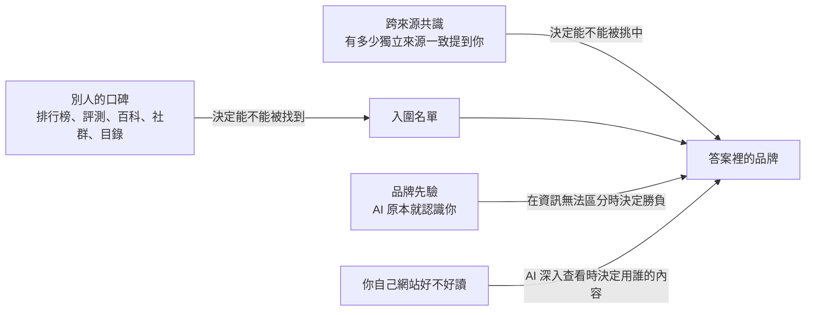

# 第 5 章　AI 比較相信別人怎麼說你

## 先想像一個場景

以下是一個假設的情境。

一位網店老闆賣精選咖啡豆。她的網站做得很用心：產地介紹、烘焙說明、常見問題，一樣不缺。在傳統搜尋結果裡，她的網站也排在第一頁。

有一天，她打開一個 AI 助手，問：「有哪些值得買的精選咖啡豆網店？」

AI 列出了五家店。沒有她的店。

她換個問法：「請介紹一下我這家咖啡豆網店。」這一次，AI 回答得很完整，連她主打的產地都說對了。

AI 明明認識她。那為什麼推薦的時候不提她？

這一章要講的就是這件事。先把答案說在前面：

**在 AI 眼裡，別人怎麼說你，往往比你怎麼說自己更重要。**

---

## 這一章要回答的五個問題

1. 當 AI 回答「某類產品哪個好」時，它引用的是品牌自己的網站，還是別人的網站？
2. 為什麼「很多個來源都這麼說」對 AI 特別有說服力？為什麼這件事同時也是最大的風險？
3. 品牌的知名度（品牌先驗）到底有多大作用？小品牌還有沒有機會？
4. 別人網站上提到你，和你自己網站好不好讀，哪一個更重要？
5. 實際操作上，應該先做什麼、不該做什麼？

在全書的「七道關」裡，這一章主要談第 3 關**找不找得到你**（召回）和第 4 關**挑不挑你**（選擇與排序），也會延伸到第 6 關**有沒有真用你、用對沒有**（吸收）。核心問題是：AI 寫進答案裡的品牌，是從哪些來源、靠什麼訊號被挑出來的。

---

## 一、AI 的答案，大多建立在別人的網站上

### 圖書館員不會去翻你自己印的型錄

回到全書那位很忙的圖書館員。

你問他：「哪一家比較好？」他不會一家一家去翻每間公司自己印的型錄。他會去找「十大推薦」「A 和 B 怎麼選」「使用者評比」這類資料，因為這類資料一次就能比較好幾家。

AI 搜尋也是這樣。在回答品牌、產品、服務類的問題時，它大部分的引用來自**別人的網站**，而不是品牌自己的網站。這就是全書說的**別人的口碑**，也叫第三方來源。

這裡的「別人」範圍很廣，包括：

- 媒體報導與專業評測
- 排行榜文章（「最佳 X 款」這一類）
- 評論平台
- 目錄網站
- 百科
- 影片平台
- 社群討論
- 同一個行業裡其他公司的頁面

### 為什麼會這樣：跟著 AI 走一遍

假設有人問 AI：「最適合新創公司的 X 工具是哪個？」

1. **拆問題**：AI 會把這個問題改寫成幾個小問題分頭去搜，例如「最佳 X 工具」「X 工具比較」。這個動作叫**查詢擴展**。
2. **撈資料**：這類小問題最容易撈到的，是排行榜、比較文章、評測頁，而不是某一個品牌的產品頁。這一步決定誰進入**入圍名單**。
3. **挑資料**：AI 比較偏好「由別人說出來」的評價，而不是品牌對自己的宣傳。
4. **寫答案**：一個品牌會不會被寫進答案，要看它有沒有出現在這些別人的頁面上。

所以有一個簡單的分工：

- **你的網站**，回答的是「你是誰」。
- **別人的口碑**，回答的是「該選誰」。

而人們在做購買決定之前問 AI 的，大多是後者。

### 數字有多懸殊

研究人員在真實的 AI 搜尋上反覆測試，而且好幾個團隊、在不同語言和不同 AI 平台上，都得到方向一致的結果。

- 一項研究涵蓋 128 個品牌、13 種語言、共 167,551 條引用。其中 85.7% 來自第三方網站，只有 14.3% 來自品牌自己的網站。
- 另一項研究分析了 149,912 條引用。品牌自己的網站只佔 2.9%；同一個領域裡其他公司的頁面佔 75.2%；排行榜類的頁面佔全部引用的 21.0%，如果只看內容類的引用，排行榜佔 35.7%。
- 一項針對中文 AI 平台的研究，用 614 個問題，在 8 個介面上各問 3 次，共得到 160,860 條引用。第三方約佔 69%，品牌官方網站佔 12.9%。
- 在美國的汽車類排名問題上，AI 引用第三方媒體的比例是 81.9%，引用社群來源的比例是 0。同樣的問題在傳統搜尋結果裡，這兩個比例分別是 45.1% 和 15.4%。在電子產品類，AI 引用第三方媒體的比例更高達 92.1%。

把幾項研究放在一起看，品牌自家網站在 AI 引用中大約只佔 3% 到 17%。

> **深入一點：這些數字該怎麼讀**
>
> - 有幾項研究是由提供「AI 可見度」或「監測」服務的公司做的。汽車類那一項只在單一日期測量，雖然用了很多問題，但作者本身和 GEO 服務有關聯。
> - 這些研究全部是**描述性的測量**。它們說明了「AI 現在在引用什麼」，沒有證明「只要把品牌放上第三方頁面，就一定會被推薦」。
> - 換句話說，它們告訴你戰場在哪裡，不保證你去了就會贏。

### 引用非常集中，而且「權威」因市場而異

- 在第一項大規模研究裡，大約 80% 的引用集中在大約 18.2% 的網域上。也就是說，少數網站拿走了大部分的引用。
- 在其中 12 種語言裡，維基百科在 11 種語言中是被引用最多的網站。
- 不同 AI 引擎引用品牌自家網站的比例也不一樣：一個引擎是 16.8%，另一個只有 5.8%。
- 在波蘭市場，4 個人力資源和求職網站被引用的次數，大約是波蘭語維基百科的 2.1 倍。這說明「哪個來源算權威」會因市場而不同。

### 換一個 AI、換一種語言，名單就換了

研究人員在真實的 AI 搜尋上反覆測試，還發現不同來源之間的重疊非常低：

- 把 AI 引擎和傳統搜尋最常引用的前 5 個網域拿來比，智慧型手機類只有 15% 重疊，筆記型電腦類只有 32%。
- 在汽車類，不同 AI 引擎之間引用網域的相似度只有 0.096 到 0.251。（這個相似度的算法是：0 代表完全不同，1 代表完全相同。）
- 就算是同一個 AI 平台，網頁版和手機 App 版引用的網域，相似度也只有 0.19 到 0.51。
- 換一種語言提問，某些引擎幾乎會換掉整套引用的網域。

這代表兩件事：

1. 你在某一個 AI 上被引用，不代表在其他 AI 上也會被引用。
2. 你在傳統搜尋上排名很好，不能拿來代表你在 AI 上的表現。

另外，這個比例會因領域而不同。在選舉資訊的研究裡（日本，四個會上網的 AI），政黨自己的網站佔了引用的 24.8% 到 44.3%，遠高於品牌和產品領域。

### 一個容易誤會的地方：「第三方」到底佔多少？

不同的測量，數字會打架：

- 多項測量說，第三方佔 69% 到 95%。
- 但有業內人士觀察到，在單一引擎的 860 個答案裡，被引用最多的前 100 個網域中，有 77.4% 是**廠商自己寫的頁面**，評測平台只佔 10.2%。
- 另一位業內人士自己測過（重複多次、有對照組），在一組固定的 40 個買家問題裡，約 80.9% 被引用的網域屬於「一般公司與出版商的頁面」。作者自己說明，這一類其實是「不屬於其他任何類別」的剩餘類別，並不是一個明確定義的分類。

這些數字可以同時成立。關鍵在於「自有」怎麼定義。

對**某一個品牌**來說，其他廠商的頁面也是第三方。前面那項大規模研究裡，「同一個領域其他公司的頁面」就佔了 75.2%。

所以正確的理解是：**AI 很常引用廠商的頁面，但很少引用「你自己的」頁面。**

---

## 二、「很多人都這麼說」：最強的訊號之一，也是最大的漏洞

### 圖書館員會數「有幾個人這麼說」

那位圖書館員還有一個習慣：他特別相信「很多人都這麼說」的說法。

AI 也是這樣。它不只看一個來源怎麼說，還會看**有多少個來源說了同樣的話**。當一個品牌在許多不同的來源裡反覆被提到，而且說法一致，它被寫進答案的機會就會大幅上升。這就是「共識」。

可以用一個簡單的對照來記：

- 一個來源說「A 最好」：影響有限。
- 同一個來源重複說三次：幾乎不會增加影響。
- 三個看起來彼此獨立的來源都說「A 最好」：影響明顯上升。

重點是「不同的人說」，不是「同一個人說很多次」。

### 這件事有兩面

- **好的一面**：被很多獨立的人認可的品牌，更容易被推薦。這很接近人類靠口碑做判斷的方式。
- **壞的一面**：AI 常常用「來源的數量」來代替「這些來源是不是真的獨立」。幾個**看起來**各自獨立、其實出自同一方的頁面，也能做出一個假的共識。

### 證據一：在真實 AI 搜尋上觀察到的

研究人員在真實的中文 AI 平台上反覆測試，發現：

- AI 撈回來、放進引用裡的品牌，最後只有 8.3% 真的被寫進答案。
- 一個品牌如果只出現在 1 個引用來源裡，被寫進答案的機率是 2.1%。
- 如果出現在 11 個以上的來源裡，機率升到 59.9%。
- 研究人員用一個模型來預測「誰會被寫進答案」。在這個模型裡，傳統 SEO 的綜合品質分數，重要程度只有 4.52%。

### 證據二：實驗

研究人員也做了實驗。**在給定網頁的測試條件下**，也就是先假設設計好的內容已經成功出現在搜尋結果裡，再看 AI 會不會被它帶著走：

- 研究人員測試了 13 種會自己上網查資料的 AI 搜尋系統。平均被操縱的比例是 13.4%，最低 0%，最高 31.4%。差別主要來自 AI 模型本身。
- 以其中一個模型為例：有 1 個來源背書時，操縱成功率是 39%；2 個看似獨立的來源一致背書，是 55%；3 個，是 77%。
- 如果是**同一個來源重複出現**，成功率持平，不會上升。
- 內容在搜尋結果裡排第幾名，沒有明顯影響。

同一項研究也比較了不同手法的平均成功率：

| 手法 | 平均成功率 |
|---|---|
| 在網頁程式碼裡藏指令給 AI | 0.3% |
| 網頁摘要和頁面內容不一致 | 1.2% |
| 冒充權威 | 14.2% |
| 製造「多方都這麼說」的假共識 | 24.8% |
| 冒充權威，再加上一串互相引用的來源 | 37.2% |

規律很清楚：**越像「有證據的多方說法」，越有效；越像「偷偷藏起來的指令」，越無效。**

### 證據三：一整套「假證據網」

**在實驗室條件下看到**（真實世界還不一定）：

- 研究對象是會自己逐頁瀏覽、跟著連結走的 AI 搜尋系統。
- 研究人員做出一組多頁內容：風格一致、說法一致、互相連結，像一個「證據生態」。這組內容讓一個虛構產品被推薦的比例達到 67.2% 到 73.9%。
- 只有一頁內容時，推薦比例是 35.9% 到 59.0%。
- 幾種「單頁改寫」的技巧，都沒有穩定地比「完全沒優化的單頁」更好。

要特別說清楚：**這項研究本質上是在測試「偽造多來源共識」這種操縱手法。**

### 證據四：提醒 AI 小心，也不一定有用

**理論上可能，但還沒被證實**：模擬分析顯示，表面上有好幾個來源互相佐證，比單純直接下結論，更難被識別成假的。

研究人員還給 AI 加上「請小心查證」的防禦提示。結果 AI 確實更常去查證，但最後錯誤背書的比例並沒有下降，反而從 28.6% 升到 38.6%。

**「去查證了」不等於「查證之後改正了」。**

### 證據有多可靠

真實世界的測量和實驗兩條線，方向一致。所以「共識」是這一章裡最可靠的機制之一。

但有兩點要注意：

1. 實驗大多用的是虛構產品和受控的資料。
2. 實驗證明的是「共識可以被偽造」。這是一個被攻擊的弱點，**不是建議你去做的方法**。本章最後的「別再做了」會再講一次。

---

## 三、品牌先驗：大品牌有先天優勢，但不是無敵

### 什麼是品牌先驗

AI 模型在訓練的時候，已經讀過大量資料，所以它本來就「認識」很多品牌。這種在查資料之前就已經有的品牌印象，叫**品牌先驗**。你可以把它想成圖書館員腦中的「老印象」。

品牌先驗有三個特點：

1. **認識不等於推薦。** 直接點名問 AI 某個品牌，它幾乎都認得；但請它「推薦這一類的產品」時，它常常想不到這個品牌。
2. **先驗是有條件的。** 當幾個候選產品之間沒有可以區分的資訊時，知名品牌幾乎一定贏。一旦出現可以區分的真實資訊，例如評分、評論數量、價格，先驗就可能被打破。
3. **先驗越薄弱，越容易被眼前讀到的內容左右。** 對小品牌來說，這是機會：只要有人寫你，你就有可能被採用。這也是風險：如果有人把你寫錯，AI 也可能照單全收。

### 起跑線確實不一樣

研究人員在真實的 AI 搜尋上反覆測試，在不提品牌名稱的類別問題裡，第一次問的時候，品牌被提到的比例分成三級：

- 大品牌：72.9%
- 中型品牌：43.6%
- 小品牌：11.4%

這份數據來自一家服務業者，而且「大、中、小」是人工劃分的。

### 認識你，卻不推薦你

研究人員在真實的 AI 搜尋上反覆測試新產品，發現：

- 直接點名問某個新產品時，AI 認得它的比例是 99.4%（在另一個引擎上是 94.3%）。
- 但在「推薦這一類產品」時，它被提到的比例只有 3.32%（另一個引擎是 8.29%）。
- 研究人員也給這些網站打了一個「GEO 綜合分數」。結果這個分數和 AI 上的可見度沒有關係。
- 同一項研究中，可見度和兩件事有正相關：有多少個不同的網站連結到你，以及社群討論裡提到你的次數。不過，這只是相關，不是因果，而且樣本只有 60 個。

另一項在真實 AI 搜尋上的測量也看到類似現象：已經在外部平台有名氣的創作者，在 AI 引用中也得到更多曝光。在排名靠前的創作者之間，名次每往前一位，曝光的優勢大約多 4.3 到 4.8 個百分點。這同樣只是相關。

> **深入一點：「相關係數」是什麼意思**
>
> 研究裡常用一個叫「相關係數」的數字，範圍從 −1 到 +1。越接近 +1，代表兩件事越常一起變高；越接近 −1，代表一件事變高時另一件事越常變低；接近 0，代表兩者幾乎沒有關係。
>
> - 網站的 GEO 綜合分數和可見度：−0.108 和 −0.102，幾乎沒有關係。
> - 連結到你的網站數量和可見度：+0.319，有一定的正相關。
> - 社群討論提到你的次數和可見度：+0.395，有一定的正相關。
>
> 相關不等於因果。這些數字只說明「常常一起出現」，沒有說明「做了一件事就會導致另一件事」。

### 先驗可以被打破嗎？

以下兩個結果，都屬於**理論上可能，但還沒被證實**。它們是在固定內容的模擬條件下得到的：研究人員先決定 AI 會讀到哪些資料，再看它怎麼推薦。

**第一個結果：可以區分的資訊，比品牌名氣重要。**

- 當幾個產品的規格完全相同時，知名品牌 100% 被推薦。
- 但競爭者只要評分高 0.075 顆星，或評論數量多 1.6 倍，或價格低 7.3%，就能有 50% 的機會勝出。
- 在推薦結果的差異中，產品本身的參數可以解釋 82.4%，品牌只佔 1.2%。

**第二個結果：換一種問法，就能喚醒被忽略的品牌。**

- 在 AI 不上網、只靠自己記憶的條件下，許多知名品牌的推薦比例是零。
- 把問題改成描述需求的問法之後，某個品牌的推薦比例從 0% 升到 35.4%。
- 再加上說明定位的線索，可以達到 81.3%。

### 先驗越薄，越容易被帶偏

**在實驗室條件下看到**（真實世界還不一定）：

- AI 模型對某個品牌的先驗越薄弱，就越容易被放進資料裡的錯誤頁面誤導。跨模型比較的相關係數是 −0.65，這是相當明顯的反向關係。
- 12 個模型平均被騙的比例是 42.7%，最低 13.3%，最高 73.8%。
- 如果只有一個被污染的頁面，把它放在第 1 位時，被騙的比例最高，達到 27%；放在第 2 到第 10 位時，只有 1% 到 4%。

### 一個反例：大家都做了，好處就沒了

**理論上可能，但還沒被證實**（同樣是固定內容的模擬）：

- 只有一個挑戰者採用 GEO 時，原本領先的品牌「繼續被推薦」的比例，會從 100% 掉到 19.8%。
- 但當所有競爭者都採用 GEO 之後，原本領先的品牌又回升到 93.8%。
- 每個採用者得到的好處，從 +0.802 降到 +0.007。

這表示 **GEO 的好處，可能會隨著採用的人變多而趨近於零**。這是一種「你多拿一點，別人就少拿一點」的競爭。不過這是模擬結果，不能直接當成真實市場的結論。

### 證據有多可靠

- 「大品牌更容易被推薦」：有真實 AI 搜尋上的測量支持。
- 「先驗可以被可區分的資訊打破」：目前主要來自固定內容的模擬實驗，只能說**機制上可能**，還沒有真實世界的介入實驗證據。
- 「先驗只在資訊分不出高下時才起作用」：這個說法要修正。一項大規模研究（15.8 萬個回答，相關性）發現：AI 記得的品牌，有 67% 被寫進它自己的搜尋詞，不記得的只有 11%；排在同樣位置時，它記得的網站被引用的機會是 1.6 倍；ChatGPT 有 46% 的品牌點名，沒有任何引用的網頁支持，等於直接憑記憶點名。也就是說，先驗在「搜什麼、選誰、說誰」三個地方都在起作用。

### 先驗從哪裡來：被寫得多，還要和對的東西寫在一起

想想人是怎麼認識、理解、相信一個人的：多半是靠別人怎麼說他。聽很多人提過，你就記得這個名字；大家的說法一致，你就知道他是做什麼的；好幾個互不相識的人都說他靠得住，你才會信。

AI 也很像這樣。它學到的是網路上的文字：哪些名字常出現、和哪些詞一起出現、在什麼語氣下出現。所以 **AI 對你的印象，來自別人怎麼寫你，不一定是你實際怎麼樣。**

我們寫這本書時做過另一個實驗：讓 AI 依照真實人物的約 270 個標籤，扮演這些人回答社會調查。結果刻板印象非常明顯，例如 AI 普遍認為一位退休的黑人修車工過得不幸福。（這是單一觀察，原始數據沒有收進本書，也還沒和這些人本人的回答對照過。）

不過，AI 的「別人怎麼說」和人的不一樣：

- **它只數得到寫下來、讀得到的聲音。**
- **它不太分得出這些聲音是不是彼此獨立。** 一整套看起來各自獨立、其實出自同一來源的頁面，就能改變它的答案（見第二節的「假證據網」）。

再往下拆，被「寫得多」和被「想得到」是兩件事：

- **寫得多 → 認得你。** 我們的記憶測試裡，AI 熟悉一個知名平台，連它多年前的舊名都記得；對一個成立幾個月的新網站，它的回答和對虛構網址一樣（見案例 9）。
- **和對的東西寫在一起 → 想得到你。** 前面講過：AI 直接被問到某個新產品時，認得它的比例是 99.4%；但在「推薦這一類產品」時，只有 3.32% 會想到它。認得名字，不代表別人描述需求時會想到你。
- AI 記住的，常常是「哪一類資訊去哪裡找」。我們的測試裡，AI 用 `site:` 點名國家游泳協會的官網時，搜的是某個年齡組的成績標準文件；被 AI 主動點名的網站，在同一次回答裡被引用的機會明顯比較高（見第 4 章、第 6 章）。所以你要累積的不只是知名度，而是讓**你的名字**和**某一類問題、某一類數據**，在可信的地方反覆一起出現。

這也帶出兩條時間線：

- **現在靠搜尋。** AI 不認識你也沒關係，只要你的頁面對上它改寫出來的查詢，照樣可以被大量引用（第 3 章案例 8：AI 不認識的新網站，10 次裡被引用 9 次）。
- **以後靠記憶。** 要進入下一代 AI 的記憶，至少要隔一次訓練；被抓取不等於被記住（案例 9：GPTBot 抓過大約 92.5% 的頁面，AI 仍然不認識那個網站）。

還有一個要提防的地方：靠「出現次數」建立的信任，對已經被寫得多的老牌網站有利，也可能被灌水。先驗越薄，越容易被一個錯誤頁面帶偏（相關係數 −0.65，見本節前面的「先驗越薄，越容易被帶偏」）。所以，**比「多」更重要的，是來源可不可信、彼此是不是獨立。**

> **證據有多強：** 每一項事實的強度，見各處的標註。把它們串成「印象來自文字、次數決定認得、一起出現決定想得到」，是本書的推論，還沒有被直接檢驗過。

---

## 四、幾股力量怎麼合在一起

把前面的內容放在一起看，可以畫成這樣：

用文字說：

- **別人的口碑**決定你能不能進入入圍名單。
- **跨來源的共識**決定你能不能被挑中。
- **品牌先驗**在大家資訊都差不多時決定勝負。
- **你自己網站好不好讀**，決定當 AI 深入查看時，答案用的是誰的內容。

### 爭議：別人提到你，到底有沒有獨立的作用？

這是目前還沒有定論的問題。兩邊的說法如下。

**認為有作用的一方：**

- 中文 AI 平台的測量顯示，一個品牌在多少個來源裡同時出現，是它會不會被寫進答案的強力預測指標。
- 新產品的研究顯示，連結到你的網站數量、社群提到你的次數，都和可見度正相關。

**認為扣除其他因素後就沒有獨立作用的一方：**

研究人員在真實的 AI 搜尋上反覆測試，比較了 1,056 家企業、37,927 次「會自己上網查資料的 AI」的查詢過程。他們把條件相近的企業配成對來比較。

- 在扣除「網站對 AI 好不好讀」的影響之後，兩個代表「別人提到你」和「容易被發現」的指標，對兩件事都沒有明顯的額外關係：答案有沒有以你自己的內容為依據，以及你有沒有被明確推薦。
- 網站好讀的那一組，78% 的答案內容來自自家頁面，對照組是 58%。
- 網站好讀的那一組，被明確推薦的比例是 20%，對照組是 11%。

**可能的解釋：兩者作用在不同的階段。**

- 別人提到你，決定你能不能**浮現**在入圍名單裡。
- 你的網站好不好讀，決定 AI 深入查看時，答案是用**誰的內容**寫成的。

後面那項研究只看「AI 已經進入你的網站、深入查看」的情境；它用的是研究方自己的評分工具；它是配對觀察，不是實驗。所以兩種說法不一定互相矛盾。但到目前為止，還沒有研究在同一個設計裡同時檢驗這兩個階段。

有業內人士自己測過，也提出類似的「兩階段」說法：把內容分發出去，讓品牌進入 AI 會搜尋的範圍；頁面本身的品質，決定你會不會被選中。在分發範圍差不多的品牌之間，內容結構比較清楚的品牌被引用得更多。這是單一觀察，沒有人獨立驗證過。

---

## 五、其他還沒吵完的問題

### 社群討論和評測目錄，到底有多重要？

業內人士自己測出來的結論，差異非常大：

- 有人發現，在「購買建議」類的問題上，社群內容是被引用最多的網域。
- 也有人分析約 16,400 個商業類問題、127,198 條引用，發現社群討論只佔 1.8%，維基百科不到 0.6%，有 90.6% 流向廠商的說明文件、產品頁，以及各種小眾的類別網站。
- 另一位業內人士自己測過（重複多次、有對照組），在固定的 40 個買家問題上，社群來源的比例因 AI 引擎而不同：有的引擎約 7% 到 9%，有的接近 0%。

評測目錄網站也有分歧。有一位業內人士一開始報告：「某某的替代品」這類問題，比「最佳某某」這類問題更常引用目錄網站（43.0% 比 3.8%）。後來他自己更正：這個差距只出現在傳統搜尋結果裡；在 AI 的答案上，兩者的比例在誤差範圍內是一樣的。

**結論：不存在一個通用的「最重要平台」。** 來源的組成會隨著 AI 引擎、行業、提問的目的、語言市場而改變。社群平台作為 AI 引用來源的角色，第 15 章會專門討論。

我們寫這本書時，自己用 API 對 ChatGPT 實際測過（方法見第 4 章；樣本很小，還沒有其他人獨立驗證）：社群討論網站在三類題型 30 次對話裡有 24 次出現在搜尋結果中，游泳題 10 次全部出現，但引用都是 0；百科和影片網站也出現過很多次，引用同樣是 0。要注意：「出現在搜尋結果裡」不代表 AI 讀了全文，而且這只是一個模型、透過 API 的結果。

### 網域權威還重要嗎？

「網域權威」指的是一個網站整體的份量，例如它存在多久、有多少其他網站連結到它。

- 有業內人士自己測過，在 18,000 多個被引用的頁面裡，網域層級的權威大約佔「可以預測的部分」的 77%，頁面本身的因素約佔 23%。而且頁面優化只在高權威的網域上才有效。
- 另一位業內人士自己測過（重複多次、有對照組），發現在某一個 AI 引擎上，網域權威對引用的影響不大；反而是在 7 天內同步發布到多個平台的內容，被引用得明顯更多。不過樣本只有 14 篇文章，作者自己也指出樣本小、追蹤結果有雜訊。
- 還有業內人士觀察到：其他網站連結到你，對「你自己的頁面被直接選中」幫助有限。但 AI 挑選的那些第三方出版者，本身都是被大量連結的編輯型網站。所以連結可能是**間接**在起作用。

這三種說法量的東西不一樣，目前無法判斷誰對。

### AI 引用的來源是固定的，還是一直在換？

- 有業內人士自己測過：40 個問題、三週內大約 180 個被引用的網址裡，約 70% 是反覆出現的同一批第三方頁面；新發布的自有頁面幾乎不出現。
- 另一位業內人士自己測過：被引用的來源每個月有 40% 到 60% 會換掉。
- 還有業內人士觀察到：某個分析工具在類別問題中的被引用次數，一個月內從 8 次降到 3 次；而一個主要靠評測網站報導的競爭對手，升到 13 次。

這兩種現象可能同時存在：**最前面的少數頁面相對穩定，後面的一長串則快速輪換。** 這也是為什麼只看一次結果不可靠。這就像**擲骰子**：同一個問題問十次，答案可能不一樣，所以要看「十次裡出現幾次」。

---

## 六、真實案例

以下案例都是業內人士自己測試或觀察的結果，除非特別註明，都沒有人獨立驗證過。它們用來幫助理解原理，不是證明。

### 案例 1：傳統搜尋排第三，在 AI 裡幾乎不存在

- **背景**：一家做倉庫管理軟體的企業軟體公司，客戶是專門替別人處理物流的公司。它的核心關鍵字在 Google 排第三名。
- **觀察**：業內人士自己測過（重複多次、有對照組）。從 1 月開始，每個月記錄 40 個「推薦類」問題。ChatGPT 只在其中 2 到 4 個問題裡點名這家公司。另一個在搜尋結果只排第二頁、連結更少的競爭對手，大約被點名 18 次。
- **競爭對手有什麼**：物流部落格上的兩篇排行榜文章、一個軟體評測網站的類別頁，還有一則 2023 年物流業者稱讚它的社群討論。
- **這家公司的弱點**：它在公司資料庫、職業社交平台、評測網站上，有三種不同的公司描述。
- **做了什麼**：把第三方網站上的描述統一，同時每天發布一篇比較頁。到 8 月，40 個問題中大約有 9 個會點名它。因為兩件事同時進行，無法分辨是哪一件起了作用。
- **同一位作者的其他觀察**：
  - 引用主要可以追溯到評測網站、別人寫的排行榜，以及一則舊的社群討論。
  - 行業協會的會員目錄被某個 AI 引擎引用了。
  - 一年在職業社交平台上發了 200 則內容，零引用。
  - 花 6,000 美元升級評測網站上的付費檔案，沒有任何變化。
- **對應的道理**：AI 的推薦靠別人的口碑決定；描述一致，才能形成共識。

### 案例 2：被 AI 說錯身分的產品

- **做了什麼**：業內人士自己測過。對一個「CSV 檔案匯入工具」，用 8 個買家式的問題，在 ChatGPT、Claude、Gemini、Perplexity 上測試。
- **觀察**：8 次對話裡它只出現 1 次，而且被描述成「ETL 工具」（一種資料搬移與轉換工具），但它其實不是。有兩個模型轉而介紹競爭對手，用詞明顯來自競爭對手自己的行銷文案。這個產品在傳統搜尋上其實做得不錯，有連結、也有排名頁。
- **作者的判斷**：被推薦的工具，在第三方內容裡都有「一句清楚、反覆出現的定位」。沒被推薦的，描述模糊或前後不一致。
- **做了什麼、花多久**：10 天內發布了 2 篇比較文章，並更新產品說明文件。結果從 8 次出現 1 次，升到 8 次出現 5 次。
- **對應的道理**：一致的描述構成共識；先驗薄弱時，AI 會採用手邊找得到的描述，甚至包括競爭對手的說法。

### 案例 3：自家網站優化兩週沒用，一篇第三方彙整文章改變了局面

- **做了什麼**：業內人士自己測過。對 12 個客戶頁面做完整的網站內部優化，包括結構化資料、標題層級、讓「實體」更清楚、網站內部連結。然後用同樣的 15 個問題，在 ChatGPT、Perplexity、Gemini 上追蹤，每次都登出帳號再問。
- **觀察**：兩週後，完全沒有變化。第三週，有一篇把這個客戶和 4 個競爭對手並列比較的彙整文章發布了。幾天之內，原本看不到的兩個頁面開始被引用。
- **作者的保留**：樣本很小，無法把兩件事的作用分開。他的結論是：「網站內部優化是必要的，但不夠。」
- **對應的道理**：別人的口碑決定入圍；也呼應前面「兩個階段」的解釋。

### 案例 4：擠進 AI 已經在引用的排行榜

- 有業內人士自己測過：替一個消費品牌的助眠產品，先把目標問題下 AI 引用的所有網站列出來，再聯絡這些網站，請他們把客戶加進已有的文章；加不進去的，就改寫客座文章。做了 5 篇排行榜、2 篇產品彙整之後，一週內，ChatGPT 在這個問題下把客戶列在第 2 位。
- 另一位業內人士自己測過：一個新上市的能量飲料品牌，發現 Google 的 AI 摘要反覆引用 3 到 4 個「最佳某類飲料」的評測部落格。爭取被這些部落格收錄之後，幾天內就和大品牌一起出現在 AI 摘要裡。
- **注意**：這兩位作者都是專門替人爭取外部連結、做對外聯絡的從業者，結果屬於自己陳述。
- **對應的道理**：擠進**AI 已經在讀的頁面**，比自己新寫一頁、等 AI 發現，更直接。

### 案例 5：認識你，不代表推薦你

- 有業內人士自己測過：用三個「幫我找高階主管教練」的問題，在兩個 AI 引擎上測試，共 6 組結果。業內知名度最高、有數百萬追蹤者的一位教練，只出現 1 次。但直接問 AI「請介紹這位教練」，兩個引擎都給出詳細又正確的回答。AI 認識他，只是推薦時不提他。
- 另一位業內人士自己測過（重複多次、有對照組）：20 家在最近 18 個月內完成 A 輪以上融資的印度新創公司，在不提品牌名的類別問題裡，有 17 家完全沒出現。但直接問「某某是什麼」時，AI 大多能正確回答。有出現的那 3 家，都有真實的社群討論、有結構的比較頁，以及評論的標記。
- 還有一位業內人士自己測過（重複多次、有對照組）：用 82 個帶購買意圖的問題，在 4 個 AI 引擎上各問 3 次。拿到融資的新創公司，被引用的比例是 6% 到 13%；原本就在市場上的大公司是 32% 到 62%。唯一超過兩位數的新創類別是「向量資料庫」，達到 34%。作者推測，原因是這類產品從多年前就被技術部落格大量討論。另外，透過新聞稿發布平台的轉載沒有幫助，在其中一個引擎上甚至略有負面效果。
- **對應的道理**：認識不等於推薦；先驗來自長期累積的第三方討論。

### 案例 6：在某些行業，聚合平台就是排名本身

- 有業內人士自己測過：向 Google 的 AI 模式提出 510 個問題，內容是土耳其 30 個目的地的飯店。在得到的 481 個答案裡，98% 至少引用了一個訂房平台；最大的單一訂房平台出現在 74% 的答案裡。飯店自己的網站幾乎從來沒被直接引用。
- 有業內人士自己測過：在 1 萬多個 ChatGPT 購物問題裡，零售網站佔了全部引用的 89% 到 99%。在另一組 8,520 個女裝類問題裡，零售平台被引用的次數比多數品牌官網都多。
- 有業內人士自己測過：ChatGPT 推薦手機應用程式時，將近一半（47.5%）的引用來自應用程式商店可以被爬蟲讀取的網頁版列表。作者自己提醒，這些比例變動很大，只是某一時刻的狀況。
- **對應的道理**：在由聚合平台主導的行業，**你在平台上的列表品質，就是 GEO 的主戰場**。

### 案例 7：品牌形象被別人改寫

- 有業內人士自己測過：連續六週，每週用同樣的類別問題測試三個競爭品牌。其中兩個品牌的描述明顯變了：一個原本被稱為「分析工具」，後來被改稱為另一類平台；另一個多了「整合能力有限」的批評。這兩次改變都不是來自這些公司自己發布的內容，而是分別追溯到一個小眾社群裡的直接比較討論，以及幾則互動很多的論壇留言。
- 有業內人士觀察到：一家公司的維基百科條目被「軟刪除」之後，AI 和搜尋引擎對這個品牌的辨識變得不一致，甚至把其他東西和這個品牌名連在一起。這家公司加強了自己的網站、結構化資料和其他地方的提及，也沒能補回來。
- **對應的道理**：先驗薄弱時，別人的說法會直接變成 AI 的說法。

### 案例 8：被推薦的品牌，和被引用的網站，是兩回事

- 有業內人士自己測過：在 12 天內分析三個 AI 引擎的 180 則運動鞋推薦，共有 1,783 條引用、250 個網域。最常被推薦的品牌，它的官網只被引用 2 次。其中一個引擎在全部 180 個答案裡，引用品牌官網的次數是 0。主要的來源是影片平台、評測網站、時尚媒體和社群。
- 有業內人士自己測過：在羅馬尼亞，用當地語言，向 5 個 AI 介面提出 18 個買書相關的問題，相隔一週各跑一輪，共 180 個答案。
  - 58% 的答案沒有推薦任何一家書店。
  - 市場領導者只出現在大約五分之一的答案裡。
  - 排名每週都被重寫。
  - 還出現了「幽靈品牌」：有些網站被 AI 拿來當作價格和書單的來源，答案卻推薦了別家。
  - 反過來，一個有 35 年歷史的文化品牌被推薦了 13 次，但它的網站一次都沒被引用。它完全靠 AI 的記憶被推薦。
- 有業內人士觀察到：在單一引擎裡，點名某家公司的答案中，只有 47% 同時引用了這家公司的網站。
- **對應的道理**：「被引用」（答案附上你的連結）和「被提到」（答案寫出你的名字）是兩個不同的指標，必須分開測量。

### 案例 9：AI 不認識新網站，卻記得老平台多年前的舊名

- **做了什麼：** 我們寫這本書時，自己用 API 對 ChatGPT 實際測過（方法見第 4 章；樣本很小，還沒有其他人獨立驗證）。這次關掉上網搜尋，要求 AI「不確定就說不知道」，每個問題問 5 次。
- **看到什麼：** 對第 3 章案例 8 的新網站，AI 5 次都說不熟悉，和對一個虛構網址的回答一樣；問它這個網站特有的分級名稱和網址結構，5 次都說不知道；請它憑記憶列出「提供招募成績標準的網站」，5 次都沒有它。對一個知名的游泳數據平台，AI 5 次都能具體描述，而且 5 次都提到它多年前的舊名。也就是說，記憶會過時。
- **記憶不一定來自網站本身：** 這個知名平台擋掉了 GPTBot，AI 仍然很熟悉它。記憶可能來自別人提到它，或是封鎖之前的舊資料（這是推測）。AI 記住的是「哪個網站有哪一類數據」：它用 `site:` 指名國家游泳協會的官網時，搜的是某個年齡組的成績標準文件。
- **被抓取，不等於被記住：** 根據新網站自己的伺服器日誌（網站方自己分析的，沒有獨立驗證），GPTBot 在 2026 年 7 月到 8 月 20 日之間抓過大約 92.5% 的頁面，但測試時的 AI 仍然不認識它。從被抓取到被記住，中間至少隔著下一次訓練。
- **限制：** 只有一個模型、一個主題，沒有人獨立驗證。
- **對應的道理：** 品牌先驗（第三節）。新網站在下一代 AI 出現之前，只能靠搜尋被找到，第 3 章案例 8 正是這樣。

---

## 本章要點

1. 在品牌和產品類的問題上，AI 引用的大多是第三方來源；品牌自家網站在不同研究中只佔約 3% 到 17%。這是多項大規模測量的一致結論，但屬於描述性的證據。
2. 「好幾個看似獨立的來源都說同一件事」，是影響 AI 挑選最強的訊號之一。同一個來源重複說，幾乎沒有用。
3. 這個共識機制可以被偽造，是目前最大的被攻擊弱點。做 GEO 的人應該爭取真正獨立的來源，而不是製造假共識。
4. 品牌先驗決定起跑線：大、中、小品牌在類別問題裡的可見度約為 73%、44%、11%。但「認識」不等於「推薦」，先驗主要在資訊無法區分時起決定作用。
5. 先驗越薄弱，AI 越容易採用第三方的描述，包括競爭對手的說法和錯誤的說法。所以小品牌必須主動管理自己在別人網站上被怎麼描述。
6. 別人提到你，和你自己網站好不好讀，作用在不同的階段：前者決定你能不能浮現，後者決定 AI 深入查看時用誰的內容。兩者之間的關係仍有爭議。
7. 權威來源會因 AI 引擎、行業、語言市場而不同，沒有通用的「最重要平台」。先畫出你自己品類的來源地圖，再決定去哪裡。
8. 測量要分開不同的 AI 引擎、每個問題問很多次、「被引用」和「被推薦」分開記錄，並保留對照組。

---

## 一句話記住

**你的網站告訴 AI「你是誰」，別人的口碑告訴 AI「該選誰」；而且要很多個真正獨立的人，一致地這麼說。**

---

## 你明天就能做的事

### 1. 先畫出你的來源地圖

- 列出 30 到 50 個真實買家會問的問題，例如「最佳某類產品」「A 和 B 比較」「某某的替代品」。
- 在好幾個 AI 引擎上反覆問，記下每一個被引用的網址，再按網站分類。
- 有業內人士自己測過：在一次 200 個問題的檢查中，60% 的引用集中在 7 個網站上，而且大多不在他們原本的公關目標名單裡。
- 證據強度：「第三方佔多數」和「引用很集中」，研究人員在真實的 AI 搜尋上反覆測試過；具體的操作流程，來自業內人士的自己測試。

### 2. 找出差距，列成對外聯絡清單

- 找出「競爭對手被引用、你卻缺席」的頁面，這就是你的聯絡清單。
- 優先爭取**AI 已經在引用**的排行榜、比較文章、評測頁把你收進去，而不是自己另寫一篇新文章、等著被發現。
- 證據強度：業內人士自己測過，好幾個互相獨立的案例方向一致，但都沒有人獨立驗證過。

### 3. 統一你在各處的描述

- 你網站的「關於我們」、公司資料庫、評測網站、職業社交平台、目錄網站上，都用同一句話說清楚：「你是什麼、為誰服務」。
- 定位要具體到某一個行業或使用情境。
- 證據強度：共識的作用，在給定網頁的測試條件下、以及在真實 AI 搜尋上都有測量支持；描述一致本身的作用，是業內人士自己測過（重複多次、有對照組）。

### 4. 爭取好幾個真正獨立的來源

- 不同的出版者、不同的作者、不同類型的平台。
- 同一個來源重複說，幾乎不加分。
- 證據強度：在給定網頁的測試條件下看到，同一來源重複出現不會提高效果。

### 5. 提供可以區分你的真實資訊

- 評分、評論數量、價格、具體規格、實際成效的數據。
- 如果你和別人的資訊看起來都差不多，大品牌的先驗就會勝出。
- 證據強度：理論上可能，但還沒被證實（模擬分析）。

### 6. 依行業找出真正的「在地權威」

- 由聚合平台主導的行業，例如飯店、零售、手機應用程式：你在平台上的列表完不完整，就是主戰場。
- 小眾行業：關鍵來源可能是行業刊物、協會的會員目錄。
- 不同語言市場，最重要的來源也不一樣。
- 證據強度：市場之間的差異，研究人員在真實的 AI 搜尋上反覆測試過；行業之間的差異，來自業內人士的自己測試。

### 7. 讓別人把你和「具體需求」寫在一起

- 讓第三方內容把你和「某個具體問題 + 某個具體用途」寫在一起，而不只是順便提到你的品牌名。
- 證據強度：理論上可能，但還沒被證實（模擬分析顯示，描述需求的問法能喚醒原本被漏掉的品牌）。

### 8. 你自己的網站照樣要讓 AI 讀得懂

- 別人提到你，讓你浮現；你的網站好讀，讓 AI 深入查看時用的是你自己的內容，而不是競爭對手或第三方的描述。
- 證據強度：研究人員在真實的 AI 搜尋上反覆測試（服務業者做的研究，配對觀察）。

### 9. 分開不同的 AI 引擎，每個問題問很多次

- 看「有沒有被提到」，每個問題至少跑 3 次才相對穩定。
- 看「AI 對你是正面還是負面」，至少要 10 個問題才相對穩定。
- 也有研究讓每個問題重複問 40 次。
- 「被引用」和「被推薦」要分開記錄。
- 證據強度：研究人員在真實的 AI 搜尋上反覆測試，也有模擬分析支持。

### 10. 保留一組對照問題

- 固定一部分問題不做任何改動，但照樣追蹤。
- 如果對照組和你改動的那一組一起變化，那是 AI 引擎自己變了，不是你的工作起了作用。
- 證據強度：業內人士觀察到的方法建議。

### 要等多久才會看到效果？

沒有可靠的通用數字，各案例差異很大：

- 業內人士的自己測試裡，有「幾天內」「一週內」「10 天」的例子。這些大多發生在會即時上網搜尋的 AI 引擎上，或是擠進了 AI 本來就在引用的頁面。
- 也有業內人士觀察到，需要 6 週、60 到 90 天、約 3 個月，甚至 5 個月，結果才穩定出現。
- 好幾位業內人士觀察到：會即時上網搜尋的引擎，比依賴訓練資料的引擎更早反映新的來源（有人估計早 3 到 4 週）。**如果只在一個反應慢的引擎上測，很容易誤以為沒有效果。**

---

## 別再做了

### 不要做的事

1. **偽造「很多人都這麼說」。** 例如自己架好幾個看似獨立的網站、協同發文、灌評論。實驗顯示這確實能操縱會自己上網查資料的 AI，但它是操縱手法。而且防禦方法已經出現：在實驗室條件下，如果按照出版者的類型重新排列來源（編輯型內容優先，其次是商業內容，最後是使用者自己產生的內容），被騙的比例可以降低 8.4 個百分點，而且不會影響正常的推薦。
2. **在網頁裡藏指令給 AI。** 在給定網頁的測試條件下，藏起來的指令平均成功率只有 0.3%，幾乎沒有用。
3. **用製造稀缺感、設定價格錨點、強調「不買就會損失」這類銷售話術。** 理論上的模擬分析顯示，這類寫法讓品牌勝出的比例只有 9.6% 到 12.9%。
4. **把新聞稿發布平台的轉載，當成媒體報導。** 有業內人士自己測過：在新聞類的問題裡，新聞稿只佔引用的 4%，原創報導佔 73%；轉載平台的轉發對新創公司沒有幫助。不過也有業內人士觀察到，寫得像一篇正式文章的新聞稿，偶爾會被引用，這是少數例外。
5. **在自己網站上寫「最佳某類產品」排行榜，把自己排第一，指望 AI 相信。** 有業內人士自己測過：好幾個大量發布這類自家排行榜的客戶，在 50 個問題上的被提到比例突然下降。作者懷疑，自家網站上的自我推薦被降低了份量，但這沒有經過驗證。此外，AI 整體上本來就偏好「由別人說出來」的評價。
6. **期待付費升級平台上的檔案，或大量發文，就會直接帶來引用。** 有業內人士自己測過，這兩件事都沒有作用（見案例 1）。這只是單一案例，當作提醒。

### 已經過時的做法

1. **用 Google 排名代表你在 AI 上的可見度。** 好幾個案例顯示，搜尋排名很前面的品牌，在 AI 答案裡完全缺席；AI 引擎和傳統搜尋引用的來源重疊也很低。
2. **只優化自己的網站。** 你的網站仍然必要，尤其是在別人直接搜尋你品牌名稱的時候，以及 AI 深入查看你網站的時候。但在「該選誰」這類問題上，你的網站常常根本不在 AI 搜尋的來源裡。
3. **只看一次結果的可見度報告。** 來源和推薦每週都在變。只看一次，會讓你以為結果比實際上更精確。

---

## 還不確定的事

1. **別人提到你，有沒有獨立的作用？** 一方的測量說有；另一方的研究說，扣除「網站好不好讀」之後就沒有。可能的解釋是兩者作用在不同階段，但還沒有研究在同一個設計裡同時檢驗。
2. **「第三方」到底佔多少？** 從 69% 到 95% 都有，也有測量顯示廠商頁面佔大多數。差別主要來自「自有」怎麼定義。能確定的是：AI 很少引用「你自己的」頁面。
3. **社群討論和評測目錄有多重要？** 不同的業內測試，從「最常被引用」到「只佔 1.8%」都有；而且因 AI 引擎而異。沒有通用的「最重要平台」。
4. **網域權威還重要嗎？** 有人說它佔可預測部分的 77%；有人說在某個引擎上影響不大；也有人說連結可能是間接起作用。三種說法量的東西不同，目前無法判斷。
5. **AI 引用的來源是穩定的，還是一直在換？** 有測試說約 70% 反覆出現，也有測試說每月換掉 40% 到 60%。可能是最前面的少數穩定、後面的一長串輪換。
6. **品牌先驗真的能被打破嗎？** 目前主要來自固定內容的模擬實驗，機制上可能，但還沒有真實世界的介入證據。
7. **大家都做 GEO 之後，還有沒有好處？** 模擬顯示好處可能趨近於零，但這不能直接當成真實市場的結論。
8. **共識效應在真實世界有多強？** 實驗多用虛構產品和受控資料，真實世界的效果大小還不確定。
9. **要多久才見效？** 從幾天到 5 個月都有，沒有可靠的通用數字。
10. **怎樣才會被下一代 AI 記住？** 目前只有「長期累積、靠別人提到你」的機制推論，沒有直接證據。我們的測試裡，一個被 AI 爬蟲抓過九成以上頁面的新網站，AI 仍然不認識它。
